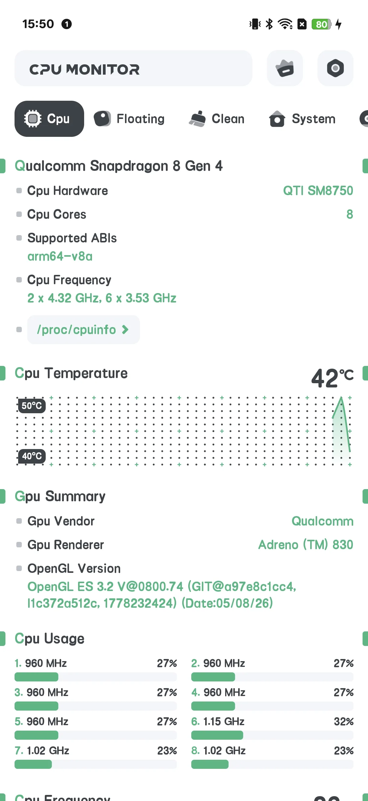
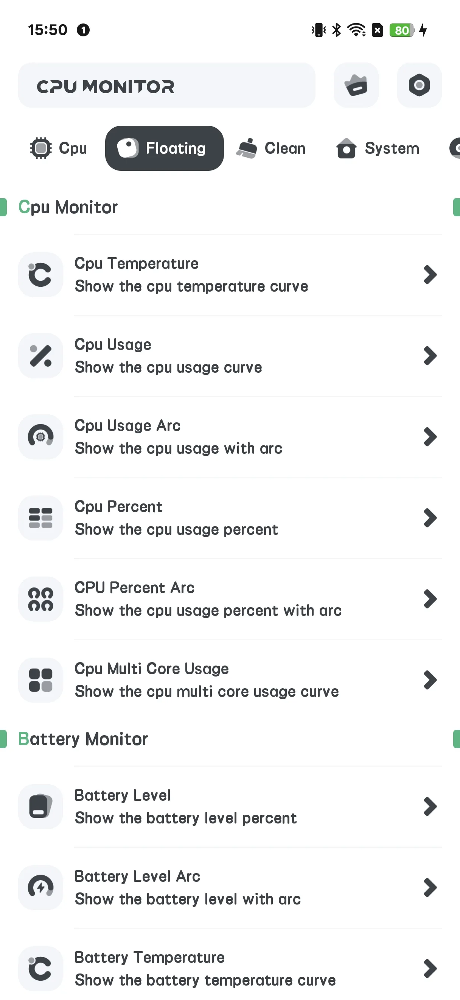
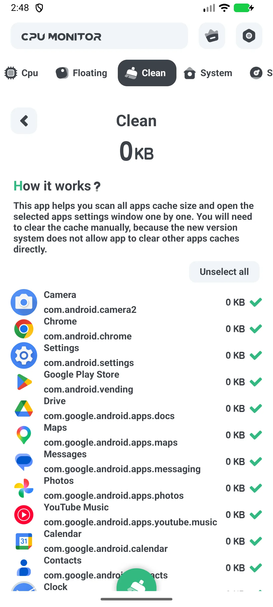
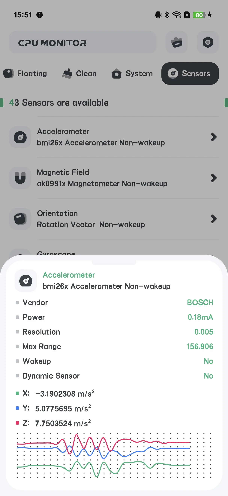
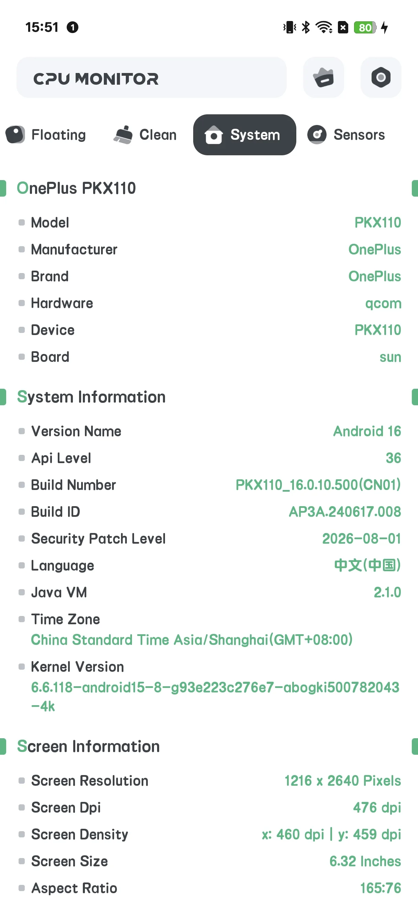

## สารบัญ

- [แนะนำแอป](#แนะนำแอป)
- [การใช้งานครั้งแรก](#การใช้งานครั้งแรก)
- [CPU เรียลไทม์](#cpu-เรียลไทม์)
- [หน้าต่างลอย](#หน้าต่างลอย)
- [วิดเจ็ตหน้าจอหลัก](#วิดเจ็ตหน้าจอหลัก)
- [การเตือนความร้อนเกิน](#การเตือนความร้อนเกิน)
- [เส้นโค้งประวัติ](#เส้นโค้งประวัติ)
- [อัปเกรดเป็น Pro](#อัปเกรดเป็น-pro)
- [การตั้งค่า](#การตั้งค่า)
- [สถานการณ์ทั่วไป](#สถานการณ์ทั่วไป)
- [คำถามที่พบบ่อย](#คำถามที่พบบ่อย)

## แนะนำแอป

CPU Monitor คือเครื่องมือ **อ่านอย่างเดียว** ที่แสดง **อุณหภูมิ [CPU](/th/glossary/what-is-a-cpu-temperature-monitor/) และความถี่เรียลไทม์ RAM แบตเตอรี่ และพื้นที่จัดเก็บ** บน Android พร้อมหน้าต่างลอย วิดเจ็ต การเตือนความร้อนเกิน และเส้นโค้งประวัติ โดยอ่านเซ็นเซอร์ความร้อนและตัวนับระบบโดยไม่ต้อง root และไม่เปลี่ยนข้อมูลเกมหรือการตั้งค่าระบบ คู่มือนำทางจากการเปิดครั้งแรกผ่านหน้าต่างลอย ขอบเขต **แอปการเตือนความร้อนเกิน CPU** เส้นโค้ง **ตัวตรวจสอบประวัติความถี่ CPU** เลย์เอาต์หน้าจอหลัก **วิดเจ็ต CPU RAM แบตเตอรี่ Android** และหน้าจอทำความสะอาดแคช — อธิบายความหมายของตัวเลข แทนสัญญาการลดอุณหภูมิ

**📈 การตรวจสอบเรียลไทม์**
- อุณหภูมิและความถี่ CPU การใช้งานต่อคอร์
- สถิต RAM แบตเตอรี่ และพื้นที่จัดเก็บในที่เดียว

**🧹 ทำความสะอาด**
- หน้าจอ **CLEAN** แสดงแคช/ขยะแอปและให้คุณลบออก

**🌡 การเตือนความร้อนเกิน**
- แจ้งก่อนความร้อนทำลายประสิทธิภาพหรือแบตเตอรี่

**📉 ประวัติ**
- เส้นโค้งอุณหภูมิ/ความถี่เพื่อหาสิ่งที่ดันความร้อนคุณพุ่ง

**💲 ฟรี + Pro**
- เวอร์ชันฟรี **มีโฆษณา**
- **Pro** ลบโฆษณาและปลดล็อกชุดเครื่องมือ "Powerful System Monitor"

## การใช้งานครั้งแรก

CPU Monitor เปิดมาที่หน้าจอหลักที่มี 4 แท็บคือ **CPU / SYSTEM / FLOATING / SENSOR** พร้อมปุ่ม **Upgrade** ด้านบน ไม่ต้องตั้งค่าหรือลงทะเบียนก่อนใช้งาน หน้าจอแต่ละแท็บแสดงอุณหภูมิ สถิตระบบ โอเวอร์เลย์ลอย และค่าอ่านเซ็นเซอร์ตามลำดับ คู่มือนี้จะพาไปทีละแท็บ

{: width="180" .normal }
{: width="180" .normal }
{: width="180" .normal }
{: width="180" .normal }
{: width="180" .normal }

## CPU เรียลไทม์

CPU Monitor แสดงอุณหภูมิ CPU และความถี่แบบเรียลไทม์ในแท็บ CPU พร้อมภาระต่อคอร์ บน Android หน้าจอนี้เป็นจุดอ่านตัวเลขหลักของแอป และเวอร์ชันฟรีแสดงโฆษณาแบนเนอร์ที่นี่ ข้อมูลที่เห็นเป็นค่าอ่านเซ็นเซอร์และตัวนับระบบแบบอ่านอย่างเดียว ไม่ได้มีการปรับแต่งหรือทำความสะอาดใดๆ

1. เปิดแท็บ **CPU**
2. อ่านอุณหภูมิ CPU ความถี่ และภาระต่อคอร์เรียลไทม์
3. เวอร์ชันฟรีแสดงโฆษณาแบนเนอร์ที่นี่

## หน้าต่างลอย

CPU Monitor ให้หน้าต่างลอยเหนือแอปใดๆ ผ่านแท็บ FLOATING ซึ่งมีตัวตรวจสอบให้เลือกหลายแบบ ได้แก่ อุณหภูมิ CPU การใช้งาน arc แบตเตอรี่ FPS RAM และ System Monitor การเปิดใช้งานต้องได้รับสิทธิ์โอเวอร์เลย์จากระบบก่อน หลังให้สิทธิ์แล้วสถิตเรียลไทม์จะลอยแสดงเหนือเกมหรือแอปอื่นโดยไม่ต้องสลับไปมา

1. เปิดแท็บ **FLOATING**
2. สลับตัวตรวจสอบ (อุณหภูมิ CPU/การใช้งาน/arc แบตเตอรี่ FPS RAM System Monitor)
3. ให้สิทธิ์โอเวอร์เลย์เมื่อถูกขอ
4. สถิตเรียลไทม์ลอยเหนือแอปใดๆ

## วิดเจ็ตหน้าจอหลัก

CPU Monitor มีชุดวิดเจ็ตเฉพาะ CPU ในแกลเลอรีวิดเจ็ตที่เข้าถึงได้จากการตั้งค่า ผู้ใช้วางวิดเจ็ตอุณหภูมิหรือการใช้งาน CPU บนหน้าจอหลักเพื่อดูตัวเลขแบบเหลียวเดียวโดยไม่ต้องเปิดแอป วิดเจ็ตเหล่านี้เป็นส่วนหนึ่งของชุดเครื่องมือที่แอปให้มาและทำงานร่วมกับหน้าต่างลอย

1. เปิด **การตั้งค่า → แกลเลอรีวิดเจ็ต** (ชุด CPU-only)
2. วางวิดเจ็ตอุณหภูมิ/การใช้งาน CPU บนหน้าจอหลัก

## การเตือนความร้อนเกิน

CPU Monitor มีการเตือนความร้อนเกินที่ตั้งค่าได้จากเมนูการตั้งค่า โดยแยกสวิตช์สำหรับ CPU และแบตเตอรี่พร้อมกำหนดขอบเขตอุณหภูมิเอง เมื่อความร้อนถึงจุดที่ตั้งไว้แอปจะแจ้งเตือนก่อนที่สถานการณ์จะทำลายประสิทธิภาพหรือแบตเตอรี่ ฟีเจอร์นี้ทำงานฟรีในเวอร์ชันพื้นฐานและเป็นหนึ่งในเหตุผลหลักที่เลือกใช้แอปนี้ตรวจสอบความร้อน

1. เปิด **การตั้งค่า → การเตือนความร้อนเกิน**
2. สลับการเตือน CPU และ/หรือแบตเตอรี่และตั้งขอบเขต
3. คุณจะถูกเตือนก่อนสถานการณ์ทำลาย

## เส้นโค้งประวัติ

CPU Monitor บันทึก **เส้นโค้งอุณหภูมิและความถี่** ตามเวลาในมุมมองลอยและประวัติ เพื่อให้เห็นจุดที่ความร้อนพุ่งขึ้น แผนภาพนี้มีประโยชน์ในการตามหาว่าเกมหรือแอปไหนเป็นตัวกระตุ้น จากนั้นผู้ใช้สามารถปิดแอปนั้นหรือปรับการใช้งานได้ทันเวลาก่อนความร้อนส่งผลต่อแบตเตอรี่

## อัปเกรดเป็น Pro

CPU Monitor มีหน้าจอ Pro ที่ปลดล็อกด้วยการแตะ **Upgrade** และให้ชุดเครื่องมือ "Powerful System Monitor" ซึ่งลบโฆษณาทั้งหมดและเปิดฟีเจอร์ทั้งหมดสำหรับผู้ใช้ชำนาญ ฟรีแอปแสดงโฆษณาและมีฟีเจอร์พื้นฐานครบ การอัปเกรดจึงเป็นทางเลือกสำหรับผู้ที่ต้องการเครื่องมือเจาะลึกและประสบการณ์ไม่มีโฆษณา

## การตั้งค่า

CPU Monitor รวมการตั้งค่าหลักไว้ในหน้าเดียวครอบคลุม Upgrade ธีม การเตือนความร้อนเกิน หน่วยอุณหภูมิ ระดับการรีเฟรช และแกลเลอรีวิดเจ็ต ผู้ใช้จึงปรับทั้งการแสดงผลและพฤติกรรมการแจ้งเตือนได้จากที่เดียวโดยไม่ต้องออกจากแอป

## สถานการณ์ทั่วไป

CPU Monitor ครอบคลุม 5 สถานการณ์ตรวจสอบความร้อนได้แก่ การดูความร้อนขณะเล่นเกมด้วยโอเวอร์เลย์แท็บ FLOATING ที่แสดงอุณหภูมิ CPU และแบตเตอรี่เหนือเกม การจับจุดร้อนขณะชาร์จด้วยวิดเจ็ตหน้าจอหลักและการเตือนความร้อนเกิน การหาสาเหตุจากเส้นโค้งประวัติหลังเซสชันร้อน การทำความสะอาดด่วนด้วยหน้าจอ CLEAN เมื่อเครื่องช้า และการปิดโฆษณาด้วย Upgrade เพื่อปลดล็อกชุด Powerful System Monitor เต็ม

- **ดูความร้อนขณะเล่นเกม** — เปิดแท็บ FLOATING ให้โอเวอร์เลย์ และอุณหภูมิ CPU/แบตเตอรี่ลอยเหนือเกม เพื่อคุณหยุดพักก่อน throttling
- **จับจุดร้อนขณะชาร์จ** — วางวิดเจ็ต CPU หน้าจอหลักและตั้งการเตือนความร้อนเกิน แล้วคุณถูกเตือนเมื่อแบตเตอรี่ร้อน
- **หาสาเหตุ** — เปิดเส้นโค้งประวัติหลังเซสชันร้อน เพื่อดูแอปไหนดันอุณหภูมิขึ้น
- **ทำความสะอาดด่วน** — ใช้หน้าจอ CLEAN เพื่อลบแคช/ขยะแอปเมื่อโทรศัพท์รู้สึกช้า
- **ปิดโฆษณา** — แตะ Upgrade เพื่อลบโฆษณาและปลดล็อกชุดเครื่องมือ Powerful System Monitor เต็ม

## คำถามที่พบบ่อย

### CPU Monitor เหมือนกับ System Monitor ไหม?
{:.faq-q}
พวกเขาแชร์โค้ดกัน แต่ CPU Monitor เพิ่มหน้าจอ **CLEAN** (แคช) และอัปเกรด Pro; System Monitor อ่านอย่างเดียวโดยไม่มีการทำความสะอาด

### ทำไมฉันถึงเห็นโฆษณา?
{:.faq-q}
เวอร์ชันฟรีมีโฆษณา อัปเกรดเป็น Pro เพื่อลบออก

## สรุป

CPU Monitor คือชุดเครื่องมือการตรวจสอบเรียลไทม์ที่ลงตัว — อุณหภูมิเรียลไทม์ การเตือนความร้อนเกิน สถิตลอย วิดเจ็ต และเส้นโค้งประวัติ — พร้อมตัวทำความสะอาดแคชเป็นโบนัส

## ศัพท์ที่เกี่ยวข้อง

- [ตัวตรวจสอบอุณหภูมิ CPU คืออะไร?](/th/glossary/what-is-a-cpu-temperature-monitor/)
- [ตัวตรวจสอบระบบคืออะไร?](/th/glossary/what-is-a-system-monitor/)
