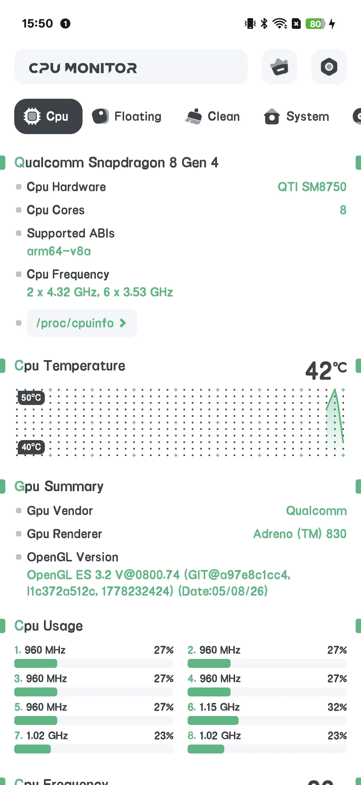
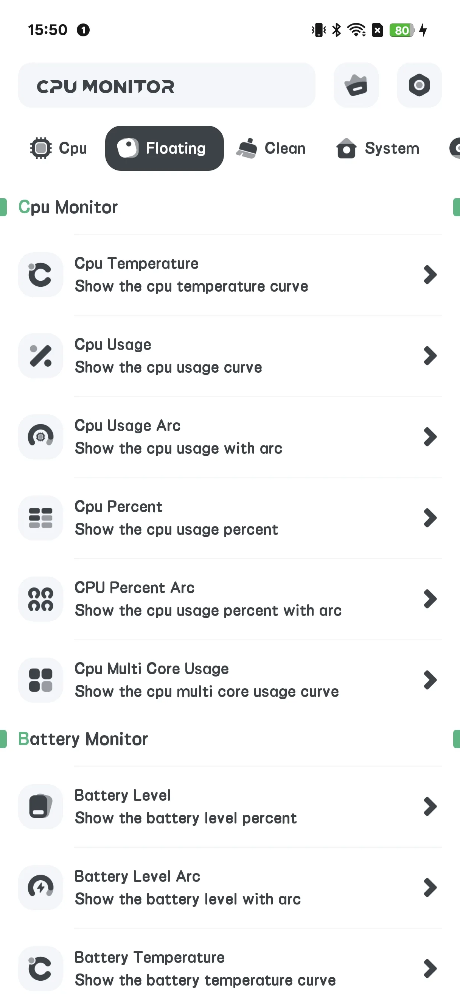
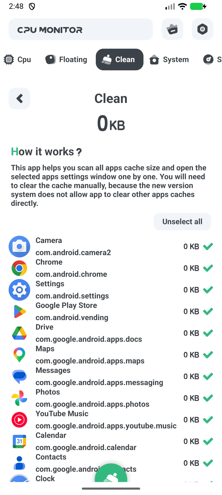
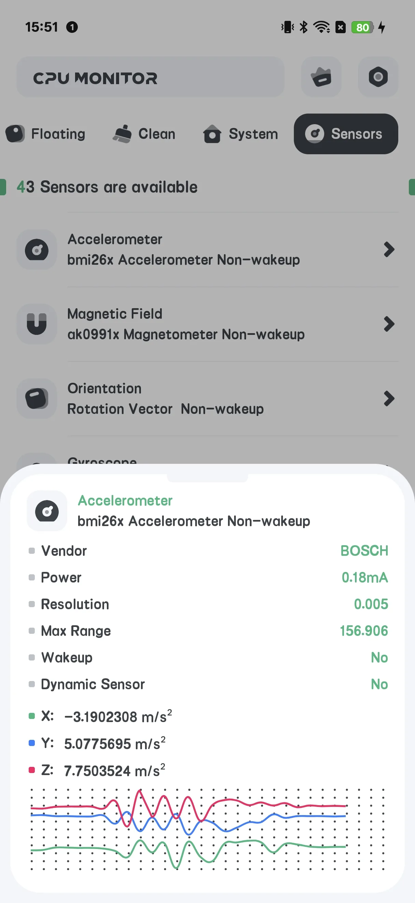
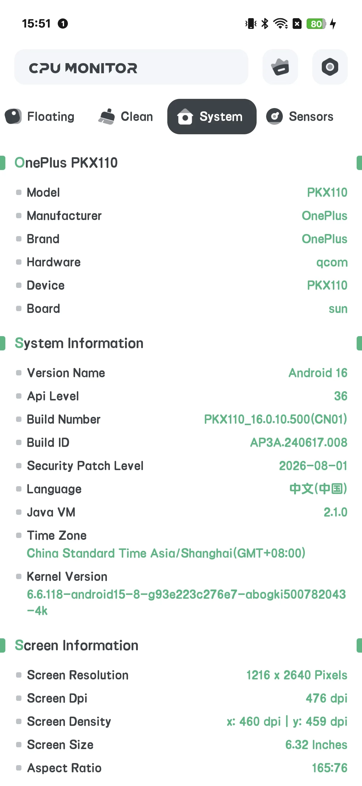

## สารบัญ

- [แนะนำแอป](#แนะนำแอป)
- [การใช้งานครั้งแรก](#การใช้งานครั้งแรก)
- [CPU เรียลไทม์](#cpu-เรียลไทม์)
- [หน้าต่างลอย](#หน้าต่างลอย)
- [วิดเจ็ตหน้าจอหลัก](#วิดเจ็ตหน้าจอหลัก)
- [การเตือนความร้อนเกิน](#การเตือนความร้อนเกิน)
- [เส้นโค้งประวัติ](#เส้นโค้งประวัติ)
- [อัปเกรดเป็น Pro](#อัปเกรดเป็น-pro)
- [การตั้งค่า](#การตั้งค่า)
- [สถานการณ์ทั่วไป](#สถานการณ์ทั่วไป)
- [คำถามที่พบบ่อย](#คำถามที่พบบ่อย)

## แนะนำแอป

CPU Monitor แสดง **อุณหภูมิ [CPU](/th/glossary/what-is-a-cpu-temperature-monitor/) และความถี่เรียลไทม์ RAM แบตเตอรี่ และพื้นที่จัดเก็บ** บน Android พร้อมหน้าต่างลอย วิดเจ็ต การเตือนความร้อนเกิน และเส้นโค้งประวัติ นี่คือเครื่องมือ **อ่านอย่างเดียว**: มันอ่านเซ็นเซอร์ความร้อนและตัวนับระบบโดยไม่ต้อง root และไม่เปลี่ยนข้อมูลเกมหรือการตั้งค่าระบบ คู่มือนำทางจากการเปิดครั้งแรกผ่านหน้าต่างลอย ขอบเขต **แอปการเตือนความร้อนเกิน CPU** เส้นโค้ง **ตัวตรวจสอบประวัติความถี่ CPU** เลย์เอาต์หน้าจอหลัก **วิดเจ็ต CPU RAM แบตเตอรี่ Android** และหน้าจอทำความสะอาดแคช — อธิบายความหมายของตัวเลข แทนสัญญาการลดอุณหภูมิ

**📈 การตรวจสอบเรียลไทม์**
- อุณหภูมิและความถี่ CPU การใช้งานต่อคอร์
- สถิต RAM แบตเตอรี่ และพื้นที่จัดเก็บในที่เดียว

**🧹 ทำความสะอาด**
- หน้าจอ **CLEAN** แสดงแคช/ขยะแอปและให้คุณลบออก

**🌡 การเตือนความร้อนเกิน**
- แจ้งก่อนความร้อนทำลายประสิทธิภาพหรือแบตเตอรี่

**📉 ประวัติ**
- เส้นโค้งอุณหภูมิ/ความถี่เพื่อหาสิ่งที่ดันความร้อนคุณพุ่ง

**💲 ฟรี + Pro**
- เวอร์ชันฟรี **มีโฆษณา**
- **Pro** ลบโฆษณาและปลดล็อกชุดเครื่องมือ "Powerful System Monitor"

## การใช้งานครั้งแรก

หน้าจอหลักมีแท็บ: **CPU / SYSTEM / FLOATING / SENSOR** พร้อมปุ่ม **Upgrade** ด้านบน

{: width="180" .normal }
{: width="180" .normal }
{: width="180" .normal }
{: width="180" .normal }
{: width="180" .normal }

## CPU เรียลไทม์

1. เปิดแท็บ **CPU**
2. อ่านอุณหภูมิ CPU ความถี่ และภาระต่อคอร์เรียลไทม์
3. เวอร์ชันฟรีแสดงโฆษณาแบนเนอร์ที่นี่

## หน้าต่างลอย

1. เปิดแท็บ **FLOATING**
2. สลับตัวตรวจสอบ (อุณหภูมิ CPU/การใช้งาน/arc แบตเตอรี่ FPS RAM System Monitor)
3. ให้สิทธิ์โอเวอร์เลย์เมื่อถูกขอ
4. สถิตเรียลไทม์ลอยเหนือแอปใดๆ

## วิดเจ็ตหน้าจอหลัก

1. เปิด **การตั้งค่า → แกลเลอรีวิดเจ็ต** (ชุด CPU-only)
2. วางวิดเจ็ตอุณหภูมิ/การใช้งาน CPU บนหน้าจอหลัก

## การเตือนความร้อนเกิน

1. เปิด **การตั้งค่า → การเตือนความร้อนเกิน**
2. สลับการเตือน CPU และ/หรือแบตเตอรี่และตั้งขอบเขต
3. คุณจะถูกเตือนก่อนสถานการณ์ทำลาย

## เส้นโค้งประวัติ

ในการแสดงลอย/ประวัติ คุณสามารถดู **เส้นโค้งอุณหภูมิและความถี่** ตามเวลา — มีประโยชน์เพื่อหาว่าเกมหรือแอปไหนดันความร้อนพุ่ง

## อัปเกรดเป็น Pro

แตะ **Upgrade** เพื่อปลดล็อกหน้าจอ Pro: "Powerful System Monitor" ลบโฆษณาทั้งหมดและปลดล็อกฟีเจอร์ทั้งหมด

## การตั้งค่า

การตั้งค่าครอบคลุม Upgrade ธีม การเตือนความร้อนเกิน หน่วยอุณหภูมิ ระดับการรีเฟรช และแกลเลอรีวิดเจ็ต

## สถานการณ์ทั่วไป

- **ดูความร้อนขณะเล่นเกม** — เปิดแท็บ FLOATING ให้โอเวอร์เลย์ และอุณหภูมิ CPU/แบตเตอรี่ลอยเหนือเกม เพื่อคุณหยุดพักก่อน throttling
- **จับจุดร้อนขณะชาร์จ** — วางวิดเจ็ต CPU หน้าจอหลักและตั้งการเตือนความร้อนเกิน แล้วคุณถูกเตือนเมื่อแบตเตอรี่ร้อน
- **หาสาเหตุ** — เปิดเส้นโค้งประวัติหลังเซสชันร้อน เพื่อดูแอปไหนดันอุณหภูมิขึ้น
- **ทำความสะอาดด่วน** — ใช้หน้าจอ CLEAN เพื่อลบแคช/ขยะแอปเมื่อโทรศัพท์รู้สึกช้า
- **ปิดโฆษณา** — แตะ Upgrade เพื่อลบโฆษณาและปลดล็อกชุดเครื่องมือ Powerful System Monitor เต็ม

## คำถามที่พบบ่อย

### CPU Monitor เหมือนกับ System Monitor ไหม?
{:.faq-q}
พวกเขาแชร์โค้ดกัน แต่ CPU Monitor เพิ่มหน้าจอ **CLEAN** (แคช) และอัปเกรด Pro; System Monitor อ่านอย่างเดียวโดยไม่มีการทำความสะอาด

### ทำไมฉันถึงเห็นโฆษณา?
{:.faq-q}
เวอร์ชันฟรีมีโฆษณา อัปเกรดเป็น Pro เพื่อลบออก

## สรุป

CPU Monitor คือชุดเครื่องมือการตรวจสอบเรียลไทม์ที่ลงตัว — อุณหภูมิเรียลไทม์ การเตือนความร้อนเกิน สถิตลอย วิดเจ็ต และเส้นโค้งประวัติ — พร้อมตัวทำความสะอาดแคชเป็นโบนัส

## ศัพท์ที่เกี่ยวข้อง

- [ตัวตรวจสอบอุณหภูมิ CPU คืออะไร?](/th/glossary/what-is-a-cpu-temperature-monitor/)
- [ตัวตรวจสอบระบบคืออะไร?](/th/glossary/what-is-a-system-monitor/)
