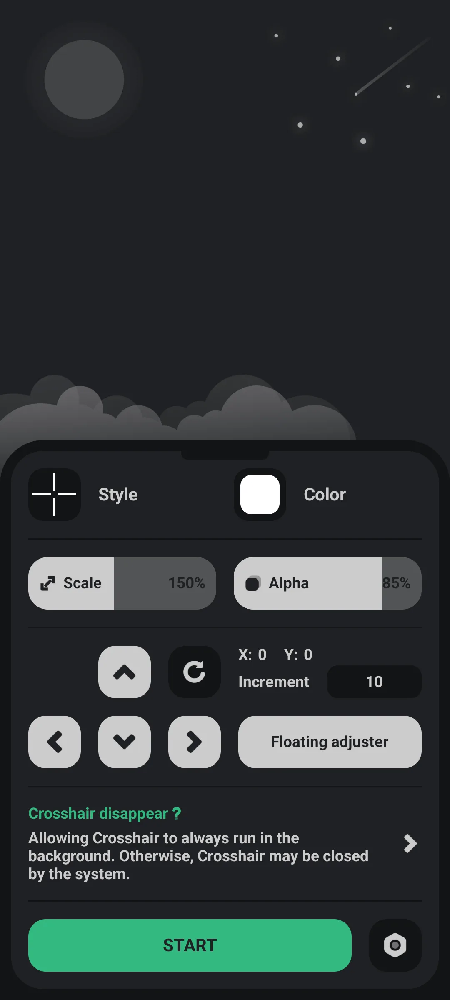
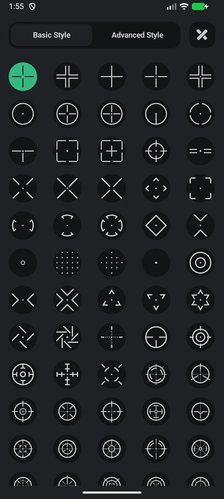
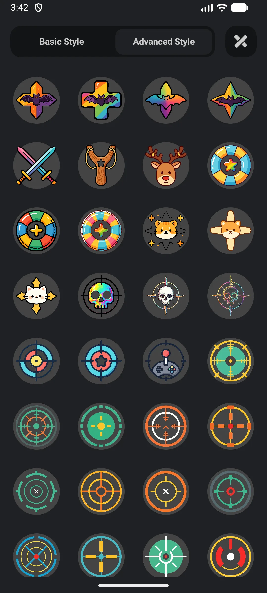
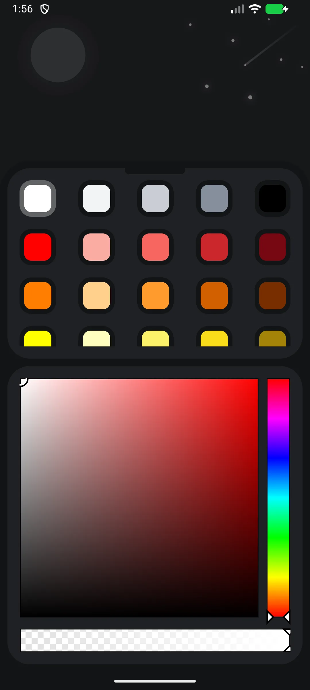
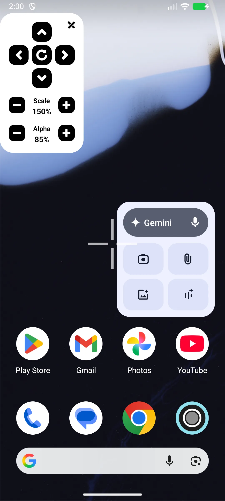

## สารบัญ

- [แนะนำแอป](#แนะนำแอป)
- [การใช้งานครั้งแรก](#การใช้งานครั้งแรก)
- [ให้สิทธิ์โอเวอร์เลย์](#ให้สิทธิ์โอเวอร์เลย์)
- [เลือกสไตล์ครอสแฮร์](#เลือกสไตล์ครอสแฮร์)
- [ปรับแต่งขนาด สี ตำแหน่ง](#ปรับแต่งขนาด-สี-ตำแหน่ง)
- [ใช้งานในเกม](#ใช้งานในเกม)
- [ปลดล็อกสไตล์เพิ่ม](#ปลดล็อกสไตล์เพิ่ม)
- [คำถามที่พบบ่อย](#คำถามที่พบบ่อย)

## แนะนำแอป

Crosshair (Crosshair Aim) เพิ่ม **[โอเวอร์เลย์ครอสแฮร์ที่กำหนดเอง](/th/glossary/what-is-a-crosshair/)** ให้เกม FPS บน Android ด้วย **ดีไซน์ 80+** เพื่อปรับปรุงการเล็งของคุณ — เครื่องมือ **custom crosshair Android** ฟรีที่ทำงานโดยไม่รูท

**🎯 สไตล์ 80+**
- **84 พื้นฐาน** (แบน) built-in
- **63 Pro** (ขั้นสูง) สไตล์
- ผู้ใช้ฟรีบันทึก ~30 สไตล์ถาวร; ที่เหลือปลดล็อกผ่านโฆษณารางวัล 24 ชั่วโมง หรือแอป Pro

**🛠 การปรับแต่ง**
- **สเกล** 50%–300%
- **อัลฟ่า** 30%–100%
- **สี**: 60 สี + ตัวเลือก
- **ตำแหน่ง**: ลากด้วยปุ่มลูกศร (ไม่มีสไลเดอร์ความหนา — ความหนาฝังอยู่ในแต่ละสไตล์)

**🔓 ไม่ต้องรูท ไม่ต้องการการช่วยเหลือพิเศษ**
- ต้องการเพียงสิทธิ์ **"วาดทับแอปอื่น"** (โอเวอร์เลย์)

> หมายเหตุ: ไม่มี **พรีเซ็ตต่อเกม** — แอปบันทึกการตั้งค่าครอสแฮร์ global เดียว

## การใช้งานครั้งแรก

เปิดแอปไปที่คอนโซลหลัก

- ปุ่ม **START/STOP** แสดง/ซ่อนครอสแฮร์
- แตะพื้นที่ **สไตล์** เพื่อเลือกดีไซน์ **สี** เพื่อเลือกสี และใช้สไลเดอร์ **สเกล/อัลฟ่า**
- วงล้อการตั้งค่าเปิดภาษา ค่า แชร์ และการอัปเกรด

{: width="180" .normal }

## ให้สิทธิ์โอเวอร์เลย์

1. แตะสวิตช์ครอสแฮร์ / START
2. หากถูกขอ ให้สิทธิ์ **"แสดงหน้าต่างป็อปอัป"** (วาดทับแอปอื่น)
3. แอปเปิดตั้งค่าระบบ → "วาดทับแอปอื่น"; เปิดใช้งานสำหรับ Crosshair
4. กลับไปที่แอป

สิทธิ์นี้ (ไม่ใช่การช่วยเหลือพิเศษ ไม่ใช่รูท) คือสิ่งที่ให้ครอสแฮร์นั่งเหนือเกม

## เลือกสไตล์ครอสแฮร์

1. แตะพื้นที่ **สไตล์** → หน้าจอ **สไตล์**
2. สลับแท็บ **พื้นฐาน** (กริด 5 คอลัมน์) / **ขั้นสูง** (กริด 4 คอลัมน์)
3. แตะรูปย่อเพื่อนำไปใช้
4. สไตล์ Pro ที่ล็อกอยู่ขอโฆษณารางวัลหรืออัปเกรด

{: width="180" .normal }
{: width="180" .normal }

## ปรับแต่งขนาด สี ตำแหน่ง

- **สเกล**: ลากสไลเดอร์สเกล (50%–300%)
- **อัลฟ่า**: ลากสไลเดอร์อัลฟ่า (30%–100%)
- **สี**: เปิด **สี** → เลือกจาก 60 สี หรือใช้ตัวเลือก
- **ตำแหน่ง**: ใช้ปุ่มลูกศรเพื่อเลื่อน; ตั้งขั้น (1–50 ค่าเริ่มต้น 10) ผ่านอินพุตขั้น; หรือลากแผงควบคุมบนจอขณะเล่น

ไม่มี **สไลเดอร์ความหนาอิสระ** — แต่ละสไตล์เรนเดอร์ล่วงหน้าแล้วมีความหนาของตัวเอง

{: width="180" .normal }

## ใช้งานในเกม

1. เปิดใช้งานครอสแฮร์ (START)
2. เปิดเกม FPS ของคุณ
3. ครอสแฮร์ลอยเหนือเกมและ **ไม่** สกัดการสัมผัส (ดังนั้นการแตะของคุณยังไปที่เกม)
4. แตะครอสแฮร์เพื่อเปิดแผงควบคุมลอย: ขนาด +/− อัลฟ่า +/− ลูกศร รีเซ็ต ปิด

{: width="180" .normal }

## ปลดล็อกสไตล์เพิ่ม

- **ฟรี**: ~30 สไตล์ถาวร + ดูโฆษณารางวัลเพื่อปลดล็อกสไตล์ที่ล็อกเป็นเวลา **24 ชั่วโมง**
- **Pro** (แอปแยก): ไม่มีโฆษณาและทั้ง 147 สไตล์ถาวร

## คำถามที่พบบ่อย

### ฉันต้องการรูทหรือการช่วยเหลือพิเศษไหม?
{:.faq-q}
ไม่ เพียงสิทธิ์โอเวอร์เลย์ (วาดทับแอปอื่น)

### ฉันสามารถบันทึกครอสแฮร์ต่างกันต่อเกมได้ไหม?
{:.faq-q}
ไม่ — แอปบันทึกการตั้งค่า global เดียว คุณเปลี่ยนเองตอนสลับเกม

### ฉันเปลี่ยนความหนาได้ไหม?
{:.faq-q}
ไม่แยกต่างหาก ความหนาเป็นส่วนหนึ่งของดีไซน์แต่ละสไตล์

## สรุป

Crosshair คือวิธีเบาที่สุดในการเพิ่มจุดเล็งแม่นยำและปรับแต่งได้ในเกมยิง Android ใดก็ได้ — โดยไม่รูท ไม่ต้องการการช่วยเหลือพิเศษ ด้วยสไตล์ 80+ และชั้นฟรีให้เริ่ม

## ศัพท์ที่เกี่ยวข้อง

- [ครอสแฮร์คืออะไร?](/th/glossary/what-is-a-crosshair/)
