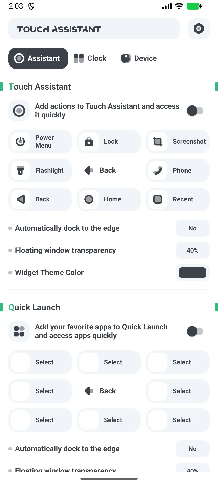
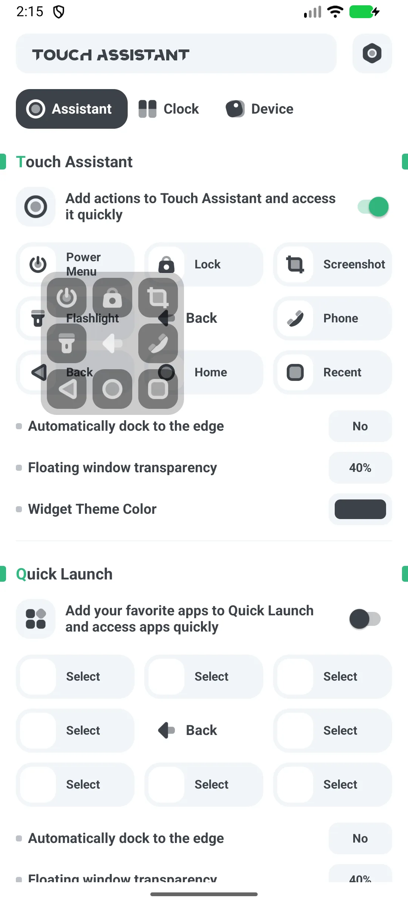
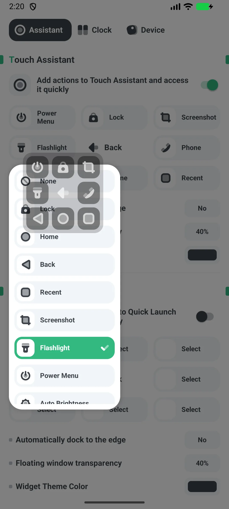

## สารบัญ

- [แนะนำแอป](#แนะนำแอป)
- [การใช้งานครั้งแรก](#การใช้งานครั้งแรก)
- [ให้สิทธิ์โอเวอร์เลย์และการช่วยเหลือพิเศษ](#ให้สิทธิ์โอเวอร์เลย์และการช่วยเหลือพิเศษ)
- [เปิดใช้งานและย้ายลูกบอล](#เปิดใช้งานและย้ายลูกบอล)
- [การกระทำของลูกบอล](#การกระทำของลูกบอล)
- [ทางลัดแอป](#ทางลัดแอป)
- [วิดเจ็ตสวิตช์ระบบ](#วิดเจ็ตสวิตช์ระบบ)
- [ขนาด สี Dock](#ขนาด-สี-dock)
- [การใช้มือเดียว](#การใช้มือเดียว)
- [ฟรี vs Pro](#ฟรี-vs-pro)
- [สถานการณ์ทั่วไป](#สถานการณ์ทั่วไป)
- [คำถามที่พบบ่อย](#คำถามที่พบบ่อย)

## แนะนำแอป

Floating Assistant เพิ่ม [ลูกบอลลอย](/th/glossary/what-is-a-floating-window/) ให้ Android สำหรับเปิดแอปด่วน สวิตช์ระบบ และการควบคุมมือเดียวบนโทรศัพท์ใหญ่ มันทำงานในฐานะ **แอปปุ่มลอยสำหรับมือเดียว android**: ลูกบอลเทียบท่าที่ขอบจอ ทุกช่องแมปใหม่ได้ และทางลัดครอบคลุมแอป ผู้ติดต่อ และสวิตช์ระบบ คู่มือนำทางจากการเปิดครั้งแรกผ่านการให้สิทธิ์โอเวอร์เลย์และการช่วยเหลือพิเศษ ย้ายและปรับขนาดลูกบอล มอบหมาย **ลูกบอลลอยพร้อมทางลัดที่กำหนดเอง** รวมถึงการแบ่งฟรี/Pro — พร้อมอธิบายว่าสิทธิ์เหล่านั้นอนุญาตและไม่อนุญาตอะไร

**🫳 ลูกบอลลอย**
- ลูกบอลที่ลากได้และคงอยู่เหนือแอปใดก็ได้ (โดยไม่รูท)
- ทดแทนปุ่มกายภาพผ่านบริการการช่วยเหลือพิเศษ

**⚡ 8 ช่องการกระทำ**
- 15 การกระทำที่เป็นไปได้: เมนูพลังงาน ล็อก จับภาพหน้าจอ ไฟฉาย โทร ย้อนกลับ หน้าหลัก แอปล่าสุด ความสว่างอัตโนมัติ หมุนอัตโนมัติ ระดับเสียง +/−/ปิดเสียง และอื่นๆ

**📱 ทางลัดแอป**
- 8 ช่องเปิดแอปที่ติดตั้งของคุณ (มีทางลัดโทรหรือผู้เรียก; **ไม่มีทางลัดผู้ติดต่อ**)

**🔧 วิดเจ็ตสวิตช์ระบบ**
- 11 วิดเจ็ตหน้าจอหลัก: Bluetooth ข้อมูลเซลลูลาร์ Wi-Fi ไฟฉาย หมุน เครื่องบิน Hotspot ห้ามรบกวน (DND) ตำแหน่ง สั่น โหมดมืด

**💲 ฟรี + Pro**
- ฟรีแสดงโฆษณา; **Pro** คือแอปแยกที่ไม่มีโฆษณา

## การใช้งานครั้งแรก

เปิดแอปไปที่หน้าจอหลักที่มีโปรโมทอัปเกรดด้านบนและสวิตช์ **"Home entry"**

- เปิด **Home entry** เพื่อแสดงลูกบอล
- วงล้อการตั้งค่าเปิดภาษา ค่า แชร์ และการอัปเกรด

{: width="180" .normal }

## ให้สิทธิ์โอเวอร์เลย์และการช่วยเหลือพิเศษ

1. เปิด **Home entry**
2. ให้สิทธิ์ **"วาดทับแอปอื่น"** เมื่อถูกขอ (ตั้งค่าระบบ)
3. ยอมรับ **การช่วยเหลือพิเศษ** เมื่อถูกขอ — การกระทำปุ่มลูกบอล (หน้าหลัก/ย้อนกลับ/แอปล่าสุด/ล็อก/จับภาพหน้าจอ) ต้องการมัน
4. อนุญาต **ละเว้นการเพิ่มประสิทธิภาพแบตเตอรี่** เพื่อลูกบอลไม่ถูกหยุด

สิทธิ์โอเวอร์เลย์ให้ลูกบอลวาดเหนือแอป; การช่วยเหลือพิเศษให้เรียกการกระทำทั่วไปได้

## เปิดใช้งานและย้ายลูกบอล

1. เปิดใช้งาน **Home entry**
2. ลูกบอลปรากฏ; **ลาก** เพื่อย้าย — มันเกาะขอบซ้ายหรือขวาอัตโนมัติ
3. ตำแหน่งถูกบันทึกเป็นเปอร์เซ็นต์หน้าจอ

{: width="180" .normal }

## การกระทำของลูกบอล

1. แตะลูกบอลเพื่อ **ขยาย** เป็น 8 ช่อง
2. แต่ละช่องเรียกการกระทำที่แมปไว้ (เมนูพลังงาน ล็อก จับภาพหน้าจอ ไฟฉาย โทร ย้อนกลับ หน้าหลัก แอปล่าสุด …)
3. แตะลูกบอลอีกครั้งเพื่อยุบ

ค่าเริ่มต้น: 1=เมนูพลังงาน 2=ล็อก 3=จับภาพหน้าจอ 4=ไฟฉาย 6=โทร 7=ย้อนกลับ 8=หน้าหลัก 9=แอปล่าสุด

## ทางลัดแอป

1. ตั้งค่าลูกบอลหรือวิดเจ็ต **ตัวเปิดแอป** ด้วยสูงสุด 8 ช่อง
2. ในแต่ละช่อง เลือกแอปที่ติดตั้ง
3. แตะเพื่อเปิด (หรือ Google Play หากยังไม่มี)

## วิดเจ็ตสวิตช์ระบบ

1. เพิ่ม **วิดเจ็ตสวิตช์** จากตัวเลือกวิดเจ็ต (11 ประเภท)
2. ตัวอย่าง:
   - **ไฟฉาย** สลับไฟฉายจริง
   - **Wi-Fi / Bluetooth / DND** เปิดหน้าจอตั้งค่าระบบของมัน
   - **หมุน** เขียนการตั้งค่าหมุนอัตโนมัติ
3. ใช้วิดเจ็ต **รวม** เพื่อจับกลุ่มสวิตช์หลายตัว

{: width="180" .normal }

## ขนาด สี Dock

- **ขนาด**: 5 ระดับ S/M/L/XL/XXL
- **ความโปร่งใส (alpha)**: ปรับได้ (ค่าเริ่มต้น ~40%)
- **สี**: ดำ / ขาว / เขียว / น้ำเงิน / เหลือง / ม่วง (ค่าเริ่มต้นดำ)
- **Dock**: เปิดหรือปิดควบคุมการเกาะขอบจออัตโนมัติ

## การใช้มือเดียว

ด้วยลูกบอลคุณทำ HOME / BACK / RECENTS / POWER-DIALOG / LOCK / SCREENSHOT ผ่านบริการการช่วยเหลือพิเศษ พลัสไฟฉาย ระดับเสียง และหมุนเหนือลูกบอล — จึงควบคุมโทรศัพท์ด้วยนิ้วหัวแม่มือโดยไม่ต้องเอื้อมปุ่มกายภาพ

## ฟรี vs Pro

- **ฟรี** แสดงโฆษณา (แบนเนอร์ + แทรกกลาง)
- **Pro** คือแอปแยก **ที่ไม่มีโฆษณา**; การอัปเกรดในแอปแค่เปิด Google Play ให้มัน

## สถานการณ์ทั่วไป

- **ตั้งค่าครั้งแรก** — เปิด Home entry ให้วาดทับแอปอื่นและการช่วยเหลือพิเศษครั้งเดียว แล้วลูกบอลคงอยู่เหนือทุกแอป
- **มือเดียวบนโทรศัพท์ใหญ่** — ลากลูกบอลไปขอบล่างเพื่อให้ ย้อนกลับ หน้าหลัก แอปล่าสุด และจับภาพหน้าจอ ลงตรงใต้นิ้วหัวแม่มือ
- **ล็อกโดยไม่มีปุ่มพลังงาน** — แมปช่องไปล็อกจอและประหยัดปุ่มกายภาพ
- **กระโดดแอปด่วน** — เติม 8 ช่องแอปด้วยแอปประจำวันเพื่อข้ามการไล่หาหน้าจอหลัก
- **สวิตช์โดยไม่คุ้ยเขี่ย** — วาง 11 วิดเจ็ตสวิตช์ระบบ (Wi-Fi ไฟฉาย DND…) บนหน้าจอหลักสำหรับควบคุมห่างแตะ

## คำถามที่พบบ่อย

### มีทางลัดผู้ติดต่อไหม?
{:.faq-q}
ไม่ การกระทำเดียวที่เกี่ยวกับคนคือทางลัด **โทรหรือผู้เรียก** ไม่มีทางลัดผู้ติดต่อ

### ฉันปัดลูกบอลได้ไหม?
{:.faq-q}
ท่าทางมีแค่ **แตะเพื่อขยาย แตะช่อง และลากเพื่อย้ายหรือ dock** ไม่มีการแมปปัดซ้ายหรือขวา

### ทำไมต้องการการช่วยเหลือพิเศษ?
{:.faq-q}
การกระทำปุ่มทั่วไป (หน้าหลัก/ย้อนกลับ/แอปล่าสุด/ล็อก/จับภาพหน้าจอ) ทำผ่านบริการการช่วยเหลือพิเศษ Android

## สรุป

Floating Assistant ทำให้โทรศัพท์ใหญ่สั่งการด้วยมือเดียวได้: ลูกบอลลอยสำหรับเปิดและการกระทำระบบ พลัสวิดเจ็ตสวิตช์ — ฟรีเริ่มต้น พร้อมแอป Pro ที่ไม่มีโฆษณา

## ศัพท์ที่เกี่ยวข้อง

- [Assistive Touch คืออะไร?](/th/glossary/what-is-assistive-touch/)
- [หน้าต่างลอยคืออะไร?](/th/glossary/what-is-a-floating-window/)
