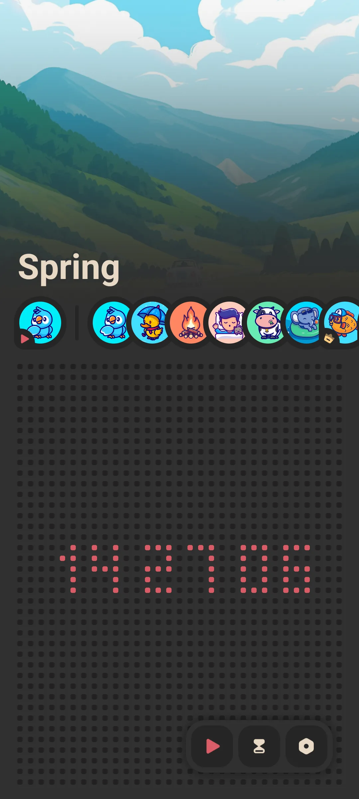
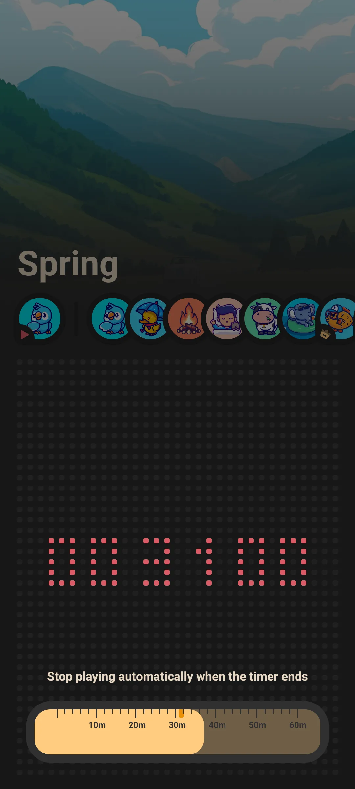
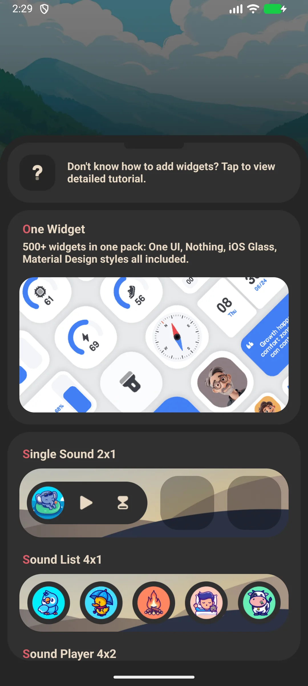

## สารบัญ

- [แนะนำแอป](#แนะนำแอป)
- [การใช้งานครั้งแรก](#การใช้งานครั้งแรก)
- [เล่นเสียงแอมเบียนต์](#เล่นเสียงแอมเบียนต์)
- [ตัวจับเวลานอน](#ตัวจับเวลานอน)
- [เล่นพื้นหลังและจอดับ](#เล่นพื้นหลังและจอดับ)
- [ธีม](#ธีม)
- [วิดเจ็ตหน้าจอหลัก](#วิดเจ็ตหน้าจอหลัก)
- [เสียงฟรีกับพรีเมียม](#เสียงฟรีกับพรีเมียม)
- [การตั้งค่า](#การตั้งค่า)
- [สถานการณ์ทั่วไป](#สถานการณ์ทั่วไป)
- [คำถามที่พบบ่อย](#คำถามที่พบบ่อย)

## แนะนำแอป

Meow FM คือแอป [ไวต์นอยส์](/th/glossary/what-is-white-noise/) ธีมแมวสำหรับนอน ผ่อนคลาย และโฟกัส เล่นเสียงแอมเบียนต์สงบเพื่อหลับเร็วขึ้น โฟกัสนานขึ้น หรือกลบห้องที่เสียงดัง นี่คือเครื่องเล่น **ไวต์นอยส์ออฟไลน์**: คลังเสียงอยู่ในเครื่อง จึง **ไวต์นอยส์สำหรับบดบังเสียง** ยังทำงานบนเครื่องบินหรือจอดับ คู่มือนี้พาคุณจากการเล่นครั้งแรกผ่าน **ไวต์นอยส์พร้อมตัวจับเวลา** ซ้อนแทร็กแบบ **แอปเสียงฝน** ใต้เสียงกระซิบต่ำของ **แอปบราวน์นอยส์** และวิดเจ็ตหน้าจอหลัก — ทั้งหมดจาก **แอปไวต์นอยส์แมว** ที่ไม่ต้องบัญชี

**🌧 เสียงแอมเบียนต์**
- คลังเสียง **15+**: ฝน พายุฝนฟ้าคะนอง ป่า เตาผิง ลม ริมทะเล คืนฤดูร้อน และอื่นๆ
- เรียกดูรายการเสียงแนวนอนแล้วแตะเพื่อเล่น

**⏲ ตัวจับเวลานอน**
- สไลเดอร์ตัวจับเวลา **0 ถึง 60 นาที**; เล่นหยุดอัตโนมัติเมื่อถึง จึงไม่รันจนเช้า

**🔇 ออฟไลน์**
- เสียงทุกเสียงเล่นโดยไม่มีเครือข่าย — ดีบนเครื่องบิน การเดินทาง และ Wi-Fi โรงแรมที่แกว่ง

**🎨 เรียบง่าย**
- ธีมสว่าง / มืด
- ฟรีเริ่มต้น; ปลดล็อกครั้งเดียวเปิดฉากเสียงพรีเมียม

> หมายเหตุ: Meow FM เล่น **เสียงเดียวในเวลาหนึ่ง** (ไม่มีชั้น/มิกเซอร์เพื่อรวมเสียงหลายเสียง) เลือกฉากที่เข้ากับช่วงเวลา

## การใช้งานครั้งแรก

หน้าแรกคือหน้าเดียว: ชิปเสียงที่เลือกพร้อมรายการเลื่อนเสียงทั้งหมด

- แตะเสียงเพื่อเล่น
- แตะอีกครั้งเพื่อหยุด
- ใช้สไลเดอร์ตัวจับเวลาเพื่อตั้งหยุดอัตโนมัติ

{: width="180" .normal }

## เล่นเสียงแอมเบียนต์

1. ที่หน้าแรก เลื่อนรายการเสียง
2. แตะเสียง (เช่น **ฝน** หรือ **พายุฝนฟ้าคะนอง**)
3. เริ่มเล่นทันทีและชิปอัปเดต
4. แตะเสียงเดิมอีกครั้งเพื่อหยุด หรือแตะอันอื่นเพื่อสลับ

การเล่นรันต่อขณะคุณใช้แอปอื่นหรือล็อกจอ

## ตัวจับเวลานอน

1. ลาก **สไลเดอร์ตัวจับเวลา** จาก 0 ถึง 60 นาที
2. เล่นหยุดอัตโนมัติเมื่อตัวจับเวลาเป็นศูนย์
3. ตั้งก่อนหลับเพื่อเสียงไม่รันตลอดคืน

{: width="180" .normal }

## เล่นพื้นหลังและจอดับ

Meow FM ใช้บริการเล่นพื้นหลังแนวหน้า จึงเสียงรันต่อตอนจอดับและไม่พึ่งเซิร์ฟเวอร์ นี่คือฟีเจอร์สำคัญสำหรับนอนและโฟกัส

## ธีม

เปิด **การตั้งค่า** และสลับระหว่างโหมด **สว่าง** และ **มืด** (โหมดมืดเปิดตามค่าเริ่มต้น)

## วิดเจ็ตหน้าจอหลัก

Meow FM ให้วิดเจ็ตสามแบบที่คุณวางบนหน้าจอหลัก:

- **เสียงเดี่ยว** — เล่นเสียงที่เลือกแตะเดียว
- **รายการเสียง** — เข้าถึงด่วนเสียงหลายเสียง
- **เครื่องเล่นเสียง / ปก** — วิดเจ็ตเครื่องเล่น

เพิ่มจากตัวเลือกวิดเจ็ต แล้วตั้งค่าเสียงในตั้งค่ากวิดเจ็ต

{: width="180" .normal }

## เสียงฟรีกับพรีเมียม

- ชุดเสียง **ฟรี** ให้เล่น
- **ฉากพรีเมียม** เพิ่มเติมปลดล็อกผ่าน **ซื้อครั้งเดียว** (ไม่ต้องสมาชิก)

## การตั้งค่า

การตั้งค่าครอบคลุมธีม (สว่าง/มืด) โปรโมทข้ามครอบครัว Meow และตัวเลือกบิล / กู้คืน

## สถานการณ์ทั่วไป

- **นอนคืนเสียงดัง** — แตะฉากฝนหรือพายุ ตั้งตัวจับเวลา 60 นาที และเสียงกลบคนรักที่กรนก่อนปิดตัวเอง
- **โฟกัสบนโต๊ะ** — เล่นเตาผิงหรือริมทะเลและปล่อยจอดับ; บริการพื้นหลังรันตลอดบล็อกงาน
- **เดินทางไร้สัญญาณ** — เสียงทุกเสียงถูกบรรจุ จึงไม่มีอะไรขัดขวางช่วงเวลาสงบ
- **แตะเดียวจากวิดเจ็ต** — วางวิดเจ็ตเสียงเดี่ยวบนหน้าจอหลักและเริ่มฉากโดยไม่เปิดแอป

## คำถามที่พบบ่อย

### ฉันผสมฝน + ฟ้าร้องพร้อมกันได้ไหม?
{:.faq-q}
ไม่ในแอปตอนนี้ — มันเล่นเสียงเดียวในเวลาหนึ่ง เลือกฉากเดียวที่เข้ากับที่สุด (เช่น พายุฝนฟ้าคะนองรวมฝนและฟ้าร้องแล้ว)

### ต้องใช้เน็ตไหม?
{:.faq-q}
ไม่ ทุกเสียงถูกบรรจุและเล่นออฟไลน์เต็มรูปแบบ

### จะหยุดอัตโนมัติได้อย่างไร?
{:.faq-q}
ใช้ตัวจับเวลานอน (0–60 นาที); เล่นหยุดที่ศูนย์

## สรุป

Meow FM คือวิธีเรียบง่ายที่สุดในการเพิ่มเสียงแอมเบียนต์สงบให้การนอนหรือโฟกัส — ฟรีเริ่มต้น ออฟไลน์เต็มรูปแบบ พร้อมตัวจับเวลานอนที่ปิดตัวเอง

[หน้าแอป Meow FM](/th/apps/meow-fm/) — มีให้สำหรับ Android และ iOS

## ศัพท์ที่เกี่ยวข้อง

- [ไวต์นอยส์คืออะไร?](/th/glossary/what-is-white-noise/)
