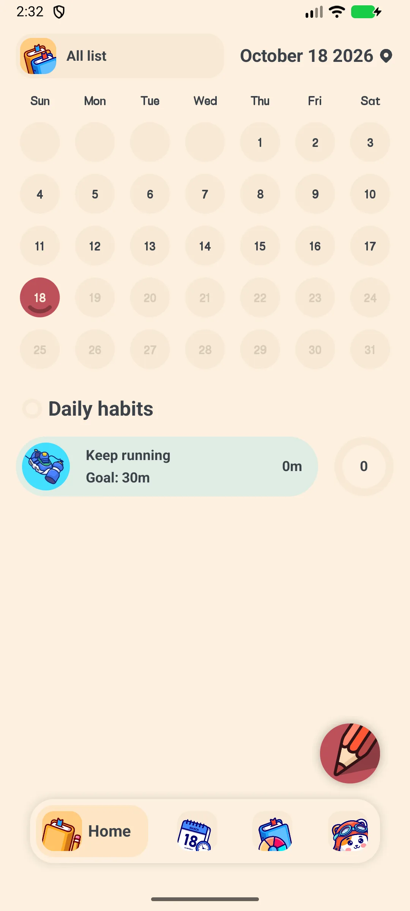
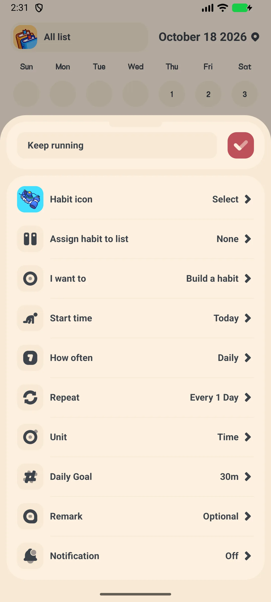
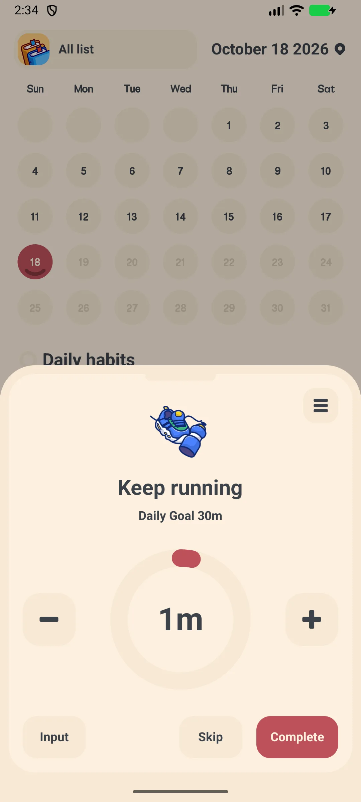
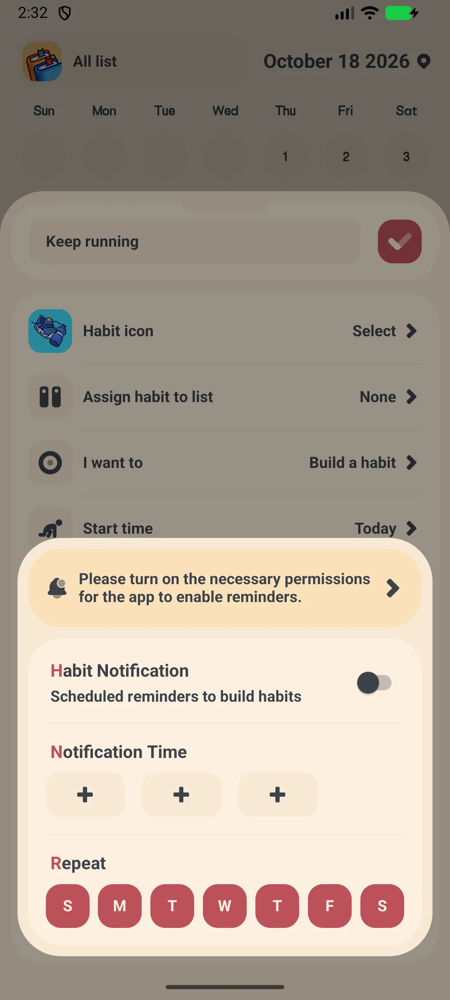
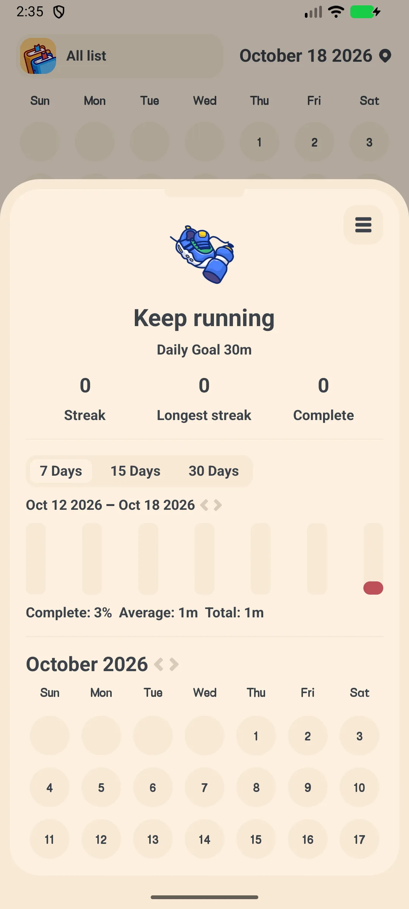

## สารบัญ

- [การแนะนำแอป](#การแนะนำแอป)
- [การใช้งานครั้งแรก](#การใช้งานครั้งแรก)
- [การเพิ่มนิสัย](#การเพิ่มนิสัย)
- [เช็คอินรายวัน](#เช็คอินรายวัน)
- [การเตือน](#การเตือน)
- [สเตรกและเทรนด์](#สเตรกและเทรนด์)
- [แก้ไข เก็บถาวร หรือลบ](#แก้ไข-เก็บถาวร-หรือลบ)
- [สำรองและส่งออก](#สำรองและส่งออก)
- [การตั้งค่า](#การตั้งค่า)
- [สถานการณ์ทั่วไป](#สถานการณ์ทั่วไป)
- [คำถามที่พบบ่อย](#คำถามที่พบบ่อย)

## การแนะนำแอป

Meow Habits คือ **[แอปติดตามนิสัย](/th/glossary/what-is-a-habit-tracker/)** น่ารักและเครื่องมือสร้างกิจวัตรสำหรับ Android และ iOS สร้างนิสัยดีและเลิกนิสัยเสียด้วยสเตรก กราฟ และแผนที่ความร้อนปฏิทิน แอปนี้ทำงานเป็น **ตัวติดตามนิสัยไม่ต้องบัญชี** และ **แอปติดตามนิสัยออฟไลน์**: การบันทึกไม่ต้องสมัครหรือสัญญาณ และ **ตัวติดตามนิสัยพร้อมส่งออก CSV** รวมถึง **ตัวติดตามนิสัยพร้อมสำรอง WebDav** รักษาประวัติให้เป็นของคุณ คู่มือการใช้แอปติดตามนิสัยนี้พาคุณจากการเปิดครั้งแรก ผ่าน **ตัวติดตามนิสัยพร้อมวิดเจ็ต** และ **ตัวติดตามนิสัยพร้อมการเตือน** จนถึงการอ่านเทรนด์ของคุณเอง

**🐱 ไอคอนการ์ตูนน่ารัก 500+**
- ตัวเลือกไอคอนประมาณ **590 ไอคอน** ใน **14 หมวดหมู่**
- เลือกไอคอนและสีสำหรับแต่ละนิสัย

**🔥 สเตรกและกราฟ**
- สเตรกและอัตราความสำเร็จต่อนิสัย
- มุมมองแท่ง พาย และปฏิทิน (แผนที่ความร้อน) สำหรับความคืบหน้าของคุณ

**🔁 วัฏจักรยืดหยุ่น**
- รายวัน รายสัปดาห์ รายเดือน หรือวันเฉพาะ (เช่น จ.พุธ.ศุกร์)
- กฎกำหนดเอง "ทุก N วัน/สัปดาห์"

**☁️ ส่วนตัว**
- ออฟไลน์โดยปริยาย; สำรอง Google Drive / WebDav เลือกได้
- ส่งออก CSV (VIP)

## การใช้งานครั้งแรก

แอปเปิดที่แท็บ **หน้าแรก** ซึ่งแสดงนิสัยวันนี้และปฏิทินรายเดือน

- แท็บล่าง: **หน้าแรก** **นิสัย** **เทรนด์** **การตั้งค่า**
- แตะ **+** เพื่อเพิ่มนิสัยแรก (เวอร์ชันฟรีสูงสุด **5 นิสัย**; VIP ปลดล็อกไม่จำกัด)

{: width="180" .normal }

## การเพิ่มนิสัย

1. แตะ **+** ที่แท็บหน้าแรก
2. เลือก **เทมเพลต** หรือเริ่มว่างเปล่า → เปิด **เพิ่มนิสัย**
3. ป้อน **ชื่อ**
4. แตะ **ไอคอน** เพื่อเปิดตัวเลือกไอคอน (≈590 ไอคอน 14 หมวดหมู่)
5. เลือก **หนังสือ (รายการ)** และ **ประเภท**
6. กำหนด **เป้าหมาย** (เช่น จำนวนหรือระยะเวลา)
7. ตั้ง **วัฏจักร**: รายวัน / รายสัปดาห์ / รายเดือน / วันเฉพาะ รวมถึงช่วง "ทุก N" หากต้องการ
8. กำหนด **วันที่เริ่ม**
9. แตะ **ยืนยัน**

{: width="180" .normal }

## เช็คอินรายวัน

1. ที่แท็บหน้าแรกหรือนิสัย แตะนิสัยหนึ่งเพื่อเปิดหน้าจอ **เช็คอิน**
2. วงแสดงความคืบหน้าใหญ่แสดงเป้าหมายวันนี้
3. ใช้ **+ / −** เพื่อเปลี่ยนจำนวน, **ป้อน** เพื่อพิมพ์ค่า, **ข้าม** เพื่อข้าม, หรือ **เสร็จ** เพื่อจบ
4. เมนูจุดสามจุดมี เทรนด์ / การแจ้งเตือน / บันทึก / แก้ไข / เก็บถาวร / ลบ

{: width="180" .normal }

## การเตือน

1. เปิดนิสัยและแตะตัวเลือกการเตือน (ระฆัง)
2. เปิดการเตือนรายวัน
3. เลือกหนึ่งใน **ชิปเวลา 3 อัน** และกำหนดวัน (อา–ส) ที่ใช้ได้
4. แอปเตือนคุณให้เช็คอิน

{: width="180" .normal }

## สเตรกและเทรนด์

1. เปิดนิสัย → **รายละเอียด** เพื่อดูตัวเลขสเตรก แท่งประวัติ และแผนที่ความร้อนปฏิทิน
2. สลับไปแท็บ **เทรนด์** สำหรับกราฟและความสำเร็จ

{: width="180" .normal }

## แก้ไข เก็บถาวร หรือลบ

จากเมนูจุดสามจุดในหน้าจอเช็คอิน คุณสามารถ **แก้ไข** **เก็บถาวร** (ประวัติคงอยู่แต่ซ่อน) หรือ **ลบ** นิสัยได้

## สำรองและส่งออก

- **การตั้งค่า → Google Drive / WebDav** เพื่อสำรองและกู้คืน
- **การตั้งค่า → ส่งออก** ให้คุณเลือกนิสัย กำหนดช่วงวันที่ และแชร์ **CSV**

## การตั้งค่า

การตั้งค่าครอบคลุมแบนเนอร์ VIP **โหมดมืด** **ภาษา** **วันเริ่มต้นสัปดาห์** **ล็อกแอป** (VIP) เสียง การแจ้งเตือน **วิดเจ็ต** รายการ นิสัย **ส่งออก** (VIP) Google Drive WebDav และส่วนครอบครัว Meow

## สถานการณ์ทั่วไป

- **กิจวัตรเช้า** — หลังตั้งค่า ปัก 'ดื่มน้ำ' และ 'ยืดเหยียด' ลงวิดเจ็ตหน้าจอหลัก และเช็คอินจากหน้าจอล็อกเพื่อไม่ให้สเตรกประจำวันขาดเลย
- **เลิกนิสัยเสีย** — สร้างนิสัย 'เลิกเลื่อนฟีด' พร้อมการเตือนรายวัน; แผนที่ความร้อนปฏิทินทำให้วันที่หลุดเห็นชัดก่อนเป็นสเตรกขาด
- **ทบทวนเดือนของคุณ** — เปิดแท็บเทรนด์เพื่อดูอัตราความสำเร็จและความสำเร็จ แล้วใช้ การตั้งค่า → ส่งออก (VIP) เพื่อดึง CSV ไปวิเคราะห์ลึกขึ้น
- **คงความส่วนตัวออฟไลน์** — ทุกอย่างทำงานโดยไม่ต้องบัญชี; เปิด Google Drive หรือ WebDav เฉพาะเมื่อต้องการสำรองข้ามอุปกรณ์

## คำถามที่พบบ่อย

### อะไรทำให้สเตรกขาด?
{:.faq-q}
สเตรกดำเนินต่อตราบใดที่คุณเช็คอินในวันที่กำหนด การข้ามหนึ่งวันที่กำหนด รีเซ็ตสเตรกปัจจุบันของนิสัยนั้น

### เวอร์ชันฟรีมีขีดจำกัดไหม?
{:.faq-q}
มี — เวอร์ชันฟรีอนุญาตสูงสุด **5 นิสัย** VIP ปลดล็อกนิสัยไม่จำกัด รายการไม่จำกัด โหมดมืด ล็อกแอป และส่งออก CSV

### ข้อมูลของฉันเก็บที่ไหน?
{:.faq-q}
โดยปริยายอยู่ในเครื่องของคุณ ใช้สำรอง Google Drive หรือ WebDav เพื่อย้ายข้ามอุปกรณ์

## สรุป

Meow Habits เปลี่ยนการสร้างนิสัยเป็นพิธีประจำวันที่สงบด้วยไอคอนน่ารัก สเตรกประจำวัน และเทรนด์ที่ชัดเจน — และทำงานออฟไลน์อย่างสมบูรณ์

[หน้าแอป Meow Habits](/th/apps/meow-habits/) — มีให้สำหรับ Android และ iOS

## ศัพท์ที่เกี่ยวข้อง

- [แอปติดตามนิสัย (Habit Tracker) คืออะไร?](/th/glossary/what-is-a-habit-tracker/)
