## สารบัญ

- [การแนะนำแอป](#การแนะนำแอป)
- [การใช้งานครั้งแรก](#การใช้งานครั้งแรก)
- [ฟีเจอร์การบันทึก](#ฟีเจอร์การบันทึก)
- [การจัดการงบประมาณ](#การจัดการงบประมาณ)
- [สถิติและการวิเคราะห์](#สถิติและการวิเคราะห์)
- [การจัดการสินทรัพย์](#การจัดการสินทรัพย์)
- [การจัดการสมุดบัญชี](#การจัดการสมุดบัญชี)
- [รายการเกิดซ้ำ](#รายการเกิดซ้ำ)
- [การเบิกคืนค่าใช้จ่าย](#การเบิกคืนค่าใช้จ่าย)
- [การตั้งค่า](#การตั้งค่า)
- [คำถามที่พบบ่อย](#คำถามที่พบบ่อย)

## การแนะนำแอป

Meow Money Manager คือ [แอปบันทึกการเงิน](/th/glossary/what-is-an-expense-tracker/) สไตล์การ์ตูนน่ารักสำหรับ **จัดการการเงินส่วนตัว** ด้วยส่วนติดต่อผู้ใช้ธีมแมว ผสานดีไซน์น่ารักเข้ากับฟีเจอร์ครบครันให้คุณจัดการการเงินได้ง่าย ส่วนติดต่อผู้ใช้รองรับหลายภาษา — จีน อังกฤษ อินโดนีเซีย ไทย และโปรตุเกส — และมีทั้งบน Android [ดาวน์โหลด Google Play](https://play.google.com/store/apps/details?id=com.glgjing.money.manager.bookkeeping.meow&hl=en) และ iOS [ดาวน์โหลด App Store](https://apps.apple.com/us/app/meow-money-manager/id1528852284)

**🐱 ดีไซน์ส่วนติดต่อผู้ใช้ที่น่ารัก**
- ส่วนติดต่อผู้ใช้การ์ตูนธีมแมวที่ทำให้การบันทึกสนุกสนาน
- ไอคอนการ์ตูนกว่า 400+ ที่ออกแบบประณีต ตัวละน่ารักและดึงดูด
- รองรับโหมดมืด โหมดสว่าง และปรับตามธีมระบบสำหรับสถานการณ์การใช้งานต่างๆ

**💰 ฟีเจอร์การบันทึกครบถ้วน**
- รองรับธุรกรรมสามประเภท: ค่าใช้จ่าย รายรับ และโอน
- ไอคอนหมวดหมู่หลากหลายสำหรับอาหาร ช้อปปิ้ง คมนาคม บันเทิง สุขภาพ และความต้องการใช้ชีวิตอื่นๆ
- รองรับบันทึกเพิ่มเติมเพื่อบันทึกรายละเอียดค่าใช้จ่าย
- บันทึกด่วน จบในแตะเดียว

**📊 การจัดการงบประมาณฉลาด**
- รองรับการตรวจสอบงบประมาณหลายรายการพร้อมกัน
- รอบงบประมาณยืดหยุ่น: รายวัน รายสัปดาห์ รายเดือน รายปี หรือกำหนดเอง
- ฟีเจอร์ **งบต่อหมวด** กำหนดงบประมาณแยกต่างหากสำหรับแต่ละหมวดค่าใช้จ่าย
- แสดงการใช้งบประมาณ ยอดคงเหลือ และค่าเฉลี่ย **งบรายวัน** แบบเรียลไทม์

**📈 สถิติและการวิเคราะห์แข็งแกร่ง**
- แผนภูมิวงกลม: สัดส่วนรายรับและค่าใช้จ่ายต่อหมวดอย่างเห็นภาพ
- แผนภูมิแท่ง: แนวโน้มรายรับและค่าใช้จ่ายรายวันหรือรายเดือน
- มุมมองปฏิทิน: จดจำรายรับรายจ่ายรายวันผ่านความเข้มของสี
- รองรับสถิติรายวัน สัปดาห์ เดือน ปี และช่วงเวลากำหนดเอง

**📒 การจัดการสมุดบัญชีหลายเล่ม** (สมุดบัญชีหลายเล่มเป็นฟีเจอร์ VIP)
- รองรับการสร้างสมุดบัญชีหลายเล่มเพื่อจัดกลุ่มประเภทรายรับรายจ่าย
- แต่ละสมุดบัญชีมีสถิติของตนเอง เป็นระเบียบเรียบร้อย
- สลับสมุดบัญชีได้รวดเร็ว อำนวยความสะดวกในการบันทึกในสถานการณ์ต่างๆ

**🔄 การบันทึกอัตโนมัติเกิดซ้ำ**
- บันทึกรายรับรายจ่ายประจำ مثل เงินเดือน ค่าเช่า บิล และอื่นๆ อัตโนมัติ
- รองรับหลายรอบระยะ: รายวัน สัปดาห์ เดือน ปี
- รองรับการเลือกหลายวันพร้อมกัน ตั้งเวลาการบันทึกยืดหยุ่น

**💵 รองรับหลายสกุลเงิน**
- รองรับสัญลักษณ์ 50+ สกุลเงิน รวม RMB USD EUR GBP และรูเปียห์ (Rp)
- ตอบโจทย์ผู้ใช้ในประเทศและภูมิภาคต่างๆ

**🔒 การปกป้องความเป็นส่วนตัว**
- รองรับล็อกแอปด้วยลายนิ้วมือเพื่อปกป้องความเป็นส่วนตัวทางการเงิน
- **ไม่ต้องสมัครบัญชี** **ข้อมูลจัดเก็บในเครื่องของคุณ** อย่างสมบูรณ์
- ไม่เก็บข้อมูลส่วนบุคคลของผู้ใช้

**☁️ สำรองและกู้คืนข้อมูล**
- รองรับสำรอง Google Drive สำรอง iCloud (เวอร์ชัน iOS) และสำรองคลาวด์ WebDAV
- ฟังก์ชันสำรองอัตโนมัติป้องกันการสูญหายข้อมูล
- รองรับสำรองและกู้คืนด้วยตนเอง
- **ส่งออกข้อมูลเป็น CSV** ดูและแก้ไขใน Excel ได้ง่าย

**💳 การจัดการสินทรัพย์**
- รองรับสินทรัพย์หลายประเภท: เงินสด บัตรธนาคาร บัตรเครดิต หุ้น กองทุน และอื่นๆ
- สถิติแนวโน้มสินทรัพย์ ติดตามการเปลี่ยนแปลงสินทรัพย์
- ฟีเจอร์โอนสินทรัพย์ อำนวยความสะดวกในการจัดสรรเงิน

**🧾 การเบิกคืนค่าใช้จ่าย**
- ออกแบบมาเฉพาะสำหรับจัดการค่าใช้จ่ายที่ต้องเบิกคืน
- ติดตามสถานะการเบิกคืน แยกที่จ่ายแล้วและยังไม่จ่าย
- รองรับเบิกคืนบางส่วนและเบิกคืนเต็มจำนวน

## การใช้งานครั้งแรก

ส่วนติดต่อผู้ใช้หลักประกอบด้วยส่วนต่างๆ ดังนี้:
- ปุ่มบันทึก: อยู่มุมขวาล่าง สำหรับเพิ่มบันทึกอย่างรวดเร็ว
- แถบนำทางล่าง: สี่ตัวเลือก — บันทึก สถิติ สินทรัพย์ และการตั้งค่า
- แบนเนอร์บน: แสดงสมุดบัญชีที่ใช้งานและสรุปสินทรัพย์

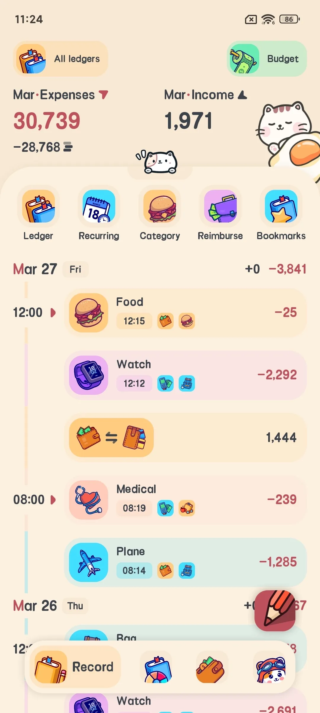{: width="180" .normal } 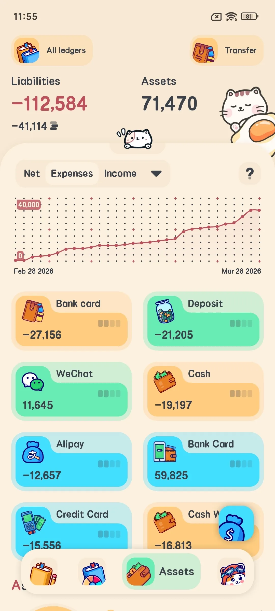{: width="180" .normal } 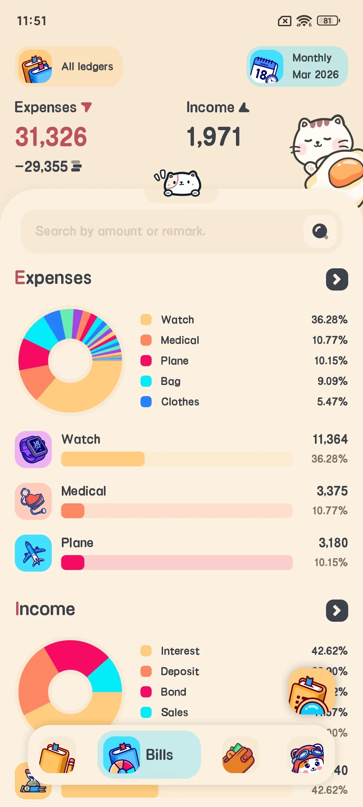{: width="180" .normal } 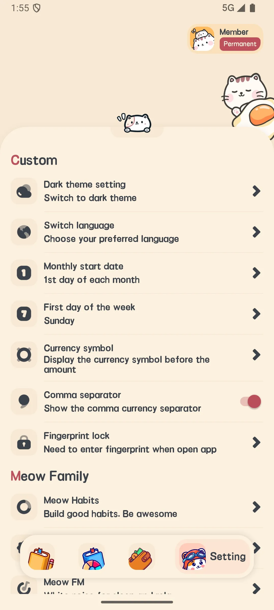{: width="180" .normal }

## ฟีเจอร์การบันทึก

ฟีเจอร์การบันทึกของ Meow Money Manager ใช้งานได้อย่าง intuitive รองรับการบันทึกสามประเภท: ค่าใช้จ่าย รายรับ และโอน

### การเพิ่มบันทึกรายจ่ายหรือรายรับ

1. คลิกปุ่มบันทึกที่ด้านล่างของหน้าหลัก
2. บนหน้าจอบันทึกที่ปรากฏ เปลี่ยนไปแท็บ "รายจ่ายหรือรายรับ"
3. เลือกไอคอนหมวดหมู่ที่เหมาะสม (อาหาร ช้อปปิ้ง คมนาคม และอื่นๆ)
4. กรอกจำนวนเงิน
5. เลือกวิธีการชำระเงิน (สินทรัพย์)
6. เลือกสมุดบัญชี
7. เพิ่มบันทึก (เลือกได้)
8. คลิกยืนยันเพื่อบันทึกเสร็จสิ้น

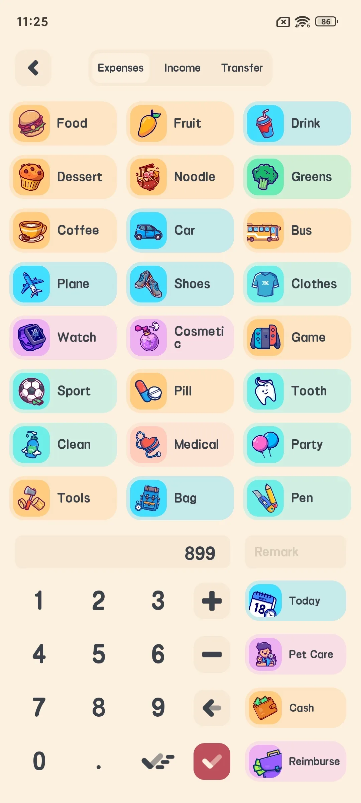{: width="180" .normal } 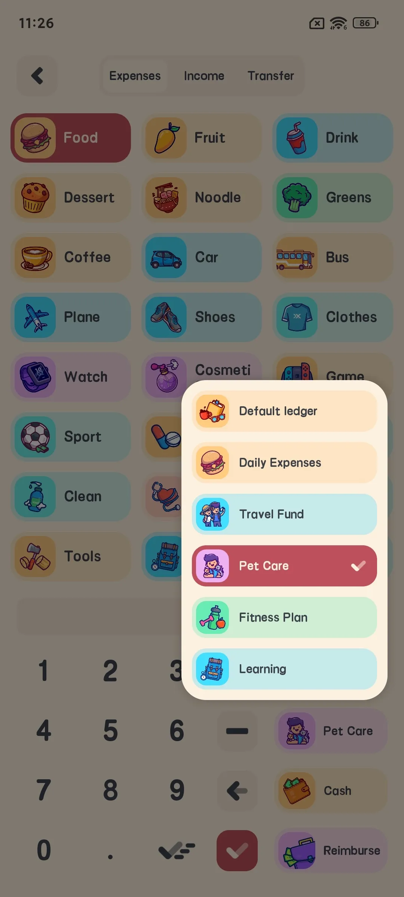{: width="180" .normal } 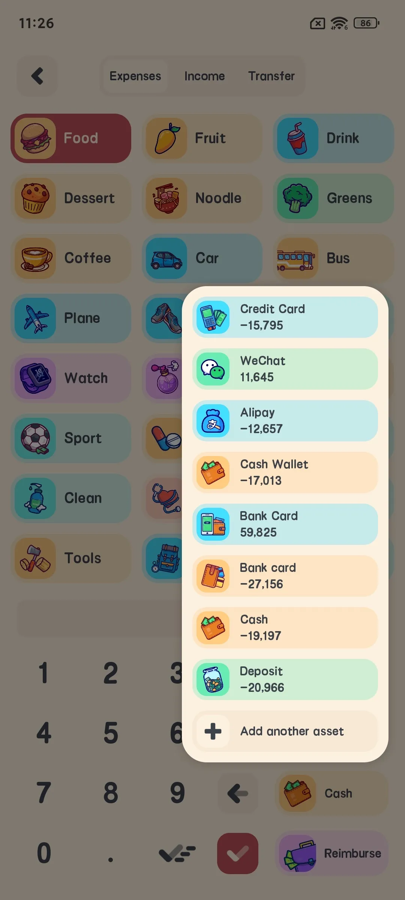{: width="180" .normal } 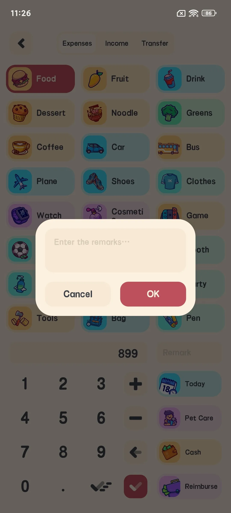{: width="180" .normal }

### ฟังก์ชันโอน

1. คลิกปุ่มบันทึกที่ด้านล่างของหน้าหลัก
2. บนหน้าจอบันทึกที่ปรากฏ เปลี่ยนไปแท็บโอน
3. เลือกสินทรัพย์ต้นทางและสินทรัพย์ปลายทาง
4. กรอกจำนวนเงินโอน
5. กรอกค่าธรรมเนียม (เลือกได้)
6. เลือกสมุดบัญชี
7. เพิ่มบันทึก (เลือกได้)
8. คลิกยืนยันเพื่อโอนเสร็จสิ้น

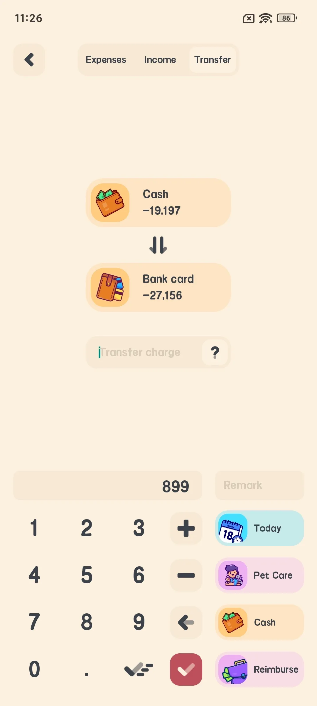{: width="180" .normal } 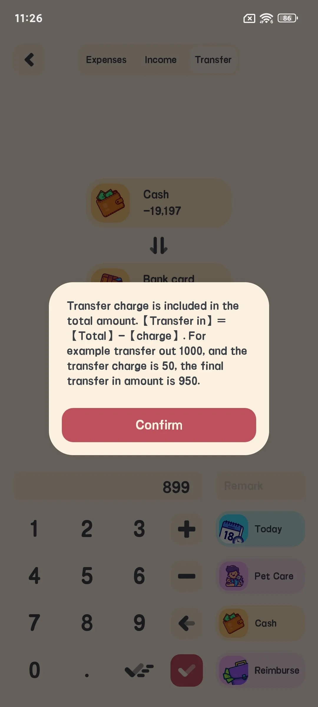{: width="180" .normal }

## การจัดการงบประมาณ

Meow Money Manager รองรับการจัดการงบประมาณหลายรูปแบบ รวมถึงงบรายวัน รายสัปดาห์ รายเดือน รายปี และรอบกำหนดเอง

### การเพิ่มงบประมาณ

1. ที่ส่วนติดต่อผู้ใช้หลัก คลิกแบนเนอร์งบประมาณ หรือเปิดการจัดการงบประมาณจากการตั้งค่า
2. คลิกปุ่ม "เพิ่มงบประมาณ"
3. เลือกประเภทงบประมาณ (รายวัน รายสัปดาห์ รายเดือน รายปี หรือกำหนดเอง)
4. คลิก "เพิ่มงบต่อหมวด" และเลือกหมวดที่ต้องการจัดงบ
5. กรอกงบประมาณรวมหรือจำนวนงบต่อหมวด
6. กรอกชื่องบประมาณ
7. คลิกยืนยันเพื่อสร้างงบประมาณเสร็จสิ้น

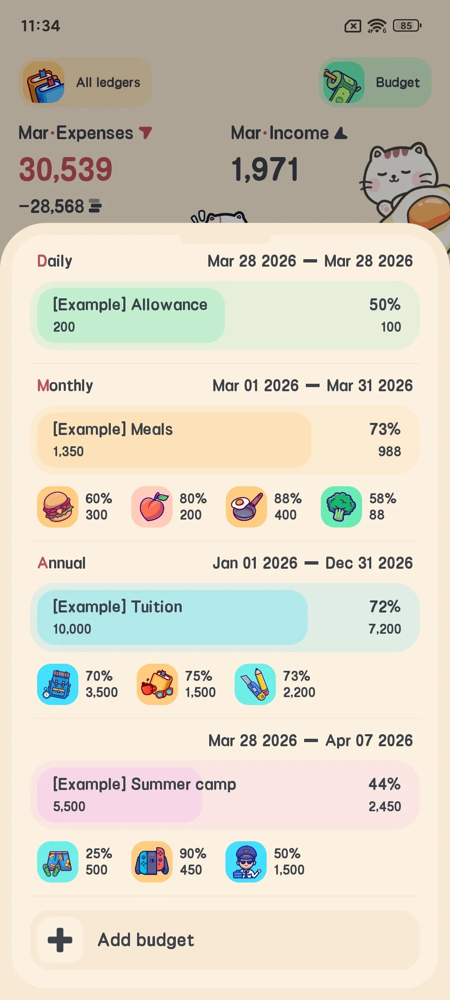{: width="180" .normal } 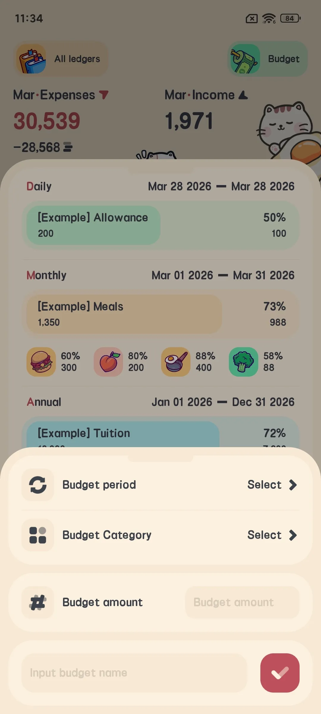{: width="180" .normal } 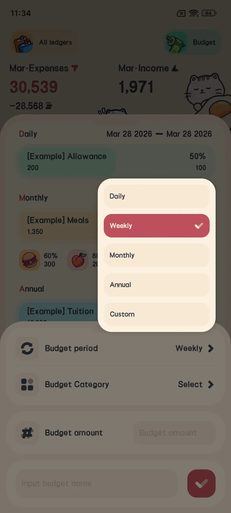{: width="180" .normal } 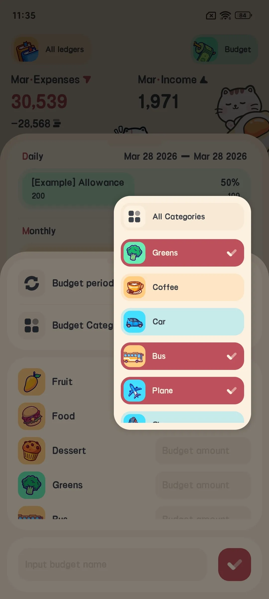{: width="180" .normal } 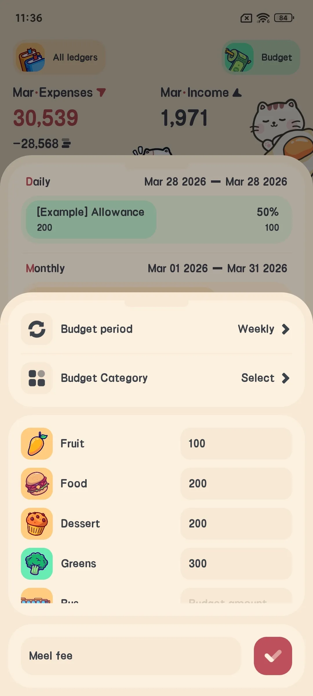{: width="180" .normal }

### การตรวจสอบงบประมาณ

ที่หน้ารายละเอียดงบประมาณ คุณสามารถดู:
- งบประมาณรวมและจำนวนที่ใช้ไป
- งบประมาณคงเหลือและจำนวนวันที่เหลือ
- งบรายวันเฉลี่ย
- การใช้งบต่อหมวด

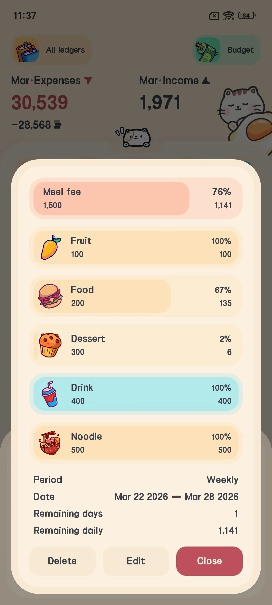{: width="180" .normal }

## สถิติและการวิเคราะห์

Meow Money Manager มีฟังก์ชันวิเคราะห์สถิติหลายอย่างเพื่อทำความเข้าใจสถานะทางการเงินของคุณ

### ประเภทสถิติ

1. ที่ส่วนติดต่อผู้ใช้หลัก คลิกแถบนำทางสถิติด้านล่างเพื่อเข้าหน้าสถิติ
2. เลือกช่วงเวลาสถิติ: วัน สัปดาห์ เดือน ปี หรือกำหนดเอง
3. ดูแผนภูมิสถิติประเภทต่างๆ

- **สถิติแผนภูมิวงกลม**: แสดงสัดส่วนค่าใช้จ่ายและรายรับในหมวดต่างๆ ช่วยให้เข้าใจเงินไปไหน
- **สถิติแผนภูมิแท่ง**: แสดงรายรับรายจ่ายรายวันหรือรายเดือน ช่วยทำความเข้าใจแนวโน้ม
- **มุมมองปฏิทิน**: แสดงรายรับรายจ่ายรายวัน ความเข้มของสีบ่งบอกขนาดจำนวนเงิน

{: width="180" .normal } 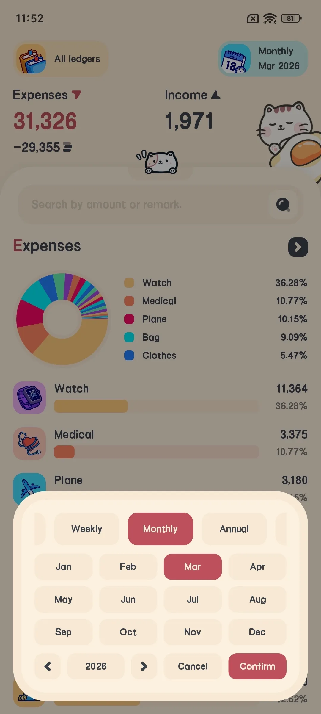{: width="180" .normal } 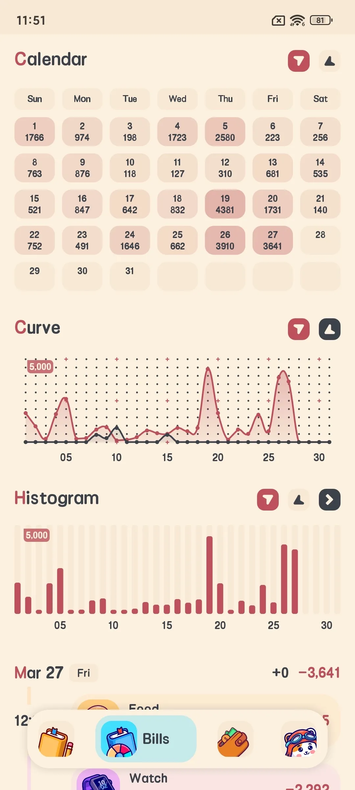{: width="180" .normal } 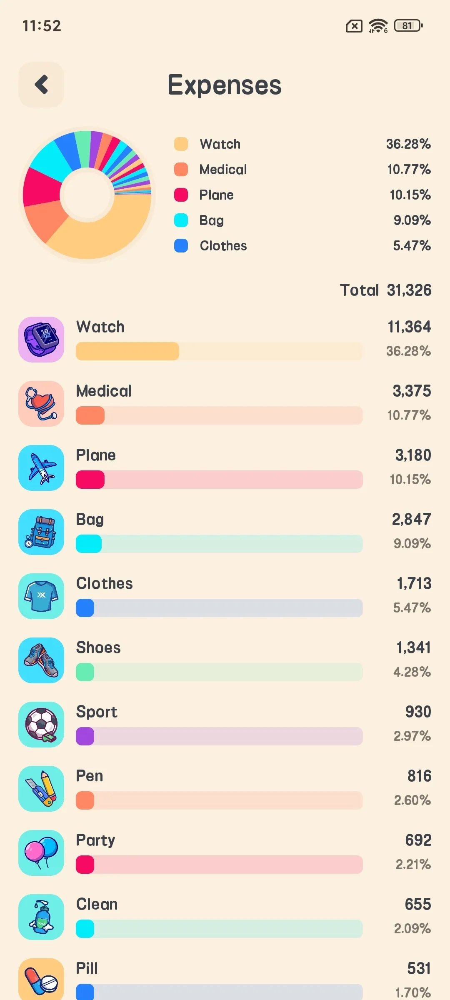{: width="180" .normal } 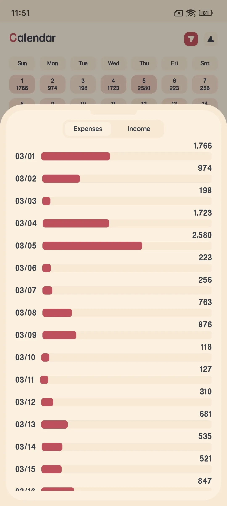{: width="180" .normal }

## การจัดการสินทรัพย์

Meow Money Manager รองรับการจัดการสินทรัพย์หลายประเภท เช่น เงินสด บัตรธนาคาร บัตรเครดิต และอื่นๆ

### การเพิ่มสินทรัพย์

1. ที่ส่วนติดต่อผู้ใช้หลัก คลิกแถบนำทางสินทรัพย์ด้านล่างเพื่อเข้าหน้าสินทรัพย์
2. คลิกปุ่ม "เพิ่มสินทรัพย์"
3. เลือกประเภทสินทรัพย์
4. กรอกชื่อสินทรัพย์
5. กรอกยอดคงเหลือเริ่มต้น
6. เลือกไอคอนสินทรัพย์
7. คลิกยืนยันเพื่อเพิ่มสินทรัพย์เสร็จสิ้น

{: width="180" .normal } 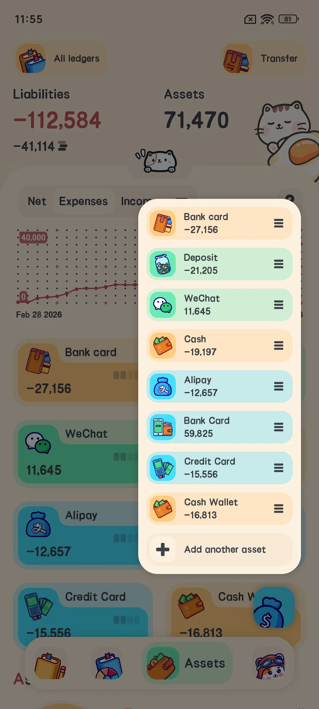{: width="180" .normal }

### รายละเอียดสินทรัพย์

คลิกสินทรัพย์เพื่อเข้าหน้ารายละเอียด ที่นั่นคุณสามารถดู:
- ยอดสินทรัพย์
- บันทึกรายรับรายจ่ายของสินทรัพย์
- กราฟแนวโน้มสินทรัพย์

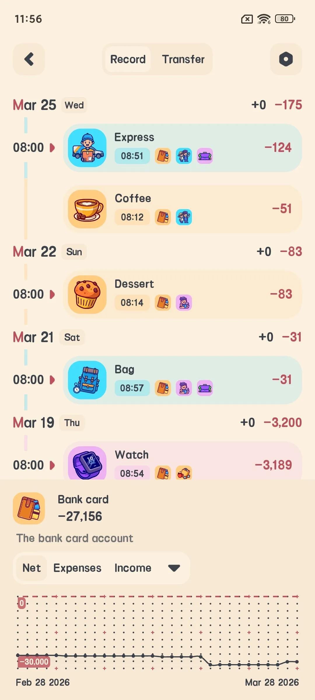{: width="180" .normal } 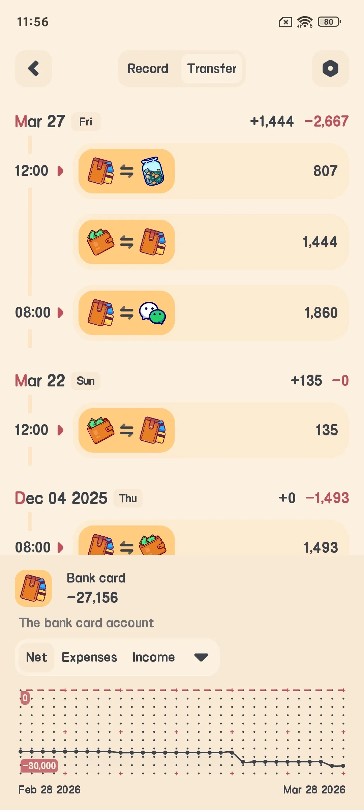{: width="180" .normal } 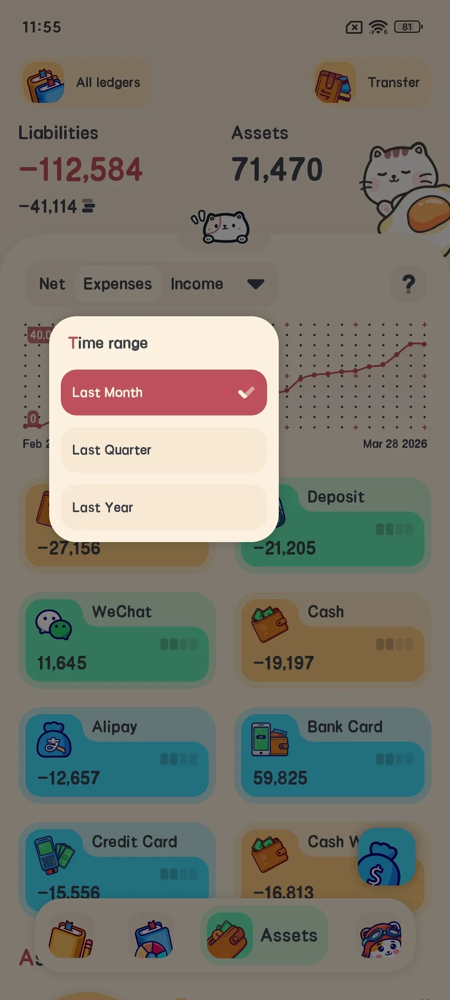{: width="180" .normal } 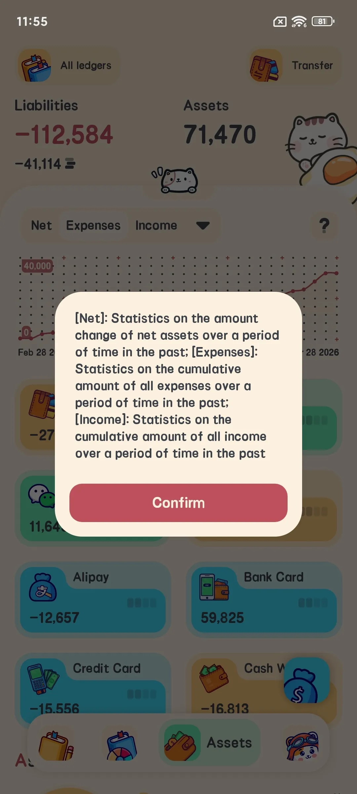{: width="180" .normal }

## การจัดการสมุดบัญชี

Meow Money Manager รองรับการสร้างสมุดบัญชีหลายเล่มเพื่อจัดการประเภทรายรับรายจ่ายที่หลากหลาย

### การเพิ่มสมุดบัญชี

1. ที่ส่วนติดต่อผู้ใช้หลัก คลิกแบนเนอร์สมุดบัญชี หรือเปิดการจัดการสมุดบัญชีจากการตั้งค่า
2. คลิกปุ่ม "เพิ่มสมุดบัญชี"
3. กรอกชื่อสมุดบัญชี
4. เลือกไอคอนสมุดบัญชี
5. คลิกยืนยันเพื่อสร้างสมุดบัญชีเสร็จสิ้น

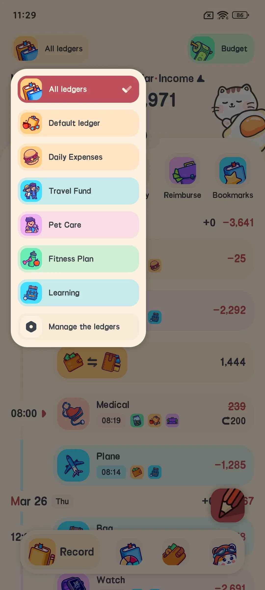{: width="180" .normal } {: width="180" .normal } {: width="180" .normal }

### การสลับสมุดบัญชี

1. ขณะบันทึก คลิกตัวเลือกสมุดบัญชี
2. เลือกสมุดบัญชีที่ใช้จากรายการที่ปรากฏ
3. หลังเลือกเสร็จ บันทึกของสมุดบัญชีนั้นจะแสดง

{: width="180" .normal }

### สถิติสมุดบัญชี

คลิกสมุดบัญชีเพื่อเข้าหน้ารายละเอียด ที่นั่นคุณสามารถดูสำหรับสมุดบัญชีนั้น:
- สถิติรายรับรายจ่าย
- การใช้งบประมาณ
- รายละเอียดบันทึก

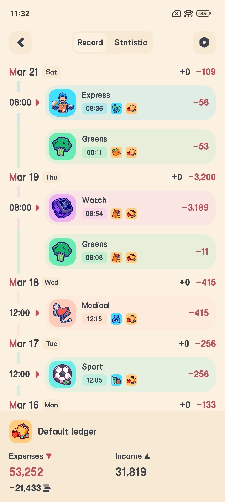{: width="180" .normal } 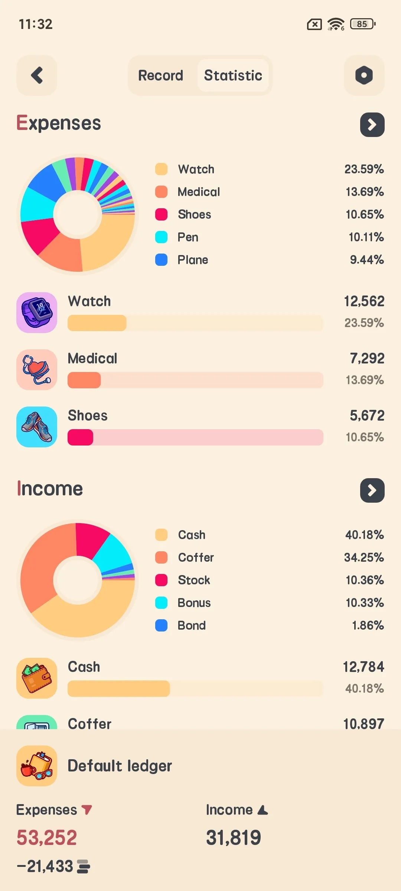{: width="180" .normal } 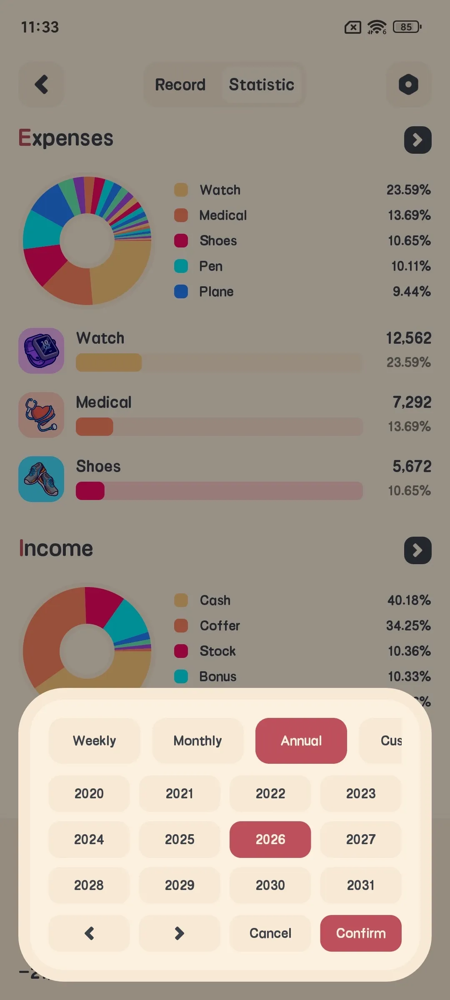{: width="180" .normal }

## รายการเกิดซ้ำ

ฟีเจอร์รายการเกิดซ้ำช่วยบันทึกรายรับรายจ่ายประจำ เช่น เงินเดือน ค่าเช่า บิล และอื่นๆ อัตโนมัติ

### การเพิ่มรายการเกิดซ้ำ

1. เปิดการจัดการรายการเกิดซ้ำจากการตั้งค่า
2. คลิกปุ่ม "เพิ่มรายการเกิดซ้ำ"
3. เลือกประเภทธุรกรรม (ค่าใช้จ่ายหรือรายรับ)
4. เลือกหมวดหมู่
5. กรอกจำนวนเงิน
6. เลือกสินทรัพย์
7. เลือกสมุดบัญชี
8. กำหนดรอบระยะ (รายวัน สัปดาห์ เดือน ปี)
9. กำหนดวันเริ่มต้นและวันสิ้นสุด
10. คลิกยืนยันเพื่อตั้งค่ารายการเกิดซ้ำเสร็จสิ้น

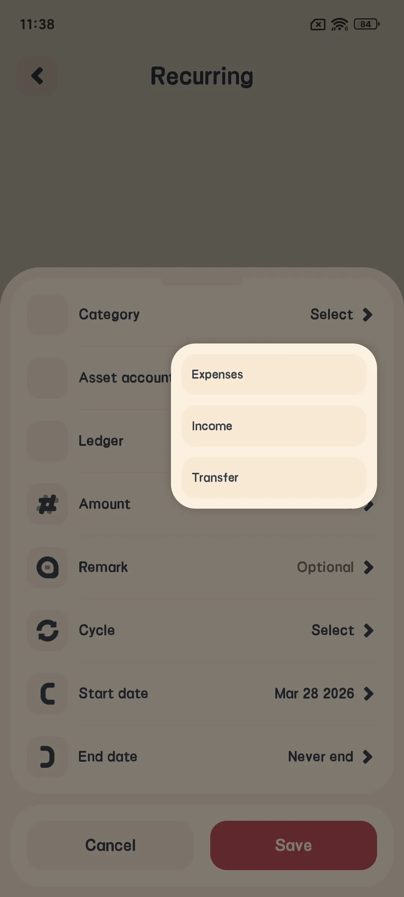{: width="180" .normal } 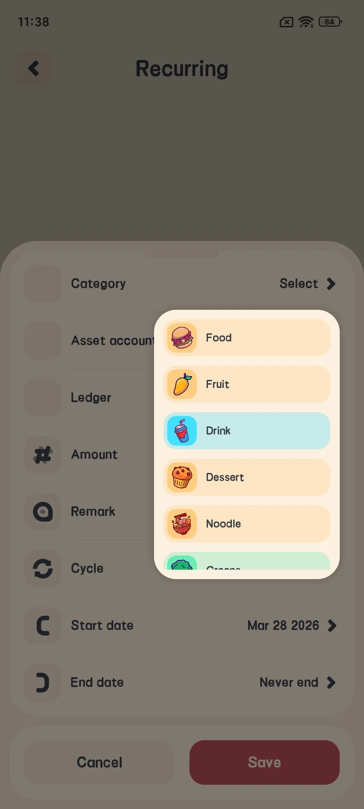{: width="180" .normal } 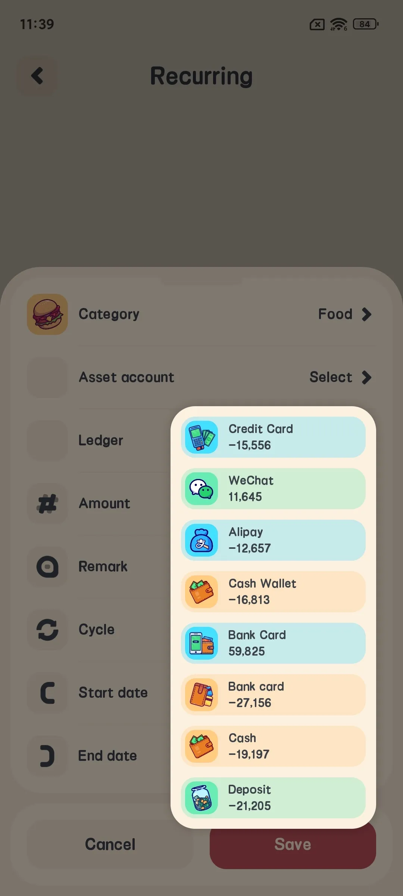{: width="180" .normal } 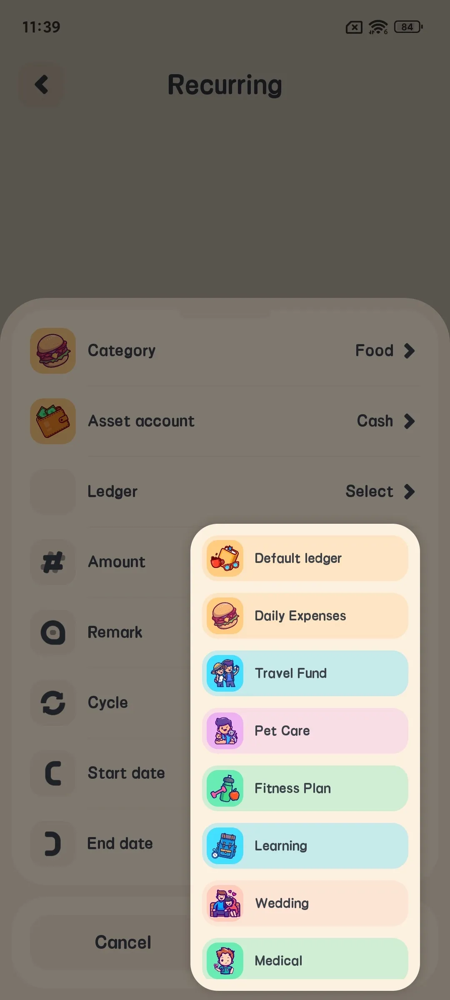{: width="180" .normal } 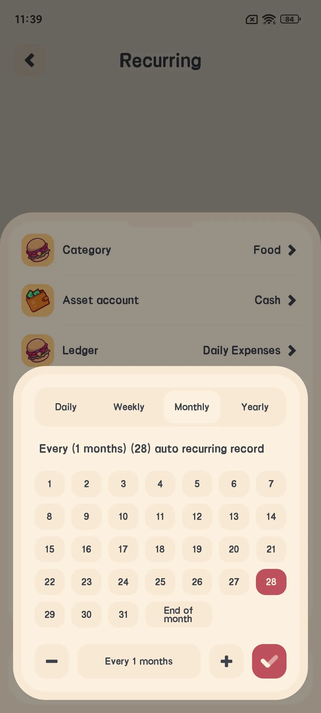{: width="180" .normal }

### การจัดการรายการเกิดซ้ำ

ในรายการรายการเกิดซ้ำ คุณสามารถ:
- ดูงานรายการเกิดซ้ำทั้งหมด
- เปลี่ยนหรือลบงานรายการเกิดซ้ำ
- รันรายการเกิดซ้ำด้วยตนเอง

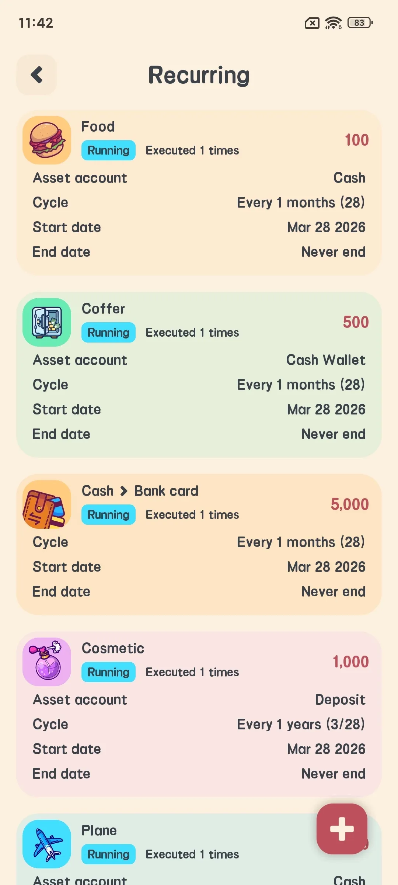{: width="180" .normal } 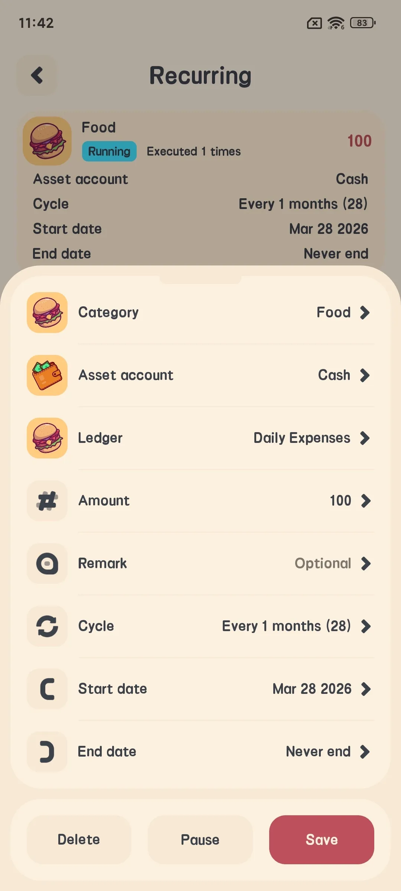{: width="180" .normal }

## การเบิกคืนค่าใช้จ่าย

ฟีเจอร์การเบิกคืนค่าใช้จ่ายช่วยติดตามค่าใช้จ่ายที่ต้องเบิกคืน

### การเพิ่มบันทึกการเบิกคืน

1. ขณะเพิ่มบันทึกรายจ่าย เลือกตัวเลือก "เบิกคืน"
2. กรอกข้อมูลบันทึกอื่นๆ ให้ครบ
3. คลิกยืนยันเพื่อเพิ่มบันทึกการเบิกคืนเสร็จสิ้น

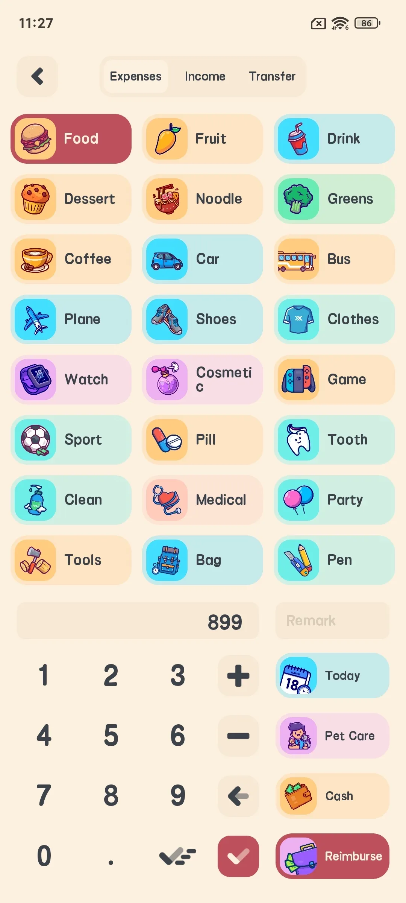{: width="180" .normal }

### การจัดการเบิกคืน

1. เปิดการจัดการเบิกคืนจากการตั้งค่า
2. ดูบันทึกทั้งที่ค้างและที่จ่ายแล้ว
3. คลิกบันทึกเบิกคืนและทำเครื่องหมายว่าจ่ายแล้ว
4. กรอกจำนวนเงินเบิกคืนและวันที่เบิกคืน
5. เลือกวิธีเบิกคืน (สินทรัพย์)
6. คลิกยืนยันเพื่อเสร็จสิ้นการเบิกคืน

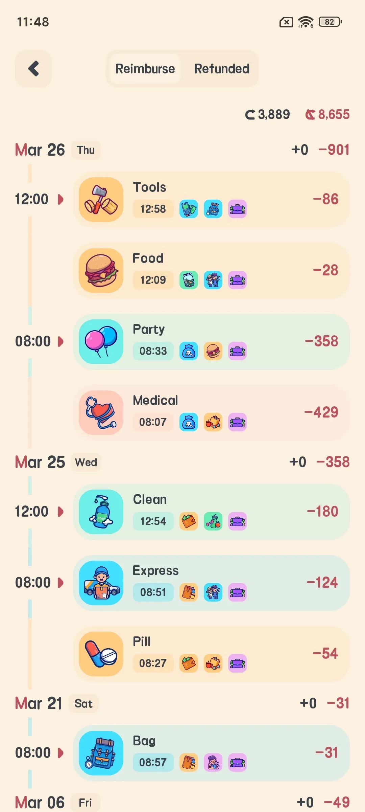{: width="180" .normal } 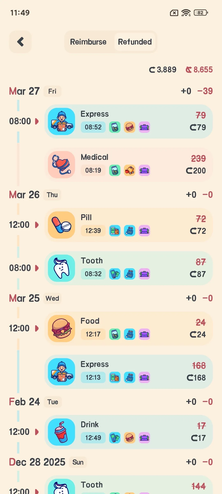{: width="180" .normal } 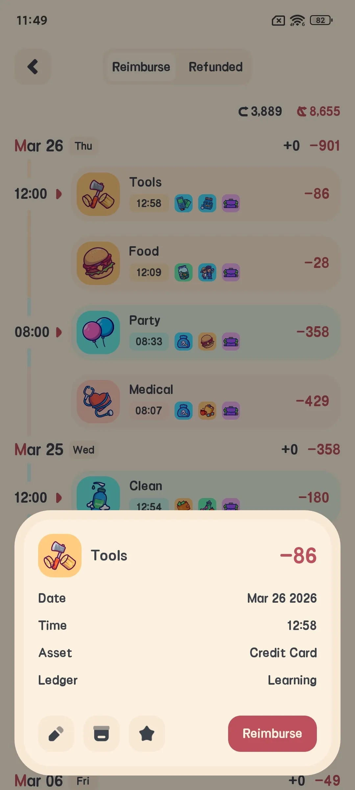{: width="180" .normal } 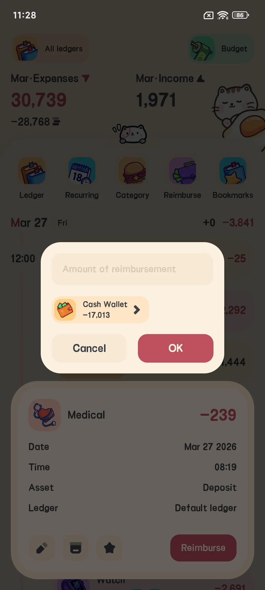{: width="180" .normal } 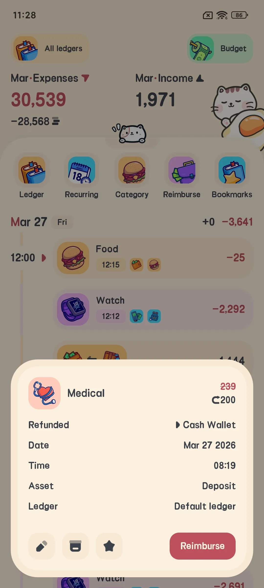{: width="180" .normal }

## การตั้งค่า

Meow Money Manager มีตัวเลือกการตั้งค่าหลายอย่างเพื่อปรับแต่งฟังก์ชันแอป

### การตั้งค่าพื้นฐาน

1. เปิดหน้าการตั้งค่าจากแถบนำทางล่าง
2. ปรับการตั้งค่าต่อไปนี้:
   - การตั้งค่าธีม (สว่าง มืด หรือตามระบบ)
   - การตั้งค่าภาษา
   - การตั้งค่าสัญลักษณ์สกุลเงิน
   - การตั้งค่าวันเริ่มต้นของสัปดาห์
   - การตั้งค่าวันเริ่มต้นของเดือน

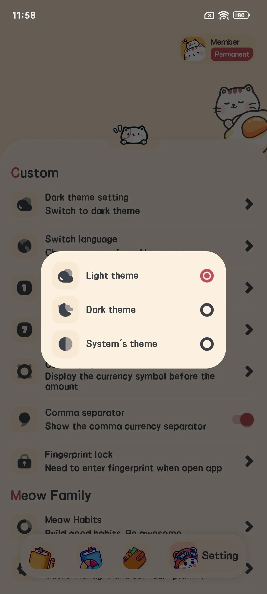{: width="180" .normal } 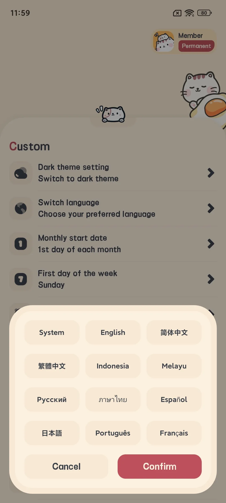{: width="180" .normal } 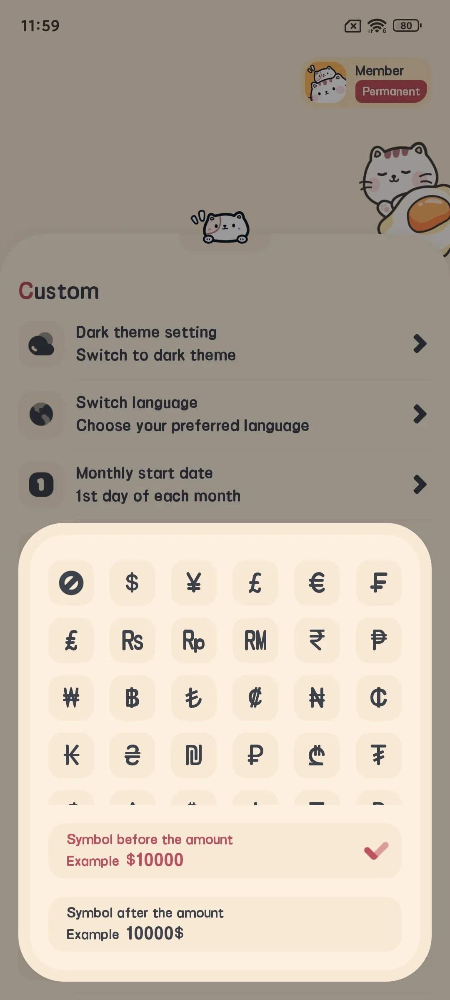{: width="180" .normal } 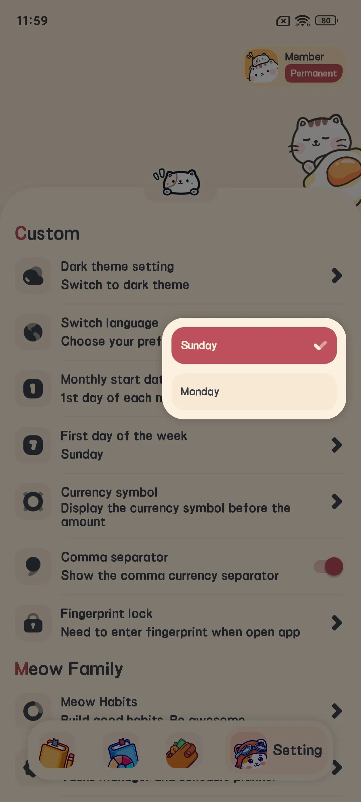{: width="180" .normal } 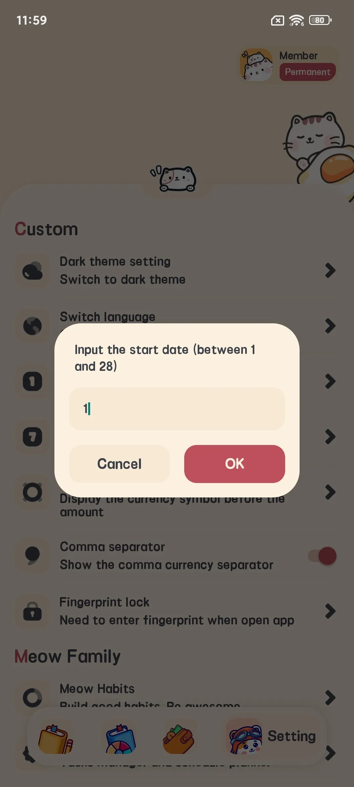{: width="180" .normal }

### การตั้งค่าความเป็นส่วนตัว

1. ที่หน้าการตั้งค่า คลิก "การตั้งค่าความเป็นส่วนตัว"
2. เปิดหรือปิดล็อกแอปด้วยลายนิ้วมือ
3. กำหนดรหัสผ่านแอป (หากจำเป็น)

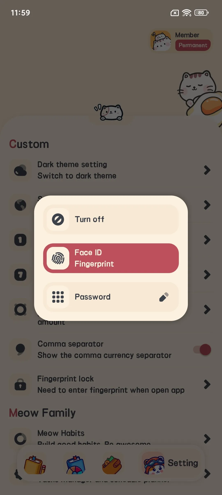{: width="180" .normal } {: width="180" .normal }

### สำรองและกู้คืน

1. ที่หน้าการตั้งค่า คลิก "สำรองและกู้คืน"
2. เลือกวิธีสำรอง:
   - Google Drive
   - สำรอง iCloud (เฉพาะ iOS)
   - สำรอง WebDAV
3. คลิก "สำรองตอนนี้" เพื่อสำรองด้วยตนเอง
4. คลิก "กู้คืน" เพื่อกู้คืนข้อมูลจากไฟล์สำรอง

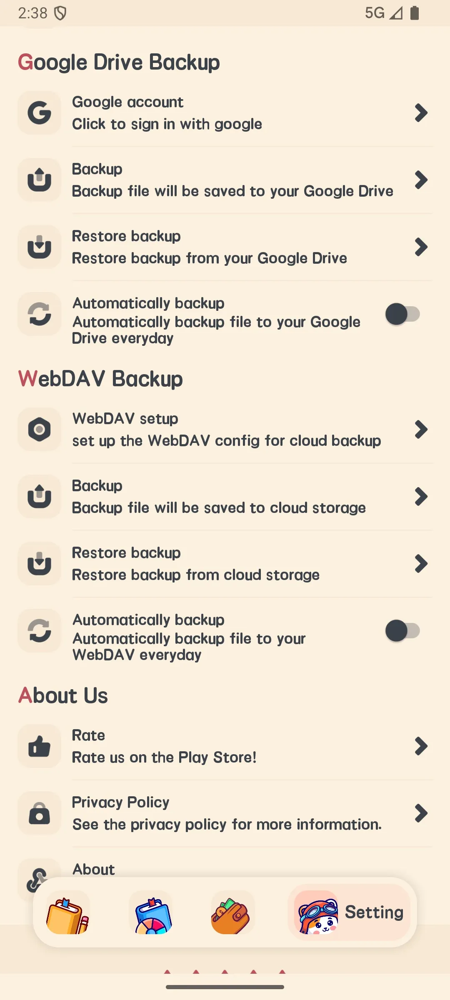{: width="180" .normal } 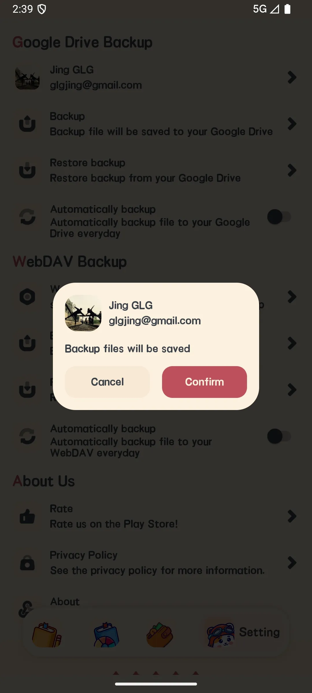{: width="180" .normal } {: width="180" .normal } {: width="180" .normal }

### ส่งออกข้อมูล

1. ที่หน้าการตั้งค่า คลิก "ส่งออกข้อมูล"
2. เลือกช่วงเวลาส่งออก
3. เลือกรูปแบบส่งออก (CSV)
4. คลิก "ส่งออก" เพื่อส่งออกข้อมูลเป็นไฟล์

{: width="180" .normal } {: width="180" .normal } {: width="180" .normal } {: width="180" .normal }

## คำถามที่พบบ่อย

### Meow Money Manager ต้องสมัครบัญชีไหม?
{:.faq-q}
ไม่ **ข้อมูลจัดเก็บในเครื่องของคุณ** อย่างสมบูรณ์ และคุณสามารถใช้แอปทั้งหมดได้โดยไม่ต้องบัญชีคลาวด์ สำรองผ่าน Google Drive iCloud หรือ WebDav ก็พอ

### รองรับภาษาใดบ้าง?
{:.faq-q}
รองรับส่วนติดต่อผู้ใช้หลายภาษา — จีน อังกฤษ อินโดนีเซีย ไทย และโปรตุเกส

### รองรับการบันทึกหลายสกุลเงินไหม?
{:.faq-q}
ใช่ มีสัญลักษณ์ 50+ สกุลเงิน และคุณสามารถตั้งสมุดบัญชีแยกสำหรับเดินทาง งาน และครอบครัวได้

### จะส่งออกข้อมูลบันทึกอย่างไร?
{:.faq-q}
ที่ การตั้งค่า → ส่งออกข้อมูล เลือกช่วงวันที่และรูปแบบ CSV เพื่อส่งออกเป็นไฟล์ที่ดูหรือแก้ไขใน Excel ได้; คุณยังสามารถสำรองและกู้คืนผ่าน Google Drive iCloud หรือ WebDav

### จะแก้ไขบันทึกที่เพิ่มไปแล้วอย่างไร?
{:.faq-q}

1. ในรายการบันทึก หาบันทึกที่ต้องการแก้ไข
2. คลิกบันทึกและเลือก "แก้ไข" บนหน้าที่ปรากฏ
3. แก้ไขข้อมูลที่ต้องการ
4. คลิกยืนยันเพื่อเสร็จสิ้นการแก้ไข

### จะลบบันทึกอย่างไร?
{:.faq-q}

1. ในรายการบันทึก หาบันทึกที่ต้องการลบ
2. กดค้างที่บันทึกและเลือก "ลบ"
3. ยืนยันการลบ

### จะเปลี่ยนสัญลักษณ์สกุลเงินอย่างไร?
{:.faq-q}

1. เปิดหน้าการตั้งค่า
2. คลิก "การตั้งค่าสัญลักษณ์สกุลเงิน"
3. เลือกสัญลักษณ์สกุลเงินที่ต้องการ
4. คลิกยืนยันเพื่อตั้งค่าเสร็จสิ้น

### จะตั้งค่าล็อกแอปอย่างไร?
{:.faq-q}

1. เปิดหน้าการตั้งค่า
2. คลิก "การตั้งค่าความเป็นส่วนตัว"
3. เปิด "ล็อกลายนิ้วมือ" หรือ "ล็อกรหัสผ่าน"
4. ทำตามคำแนะนำเพื่อตั้งค่าเสร็จสิ้น

### จะสำรองข้อมูลอย่างไร?
{:.faq-q}

1. เปิดหน้าการตั้งค่า
2. คลิก "สำรองและกู้คืน"
3. เลือกวิธีสำรอง
4. คลิก "สำรองตอนนี้" เพื่อสำรองด้วยตนเอง

## สรุป

Meow Money Manager คือแอป **จัดการการเงินส่วนตัว** ที่ครบครันและน่ารัก ผ่านคู่มือนี้ คุณควรครอบครองฟีเจอร์หลักและวิธีการใช้งานแล้ว ขอให้ช่วยให้คุณจัดการการเงินดีขึ้น และทำให้ **บันทึกการเงินรายวัน** ง่ายและสนุกขึ้น!

หากพบปัญหาในการใช้งาน สามารถติดต่อฉันได้ที่: glgjingmarvel@gmail.com

## ศัพท์ที่เกี่ยวข้อง

- [แอปบันทึกการเงินคืออะไร?](/th/glossary/what-is-an-expense-tracker/)
