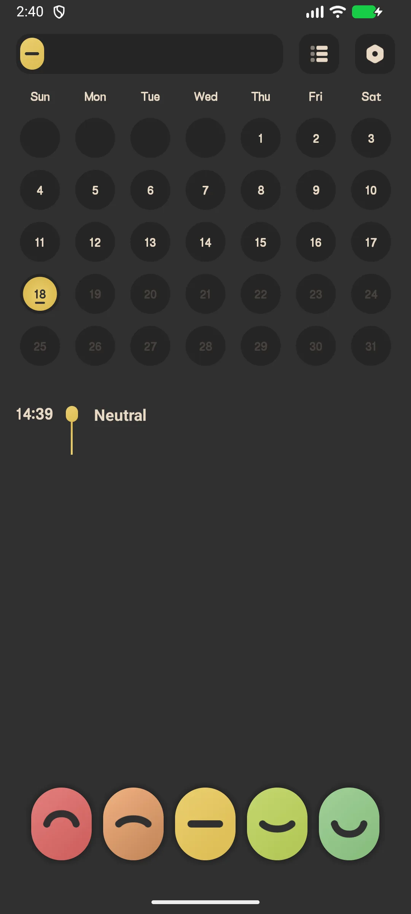
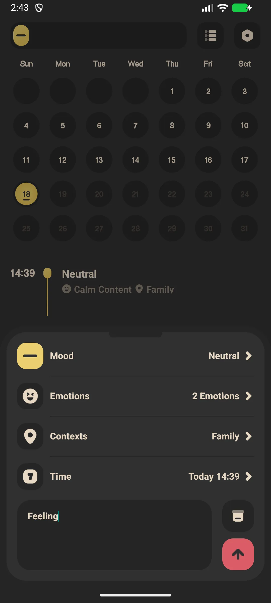
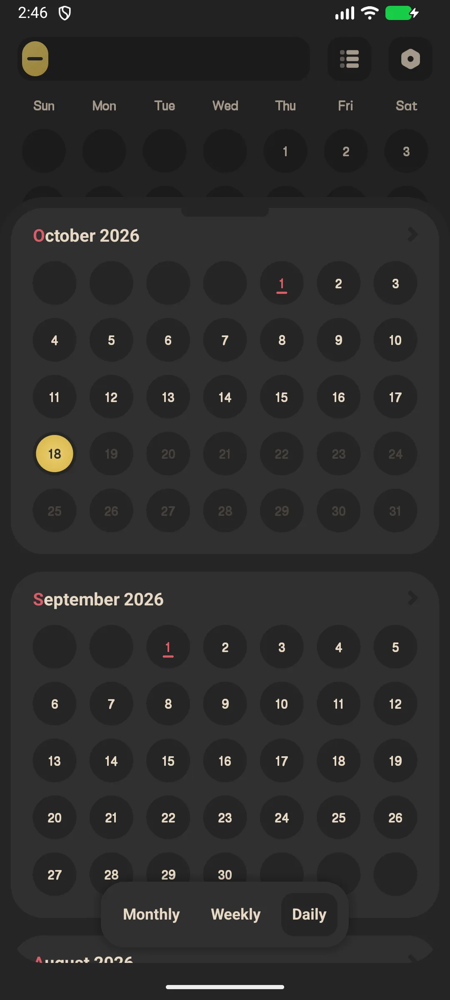
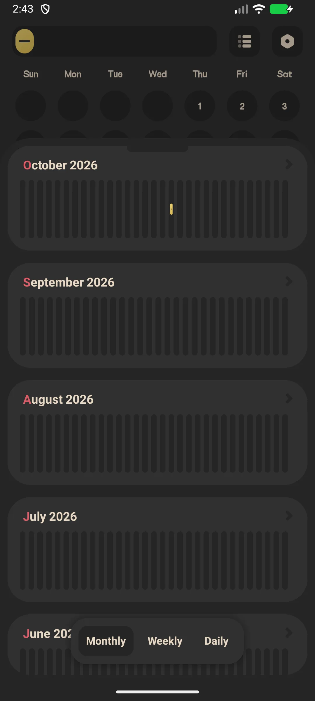

## สารบัญ

- [การแนะนำแอป](#การแนะนำแอป)
- [การใช้งานครั้งแรก](#การใช้งานครั้งแรก)
- [บันทึกอารมณ์ (แตะเดียว)](#บันทึกอารมณ์-แตะเดียว)
- [รายการอารมณ์เต็ม](#รายการอารมณ์เต็ม)
- [ปฏิทินประวัติ](#ปฏิทินประวัติ)
- [สถิติและเทรนด์](#สถิติและเทรนด์)
- [การเตือนรายวัน](#การเตือนรายวัน)
- [ล็อกแอป (VIP)](#ล็อกแอป-vip)
- [สำรอง](#สำรอง)
- [การตั้งค่า](#การตั้งค่า)
- [สถานการณ์ทั่วไป](#สถานการณ์ทั่วไป)
- [คำถามที่พบบ่อย](#คำถามที่พบบ่อย)

## การแนะนำแอป

Meow Mood Diary คือ [ไดอารี่อารมณ์](/th/glossary/what-is-a-mood-tracker/) และแอปไดอารี่ที่ปลอดภัยและส่วนตัว ด้วยอินเทอร์เฟซธีมแมวที่ผ่อนคลาย มันทำงานเป็น **แอปตัวติดตามอารมณ์ออฟไลน์** และ **แอปเช็คอินรายวัน**: แตะเดียวบันทึกอารมณ์ แตะที่สองเพิ่มกิจกรรมและบันทึก ส่วนอื่นของคู่มือว่าดูปฏิทิน กราฟ ล็อกแอปเลือกได้ การเตือน และวิธีนำประวัติออกจาก **แอปไดอารี่อารมณ์** ที่ไม่เคยขอให้คุณสมัคร

**😺 บันทึกแตะเดียว**
- แคปซูลระดับอารมณ์ 5 อันบนหน้าแรก
- แตะแคปซูลเพื่อบันทึกทันที หรือเปิดเพื่อรายการละเอียดขึ้น

**📊 ข้อมูลเชิงลึก**
- ปฏิทินรายเดือนที่ระบายสีตามอารมณ์
- สถิติ: การกระจายระดับ (พาย) ฮิสโตแกรมรายเดือน ความถี่อารมณ์ ความถี่บริบท

**🔒 ส่วนตัวโดยปริยาย**
- ข้อมูลเก็บ **เฉพาะในเครื่อง** — ไม่มีอะไรอัปโหลดไปเซิร์ฟเวอร์
- สำรอง Google Drive / WebDav เลือกได้ (คุณควบคุมคลาวด์)
- ล็อกแอป (ลายนิ้วมือ / รหัสผ่าน) คือฟีเจอร์ **VIP**

**🎨 ตัวเลือกหลากหลาย**
- **อารมณ์ตั้งต้น 48 ตัว** (ไม่น่ารัก 24 + เป็นกลาง 6 + น่ารัก 18) จัดกลุ่มเป็น 5 ระดับอารมณ์
- **แท็กบริบท 18 ตัว** (ที่ไหน / กับใคร)
- ฟรี vs VIP: ไอคอนมากขึ้น ธีมสีมากขึ้น ล็อกแอป และส่งออก PDF

## การใช้งานครั้งแรก

หน้าแรกแสดงแคปซูลอารมณ์ 5 อัน ปฏิทินรายเดือน และรายการอารมณ์วันนี้

- แตะ **เมนูสถิติ** (บน) เพื่อดูสถิติ
- แตะ **เมนูตั้งค่า** (บน) เพื่อเปิดการตั้งค่า

{: width="180" .normal }

## บันทึกอารมณ์ (แตะเดียว)

1. ที่หน้าแรก แตะ **แคปซูลอารมณ์** (เช่น "มีความสุข")
2. แคปซูลขยาย — แตะ **ยืนยัน** เพื่อบันทึกทันที หรือแตะไอคอน **ตั้งค่า (เฟือง)** เพื่อเพิ่มรายละเอียด

บันทึกแตะเดียวเก็บระดับอารมณ์โดยไม่มีบันทึกหรือแท็ก

## รายการอารมณ์เต็ม

1. แตะเฟืองบนแคปซูล → **เพิ่มอารมณ์**
2. เลือก **ระดับอารมณ์** (1–5)
3. เลือก **แท็กอารมณ์** (เลือกได้หลายจาก 48)
4. เลือก **แท็กบริบท** (เลือกได้หลายจาก 18)
5. ตั้ง **เวลา** (ต้องไม่เป็นอนาคต)
6. เขียน **บันทึก** เลือกได้
7. แตะ **บันทึก**

{: width="180" .normal }

## ปฏิทินประวัติ

- เลื่อนปฏิทินหน้าแรกเดือนต่อเดือน
- แต่ละวันเป็นส่วนโค้งสีที่สะท้อน **ค่าเฉลี่ยระดับอารมณ์** วันนั้น (วันข้างหน้าดูเทาหม่น)
- แตะวันหนึ่งเพื่อดูรายการวันนั้น

{: width="180" .normal }

## สถิติและเทรนด์

1. แตะไอคอนสถิติ (ขวาบน)
2. สลับแท็บ **เดือน / สัปดาห์ / วัน**
3. ทบทวน:
   - **การกระจายระดับ** กราฟพาย
   - **ฮิสโตแกรมรายเดือน**
   - **ความถี่อารมณ์** และ **ความถี่บริบท**

{: width="180" .normal }

## การเตือนรายวัน

1. การตั้งค่า → **การเตือน**
2. เปิดการเตือนรายวันและตั้งเวลา
3. คุณได้รับแจ้งเตือนอ่อนโยน "วันนี้เป็นไงบ้าง?" / "ถึงเวลาบันทึกอารมณ์!"

## ล็อกแอป (VIP)

1. การตั้งค่า → **ล็อกแอป**
2. หากยังไม่ VIP จะถูกขอให้อัปเกรด
3. ผู้ใช้ VIP เปิดล็อกลายนิ้วมือหรือรหัสผ่านได้

## สำรอง

การตั้งค่า → **Google Drive** (เข้าสู่ระบบ สำรอง / กู้คืน / อัตโนมัติ) และ **WebDav** รายการคงอยู่ในเครื่องเว้นแต่คุณสำรอง

## การตั้งค่า

การตั้งค่าครอบคลุมภาษา วันเริ่มต้นสัปดาห์ ล็อกแอป (VIP) วิดเจ็ต ไอคอนอารมณ์ (VIP) ธีมสี (VIP) แท็กอารมณ์/บริบท ส่งออก (VIP) การเตือน รวมถึง Google Drive / WebDav

## สถานการณ์ทั่วไป

- **บันทึกด่วนในวันที่แย่** — คืนที่หนักหน่วง แตะอารมณ์เดียวและแท็กสองสามอัน; ไม่มีย่อหน้า จึงทำให้ไดอารี่รอดในวันที่คุณมักข้าม
- **ส่วนตัวโดยปริยาย** — รายการคงอยู่ในเครื่องหลังล็อกลายนิ้วมือ (VIP); บนโทรศัพท์ที่ครอบครัวใช้ร่วม ความคิดคุณไม่เคยซิงค์ไปคลาวด์ผู้ขายเว้นแต่จะเลือก Google Drive
- **ค้นหารูปแบบ** — ปฏิทินและกราฟเผย 'อารมณ์ซึมวันอาทิตย์' หรือกระชากหลังกาแฟ เปลี่ยนความรู้สึกคลุมเครือเป็นสิ่งที่ลงมือได้
- **ออฟไลน์ที่ไหนก็ได้** — บันทึกบนเครื่องบินหรือในรถไฟใต้ดินที่ไม่มีสัญญาณ; ไม่ต้อง Wi-Fi เพื่อบันทึกช่วงเวลา

## คำถามที่พบบ่อย

### ไดอารี่ของฉันถูกอัปโหลดไปเซิร์ฟเวอร์ไหม?
{:.faq-q}
ไม่ ทุกรายการเก็บในฐานข้อมูลท้องถิ่นในเครื่องคุณ มีแค่คุณที่สำรองไป Google Drive หรือ WebDav ของตัวเองได้

### สีปฏิทินถูกกำหนดอย่างไร?
{:.faq-q}
สีแต่ละวันคือค่าเฉลี่ยระดับอารมณ์ของรายการวันนั้น ถูกจับคู่กับจานสี 5 ธีมที่ใช้งาน วันที่ไม่มีรายการปล่อยว่าง

### ฉันส่งออกไดอารี่ได้ไหม?
{:.faq-q}
ได้ — ส่งออก PDF คือฟีเจอร์ VIP

## สรุป

Meow Mood Diary ทำให้การติดตามอารมณ์รายวันรู้สึกง่ายและส่วนตัว ด้วยปฏิทินชัดเจนและกราฟเทรนด์เพื่อเข้าใจอารมณ์ของคุณตามกาลเวลา

[หน้าแอป Meow Mood Diary](/th/apps/meow-mood-diary/) — มีให้สำหรับ Android และ iOS

## ศัพท์ที่เกี่ยวข้อง

- [ตัวติดตามอารมณ์คืออะไร?](/th/glossary/what-is-a-mood-tracker/)
