## สารบัญ

- [การแนะนำแอป](#การแนะนำแอป)
- [การใช้งานครั้งแรก](#การใช้งานครั้งแรก)
- [การเพิ่มงาน](#การเพิ่มงาน)
- [งานย่อย](#งานย่อย)
- [การเตือน](#การเตือน)
- [มุมมองปฏิทิน](#มุมมองปฏิทิน)
- [สถิติ](#สถิติ)
- [รายการและแท็ก](#รายการและแท็ก)
- [สำรองและซิงโครไนซ์](#สำรองและซิงโครไนซ์)
- [ส่งออก CSV (VIP)](#ส่งออก-csv-vip)
- [การตั้งค่า](#การตั้งค่า)
- [คำถามที่พบบ่อย](#สถานการณ์ทั่วไป)

## การแนะนำแอป

Meow Todo List คือตัวจัดการงานสไตล์การ์ตูนน่ารักและ **[แอป to-do list](/th/glossary/what-is-a-to-do-list/)** สำหรับ Android และ iOS มันช่วยให้คุณบันทึกงานอย่างรวดเร็ว และทบทวนตามวัน สัปดาห์ เดือน หรือรายการ แอปนี้ยังทำหน้าที่เป็น **แอปงานประจำวันออฟไลน์อย่างง่าย**: รายการสิ่งที่ต้องทำไม่ต้องบัญชีเก็บในโทรศัพท์ และหลัก **แอปจัดการงานฟรี** ครอบคลุมรายการ การเตือน รวมถึง **แอปปฏิทินงาน** คู่มือนี้พาคุณผ่านทุกหน้าจอ ตั้งแต่การเปิดครั้งแรกจนถึง **การซิงโครไนซ์ Google Drive** และส่งออก CSV

**📝 การบันทึกอย่างรวดเร็ว**

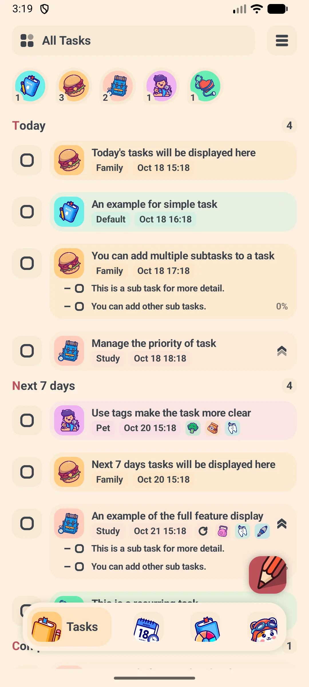{: width="180" .normal }
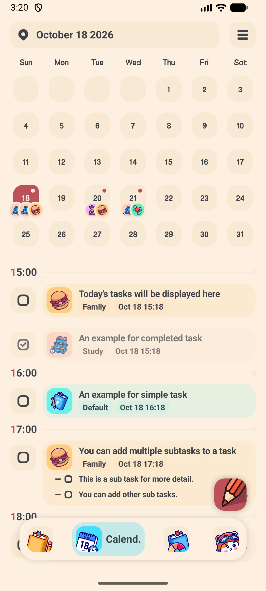{: width="180" .normal }
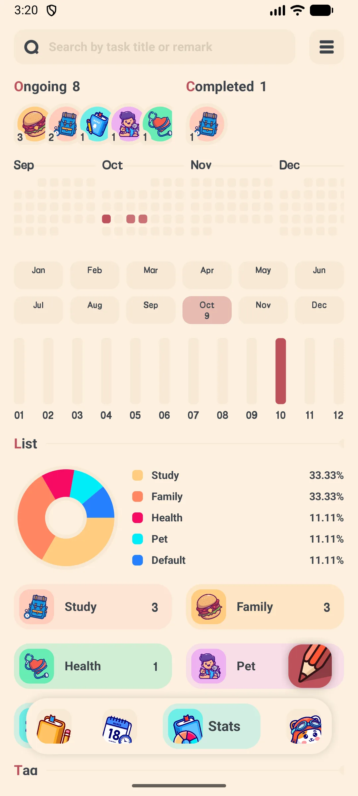{: width="180" .normal }
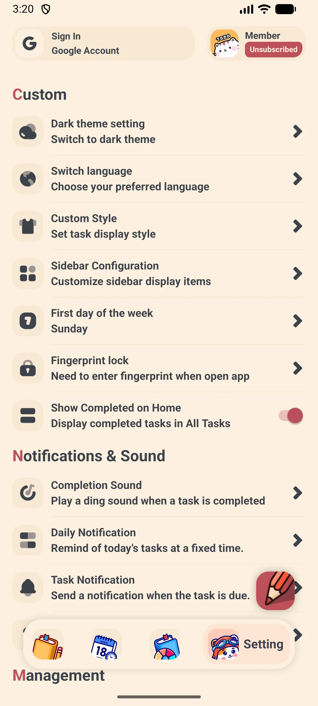{: width="180" .normal }

- แท็บล่างสี่ตัว: **งาน** **ปฏิทิน** **สถิติ** **การตั้งค่า**
- ปุ่มลอย **+** เพิ่มงานจากที่ใดก็ได้
- ถาดกรองด้านข้าง: ทั้งหมด / วันนี้ / พรุ่งนี้ / 7 วัน / เสร็จแล้ว รวมถึงหนังสือ (รายการ) และแท็กของคุณ

**🗓 การวางแผน**
- กำหนด **วันที่และเวลา** ในแต่ละงาน
- งานเกิดซ้ำ: รายวัน รายสัปดาห์ รายเดือน รายปี หรือกฎกำหนดเอง "ทุก N วัน/สัปดาห์"
- มุมมองปฏิทินด้วยตัวเลือก วัน / สัปดาห์ / เดือน

**📊 ข้อมูลเชิงลึก**
- แผนที่ความร้อนการมีส่วนร่วมและแผนภูมิวงกลมจัดกลุ่มตาม หนังสือ/แท็ก
- สรุปรายสัปดาห์ / รายเดือน / รายปี

**☁️ ปลอดภัยและเป็นส่วนตัว**
- เก็บในเครื่อง (ฐานข้อมูล Room); สำรอง Google Drive / WebDAV เลือกได้
- VIP ปลดล็อกโหมดมืด ล็อกแอป ส่งออก CSV และขีดจำกัดที่สูงขึ้น

## การใช้งานครั้งแรก

เมื่อเปิด Meow Todo List ครั้งแรก คุณจะเข้าสู่แท็บ **งาน** ทันที

- ปุ่ม **+** (ขวาล่าง) สร้างงาน
- **ถาด** ซ้าย สลับระหว่าง วันนี้ / พรุ่งนี้ / 7 วัน / เสร็จแล้ว รวมถึงหนังสือและแท็กที่คุณกำหนดเอง
- แถบล่าง สลับระหว่าง งาน / ปฏิทิน / สถิติ / การตั้งค่า

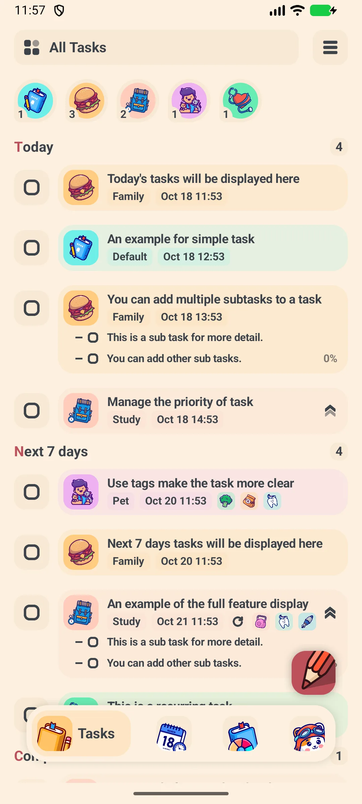{: width="180" .normal }

## การเพิ่มงาน

1. แตะปุ่ม **+**
2. พิมพ์ **ชื่องาน**
3. แตะแถว **วันที่** เพื่อเปิดป็อปอัปปฏิทิน; เปิด **เวลา** เพื่อกำหนดเวลาชัดเจน หรือปิดสำหรับงานตลอดวัน
4. เลือก **หนังสือ** (รายการ) — เช่น งาน ชีวิต เรียน
5. เลือกหนึ่งหรือมากกว่าหนึ่ง **แท็ก** เพื่อกรอง
6. กำหนด **ความสำคัญ** หากจำเป็น
7. แตะ **ยืนยัน** เพื่อบันทึก

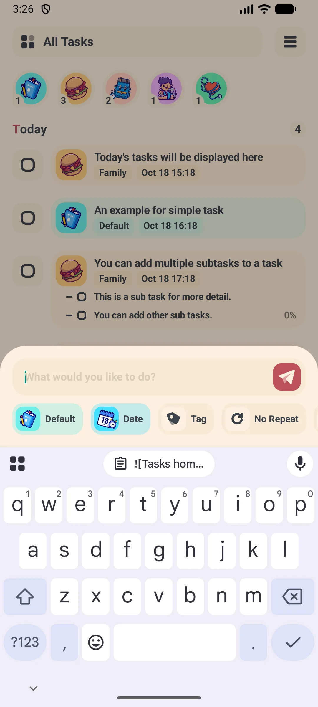{: width="180" .normal }
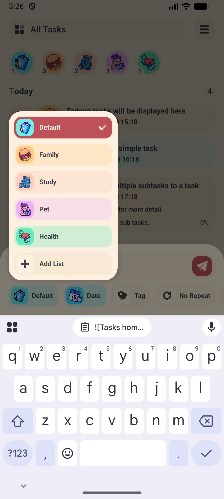{: width="180" .normal }
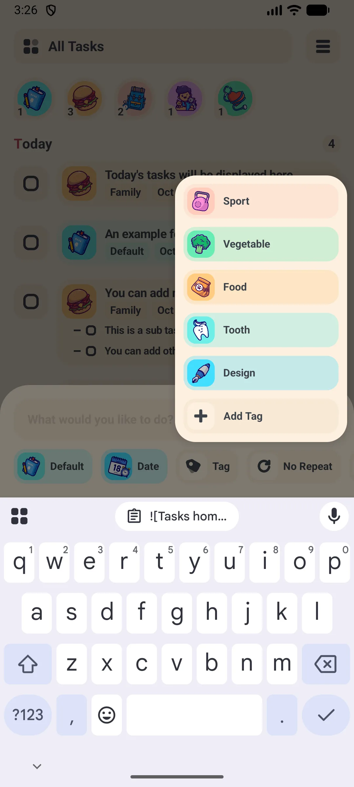{: width="180" .normal }
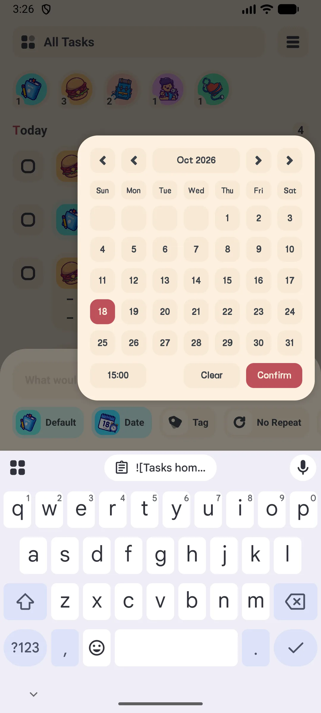{: width="180" .normal }
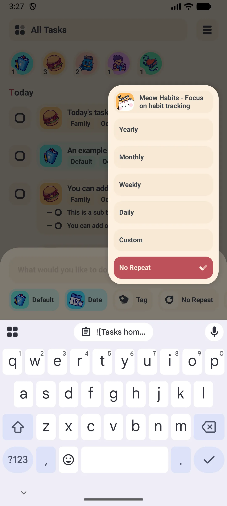{: width="180" .normal }

## งานย่อย

เปิดงาน แล้วใช้ช่อง **เพิ่มงานย่อย** ด้านล่างหน้ารายละเอียด

- พิมพ์งานย่อยและรายการจะเข้าสู่ลิสต์ทันที
- บัญชีฟรีเพิ่มได้ถึง **15 งานย่อย** ต่องาน; VIP ปลดขีดจำกัด **แอป subtask ฟรี** นี้
- ติ๊กเมื่อเสร็จ

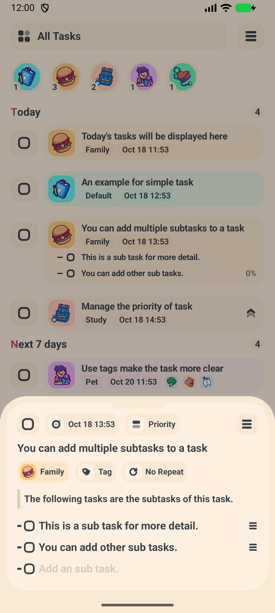{: width="180" .normal }
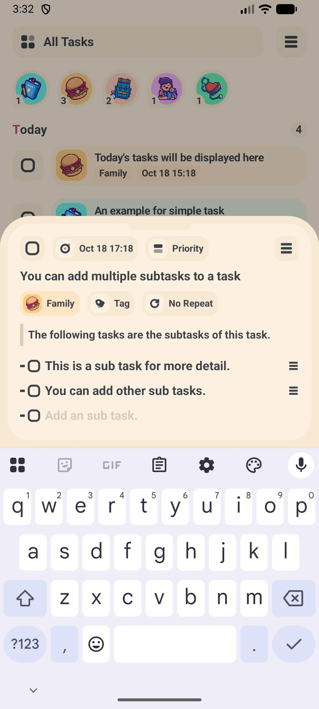{: width="180" .normal }

## การเตือน

การเตือนถูกกำหนดตารางด้วย **WorkManager** ดังนั้น **แอปเตือนความจำงาน** นี้ยังดังแม้คุณไม่เปิดแอป

1. ขณะแก้ไขงาน กำหนดวันที่/เวลา (การเตือนใช้เวลานั้น)
2. ตรวจให้แน่ใจว่าอนุญาตการแจ้งเตือนสำหรับแอป
3. แอปจัดตารางการเตือนใหม่โดยอัตโนมัติเมื่อแก้ไขงาน

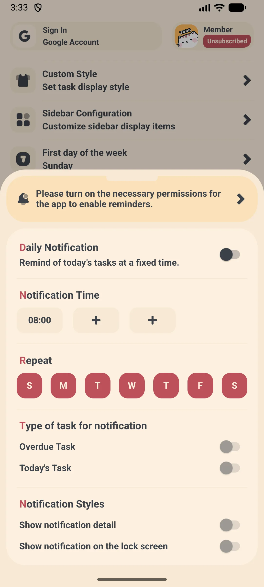{: width="180" .normal }
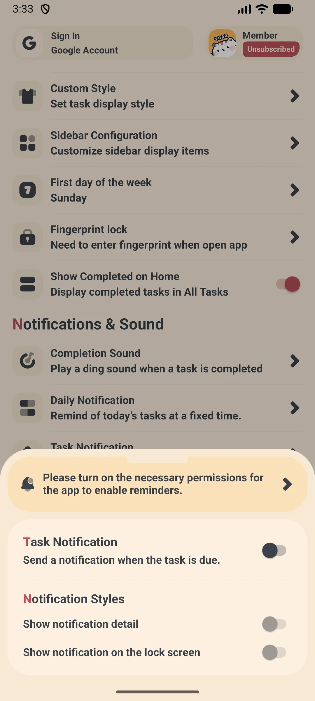{: width="180" .normal }
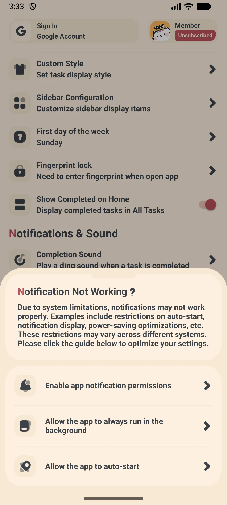{: width="180" .normal }

หากการเตือนไม่ปรากฏ ให้เปิดงานและตรวจสอบว่าวันที่/เวลาอยู่ในอนาคต แล้วอนุญาตการแจ้งเตือนในการตั้งค่าระบบ

## มุมมองปฏิทิน

1. สลับไปแท็บ **ปฏิทิน**
2. ใช้ตัวเลือก **วัน / สัปดาห์ / เดือน** มุมขวาบน
3. วันที่มีงานจะถูกทำเครื่องหมายจุดเล็ก
4. แตะวันใดเพื่อดูงานวันนั้น

{: width="180" .normal }
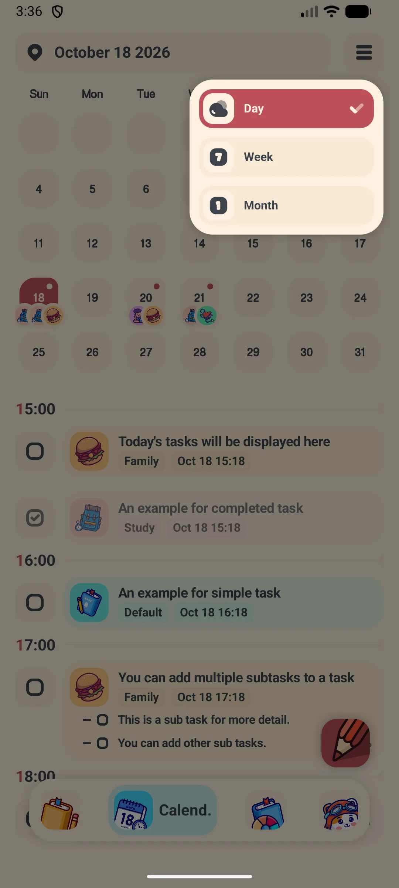{: width="180" .normal }
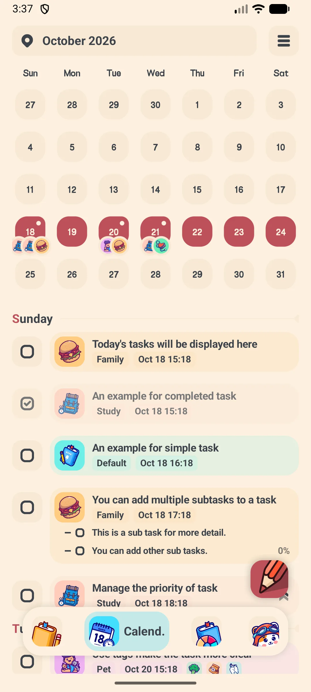{: width="180" .normal }
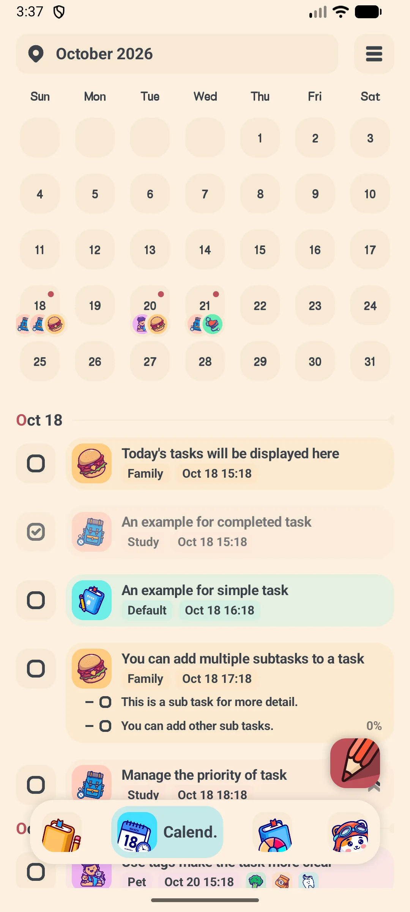{: width="180" .normal }

## สถิติ

1. เปิดแท็บ **สถิติ**
2. ดูแผนที่ความร้อนการมีส่วนร่วมและแผนภูมิวงกลม
3. เปลี่ยนช่วง (สัปดาห์ / เดือน / ปี) เพื่อดูแนวโน้มตามหนังสือและแท็ก

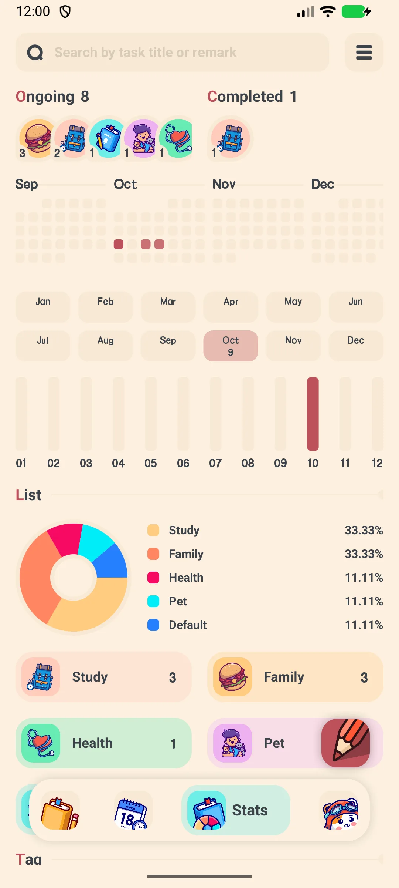{: width="180" .normal }
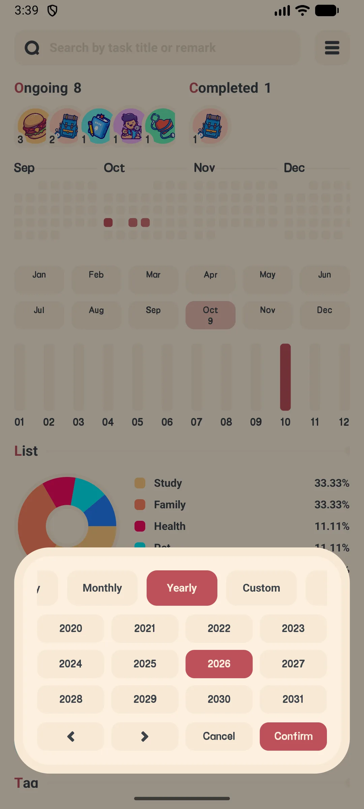{: width="180" .normal }

## รายการและแท็ก

- **หนังสือ (รายการ)** จัดกลุ่มงาน — เช่น งาน ท่องเที่ยว บัญชีฟรีสร้างได้ถึง **10 หนังสือ**
- **แท็ก** อำนวยการกรองข้ามรายการ — บัญชีฟรีสร้างได้ถึง **10 แท็ก**
- สร้างทั้งสองจากถาดหรือหน้าจอ การตั้งค่า → การจัดการ

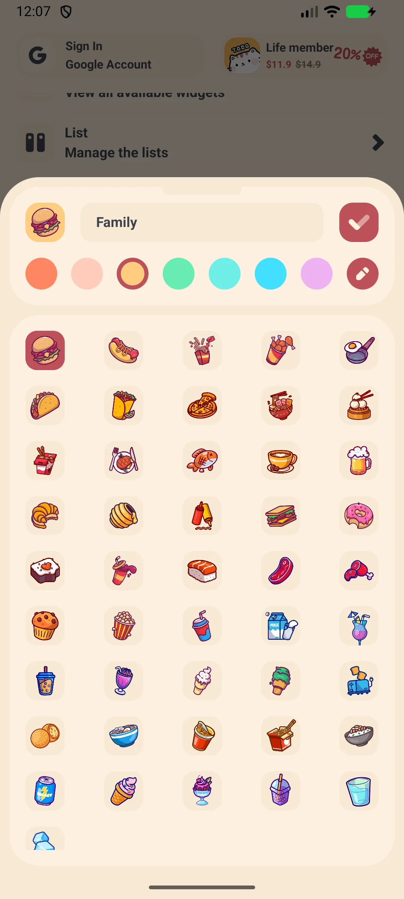{: width="180" .normal }

## สำรองและซิงโครไนซ์

1. เปิด **การตั้งค่า → การจัดการ → Google Drive** (หรือ **WebDAV**)
2. เข้าสู่ระบบ / กรอกเซิร์ฟเวอร์ บัญชี และรหัสผ่าน
3. แตะ **สำรอง** เพื่ออัปโหลด **กู้คืน** เพื่อดาวน์โหลด
4. เปิด **สำรองอัตโนมัติ** เพื่อสำรองเป็นระยะ

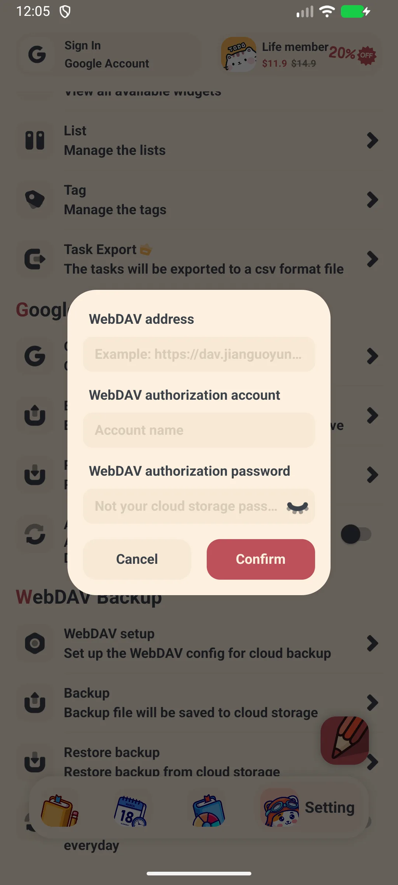{: width="180" .normal }

## ส่งออก CSV (VIP)

1. เปิด **การตั้งค่า → การจัดการ → ส่งออก**
2. กรองตาม หนังสือ / แท็ก / ความสำคัญ / ช่วงวันที่
3. แตะ **ส่งออก** แล้วแชร์ไฟล์ `.csv` (เปิดใน Excel หรือ Sheets)

**ส่งออก CSV** เป็นฟีเจอร์ **VIP**

## การตั้งค่า

การตั้งค่าครอบคลุม:

- **โหมดมืด** (VIP)
- **ล็อกแอป** — ลายนิ้วมือหรือรหัสผ่าน (VIP)
- **วันเริ่มต้นสัปดาห์** และ **ภาษา**
- มุมมอง **งานที่เสร็จแล้ว** (10 ล่าสุดโดยปริยาย พร้อม "แสดงทั้งหมด")
- **Google Drive / WebDAV** และ **วิดเจ็ต**

## สถานการณ์ทั่วไป

- **ช่วงสอบ** — ใช้มุมมองปฏิทินและการเตือนรายวันให้กำหนดส่งแต่ละวิชายังเห็นชัด จึงไม่มีอะไรหลุดระหว่างสัปดาห์
- **โครงการกลุ่ม** — สร้างหนึ่งหนังสือ (รายการ) ต่อโครงการและแท็กต่อสมาชิก แล้วแบ่งงานเป็นงานย่อยและส่งออก CSV เพื่อแชร์แผน
- **บันทึกออฟไลน์** — ขณะเดินทางไม่มีสัญญาณ เพิ่มงานทันที; ข้อมูลยังคงในเครื่องและเพิ่งซิงค์ไป Google Drive หรือ WebDav เมื่อคุณกลับออนไลน์
- **ความเป็นส่วนตัวสูงสุด** — เก็บ Room ท้องถิ่นคู่กับล็อกลายนิ้วมือแอปเลือกได้ รักษารายการสิ่งที่ต้องทำไม่ต้องบัญชีให้คงอยู่ในโทรศัพท์ ไม่ใช่บัญชีคลาวด์อื่น

## คำถามที่พบบ่อย

### จะแก้ไขหรือลบงานอย่างไร?
{:.faq-q}
เปิดงาน แก้ไขช่องแล้วแตะยืนยันเพื่อบันทึก ใช้เมนูจุดสามจุด (หรือกดค้าง) เพื่อลบ

### งานเกิดซ้ำทำงานอย่างไร?
{:.faq-q}
เมื่อคุณทำงานเกิดซ้ำเสร็จ แอปจะสร้างการปรากฏครั้งถัดไปโดยอัตโนมัติ (วัน +1 สัปดาห์ +7 เดือน +1 ปี +1 หรือช่วงกำหนดเอง) และหยุดตัวเก่า

### มีขีดจำกัดในเวอร์ชันฟรีไหม?
{:.faq-q}
งานทั้งหมดไม่จำกัด แต่หนังสือสูงสุด 10 แท็ก 10 และงานย่อย 15 ในเวอร์ชันฟรี เวอร์ชันฟรียังแสดงโฆษณา

## สรุป

Meow Todo List คือตัวจัดการงานที่เป็นมิตรและน่ารัก ครอบคลุมการบันทึกอย่างรวดเร็ว งานเกิดซ้ำ มุมมองปฏิทิน และสถิติ — พร้อมสำรอง Drive/WebDav รักษารายการสิ่งที่ต้องทำให้ปลอดภัย

## ศัพท์ที่เกี่ยวข้อง

- [แอป To-Do List คืออะไร?](/th/glossary/what-is-a-to-do-list/)
- [งานย่อย (Subtask) คืออะไร?](/th/glossary/what-is-a-subtask/)
