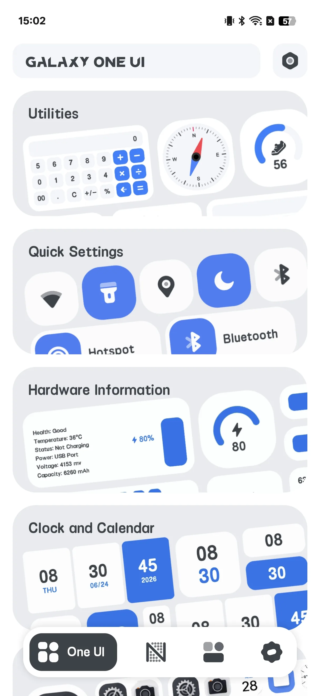
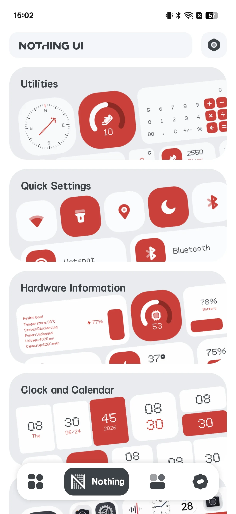
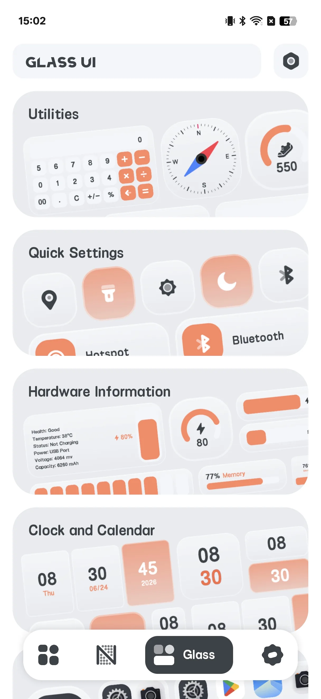
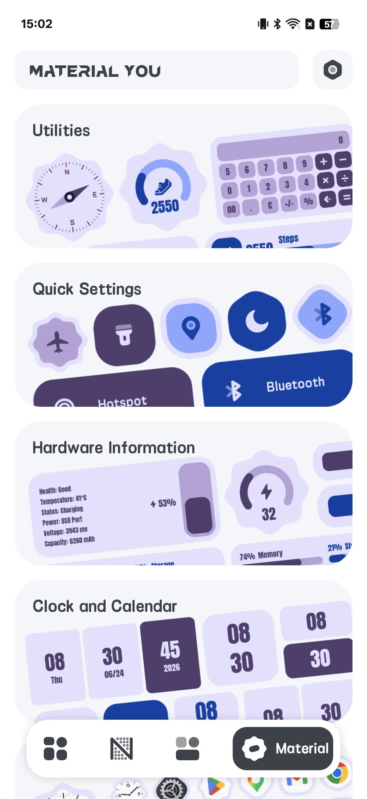
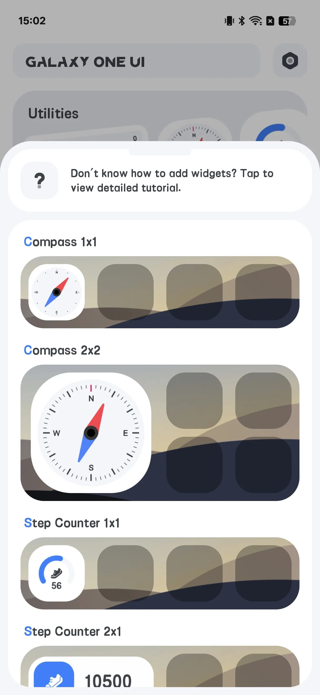
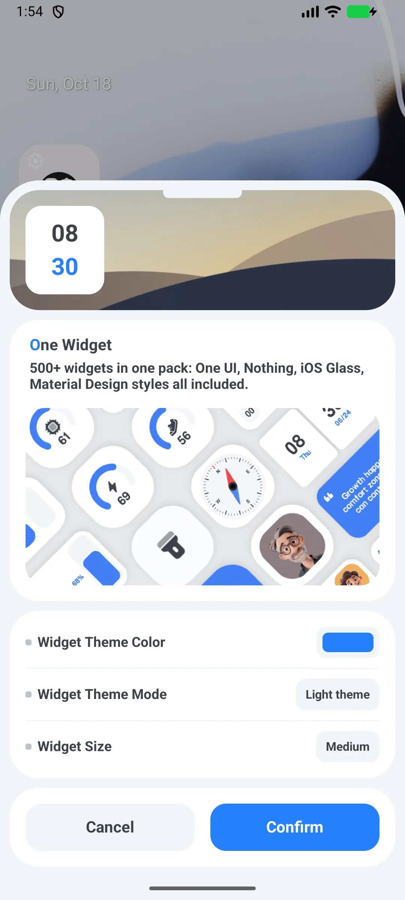

## สารบัญ

- [แนะนำแอป](#แนะนำแอป)
- [การใช้งานครั้งแรก](#การใช้งานครั้งแรก)
- [สำรวจ 4 สไตล์](#สำรวจ-4-สไตล์)
- [เพิ่มวิดเจ็ต](#เพิ่มวิดเจ็ต)
- [ตั้งค่าวิดเจ็ต](#ตั้งค่าวิดเจ็ต)
- [สวิตช์ด่วน](#สวิตช์ด่วน)
- [ทางลัดแอป](#ทางลัดแอป)
- [วิดเจ็ตข้อมูลสด](#วิดเจ็ตข้อมูลสด)
- [การตั้งค่า](#การตั้งค่า)
- [สถานการณ์ทั่วไป](#สถานการณ์ทั่วไป)
- [คำถามที่พบบ่อย](#คำถามที่พบบ่อย)

## แนะนำแอป

One Widget คือ **แอปวิดเจ็ต** ที่โหลด **วิดเจ็ตหน้าจอหลัก Android ที่ปรับแต่งได้ 500+ [วิดเจ็ตหน้าจอหลัก](/th/glossary/what-is-a-home-screen-widget/)** ในสี่สไตล์เทรนด์ ได้แก่ One UI Nothing Glass และ Material You พร้อมทางลัดแอปและสวิตช์ด่วน ใช้ได้โดยไม่ต้องบัญชี สำรวจคลังสไตล์ วางพรีเซ็ต แล้วปรับขนาด พื้นหลัง และรัศมีมุม คู่มือนี้ไล่รอบการใช้งานตั้งแต่เปิดครั้งแรกผ่านการเพิ่มวิดเจ็ต ทอกเกิล **วิดเจ็ตทางลัดแอป Android** ไปจนถึงข้อมูลนาฬิกา ปฏิทิน และแบตเตอรี่สด

**🎨 สี่สไตล์**
- **One UI** (ค่าเริ่มต้น; สไตล์เดียวที่มีในแอป "Lite" ฟรี)
- **Nothing**
- **Glass**
- **Material You**

> "Material You" ที่นี่คือ *ชื่อสไตล์* ที่ใช้พาเลต์วัน-กลางคืน น้ำเงิน/ม่วงตายตัว — ไม่ใช่สีไดนามิกตามวอลเปเปอร์ Android 12

**⚡ สวิตช์ด่วน**
- 11 สวิตช์: บลูทูธ ดาต้าเซลลูลาร์ Wi-Fi ไฟฉาย การหมุน เครื่องบิน ฮอทสปอต ห้ามรบกวน ตำแหน่ง สั่น โหมดมืด

**📱 ทางลัดและติดต่อแอป**
- launcher แตะเดียวสำหรับแอปของคุณและโทร/ลำโพง

**📊 ข้อมูลสด**
- วิดเจ็ตนาฬิกา ปฏิทิน แบตเตอรี่ และ RAM ที่อัปเดตในที่

**💲 สองแอป ไม่ใช่หนึ่ง**
- แอป **"Lite" ฟรี** (แค่สไตล์ One UI) และแอป **"เต็ม" จ่ายเงิน** (ทั้งสี่สไตล์) ไม่มีการซื้อในแอป — ติดตั้งแอปเต็มจาก Google Play เพื่อปลดล็อกทั้งหมด

## การใช้งานครั้งแรก

One Widget เปิดมาที่แกลเลอรี 4 แท็บคือ **One UI / Nothing / Glass / Material You** แต่ละแท็บแสดงหมวดวิดเจ็ต เช่น Tools Entry Hardware Clock Launcher Combo Note Contact แตะหมวดเพื่อดูตัวอย่าง แอป Lite ฟรีมีเฉพาะสไตล์ One UI ส่วนอีกสามสไตล์ต้องแอปเต็ม

- แต่ละหน้าสไตล์แสดงหมวด: Tools, Entry, Hardware, Clock, Launcher, Combo, Note, Contact
- แตะหมวดเพื่อดูตัวอย่างวิดเจ็ต

{: width="180" .normal }
{: width="180" .normal }
{: width="180" .normal }
{: width="180" .normal }

## สำรวจ 4 สไตล์

One Widget มี 4 สไตล์ให้สำรวจ คือ One UI Nothing Glass และ Material You โดยปัดแท็บด้านบนเพื่อดูตัวอย่างแต่ละแบบ One UI เป็นค่าเริ่มต้นและมีในแอป Lite ฟรี ขณะที่อีกสามสไตล์ต้องติดตั้งแอปเต็มที่จ่ายเงิน Material You ในที่นี้เป็นชื่อสไตล์ที่ใช้พาเลต์วัน-กลางคืนน้ำเงินและม่วงตายตัว ไม่ใช่สีไดนามิกตามวอลเปเปอร์ Android 12

## เพิ่มวิดเจ็ต

One Widget วางลงหน้าจอหลักผ่านเมนูวิดเจ็ตของระบบ โดยกดค้างหน้าจอหลัก เลือกวิดเจ็ต หา One Widget และเลือกตัวแปร ระบบจะเปิดหน้าตั้งค่าให้ปรับตัวเลือกก่อนแตะยืนยันเพื่อวาง การเพิ่มทำได้โดยไม่ต้อง root หรือบัญชี

1. กดค้างหน้าจอหลักของคุณ → **วิดเจ็ต**
2. หา **One Widget** ในรายการและเลือกตัวแปร
3. ระบบเปิดหน้า **ตั้งค่า** One Widget
4. ปรับตัวเลือกของคุณและแตะ **ยืนยัน** เพื่อวาง

{: width="180" .normal }

## ตั้งค่าวิดเจ็ต

One Widget ให้วิดเจ็ตส่วนใหญ่แชร์ตัวเลือกทั่วไปได้แก่ สีธีมจากพาเลต์ โหมดมืดหรือสว่าง รูปทรงวงกลมหรือสี่เหลี่ยมมน และขนาดกริดตั้งแต่ 1x1 ถึง 6x2 สีพื้นหลังไอคอนและรัศมีมุมสืบทอดจากรูปทรงที่เลือก การปรับเหล่านี้ทำให้วิดเจ็ตเข้ากับหน้าจอหลักได้ตามต้องการ

- **สีธีม** (พาเลต์ป๊อบอัพ)
- โหมด **มืด / สว่าง**
- **รูปทรง** — วงกลมหรือสี่เหลี่ยมมน
- **ขนาด** — ตัวเลือกกริดเช่น 1x1, 2x1, 4x1, 5x1, 6x1, 2x2, 4x2, 5x2, 6x2 (ถึง **6x2**)

สีพื้นหลังไอคอนและรัศมีมุมสืบทอดจากรูปทรง (วงกลม = ขนาด/2, มน = ขนาด/3)

{: width="180" .normal }

## สวิตช์ด่วน

One Widget มีสวิตช์ด่วน 11 ตัวครอบคลุมบลูทูธ ดาต้าเซลลูลาร์ Wi-Fi ไฟฉาย การหมุน เครื่องบิน ฮอทสปอต ห้ามรบกวน ตำแหน่ง สั่น และโหมดมืด วางทอกเกิลเดี่ยวหรือใช้วิดเจ็ต Combine 4x1 เพื่อรวมถึง 5 อันในแถบเดียว สวิตช์บางตัวสลับโดยตรง เช่น ไฟฉาย และบางตัวเปิดหน้าตั้งค่าระบบ ไม่ต้อง root

1. จากวิดเจ็ตทอกเกิล เลือกประเภททอกเกิล (Wi-Fi, บลูทูธ, ไฟฉาย, การหมุน, DND, …)
2. วางทอกเกิลเดียว หรือใช้วิดเจ็ต **Combine 4x1** เพื่อวางทอกเกิลถึง 5 อันในแถบเดียว (ค่าเริ่มต้น: บลูทูธ / Wi-Fi / ดาต้าเซลลูลาร์ / ไฟฉาย / การหมุน)
3. แตะทอกเกิลเพื่อทำงาน:
   - **ไฟฉาย** สลับไฟฉายจริง (`CameraManager`)
   - **Wi-Fi / บลูทูธ / DND** เปิดหน้าตั้งค่าระบบที่เกี่ยวข้อง
   - **การหมุน** เขียนการตั้งค่าหมุนอัตโนมัติระบบ

## ทางลัดแอป

One Widget สร้าง launcher แตะเดียวสำหรับแอปที่ติดตั้งและการโทร โดยตั้งค่ากล่องทางลัดแอปแล้วเลือกแอปจากรายการในแต่ละช่อง แตะวิดเจ็ตเพื่อเปิดแอปนั้นทันที หรือเปิด Google Play หากยังไม่ได้ติดตั้ง ทางลัดนี้ช่วยข้ามการค้นหาแอปบนหน้าจอหลัก

1. ตั้งค่ากล่อง **ทางลัดแอป**
2. แต่ละช่อง เลือกแอปที่ติดตั้งจากรายการ launcher
3. แตะวิดเจ็ตเพื่อเปิดแอปนั้น (หรือ Google Play หากยังไม่ติดตั้ง)

## วิดเจ็ตข้อมูลสด

One Widget มีวิดเจ็ตนาฬิกา ปฏิทิน แบตเตอรี่ และ RAM ที่อัปเดตในที่ วิดเจ็ตนาฬิกาวาดใหม่ตามวัฏจักรระบบประมาณทุก 30 นาทีและตอนขนาดเปลี่ยน วิดเจ็ตแบตเตอรี่และ RAM สอบถามสถิติอุปกรณ์ทุก 60 วินาทีโดยประมาณ โดยแบตเตอรี่อัปเดตทันทีจากสัญญาณการเปลี่ยนแปลง ข้อมูลสดจึงพร้อมในหน้าจอหลักโดยไม่ต้องเปิดแอป

- วิดเจ็ต **นาฬิกา** วาดใหม่บนวัฏจักรอัปเดตวิดเจ็ตระบบ (ทุก 30 นาที) และเมื่อขนาดเปลี่ยน
- วิดเจ็ต **แบตเตอรี่ / RAM** ถามสถิติอุปกรณ์ทุกๆ **60 วินาที** โดยประมาณ; แบตเตอรี่ยังอัปเดตทันทีจากสัญญาณการเปลี่ยนแบตเตอรี่
- วิดเจ็ตปฏิทิน / บันทึก คงที่หรือรีเฟรชบนวัฏจักร 30 นาที

## การตั้งค่า

One Widget รวมการตั้งค่าไว้ครอบคลุมโหมดมืด ภาษา หน่วยอุณหภูมิ ค่า แชร์ ฟีดแบ็ก ความเป็นส่วนตัว และเวอร์ชัน ผู้ใช้จึงปรับการแสดงผลและจัดการข้อมูลได้จากหน้าเดียว

## สถานการณ์ทั่วไป

One Widget ครอบคลุม 5 สถานการณ์ปรับหน้าจอหลักได้แก่ การจัดหน้าใหม่ใน 5 นาทีด้วยแกลเลอรี 4 แท็บที่เลือกสไตล์และวางวิดเจ็ตนาฬิกาหรือสภาพอากาศโดยไม่มีโค้ด การเข้ากับวอลเปเปอร์ด้วยสีธีม โหมดมืดสว่าง และรูปทรงวงกลมหรือมน การใช้สวิตช์ด่วนแตะเดียวในแถบ 4x1 และทางลัดแอปหรือติดต่อจากวิดเจ็ตเดียว รวมถึงการรองรับทุกอุปกรณ์ Android ทั้ง Galaxy Pixel และ Nothing

- **หน้าจอหลักใหม่ใน 5 นาที** — เปิดแกลเลอรีแท็บ 4 แตะสไตล์ เลือกวิดเจ็ตนาฬิกาหรือสภาพอากาศ แล้ววาง; ไม่มีตัวแก้ไข ไม่มีโค้ด
- **เข้ากับวอลเปเปอร์** — ปรับสีธีมและมืด/สว่าง เลือกรูปทรงวงกลมหรือมน และวิดเจ็ตกลมกลืนกับ launcher คุณ
- **สวิตช์ด่วนแตะเดียว** — วาง Wi-Fi บลูทูธ และไฟฉายในแถบ 4x1 เพื่อเลิกขุดในตั้งค่า
- **ทางลัดแอปและติดต่อ** — เปิด Chrome Maps หรือติดต่อโปรดจากวิดเจ็ตเดียว
- **ทุกอุปกรณ์ Android** — Galaxy Pixel และ Nothing รองรับทั้งหมด; แอป Lite ฟรีครอบคลุมสไตล์ One UI แอปเต็มปลดล็อกทั้งสี่

## คำถามที่พบบ่อย

### ทำไมฉันถึงใช้ Nothing / Glass / Material You ในแอปฟรีไม่ได้?
{:.faq-q}
แอปฟรีคือบิลด์ "Lite" ที่มีแค่สไตล์ One UI ติดตั้งแอปเต็มจ่ายเงินเพื่อปลดล็อกสไตล์อื่นสาม

### "Material You" เป็นธีมไดนามิกจริงๆ ไหม?
{:.faq-q}
นี่คือสไตล์ที่ใช้พาเลต์วัน-กลางคืน น้ำเงิน/ม่วงตายตัว ไม่ใช่สีไดนามิกตามวอลเปเปอร์

### ทอกเกิลต้อง root ไหม?
{:.faq-q}
ไม่ พวกมันใช้ API และการตั้งค่าระบบมาตรฐาน; ไฟฉายใช้ API ไฟฉายกล้อง

## สรุป

One Widget คือวิธีเร็วที่สุดในการให้หน้าจอหลัก Android ของคุณชุดเครื่องมือวิดเจ็ตครบจบมีสไตล์ — วิดเจ็ตร้อยตัวในสี่ลุค พร้อมสวิตช์ด่วนและทางลัดแอป

## ศัพท์ที่เกี่ยวข้อง

- [วิดเจ็ตหน้าจอหลักคืออะไร?](/th/glossary/what-is-a-home-screen-widget/)
- [Material You คืออะไร?](/th/glossary/what-is-material-you/)
- [Nothing UI คืออะไร?](/th/glossary/what-is-nothing-ui/)
- [Galaxy One UI คืออะไร?](/th/glossary/what-is-galaxy-one-ui/)
- [iOS Glass คืออะไร?](/th/glossary/what-is-ios-glass/)
