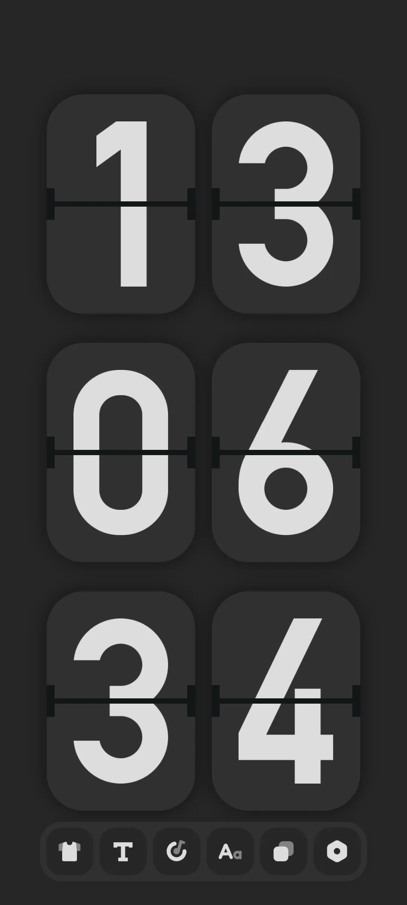
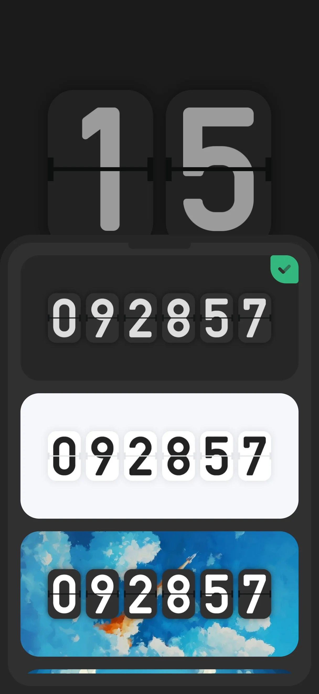
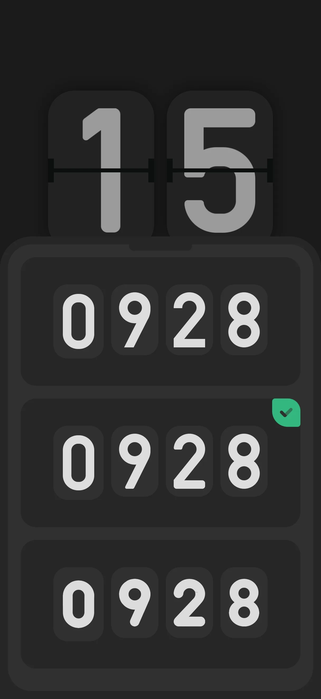
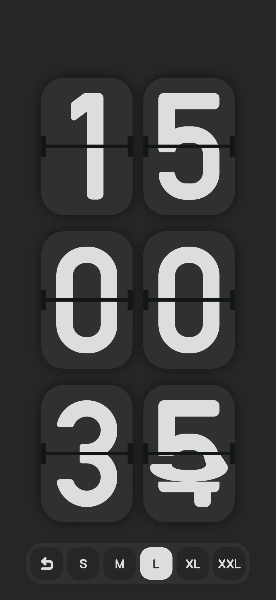
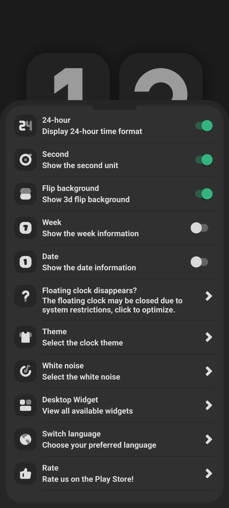
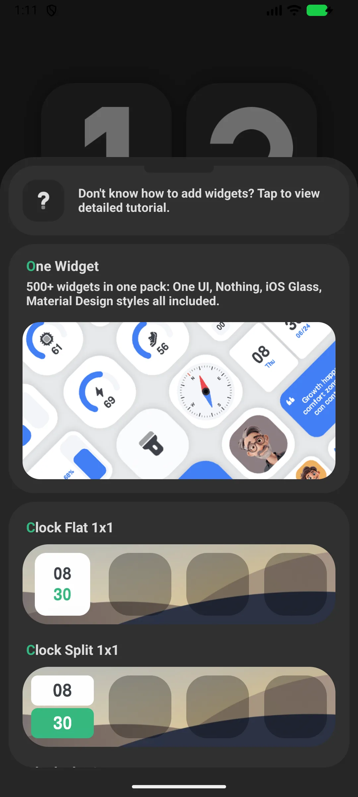
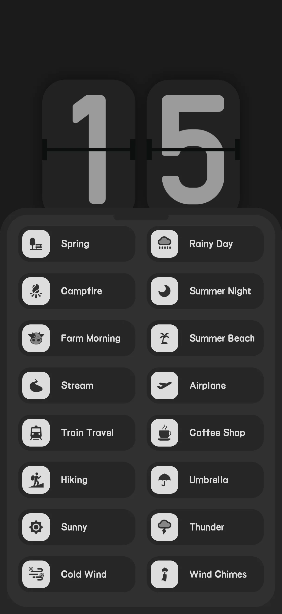
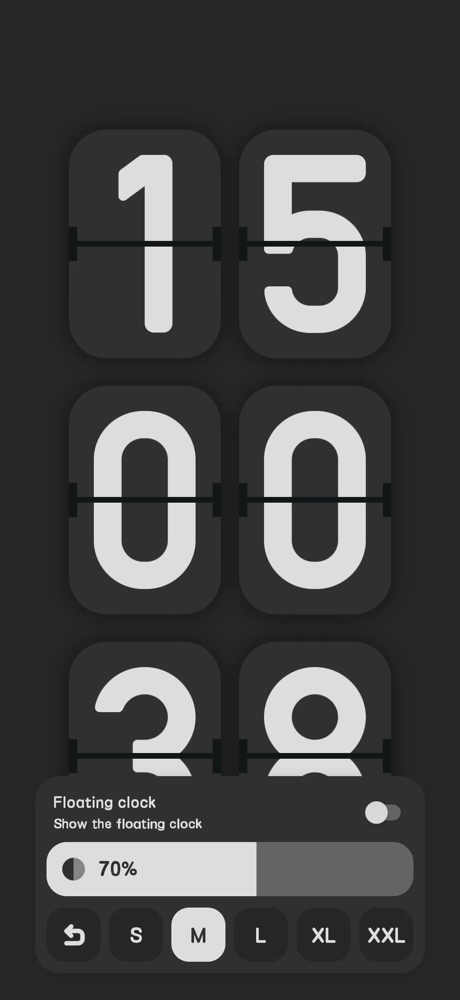

## สารบัญ

- [แนะนำแอป](#แนะนำแอป)
- [การใช้งานครั้งแรก](#การใช้งานครั้งแรก)
- [หน้านาฬิกาพลิก](#หน้านาฬิกาพลิก)
- [12/24-ชั่วโมง วินาที วันที่](#1224-ชั่วโมง-วินาที-วันที่)
- [วิดเจ็ตนาฬิกา](#วิดเจ็ตนาฬิกา)
- [ไวท์นอยส์](#ไวท์นอยส์)
- [นาฬิกาลอย](#นาฬิกาลอย)
- [โทรศัพท์เก่าเป็นนาฬิกา](#โทรศัพท์เก่าเป็นนาฬิกา)
- [ฟรี vs โปร](#ฟรี-vs-โปร)
- [สถานการณ์ทั่วไป](#สถานการณ์ทั่วไป)
- [คำถามที่พบบ่อย](#คำถามที่พบบ่อย)

## แนะนำแอป

Only Clock คือ **นาฬิกาพลิกหน้าจอเต็ม [flip clock](/th/glossary/what-is-a-flip-clock/)** ที่งดงามสำหรับ Android และ iOS — เปลี่ยนโทรศัพท์หรือแท็บเล็ตใดก็ได้ให้เป็นนาฬิกาโต๊ะหรือข้างเตียง มันทำหน้าที่เป็นแหล่ง **นาฬิกาพลิกพร้อมตัวจับเวลา Pomodoro โฟกัส** **นาฬิกาพลิกพร้อมไวท์นอยส์** และ **วิดเจ็ตนาฬิกาพลิก** ดังนั้นการติดตั้งเดียวครอบคลุมโต๊ะ ข้างเตียง และหน้าจอหลัก คู่มือนำทางจากการเปิดครั้งแรกผ่านการแสดงผล 12/24-ชั่วโมง ธีม และขนาดหลัก จากนั้นไปที่วิดเจ็ต เสียง และโหมดลอย — รวมถึงวิธี **ใช้งานโทรศัพท์เก่าเป็นนาฬิกา** โดยไม่ปล่อยจอสว่างเต็ม

**🕐 แอนิเมชันพลิก**
- การเปลี่ยนผ่าน page-flip ที่ราบรื่นเมื่อหลักเปลี่ยน (ประมาณ 600 มิลลิวินาทีต่อหลัก)
- ธีมหลากหลาย (เช่น ดำ ขาว ฟ้า)

**🪟 วิดเจ็ต**
- วิดเจ็ตนาฬิกา 18 ธีม พลัสวิดเจ็ตกริดนาฬิกา (1x1, 2x1, 2x2, 4x1, 4x2, แบน/แยก)

**🔊 ไวท์นอยส์**
- เสียงแวดล้อมในตัว (เครื่องเดียวกับแอปไวท์นอยส์ stand-alone) ช่วยโฟกัสหรือนอน

**📅 การแสดงผลยืดหยุ่น**
- สลับ 12/24-ชั่วโมง วินาที สัปดาห์ และวันที่

> หมายเหตุ: Only Clock เอง **ไม่มีตัวจับเวลา Pomodoro โฟกัส** — มันอยู่ในแอปน้องสาวแยก เสียงไวท์นอยส์นาฬิกาแค่ช่วยคุณมีสมาธิ

## การใช้งานครั้งแรก

เปิดแอปไปที่ **นาฬิกาพลิกหน้าจอเต็ม**

- แถบเครื่องมือ (บน) ให้เข้าถึงด่วนการตั้งค่า ธีม เสียง และขนาด
- หน้าจอคงเปิดขณะแสดงนาฬิกา

{: width="180" .normal }

## หน้านาฬิกาพลิก

นาฬิกาแสดงเวลาสไตล์พลิก แตะแถบเครื่องมือเพื่อเปลี่ยน **ธีม** (Clock Theme) **ฟอนต์** (Clock Font) และ **ขนาด** (Clock Size)

{: width="180" .normal }
{: width="180" .normal }
{: width="180" .normal }

## 12/24-ชั่วโมง วินาที วันที่

1. เปิด **การตั้งค่า**
2. สลับ:
   - **24-ชั่วโมง** (ค่าเริ่มต้นเปิด)
   - **วินาที** (ค่าเริ่มต้นเปิด)
   - **สัปดาห์** (ค่าเริ่มต้นปิด)
   - **วันที่** (ค่าเริ่มต้นปิด)
   - **หน้ากากพลิกพื้นหลัง** (ค่าเริ่มต้นเปิด)

{: width="180" .normal }

## วิดเจ็ตนาฬิกา

1. เปิด **การตั้งค่า → วิดเจ็ต**
2. เรียกดู **แกลเลอรี** 26 สไตล์
3. แตะสไตล์หนึ่ง → แอปแสดงคำแนะนำ "กดค้างหน้าจอหลักเพื่อเพิ่ม"
4. กดค้างหน้าจอหลัก/หน้าจอล็อก → วิดเจ็ต → เลือก Only Clock → วาง
5. วิดเจ็ตพลิก 4x2 มีการตั้งค่าของตัวเอง (วินาที / หน้ากาก / สัปดาห์ / วันที่)

{: width="180" .normal }

## ไวท์นอยส์

1. เปิด **การตั้งค่า → ไวท์นอยส์**
2. เลือกเสียงจากกริดสองคอลัมน์ (บางตัวพรีเมียม)
3. แตะเพื่อเล่น/หยุด

นาฬิกาแชร์เครื่องเสียงเดียวกับแอปไวท์นอยส์ stand-alone

{: width="180" .normal }

## นาฬิกาลอย

1. เปิดสวิตช์นาฬิกาลอยบนแถบเครื่องมือหน้าแรก
2. ให้สิทธิ์โอเวอร์เลย์หากถูกขอ
3. โอเวอร์เลย์นาฬิกาปรากฏเหนือแอปอื่น

{: width="180" .normal }

## โทรศัพท์เก่าเป็นนาฬิกา

เพราะหน้าจอคงเปิด (`FLAG_KEEP_SCREEN_ON`) และคุณสามารถวางวิดเจ็ตได้ โทรศัพท์หรือแท็บเล็ตเก่าทำงานได้ดีมากเป็นนาฬิกาโต๊ะ/ข้างเตียงเฉพาะ เพิกเฉยการเพิ่มประสิทธิภาพแบตเตอรี่เพื่อไม่ให้ปิด

## ฟรี vs โปร

- **ฟรี** แสดงโฆษณาและล็อกธีม/ฟอนต์/เสียงบางตัวไว้หลังโฆษณารางวัลหรือการซื้อ
- **โปร** ลบโฆษณาและปลดล็อกทั้งหมด

## สถานการณ์ทั่วไป

- **นาฬิกาข้างเตียงจากโทรศัพท์เก่า** — เปิด Only Clock เสียบโทรศัพท์ข้างเตียง และหน้าพลิกหรี่แสงแสดงเวลาตลอดคืนด้วยหน้าจอคงเปิด
- **จุดหมายโฟกัสบนโต๊ะ** — รันนาฬิกาหน้าจอเต็มพร้อมไวท์นอยส์ขณะบล็อกเรียน; โหมดลอยรักษาเวลาเหนือโน้ตหรือวิดีโอ
- **หน้าจอหลักเหลียวเดียว** — เพิ่มวิดเจ็ตพลิก 4x2 พร้อมวินาที สัปดาห์ และวันที่ ให้เวลาห่างแค่การมองเดียว
- **เข้ากับห้อง** — สลับธีม ดำ/ขาว/ฟ้า และฟอนต์/ขนาด ให้เข้ากับเซ็ตอัพคุณ

## คำถามที่พบบ่อย

### มีตัวจับเวลา Pomodoro โฟกัสใน Only Clock ไหม?
{:.faq-q}
ไม่ ตัวจับเวลาโฟกัสอยู่ในแอปแยก Only Clock เสนอแค่นาฬิกาพลิก วิดเจ็ต และไวท์นอยส์

### หน้าจอคงเปิดไหม?
{:.faq-q}
ใช่ — นาฬิกาใช้แฟล็ก keep-screen-on ขณะแสดง; สำหรับใช้งานข้างเตียง เพิกเฉยการเพิ่มประสิทธิภาพแบตเตอรี่ด้วย

## สรุป

Only Clock เปลี่ยนอุปกรณ์ใดก็ได้ให้เป็นจอแสดงนาฬิกาพลิกที่น่าทึ่งพร้อมวิดเจ็ตและไวท์นอยส์ที่ผ่อนคลาย — ฟรีให้เริ่ม ด้วยอัปเกรด Pro เพื่อลบโฆษณาและปลดล็อกธีมทั้งหมด

## ศัพท์ที่เกี่ยวข้อง

- [นาฬิกาพลิกคืออะไร?](/th/glossary/what-is-a-flip-clock/)
- [นาฬิกาข้างเตียงคืออะไร?](/th/glossary/what-is-a-nightstand-clock/)
