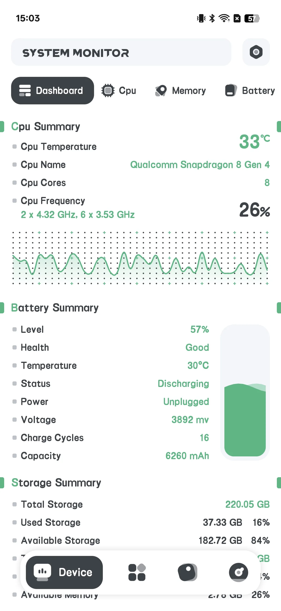
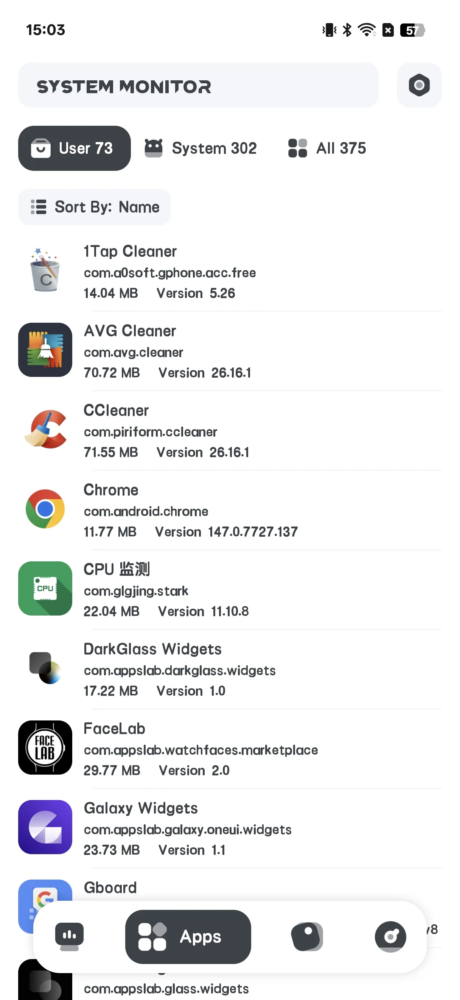
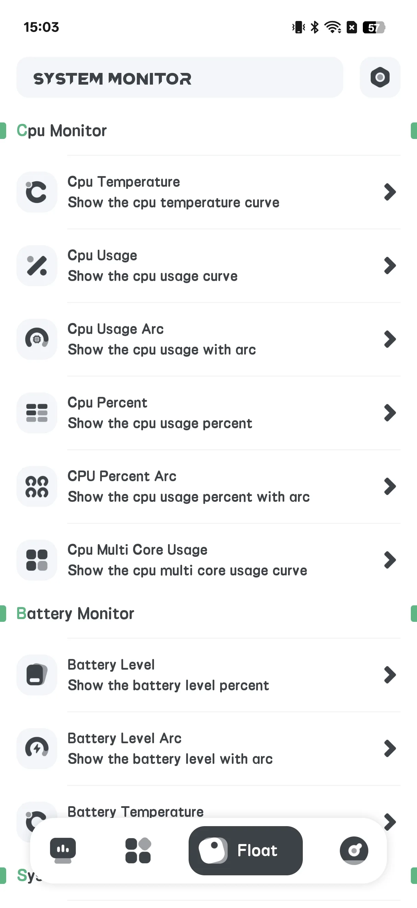
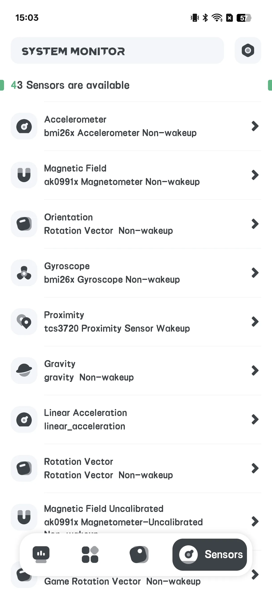
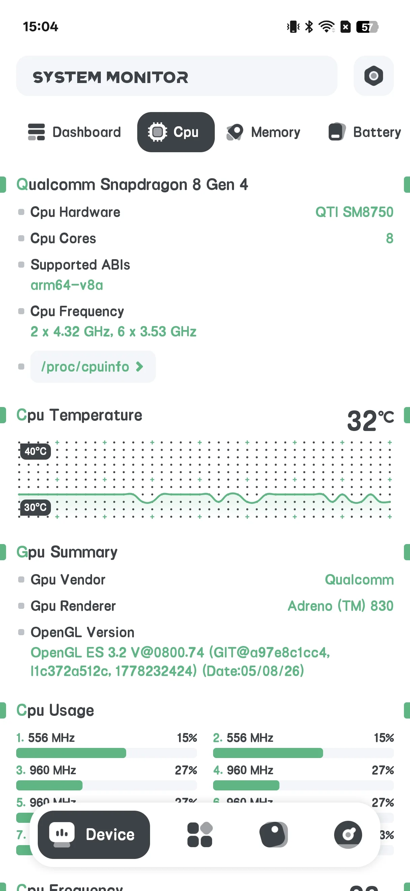
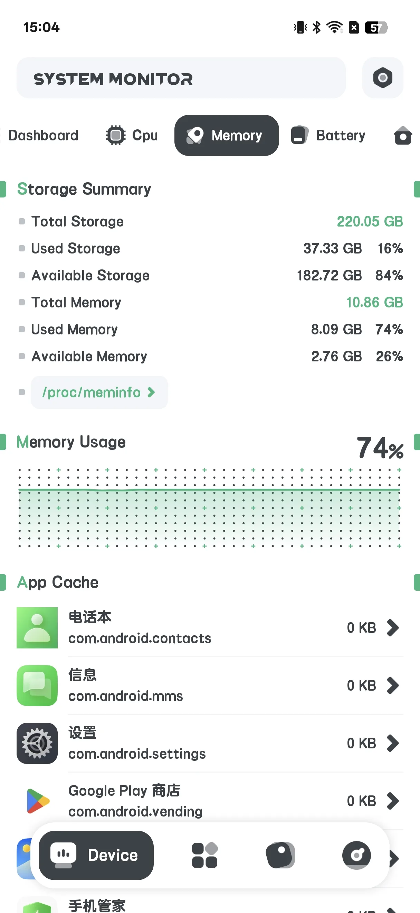
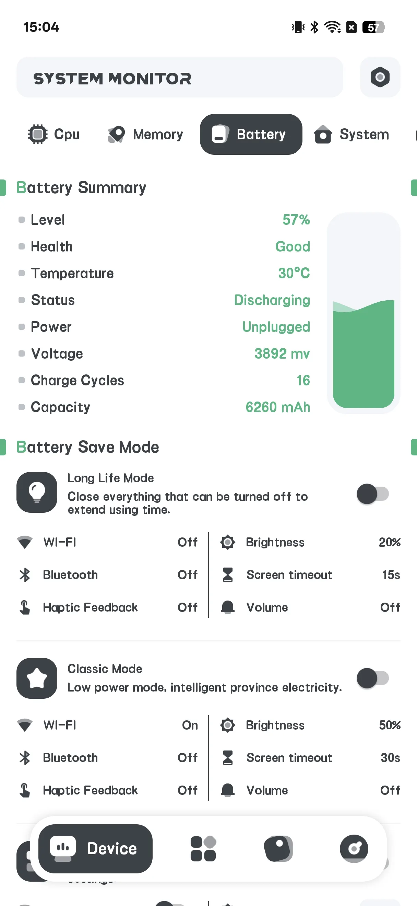
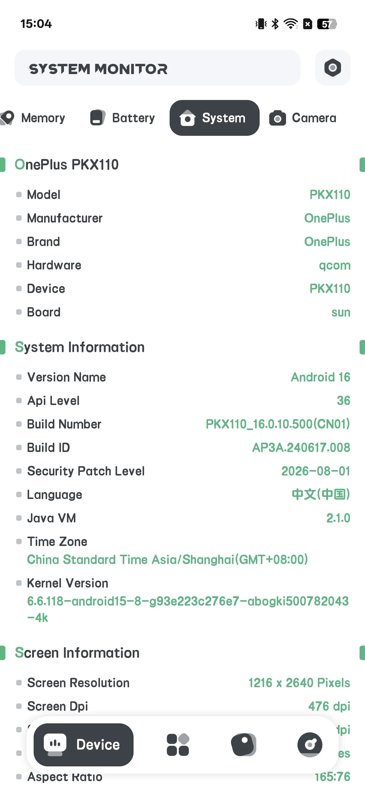
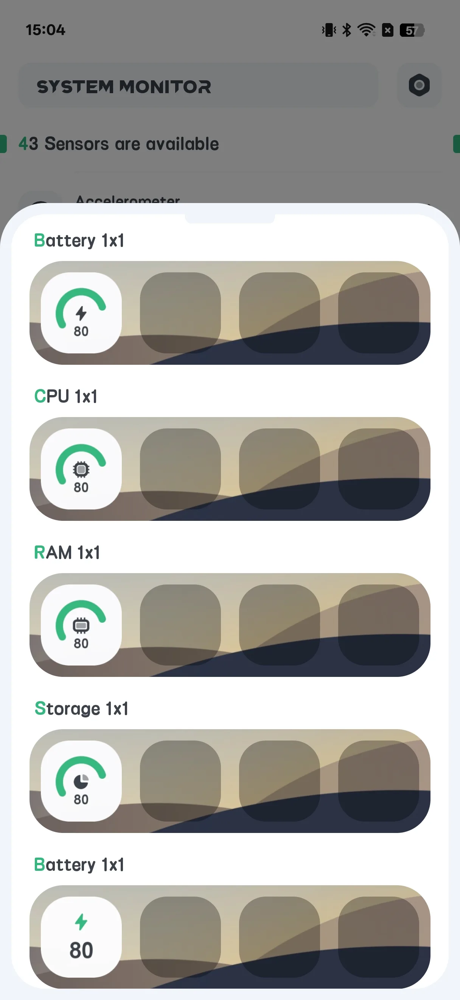

## สารบัญ

- [แนะนำแอป](#แนะนำแอป)
- [การใช้งานครั้งแรก](#การใช้งานครั้งแรก)
- [ดูข้อมูลฮาร์ดแวร์](#ดูข้อมูลฮาร์ดแวร์)
- [สุขภาพแบตเตอรี่](#สุขภาพแบตเตอรี่)
- [การเตือนความร้อนเกิน](#การเตือนความร้อนเกิน)
- [หน้าต่างลอย](#หน้าต่างลอย)
- [วิดเจ็ตหน้าจอหลัก](#วิดเจ็ตหน้าจอหลัก)
- [การตั้งค่า](#การตั้งค่า)
- [สถานการณ์ทั่วไป](#สถานการณ์ทั่วไป)
- [คำถามที่พบบ่อย](#คำถามที่พบบ่อย)

## แนะนำแอป

System Monitor คือเครื่องมือ Android **จ่ายครั้งเดียว** สำหรับ [การตรวจจับข้อมูลฮาร์ดแวร์อ่านอย่างเดียว](/th/glossary/what-is-a-system-monitor/) มันรายงานสิ่งที่เกิดขึ้นภายในโทรศัพท์คุณ — มัน **ไม่** ทำความสะอาด junk หรือ boost RAM เนื่องจากแค่อ่านตัวนับระบบ การค้นหา **System Monitor Android พร้อม cleaner และ booster** ที่พาคุณมาที่นี่มักอยากสองสิ่ง: ตัวเลขที่เชื่อถือได้ และวิธีทำให้คงที่ให้เห็นได้ คู่มือนำทางจากการเปิดครั้งแรกผ่านข้อมูลฮาร์ดแวร์ สุขภาพแบตเตอรี่ การเตือนความร้อนเกิน โอเวอร์เลย์ **System Monitor พร้อมหน้าต่างลอย** และวิดเจ็ตหน้าจอหลัก — ทั้งหมดอ่านอย่างเดียว ไม่มีบัญชี และไม่มีคำอ้างทำความสะอาด junk

**🔍 สิ่งที่มันอ่าน (อ่านอย่างเดียว)**
- **CPU** อุณหภูมิและความถี่ การใช้ต่อคอร์
- **พื้นที่จัดเก็บ** การใช้
- **หน่วยความจำ (RAM)** การใช้
- **แบตเตอรี่** สุขภาพ: อุณหภูมิ สถานะสุขภาพ แรงดัน และระดับ
- **กล้อง** ความสามารถ

**🌡 การป้องกันความร้อนเกิน**
- การเตือนที่แจ้งเมื่อ CPU หรือแบตเตอรี่ร้อน

**🪟 หน้าต่างลอยและวิดเจ็ต**
- โอเวอร์เลย์ลอยแสดงสถิตเรียลไทม์
- วิดเจ็ตหน้าจอหลัก: CPU / แบตเตอรี่ / RAM / ROM / Combine

> สำคัญ: System Monitor **ไม่มี app lock / ล็อกลายนิ้วมือ** และ **ไม่ทำความสะอาดหรือ boosting** แถว "Fingerprint: supported?" ที่คุณอาจเห็นเป็นเพียงค่าอ่านความสามารถอุปกรณ์ ไม่ใช่ฟีเจอร์ล็อก

## การใช้งานครั้งแรก

หน้าจอหลักมีสี่แท็บ: **Hardware**, **App**, **Floating**, **Sensor**

- **Hardware** คือหน้าข้อมูลหลัก
- **Floating** กำหนดค่าโอเวอร์เลย์
- **Sensor** แสดงรายการเซ็นเซอร์อุปกรณ์

{: width="180" .normal }
{: width="180" .normal }
{: width="180" .normal }
{: width="180" .normal }

## ดูข้อมูลฮาร์ดแวร์

1. เปิดแท็บ **Hardware**
2. สลับซับแท็บ: **Dashboard / CPU / RAM / BAT / SYSTEM / CAMERA**
3. อ่านค่าเรียลไทม์:
   - **CPU**: อุณหภูมิ ความถี่ ภาระต่อคอร์
   - **RAM**: หน่วยความจำที่ใช้ไป / รวม
   - **BAT**: อุณหภูมิแบตเตอรี่ สุขภาพ แรงดัน ระดับ
   - **SYSTEM**: พื้นที่จัดเก็บและข้อมูลอุปกรณ์

{: width="180" .normal }
{: width="180" .normal }
{: width="180" .normal }
{: width="180" .normal }

## สุขภาพแบตเตอรี่

ในซับแท็บ **BAT** คุณสามารถดู **อุณหภูมิ สถานะสุขภาพ แรงดัน และระดับ** แบตเตอรี่พร้อมเส้นโค้ง — มีประโยชน์เพื่อเฝ้าระวังการสึกหร่อตามเวลา

{: width="180" .normal }

## การเตือนความร้อนเกิน

1. เปิด **Settings → Alarm overheat** (หรือ **Temperature Alert**)
2. สลับการเตือน **CPU** และ/หรือ **แบตเตอรี่** ให้เปิด
3. ตั้งค่า **ขีดจำกัด** อุณหภูมิ
4. แอปเตือนคุณเมื่อค่าเกิน เพื่อคุณทำความเย็นโทรศัพท์

## หน้าต่างลอย

1. เปิดแท็บ **Floating**
2. สลับตัวตรวจสอบที่ต้องการ (อุณหภูมิ/การใช้/เส้นโค้ง CPU แบตเตอรี่ RAM System Monitor FPS)
3. ให้สิทธิ์ **"วาดทับแอปอื่น"** เมื่อถูกขอ
4. สถิตลอยปรากฏเหนือแอปใดๆ

{: width="180" .normal }

## วิดเจ็ตหน้าจอหลัก

1. เปิด **Settings → แกลเลอรีวิดเจ็ต**
2. เลือกวิดเจ็ต: CPU / แบตเตอรี่ / RAM / ROM / Combine
3. วางจากตัวเลือกวิดเจ็ต

{: width="180" .normal }

## การตั้งค่า

การตั้งค่าครอบคลุมธีม การเตือนความร้อนเกิน หน่วยอุณหภูมิ ระดับการรีเฟรช แกลเลอรีวิดเจ็ต และการกู้คืนหน้าต่างลอยอัตโนมัติ

## สถานการณ์ทั่วไป

- **อ่านอุณหภูมิ CPU ขณะเล่นเกม** — เปิดแท็บ Hardware (ซับแท็บ CPU) และเฝ้าดูอุณหภูมิและภาระต่อคอร์เพื่อจับ throttling ก่อนเฟรมตก
- **ปกป้องแบตเตอรี่** — ตรวจสอบเส้นโค้งอุณหภูมิ สุขภาพ แรงดัน และระดับซับแท็บ BAT เพื่อเฝ้าระวังการสึกหร่อที่พัฒนาระหว่างเดือน
- **มองโดยไม่เปิด** — เปิดโอเวอร์เลย์ Floating หรือวางวิดเจ็ต Combine บนหน้าจอหลักสำหรับ CPU/แบตเตอรี่/RAM เรียลไทม์เหลียวเดียว
- **ติดตั้งผู้เฝ้าระวังความร้อน** — เปิดการเตือนความร้อนเกินพร้อมขีดจำกัด เพื่อคุณถูกเตือนก่อนโทรศัพท์ร้อนทำลาย
- **รู้ว่าอะไรไม่ใช่** — จำว่าแบบอ่านอย่างเดียว: ไม่ทำความสะอาด junk หรือเคลียร์ RAM จึงปิดแอปหนักเอง

## คำถามที่พบบ่อย

### นี่ทำความสะอาดหน่วยความจำหรือพื้นที่จัดเก็บไหม?
{:.faq-q}
ไม่ System Monitor อ่านอย่างเดียวโดยเคร่งครัด — รายงานข้อเท็จจริงและไม่เคยลบไฟล์หรือ "boost" RAM

### มี app lock ไหม?
{:.faq-q}
ไม่ ไม่มีล็อกลายนิ้วมือหรือรหัสผ่านในแอปนี้

### ข้อมูลมาจากไหน?
{:.faq-q}
จาก API มาตรฐาน Android (เช่น BatteryManager และไฟล์ระบบ) ไม่มีอะไรถูกเปลี่ยน

## สรุป

System Monitor คือตัวเลือกสุจริตเมื่อคุณแค่อยาก *เห็น* ว่าด้านในโทรศัพท์มีอะไร — อุณหภูมิ CPU สุขภาพแบตเตอรี่ และสถิตเรียลไทม์ — โดยไม่มีตัวทำความสะอาดหรือ booster ดาวน์โหลดจ่ายครั้งเดียว

## ศัพท์ที่เกี่ยวข้อง

- [ตัวตรวจสอบอุณหภูมิ CPU คืออะไร?](/th/glossary/what-is-a-cpu-temperature-monitor/)
- [ตัวตรวจสอบระบบคืออะไร?](/th/glossary/what-is-a-system-monitor/)
- [ตัวเร่ง RAM คืออะไร?](/th/glossary/what-is-a-ram-booster/)
