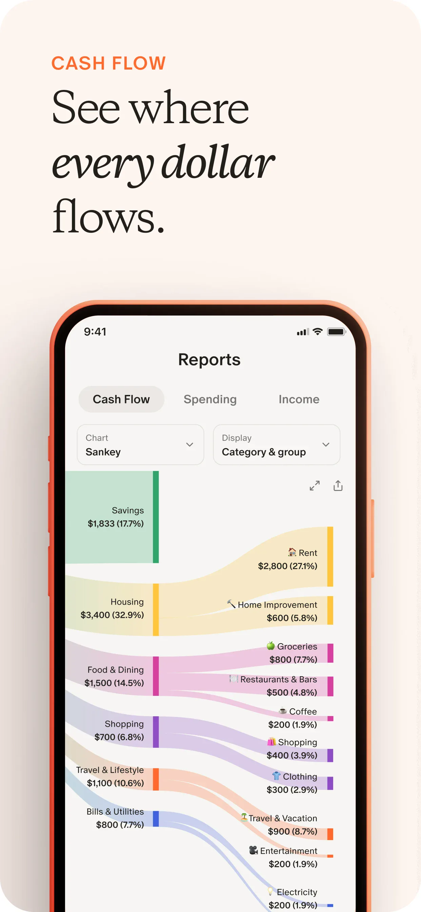
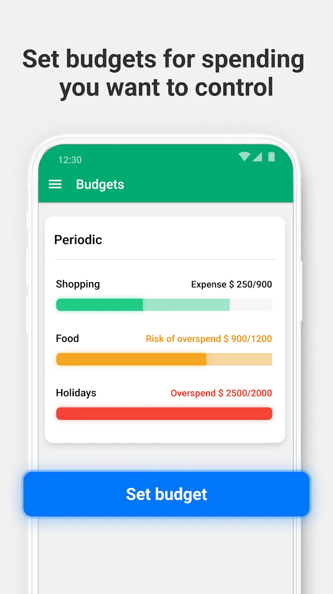
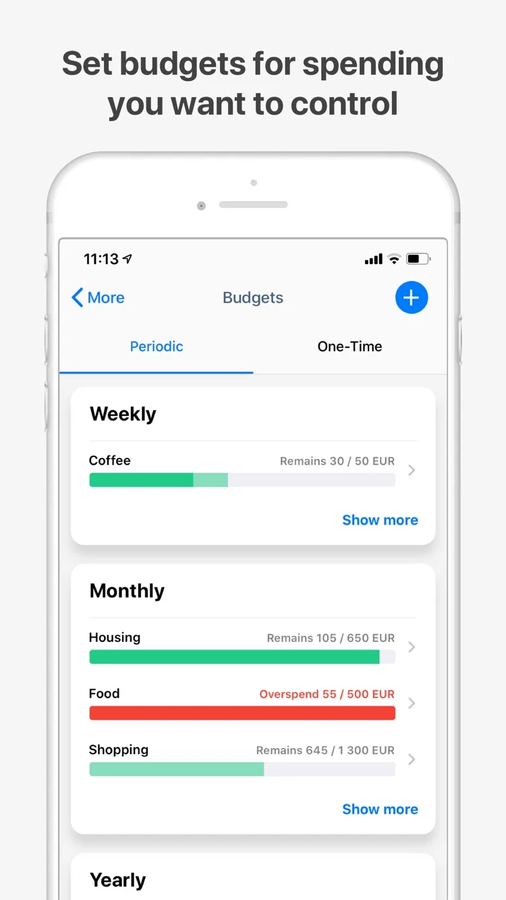

บทความ "เปรียบเทียบฟีเจอร์งบประมาณ" ส่วนใหญ่หยุดอยู่แค่ระดับ "มีงบต่อหมวด มีกราฟ มีการแจ้งเตือน" แต่จริงๆ แล้วสิ่งที่ตัดสินว่ากว่า **แอปบันทึกการเงิน** ตัวไหนสบายตอนใช้งาน คือคำถามพื้นฐานสามข้อ: **วัตถุของงบประมาณคืออะไร**, **เส้นแบ่งรอบระยะถูกตัดตรงไหน**, และ **เงินที่ไม่ได้ใช้ไปไหน** ยกตัวอย่าง "งบค่าอาหาร 2,000 บาท" — ที่ YNAB มันคือยอดคงเหลือของหมวดที่สะสมไปเรื่อยๆ; ที่ Goodbudget มันคือยอดซองที่เดินหน้าต่อ; ที่ Meow Money Manager มันคือหน้าต่างเวลาที่เลื่อนตามวันที่ — และทั้งสามแบบนิยาม "overbudget" ต่างกันอย่างมาก

บทความนี้พูดเฉพาะเรื่องฟีเจอร์งบประมาณ เราเจาะลึกกลไกงบประมาณของ **7 แอปยอดนิยม**: **YNAB**, **Monarch Money**, **Goodbudget**, **EveryDollar**, **PocketGuard**, **Wallet by BudgetBakers**, และ **Meow Money Manager**

> ขอบเขตการอ่าน: บทความนี้วิเคราะห์เฉพาะฟีเจอร์ **งบประมาณ** เท่านั้น ฟีเจอร์อื่นของแอปบันทึกการเงิน (ซิงค์ธนาคาร, รายงาน, จัดการบิล, หลายสกุลเงิน ฯลฯ) ไม่ได้เปรียบเทียบที่นี่

ถ้าสนใจเปรียบเทียบฟีเจอร์ทั้งหมดด้วย อ่าน: [Meow Money Manager vs YNAB: แอปจัดการงบประมาณไหนเหมาะกับคุณ?](/th/posts/vs-meow-money-and-ynab/), [ทางเลือก Mint ที่ดีที่สุด 2026](/th/posts/alternatives-to-mint/), และ [แอปบันทึกการเงินและงบประมาณที่ดีที่สุดสำหรับ Android (2026)](/th/posts/pillar-budget-expense-tracker-apps-android/)

## ภาพรวมอย่างรวดเร็ว: ตรวจสอบกลไกงบประมาณ 7 แอป

การเปรียบเทียบกลไกงบประมาณ 7 แอปตัดสินกันที่ 3 คำถามพื้นฐาน — วัตถุของงบประมาณคืออะไร เส้นแบ่งรอบระยะตัดตรงไหน และเงินที่ไม่ได้ใช้ไปไหน; งบค่าอาหาร 2,000 บาทที่ YNAB คือยอดคงเหลือหมวดที่สะสมต่อเนื่อง ที่ Goodbudget คือยอดซองที่เดินหน้าต่อ และที่ Meow Money Manager คือหน้าต่างเวลาที่เลื่อนตามวันที่ โดยทั้งสามแบบนิยาม overbudget ต่างกันอย่างมาก; 7 แอปแบ่งเป็นกลุ่มจัดสรร (YNAB, EveryDollar, Goodbudget) กลุ่มแผน (Monarch, PocketGuard, Wallet) และกลุ่มเพดาน (Meow Money Manager)

| แอป | วัตถุของงบประมาณ | รูปแบบรอบระยะ | Rollover | ค่าใช้จ่ายที่ไม่รายเดือน | สูตรหลัก |
|---|---|---|---|---|---|
| **Meow Money Manager** | งบหนึ่งอัน (รวมทั้งหมด หรือต่อหมวด) | วัน / สัปดาห์ / เดือน / ปี / กำหนดเอง, **หน้าต่างเลื่อน** | ไม่มี คำนวณหน้าต่างใหม่ทุกวัน | วันที่เริ่ม–จบกำหนดเอง | งบรายวัน = คงเหลือ ÷ วันที่เหลือ (เป็น 0 ถ้า overbudget) |
| **YNAB** | หมวด + Target | เดือนตามปฏิทิน | ยอดบวก rollover; ยอดลบถูกศูนย์และจัดการแยก | Yearly / Weekly / Custom Target | รายได้ − จัดสรร = Ready to Assign |
| **Monarch Money** | งบต่อหมวด หรือ bucket แบ่ง Fixed / Non-monthly / Flex | เดือนตามปฏิทิน | ทั้งกำไรและขาดทุน **rollover ด้วยกัน** | Bucket Non-monthly: เป้าหมาย + ความถี่ | rolloverที่แล้ว + แผนนี้ − จริงนี้ = rolloverถัดไป |
| **Goodbudget** | ซอง (Regular / Annual / Goal) | สัปดาห์ / ครึ่งเดือน / เดือน ฯลฯ | ยอดคงเหลือเดินหน้า ขึ้นอยู่กับวิธีเติม | ซอง Annual / Goal + วันครบกำหนด | (เป้าหมาย − ที่เติมแล้ว) ÷ รอบก่อนครบกำหนด |
| **EveryDollar** | หมวดและรายการย่อย | เดือนตามปฏิทิน สร้างใหม่ทุกเดือน | ไม่มี rollover เริ่มจากศูนย์ทุกเดือน | Sinking funds | รายได้ − ค่าใช้จ่าย = 0 |
| **PocketGuard** | งบต่อหมวด | เดือนตามปฏิทิน | ยอดเหลือนำไปบวกเดือนหน้า ขาดทุนถูกหัก | เป้าหมายและแผนปลดหนี้ | In My Pocket = รายได้ − บิล − ความต้องการ − เป้าหมาย |
| **Wallet** | งบตามหมวด / บัญชี / แท็ก | สัปดาห์ / เดือน / ปี / กำหนดเอง; เกิดซ้ำหรือครั้งเดียว | ยอดไม่ได้ใช้ rollover | งบเกิดซ้ำ + การจ่ายที่กำหนดการ | คงเหลือ = งบ − ที่ใช้ไป; รวมถึงพยากรณ์การใช้จ่าย |

การแบ่งที่ชัดเจนที่สุด: **YNAB, EveryDollar, Goodbudget คืองบแบบ "จัดสรร"** (เอาเงินใส่ช่องแล้วค่อยใช้); **Monarch, PocketGuard, Wallet คืองบแบบ "แผน"** (ตั้งเพดานไว้แล้วเทียบกับผลจริง); **Meow Money Manager คืองบแบบ "เพดาน"** (ให้หน้าต่างเวลาและเพดาน แล้วรายงานยอดเหลือและใช้ได้วันละเท่าไหร่) ไม่มีอันไหนดีกว่า — แต่ละแบบเหมาะกับสถานการณ์ต่างกัน

---

## สร้างกรอบการประเมินก่อน: 6 ความแตกต่างทางเทคนิคของฟีเจอร์งบประมาณ

### 1. วัตถุของงบประมาณ: ยอดบัญชีหรือขีดจำกัดค่าใช้จ่าย

กรอบประเมินฟีเจอร์งบประมาณมี 6 ความแตกต่างทางเทคนิคที่ตรวจได้ — วัตถุของงบ เส้นแบ่งรอบระยะ ความหมายของ rollover ค่าใช้จ่ายไม่รายเดือน วิธีคำนวณยอดเหลือ และแหล่งข้อมูล; YNAB และ Monarch ระบุชัดเจนว่าตัวเองคือ **งบกระแสเงินสด** ไม่ใช่งบยอดบัญชี โดยเอกสารของ Monarch ระบุว่ารายได้ลบค่าใช้จ่ายลบเงินออมก่อตัวเป็นสมการ `รายได้ = ค่าใช้จ่าย + ออม` และยอดบัญชีใช้สำหรับเป้าหมายระยะยาว ไม่ใช่การตัดสินใจรายวัน; YNAB วาง **Ready to Assign** ไว้บนสุดของแผน และยอด Available ของแต่ละหมวดต้องอธิบายได้ด้วยเงินก้อนนั้น

Meow Money Manager เลือกทางตรงข้าม: ไม่มีขั้นตอน "จัดสรร" และไม่ต้องกรอกรายได้ที่คาดหวัง งบหนึ่งอันคือ "ในหน้าต่างเวลานี้ กลุ่มค่าใช้จ่ายนี้ใช้ได้มากที่สุดแค่ไหน" — งบรวมให้เพดานเดียว งบต่อหมวดให้เพดานแต่ละหมวด และยอดที่ใช้ไปอัปเดตแบบสดขณะคุณบันทึก แปลว่า它 **ไม่บังคับให้คุณวางแผนรายได้ก่อน** แต่ก็ตอบไม่ได้ว่า "เดือนนี้เหลือจัดสรรเข้าออมเท่าไหร่"

### 2. เส้นแบ่งรอบระยะ: เดือนตามปฏิทิน, รอบงบประมาณ, หรือหน้าต่างเลื่อน

แอปส่วนใหญ่ใช้ **เดือนตามปฏิทิน** เป็นรอบงบประมาณเพราะตรงกับเงินเดือน ค่าเช่า บิล EveryDollar สร้าง [zero-based budgeting](/th/glossary/what-is-zero-based-budgeting/) ทุกเดือน; YNAB และ Monarch รัน rollover ทุกเดือน; งบต่อหมวดของ PocketGuard รีเซ็ตรายเดือน (เว้นแต่เปิด rollover)

Goodbudget ยืดหยุ่นกว่า: คุณเลือก "รอบงบประมาณหลัก" (เดือน ครึ่งเดือน สัปดาห์ ฯลฯ) และคำแนะนำเติมซอง Annual รายเดือนคือ "งบประจำปี ÷ จำนวนรอบงบประมาณในหนึ่งปี" — รอบเดือนแปลว่าหาร 12 ครึ่งเดือนหาร 24 ตัวอย่างทางการยังแสดงการหาร 8 สำหรับรอบครึ่งเดือน

**หน้าต่างเลื่อน** ไม่แคร์เดือนตามปฏิทิน: ไม่ใช่งบหนึ่งอันสำหรับพฤศจิกายนอีกอันสำหรับธันวาคม แต่เป็นงบเดือนเดียวที่ auto-กำหนดต้น–จบเดือนนี้ตามวันที่วันนี้ และ auto-เดินหน้าไปรอบถัดไปเมื่อถึงกำหนด ดีตรงไม่ต้องดูแลและเดินหน้าอัตโนมัติ; เสียตรงไม่มีประวัติเพดานเดือนที่แล้ว และดูไม่ได้ว่า "เดือนที่แล้วฉันตั้งเท่าไหร่"

### 3. ความหมายของ rollover: คำเดียว พฤติกรรมต่างกันสี่แบบ

คำเดียวกัน — [budget rollover](/th/glossary/what-is-budget-rollover/) — มีพฤติกรรมต่างกันมากในสี่ผลิตภัณฑ์:

- **YNAB**: Available บวกที่ปลายเดือนคงอยู่; Available ลบ **ไม่** ถูกนำเป็นติดลบไปเดือนหน้า แต่แสดงสีเทา 0 Overspending เงินสด (แดง) ถูกหักจาก Ready to Assign เดือนหน้า; overspending บัตรเครดิต (เหลือง) กลายเป็นหนี้ในหมวดปลดหนี้บัตรเครดิตที่คุณต้องเงินสดกันตรง FAQ ทางการตอบว่า "reimbursement จะทำให้ overspending rollover ไปเดือนหน้าได้ไหม? ไม่"
- **Monarch**: บวกและลบ rollover **ด้วยกัน** ด้วยสูตรชัดเจน `rolloverที่แล้ว + แผนนี้ − จริงนี้ = rolloverถัดไป` ตัวอย่างทางการ: overspend −25 เดือนที่แล้ว แผน 100 จริง 50 → rolloverถัดไป 25 rollover **ใช้ได้เฉพาะหมวดค่าใช้จ่าย ไม่ใช่หมวดรายได้**
- **PocketGuard**: ยอดไม่ได้ใช้ถูกนำไปบวกเพดานหมวดเดียวกันเดือนหน้า; ที่ overbudget ถูกหักจากเพดานเดือนหน้า
- **Goodbudget**: ซองคือยอดคงเหลือเดินหน้า ไม่ถูกรีเซ็ตรายเดือน; ว่าจะศูนย์หรือไม่ขึ้นกับคุณเลือกเติม "Add" หรือ "Set" (อธิบายข้างล่าง)
- **EveryDollar, Meow Money Manager**: ไม่มีแนวคิด rollover คำนวณใหม่ทุกรอบ / ทุกเดือน

### 4. ค่าใช้จ่ายที่ไม่รายเดือน: จะแบ่งค่าประกันรายปี ภาษี หรือของขวัญปีใหม่อย่างไร

นี่คือเส้นแบ่งระหว่าง "พอใช้" กับ "สบายตอนใช้งาน"

- YNAB ใช้ **Yearly Target**: กระจายยอดรายปีเป็นพรอมต์จัดสรรรายเดือน; พฤติกรรม `Set aside another` ทำให้เงินสะสมเดือนต่อเดือน
- Monarch ใช้ **bucket Non-monthly**: ตั้งเป้าหมายและความถี่ให้หมวด ระบบคำนวณยอดเติมรายเดือนอัตโนมัติ ตัวอย่างทางการ: ประกัน $600 จ่ายทุก 6 เดือน → ระบบคำนวณ $100/เดือน และ rollover เป็น 200, 300, 400, 500, 600 แล้วศูนย์ตอนจ่ายแล้วเริ่มใหม่ ความถี่ `variable` ไม่คำนวณอัตโนมัติ; คุณกำหนดเองรายเดือน
- Goodbudget ใช้ **ซอง Annual / Goal + วันครบกำหนด** สูตรข้างล่าง
- EveryDollar ใช้ [sinking fund](/th/glossary/what-is-a-sinking-fund/): คำแนะนำทางการ "หารยอดรวมด้วยจำนวนเดือนก่อนครบกำหนด เก็บนิดหน่อยทุกเดือน"
- Wallet ใช้งบเกิดซ้ำร่วมกับการจ่ายที่กำหนดการและพยากรณ์ค่าใช้จ่าย
- Meow Money Manager ใช้ **วันที่เริ่ม–จบกำหนดเอง**: คุณทำงบ 1–7 ตุลาคมสำหรับเที่ยวได้ แต่它 ไม่กระจายเป้าหมายรายปีไปแต่ละเดือนอัตโนมัติ

### 5. จริงๆ แล้ว "เหลือเท่าไหร่" คำนวณอย่างไร

ตัวเลขที่แอปแสดงดูคล้ายกันแต่ความหมายต่างกันไกล:

- **คงเหลือ**: Meow Money Manager `งบ − ที่ใช้ไป`; Wallet `งบ − ที่ใช้ไป`; Monarch แสดง `Remaining` และอาจรวมยอดเดือนที่แล้วถ้าเปิด rollover
- **เงินที่ใช้ได้อย่างปลอดภัย**: In My Pocket ของ PocketGuard คือ "รายได้หักบิล ความต้องการ เป้าหมายออม" มีมิติเวลา (ไม่เสียงบพรุ่งนี้)
- **ความหมายของความก้าวหน้า**: แถบของ Meow Money Manager แสดง **สัดส่วนคงเหลือ** (คงเหลือ ÷ รวม) ไม่ใช่สัดส่วนที่ใช้ไป; Monarch ใช้เขียว/เหลือง/แดงพร้อมสัญลักษณ์ "วันที่เท่าไหร่ของเดือน" เหลืองแปลว่าจังหวะนี้คุณจะ overbudget สิ้นเดือน; Spending Pace ของ PocketGuard ให้สามสถานะ On Pace / Under Pace / Over Pace; Target ของ YNAB เขียวแปลว่าได้แล้ว เหลืองแปลว่าต้องเติมให้ครบ
- **ต่อการคำนวณรายวัน**: "งบรายวัน" หารคงเหลือด้วยวันที่เหลือ; YNAB และ EveryDollar ไม่ทำ — เขาใช้ "ทุกดอลลาร์มีหน้าที่" เพื่อจัดจังหวะ

### 6. แหล่งข้อมูล: ซิงค์อัตโนมัติหรือกรอกเองในเครื่อง

YNAB, Monarch, PocketGuard, Wallet ต่างก็เอาซิงค์ธนาคารอัตโนมัติเป็นแหล่งหลัก (PocketGuard ระบุชัดว่า�用它 Plaid, Finicity, Salt Edge ครอบคลุมสหรัฐ แคนาดา อังกฤษ; Wallet อ้างว่าต่อได้ 15,000+ ธนาคาร) EveryDollar เวอร์ชันฟรีกรอกเองทั้งหมด นำเข้าอัตโนมัติมีแค่ Premium Goodbudget นำเข้ารายการจากธนาคารได้ แต่แก่นคือจัดการซองแบบกรอกเอง Meow Money Manager **ตั้งใจไม่ต่อเข้าบัญชีธนาคาร** — ทุกรายการกรอกเองหรือสร้างอัตโนมัติตามรอบ ข้อมูลอยู่ในเครื่อง ด้วยเหตุนี้มันจึงเป็น **แอปบันทึกการเงินไม่มีบัญชี** และ **แอปบันทึกการเงินแบบส่วนตัว** โดยสมบูรณ์ รองรับ **หลายสกุลเงินรวมบาทไทย** ในโหมดออฟไลน์

นี่กำหนดตรงๆ ว่า "เรียลไทม์" ของงบ vs "ค่าความเป็นส่วนตัว": งบซิงค์อัตโนมัติแทบไม่ต้องดูแล แต่ต้องยอมให้สิทธิ์อ่านบัญชี; งบกรอกเองในเครื่องต้องใช้เวลาสิบกว่าวินาทีบันทึกทุกวัน แต่ไม่มีบัญชีแยกในคลาวด์

---

## เจาะลึก 7 แอปทีละตัว

การเจาะลึก 7 แอปครอบคลุม Meow Money Manager, YNAB, Monarch Money, Goodbudget, EveryDollar, PocketGuard และ Wallet by BudgetBakers โดยแต่ละตัวถูกดูผ่านกลไกเดียวกันทั้งวัตถุงบ รอบระยะ rollover การกระจายค่าใช้จ่ายไม่รายเดือน และแหล่งข้อมูล; ทั้ง 7 มีจุดแข็งต่างกัน — บางตัวคำนวณอัตโนมัติ บางตัวให้คุณกำหนดเอง และ Meow Money Manager เป็นเพียงตัวเดียวที่ตั้งใจไม่ต่อธนาคารและเก็บข้อมูลในเครื่อง

### Meow Money Manager: รอบระยะเลื่อนและงบรายวัน

งบของ它 ไม่บังคับวางแผนรายได้ก่อน และไม่มีขั้นตอน "จัดสรรเงินเข้าหมวด": คุณให้หน้าต่างเวลาและเพดาน มันรายงานยอดเหลือและใช้ได้วันละเท่าไหร่เรื่อยๆ เราเจาะลึกตามฟีเจอร์

<!-- Meow screenshot 1/3: reuses in-site budget_manage.webp; swap for a newer UI shot by replacing the same file -->
{: width="180" .normal }
{: width="180" .normal }
<!-- Meow screenshot 3/3: reuses in-site budget_add_category.webp; swap for a newer UI shot by replacing the same file -->
{: width="180" .normal }

#### สองรูปแบบงบ: รวมและต่อหมวด

งบหนึ่งอันอาจเป็น **งบรวม**: เพดานเดียวสำหรับทั้งหน้าต่างที่ครอบคลุมค่าใช้จ่ายทั้งหมดในนั้น; หรือ **[งบต่อหมวด](/th/glossary/what-is-a-category-budget/)**: เลือกหลายหมวดค่าใช้จ่าย แต่ละหมวดได้เพดานเอง รวมกันคือผลบวกของเพดานหมวด มันไม่รองรับโครงสร้างสองชั้น "งบย่อยใต้งบรวม" และ **จำนวนหมวดที่เลือกไม่จำกัด**

งบต่อหมวดรองรับหมวดแม่–ลูก: เลือกแม่ "อาหาร" จะรวมลูก ("มื้อเช้า", "สั่งกลับบ้าน") โดยอัตโนมัติโดยไม่ต้องติ๊กทีละอัน ยอดที่ใช้ไปคำนวณตามหน้าต่างเวลาปัจจุบัน ตัวเลขเปลี่ยนเมื่อหน้าต่างเลื่อน

#### ห้ารอบระยะและหน้าต่างเลื่อน

รอบระยะมี **วัน สัปดาห์ เดือน ปี กำหนดเอง** รอบกำหนดเองตั้งวันที่เริ่ม–จบได้ (เริ่มไม่ควรเลยจบ); วันเริ่มสัปดาห์และเดือนก็ตั้งได้ ทำให้ "เงินเดือนวันที่ 25 คิดหนึ่งเดือนจาก 25 ถึง 24 เดือนหน้า" ติดตั้งได้ทันที

มันใช้ **หน้าต่างเลื่อน**: ต้น–จบรอบนี้ถูกกำหนดอัตโนมัติตามวันที่วันนี้; งบเดือนเดียว auto-เดินหน้าไปเดือนถัดไปโดยไม่ต้องสร้างใหม่และไม่ต้องงบใหม่สำหรับรอบถัดไป ไม่ต้องดูแล; เสียตรงไม่มีประวัติเพดานเดือนที่แล้ว ดูไม่ได้ว่า "เดือนที่แล้วฉันตั้งเท่าไหร่"

#### วันที่เหลือและงบรายวัน

วันที่เหลือคำนวณตามรอบ: งบรายวัน = 1 วัน งบสัปดาห์ = วันที่เหลือในสัปดาห์นี้ งบเดือน = วันที่เหลือในเดือนนี้ (ได้รับผลจากวันเริ่มเดือนกำหนดเอง) งบปี = วันที่เหลือในปีนี้ รอบกำหนดเอง = วันที่เหลือในช่วง และไม่เป็นลบเด็ดขาด

เหนือขึ้นมาคือ **งบรายวัน**: หารคงเหลือด้วยวันที่เหลือ เก็บ 4 ทศนิยม ปัดเศษ ถ้า overbudget แล้ว คิดเป็น 0 — ไม่มี "ยังซื้อได้ −฿12.50/วัน"; วันสุดท้ายหรือรอบเลย แสดงคงเหลือตรงๆ โดยไม่หาร

แถบความก้าวหน้าแสดง **สัดส่วนคงเหลือ** ไม่ใช่สัดส่วนที่ใช้ไป: แถบสั้นลงแปลว่าคงเหลือน้อยลง และตอน overbudget แถบว่าง — กลับกับแอปส่วนใหญ่ อย่าอ่าน "แถบสั้น" เป็น "เพิ่งเริ่มใช้"

#### วิธีคำนวณยอดที่ใช้ไป

งบรวมรวมค่าใช้จ่ายทั้งหมดในหน้าต่าง; ส่วนต่างของ reimbursement และค่าธรรมเนียมโอนก็เข้านับนี้ ไม่ใช่แค่ "ยอดค่าใช้จ่ายรวม"

งบต่อหมวดจัดกลุ่มตามหมวด และมีสองรายละเอียดที่พลาดง่ายแต่กระทบความแม่นยำของตัวเลขโดยตรง:

1. **รวมอัตโนมัติแม่–ลูก**: เลือกแม่เพื่อครอบคลุมลูกทั้งหมด ไม่ต้องติ๊กทีละอัน
2. **reimbursement นับเท่ากับสุทธิที่ยังไม่ได้จ่าย**: ค่าใช้จ่ายงานที่เบิกคืนแล้วไม่กินเพดาน; ถ้าบางส่วน จะนับแค่ส่วนที่ยังไม่จ่าย

สำหรับคนจ่ายเงินล่วงหน้าให้งานบ่อย ข้อ 2 แม่นยำกว่าการ "มอง reimbursement เป็นรายได้" มาก และเป็นวิธีที่หายากใน 7 แอปนี้ ขอบเขตการนับตรงกับหน้าต่างรอบปัจจุบันเสมอ

#### กฎการสร้าง โควตาฟรี และวิดเจ็ตหน้าหลัก

การสร้างงบต้องเลือกรอบ ใส่ชื่อ ให้จำนวน: จำนวนงบรวมต้อง > 0 เพดานแต่ละหมวดในงบต่อหมวดต้อง > 0; รอบกำหนดเองก็ต้องวันที่เริ่ม–จบ งบต่อหมวดตอนนี้ **ครอบคลุมแค่หมวดค่าใช้จ่าย** หมวดรายได้ไม่ได้งบเอง

เวอร์ชันฟรีได้สูงสุด **3 งบ** อันที่ 4 ต้องเปิด VIP; แต่งบหนึ่งอันจุกหมวดค่าใช้จ่ายเท่าไหร่ก็ได้ หมวดเรียงลำดับด้วยการลาก ลำดับถูกบันทึกกับงบ เมื่อเพิ่ม แก้ไข หรือลบงบ วิดเจ็ตหน้าหลักก็รีเฟรช แต่ละงบแสดงรวมและคงเหลือของตัวเอง

#### ขอบเขตความสามารถที่ชัดเจน

มันไม่มี rollover ข้ามรอบ ไม่สร้างหลายรอบอัตโนมัติต่อรอบ ไม่มีหลายสกุลเงินระดับงบ (หลายสกุลเงินคือสัญลักษณ์โลกและความสามารถหลายสมุดบัญชี ไม่ใช่มิติงบ) ไม่มีแจ้งเตือน push overbudget ไม่มีแชร์งบ ไม่มีกราฟเทรนด์ประวัติ ไม่มีงบต่อหมวดรายได้ และไม่มีเทมเพลตงบหรือกระจายเป้าหมายอัตโนมัติ บทบาทของ它 คือ **กระดานเพดาน** ที่ออฟไลน์ เบา และเน้นชัดเจน ไม่ใช่ระเบียบวิธีงบประมาณ

### YNAB: ขับด้วย Target พร้อม overspend สองทางเงินสดและบัตร

{: width="180" .normal }
{: width="180" .normal }

หน่วยงบของ YNAB คือ **หมวด + Target** Target มีสองมิติ:

- **ชนิด** กำหนดความถี่: `Monthly` (ทุกเดือนตามปฏิทิน), `Yearly` (กระจายยอดรายปีเป็นพรอมต์ออมรายเดือน), `Weekly` (เกิดซ้ำในเดือน), `Custom` (ค่าใช้จ่ายนอกจังหวะมาตรฐาน)
- **พฤติกรรม** กำหนดสิ่งที่พรอมต์ตอนรีเซ็ต: `Set aside another` ทุกรอบเรียกเต็มเป้าหมายแม้มีเหลือเดือนที่แล้ว — เหมาะสำหรับออมและค่าใช้จ่ายไม่รายเดือนที่ต้องสะสม; `Refill up to` แค่ขอเติมให้ถึงเป้าหมาย ยอดเหลือเดือนที่แล้วอาจลด — เหมาะหมวด "เดือนละไม่เกินเท่านี้"

ความก้าวหน้าใช้เขียว (ถึงแล้ว) และเหลือง (ต้องเติมให้ครบ) เมื่อติด Target แล้ว YNAB พรอมต์ให้คุณจัดสรรเงินเข้าหมวดนั้นทุกเงินเดือน และอาจสร้าง Target บางส่วนอัตโนมัติจากประวัติการใช้

Rollover สิ้นเดือนคือส่วนที่แม่นยำที่สุดแต่เข้าใจผิดมากที่สุดของ YNAB ทางการ "When the Month Rolls Over" ให้สี่กฎ:

1. Available บวก **คงอยู่** ครบในเดือนใหม่
2. Available ลบในเดือนใหม่แสดง **สีเทา 0** ไม่มีเป็นติดลบอีก
3. คอลัมน์ Assigned **รีเซ็ตเป็น 0** (เว้นแต่คุณจัดสรรเข้าเดือนหน้าแล้ว)
4. Overspending เงินสด (แดงติดลบ) ถูกหักจาก Ready to Assign เดือนใหม่; overspending บัตรเครดิต (เหลืองติดลบ) กลายเป็นพรอมต์ Underfunded ในหมวดปลดหนี้บัตรเครดิตที่คุณต้องเงินสดกันตรง

ถ้า Ready to Assign ยังมียอดปลายเดือนโดยไม่มี overspend เงินสด มัน rollover ครบไปเดือนใหม่; ถ้ามี overspend เงินสด หักชดเชยก่อน ส่วนที่เหลือค่อย rollover "Overspending in YNAB" เพิ่ม: ถ้าเงินสดและบัตรปนกันในหมวดเดียว YNAB บันทึกเงินสดก่อน ทำให้ติดลบแสดงแดง

**เหมาะกับ**: ผู้ยอมเรียนระเบียบวิธี อยากวางแผนทุกดอลลาร์อย่างกระตือรือร้น และยอมจ่ายค่าสมาชิก **ไม่เหมาะกับ**: คนที่แค่อยากรู้ "เดือนนี้เหลือเท่าไหร่"

### Monarch Money: สองระบบงบพร้อม rollover มีสูตร

{: width="180" .normal }
{: width="180" .normal }

Monarch มีโหมด **Category** (งบต่อหมวดแบบดั้งเดิม หมวดค่าใช้จ่ายละเพดาน) และ **Flex** (ดีฟอลต์) พร้อมกัน สลับเมื่อไรก็ได้ โดยตั้งค่าแต่ละโหมดบันทึกแยก

Flex แบ่งค่าใช้จ่ายเป็นสาม bucket หลัก:

- **Fixed**: ค่าเช่า ไฟ ค่าสมาชิก ประกันรายเดือน — ค่าใช้จ่ายคงที่ทุกเดือนที่ตัดแทบไม่ได้ รวม bucket แต่ละเดือนเท่ากัน
- **Non-monthly**: ค่าใช้จ่ายที่เกิดอย่างน้อยปีละครั้ง คาดเดาได้แต่ไม่ทุกเดือน (สมาชิกรายปี ดูแลรถ ของขวัญปีใหม่) — **ต้องเปิด rollover และตั้งเป้าหมายพร้อมความถี่** จึงทำงาน
- **Flex**: กินนอกบ้าน ความบันเทิง ช้อปปิ้ง — ผันผวนที่สุดและตัดได้ง่ายที่สุด เทียบกับตัวเลขรวมเดียว

ตอนสร้างงบครั้งแรก Monarch ใส่อัตโนมัติจากค่าใช้จ่ายเฉลี่ยแต่ละหมวด **6 เดือนล่าสุด** หรือ anytime ผ่าน `Recalculate default budgets` ระบบหมวดสามชั้น: Type (Income / Expenses / Transfers เปลี่ยนไม่ได้) → Group → Category มาdefault ราว 60 หมวด แก้ได้ ปิดได้ หรือยกเว้นจากงบ (ยังนับในกระแสเงินสดและรวม)

กฎ rollover มีสูตรทางการ:

> **rolloverที่แล้ว + แผนนี้ − จริงนี้ = rolloverถัดไป**

ตัวอย่างทางการ: overspend −25 เดือนที่แล้ว แผน 100 จริง 50 → rolloverถัดไป 25 คุณตั้ง `Starting Balance` และ `Starting Month` ต่อหมวดเพื่อบันทึกออมประวัติ สามข้อจำกัดสำคัญ: rollover **ใช้ได้เฉพาะหมวดค่าใช้จ่าย ไม่ใช่หมวดรายได้**; ใน bucket Fixed และ Non-monthly rollover หมวดกระทบทั้งหมวดและ Remaining bucket ในขณะที่ **ใน bucket Flex rollover หมวดกระทบแค่ระดับหมวด ไม่ใช่รวม bucket Flex**; ตัวเลข bucket Flex จริงไม่เท่าผลบวกงบต่อหมวดข้างล่างเพราะหมวดมากไม่มีเพดานเอง

การกระจาย Non-monthly อัตโนมัติ: "เป้าหมาย ÷ ความถี่" → $600 ทุก 6 เดือน = $100/เดือน rollover เป็น 600 แล้วศูนย์ ความถี่ `variable` ไม่คำนวณอัตโนมัติ

การแสดงผล: เว็บแสดงคอลัมน์ Planned / Actual / Remaining มือถือสองคอลัมน์ (แตะค้างที่ตัวเลขเพื่อสลับ); แถบใช้เขียว (ในงบ) เหลือง (จังหวะนี้จะ overbudget เฉพาะแถบ Flex) แดง (overbudget แล้ว) พร้อมสัญลักษณ์ "วันที่เท่าไหร่ของเดือน" คุณย้ายเงินจากหมวดกำไรไปหมวด overbudget ได้ (Flex แค่ระดับ bucket) ส่งออก CSV (เฉพาะเว็บ เดือนปัจจุบัน) วิดเจ็ตงบ iOS วิวปฏิทินงบ และการแจ้งเตือน

**เหมาะกับ**: ผู้ใช้ที่อยากคุมหมวดแต่ไม่ต้องดูแลเพดานหมวดเอง **ไม่เหมาะกับ**: รายได้ผันผวนมากหรือสาวก zero-based บริสุทธิ์

### Goodbudget: ยอดซองเดินหน้าพร้อมสองความหมายการเติม

{: width="180" .normal }
{: width="180" .normal }

Goodbudget ใช้ [ระเบียบงบแบบซอง](/th/glossary/what-is-envelope-budgeting/): งบถูกทำให้เป็น **ยอดซอง** และ **ยอดเดินหน้า** เอกสารทางการระบุชัดว่ายอดซองไม่จำกัดแค่เดือนหนึ่ง — รายการเมื่อไรก็ตาม อดีตหรือปัจจุบัน กระทบยอดวันนี้ นี่คือความต่างพื้นฐานจาก YNAB และ Monarch: ไม่ใช่ "หนึ่งแผ่นต่อเดือน" แต่ "เติมเรื่อยๆ จ่ายเรื่อยๆ"

สามชนิดซอง:

- **Regular Envelope**: ค่าใช้จ่ายรายวันเติมตามรอบงบหลัก (เดือน / ครึ่งเดือน / สัปดาห์)
- **Annual Envelope**: ค่าใช้จ่ายใหญ่รายปี (ภาษีที่ดิน ของขวัญปีใหม่) พร้อมงบรายปีและวันครบกำหนด
- **Goal Envelope**: เป้าหมายครั้งเดียว (แต่งงาน ซื้อรถ) พร้อมเป้าหมายและวันครบกำหนด สำเร็จเมื่อถึง

เมื่อรอบใหม่คุณรัน "Fill" และสองวิธีมีความแม่นยำต่างกัน ตัวอย่างทางการ: ซองงบ 50.00 สิ้นเดือนเหลือ 5.00 —

- `Add budgeted amount`: **rollover 5.00 แล้วบวก 50.00** รอบใหม่เริ่มที่ **55.00**
- `Set to budget amount`: **แค่เติมให้ถึง 50.00** แปลว่าเพิ่ม 45.00 รอบใหม่เริ่มที่ **50.00**

แปลว่า "overspend ถูกนำไปเดือนหน้าไหม" ใน Goodbudget ไม่ใช่ตั้งค่าผลิตภัณฑ์ แต่เป็นทางเลือกคุณทุกครั้งที่เติม คุณยังตั้งเติมเกิดซ้ำวันที่ 1 อัตโนมัติได้ ถ้าอยากซองทุกเดือนเริ่มจากงบโดยไม่สะสม เอกสารมีวิธี "auto-reset ยอดซองรายเดือน"

ซอง Annual / Goal มีสูตรเติมที่แนะนำชัดเจน (หน้าช่วยเหลือทางการ):

- Annual ไม่มีวันครบกำหนด: งบรายปี ÷ จำนวนรอบงบในหนึ่งปี (รอบเดือน → ÷12)
- Goal ไม่มีวันครบกำหนด: **เสมอ 0**
- Annual หรือ Goal ที่มีวันครบกำหนด: `(งบ/เป้าหมาย − ที่เติมหรือโอนเข้าแล้ว) ÷ รอบงบก่อนครบกำหนด` ตัวอย่างทางการ: เป้าหมาย 1200 ครบกำหนดอีก 4 เดือน ยังไม่เคยเติม รอบเดือน → `(1200 − 0) / 4 = 400`; เปลี่ยนครึ่งเดือนและเติมแล้ว 50 → `(1200 − 50) / 8 = 143.75`

รายละเอียด contradictory แต่สำคัญ: **สูตรไม่แคร์ยอดปัจจุบัน** แม้เงินที่ออมบางส่วนไปใช้แล้ว ส่วนที่เคยเติมยังนับ "ออมเสร็จ"

โควตาฟรี (หน้า Billing ทางการ): **10 ซอง Regular + 10 ซอง Annual/Goal + 1 บัญชี + 2 อุปกรณ์ + ประวัติ 1 ปี** ใช้ได้ไม่จำกัดเวลา; Premium **$10/เดือน หรือ $80/ปี** สำหรับซองไม่จำกัด ฯลฯ เอกสารยังแนะนำซองหนึ่งอันต่อค่าใช้จ่ายไม่รายเดือนและหารรวมด้วยเดือนก่อนครบกำหนด

**เหมาะกับ**: สาวกงบแบบซอง ยอมเติม几分钟ทุกเดือน และหมวดไม่มาก **ไม่เหมาะกับ**: มากกว่า 20 หมวด หรือไม่ชอบดูแลยอดเอง

### EveryDollar: งบ zero-based รายเดือนที่เข้มงวด

{: width="180" .normal }
{: width="180" .normal }

โมเดล EveryDollar ง่ายจนพอเป็นประโยคเดียว: **รายได้ − ค่าใช้จ่าย = 0** คุณใส่รายได้ทั้งหมดต้นเดือน แล้วบอกบริจาค ออม ค่าใช้จ่าย จนส่วนต่างศูนย์ เอกสารบอกติ๊กเขียวและ "It's an EveryDollar budget!" ขึ้นบน ตัวอย่างทางการ: รายได้รายเดือน 3000 → บริจาค 300 ออม 300 บ้านและสาธารณูปโภค 1300 อาหาร 450 เดินทาง 400 อื่นๆ 250 พอดี 3000

มันสร้างแผ่น **ต่อเดือน** เริ่มใหม่ทุกเดือน — "ทุกเดือนคือโอกาสใหม่" มีในคำแนะนำมือใหม่ แปลว่ามันไม่ใช่งบแบบ rollover; overspend และกำไรไม่เข้านับเดือนหน้าอัตโนมัติ ถ้าแผนเปลี่ยนกลางเดือน เอกสารแนะนำย้ายเงินระหว่างรายการย่อย และหลังย้ายยังต้อง "ทุกดอลลาร์มีหน้าที่"

**เวอร์ชันฟรี** (บทความ Ramsey ทางการ อัปเดต 2026-11-05) ครอบคลุม: สร้างงบรายเดือน เข้าเว็บ/มือถือ/แท็บเล็ต รายการกรอกเอง หมวดและรายการย่อยกำหนดเอง **หมวดและรายการย่อยไม่จำกัด** ตั้งค่าและติดตามเป้าหมาย sinking funds แยกธุรกรรมเป็นหลายรายการ วันครบกำหนดบิล สนับสนุนมนุษย์ **Premium $79.99/ปี** เพิ่ม: ต่อบัญชีการเงินหลายบัญชี รายการไหลอัตโนมัติและลากลงรายการย่อย วางแผนเงินเดือน (paycheck planning) คำแนะนำจัดหมวดคลิกเดียว เตือนวันครบกำหนดบิล รายงานพิเศษ ส่งออก CSV คอร์สโค้ชสด net worth ปัจจุบันและพยากรณ์ แผนที่การเงิน

สำหรับค่าใช้จ่ายไม่รายเดือน คำแนะนำทางการคือ **หารเอง**: สร้าง sinking fund หนึ่งอันต่อค่าใช้จ่ายรายปี/偶发 หารรวมด้วยเดือนก่อนครบกำหนด เก็บนิดหน่อยทุกเดือน นี่แก้ปัญหาเดียวกับ Yearly Target YNAB หรือ bucket Non-monthly Monarch แต่ไม่มีคำนวณอัตโนมัติและ rollover อัตโนมัติ คุณแชร์บัญชีกับคู่ได้สำหรับงบคู่

**เหมาะกับ**: ผู้อยากฝึก zero-based เข้มงวดและชอบ "เรียบง่ายไม่มีกฎซ่อน" **ไม่เหมาะกับ**: ต้องสะสมออมข้ามเดือน หรืออยากระบบหารรายปีให้

### PocketGuard: งบถูกกลับหัวจาก "เงินที่ใช้ได้อย่างปลอดภัย"

{: width="180" .normal }
{: width="180" .normal }

งบ PocketGuard ไม่เริ่มจาก "หมวด" แต่จาก **ตัวเลขเดียว**: In My Pocket (เรียกด้วย Leftover / Safe-to-spend) — เงินที่ใช้ได้อย่างปลอดภัยวันนี้หลังบิล ความต้องการ เป้าหมายออม และหนี้ คำอธิบาย Google Play แบ่งสามชั้น: ยอดงบเรียลไทม์หลังรายได้และค่าใช้จ่าย จำนวนใช้ได้อย่างปลอดภัยหลังหักบิล/เป้าหมาย/ความต้องการ และโควต้ารายวันที่ "ไม่ทำลายงบพรุ่งนี้"

**Category Budget** ถูกจองเหนือตัวเลขนั้น: หน้าช่วยเหลือบอกว่าตอนสร้างงบต่อหมวด PocketGuard **จองเงินให้หมวดนั้นและหักจาก In My Pocket**; จัดสรรรายได้เข้าแต่ละหมวด คุณสร้างแผ่น zero-based หน้าฟีเจอร์ยังระบุสไตล์ zero-based หมวด ซอง และ 50/30/20

**Rollover** ใช้ต่อหมวด: ที่ไม่ได้ใช้ถูกนำไปบวกเพดานหมวดเดียวกันเดือนหน้า; ที่ overbudget ถูกหักจากเพดานเดือนหน้า แปลว่ามันเก็บทั้งกำไรและขาดทุนพร้อมกัน ตรงข้ามกับ "rollover แค่ยอดบวก" ของ YNAB อย่างแรง

**Spending Pace** คือกลไกงบที่รู้จักที่สุด: ระบบรวมบิลและนิสัย ประเมินก่อนสิ้นเดือนว่าคุณจะ overbudget หรือยัง ให้สามสถานะ `On Pace` (ตามแผนเดือน) `Under Pace` (ต่ำกว่าแผน) `Over Pace` (ใช้เร็วเกิน อาจเลยงบ) ยังมีกฎธุรกรรมจัดหมวดอัตโนมัติ `Don't count` เพื่อยกเว้นธุรกรรมจากงบ เปรียบเทียบผลงานรายเดือนและวิเคราะห์เทรนด์ จดจำบิลและสมาชิก แผนปลดหนี้

ราคา (FAQ Google Play ทางการ อัปเดต 2026-10-28): ฟีเจอร์หลักฟรีแต่จำกัดจำนวนงบ; **PocketGuard Plus ทดลอง 7 วันแล้ว $12.99/เดือน หรือ $74.99/ปี** เปิดงบไม่จำกัด กฎธุรกรรม แผนปลดหนี้ ฯลฯ ต่อธนาคารครอบคลุมสหรัฐ แคนาดา อังกฤษ; คุณยัง **ไม่ต่อธนาคารเลย กรอกเองได้**

> หมายเหตุ: เว็บและศูนย์ช่วยเหลือ PocketGuard ในบางภูมิภาคแสดงหน้าจำกัดระดับภูมิภาค; กฎ rollover และหมวดที่นี่ตรวจสอบข้ามกับสรุปช่วยเหลือทางการ ข้อความฟีเจอร์ทางการ และคำอธิบาย Google Play

**เหมาะกับ**: ผู้กังวลที่สุดว่า "วันนี้ยังซื้อนี้ได้ไหม" และคนไม่อยากแผ่นหมวด **ไม่เหมาะกับ**: ต้องจัดการเป้าหมายซับซ้อนและหลายสกุลเงิน

### Wallet by BudgetBakers: งบตามหมวด บัญชี หรือแท็ก

{: width="180" .normal }
{: width="180" .normal }

งบ Wallet **ไม่ได้จัด "หนึ่งต่อหมวด" แต่ "ตามเงื่อนไขตัวกรอง"** หน้าช่วยเหลือให้สามวิธี: เลือกหมวดเฉพาะ (แนะนำทางการ) เลือกบัญชีเฉพาะ หรือเลือกแท็กกำหนดเอง ทุกบันทึกที่ตรงเงื่อนไขเข้างบนี้ ทำให้เอกสารย้ำ **หลีกเลี่ยงงบทับซ้อน** (เช่น หมวดเดียวอยู่ในสองงบ) มิฉะนั้นสถิติจะอ่านยาก

เรื่องรอบและรูปแบบ หน้าฟีเจอร์ระบุ: **งบเกิดซ้ำ (recurring) และครั้งเดียว (one-time)** ติดตามต่อหมวด **ยอดไม่ได้ใช้ rollover**; หน้างบเพิ่มงบรอบ เดือน / สัปดาห์ / กำหนดเอง เตือนใกล้เพดาน วิเคราะห์เทรนด์ประวัติ การ์ดงบแสดง Spent (ใช้ไป) Remaining (งบ − ใช้ไป ในสกุลเงินดีฟอลต์) และ Forecast spending (พยากรณ์ค่าใช้จ่ายตอนรอบสิ้นสุด) ใน 7 ผลิตภัณฑ์นี้ มีแค่ Wallet ที่เอา "พยากรณ์ค่าใช้จ่ายสิ้นรอบจากเส้นทางปัจจุบัน" เป็นข้อมูลหลักของการ์ดงบ

หลายสกุลเงินคือจุดแข็งชัดเจนของ Wallet: หน้าฟีเจอร์ระบุ **170+ สกุลเงิน อัตรา live**; ศูนย์ช่วยเหลือบอกแต่ละสกุลเงินต้องบัญชีเอง อัตราแน่นอนทุกคืน (หรือปิดอัปเดตอัตโนมัติแล้วตั้งเอง) แชร์ครอบครัวรองรับบัญชีร่วม แบ่งค่าใช้จ่าย และควบคุมความเป็นส่วนตัว หน้าฟีเจอร์ยังระบุซิงค์ 15,000+ ธนาคาร รายงาน CSV/PDF ข้ามแพลตฟอร์ม iOS / Android / Web

สามข้อจำกัดต้องจด: **ฟีเจอร์งบยังไม่มีในเวอร์ชัน Web** มีแค่ Android (เมนูข้างหลัก) และ iOS (แท็บ "Plan" ด้านล่าง); เวอร์ชันฟรีส่วนใหญ่กรอกเอง ซิงค์ธนาคารและแชร์ครอบครัวอยู่หลัง Premium; ราคา Premium ไม่ประกาศในเว็บ ดูในแอป

**เหมาะกับ**: บัญชีหลายสกุลเงิน งบแชร์ครอบครัว หรืออยากตัดงบตามบัญชี/แท็กไม่ใช่หมวด **ไม่เหมาะกับ**: คนที่แค่อยากจัดงบบนเว็บ

---

## เปรียบเทียบเชิงลึกตามมิติสำคัญ

การเปรียบเทียบเชิงลึกแยกตาม 6 มิติสำคัญ — ความหมาย rollover การกระจายค่าใช้จ่ายไม่รายเดือน การคำนวณแถบความก้าวหน้า ลำดับชั้นหมวด ความเป็นส่วนตัวกับราคา และการแชร์; แต่ละตารางจับคู่ 7 แอปในมิติเดียวเพื่อให้เห็นว่าคำอย่าง rollover กลับให้พฤติกรรมต่างกันถึงสี่แบบ; การอ่านตารางต้องดูควบคู่กับสถานการณ์ของตัวเอง เพราะไม่มีแอปไหนชนะทุกมิติ

### เปรียบเทียบความหมาย rollover: คำเดียว พฤติกรรมสี่แบบ

| แอป | ยอดบวก (กำไร) | ยอดลบ (overbudget) | ปิดได้ | ใช้ได้กับหมวดรายได้ |
|---|---|---|---|---|
| Meow Money Manager | ไม่มี rollover; คำนวณหน้าต่างใหม่เมื่อรอบจบ | ไม่มี rollover | ไม่มีแนวคิด | ไม่รองรับงบรายได้ |
| YNAB | คงอยู่ครบใน Available เดือนหน้า | ศูนย์เป็นสีเทา 0; overspend เงินสดหัก Ready to Assign เดือนหน้า; overspend บัตรเป็นหนี้ | ปิดไม่ได้ | ไม่ใช้ |
| Monarch | เข้า rollover เดือนหน้า | คิดเป็นติดลบเข้า rollover เดือนหน้า | เปิด/ปิดต่อหมวด | **ไม่ได้** ห้ามชัดเจน |
| Goodbudget | ขึ้นกับเติม Add / Set | ขึ้นกับเติม Add / Set | กำหนดทุกครั้งเติม | ไม่ใช้ (ซอง = ค่าใช้จ่าย) |
| EveryDollar | ไม่มี rollover สร้างใหม่รายเดือน | ไม่มี rollover | ไม่มีแนวคิด | รายได้คือ input งบ |
| PocketGuard | นำไปบวกเพดานหมวดเดียวกันเดือนหน้า | หักจากเพดานเดือนหน้า | เปิด/ปิดต่องบ | ไม่ใช้ |
| Wallet | ยอดไม่ได้ใช้ rollover | การจัดการ overbudget ไม่อธิบายทางการ | ไม่อธิบาย | งบเน้นค่าใช้จ่าย |

**วิธีอ่านตารางนี้**: ถ้าคุณออมสำหรับบิล 6 เดือนข้างหน้า "ยอดบวกต้อง rollover" คือเงื่อนไขบังคับ — Meow Money Manager และ EveryDollar ตกไปทันที Goodbudget ต้องคุณเลือกเติม `Add` YNAB ต้อง `Set aside another` หรือ Yearly Target Monarch ต้องเปิด rollover และตั้งเป้าหมายความถี่ PocketGuard และ Wallet รองรับ native ในทางกลับกัน ถ้าคุณอยากแผ่นสะอาดทุกเดือนและไม่เอา overspend เดือนที่แล้วมาเปื้อนเดือนนี้ ความหมาย "zeroing" ของ YNAB และ EveryDollar กลับสบายกว่า; แนวคิดคำนวณใหม่ตามหน้าต่างก็คล้ายกัน overbudget รอบหนึ่งไม่กดเพดานรอบถัดไป บัญชีก็ตรงไปตรงมายิ่งขึ้น

### กระจายค่าใช้จ่ายไม่รายเดือน: คำนวณอัตโนมัติ vs ประมาณเอง

| แอป | กลไก | คำนวณอัตโนมัติต่อรอบ | สะสมอัตโนมัติสู่เป้าหมาย |
|---|---|---|---|
| Meow Money Manager | งบด้วยวันที่เริ่ม–จบกำหนดเอง | ไม่ | ไม่ |
| YNAB | Yearly / Weekly / Custom Target + `Set aside another` | ใช่ (เป้ารายปี → พรอมต์รายเดือน) | ใช่ (ยอดสะสมเรื่อยๆ) |
| Monarch | Bucket Non-monthly: เป้าหมาย + ความถี่ | **ใช่** (600 ÷ 6 = 100/เดือน) | **ใช่** (rollover เป็น 600 แล้วศูนย์) |
| Goodbudget | ซอง Annual / Goal + วันครบกำหนด | **ใช่** ((เป้าหมาย − เติมแล้ว) ÷ รอบก่อนครบกำหนด) | ใช่ (ยอดซอง) |
| EveryDollar | Sinking funds | ไม่ (แนะนำทางการ: หารด้วยเดือนเอง) | ใช่ (ยอด fund) |
| PocketGuard | เป้าหมาย + rollover | การกระจายอัตโนมัติไม่ชัดเจน | ใช่ (rollover หมวด) |
| Wallet | งบเกิดซ้ำ + การจ่ายกำหนดการ + พยากรณ์ | การกระจายอัตโนมัติไม่ชัดเจน | ใช่ (ยอดไม่ได้ใช้ rollover) |

Monarch และ Goodbudget คือสองอันสมบูรณ์ที่สุดที่นี่: ทั้งคู่ให้ **สูตรที่คำนวณใหม่ได้** คำนึงวันครบกำหนด จัดการ "ออมบางส่วนแล้ว" ต่างกันที่สูตร Goodbudget **ไม่หักยอดปัจจุบัน** (ใช้เงินที่ออมบางส่วนไปแล้วไม่ขึ้นสัญญานเติม) ในขณะที่ Monarch ใช้ค่าใช้จ่ายจริงตรงใน rollover ความหมายเข้าเคียงบัญชีมากกว่า ในทางกลับกัน ถ้าค่าใช้จ่ายรวมอยู่ในหน้าต่างสั้นชัดเจน — เที่ยวหนึ่ง  renovate หนึ่ง — แค่ตั้งงบหนึ่งอันสำหรับหน้าต่างนั้น而不是กระจายยอดรายปีไปแต่ละเดือน

### เปรียบเทียบการคำนวณ: จริงๆ แล้วแถบความก้าวหน้าบอกอะไร

| แอป | ตัวเลขหลัก | ความก้าวหน้า / สถานะ | ต่อการคำนวณรายวัน | พยากรณ์สิ้นรอบ |
|---|---|---|---|---|
| Meow Money Manager | คงเหลือ วันที่เหลือ **งบรายวัน** | สัดส่วนคงเหลือ (0 ถ้า overbudget) | **มี** | ไม่ |
| YNAB | Available, Ready to Assign | Target เขียว / เหลือง | ไม่ | ไม่ |
| Monarch | Planned / Actual / Remaining | เขียว / เหลือง / แดง + วันที่เดือน | ไม่ | ใช่ (Forecast หน้าฟีเจอร์) |
| Goodbudget | ยอดซองเดินหน้า | ยอดซองนั้นเอง | ไม่ | ไม่ |
| EveryDollar | คงเหลือรายการย่อย | ไม่มีแถบ (ติ๊ก zero-based) | ไม่ | ใช่ (พยากรณ์ net worth Premium) |
| PocketGuard | In My Pocket | สามสถานะ Spending Pace | ไม่ | ใช่ (เทรนด์ Pace) |
| Wallet | Spent / Remaining / Forecast spending | เตือนใกล้เพดาน | ไม่ | **ใช่** |

"งบรายวัน" ผูกคงเหลือกับเวลาที่เหลือ ตอบตรงๆ "วันนี้ซื้อได้เท่าไหร่" ทั้งยอดเหลือรอบและโควต้ารายวันเห็นพร้อมกัน โดยไม่ต้องวางแผนรายได้ก่อนหรือหารเอง แต่มีผลข้างเคียง — **งบรายวันกระโดดเมื่อวันที่เหลือเปลี่ยน** สมมติงบเดือนวันที่ 1 คงเหลือ ฿3,000 เหลือ 30 วัน → ฿100/วัน; กลางเดือนคงเหลือ ฿1,500 เหลือ 15 วัน → ยัง ฿100/วัน (เสถียรถ้าเชิงเส้น); แต่พอใช้ใหญ่หนึ่งวัน งบรายวันตกทันทีและไม่ rebound ทีหลัง นี่คือธรรมชาติของงบแบบเพดาน ไม่ใช่บกพร่อง แต่ผู้อ่านต้องเข้าใจว่านี่ **ไม่ใช่พยากรณ์** แค่ค่าเฉลี่ยเลขคณิตของยอดปัจจุบัน

### ลำดับชั้นหมวด ขอบเขต และขีดจำกัดข้อมูล

| แอป | ลำดับชั้นหมวด | มิติแท็ก / บัญชี | ยกเว้นธุรกรรม | ขอบเขต reimbursement | หลายสกุลเงิน |
|---|---|---|---|---|---|
| Meow Money Manager | แม่ / ลูก ลูกรวมเข้าแม่อัตโนมัติ | สมุดบัญชี (หลายสมุด ไม่ใช่มิติงบ) | ค่าธรรมเนียมโอนเข้ารวม | **นับสุทธิยังไม่จ่าย** | 50+ สัญลักษณ์ หลายสมุดบัญชี (โลก) |
| YNAB | กลุ่มหมวด / หมวด | ไม่ | ซ่อนหมวดได้ | ปฏิบัติ reimbursement แยก (ไม่เปลี่ยน rollover) | จำกัด |
| Monarch | Type / Group / Category สามชั้น | ไม่ | **ยกเว้นหมวดจากงบได้** (ยังนับกระแสเงินสด) | ไม่มีขอบเขตพิเศษ | จำกัด |
| Goodbudget | ซอง / กลุ่มซอง | บัญชี (Account) | ไม่ | ไม่ | จำกัด |
| EveryDollar | หมวด / รายการย่อย | ไม่ | ไม่ | ไม่ | จำกัด |
| PocketGuard | หมวดกำหนดเอง | กฎธุรกรรม | **`Don't count` ยกเว้นจากงบ** | ไม่ | จำกัด |
| Wallet | หมวด | **หมวด / บัญชี / แท็ก เลือกหนึ่ง** | หลีกได้ผ่านกฎ | ไม่ | **170+ สกุลเงิน อัตรา live** |

การคำนวณ **เท่ากับสุทธิยังไม่จ่าย reimbursement** คือวิธีที่หายากใน 7 นี้: ค่าใช้จ่ายงานที่เบิกคืนแล้วไม่กินเพดาน; ถ้าบางส่วน จะนับแค่ส่วนที่ยังไม่จ่าย สำหรับคนจ่ายล่วงหน้าให้งานบ่อย นี้แม่นยำกว่า "มอง reimbursement เป็นรายได้" มาก ในขณะที่ "ยกเว้นจากงบแต่ยังนับกระแสเงินสด" ของ Monarch `Don't count` ของ PocketGuard และมิติแท็กของ Wallet แทนความยืดหยุ่นอื่น: **กำหนดธุรกรรมไหนที่เลยไม่เข้างบเลย**

### ความเป็นส่วนตัว ราคา และการแชร์

| แอป | บัญชีและข้อมูล | ซิงค์ธนาคาร | แชร์งบ | โควตาฟรี | ราคาจ่าย (ทางการ) |
|---|---|---|---|---|---|
| Meow Money Manager | ไม่มีบัญชี ในเครื่อง สำรองเข้าคลาวด์เอง | ไม่ (ตั้งใจ) | ไม่ | สูงสุด 3 งบ | VIP จ่ายครั้งเดียว |
| YNAB | บัญชีคลาวด์ | อัตโนมัติ | แชร์แผนกับคู่ | ไม่มีเวอร์ชันฟรี | $109/ปี (ตาราง Ramsey) |
| Monarch | บัญชีคลาวด์ | อัตโนมัติ | รองรับ | ไม่มีเวอร์ชันฟรี | Core $99.99 / Plus $199.99 ต่อปี (ตาราง Ramsey) |
| Goodbudget | บัญชี household | นำเข้าได้ | แชร์งบหนึ่งอันใน 2 อุปกรณ์ | 10 + 10 ซอง 1 บัญชี 2 อุปกรณ์ ประวัติ 1 ปี | $10/เดือน หรือ $80/ปี |
| EveryDollar | บัญชีคลาวด์ | แค่ Premium | แชร์งบหนึ่งอันกับคู่ | หมวดไม่จำกัด + sinking funds | $79.99/ปี |
| PocketGuard | บัญชีคลาวด์ | อัตโนมัติ (หรือกรอกเองเต็มรูปแบบ) | ไม่เน้นเป็นฟีเจอร์งบ | หลักฟรี จำกัดจำนวนงบ | $12.99/เดือน หรือ $74.99/ปี |
| Wallet | บัญชีคลาวด์ | อัตโนมัติ (Premium) | งบแชร์ครอบครัว | กรอกเอง | ไม่ประกาศ ดูในแอป |

ในแถวนี้ ไม่มีบัญชี ไม่ต่อธนาคาร ไม่แชร์ คือการแลกเปลี่ยนที่รู้ตัว เพื่อเปลี่ยนจากข้อมูลไม่ออกเครื่องและจ่ายครั้งเดียว; อีก 6 ตัวดีฟอลต์บัญชีคลาวด์และซิงค์อัตโนมัติ ยอมมอบบัญชีแยกและสิทธิ์อ่านธนาคารให้ผู้ขาย **ถ้าความเป็นส่วนตัวคือความสำคัญ เลือก Meow Money Manager ตรงๆ**: จาก 7 นี้ มีแค่มันที่ไม่ต้องบัญชี ไม่ให้สิทธิ์อ่านธนาคาร และไม่อัปโหลดบัญชีแยกขึ้นคลาวด์ — บันทึกอยู่ในเครื่อง สำรองเข้าคลาวด์ของคุณเอง เปิดเผยข้อมูลน้อยสุด ปลอดภัยเรื่องความเป็นส่วนตัวที่สุด การเทียบ它 กับ YNAB เรื่อง "ใครคุ้มค่ากว่า" ไม่ค่อยแม่น — ทั้งคู่ขายของคนละอย่าง: ระเบียบวิธีที่เปลี่ยนพฤติกรรม และบัญชีแยกในเครื่องที่ไม่รบกวนคุณ

---

## ควรเลือกแอปไหน

การเลือกแอปตัดสินกันที่คำถามว่า คุณอยากรู้ว่าวันนี้ซื้อได้เท่าไหร่ หรืออยากวางแผนทุกดอลลาร์ล่วงหน้า; 7 แอปแบ่งเป็นแบบเพดานอย่าง Meow Money Manager ที่รายงานยอดเหลือและงบรายวันโดยไม่ต้องบัญชี แบบจัดสรรอย่าง YNAB และ EveryDollar ที่สร้างแผ่นใหม่ทุกเดือน และแบบแผนอย่าง Monarch, PocketGuard และ Wallet ที่ตั้งเพดานแล้วเทียบผลจริง; เงื่อนไขสำคัญคือยอมกรอกเองหรือรับซิงค์ธนาคาร และต้องการ rollover ข้ามเดือนหรือไม่

- **แค่อยากตอบ "วันนี้ยังซื้อนี้ได้ไหม"**: เลือก **Meow Money Manager** งบรายวัน วันที่เหลือ และวิดเจ็ตหน้าหลักตอบตรงๆ; ไม่ต้องวางแผนรายได้ก่อน ไม่ต้องบัญชีหรือต่อธนาคาร และวันเริ่มสัปดาห์/เดือนควรตามเงินเดือน เงื่อนไขคือยอมกรอกเองและ "ไม่มี rollover"
- **ยอมแลกระเบียบวิธีเพื่อการคุม**: เลือก **YNAB** สองพฤติกรรม Target overspend สองทางเงินสด/บัตร และ Ready to Assign เข้มงวด ก่อตัวเป็นโมเดลจัดสรรเต็มรูปแบบ นี่ยังเป็นทางเข้าสู่ **ทางเลือก YNAB** ถ้าคุณหาสไตล์คล้ายแต่บันทึกในเครื่อง
- **อยากหมวดแต่ไม่ต้องดูแลหมวดเอง**: เลือก **Monarch Money** สาม bucket Flex แยก "ต้องคุมเข้ม" ออกจาก "แค่ดูรวม" และความถี่ Non-monthly คือการกระจายอัตโนมัติที่สุดที่นี่
- **สาวกซองที่หมวดไม่มาก**: เลือก **Goodbudget** ยอดเดินหน้าร่วมกับเติม Add/Set มอบการควบคุม rollover ให้คุณทั้งหมด; แต่แน่ใจว่า 10 + 10 ซองพอ
- **zero-based เข้มงวด ยิ่งเรียบง่ายยิ่งดี**: เลือก **EveryDollar** ฟรีAlready ให้หมวดไม่จำกัดและ sinking funds เสียตรงไม่รายเดือนต้องคำนวณเองและงบสร้างใหม่ทุกเดือน
- **กลัว overbudget ที่สุด อยากเห็น "เงินที่ใช้ได้อย่างปลอดภัย"**: เลือก **PocketGuard** In My Pocket ร่วมกับ Spending Pace สามสถานะ เตือนก่อนสิ้นเดือน ไม่ใช่หลังจาก
- **หลายสกุลเงิน แชร์ครอบครัว งบตามแท็ก**: เลือก **Wallet by BudgetBakers** 170+ สกุลเงินกับนิยามหมวด/บัญชี/แท็ก คือ combi ที่หายากใน 7 นี้ แต่งบใหม่มีแค่บนมือถือ
- **จ่ายล่วงหน้าให้งานบ่อย**: เช็คว่างบคำนวณสุทธิยังไม่จ่าย reimbursement หรือไม่ ค่าใช้จ่ายที่เบิกคืนแล้วไม่กินเพดาน; แอปอื่นส่วนใหญ่มอง reimbursement เป็นรายได้หรือสายแยก

**คอมบิน pragmatic**: ใช้เครื่องมือแบบเพดานสำหรับบันทึกรายวันและ reimbursement งาน เครื่องมือแบบจัดสรรสำหรับกระจายค่าใช้จ่ายรายปีและวางแผนร่วม แต่ละอันถือส่วนหนึ่ง ถ้ารายวันแค่สนใจยอดเหลือรอบนี้และไม่ออมแยกสำหรับค่าใช้จ่ายรายปี อันแรกก็พอ; ไม่ต้องซ้อนโครงสร้างจัดสรรเหนือมัน ถ้าวิ่งสองตัว อย่าพยายามจับคู่ "คงเหลือ" — ขอบเขตมันต่างกันจริงๆ

> ในไทย นอกจาก 7 แอปข้างต้น ยังมี **ทางเลือกท้องถิ่น** ที่คุ้มคำพิจารณาสำหรับบันทึกเบาๆ: แอปบันทึกการเงินประเภทบันทึกรายจ่ายง่ายๆ และกระเป๋าเงินดิจิทัล (TrueMoney Wallet, PromptPay, GrabPay, ShopeePay) — เหมาะหากคุณไม่ต้องการระบบงบประมาณเต็มรูปแบบ (หมายเหตุ: นี้ไม่ใช่การเปรียบเทียบ head-to-head; ระบุเป็นตัวเลือกอื่นในระบบนิเวศท้องถิ่น)

### ลิงก์ดาวน์โหลดทางการ

ทั้ง 7 แอปมีใน Android และ iOS หน้าร้านทางการของแต่ละตัวด้านล่าง

| แอป | Android | iOS |
|---|---|---|
| Meow Money Manager | [Google Play](https://play.google.com/store/apps/details?id=com.glgjing.money.manager.bookkeeping.meow) | [App Store](https://apps.apple.com/us/app/meow-money-manager/id1528852284) |
| YNAB | [Google Play](https://play.google.com/store/apps/details?id=com.youneedabudget.evergreen.app) | [App Store](https://apps.apple.com/us/app/ynab/id1010865877) |
| Monarch Money | [Google Play](https://play.google.com/store/apps/details?id=com.monarchmoney.mobile) | [App Store](https://apps.apple.com/us/app/monarch-budget-track-money/id1459319842) |
| Goodbudget | [Google Play](https://play.google.com/store/apps/details?id=com.dayspringtech.envelopes) | [App Store](https://apps.apple.com/us/app/goodbudget-budget-planner/id471112395) |
| EveryDollar | [Google Play](https://play.google.com/store/apps/details?id=com.everydollar.android) | [App Store](https://apps.apple.com/us/app/everydollar-budget-management/id942571931) |
| PocketGuard | [Google Play](https://play.google.com/store/apps/details?id=com.pocketguard.android.app) | [App Store](https://apps.apple.com/us/app/pocketguard-budget-app/id949414211) |
| Wallet by BudgetBakers | [Google Play](https://play.google.com/store/apps/details?id=com.droid4you.application.wallet) | [App Store](https://apps.apple.com/us/app/wallet-daily-budget-profit/id1032467659) |

## FAQ

**YNAB และ Monarch ต่างก็ "rollover" แตกต่างกันจริงๆ ที่ไหน?**
{:.faq-q}

YNAB rollover แค่ยอดบวก; Available ลบในเดือนใหม่แสดงสีเทา 0 overspend เงินสดหักจาก Ready to Assign และ overspend บัตรเป็นหนี้ Monarch เขียนบวกและลบเข้าสูตรเดียว `rolloverที่แล้ว + แผนนี้ − จริงนี้ = rolloverถัดไป` ทำให้ overspend กดเพดานเดือนหน้าทันที ตัวแรกปกป้อง "แผ่นสะอาดทุกเดือน"; ตัวหลังทำให้หนี้ซ่อนในตัวเลขไม่ได้

**"งบรายวัน" คำนวณอย่างไร?**
{:.faq-q}

หารคงเหลือด้วยวันที่เหลือ เก็บ 4 ทศนิยม ปัดเศษ; ถ้า overbudget แล้วคิด 0 วันที่เหลือคำนวณตามรอบ: งบรายวันคงที่ 1 งบสัปดาห์ = วันที่เหลือในสัปดาห์นี้ งบเดือน = วันที่เหลือในเดือนนี้ (ได้รับผลจากวันเริ่มเดือนกำหนดเอง) งบปี = วันที่เหลือในปีนี้ รอบกำหนดเอง = วันที่เหลือในช่วง และไม่น้อยกว่า 0 เมื่อวันที่เหลือเป็น 0 ไม่หาร — แสดงคงเหลือตรงๆ

**ทำไมมีแถบความก้าวหน้าที่แสดงคงเหลือ บางอันแสดงที่ใช้ไป?**
{:.faq-q}

มันแสดง **สัดส่วนคงเหลือ** (คงเหลือ ÷ รวมงบ); แถบสั้นลงแปลว่าคงเหลือน้อยลง และตอน overbudget แถบว่าง แอปส่วนใหญ่แสดงสัดส่วนที่ใช้ไปและแดงตอน overbudget ทั้งสองแค่ทิศทางตัวเลขต่างกัน — อย่าอ่าน "แถบสั้น" เป็น "เพิ่งเริ่มใช้"

**แอปไหนกระจายค่าประกันรายปีไปแต่ละเดือนอัตโนมัติ?**
{:.faq-q}

Monarch และ Goodbudget คือสองอันที่สมบูรณ์ที่สุดที่นี่: ทั้งคู่ให้สูตรที่คำนวณใหม่ได้ คำนึงวันครบกำหนด จัดการ "ออมบางส่วนแล้ว" Bucket Non-monthly Monarch คำนวณยอดเติมรายเดือนเป็น "เป้าหมาย ÷ ความถี่" ($600 / 6 เดือน = $100/เดือน) และ rollover; ซอง Annual/Goal Goodbudget คำนวณสัญญานเติมเป็น "(เป้าหมาย − เติมแล้ว) ÷ รอบก่อนครบกำหนด" YNAB ใช้ Yearly Target กับ `Set aside another` ให้ผลคล้าย EveryDollar แนะนำหารรวมด้วยจำนวนเดือนเอง

**ทำงบต่อหมวดรายได้ได้ไหม?**
{:.faq-q}

เอกสาร Monarch ระบุชัด "rollover เฉพาะหมวดค่าใช้จ่าย ไม่ใช่หมวดรายได้" — รายได้คือ input งบ ไม่ใช่วัตถุเพดาน งบต่อหมวด Meow Money Manager ก็ **ครอบคลุมแค่หมวดค่าใช้จ่าย**; หมวดรายได้ไม่ได้งบเอง

**ไม่ต่อบัญชีธนาคาร งบยังแม่นยำไหม?**
{:.faq-q}

แม่นหรือไม่ขึ้นกับบันทึกครบถ้วน ไม่ใช่ข้อมูลมาจากไหน FAQ PocketGuard ระบุชัดรองรับกรอกเองเต็มรูปแบบ; เวอร์ชันฟรี EveryDollar กรอกเอง; Meow Money Manager ตั้งใจไม่ต่อธนาคาร ซิงค์อัตโนมัติประหยัดแรงบันทึก แต่การจัดหมวดยังต้องแก้เอง (YNAB Monarch PocketGuard ให้กฎหรือคำแนะนำ) วินัยสำคัญสำหรับแบบกรอกเองคือ "บันทึกวันเดียวกัน" — พลาด了几รายการ ยอดจะดู乐观เกินไป

**สร้างงบได้กี่อันในเวอร์ชันฟรี Meow Money Manager?**
{:.faq-q}

สูงสุด **3 งบ** อันที่ 4 พรอมต์ให้เปิด VIP แต่งบหนึ่งอันจุกหมวดค่าใช้จ่ายเท่าไหร่ก็ได้ — ใส่หมวดตามใจชอบมากเท่าไรก็ได้ในงบต่อหมวดหนึ่งอัน

## คำที่เกี่ยวข้อง

- [การจัดการงบประมาณคืออะไร?](/th/glossary/what-is-budget-management/)
- [งบต่อหมวด (Category Budget) คืออะไร?](/th/glossary/what-is-a-category-budget/)
- [Zero-Based Budgeting คืออะไร?](/th/glossary/what-is-zero-based-budgeting/)
- [Envelope Budgeting คืออะไร?](/th/glossary/what-is-envelope-budgeting/)
- [Budget Rollover คืออะไร?](/th/glossary/what-is-budget-rollover/)
- [Sinking Fund คืออะไร?](/th/glossary/what-is-a-sinking-fund/)
- [แอปบันทึกการเงิน (Expense Tracker) คืออะไร?](/th/glossary/what-is-an-expense-tracker/)
- [การจัดการเบิกคืน (Reimbursement) คืออะไร?](/th/glossary/what-is-reimbursement-management/)
