บทเปรียบเทียบแอปนิสัยส่วนใหญ่หยุดอยู่แค่ มีเช็คอิน มีกราฟ มีการแจ้งเตือน แต่สิ่งที่ตัดสินว่าจะใช้งานได้จริงหรือไม่คือคำถามที่ลึกกว่านั้นสามข้อ: **หนึ่งรายการบันทึกแทนอะไร** **ขอบของรอบระยะถูกตัดตรงไหน** และ **ตัวเลขเปลี่ยนอย่างไรหลังจากขาดไปหนึ่งวัน** สมมติ ออกกำลังกายสัปดาห์ละ 3 ครั้ง บางแอปบังคับให้ระบุ จันทร์ พุธ ศุกร์ บางแอปรับสามวันใดก็ได้ในสัปดาห์ และบางแอปมองเป็นแค่ ทุกสองวันครั้ง เมื่อขาดเช็คอินหนึ่งวัน บางแอปตั้งสตรีคกลับเป็นศูนย์ บางแอปปล่อยให้คะแนนระยะยาวค่อย ๆ ลดลง และบางแอปหักค่าชีวิตของตัวละครทันที

บทความนี้จะอธิบายก่อนว่า **แอปนิสัยคืออะไร และมีประโยชน์จริงอย่างไร** จากนั้นจึงแยกแยะผลิตภัณฑ์หลัก 7 ตัวด้วยจุดแตกต่างเชิงเทคนิค 6 ข้อที่ตรวจสอบได้ทีละข้อ ได้แก่ **Meow Habits** **Streaks** **Habitica** **Loop Habit Tracker** **Habitify** **Productive** และ **Fabulous**

> ขอบเขตการอ่าน: บทความนี้เจาะลึกเฉพาะ **กลไกการติดตามนิสัย** ความสามารถรอบ ๆ อย่างการจดค่าใช้จ่าย รายการงาน แพลตฟอร์มข้อมูลสุขภาพ หรือชุมชน จะกล่าวถึงเฉพาะเมื่อมันเปลี่ยนความหมายของหนึ่งรายการบันทึก ฟีเจอร์ โควต้า และรูปแบบการจ่ายอิงตามหน้าเว็บทางการและคำอธิบายในสโตร์ทางการที่ตรวจสอบเมื่อพฤศจิกายน 2026 หลังอัปเดตให้ยึดตามที่แอปแสดงจริง

ถ้าคุณสนใจว่าตัวไหนเหมาะกับฉัน มากกว่าว่ามันนับยังไง ลองอ่านเพิ่มได้ที่ [แอปติดตามนิสัย Android ที่ดีที่สุด (2026)](/th/posts/pillar-habit-tracker-apps-android/) [Meow Habits vs Streaks: อันไหนทำได้ต่อเนื่องง่ายกว่า?](/th/posts/vs-meow-habits-and-streaks/) [Meow Habits สำหรับมือใหม่](/th/posts/best-meow-habits-beginners/) และ [คู่มือ Meow Habits ฉบับสมบูรณ์](/th/posts/tutorial-meow-habits/)

## ภาพรวม: กลไกนิสัยของ 7 แอป

| แอป | หนึ่งรายการบันทึกแทนอะไร | รูปแบบรอบระยะ | หลังขาดไปหนึ่งวัน | สถิติหลัก | ข้อมูลอยู่ที่ใด |
|---|---|---|---|---|---|
| **Meow Habits** | หนึ่งรายการสะสมต่อรอบ: `+1` / `-1` / ใส่ตัวเลข / สำเร็จ / ข้าม | รายวัน รายสัปดาห์ รายเดือน วันที่ระบุ ทุก N วัน พร้อมเป้าหมายและหน่วย | นับสตรีคย้อนหลังตามรอบที่ใช้ได้ และทำเครื่องหมายข้ามได้โดยไม่ขาดตอน | สตรีคปัจจุบัน สตรีคยาวที่สุด จำนวนครั้งสำเร็จ อัตราความสำเร็จ ปฏิทินและแผนที่ความร้อน 365 วัน | บนเครื่อง ไม่มีบัญชี ส่งออก CSV สำรอง Google Drive / WebDAV |
| **Streaks** | หนึ่งเครื่องหมายต่องาน มีทั้งงานจับเวลาและงานเชิงลบ งดทำ | ทุกวัน วันที่ระบุ จำนวนวันต่อสัปดาห์ กำหนดวันพักได้ | ขาดวันที่ต้องทำ สตรีคกลับเป็นศูนย์ วันพักไม่ตัดตอน | สตรีคปัจจุบัน / ดีที่สุด อัตราความสำเร็จ ปฏิทินและแนวโน้ม | ระบบนิเวศ Apple ซิงก์ผ่าน iCloud ไม่ผ่านเซิร์ฟเวอร์บุคคลที่สาม |
| **Habitica** | แยก 3 ชนิดชัดเจน: Habits (บวก/ลบทันที), Dailies (ตามตาราง), To-Dos (ครั้งเดียว) | Daily ตั้งได้ทุกวัน สัปดาห์ละ 3 ครั้ง เดือนละ 4 ครั้ง | Daily ที่ไม่เสร็จหักค่าชีวิต หมดค่าชีวิตจะลดเลเวลและเคลียร์เหรียญ | เลเวล XP เหรียญ การเติบโตของตัวละคร และประวัติงาน | บัญชี + คลาวด์ ไคลเอนต์โอเพนซอร์ส มีเวอร์ชันเว็บด้วย |
| **Loop Habit Tracker** | หนึ่งเครื่องหมาย นิสัยแบบตัวเลขบันทึกปริมาณได้ | รายวัน สัปดาห์ละ 3 ครั้ง เว้นวัน เว้นสัปดาห์ | ไม่ใช้ ขาดแล้วเป็นศูนย์: คะแนนนิสัยเพิ่มเมื่อทำและลดเมื่อพลาด | คะแนนนิสัย สตรีค อัตราความสำเร็จ ตารางเช็คอินและกราฟ | ออฟไลน์บนเครื่อง ไม่มีบัญชี โอเพนซอร์ส ส่งออก CSV หรือไฟล์ฐานข้อมูลทั้งชุด |
| **Habitify** | หนึ่งเครื่องหมาย นิสัยจัดกลุ่มตามช่วงเช้า / บ่าย / เย็น | รายวันหรือวันที่ระบุ และกฎซ้ำในทำนองเดียวกัน | แสดงเป็นปฏิทินและอัตราความสำเร็จ ไม่เอาบทลงโทษเป็นกลไกหลัก | อัตราความสำเร็จ สตรีค ปฏิทินและแนวโน้ม | บัญชี + ซิงก์เรียลไทม์ข้ามแพลตฟอร์ม เวอร์ชันฟรีจำกัด 3 นิสัย |
| **Productive** | หนึ่งเครื่องหมาย นิสัยผูกกับช่วงเวลาและแผน | กำหนดวันซ้ำและหลายครั้งต่อวัน พร้อมคลังเทมเพลต | ปฏิทินแสดงว่าทำหรือไม่ทำ | อัตราความสำเร็จ หลักชัย แนวโน้ม และวงแหวนความคืบหน้า | บัญชี + ซิงก์ มีระบบท้าทายและแจ้งเตือน |
| **Fabulous** | แต่ละขั้นตอนเล็ก ๆ ในหนึ่งกิจวัตรทำทีละอย่าง | จัดตามช่วงของ Journey และกิจวัตรเช้า / บ่าย / เย็น | ไม่เน้นสตรีค เดินหน้าตามช่วง | ความคืบหน้าของช่วง ความครบถ้วนของกิจวัตร และเนื้อหาโค้ช | บัญชี + คลังเนื้อหาแบบสมัครสมาชิก |

เส้นแบ่งที่เห็นได้ทันที: **Meow Habits, Streaks, Loop, Habitify และ Productive เป็นแบบบันทึกก่อน** (จดพฤติกรรม แล้วค่อยพูดเรื่องแรงจูงใจ) **Habitica เป็นแบบเกม** (ตัวบันทึกเองถูกแปลงเป็น XP เหรียญ และบทลงโทษ) **Fabulous เป็นแบบคอร์ส** (บันทึกรับใช้โปรแกรมเปลี่ยนพฤติกรรมเป็นช่วง) ไม่มีแบบไหนดีกว่า เพียงแต่แต่ละแบบตั้งสมมติฐานต่างกันว่า การทำต่อเนื่อง คืออะไร

---

## ทำความเข้าใจก่อน: แอปนิสัยบันทึกอะไรกันแน่

ก่อนเปรียบเทียบสินค้า ควรแยกแนวคิดที่โผล่ซ้ำ ๆ แต่แทบไม่มีใครอธิบายให้ชัดก่อน นี่ไม่ใช่การเล่นคำ ตัวเลขทุกตัวที่คุณเห็นในแอปถูกกำหนดโดยแนวคิดเหล่านี้

### หนึ่งนิสัย = เป้าหมาย + รอบระยะ + หนึ่งรายการบันทึก

หน่วยข้อมูลที่เล็กที่สุดของการติดตามนิสัยไม่ใช่ วันนี้ออกกำลังกายแล้ว แต่เป็นสามสิ่งซ้อนกัน:

- **เป้าหมาย**: พฤติกรรมนั้น และมันมีมาตรฐานวัดได้หรือไม่ อ่านหนังสือทุกวัน ไม่มีตัวเลขเป้าหมาย อ่าน 30 นาที มี
- **รอบระยะ**: ช่วงเวลาที่ใช้ตัดบัญชีเป้าหมายนั้น หนึ่งวัน หนึ่งสัปดาห์ หนึ่งเดือน หรือ ทุกจันทร์ พุธ ศุกร์
- **รายการบันทึก**: ในรอบนั้นคุณทำอะไรกับเป้าหมาย สำเร็จ สะสมไปเท่าไหร่ หรือตั้งใจทำเครื่องหมายข้าม

พอเข้าใจจุดนี้ ความสงสัยหลายอย่างก็คลี่คลาย: ทำไมเมื่อกี้เพิ่งเช็คอินเมื่อวาน แต่สตรีควันนี้ยังเป็น 0 เพราะเมื่อวานอยู่ในรอบก่อนหน้า ส่วนรอบวันนี้ยังไม่มีบันทึก ทำไมกราฟประวัติเปลี่ยนหลังลบนิสัยหนึ่งตัว เพราะสถิติรวมตามรอบ ไม่ได้บวกกันทีละรายการจากกระแสข้อมูล

### สร้างนิสัยและเลิกนิสัย: วงแหวนเดียวกัน ทิศทางตรงข้าม

แอปส่วนใหญ่แบ่งนิสัยเป็นสองแบบ: **แบบสร้าง** (ทำมากขึ้น เช่น ดื่มน้ำ อ่านหนังสือ ออกกำลังกาย) กับ **แบบเลิก** (ทำน้อยลง เช่น งดเครื่องดื่มหวาน ไม่นอนดึก) บนหน้าจอทั้งคู่มักใช้วงแหวนความคืบหน้าแบบเดียวกัน แต่ทิศทางตัดสินตรงข้ามกัน: แบบสร้างถือว่าสำเร็จเมื่อถึงเป้าหมาย แบบเลิกเมื่อไม่เกินเพดาน

Meow Habits วางตัวเลือกนี้ไว้ในขั้นตอนแรกของการสร้างนิสัย (เลือก สร้าง หรือ เลิก ใน ฉันต้องการ) แล้วค่อยถามหน่วยและเป้าหมาย ส่วน Streaks มีงานเชิงลบโดยเฉพาะ ที่สร้างสตรีคจากการ ไม่ทำบางอย่าง ถ้าเลือกทิศทางผิด วงแหวนจะบอกตามตรงว่ายิ่งทำมากวันนี้ ยิ่งแย่ลง

### เป้าหมายแบบใช่/ไม่ใช่ และเป้าหมายแบบตัวเลข

การบันทึกที่ง่ายที่สุดมีแค่สองสถานะ: **ยังไม่ทำ / ทำแล้ว** (แบบใช่/ไม่ใช่) แต่พฤติกรรมหลายอย่างมีปริมาณในตัว ดื่มน้ำ 8 แก้ว อ่าน 30 นาที วิ่ง 3 กิโลเมตร **เป้าหมายแบบตัวเลข** แบบนี้ต้องมีหน่วยและขอบเขต และการบันทึกก็เปลี่ยนจาก เครื่องหมายเดียว เป็น บวก ลบ ใส่ตัวเลข หรือตั้งเป็นสำเร็จเลย

ความต่างนี้ส่งต่อไปถึงสถิติด้วย: อัตราความสำเร็จของแบบใช่/ไม่ใช่มีแค่ 0% หรือ 100% ส่วนแบบตัวเลขอาจแสดง วันนี้ทำได้ 60% Meow Habits มีครบห้าอย่างในแผงเช็คอินคือ `+1` `-1` ใส่ตัวเลข สำเร็จ และข้าม ตารางของ Loop ก็แสดงนิสัยที่จดเป็นไมล์หรือจำนวนหน้าได้ ส่วนหน้าหลักของ Streaks เน้นเครื่องหมายเดียว และมีงานจับเวลารับหน้าที่ว่า นานแค่ไหน

### รอบระยะ: วันตามปฏิทิน สัปดาห์ละ N ครั้ง วันที่ระบุ ทุก N วัน

ทุกวัน คือรอบที่ง่ายที่สุด แต่ชีวิตจริงแทบไม่เป็นระเบียบขนาดนั้น มีนิยามที่พบได้บ่อยสี่แบบ:

1. **วันตามปฏิทิน**: วันละครั้ง ข้ามเที่ยงคืนก็เลื่อนช่อง
2. **วันที่ระบุ**: บังคับเฉพาะจันทร์ พุธ ศุกร์ วันอื่นไม่เกิดงานค้าง
3. **สัปดาห์ละ N ครั้ง**: ทำครบ 3 ครั้งเมื่อไหร่ในสัปดาห์ก็ได้ ไม่ระบุวัน
4. **ทุก N วัน / สัปดาห์ / เดือน**: เลื่อนตามช่วงคงที่ ไม่ได้ตามเดือนปฏิทิน

คำอธิบายในสโตร์ทางการของ Loop ยกตัวอย่างตารางยืดหยุ่นชัดเจน เช่น สัปดาห์ละ 3 ครั้ง สองสัปดาห์ครั้ง เว้นวัน ส่วน Daily ของ Habitica ตั้งเป็นสัปดาห์ละสามครั้งหรือเดือนละสี่ครั้งได้ Meow Habits แยกความถี่ ช่วงซ้ำ และวันที่ระบุเป็นตัวเลือกอิสระ และให้ใส่หน่วยกับเป้าหมายต่อนิสัยได้ด้วย เลือกรอบผิด ผลที่เห็นตรงที่สุดคือ ทำแล้ว แต่แอปบอกว่าวันนี้ยังไม่ได้ทำ

### สตรีค สตรีคยาวที่สุด และอัตราความสำเร็จ

**สตรีค** คือจำนวนรอบที่ทำสำเร็จติดต่อกันโดยนับย้อนจากรอบที่ใช้ได้ล่าสุด **สตรีคยาวที่สุด** คือจุดสูงสุดในอดีต **จำนวนครั้งสำเร็จ** คือผลรวมรอบที่เคยทำสำเร็จทั้งหมด สามตัวนี้มักถูกสับสน แต่ตอบคำถามต่างกัน: ตอนนี้ยังไปอยู่ไหม เคยไปได้ไกลแค่ไหน และทำไปแล้วทั้งหมดเท่าไหร่

นิยามของ **อัตราความสำเร็จ** ยิ่งควรใส่ใจ ใน Meow Habits นิสัยแบบสร้างคำนวณจาก ค่าที่ทำ ÷ เป้าหมาย แล้วตัดเพดานที่ 100% ส่วนแบบเลิกมีแค่สำเร็จหรือไม่สำเร็จ หน้าแนวโน้มจึงดูค่าเฉลี่ยในช่วงหนึ่ง หมายความว่า อ่าน 90 นาที จะไม่ดันอัตราความสำเร็จวันนี้ไป 300% แต่จะไปโผล่ในยอดรวมและค่าเฉลี่ย แอปอื่นอาจใช้ จำนวนวันที่ทำ ÷ จำนวนวันที่ต้องทำ ตัวเลขจึงเอามาเทียบกันตรง ๆ ไม่ได้

### การข้าม การเติมย้อนหลัง และการผ่อนปรน

คนย่อมมีวันที่ล้มเหลว วิธีที่แอปจัดการกับวันที่พลาดสำคัญกว่าว่ามันแสดงตัวเลขได้กี่หลัก:

- **เติมย้อนหลัง**: กลับไปยังวันที่ผ่านมาแล้วเพิ่มบันทึก Meow Habits ให้พลิกปฏิทินรายเดือนย้อนหลังได้ แต่ไม่ให้เช็คอินวันในอนาคต และตอนสร้างนิสัยใหม่ จะสร้างรอบที่ใช้ได้ระหว่างวันเริ่มถึงวันนี้ให้ด้วย เพื่อไม่ให้เกิดช่องว่าง
- **ข้าม**: ประกาศชัดว่า รอบนี้ตั้งใจไม่ทำ ไม่ตัดสตรีค และไม่นับเป็นสำเร็จ เป็นคนละเรื่องกับ ลืมบันทึก
- **ผ่อนปรน / ค่อย ๆ ลด**: ไม่ถือว่าการพลาดครั้งเดียวเป็นหายนะ แต่ปล่อยให้มันค่อย ๆ กระทบคะแนนระยะยาว Loop เรียกสิ่งนี้ว่า คะแนนนิสัย ทุกครั้งที่ทำสำเร็จนิสัยจะแข็งขึ้น ทุกครั้งที่พลาดจะอ่อนลง หลังทำต่อเนื่องมานาน การพลาดไม่กี่วันจะไม่ล้างความคืบหน้าทั้งหมด
- **บทลงโทษ**: Daily ของ Habitica ที่ไม่เสร็จหักค่าชีวิต เมื่อหมดจะลดเลเวลและเคลียร์เหรียญ

### การแจ้งเตือน วิดเจ็ต และการบันทึกในขั้นตอนเดียว

เหตุผลใหญ่ที่นิสัยล้มเหลวคือ พอนึกขึ้นได้ ก็ไม่ใช่จังหวะที่จะทำสิ่งนั้นแล้ว การแจ้งเตือนจึงไม่ใช่ฟีเจอร์เสริม แต่เป็นทางเข้าของห่วงโซ่การบันทึก: แจ้งตรงเวลา ติ๊กได้เลยจากแถบแจ้งเตือน หรือแตะครั้งเดียวบนวิดเจ็ตหน้าจอหลัก ล้วนย่อ เปิดแอป → หานิสัย → เช็คอิน ให้เหลือการแตะครั้งเดียว

Meow Habits รองรับหลายช่วงเวลาแจ้งเตือนต่อหนึ่งนิสัยพร้อมระบุวันที่ใช้ได้ มีแจ้งเตือนสรุปประจำวัน และวิดเจ็ตหน้าจอหลักหลายแบบ คำอธิบายทางการของ Loop เน้นว่าทำสำเร็จ ละเว้น หรือเลื่อนได้เลยจากการแจ้งเตือนโดยไม่ต้องเปิดแอป ส่วน Streaks เชื่อม Apple Health ได้ เพื่อให้จำนวนก้าวหรือนาทีสติทำเครื่องหมายงานเป็นสำเร็จโดยอัตโนมัติ

### ความเป็นเจ้าของข้อมูล: บัญชี การส่งออก และการสำรอง

อีกเรื่องหนึ่งที่มักถูกลืม: **พอเก็บข้อมูลมาหนึ่งปี ข้อมูลอยู่ในมือใคร** แบ่งคร่าว ๆ ได้สามรูปแบบ:

- **อยู่บนเครื่องล้วน ไม่มีบัญชี**: Meow Habits และ Loop อยู่กลุ่มนี้ ข้อมูลอยู่ในเครื่อง ไม่ต้องสมัคร ราคาที่จ่ายคือตอนเปลี่ยนเครื่องต้องพึ่งการส่งออกหรือไฟล์สำรอง
- **บัญชี + ซิงก์คลาวด์**: Habitify, Productive, Fabulous และ Habitica เดินทางนี้ ข้ามเครื่องสะดวก แต่บันทึกต้องผ่านเซิร์ฟเวอร์
- **ซิงก์ในระบบนิเวศ**: Streaks ใช้ iCloud ระหว่างอุปกรณ์ Apple และระบุชัดว่าไม่ผ่านเซิร์ฟเวอร์ของตัวเอง

ความสามารถส่งออกสำคัญไม่แพ้กัน Meow Habits ส่งออกบันทึกเป็น CSV ได้ และสำรองฐานข้อมูลทั้งชุดไป Google Drive หรือ WebDAV ที่ตั้งเองได้ Loop ส่งออก CSV หรือไฟล์ฐานข้อมูลได้ การมีทาง เอาข้อมูลออกไป ได้หรือไม่ เป็นตัวตัดสินว่าอีกไม่กี่ปีคุณยังเปลี่ยนเครื่องมือได้อยู่ไหม

---

## แล้วแอปนิสัยมีประโยชน์จริงอย่างไร

พูดกลไกกันแล้ว กลับมาที่คำถามใช้ได้จริง: แตะวันละครั้งเพื่อแลกกับอะไร

### เปลี่ยนความตั้งใจที่เลื่อนลอยให้เป็นข้อเท็จจริงที่ตรวจได้

อยากอ่านหนังสือให้มากขึ้น คือความปรารถนา ส่วน 30 วันหลังอ่าน 19 วัน เฉลี่ยวันละ 22 นาที คือข้อเท็จจริง คุณค่าพื้นฐานที่สุดของแอปนิสัยคือ **เปลี่ยนความตั้งใจให้เป็นบันทึกที่สังเกตได้** ทำให้ ฉันก็น่าจะทำได้สม่ำเสมอนะ กลายเป็นประโยคที่ตรวจสอบได้ ในวิทยาศาสตร์พฤติกรรมเรียกว่า **การเฝ้าติดตามตนเอง** งานของ Lally และคณะ (2010, *European Journal of Social Psychology*) ให้ผู้เข้าร่วมเลือกพฤติกรรมใหม่หนึ่งอย่างแล้วจดทุกวัน ประมาณว่าค่ามัธยฐานกว่าจะเข้าสู่ภาวะอัตโนมัติอยู่ที่ราว 66 วัน โดยแต่ละคนอยู่ระหว่าง 18 ถึง 254 วัน ช่วงที่กว้างขนาดนี้เองก็บอกแล้วว่าการอาศัยความรู้สึกเชื่อถือได้น้อยแค่ไหน

ต้องบอกให้ชัดด้วยว่า การทบทวนวรรณกรรมอย่างเป็นระบบของ Burke และคณะ (2011) ต่อการแทรกแซงแบบเฝ้าติดตามตนเอง พบว่าแม้การเฝ้าติดตามตนเองจะสัมพันธ์กับผลลัพธ์ที่ดีกว่า แต่ความแข็งแรงของหลักฐานในงานที่นำมารวมถูกประเมินว่าอ่อน **บันทึกคือเครื่องมือ ไม่ใช่การรับประกันผลลัพธ์**

### ย่อต้นทุนเริ่มต้นให้เหลือการแตะครั้งเดียว

ศัตรูของนิสัยมักไม่ใช่ความขี้เกียจ แต่คือแรงเสียดทาน: ปลดล็อก หาแอป เลื่อนหานิสัย แตะสำเร็จ สิ่งที่การแจ้งเตือนและวิดเจ็ตปรับจริงคือเส้นทางนี้ การเอาเช็คอินไปไว้ในแถบแจ้งเตือนหรือหน้าจอหลัก เท่ากับย้ายการตัดสินใจไปไว้ตอนที่พฤติกรรมกำลังเกิด แทนที่จะรอนึกย้อนตอนค่ำ นี่ก็คือเหตุผลที่วิดเจ็ตหน้าจอหลัก Android และวิดเจ็ตหน้าจอล็อกของ Apple ถูกพูดถึงซ้ำ ๆ ในแอปนิสัย

### วงจรผลป้อนกลับ: ความคืบหน้าที่มองเห็น

วงแหวนความคืบหน้า ปฏิทินรายเดือน แผนที่ความร้อน และตัวเลขสตรีค ล้วนคือ **ผลป้อนกลับ** มันย่อระยะระหว่าง ทำแล้ว กับ เห็นว่าทำแล้ว ให้เหลือเกือบศูนย์ แต่ละสินค้าให้ผลป้อนกลับต่างกันมาก: Streaks ใช้วงแหวนของงาน พร้อมตัวนับจำนวนวัน Meow Habits ใช้ปฏิทินความร้อนรายเดือนและตารางจุด 365 วัน Loop ใช้เส้นคะแนนนิสัยที่ขึ้นลงตามเวลา ส่วน Habitica เปลี่ยนเป็นเลเวล เหรียญ และไอเทม

### ทบทวน: หาวันที่เป็นตัวสะดุดจริง ๆ

มีประโยชน์กว่าว่า ทำต่อเนื่องมากี่วัน คือคำถามว่า ทำไมถึงขาด พอจัดบันทึกตามรอบลงในปฏิทิน รูปแบบจะโผล่เอง: ขาดเฉพาะวันพุธสามสัปดาห์ซ้อน แปลว่าตารางวันพุธมีปัญหา ต้นเดือนสำเร็จสูง ท้ายเดือนตกฮวบ แปลว่าตั้งเป้าหมายแน่นเกินไป สิ่งที่ควรแก้ตอนนั้นคือตารางหรือตัวเลขเป้าหมาย ไม่ใช่การโทษตัวเอง นิสัยแบบตัวเลขมีประโยชน์มากตรงนี้ เพราะมันทำให้เห็นว่า ไม่ได้ไม่ทำเลย แค่ทำได้หนึ่งในสามของแผน

### ขอบเขต: เมื่อไหร่ที่ตัวติดตามกลับสร้างปัญหา

กลไกเดียวกันก็ให้ผลข้างเคียงได้ และควรคิดให้ตกก่อนเลือกแอป:

- **ความกังวลว่าสายจะขาด** เมื่อสตรีคเป็นคะแนนเดียวที่เหลืออยู่ การพลาดครั้งเดียวอาจทำให้คนเลิกไปเลย น่าสนใจว่าในงานของ Lally และคณะ **การพลาดโอกาสครั้งเดียวไม่ได้เปลี่ยนเส้นโค้งการสร้างนิสัยโดยรวมอย่างมีนัยสำคัญ** สิ่งสำคัญคือการทำซ้ำระยะยาว ไม่ใช่สายที่ห้ามขาด คะแนนที่ค่อย ๆ ลดของ Loop เครื่องหมายข้ามของ Meow Habits และวันพักของ Streaks ล้วนเปิดช่องให้เรื่องนี้
- **ดีไซน์แบบลงโทษไม่เหมาะกับทุกคน** การหักค่าชีวิตของ Habitica เป็นแรงจูงใจที่ดีสำหรับคนชอบเกม แต่เป็นความกดดันสำหรับคนที่รู้สึกผิดง่ายเมื่อพลาด
- **ตัวเลขอาจแทนที่เป้าหมาย** พอ สตรีค 100 วัน กลายเป็นเป้าหมาย การเช็คอินเองจะถูกทำให้ดีขึ้นแทน ส่วนพฤติกรรมที่อยากสร้างหายไป
- **บางกรณีไม่ต้องใช้แอปเลย** พฤติกรรมที่ถูกกระตุ้นอัตโนมัติอยู่แล้วด้วยสัญญาณประจำ (แปรงฟัน เส้นทางเดินทาง) ไม่จำเป็นต้องจด และปัญหาที่ต้องการความช่วยเหลือจากผู้เชี่ยวชาญก็ไม่ควรแก้ด้วยการเช็คอิน

สรุปสั้น ๆ: คุณค่าของแอปนิสัยคือ **ทำให้พฤติกรรมมองเห็น ลดแรงเสียดทาน และให้หลักฐานสำหรับทบทวน** ไม่ใช่สร้างนิสัยแทนคุณ

---

## กรอบประเมิน: จุดแตกต่างเชิงเทคนิค 6 ข้อ

หกคำถามด้านล่างคือกรอบที่ใช้เปรียบเทียบแอปนิสัยสองตัวใด ๆ ก็ได้ การแยกส่วนรายตัวและตารางเปรียบเทียบถัดไปยึดตามหกข้อนี้ทั้งหมด

### 1. หน่วยบันทึก: เครื่องหมายเดียว หรือเป้าหมายแบบตัวเลข

แอปที่มีแค่เครื่องหมายเบาและเร็วกว่า แต่ชั้นข้อมูลว่า ทำไปเท่าไหร่ หายไป แอปที่รองรับเป้าหมายตัวเลขบอกระดับได้ แต่ต้องแลกกับการป้อนข้อมูลอีกหนึ่งขั้น เกณฑ์ตัดสินไม่ใช่ ใครมีฟีเจอร์มากกว่า แต่คือ นิสัยของคุณมีปริมาณในตัวหรือไม่ นอนเร็วเป็นแบบใช่/ไม่ใช่ ดื่มน้ำ 8 แก้วเป็นแบบตัวเลข

### 2. รูปแบบรอบระยะ: วันตามปฏิทิน สัปดาห์ละ N ครั้ง วันที่ระบุ ทุก N วัน

ชีวิตจริงแทบไม่เดินตามปฏิทินเรียบ ๆ การที่แอปจะพูดได้ว่า สัปดาห์ละสามครั้ง วันไหนก็ได้ เฉพาะวันทำงาน หรือ เว้นวัน คือตัวตัดสินว่ามันจะตัดสินว่าคุณล้มเหลวในวันที่ควรได้พักหรือไม่

### 3. ความหมายของวันที่ขาด: เป็นศูนย์ / ค่อยลด / ข้ามเพื่อรักษาสาย / หักค่าชีวิต

นี่คือจุดที่สินค้าต่างกันมากที่สุด และเป็นจุดที่แทบไม่เคยถูกเขียนลงรายการฟีเจอร์:

| ความหมาย | สินค้าตัวแทน | หลังขาดไปหนึ่งวัน | เหมาะกับใคร |
|---|---|---|---|
| กลับเป็นศูนย์ | Streaks | นับสตรีคใหม่ตั้งแต่ต้น | คนที่ต้องการกฎชัดเจน และถือสตรีคเป็นเป้าหมาย |
| ค่อย ๆ ลด | Loop | คะแนนนิสัยลดลงช้า ๆ ความคืบหน้าระยะยาวไม่ถูกล้างด้วยการพลาดครั้งเดียว | คนที่สนใจแนวโน้มระยะยาว และท้อง่ายเมื่อสายขาด |
| ข้ามเพื่อรักษาสาย | Meow Habits | รอบที่ทำเครื่องหมายข้ามไม่ตัดสตรีค | คนที่ตารางไม่สม่ำเสมอ และต้องประกาศวันพักล่วงหน้า |
| หักค่าชีวิต / ลดเลเวล | Habitica | Daily ไม่เสร็จหักค่าชีวิต หมดเมื่อไรลดเลเวล | คนที่ชอบรางวัล–บทลงโทษภายนอกและผลป้อนกลับแบบเกม |
| ไม่ลงโทษ | Habitify / Productive / Fabulous | แสดงเป็นปฏิทินหรือความคืบหน้าตามช่วง | คนที่อยากเห็นความครบถ้วนอย่างเดียว ไม่อยากถูกตัวเลขไล่ตาม |

### 4. กฎการตัดสินสำเร็จและนิยามสถิติ

ต้องถามสามอย่าง: สำเร็จแปลว่า ติ๊กแล้ว หรือ สะสมครบเป้าหมายแล้ว อัตราความสำเร็จนับตามวันหรือตามปริมาณ และตัดเพดานที่ 100% หรือไม่ ช่องว่างในปฏิทินแปลว่า ยังไม่ได้ทำ หรือ วันนี้ไม่ต้องทำ อัตราความสำเร็จ 75% เดียวกัน อาจหมายถึงทำ 3 จาก 4 วันในแอปหนึ่ง หรือดื่มได้ 6 จาก 8 แก้วในอีกแอปหนึ่ง

### 5. การแจ้งเตือนและเส้นทางบันทึกขั้นตอนเดียว

หนึ่งนิสัยตั้งเวลาแจ้งเตือนได้หลายช่วงไหม ระบุวันได้ไหม ทำสำเร็จได้เลยจากแถบแจ้งเตือนไหม มีวิดเจ็ตหน้าจอหลักไหม ข้อมูลสุขภาพทำให้สำเร็จอัตโนมัติได้ไหม ยิ่งห่วงโซ่นี้สั้น โอกาสที่บันทึกจะเกิดขึ้นตรงจังหวะนั้นก็ยิ่งสูง

### 6. ความเป็นเจ้าของและการย้ายข้อมูล

บังคับสมัครไหม ข้อมูลอยู่ในเครื่องหรือบนคลาวด์ ส่งออกเป็นรูปแบบทั่วไปได้ไหม การสำรองใช้คลาวด์ของผู้ให้บริการหรือตั้งเองได้ อีกหนึ่งปีตอนเปลี่ยนมือถือหรือเปลี่ยนแอป ข้อนี้จะกลายเป็นสำคัญที่สุดทันที

---

## แยกส่วน 7 แอปทีละตัว

### Meow Habits (Android)

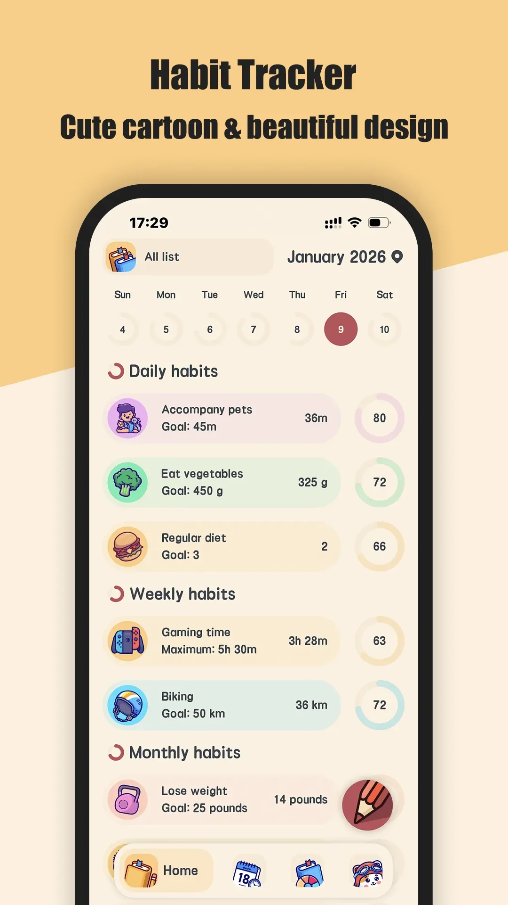{: width="180" .normal }
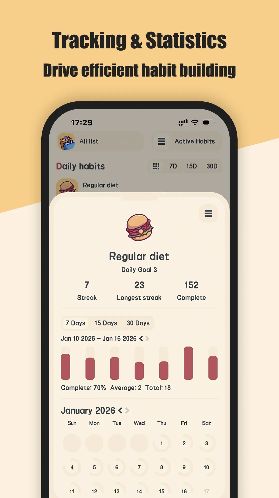{: width="180" .normal }
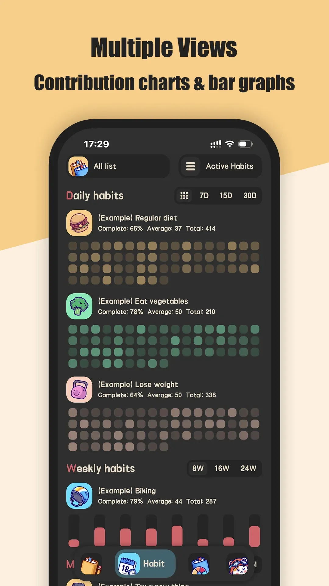{: width="180" .normal }

Meow Habits เป็นแอปเช็คอินนิสัยที่ตั้งต้นจาก **บันทึกบนเครื่องและไม่มีบัญชี** โดยมีอินเทอร์เฟซที่หมุนรอบปฏิทินรายเดือน ทิศทางการออกแบบชัดเจน: คำนวณก่อนว่า ในรอบนี้ นิสัยนี้ ทำได้เท่าไหร่ แล้วค่อยแสดงผลจากสี่ทางเข้า คือ ปฏิทิน หน้ารายละเอียด หน้าแนวโน้ม และวิดเจ็ต

#### หนึ่งรายการบันทึก: ห้าท่าทางเช็คอิน

แตะนิสัยจะเปิดแผงเช็คอินที่มี `+1` `-1` ใส่ตัวเลขโดยตรง แตะครั้งเดียวให้สำเร็จ และทำเครื่องหมายข้าม หนึ่งรอบเก็บเพียงหนึ่งรายการสะสม ใส่โน้ตได้ และมีเสียงตอบรับตอนสำเร็จ ดังนั้น ดื่มน้ำเช้า 2 แก้ว บ่ายอีก 3 แก้ว จะไม่กลายเป็นสองรายการแยกกัน แต่รวมเป็น 5 แก้วของวันนั้น แล้วค่อยเทียบกับเป้าหมาย 8 แก้ว

#### เป้าหมายและรอบระยะ: สร้าง เลิก และหน่วยกำหนดเอง

ตอนสร้างนิสัยกำหนดได้ทั้งไอคอน กลุ่มรายการ สร้างหรือเลิก วันเริ่ม ความถี่ (รายวัน / รายสัปดาห์ / รายเดือน / วันที่ระบุ) ช่วงซ้ำ หน่วย (จำนวน เวลา หรือกำหนดเอง) เป้าหมาย โน้ต และการแจ้งเตือน กลุ่มรายการในตัวมีทั้งสุขภาพ ออกกำลังกาย เรียนรู้ ประสิทธิภาพ ประหยัด และความสุข พร้อมเทมเพลตนิสัยสำเร็จรูปชุดหนึ่ง สำหรับคนที่ยังไม่รู้จะเริ่มตรงไหน

ข้อที่ควรระวังคือ **รอบระยะ เป้าหมาย และวันเริ่ม แก้ไม่ได้หลังสร้าง** สิ่งที่ยังแก้ได้คือไอคอน กลุ่มรายการ โน้ต และการแจ้งเตือน ดังนั้นคิดให้ตกตั้งแต่ครั้งแรกว่าจะใช้ สัปดาห์ละสามครั้ง หรือ จันทร์/พุธ/ศุกร์ ประหยัดแรงกว่ามาแก้ทีหลังมาก

#### สตรีคและอัตราความสำเร็จ: สามตัวเลขบวกแผนที่ความร้อน

ด้านบนของหน้ารายละเอียดแสดงสตรีคปัจจุบัน สตรีคยาวที่สุด และจำนวนครั้งสำเร็จ ด้านล่างสลับดู 7 / 15 / 30 วันล่าสุดได้ เพื่อดูกราฟแท่งรายวันและ อัตราความสำเร็จ / ค่าเฉลี่ย / ยอดรวม ถัดลงไปเป็นแผนที่ความร้อนของปฏิทินทั้งเดือน สำหรับนิสัยแบบสร้าง อัตราความสำเร็จของหนึ่งรอบคำนวณจาก ค่าที่ทำ ÷ เป้าหมาย แล้วตัดเพดาน 100% ส่วนแบบเลิกตัดสินจากการรักษาเพดานไว้ได้หรือไม่ ปฏิทินหน้าหลักแสดงนิสัยที่ต้องทำวันนั้นเป็นวงแหวนความคืบหน้า เห็นทันทีว่าตัวไหนยังไม่ถึงเป้า

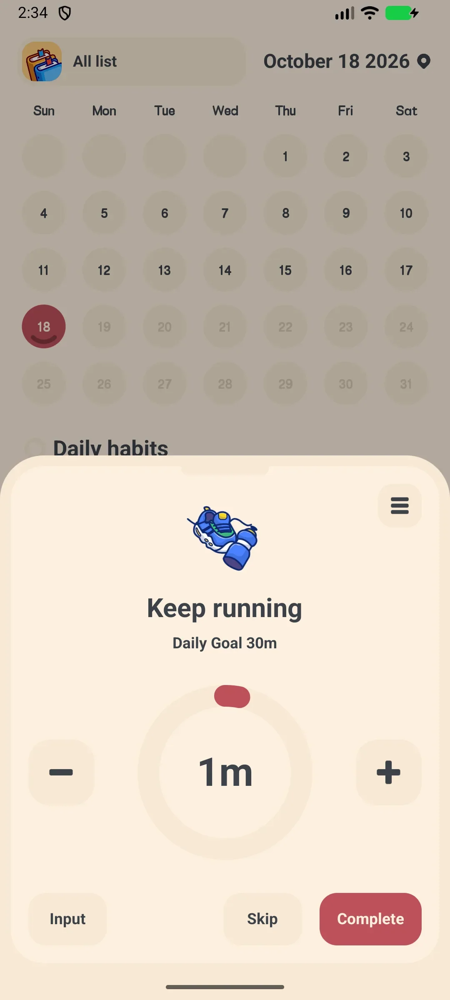{: width="180" .normal }
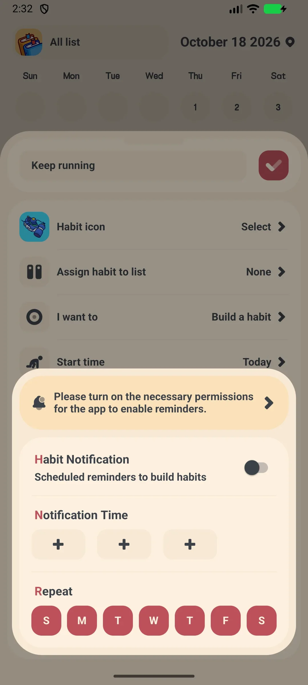{: width="180" .normal }

#### การแจ้งเตือน วิดเจ็ต และเช็คอินแตะเดียว

แต่ละนิสัยตั้งเวลาแจ้งเตือนได้หลายช่วง พร้อมระบุวันที่ใช้ได้ และมีการแจ้งเตือนสรุปวันละครั้งที่แสดงรายการนิสัยที่ยังค้างอยู่ ในระดับระบบมีคำแนะนำเรื่องสิทธิ์การแจ้งเตือนและการปรับแบตเตอรี่ เพื่อไม่ให้การแจ้งเตือนถูกบล็อก ฝั่งหน้าจอหลักมีวิดเจ็ตหลายแบบ: รายการนิสัย นิสัยเดี่ยว สถิติสัปดาห์ / เดือน / ปี กราฟวงกลม และแผนที่ความร้อนรายเดือน โดยวิดเจ็ตนิสัยเดี่ยวเช็คอินได้เลยโดยไม่ต้องเปิดแอป

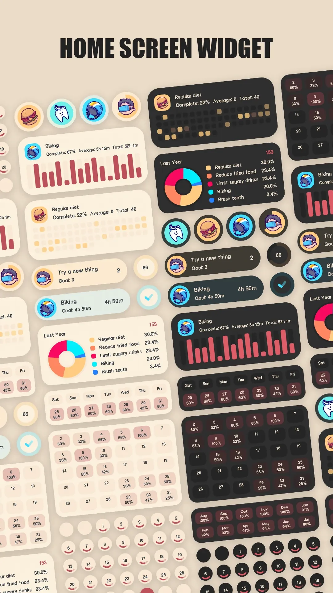{: width="180" .normal }

#### ข้อมูล: ที่เก็บในเครื่อง ส่งออก CSV และสำรองได้เอง

บันทึกเก็บในเครื่อง ไม่มีบัญชี และไม่มีซิงก์เรียลไทม์ข้ามเครื่อง ตอนย้ายข้อมูล ส่งออก CSV ตามช่วงวันที่โดยเลือกบางส่วนหรือทั้งหมดได้ หรือสำรองฐานข้อมูลทั้งชุดไป Google Drive หรือใส่ที่อยู่ WebDAV ของตัวเอง แล้วกู้คืนด้วยการทับข้อมูลเดิม สำรองอัตโนมัติได้มากที่สุดวันละครั้ง ชุดนี้เหมาะกับคนที่ไม่อยากส่งข้อมูลประจำวันขึ้นเซิร์ฟเวอร์ แต่กลัวข้อมูลหายตอนเปลี่ยนมือถือ

#### โควต้าและขอบเขต

เวอร์ชันฟรีจำกัดจำนวนนิสัยและกลุ่มรายการ นิสัยที่เพิ่มขึ้น รวมถึงธีมมืด ล็อกแอป และส่งออก CSV ต้องปลดล็อกฟีเจอร์แบบจ่าย มัน **ไม่ทำ** การซิงก์ข้อมูลสุขภาพอัตโนมัติ อันดับสังคม คำแนะนำ AI ซิงก์คลาวด์แบบมีบัญชี หรือนำเข้า CSV สีกำหนดเอง วันสิ้นสุด การเช็คอินวันในอนาคต และนิสัยย่อยหลายชั้น ก็อยู่นอกความสามารถเช่นกัน ถ้าอยากให้จำนวนก้าวจากสายรัดข้อมือถูกอ่านอัตโนมัติ หรืออยากแข่งสตรีคกับเพื่อน ต้องหาเครื่องมืออื่น

| เหมาะกับ | ไม่เหมาะกับ |
|---|---|
| อยากจดระยะยาวแบบออฟไลน์ไม่มีบัญชี ต้องการเป้าหมายตัวเลขและหน่วยกำหนดเอง พึ่งวิดเจ็ตเช็คอินแตะเดียว และอยากส่งออกหรือสำรองไปบริการของตัวเอง | ต้องการซิงก์เรียลไทม์ข้ามเครื่อง อยากได้ข้อมูลสุขภาพอัตโนมัติ ถือเอากิจกรรมสังคม / อันดับเป็นแรงจูงใจหลัก หรือมีนิสัยจำนวนมากและไม่ต้องการติดโควต้าฟรี |

นอกจากหน้าหลักและหน้ารายละเอียด ยังมีอีกสามมุมมองที่ควรดูแยกกัน: วิธีที่กลุ่มรายการและเทมเพลตสำเร็จรูปจัดหมวดนิสัย สถิติความสำเร็จรวม และการปกป้องความเป็นส่วนตัวของบันทึกบนเครื่อง

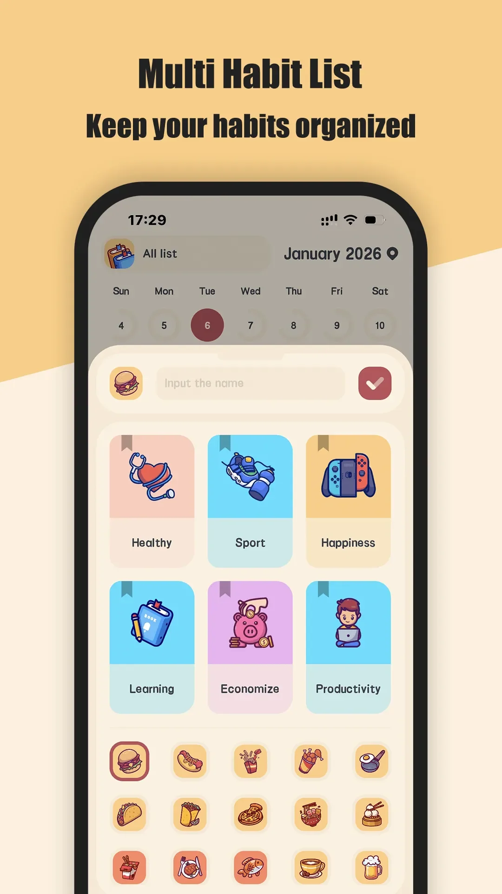{: width="180" .normal }
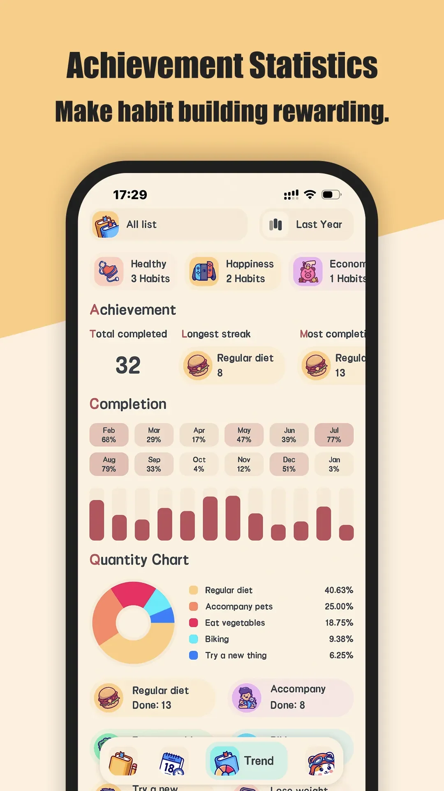{: width="180" .normal }
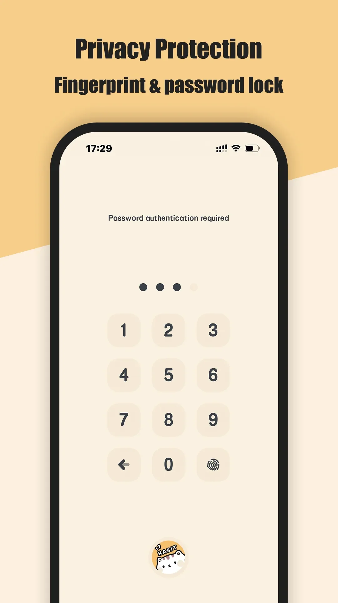{: width="180" .normal }

<!-- ชุดภาพหน้าจอยังไม่มีหน้าตั้งค่าส่งออก CSV / สำรอง WebDAV ความสามารถนี้อธิบายด้วยข้อความด้านบน -->

### Streaks (ระบบนิเวศ Apple)

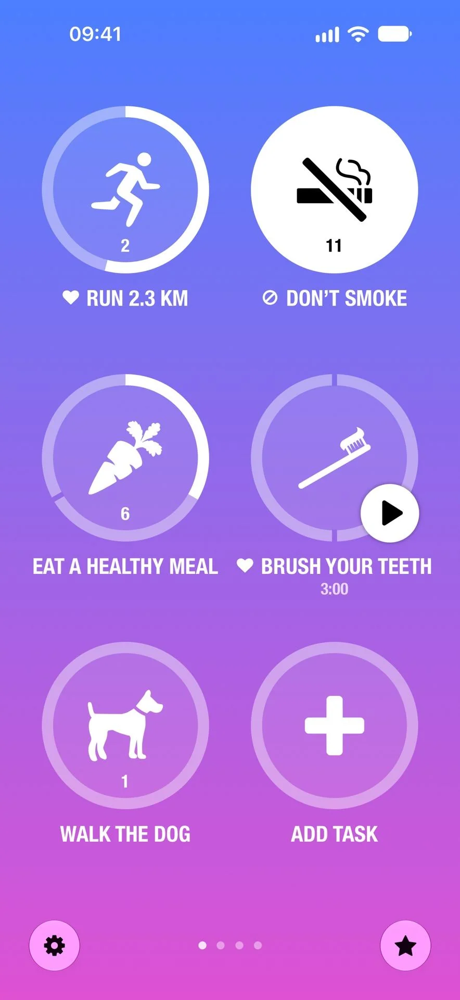{: width="180" .normal }
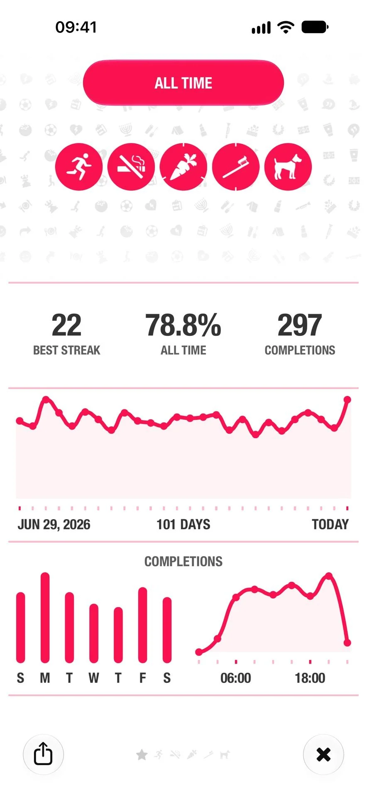{: width="180" .normal }

Streaks เอา อย่าขาดสาย ไปใส่ในชื่อผลิตภัณฑ์เลย เว็บทางการตอนนี้ระบุว่า **สร้างงานได้สูงสุด 24 งาน** (เอกสารเก่ามักบอก 12 เป็นความต่างของเวอร์ชัน ให้ยึดในแอป) งานตั้งเป็นทุกวัน วันที่ระบุ หรือจำนวนวันต่อสัปดาห์ได้ และทำเครื่องหมายวันพักได้โดยไม่ตัดสตรีค นอกจากงานที่ติ๊กครั้งเดียว ยังมีงานจับเวลา (เช่น นั่งสมาธิ 10 นาที) และงานเชิงลบแบบ งดทำ

จุดที่กลไกเน้นคือ **รอบระยะและการสำเร็จอัตโนมัติ**: อาศัย Apple Health แปลงจำนวนก้าว นาทีสติ หรือวงแหวนกิจกรรม ให้เป็นการสำเร็จหนึ่งครั้งได้เลย ลดการจดด้วยมือ ฝั่งสถิติให้สตรีคปัจจุบันและดีที่สุด อัตราความสำเร็จ ปฏิทิน และแนวโน้ม อินเทอร์เฟซมีไอคอนและชุดสีจำนวนมาก พร้อมวิดเจ็ต Siri Shortcuts และตัวจับเวลาบนหน้าจอล็อก

ข้อมูลซิงก์ผ่าน iCloud ระหว่าง iPhone iPad Apple Watch และ Mac และคำอธิบายทางการระบุว่าไม่ผ่านเซิร์ฟเวอร์ของผู้พัฒนาเอง รูปแบบจ่ายคือซื้อครั้งเดียว ไม่มีสมัครสมาชิก ไม่มีโฆษณา ราคาที่ต้องจ่ายก็ตรงไปตรงมา: อยู่ในระบบนิเวศ Apple เท่านั้น ผู้ใช้ Android ใช้ไม่ได้ และขาดวันที่ต้องทำหนึ่งวัน สตรีคจะเริ่มนับใหม่จากศูนย์ คนชอบกฎชัดเจนจะรู้สึกสะอาด คนที่ท้อเมื่อสายขาดจะรู้สึกตึงเครียด

### Habitica

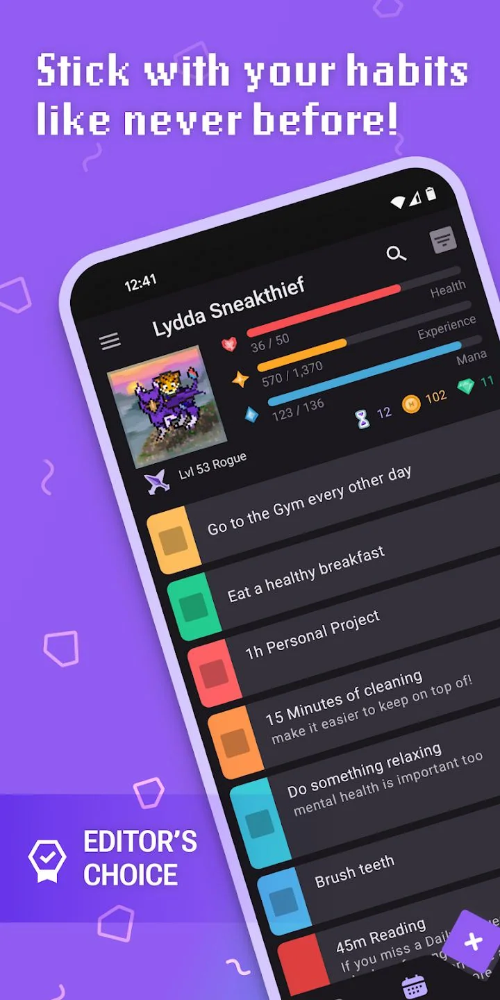{: width="180" .normal }
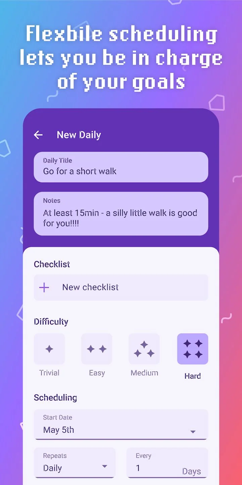{: width="180" .normal }

Habitica ตัดสินใจทำการติดตามนิสัยให้เป็นเกมสวมบทบาทไปเลย แบ่งพฤติกรรมเป็นสี่ชนิด: **Habits** (แตะ `+` / `-` ได้ทุกเมื่อ ตั้งเป็นบวก ลบ หรือสองทางได้) **Dailies** (ซ้ำตามตาราง ครบกำหนดแล้วไม่ทำจะหักค่าชีวิต) **To-Dos** (ครั้งเดียว ใส่วันกำหนดได้ พลาดไม่หักค่าชีวิต) และ **Rewards** (ใช้เหรียญแลกรางวัลให้ตัวเอง) Habits ด้านบวกให้ XP กับเหรียญ ด้านลบหักค่าชีวิต รอบซ้ำของ Daily ตั้งเป็นทุกวัน สัปดาห์ละสามครั้ง หรือเดือนละสี่ครั้งได้ และยิ่งยากรางวัลยิ่งงาม

ดีไซน์นี้เปลี่ยนวันที่ขาดให้เป็นต้นทุนที่ชัดเจน: พอค่าชีวิตหมด เหรียญถูกเคลียร์ ตัวละครลดหนึ่งเลเวล และอาจเสียไอเทม ยังมีทีม เควส อาชีพ และการเติบโตของค่าสถานะ ที่เปลี่ยนความสม่ำเสมอจากบันทึกส่วนตัวเป็นการเล่นร่วมกัน งาน ทีม และเควสฟรี ส่วนที่จ่ายหลักคือเพชรตกแต่งและสมัครสมาชิกแบบเลือกได้ (ให้เพชรรายเดือน โบนัสของตก ฯลฯ) ไคลเอนต์โอเพนซอร์ส มีเวอร์ชันเว็บ ครอบคลุม iOS Android และ Web

ถ้าคุณไม่สนใจแถบประสบการณ์และไอเทมเลย การแปลงทั้งหมดนั้นมีแต่เพิ่มภาระ แต่สำหรับคนที่ไม่มีผลป้อนกลับภายนอกแล้วไปต่อไม่ได้ นี่คือผลิตภัณฑ์เดียวใน 7 ตัวที่ทำรางวัลและบทลงโทษให้เป็นระบบเต็มรูปแบบ

### Loop Habit Tracker

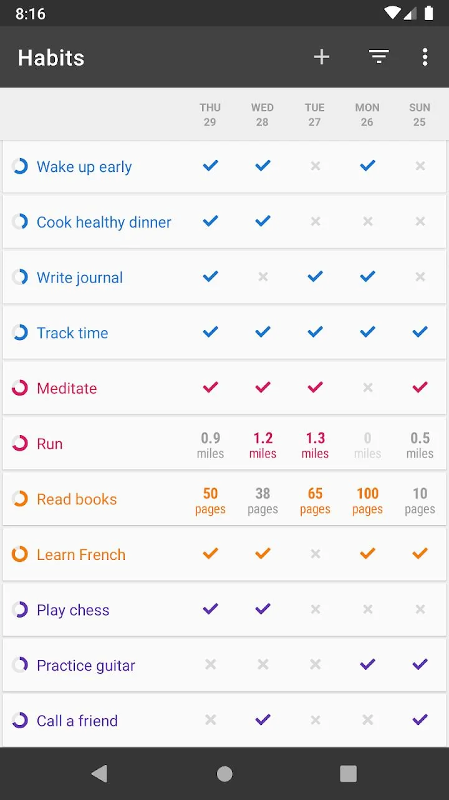{: width="180" .normal }
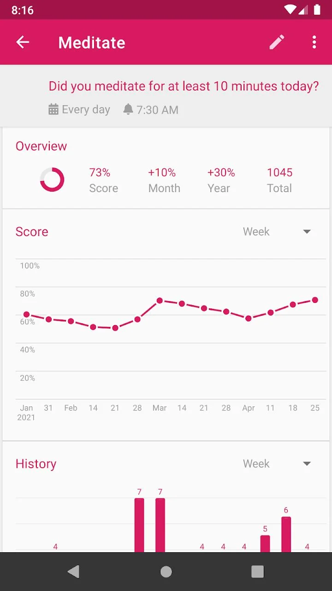{: width="180" .normal }

สิ่งที่น่าพูดถึงที่สุดของ Loop ไม่ใช่อินเทอร์เฟซ แต่คือการ **ปฏิเสธ ขาดสายแล้วกลับเป็นศูนย์** คำอธิบายในสโตร์ทางการเขียนไว้ชัดว่า ผลิตภัณฑ์ใช้สูตรขั้นสูงคำนวณ คะแนนนิสัย ทุกครั้งที่ทำซ้ำนิสัยจะแข็งขึ้น ทุกครั้งที่พลาดจะอ่อนลง หลังทำมานาน การพลาดไม่กี่วันจะไม่ทำลายความคืบหน้าทั้งหมด นี่ตอบตรง ๆ กับความกังวลสายขาดข้างต้น แนวโน้มระยะยาวใกล้เส้นโค้งจริงของการสร้างนิสัยมากกว่าสายที่ห้ามขาด

เรื่องรอบระยะ รองรับรายวัน สัปดาห์ละ 3 ครั้ง สองสัปดาห์ครั้ง เว้นวัน และตารางยืดหยุ่นอื่น ๆ ตารางเช็คอินยังแสดงนิสัยแบบตัวเลขที่จดเป็นไมล์หรือจำนวนหน้าได้ การแจ้งเตือนตั้งแยกต่อนิสัยได้ และจากแถบแจ้งเตือนทำสำเร็จ ละเว้น หรือเลื่อนได้เลยโดยไม่เปิดแอป รวมถึงบนนาฬิกา ฝั่งสถิติมีกราฟละเอียดและประวัติครบถ้วน

ข้อมูลอยู่บนเครื่องทั้งหมด ไม่มีบัญชี ไม่อัปโหลดขึ้นเครือข่าย และส่งออกเป็น CSV หรือไฟล์ฐานข้อมูลได้ แอปไม่มีโฆษณาและเป็นโอเพนซอร์ส เป็นสินค้าที่เดินทาง สายอยู่บนเครื่องล้วน + ย้ายได้ ครบถ้วนที่สุด แต่มีเฉพาะ Android และอินเทอร์เฟซเอียงไปทางเครื่องมือมากกว่าตัวกระตุ้น

### Habitify

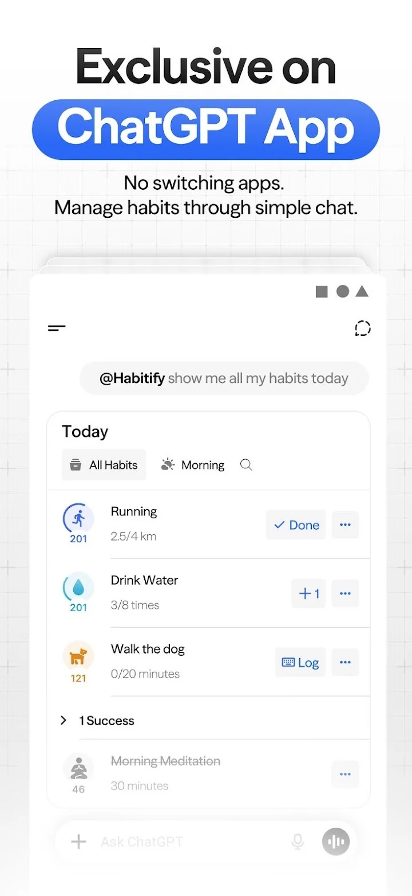{: width="180" .normal }
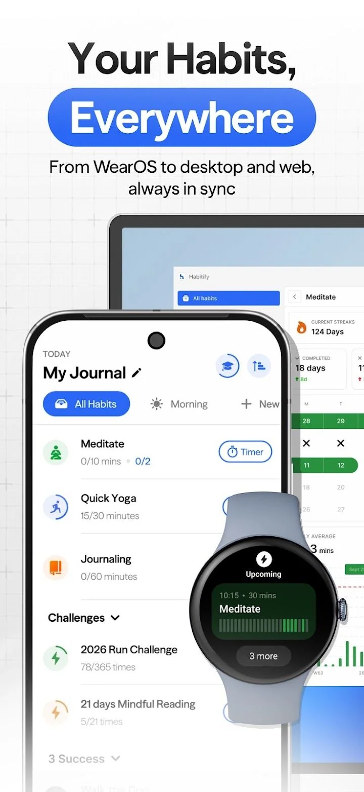{: width="180" .normal }
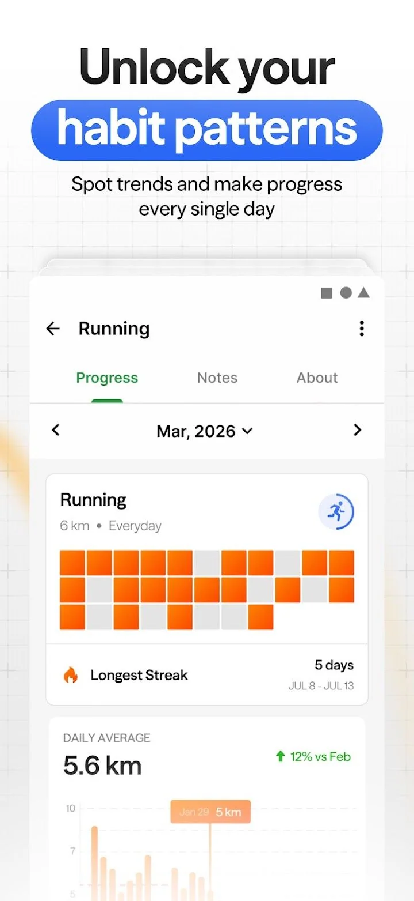{: width="180" .normal }

แนวคิดของ Habitify คือ **เอานิสัยไปวางบนแกนเวลาของหนึ่งวัน** เช้า บ่าย เย็น แยกเป็นกลุ่ม เปิดแอปขึ้นมาก็เห็นว่าตอนนี้ควรทำอะไร เว็บทางการเน้นว่าครอบคลุม iPhone Android Mac Web และนาฬิกา พร้อมซิงก์เรียลไทม์ ยังมีการเชื่อมปฏิทิน เชื่อมข้อมูลสุขภาพ API และการเชื่อมอัตโนมัติ โน้ต จดอารมณ์ ตัวจับเวลาในตัว และล็อกความเป็นส่วนตัว มุมมองสถิติจัดบันทึกที่ทำสำเร็จเป็นแผนที่ความร้อนและให้ตัวเลขสะสม

ตำแหน่งของมันตรงข้ามกับเครื่องมือที่อยู่บนเครื่องล้วน: บัญชี การซิงก์ และประสบการณ์หลายเครื่องคือจุดขายหลัก หน้าราคาทางการระบุว่าเวอร์ชันฟรีใช้ได้ 3 นิสัย (รวมซิงก์ข้ามแพลตฟอร์มและการแจ้งเตือน) ส่วนนิสัยไม่จำกัดอยู่ในแพ็กเกจจ่าย ยังมีท้าทายกับเพื่อนและฟีเจอร์ชุมชน ถ้าคุณเช็คอินบนมือถือ Android เครื่องเดียวและไม่อยากสมัคร ความสามารถเหล่านี้ส่วนใหญ่ไม่ได้ใช้ แต่ถ้าสลับไปมาระหว่างมือถือ คอม และเว็บ มันช่วยลดปัญหาบันทึกกระจัดกระจายคนละเครื่อง

### Productive

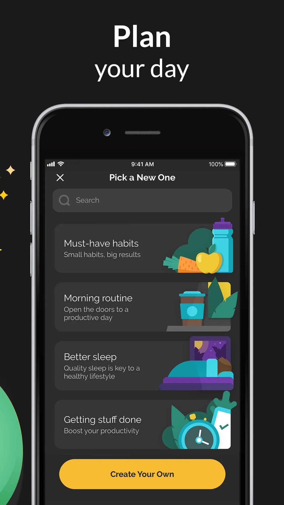{: width="180" .normal }
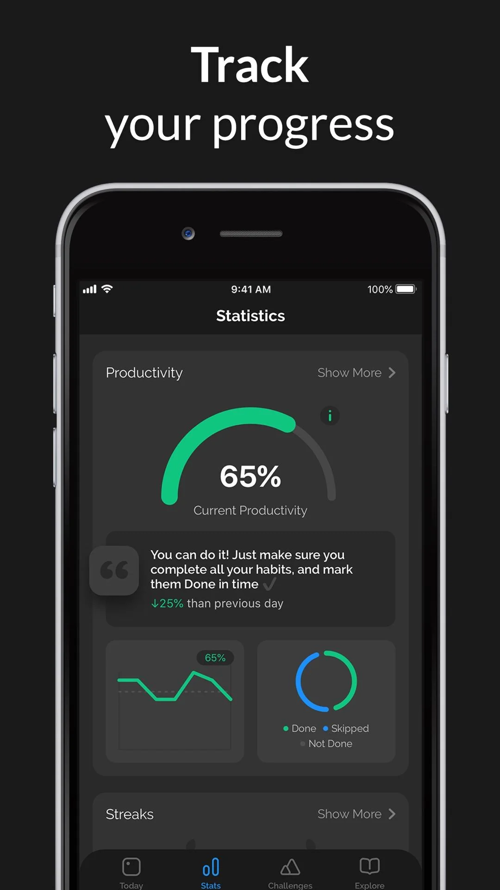{: width="180" .normal }
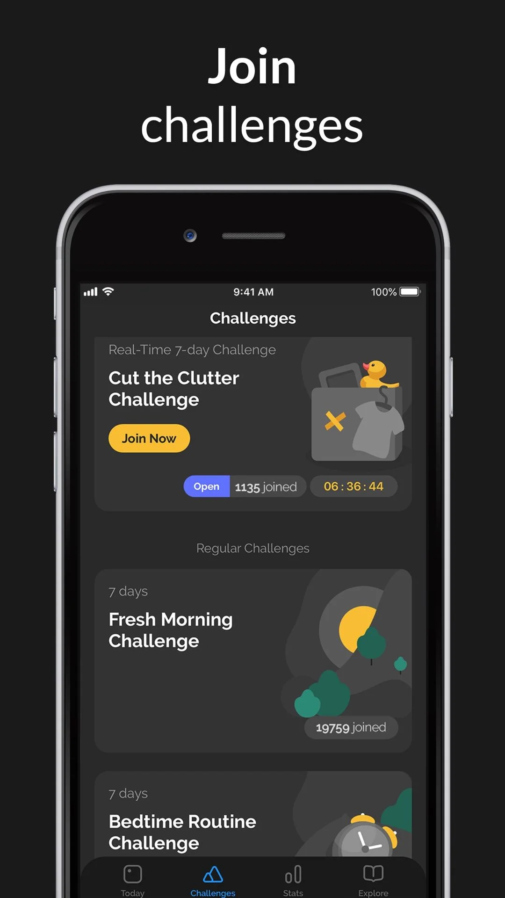{: width="180" .normal }

Productive มองนิสัยเป็น **ตารางของหนึ่งวัน**: เลือกนิสัยจากคลังเทมเพลต วางลงในช่วงเช้า บ่าย หรือเย็น ตั้งวันซ้ำกับการแจ้งเตือน แล้วติ๊กทีละวันในปฏิทิน เว็บทางการพูดถึงคลังเทมเพลต สถิติและหลักชัย การแจ้งเตือนอัจฉริยะที่อิงเวลาและสถานที่ และท้าทายที่เข้าร่วมกับคนอื่นได้ หน้าท้าทายถูกแยกเป็นอีกคอลัมน์ ต่างหากจากแผนประจำวัน

มันอยู่กลุ่มเดียวกับ Habitify คือ จัดตามช่วงเวลา + ซิงก์ด้วยบัญชี แต่เน้นความรู้สึกมีแผนและสังคมเบา ๆ มากกว่า: สิ่งที่เห็นไม่ใช่นิสัยเดี่ยว ๆ แต่คือตารางทั้งวัน ฝั่งการจ่ายใช้สมัครสมาชิกพร้อมทดลองใช้ฟรีสั้น ๆ ที่จะเปลี่ยนเป็นสมัครสมาชิกอัตโนมัติ ควรระวังตอนสมัคร ชุดฟีเจอร์เอียงไปทาง ช่วยฉันจัดตาราง มากกว่า ช่วยฉันคำนวณตัวเลขให้แม่น จึงเน้นอัตราความสำเร็จกับหลักชัยเป็นหลัก และไม่ลงลึกนิยามของสตรีค

### Fabulous

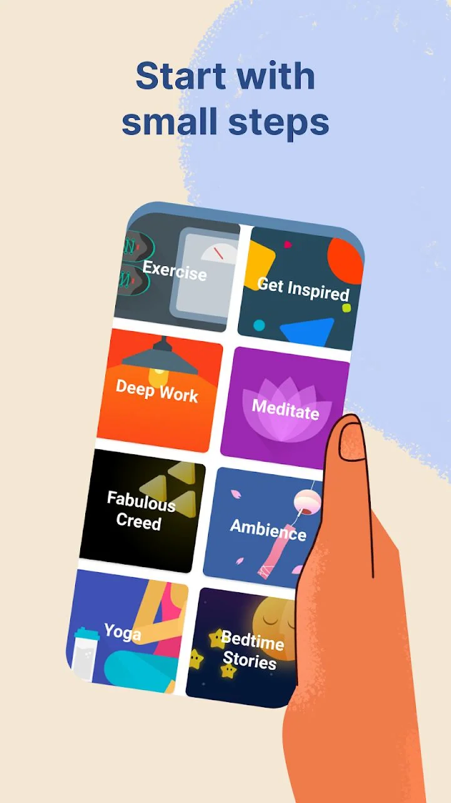{: width="180" .normal }
{: width="180" .normal }
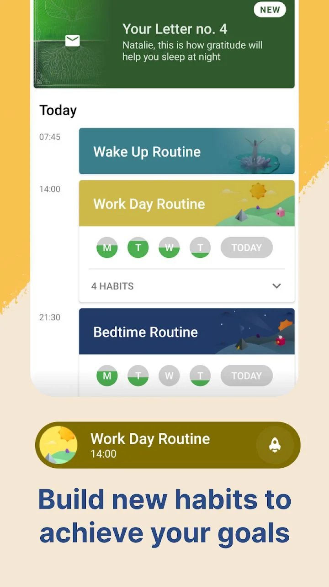{: width="180" .normal }

Fabulous ไม่ค่อยเหมือนเครื่องมือเช็คอิน แต่เหมือน **คอร์สเปลี่ยนพฤติกรรมแบบมีช่วง** มากกว่า มันมีรากจากงานวิจัยเศรษฐศาสตร์พฤติกรรมของ Center for Advanced Hindsight มหาวิทยาลัย Duke และเสนอให้ย่อยเป้าหมายใหญ่เป็นพฤติกรรมเล็กมาก ๆ แล้วร้อยเข้าด้วยกันด้วย habit stacking เป็นกิจวัตรเช้า บ่าย เย็น คือทำให้ ดื่มน้ำหนึ่งแก้ว นิ่งเสียก่อน แล้วค่อยเพิ่มขั้นตอนถัดไป แทนที่จะตั้งรายการสิบอย่างทีเดียว หน้ากิจวัตรวันนี้จะแสดงรายการขั้นตอนเล็ก ๆ ของวันให้ขีดฆ่าทีละข้อ

รูปแบบสินค้าเดินหน้าเป็น Journey มีเนื้อหาโค้ช กิจวัตร ช่วงทำงานลึก ชุมชน และการจองโค้ชที่เป็นคนจริง ฝั่งสถิติไม่ได้เน้นสตรีค แต่ใช้ความครบถ้วนของช่วงเป็นหลัก ราคาที่ต้องจ่ายคือคลังเนื้อหาแบบสมัครสมาชิก ที่ทดลองใช้ฟรีแล้วเปลี่ยนเป็นสมัครสมาชิกอัตโนมัติ และสิ่งที่คุณซื้อหลัก ๆ คือโปรแกรมกับเนื้อหา ไม่ใช่ระบบบันทึกที่ปรับแต่งได้อิสระ คนที่อยากกำหนดรอบระยะ เป้าหมาย และการส่งออกเองจะรู้สึกถูกจำกัดเกินไป

---

## เปรียบเทียบเชิงลึกตามมิติสำคัญ

### ความหมายของวันที่ขาดและการพลาด

| แอป | ขาดหนึ่งวัน | ข้ามโดยตั้งใจ | เติมประวัติย้อนหลัง | วันในอนาคต |
|---|---|---|---|---|
| Meow Habits | นับสตรีคย้อนหลังตามรอบที่ใช้ได้ | รองรับ เครื่องหมายไม่ตัดสาย | รองรับ ผ่านปฏิทินรายเดือน | ทำไม่ได้ |
| Streaks | สตรีคกลับเป็นศูนย์ | ตั้งวันพักได้ | ตามปฏิทินในแอป | ไม่เกี่ยวข้อง |
| Habitica | Daily หักค่าชีวิต หมดแล้วลดเลเวล | พักความเสียหายได้ | ตามประวัติงาน | ไม่เกี่ยวข้อง |
| Loop | คะแนนนิสัยค่อยลด ไม่กลับเป็นศูนย์ | หลีกเลี่ยงด้วยตารางยืดหยุ่น | ตารางเช็คอินย้อนได้ | ไม่เกี่ยวข้อง |
| Habitify / Productive | ปฏิทินแสดงว่ายังไม่สำเร็จ | หลีกเลี่ยงด้วยกฎซ้ำ | ตามปฏิทินในแอป | ไม่เกี่ยวข้อง |
| Fabulous | เดินหน้าตามช่วง ไม่เน้นสตรีค | ไม่มีกลไกสายขาด | ไม่เกี่ยวข้อง | ไม่เกี่ยวข้อง |

### รอบระยะ เป้าหมาย และกฎตัดสินสำเร็จ

| แอป | การแสดงรอบระยะ | เป้าหมายแบบตัวเลข | นิยามอัตราความสำเร็จ |
|---|---|---|---|
| Meow Habits | วัน / สัปดาห์ / เดือน / วันที่ระบุ / ทุก N วัน | รองรับ กำหนดหน่วยเองได้ | ค่าที่ทำ ÷ เป้าหมาย ตัดเพดาน 100% แบบเลิกตัดสินที่เพดาน |
| Streaks | ทุกวัน / วันที่ระบุ / จำนวนวันต่อสัปดาห์ + วันพัก | งานจับเวลาครอบคลุมระยะเวลา | จำนวนวันที่ทำและอัตราความสำเร็จ |
| Habitica | Daily ตั้งได้รายวัน / สัปดาห์ละ 3 / เดือนละ 4 | เน้นติ๊ก ตัวเลขผ่านรางวัลกำหนดเอง | เลเวล / XP / เหรียญ ไม่ใช่เปอร์เซ็นต์ |
| Loop | รายวัน / สัปดาห์ละ 3 / เว้นวัน / เว้นสัปดาห์ | รองรับ | คะแนนนิสัย + อัตราความสำเร็จ |
| Habitify | รายวัน / วันที่ระบุ จัดตามช่วงเวลา | เน้นติ๊ก | อัตราความสำเร็จและปฏิทิน |
| Productive | วันซ้ำ + ช่วงเวลา + หลายครั้งต่อวัน | เน้นติ๊ก | อัตราความสำเร็จและหลักชัย |
| Fabulous | ช่วง Journey + กิจวัตร | ไม่เกี่ยวข้อง | ความคืบหน้าของช่วง |

### การแจ้งเตือน ทางเข้า และข้อมูล

| แอป | การแจ้งเตือน | บันทึกขั้นตอนเดียว | ตำแหน่งข้อมูล | ส่งออก / สำรอง | บัญชี |
|---|---|---|---|---|---|
| Meow Habits | หลายช่วงต่อนิสัย + วันที่ระบุ + สรุปประจำวัน | วิดเจ็ตหน้าจอหลัก | บนเครื่อง | ส่งออก CSV สำรอง Google Drive / WebDAV | ไม่ต้องการ |
| Streaks | แจ้งเตือนต่องาน | วิดเจ็ต Siri สำเร็จอัตโนมัติผ่าน Apple Health | iCloud (ระบบนิเวศ Apple) | พึ่งการซิงก์ในระบบนิเวศ | ไม่ต้องการ |
| Habitica | แจ้งเตือน Daily | บวก / ลบในแอป | คลาวด์ | ภายในระบบบัญชี | ต้องการ |
| Loop | แจ้งเตือนต่อนิสัย ในแถบแจ้งเตือนทำสำเร็จ / ละเว้น / เลื่อนได้ | การแจ้งเตือน วิดเจ็ต นาฬิกา | บนเครื่อง | ส่งออก CSV / ฐานข้อมูล | ไม่ต้องการ |
| Habitify | แจ้งเตือนขั้นสูง แจ้งเตือนตามช่วงเวลา | วิดเจ็ต หลายแพลตฟอร์ม | ซิงก์คลาวด์เรียลไทม์ | คลาวด์ + เชื่อมปฏิทิน / สุขภาพ | ต้องการ |
| Productive | แจ้งเตือนอัจฉริยะตามเวลา / สถานที่ | ติ๊กในแอป | คลาวด์ | ภายในระบบบัญชี | ต้องการ |
| Fabulous | แจ้งเตือนกิจวัตร | ติ๊กขั้นตอนในแอป | คลาวด์ | ภายในระบบบัญชี | ต้องการ |

### แพลตฟอร์มและรูปแบบการจ่าย (ตามหน้าทางการ)

| แอป | แพลตฟอร์มหลัก | รูปแบบการจ่าย | ความสามารถทั่วไปที่ชัดเจนว่าไม่มี |
|---|---|---|---|
| Meow Habits | Android (สโตร์ยังระบุทางเข้า iOS) | ฟรีมีเพดานนิสัย / กลุ่มรายการ บางฟีเจอร์ต้องปลดล็อก | ซิงก์ข้อมูลสุขภาพอัตโนมัติ อันดับสังคม ซิงก์คลาวด์แบบมีบัญชี |
| Streaks | iPhone / iPad / Apple Watch / Mac / Vision Pro | ซื้อครั้งเดียว ไม่มีสมัครสมาชิก ไม่มีโฆษณา | Android / Windows จำนวนงานมีเพดาน |
| Habitica | Web / iOS / Android | งานหลักฟรี ของตกแต่งกับสมัครสมาชิกแบบเลือกได้จ่าย | ไม่ใช่เครื่องมืออยู่บนเครื่องล้วน บันทึกต้องมีบัญชี |
| Loop | Android | ฟรี โอเพนซอร์ส ไม่มีโฆษณา | iOS ซิงก์บัญชี แรงจูงใจแบบเกม |
| Habitify | iOS / Android / Mac / Web / Watch | ฟรี 3 นิสัย ไม่จำกัดต้องจ่าย | ใช้งานออฟไลน์ล้วน |
| Productive | iOS เป็นหลัก มีทางเข้าเว็บ | สมัครสมาชิก + ทดลองใช้ฟรีสั้น ๆ | ใช้แบบไม่มีบัญชีออฟไลน์ ส่งออกข้อมูลอิสระ |
| Fabulous | iOS / Android | คลังเนื้อหาแบบสมัครสมาชิก + ทดลองใช้ฟรี | กำหนดนิยามรอบระยะเอง ส่งออกข้อมูลแบบเปิด |

---

## ควรเลือกตัวไหน

เอากรอบหกข้อกลับไปใส่สถานการณ์ของตัวเอง แล้วทางเลือกจะชัดขึ้นมาก:

- **ถามก่อนว่าบันทึกต้องมีปริมาณไหม** ถ้าจะจด 8 แก้ว / 30 นาที / 3 กิโลเมตร นิยามของ Meow Habits กับ Loop ครบที่สุด ถ้าแค่ติ๊กครั้งเดียวพอ เส้นทางของ Streaks Habitify และ Productive สั้นกว่า
- **แล้วถามว่าตารางสม่ำเสมอไหม** ทำเฉพาะจันทร์/พุธ/ศุกร์ หรือแค่ให้ครบสามครั้งต่อสัปดาห์ ให้ดูที่วันที่ระบุและตารางยืดหยุ่น Meow Habits Streaks Loop และ Habitica ล้วนมีตัวเลือกชัดเจน
- **ต่อมาถามว่ารับได้ไหมถ้าขาดวันเดียวแล้วกลับเป็นศูนย์** คนที่ท้อกับศูนย์ ให้ดูคะแนนที่ค่อยลดของ Loop หรือเครื่องหมายข้ามของ Meow Habits คนที่อยากได้กฎชัดเจน Streaks ตรงที่สุด คนที่อยากได้รางวัล–ลงโทษภายนอก Habitica แรงที่สุด
- **แล้วถามว่าข้อมูลจะไปอยู่ที่ไหน** ไม่อยากสมัครแต่อยากสำรองเอง Meow Habits กับ Loop คือทางนั้น สลับหลายเครื่องบ่อย การซิงก์ของ Habitify / Productive / Fabulous สะดวกกว่า อยู่ใน Apple ทั้งชุด Streaks ใช้ iCloud ก็พอ
- **สุดท้ายถามว่าต้องการเครื่องมือหรือโปรแกรม** อยากกำหนดนิสัย รอบระยะ และกราฟเอง เลือกแบบบันทึกก่อน อยากมีกระบวนการเปลี่ยนแปลงที่มีคนพาไป แบบคอร์สของ Fabulous เหมาะกว่า

ยังตัดสินใจไม่ได้ เริ่มจาก [ภาพรวมแอปติดตามนิสัย](/th/posts/pillar-habit-tracker-apps-android/) เพื่อตีกรอบ แล้วค่อยอ่าน [เปรียบเทียบ Meow Habits กับ Streaks ทีละข้อ](/th/posts/vs-meow-habits-and-streaks/) สำหรับผู้ใช้ Android ในไทยที่กำลังหาแอปสร้างนิสัยแบบกิจวัตรประจำวัน ไม่ต้องสมัครบัญชี ใช้ได้ออฟไลน์ และพึ่งวิดเจ็ตหน้าจอหลัก [แอปเช็คอินนิสัยบน Android](/th/apps/meow-habits/) ก็ควรดูแยกต่างหาก

### ลิงก์ดาวน์โหลดทางการ

| แอป | Android | iOS / อื่น ๆ |
|---|---|---|
| Meow Habits | [Google Play](https://play.google.com/store/apps/details?id=com.glgjing.meow.habit.goal) | [App Store](https://apps.apple.com/app/id6758230559) |
| Streaks | — | [App Store](https://apps.apple.com/app/id963034692) · [เว็บทางการ](https://streaksapp.com/) |
| Habitica | [Google Play](https://play.google.com/store/apps/details?id=com.habitrpg.android.habitica) | [เว็บทางการ / เวอร์ชันเว็บ](https://habitica.com/) |
| Loop Habit Tracker | [Google Play](https://play.google.com/store/apps/details?id=org.isoron.uhabits) | [เว็บทางการ](https://loophabits.org/) |
| Habitify | [Google Play](https://play.google.com/store/apps/details?id=co.unstatic.habitify) | [เว็บทางการ](https://www.habitify.me/) |
| Productive | — | [เว็บทางการ](https://productiveapp.io/) |
| Fabulous | [Google Play](https://play.google.com/store/apps/details?id=co.thefabulous.app) | [เว็บทางการ](https://www.thefabulous.co/) |

---

## คำถามที่พบบ่อย (FAQ)

**แอปนิสัยแก้ปัญหาอะไรกันแน่?**
{:.faq-q}

เปลี่ยนความตั้งใจที่เลื่อนลอยให้เป็นบันทึกที่ตรวจได้ และลดแรงเสียดทานระหว่าง นึกขึ้นได้ กับ จดลงไป มันไม่ได้สร้างนิสัยแทนคุณ แต่ทำให้พฤติกรรมมองเห็น ให้ผลป้อนกลับของความคืบหน้า และให้หลักฐานสำหรับทบทวน งานวิจัยด้านพฤติกรรมชี้ว่าพฤติกรรมใหม่มักใช้เวลาหลายสัปดาห์ถึงหลายเดือนก่อนจะเป็นอัตโนมัติ (Lally และคณะ ปี 2010 ประมาณค่ามัธยฐานราว 66 วัน และต่างกันมากในแต่ละคน) ในช่วงนั้น บันทึกคือหนึ่งในสัญญาณภายนอกที่รักษาได้ง่ายที่สุด

**สตรีคขาดไปหนึ่งวัน แปลว่าเสียเปล่าหมดไหม?**
{:.faq-q}

ไม่เลย งานของ Lally และคณะพบว่าการพลาดโอกาสครั้งเดียวไม่ได้เปลี่ยนเส้นโค้งการสร้างนิสัยโดยรวมอย่างมีนัยสำคัญ สินค้าก็จัดการต่างกันด้วย: Streaks กลับเป็นศูนย์ Loop ปล่อยให้คะแนนนิสัยค่อยลด Meow Habits ให้ทำเครื่องหมายรอบนั้นว่าข้าม ส่วน Habitify / Productive / Fabulous ไม่เอาสตรีคเป็นแกน การเลือกนิยามที่เข้ากับวิธีคิดของตัวเองสำคัญกว่าการพยายามรักษาสายไว้ให้ได้ทุกวิถีทาง

**สัปดาห์ละสามครั้ง กับ จันทร์/พุธ/ศุกร์ ต่างกันอย่างไร?**
{:.faq-q}

แบบแรกทำสามวันใดก็ได้ในสัปดาห์ เหมาะกับตารางไม่คงที่ แบบหลังเกิดงานค้างเฉพาะวันที่ระบุ วันอื่นไม่ถือว่าพลาด Loop รองรับตารางยืดหยุ่นแบบ สัปดาห์ละ 3 ครั้ง อย่างชัดเจน Daily ของ Habitica ก็ตั้งเป็นสัปดาห์ละสามครั้งได้ ส่วน Meow Habits แยกความถี่ ช่วงซ้ำ และวันที่ระบุออกจากกัน ก่อนสร้างนิสัยควรเช็กก่อนว่าแอปใช้แบบไหน

**เป้าหมายแบบตัวเลข หรือ ติ๊กธรรมดา ควรเลือกแบบไหน?**
{:.faq-q}

ดูว่าพฤติกรรมนั้นมีระดับหรือไม่ การดื่มน้ำ การอ่าน การวิ่งเหมาะกับเป้าหมายตัวเลข เพราะเห็นได้ว่าวันนี้ทำได้ 60% หรือ 100% มีข้อมูลให้ทบทวนมากกว่ามาก ส่วนการนอนเร็ว หรือการงดเครื่องดื่มหวานเหมาะกับการติ๊ก Meow Habits กับ Loop รองรับเป้าหมายตัวเลขที่มีหน่วยทั้งคู่ และแผงเช็คอินของ Meow Habits มีทั้งบวก ลบ ใส่ตัวเลข สำเร็จในแตะเดียว และข้าม

**ข้าม กับ ลืมบันทึก เป็นเรื่องเดียวกันไหม?**
{:.faq-q}

ไม่ใช่ ลืมบันทึกแปลว่า ต้องทำแต่ไม่ได้จด และมักกระทบสตรีค ส่วนข้ามคือประกาศชัดว่า รอบนี้ตั้งใจไม่ทำ จึงไม่ตัดสตรีคและไม่นับเป็นสำเร็จ การทำเครื่องหมายวันเดินทางไปทำงานหรือวันป่วยว่าข้าม ไม่ว่าจะล่วงหน้าหรือภายหลัง ทำให้ปฏิทินไม่แปลความหมายของการพักตามปกติว่าคือความล้มเหลว

**ใช้ได้โดยไม่สมัครบัญชีไหม แล้วตอนเปลี่ยนมือถือล่ะ?**
{:.faq-q}

Meow Habits กับ Loop ไม่ต้องการบัญชี ข้อมูลอยู่บนเครื่อง Streaks ซิงก์ระหว่างอุปกรณ์ Apple ผ่าน iCloud ก็ไม่ต้องสมัครกับผู้พัฒนาเช่นกัน ก่อนเปลี่ยนเครื่องอย่าลืมส่งออกหรือสำรอง: Meow Habits ส่งออก CSV ตามช่วงวันที่ได้ หรือสำรองฐานข้อมูลทั้งชุดไป Google Drive / WebDAV ของตัวเอง Loop ส่งออก CSV หรือไฟล์ฐานข้อมูลได้ ส่วน Habitify Productive Fabulous และ Habitica ใช้ซิงก์บัญชี เปลี่ยนเครื่องสะดวกกว่า แต่บันทึกผ่านเซิร์ฟเวอร์

**แอปนิสัยซิงก์กับสายรัดข้อมือหรือข้อมูลสุขภาพอัตโนมัติไหม?**
{:.faq-q}

ขึ้นกับสินค้า Streaks ใช้ Apple Health ให้จำนวนก้าวหรือนาทีสติถูกทำเครื่องหมายเป็นสำเร็จอัตโนมัติได้ Habitify มีการเชื่อมปฏิทินและข้อมูลสุขภาพ ส่วน Meow Habits **ไม่มี** การซิงก์ข้อมูลสุขภาพอัตโนมัติ การเช็คอินส่วนใหญ่ทำด้วยมือ นั่นแหละคือสิ่งที่ทำให้มันอยู่บนเครื่องล้วนและไม่มีบัญชีได้ เวลาเห็นคำโฆษณาว่า บันทึกอัตโนมัติ ให้เช็กก่อนว่ามันเชื่อมแพลตฟอร์มไหนจริง ๆ

**เวอร์ชันฟรีมักจำกัดอะไร?**
{:.faq-q}

ที่พบบ่อยคือจำนวนนิสัยหรือชั้นของฟีเจอร์ Habitify ระบุทางการว่าเวอร์ชันฟรีได้ 3 นิสัย เวอร์ชันฟรีของ Meow Habits จำกัดจำนวนนิสัยและกลุ่มรายการ โดยธีมมืด ล็อกแอป และส่งออก CSV เป็นฟีเจอร์ที่ต้องปลดล็อก Loop ฟรี โอเพนซอร์ส ไม่มีโฆษณา Streaks ซื้อครั้งเดียว Productive กับ Fabulous ใช้สมัครสมาชิกพร้อมทดลองใช้สั้น ๆ การทดลองใช้ของสินค้าแบบสมัครสมาชิกจะเปลี่ยนเป็นสมัครสมาชิกอัตโนมัติ ควรดูวันยกเลิกก่อนสมัคร

---

## คำศัพท์ที่เกี่ยวข้อง

- [Habit Tracker คืออะไร?](/th/glossary/what-is-a-habit-tracker/)
- [Habit Streak คืออะไร?](/th/glossary/what-is-a-habit-streak/)
