บ่ายสามของวันพุธ คุณนึกขึ้นมาได้ทันทีว่า ต้องส่งรายงานประจำไตรมาสวันพุธหน้า การเขียนลงกระดาษโน้ตกับการใส่ลงแอปรายการสิ่งที่ต้องทำต่างกันไม่ใช่ที่หน้าจอสวยกว่า แต่อยู่ที่สิ่งที่เกิดกับข้อมูลนี้หลังจากนั้น ถึงวันพุธมันจะโผล่มาเองไหม ถ้าพลาดวันนั้นจะถูกทำเครื่องหมายหรือจมหายไปเงียบ ๆ และพอทำเสร็จจะทิ้งร่องรอยไว้หรือกลายเป็นรายการอีกอันที่ต้องเก็บกวาด

ให้ประโยคเดียวกันกับแอปรายการสิ่งที่ต้องทำ 7 แอป จะได้คำตอบ 7 แบบ บางแอปแยกเป็นชื่อเรื่อง วันที่ และความสำคัญ บางแอปเก็บแค่ข้อความบรรทัดเดียว บางแอปสร้างงานของเดือนหน้าทันทีที่อันนี้เสร็จ บางแอปจัดวันของคุณใหม่ให้ บางแอปเก็บข้อมูลในเครื่องจนต้องสำรองเองก่อนเปลี่ยนมือถือ บางแอปบังคับสร้างบัญชีก่อนเริ่มใช้ รายการฟีเจอร์ดูคล้ายกัน แต่สิ่งที่กำหนดประสบการณ์คือกฎทั้งหลายว่า แล้วหลังจากนั้นเป็นอย่างไร

บทความนี้จึงไม่ได้แข่งกันว่าใครมีช่องติ๊กยาวกว่า เราตามหนึ่งงานผ่านห้าขั้นตอน คือ จดลงมา จัดที่ให้ ทำในวันนั้น ติ๊กเสร็จ แล้วหันกลับมาทบทวน พร้อมตอบคำถามที่พื้นฐานกว่าอีกสองข้อ คือ **แอปรายการสิ่งที่ต้องทำคืออะไรกันแน่** และ **มันช่วยแก้ปัญหาจริงอะไรให้คนใช้** ถ้าอยากเทียบเลือกซื้อเลย อ่าน [ภาพรวมแอปรายการสิ่งที่ต้องทำบน Android](/th/posts/pillar-todo-list-task-manager-apps-android/) และ [Meow Todo List ต่างจาก Todoist ตรงไหน](/th/posts/vs-meow-todo-and-todoist/)

> หลักฐานที่ใช้ตรวจ ฟีเจอร์ โควต้า และราคาของคู่แข่งมาจากหน้าเว็บทางการ ศูนย์ช่วยเหลือทางการ และคำอธิบายในสโตร์ ตรวจเมื่อพฤศจิกายน 2026 ส่วนกฎของผลิตภัณฑ์เรายึดตามตัวตั้งค่าและพฤติกรรมที่เห็นในแอป เวอร์ชันเปลี่ยนเร็ว ตัวเลขแพ็กเกจจ่ายเงินจึงให้ถือตามหน้าเว็บปัจจุบัน บทความนี้พูดถึงรายการงานส่วนบุคคลเท่านั้น ไม่ครอบคลุมการจัดการโปรเจกต์ทีม

## 1. สิ่งที่แอปรายการสิ่งที่ต้องทำเก็บไว้ให้คือเรื่องที่ ยังทำไม่เสร็จ

แอปรายการสิ่งที่ต้องทำเก็บเรื่องที่ยังทำไม่เสร็จไว้ในระบบ 3 ชั้น — รายการย่อยของข้อมูล ที่เก็บ และมุมมอง — ต่างจากกระดาษโน้ตที่เป็นแค่ประโยคเดียว; ข้อมูลหนึ่งงานอาจมีทั้งชื่อเรื่อง โน้ต เวลา ความสำคัญ กฎเกิดซ้ำ แท็ก รายการ งานย่อย และสถานะเสร็จ วางอยู่ในรายการหรือโปรเจกต์ และถูกจัดชุดใหม่เป็นมุมมองวันนี้ พรุ่งนี้ หรือปฏิทิน; สิ่งที่เพิ่มขึ้นคือกฎที่ทำให้เรื่องที่ยังไม่เสร็จทุกเรื่องรู้ว่าเมื่อไหร่จะถูกเห็นอีกครั้ง โดยคุณไม่ต้องจำมันเอง

### กระดาษโน้ตกับระบบหนึ่งชุดต่างกันสามชั้น

งานบนกระดาษคือประโยคหนึ่งประโยค งานในแอปคือ **บันทึกที่มีที่ไป** แยกออกมาแล้วแทบทุกผลิตภัณฑ์ประกอบด้วยสามชั้น

- **รายการย่อยของข้อมูล** คือฟิลด์ที่หนึ่งงานถือไปด้วย น้อยที่สุดมีแค่ชื่อเรื่อง มากที่สุดมีโน้ต เวลาที่วาง ความสำคัญ กฎการเกิดซ้ำ แท็ก รายการ งานย่อย และสถานะเสร็จ
- **ที่เก็บ** คือวางรายการไว้ที่ไหน รายการ โฟลเดอร์ โปรเจกต์ พื้นที่ และแท็ก ล้วนให้หนึ่งรายการมีที่สังกัด เพื่อดึงกลับมาตามมุมที่ต้องการ
- **มุมมอง** คือจัดชุดข้อมูลเดิมใหม่ด้วยเกณฑ์อะไร วันนี้ พรุ่งนี้ อีก 7 วัน กำลังจะถึง เสร็จแล้ว ปฏิทิน และบอร์ด ไม่ใช่ข้อมูลอีกชุด แต่เป็นการตัดข้อมูลชุดเดิมคนละมุม

สามชั้นนี้อธิบายว่าทำไมแอปรายการสิ่งที่ต้องทำไม่ใช่กระดาษโน้ตดิจิทัล สิ่งที่เพิ่มเข้ามาคือการให้เรื่องที่ยังไม่เสร็จทุกเรื่องมีกฎว่า **เมื่อไหร่จะถูกเห็นอีกครั้ง** คุณไม่ต้องจำมัน แค่ให้มันมาหาคุณในจังหวะที่เหมาะ

### มัน ปฏิทิน แอปนิสัย และโน้ต ดูแลกันคนละช่วง

มือใหม่มักสับสนด้วยการยัดทุกอย่างที่ต้องจำลงเครื่องมือเดียว ความจริงการแบ่งงานของเครื่องมือสี่แบบชัดเจนมาก

| เครื่องมือ | หน่วยพื้นฐาน | ความหมายของเวลา | คำถามที่พบบ่อย |
|---|---|---|---|
| แอปรายการสิ่งที่ต้องทำ | หนึ่งงาน จบเมื่อเสร็จ | ทำให้เสร็จก่อนวันหรือก่อนกำหนด | มีอะไรยังไม่เสร็จบ้าง |
| ปฏิทิน | ช่วงเวลาหนึ่งช่วง | มีจุดเริ่มและจุดจบชัดเจน กินเวลา | วันพุธบ่ายสามฉันทำอะไรอยู่ |
| แอปติดตามนิสัย | การทำสำเร็จหนึ่งครั้งในหนึ่งรอบ | เกิดซ้ำตามรอบ ไม่มีจุดจบ | สัปดาห์นี้ออกกำลังกายกี่ครั้ง |
| โน้ตและเอกสาร | เนื้อหาที่แก้ไขได้ยาวนาน | ปกติไม่มีสถานะเสร็จ | เก็บเอกสารนั้นไว้ที่ไหน |

ชุดที่ใช้กันบ่อยคืองานเขียนในแอปรายการสิ่งที่ต้องทำ อันที่กินเวลาจริงสองชั่วโมงค่อยลงปฏิทิน พฤติกรรมที่ต้องปลูกฝังระยะยาวมอบให้แอปนิสัย เอกสารอ้างอิงเก็บไว้ในโน้ต จุดเฉพาะของแอปรายการสิ่งที่ต้องทำคือ **สงวนที่ให้กับการกระทำที่ชื่อว่าเสร็จอย่างชัดเจน** ซึ่งทั้งโน้ตและปฏิทินไม่มีให้

### พจนานุกรมเล่มเล็กของแนวคิดหลัก

คำเหล่านี้โผล่ซ้ำ ๆ ในการเทียบด้านล่าง จึงตกลงความหมายกันก่อน

- **กล่องขาเข้า (Inbox)** ที่พักข้อมูลก่อนยังไม่แยกประเภท ประโยชน์คือแยก นึกขึ้นได้ กับ คิดแล้วว่าจะวางไว้ไหน ออกเป็นสองขั้น เพื่อไม่ให้เลิกจดเพียงเพราะต้องจัดหมวดก่อน
- **งานย่อย (Subtask)** ขั้นที่ติ๊กได้ทีละขั้นในหนึ่งงาน ส่วนใหญ่รองรับแค่ชั้นเดียว และงานย่อยไม่มีวันที่ของตัวเอง ดู [งานย่อยคืออะไร](/th/glossary/what-is-a-subtask/)
- **รายการ แท็ก และโปรเจกต์** รายการมักหมายถึงการสังกัด หนึ่งงานเข้ารายการเดียว แท็กหมายถึงมุมมอง หนึ่งงานติดได้หลายแท็ก ส่วนโปรเจกต์มักมีเป้าหมายและระยะ การวางซ้อนกันได้หรือไม่เป็นตัวกำหนดเพดานของการจัดระเบียบ
- **กฎการเกิดซ้ำ (Recurring rule)** ทำให้งานโผล่ใหม่รายวัน รายสัปดาห์ รายเดือน รายปี หรือตามช่วงที่กำหนดเอง และสิ้นสุดได้ตามวันที่หรือตามจำนวนครั้ง ความต่างสำคัญอยู่ที่ เมื่ออันปัจจุบันเสร็จแล้ว อันต่อไปถูกสร้างยังไง
- **มุมมองวันนี้ (Today view)** งานไม่กี่อย่างที่ถูกคัดจากทั้งหมดให้คุณเผชิญในวันนี้ ไม่ใช่การกรองตามวันที่ของวันนี้เฉย ๆ เพราะแต่ละแอปจัดการงานเลยกำหนดไม่เหมือนกัน
- **เลยกำหนด (Overdue)** พ้นเวลาที่วางไว้แล้วยังไม่เสร็จ บางแอปเลื่อนมาอยู่วันนี้ให้อัตโนมัติ บางแอปขึ้นสีแดงแล้วปล่อยไว้ในกลุ่มเลยกำหนด บางแอปนำไปรวมในมุมมองวันนี้
- **การป้อนภาษาธรรมชาติ (Natural language input)** พิมพ์กำหนดส่งและเวลาในชื่อเรื่องเลย แล้วให้แอปแยกวันที่กับการแจ้งเตือนออกมา ช่วยลดต้นทุนตอนเข้าสู่ขั้นแรก
- **คลังเก็บและสถานะเสร็จ** หลังติ๊กแล้วรายการไปไหน บางแอปเก็บประวัติที่ค้นได้ บางแอปย่อเป็นตัวเลขตัวเดียว บางแอปหายไปจากรายการเลย

แนวคิดดูยิบย่อย แต่เกือบทุกอย่างที่ทำให้สองแอปให้ความรู้สึกต่างกันมาจากกฎที่ซ่อนอยู่หลังคำเหล่านี้

## 2. ตามหนึ่งงานผ่านห้าขั้นตอน

การตามหนึ่งงานผ่าน 5 ขั้นตอน — จดลงมา จัดที่ให้ ทำในวันนั้น ติ๊กเสร็จ และหันกลับมาทบทวน — เผยว่าทำไมแอป 7 ตัวให้ความรู้สึกต่างกันแม้รายการฟีเจอร์คล้ายกัน; แต่ละขั้นตอนมีกฎซ่อนอยู่ เช่น Todoist กับ TickTick ใช้ป้อนภาษาธรรมชาติอัดวันที่ลงประโยคเดียว ขณะที่ Meow Todo แยกชื่อเรื่องกับวันที่เป็นแผงต่างหาก; การเลือกจึงตัดสินที่ว่ากฎไหนเข้ากับวิธีทำงานของคุณ ไม่ใช่จำนวนสวิตช์

### ขั้นที่ 1 จับบันทึก ประโยคเดียวถูกแยกเป็นหลายฟิลด์

ต้นทุนตอนป้อนข้อมูลเป็นตัวตัดสินว่ารายการจะถูกใช้จริงไหม แบบเบาที่สุดให้แค่ช่องชื่อเรื่อง แล้วเลื่อนวันที่ ความสำคัญ การเกิดซ้ำ และแท็กไปทีหลัง แบบสบายที่สุดยัดฟิลด์เหล่านั้นลงประโยคเดียวแล้วให้แอปแยกให้

Todoist กับ TickTick ทั้งคู่ใช้การเพิ่มด่วนด้วยภาษาธรรมชาติเป็นทางเข้าหลัก และหน้าทางการก็จัดไว้ในความสามารถของแพ็กเกจฟรี พิมพ์รายงานประจำสัปดาห์พร้อมเวลาวันศุกร์ก็ได้วันที่และกฎการเกิดซ้ำทันที Google Tasks ไปอีกขั้น ให้เปลี่ยนสิ่งหนึ่งเป็นงานได้เลยข้างอีเมลใน Gmail หรือในแถบข้างของ Google ปฏิทิน โดยไม่ต้องสลับแอป Meow Todo List เลือกอีกทาง ชื่อเรื่องเป็นข้อความล้วน ส่วนวันที่ ความสำคัญ แท็ก และการเกิดซ้ำเลือกในแผงแยกกัน แตะเพิ่มอีกสองสามครั้ง แต่ **ไม่มีความกำกวมจากการแยกข้อความ** เขียนอะไรก็เก็บอย่างนั้น

มีรายละเอียดอีกอย่างในขั้นนี้ที่มักถูกมองข้าม คือการแจ้งเตือนเป็นฟิลด์แยกหรือเปล่า Meow Todo List ไม่มีตัวเลือก เตือนล่วงหน้า 10 นาที เวลาแจ้งเตือนเท่ากับเวลาที่วางงานไว้ และมีภาพรวมรายวันแยกต่างหาก ส่วนการแจ้งเตือนแบบกำหนดเองของ Todoist อยู่ในแพ็กเกจจ่ายเงิน ใครอยากได้การเตือนก่อนถึงกำหนดควรเช็กข้อนี้ก่อนเลือก

ยังมีคำถามก่อนหน้านั้นอีก คืออยากจดแต่ยังไม่คิดว่าจะวางไว้ไหนทำยังไง Things 3 มีกล่องขาเข้าแยกต่างหาก TickTick วางกล่องขาเข้าไว้อันดับแรกของแถบข้าง Google Tasks ให้ทางเข้าโตขึ้นข้างอีเมลและปฏิทินเลย ส่วน Meow Todo List ไม่มีกล่องขาเข้าโดยเฉพาะ รายการ แบบเริ่มต้น กับกลุ่ม ไม่มีวันที่ รับหน้าที่นี้ มีหรือไม่มีขั้นนี้เป็นตัวตัดสินว่าคุณ จดก่อนแล้วค่อยจัด หรือ ต้องตัดสินหมวดทันที อย่างหลังมักลงเอยด้วยไม่จดเลย

### ขั้นที่ 2 จัดระเบียบ รายการ แท็ก งานย่อย และความสำคัญ

พองานเริ่มเยอะ ปัญหาขยับจาก จะจำได้ไหม ไปเป็น จะหาเจอไหม เส้นแบ่งที่เป็นเนื้อหาสาระที่สุดตรงนี้คือ **วางซ้อนกันได้หรือไม่**

Things 3 สร้างโครงระยะยาวเป็นพื้นที่ โปรเจกต์ หัวข้อ แล้วคืองาน เหมาะกับการแยกงาน บ้าน และเป้าหมายส่วนตัวให้อยู่คนละส่วนไปนาน ๆ Todoist ใช้โปรเจกต์ งานย่อยเป็นชั้น แท็ก และตัวกรอง Microsoft To Do กับ Google Tasks ประหยัดกว่า อาศัยรายการเรียบ ๆ หลายรายการ Meow Todo List คือ **รายการหนึ่งชั้น แท็กหนึ่งชั้น งานย่อยหนึ่งชั้น** ไม่มีรายการแม่หรือแท็กแม่ และงานย่อยไม่ซ้อนอีก สิ่งที่ได้คือความง่าย ตอนสร้างงานไม่ต้องตอบก่อนว่า อันนี้เข้ารายการไหน สิ่งที่เสียคือโปรเจกต์ซับซ้อนแยกยาก

การเรียงลำดับและการกรองก็อยู่ขั้นนี้ Meow Todo List มีสี่รูปแบบเรียง คือ ตามวันที่ ความสำคัญ รายการ หรือไม่เรียง และในโหมดที่ไม่ใช่วันที่ลากจัดลำดับเองได้ การค้นหาและส่งออกกรองตามรายการ แท็ก ความสำคัญ และช่วงวันที่รวมกันได้ แพ็กเกจฟรีจำกัดจำนวนรายการ 10 แท็ก 10 และงานย่อยต่อหนึ่งงาน 10 **แต่ไม่จำกัดจำนวนงานรวม** ซึ่งคนละฐานกับ TickTick ที่ให้ 9 รายการและงาน 99 รายการต่อรายการ เวลาเทียบโควต้าควรดูให้ชัดว่าข้อจำกัดไปตกอยู่กับอะไร

ความสำคัญก็เป็นส่วนหนึ่งของขั้นนี้ แต่มาตราแต่ละเจ้าไม่เท่ากัน Meow Todo List มีสี่ระดับ ไม่มี ต่ำ กลาง สูง TickTick มีตารางสี่ช่อง Google Tasks ไม่มีความสำคัญเลย สี่ระดับเหมาะกับการเรียงเร็ว ตารางสี่ช่องเหมาะกับการตัดสินใจเลือก และการไม่มีความสำคัญแปลว่าน้ำหนักบอกได้แค่ ใส่รายการไหน กับ อยู่ลำดับที่เท่าไหร่ กฎการเรียงก็เช่นกัน ตามวันที่ ตามความสำคัญ ตามรายการ หรือลากเองทั้งหมด คือแนวคิดเรื่องระเบียบสี่แบบที่ต่างกัน

### ขั้นที่ 3 ลงมือทำ ความหมายของมุมมองวันนี้และการเลยกำหนด

พอถึงวันจริง ๆ แต่ละผลิตภัณฑ์เพิ่งเริ่มโชว์นิสัยของตัวเอง

วันนี้ รวมอะไรบ้าง คำตอบของ Meow Todo List คือ งานที่ครบกำหนดวันนี้ บวก **งานที่เลยกำหนดแล้วยังไม่เสร็จทุกอัน** รวมไว้ในกลุ่มเลยกำหนดและทำเครื่องหมายให้ งานเลยกำหนดไม่ถูกเลื่อนอัตโนมัติและไม่เสร็จอัตโนมัติ พอเรียงตามวันที่ งานทั้งหมดแบ่งเป็นหกกลุ่ม คือ เลยกำหนด วันนี้ พรุ่งนี้ 7 วัน ทีหลัง และไม่มีวันที่ ส่วน My Day ของ Microsoft To Do ใช้ตรรกะอีกแบบ เริ่มจากว่างเปล่าทุกวัน แล้วคุณหรือ คำแนะนำ คัดสิ่งที่จะทำกลับเข้ามา อันที่วันนี้ยังไม่เสร็จจะถูกแนะนำอีกครั้งพรุ่งนี้ แบบแรกคือสมุดบัญชี แบบหลังคือรายการที่จัดใหม่ทุกวัน ไม่มีอันไหนดีกว่า อยู่ที่ว่าคุณกลัวพลาดมากกว่าหรือกลัวถูกของเก่ากดทับมากกว่า

งานที่เกิดซ้ำคือจุดที่มักถูกมองข้ามที่สุด และเป็นจุดที่เผยสมมติฐานของการออกแบบได้ชัดที่สุด ยกตัวอย่าง จ่ายค่าเช่าวันที่ 1 ของทุกเดือน เมื่อติ๊กงานปัจจุบัน Meow Todo List จะสร้าง **อันถัดไปที่ใหม่ทั้งอัน** โดยก๊อปปี้ชื่อเรื่อง โน้ต รายการ แท็ก ความสำคัญ กฎการเกิดซ้ำ และงานย่อยทั้งหมด ตั้งงานย่อยกลับเป็นยังไม่เสร็จ และเลื่อนเวลาที่วางไปรอบถัดไปที่ใช้ได้ รอบที่ผ่านไปแล้วโดยไม่ได้จัดการจะถูกข้าม ไปตกที่วันนี้หรืออนาคต และสิ้นสุดได้ตามวันที่หรือตามจำนวนครั้ง งานเดิมกลายเป็นเสร็จแล้วและหยุดเกิดซ้ำ ประวัติจึงเป็นชุดบันทึกที่เคยทำเสร็จจริง ๆ ไม่ใช่งานเดียวถูกเขียนทับไปเรื่อย ๆ ศูนย์ช่วยเหลือทางการของ Google บอกว่างานที่เกิดซ้ำตั้งให้ซ้ำในวันที่เจาะจงได้ แต่งานย่อยมีแค่ชั้นเดียวและไม่มีวันที่ของตัวเอง ความหมายของประวัติสองแบบจึงไม่เหมือนกัน

การแจ้งเตือนและทางเข้าก็อยู่ขั้นนี้ Meow Todo List แบ่งการแจ้งเตือนเป็นสองแบบ คือ แจ้งเมื่อถึงกำหนดงาน และภาพรวมรายวันเวลาคงที่ที่เลือกได้ว่าจะรวมงานเลยกำหนดด้วยหรือไม่ วิดเจ็ตหน้าจอหลักเพิ่มรูปแบบเพิ่มด่วน รายการงาน ปฏิทิน และสถิติ แต่พอแตะการแจ้งเตือนจะเปิดหน้าแรกของแอป **ไม่มี** ปุ่ม เสร็จ หรือ ทีหลัง ภายในแจ้งเตือน และรายการในวิดเจ็ตก็เปิดหน้ารายละเอียด ผลิตภัณฑ์ที่ใส่ปุ่มทำเสร็จลงในแจ้งเตือนเลยช่วยลดแรงเสียดทานไปอีกชั้น ด้วยราคาคือแถบแจ้งเตือนที่วุ่นกว่า

### ขั้นที่ 4 ทำเสร็จ หลังติ๊กแล้วข้อมูลไปไหน

การกระทำนี้เบาจนมีคนถามผลลัพธ์น้อยมาก แต่เป็นตัวตัดสินว่าอีกครึ่งปีคุณยังตอบได้ไหมว่า แล้วเรื่องนั้นเสร็จวันไหนกันแน่

Meow Todo List ย้ายงานที่เสร็จไปกลุ่ม เสร็จแล้ว มีสวิตช์ที่หน้าแรก ค่าเริ่มต้นแสดง 10 รายการล่าสุด และมี แสดงเพิ่มเติม ตอนเสร็จจะจดเวลาไว้และเล่นเสียงเตือนได้ แอปนี้ **ไม่มีถังขยะและไม่มีพื้นที่คลังเก็บ** ลบคือลบถาวร และ ล้างงานที่เสร็จ ขึ้นเตือนชัดเจนว่ากู้คืนไม่ได้ Things 3 มีบันทึกการทำเสร็จชื่อ Logbook ส่วน Todoist ทำประวัติกิจกรรมให้เป็นภาพแสดงประสิทธิภาพที่ค้นได้ ฟรีเก็บ 1 สัปดาห์ ประวัติเต็มอยู่ในแพ็กเกจจ่ายเงิน

สำหรับคนที่ต้องการร่องรอย ทบทวนย้อนหลัง หรือพิสูจน์กับคนอื่นว่าเคยทำ ความต่างของขั้นนี้สำคัญกว่าสีหน้าตาแอปมาก ส่วนคนที่แค่อยากได้รายการว่าง ๆ วันละครั้ง ยิ่งง่ายยิ่งดี

กับดักที่เหยียบง่ายคือ ล้างงานที่เสร็จ มันทำให้รายการสะอาดทันที แต่ในผลิตภัณฑ์ที่ไม่มีคลังเก็บและไม่มีถังขยะ ขั้นนี้เท่ากับลบร่องรอยไปด้วย และหน้าตาก็เตือนว่ากู้คืนไม่ได้ คนที่ทบทวนรายไตรมาสควรส่งออกก่อนล้าง ส่วนคนที่ใช้รายการเป็นเพียงบอร์ดชั่วคราวกลับควรล้างเป็นประจำ ไม่งั้นงานที่เสร็จจะเบียดหน้าแรกจนเต็ม

### ขั้นที่ 5 ทบทวน ปฏิทิน สถิติ และทางออกของข้อมูล

ขั้นสุดท้ายเป็นตัวตัดสินว่าระบบนี้จะใช้ได้ยาวหลายปีไหม

Meow Todo List มีมุมมองหลักสี่แบบ คือ งาน ปฏิทิน สถิติ และตั้งค่า ปฏิทินรองรับแบบวัน สัปดาห์ เดือน สถิติดูได้ตามวัน สัปดาห์ เดือน ปี ช่วงที่กำหนดเอง หรือทั้งหมด รวมถึงกราฟผลงานรายปี ความร้อนของปฏิทินรายเดือน รายสัปดาห์ รายปี วงกลมและอันดับตามรายการกับตามแท็ก และรายการงานที่จัดกลุ่มตามชั่วโมง สัปดาห์ หรือวันที่ บนหน้าจอหลักยังมีวิดเจ็ต 10 แบบ คือ เพิ่มด่วน สมุดงาน รายการงาน สถิติวงกลม ปฏิทินรายเดือนและรายสัปดาห์ และสถิติรายสัปดาห์ รายเดือน รายปี โดยหลายแบบเห็นภาพรวมของวันได้เลย ไม่มีตราความสำเร็จหรือระบบสตรีค สถิติตอบแค่ว่า ทำไปเท่าไหร่ กระจายอยู่ตรงไหน ไม่สร้างคะแนนอีกตัวที่ต้องดูแล

ทางออกของข้อมูลควรแยกดูอีกสักรอบ Meow Todo List เก็บข้อมูลในเครื่อง **ไม่ต้องสร้างบัญชี** และไม่มีซิงก์แบบเรียลไทม์หลายเครื่อง เปลี่ยนเครื่องต้องอาศัยสำรองและกู้คืนฐานข้อมูลทั้งชุด รองรับ Google Drive หรือที่อยู่ WebDAV ของตัวเอง และตั้งสำรองอัตโนมัติได้ การส่งออก CSV หลังกรองตามรายการ แท็ก ความสำคัญ และช่วงวันที่เป็นฟีเจอร์พรีเมียม คอลัมน์มีรายการ ชื่อเรื่อง คำอธิบาย แท็ก วันที่ และสถานะเสร็จ **ไม่มีการนำเข้าที่คู่กัน** แปลว่าเหมาะกับคนที่ไม่ต้องการให้บันทึกประจำวันไปอยู่บนเซิร์ฟเวอร์ แต่ยังอยากหยิบออกไปได้ทุกเมื่อ ไม่เหมาะกับคนที่เพิ่มงานในมือถือแล้วอยากเห็นบนคอมทันที

## 3. แอปรายการสิ่งที่ต้องทำมีประโยชน์อะไรกันแน่

แอปรายการสิ่งที่ต้องทำมีประโยชน์หลัก 4 อย่าง — ย้ายการต้องจำไปไว้นอกหัว เปลี่ยนสิ่งคลุมเครือให้ลงมือได้ ย่อทางจากนึกขึ้นได้ถึงจดลงไป และทิ้งร่องรอยที่ทบทวนได้; งานวิจัยของ Masicampo กับ Baumeister ปี 2011 พบว่าสิ่งที่รบกวนความคิดไม่ใช่ความยังไม่เสร็จอย่างเดียว แต่คือยังไม่มีแผนที่เจาะจง พอเขียนว่าเมื่อไหร่ ที่ไหน ทำยังไง ความรบกวนจะลดลง; นี่คืองานวิจัยระยะสั้นในห้องทดลอง บันทึกคือเครื่องมือ ไม่ใช่การรับประกันผลลัพธ์

### ย้ายการ ต้องจำ ไปไว้นอกหัว

ทศวรรษ 1920 Bluma Zeigarnik สังเกตว่าบริกรจำออเดอร์ที่ยังไม่ชำระได้แม่นกว่าออเดอร์ที่จ่ายแล้ว ภายหลังสรุปเป็นปรากฏการณ์ Zeigarnik คือเรื่องที่ยังไม่เสร็จมักค้างอยู่ในหัวได้ง่ายกว่า ที่ใกล้กับแอปรายการสิ่งที่ต้องทำมากกว่าคือการทดลองของ Masicampo กับ Baumeister ปี 2011 ใน *Journal of Personality and Social Psychology* (101(4), 667–683, doi:10.1037/a0024192) สิ่งที่ทำให้เป้าหมายที่ยังไม่บรรลุคอยโผล่มารบกวนความคิดไม่ใช่ตัว ที่ยังไม่เสร็จเสียทีเดียว แต่คือ **ยังไม่มีแผนที่เจาะจง** พอเขียนว่าเมื่อไหร่ ที่ไหน ทำยังไง ความรบกวนจะลดลงชัดเจน

ข้อสรุปนี้สำคัญต่อการเข้าใจแอปรายการสิ่งที่ต้องทำ คุณค่าไม่ได้อยู่แค่ ช่วยให้คุณทำเสร็จ แต่อยู่ที่ **ย้ายเรื่องหนึ่งออกจากหัวไปไว้ในที่ที่มีขั้นต่อไปชัดเจน** การเขียนลงมาแล้วจัดให้เรียบร้อยก็ช่วยลดภาระไปส่วนหนึ่งแล้ว อย่าลืมขอบเขตของหลักฐานด้วย นี่คืองานวิจัยระยะสั้นในห้องทดลอง ไม่ได้แปลว่าติดตั้งแอปแล้วจะมีประสิทธิภาพขึ้นแน่นอน สิ่งที่ยังตัดสินผลลัพธ์คืองานนั้นทำได้จริงหรือไม่

แปลเป็นการใช้งานประจำวัน ได้ว่า **อย่าเขียนแค่คำนาม ให้เขียนขั้นถัดไป** รายงานประจำไตรมาสแบบลอย ๆ แทบไม่ให้ข้อมูลที่ลงมือได้ แต่บรรทัดที่ระบุวันพุธ 9 โมง ที่โต๊ะทำงาน และท่าทีแรก จะให้ทั้งเวลา สถานที่ และจุดเริ่มต้น วิธีเขียนแบบ ถ้าเจอ X ให้ทำ Y ในพฤติกรรมศาสตร์เรียกว่า implementation intentions และคุณค่าหนึ่งของแอปรายการสิ่งที่ต้องทำคือการเป็นที่อยู่ประจำให้วิธีเขียนนี้

### สี่คุณค่าที่ใช้ได้ทุกวัน

- **ความจำภายนอก** มอบ อย่าลืม ให้ระบบ เก็บหัวไว้ให้การตัดสินใจ โดยเฉพาะเรื่องที่ไม่มีจุดกระตุ้นประจำ เช่น เบิกค่าใช้จ่าย ตอบอีเมล จ่ายบิล ทั้งกระดาษโน้ตและความจำต่างเชื่อถือไม่ได้
- **เปลี่ยนสิ่งคลุมเครือให้ลงมือได้** รายงานประจำไตรมาสแบบลอย ๆ ชวนผัดวันประกันพรุ่ง พอแยกเป็น ดึงข้อมูล จองห้องประชุม เขียนโครง ต้นทุนตอนเริ่มจะลดทันที งานย่อยกับกฎการเกิดซ้ำรับหน้าที่ตรงนี้พอดี
- **สั้นลงจากนึกขึ้นได้ถึงจดลงไป** วิดเจ็ต การแจ้งเตือน แถบข้าง และเพิ่มด่วน แย่งกันคนละอย่างเดียวกัน คือเขียนได้ในวินาทีที่ความคิดโผล่ ไม่ใช่รอมาตามจดตอนค่ำ
- **ทิ้งร่องรอยที่ทบทวนได้** เวลาที่เสร็จ กราฟผลงาน และการกระจายตามรายการ ทำให้ เดือนนี้ยุ่งอยู่กับอะไรกันแน่ กลายเป็นข้อเท็จจริงที่เช็กได้ ไม่ใช่ความรู้สึก

### รายการคือที่รองรับ ไม่ใช่วิธีการ

GTD การทบทวนรายสัปดาห์ ตารางสี่ช่อง และ time blocking ล้วนเป็นวิธีการ ไม่ใช่ฟีเจอร์ของแอปใดแอปหนึ่ง เครื่องมือให้ได้แค่สามอย่าง คือ ที่อยู่ของรายการ ทางให้มันโผล่ใหม่ในจังหวะที่เหมาะ และบันทึกว่าเสร็จแล้ว ถ้าวิธียังไม่คิดชัด เปลี่ยนแอปก็ไม่ช่วย กลับกัน เครื่องมือที่ง่ายพอให้คุณเปิดทุกวันมักได้ผลมากกว่าระบบครบเครื่องที่เลิกดูแลหลังสามวัน

### เมื่อไหร่ที่รายการกลับเพิ่มความยุ่ง

กลไกเดียวกันย้อนกลับมาได้ รายการที่พองไปเรื่อยและไม่เคยล้างจะกลายเป็นภาระที่สร้างแต่ความกังวล การใช้เวลายี่สิบนาทีทุกวันจัดความสำคัญใหม่ก็กินเวลาที่ควรใช้ทำงานจริง และการเอา จัดระเบียบรายการ เป็น การเดินหน้างาน คือการหลอกตัวเองที่พบบ่อยที่สุด นอกจากนี้ งานที่ต้องอาศัยหลายคน ต้องซิงก์เรียลไทม์ข้ามเครื่อง หรือพึ่งเงื่อนไขภายนอกสูง เช่น รอคนอื่นตอบก่อนถึงจะเดินหน้าได้ รายการส่วนตัวที่เก็บในเครื่องล้วนไม่เหมาะ เพราะมันไม่ได้ถูกออกแบบมาเพื่อตรงนั้น

สรุปประโยคเดียว แอปรายการสิ่งที่ต้องทำรับผิดชอบ **การทำให้เรื่องที่ยังไม่เสร็จมีที่อยู่** ไม่ใช่ทำงานแทนคุณ

## 4. เจ็ดผลิตภัณฑ์ทุ่มแรงไปที่ขั้นไหน

การดูว่า 7 ผลิตภัณฑ์ทุ่มแรงไปที่ขั้นไหนแบ่งเป็น Meow Todo, Todoist, TickTick, Microsoft To Do, Things 3, Google Tasks และ Any.do; Meow Todo อยู่ในเครื่องล้วนไม่ต้องบัญชีด้วยโควต้าฟรี 10 รายการ 10 แท็กและงานย่อย 10 ต่องาน; Todoist ทำให้ขั้นจับบันทึกสั้นที่สุดด้วยเพิ่มด่วนภาษาธรรมชาติในแพ็กฟรี; TickTick เอางานไปไว้ในปฏิทินพร้อมโปโมโดโรและนิสัย; Microsoft To Do จัด My Day ใหม่ทุกวัน; Things 3 เน้นโครงระยะยาว; Google Tasks ฝังใน Gmail; Any.do วางงานลงตารางของวัน

### Meow Todo List (Android / iOS) ทั้งห้าขั้นอยู่ในเครื่อง

Meow Todo List มีทั้งบน Android และ iOS และทั้งสองฝั่งเดินทางเดียวกันคือ ไม่ต้องใช้บัญชี ข้อมูลอยู่ในเครื่อง รายละเอียดฟีเจอร์ด้านล่างอ้างอิงหน้าตาของเวอร์ชัน Android ส่วน iOS ให้ถือตามที่แสดงจริงในแอป ในกลุ่ม 7 ตัวนี้มันเป็นฝั่งที่เน้นเครื่องตัวเองที่สุด ไม่มีบัญชี งาน รายการ และแท็กเก็บในเครื่อง จัดระเบียบเป็นรายการหนึ่งชั้น แท็กหนึ่งชั้น งานย่อยหนึ่งชั้น มุมมองมี งาน ปฏิทิน สถิติ ตั้งค่า การแจ้งเตือนแบ่งเป็นแจ้งตามงานกับภาพรวมรายวัน และมีวิดเจ็ตหน้าจอหลัก 10 แบบ ข้อแลกเปลี่ยนสอดคล้องกันหมด คือ จับ จัด และทบทวน ทำเป็นความสามารถในเครื่องทั้งหมด ราคาคือไม่มีซิงก์เรียลไทม์ข้ามเครื่อง

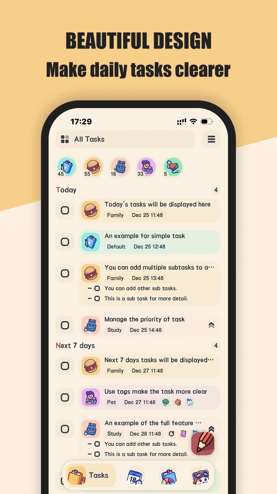{: width="180" .normal }
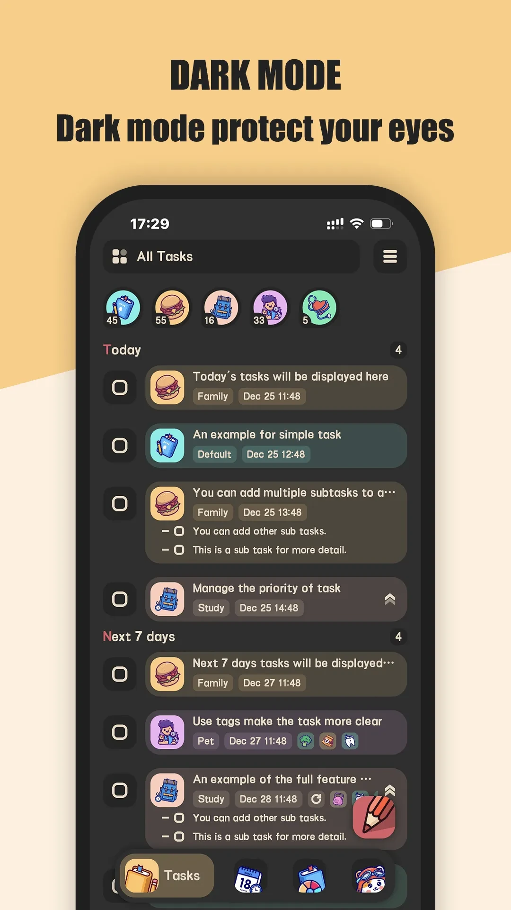{: width="180" .normal }
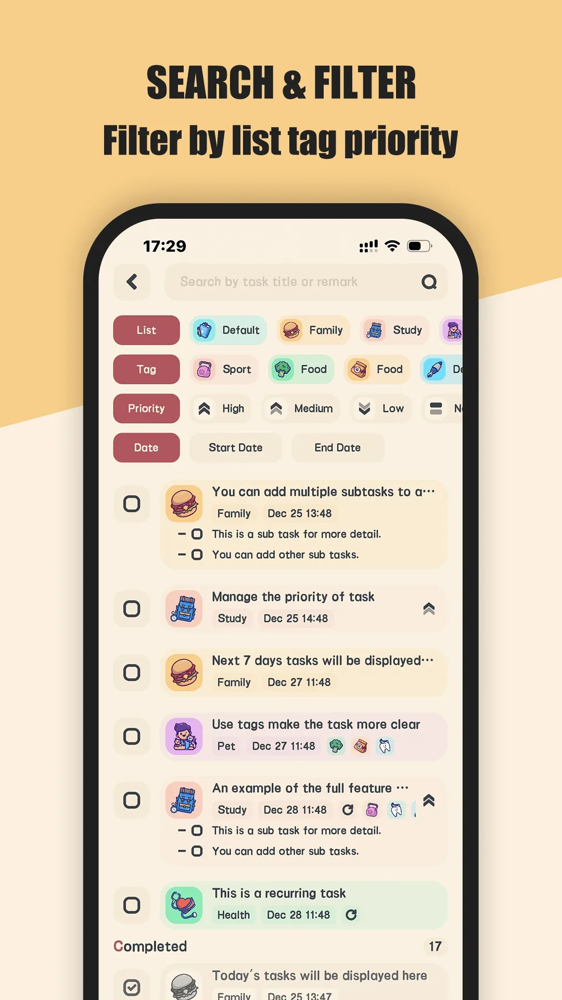{: width="180" .normal }

วิธีจัดการงานที่เกิดซ้ำควรแยกพูดอีกสักรอบ พอทำอันปัจจุบันเสร็จ จะสร้างอันถัดไปที่ใหม่ทั้งอัน ก๊อปปี้และตั้งงานย่อยใหม่ด้วย รอบที่ข้ามไปไม่ถูกเติมเป็นแถวบันทึกที่ไม่ได้ทำ และสิ้นสุดได้ตามวันที่หรือตามจำนวนครั้ง งานเลยกำหนดไม่เลื่อนอัตโนมัติ แต่จัดเข้า กลุ่มเลยกำหนด อย่างชัดเจนและถูกนำติดมาด้วยในมุมมองวันนี้ งานที่เสร็จเข้ากลุ่ม เสร็จแล้ว พร้อมเวลาที่จดไว้ แต่ไม่มีถังขยะ ไม่มีเลิกการลบ และไม่มีการนำเข้า

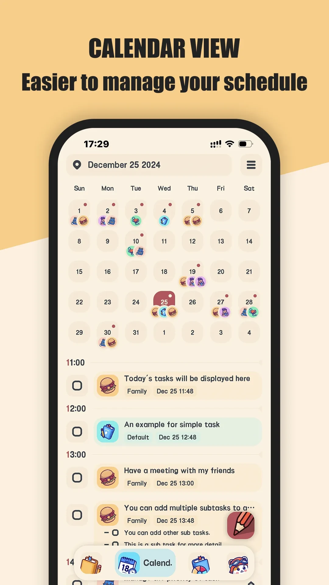{: width="180" .normal }
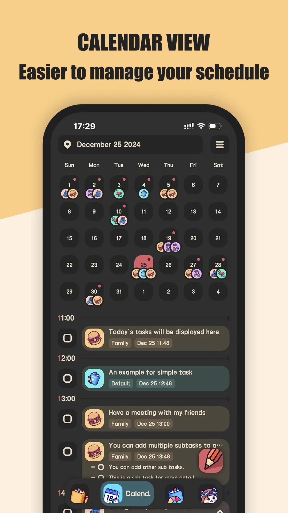{: width="180" .normal }
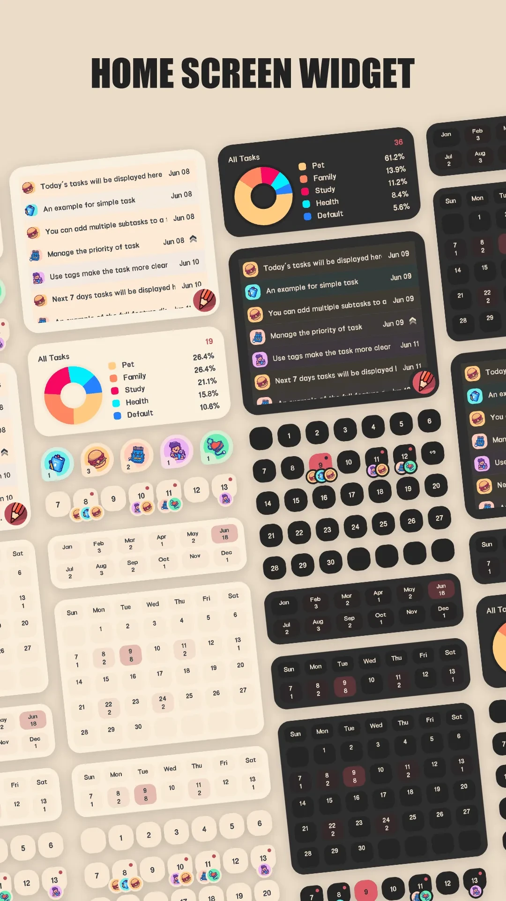{: width="180" .normal }

แพ็กเกจฟรีได้พร้อมกันสูงสุด 10 รายการ 10 แท็ก และงานย่อย 10 ต่อหนึ่งงาน ส่วนจำนวนงานรวมไม่จำกัด ธีมมืด ล็อกแอป รายการ แท็ก และงานย่อยไม่จำกัด รวมถึงส่งออก CSV เป็นรายการที่ปลดล็อก และรายการของผู้ไม่ได้เป็นสมาชิกจะมีโฆษณา ไม่มีการแยกภาษาธรรมชาติ ไม่มีทำงานร่วมกันและมอบหมาย ไม่มีปุ่มเสร็จในแจ้งเตือน ไม่มีตราความสำเร็จ และไม่มีระยะเตือนล่วงหน้าแยกต่างหาก การ ไม่ทำ เหล่านี้เป็นเนื้อเดียวกับตำแหน่ง เก็บในเครื่องล้วน ของมัน การเข้าใจขอบเขตตัดสินความเหมาะสมได้ง่ายกว่านับจำนวนสวิตช์ที่เพิ่มมา

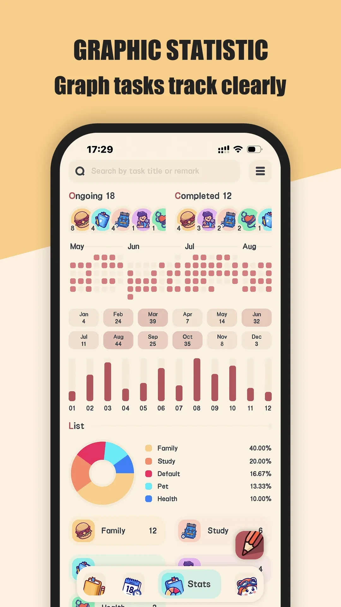{: width="180" .normal }
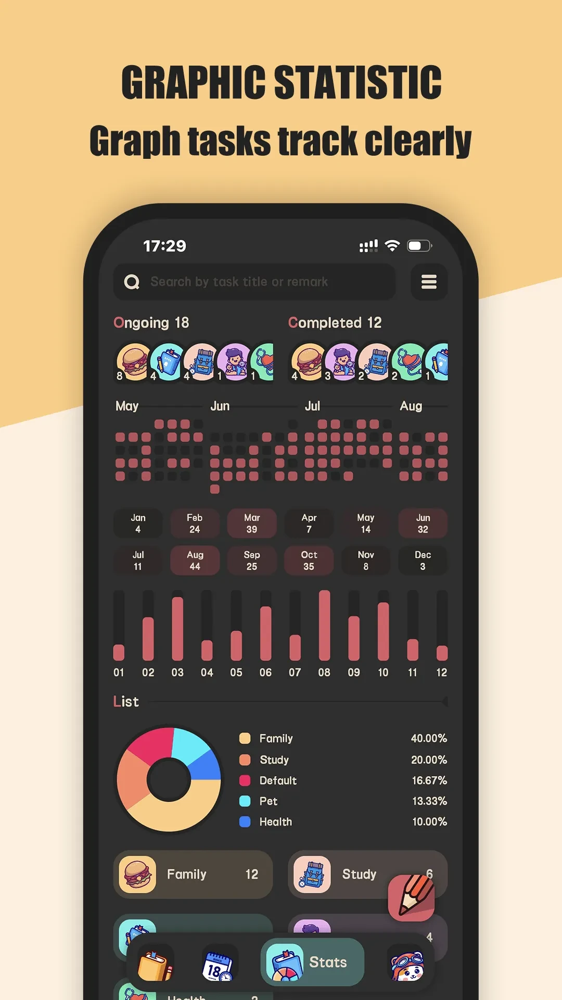{: width="180" .normal }
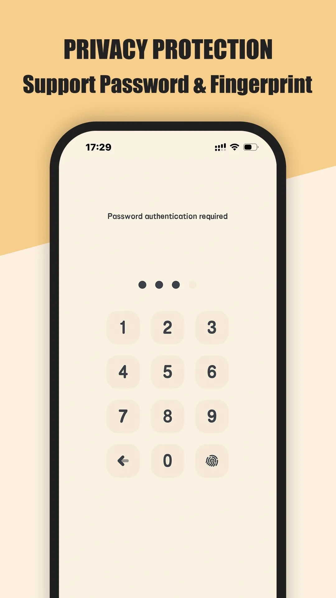{: width="180" .normal }

### Todoist ทำให้ขั้นแรกสั้นที่สุด

จุดแข็งของ Todoist อยู่ที่การจับบันทึก เพิ่มด่วนอัจฉริยะอัดวันที่ ความสำคัญ โปรเจกต์ และแท็กลงประโยคเดียว และหน้าราคาทางการจัด เพิ่มด่วนอัจฉริยะ ไว้ในแพ็กเกจฟรีเลย ด้านการจัดระเบียบใช้โปรเจกต์ งานย่อย แท็ก และตัวกรอง มีมุมมองรายการกับบอร์ด ส่วนรูปแบบปฏิทินและตารางอยู่ในแพ็กเกจจ่ายเงิน

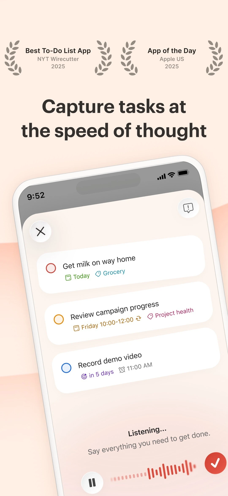{: width="180" .normal }
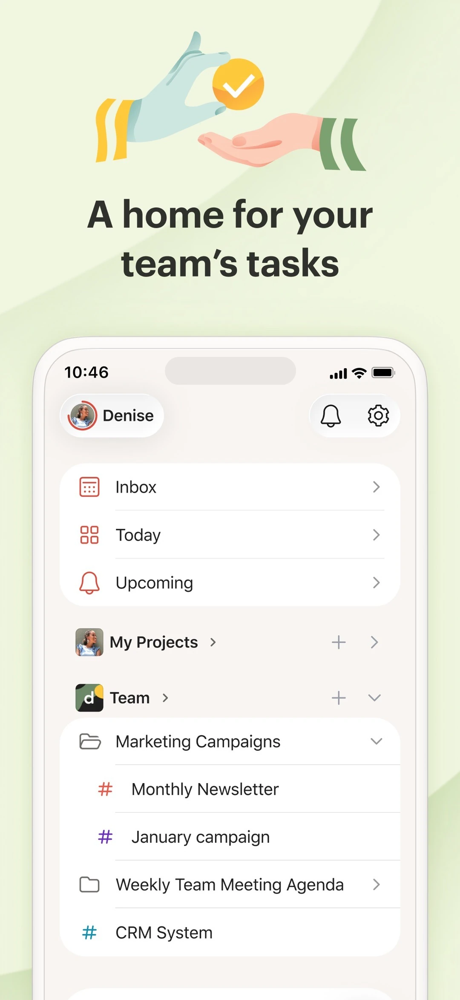{: width="180" .normal }
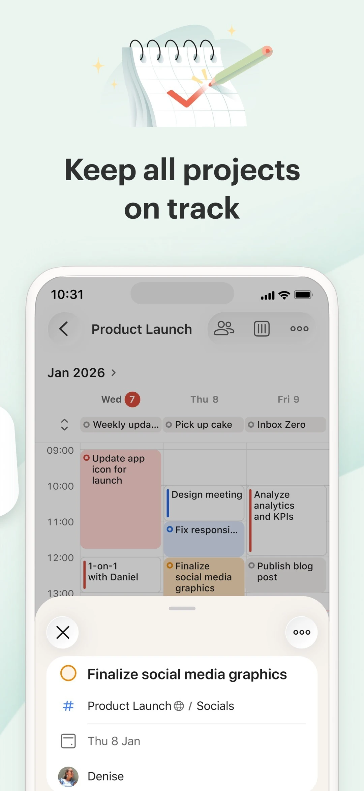{: width="180" .normal }

หน้าราคาทางการชัดเจนมาก แพ็กเกจฟรี Beginner มีโปรเจกต์ส่วนตัว 5 มุมมองตัวกรอง 3 และประวัติกิจกรรม 1 สัปดาห์ รวมการแจ้งเตือนงาน วันครบกำหนดแบบวน และแท็ก แต่ **ไม่รวม** รูปแบบปฏิทิน การแจ้งเตือนกำหนดเอง ระยะเวลางาน และสำรองอัตโนมัติ Pro จ่ายรายปี US$5 ต่อเดือน หรือ US$60 ต่อปี หรือจ่ายรายเดือน US$7 ต่อเดือน เปิดโปรเจกต์ส่วนตัว 300 ตัวกรอง 150 และประวัติเต็ม การทำงานร่วมกัน มอบหมายงาน และคอมเมนต์ใช้ได้ในแพ็กเกจฟรีด้วย สูงสุด 5 คนต่อหนึ่งโปรเจกต์ส่วนตัว สรุปคือมันทำให้ จดไว ๆ กับ ทำงานร่วมข้ามเครื่อง เบามาก แล้ววาง การทบทวนกับมุมมองขั้นสูง ไว้ฝั่งจ่ายเงิน

### TickTick เปลี่ยนการลงมือเป็นปฏิทิน นิสัย และสมาธิ

TickTick รวบเครื่องมือลงมือทำชุดหนึ่งที่อยู่นอกรายการไว้ในแอปเดียว ทั้งมุมมองปฏิทิน บอร์ด ตารางความสำคัญ โปโมโดโร ติดตามนิสัย วันนับถอยหลัง และวิดเจ็ต ภาพหน้าจอในสโตร์ทางการแทบเป็นรายการฟีเจอร์เลย

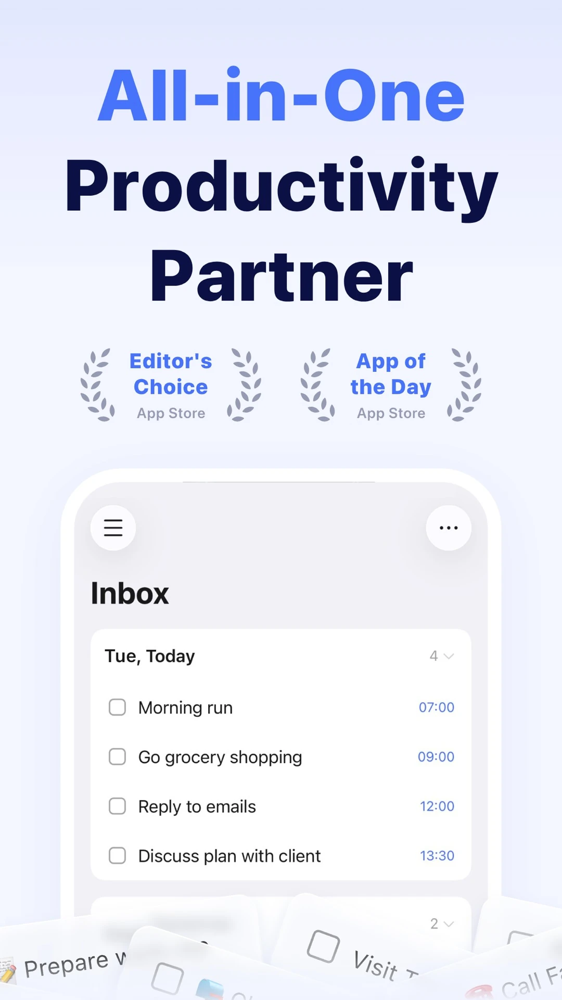{: width="180" .normal }
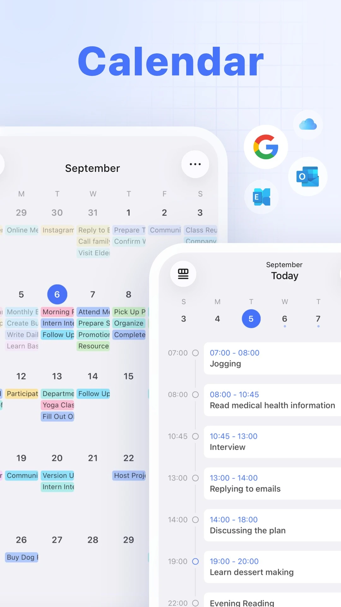{: width="180" .normal }
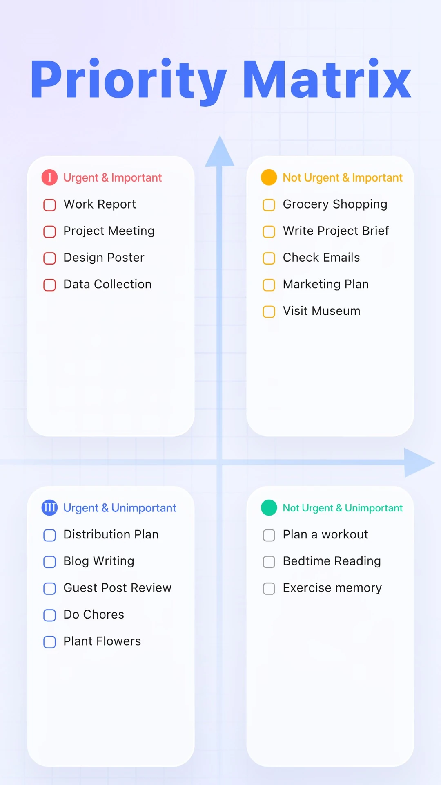{: width="180" .normal }

โควต้าฟรีไปตกที่ จำนวนรายการ หน้าอัปเกรดทางการระบุ 9 รายการ งาน 99 ต่อรายการ มุมมองรายการกับบอร์ด การแจ้งเตือนงานด้วยภาษาธรรมชาติ และซิงก์ข้ามแพลตฟอร์ม Premium US$49.99 ต่อปี ขยับเป็น 299 รายการและงาน 999 ต่อรายการ พร้อมเปิดมุมมองปฏิทินหลายแบบ ระยะเวลางาน แจ้งเตือนอีเมล และธีม ถ้าสิ่งที่คุณอยากได้ไม่ใช่แค่ จดลงมา แต่เป็นการเอาการจัดตาราง สมาธิ และนิสัยไว้ทางเข้าเดียว นี่คือตัวที่ครอบคลุมกว้างที่สุดในกลุ่ม กลับกัน ถ้าอยากได้แค่รายการเงียบ ๆ โมดูลเหล่านี้คือหน้าตาที่เกินมา

### Microsoft To Do My Day คือการจัดใหม่ทุกวัน

Microsoft To Do วางน้ำหนักไว้ที่ขั้นที่สาม ตามคำอธิบายทางการ My Day คือรายการส่วนตัวที่เริ่มจากว่างทุกวัน แล้ว คำแนะนำ คัดงานกลับเข้ามา อันที่วันนี้ยังไม่เสร็จจะถูกแนะนำอีกครั้งพรุ่งนี้ ยังเชื่อมกับ Outlook ได้ด้วย อีเมลที่ทำเครื่องหมายกลายเป็นงานได้ ข้อมูลงานซิงก์ผ่าน Exchange และงานแยกเป็นขั้น ใส่โน้ต แนบไฟล์ได้สูงสุด 25 MB และตั้งเตือนครบกำหนดครั้งเดียวหรือแบบวนได้

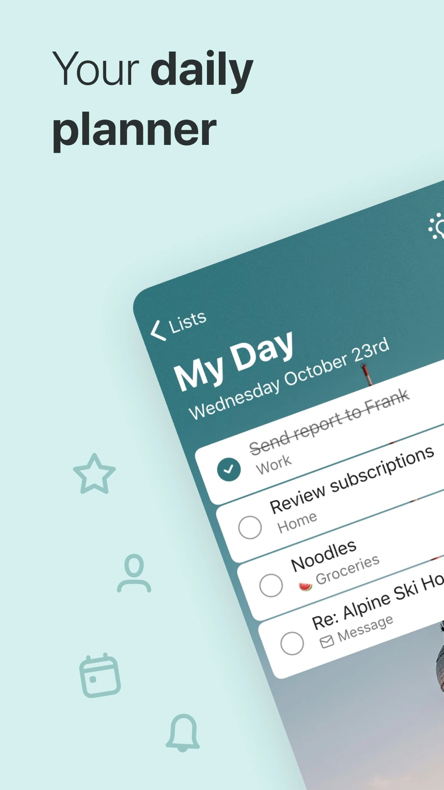{: width="180" .normal }
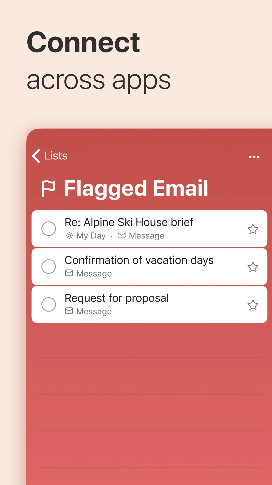{: width="180" .normal }

ซิงก์ฟรีระหว่าง iPhone Android Windows และ Web ไม่มีแพ็กเกจจ่ายเงินแยก และไม่มีโครงชั้นซับซ้อน เหมาะกับคนที่ใช้กล่องจดหมายเป็นโต๊ะทำงานอยู่แล้ว ราคาคือการจัดระเบียบตื้น โปรเจกต์ระยะยาวและการกรองซับซ้อนไม่ค่อยถนัด

### Things 3 ทำให้ขั้นที่สองกลายเป็นโครง

Things 3 เป็นตัวเดียวในกลุ่มที่เอา โครงการจัดระเบียบ มาเป็นตัวเอก Areas รับพื้นที่รับผิดชอบระยะยาว Projects รับเป้าหมายที่มีจุดจบ และในโปรเจกต์ยังแยกกลุ่มด้วย Headings ได้ Today Upcoming Anytime Someday และ Logbook ประกอบเป็นชุดความหมายของมุมมองที่ชัดเจน และเพิ่มด่วนสามารถใส่โน้ต งานย่อย และการแจ้งเตือนได้เลย

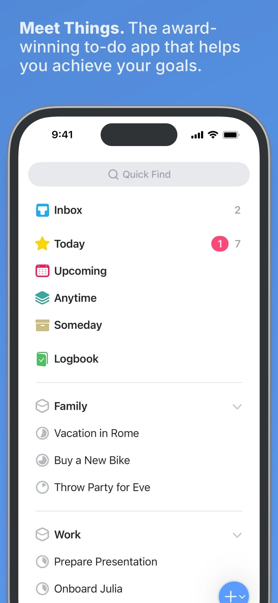{: width="180" .normal }
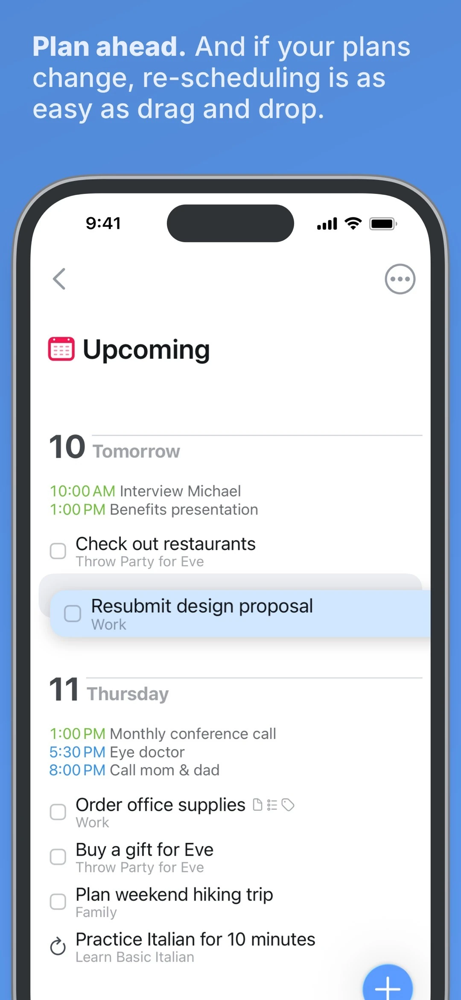{: width="180" .normal }
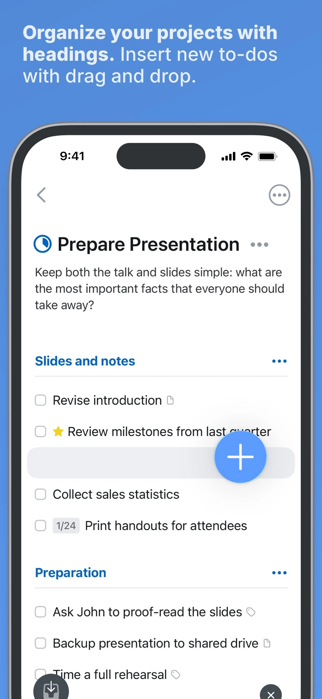{: width="180" .normal }

ซื้อครั้งเดียวตามแพลตฟอร์ม ไม่ใช่สมัครสมาชิก iPhone และ Apple Watch US$9.99 iPad US$19.99 Mac US$49.99 ราคาถือตามหน้าทางการ ซิงก์ Things Cloud ระหว่างเครื่องของตัวเองมาพร้อมการซื้อ ไม่ต้องจ่ายสมาชิกเพิ่ม ข้อจำกัดก็ชัดไม่แพ้กัน เฉพาะระบบนิเวศ Apple ไม่มี Android หรือ Windows ไม่มีเวอร์ชันเว็บ และไม่มีทำงานร่วมกันหลายคน คนที่ชอบมันส่วนใหญ่ติดอยู่กับโครงระยะยาวชุดนี้

### Google Tasks ฝังอยู่ในที่ที่คุณใช้อยู่แล้ว

Google Tasks เกือบกดต้นทุนทั้งหมดไว้ที่ทางเข้า ตามคำอธิบายทางการ สร้างงานได้เลยในแถบข้างของ Gmail Google ปฏิทิน Chat และ Docs พอใส่วันที่กับเวลา จะไปโผล่บนปฏิทินอัตโนมัติ และรองรับกำหนดส่ง การเกิดซ้ำในวันที่เจาะจง และงานย่อย

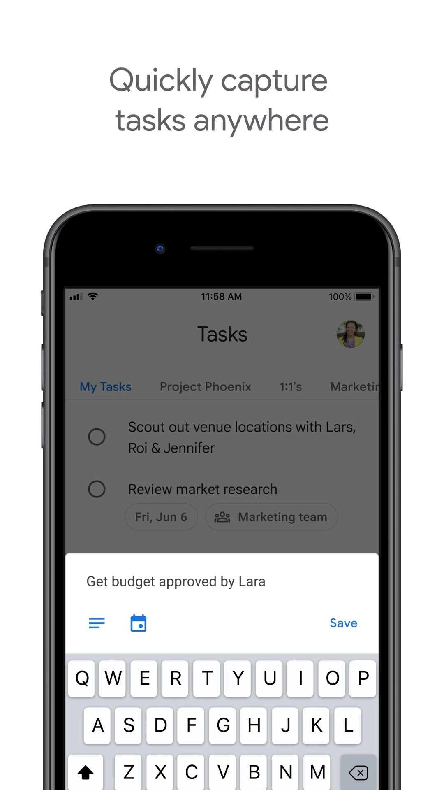{: width="180" .normal }
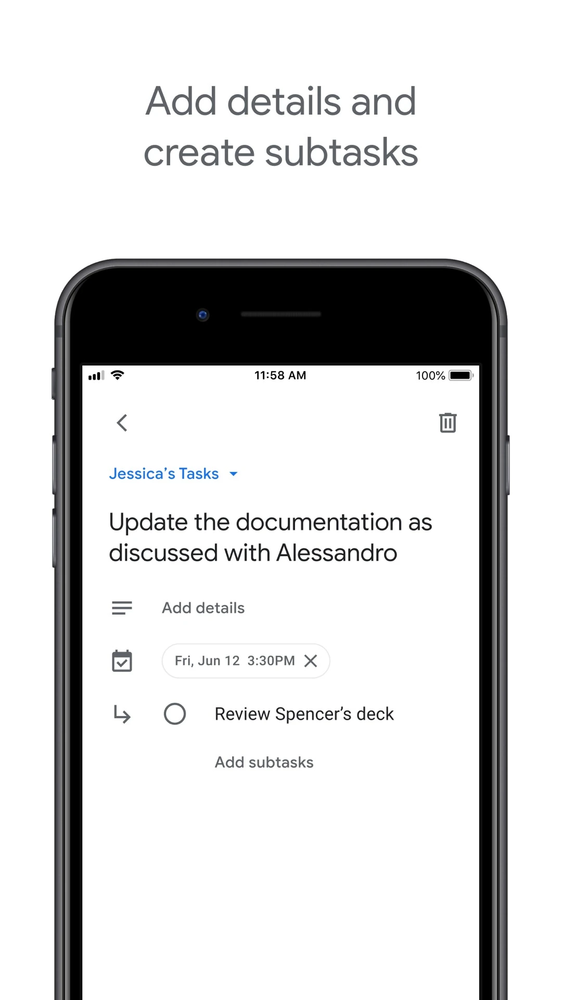{: width="180" .normal }

ศูนย์ช่วยเหลือทางการให้ตัวเลขโควต้าว่า รวมทุกรายการได้สูงสุด 100,000 งาน และในหนึ่งรายการมีงานที่ยังไม่เสร็จได้สูงสุด 20,000 งานย่อยมีแค่ชั้นเดียว ไม่มีวันที่ของตัวเอง และไม่มีความสำคัญ บอร์ด หรือสถิติ พอมีงานย่อยอยู่จะใช้กฎการเกิดซ้ำไม่ได้ ได้มาฟรีพร้อมบัญชี Google ไม่พูดถึงข้อมูลอยู่ในเครื่องหรือการจัดระเบียบซับซ้อน ตำแหน่งของมันคือ จดไว้ข้างอีเมลสักบรรทัด เท่านั้น

### Any.do วางงานลงในตารางของวัน

Any.do วางรายการกับปฏิทินไว้หน้าจอเดียว เน้น วันนี้ต้องทำอะไร มากกว่า มีงานอยู่ทั้งหมดกี่อย่าง นอกจากนี้ยังมีแผนรายวัน งานที่ใช้ร่วมกันและบอร์ดทำงานร่วม ซิงก์ข้ามเครื่อง และแพ็กเกจจ่ายเงินสำหรับทีมเล็ก

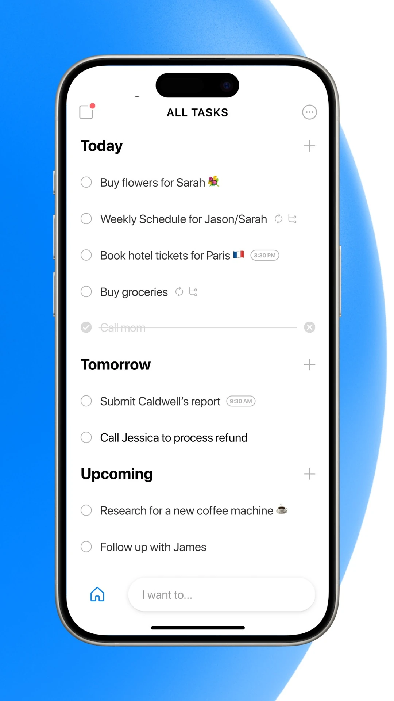{: width="180" .normal }
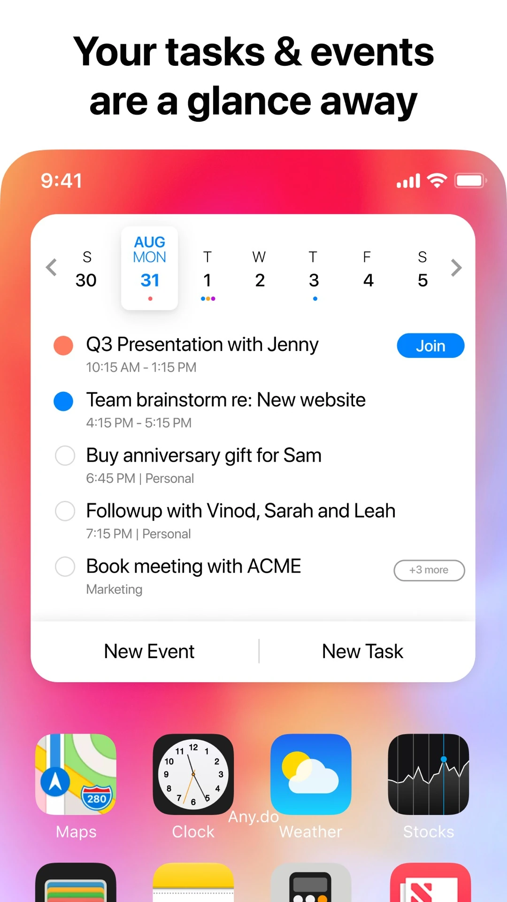{: width="180" .normal }

เหมือน Microsoft To Do ตรงที่เอียงไปทาง การจัดตาราง แต่เน้นการทำงานร่วมกันและมูลค่าเพิ่มจากสมาชิกมากกว่า มีแพ็กเกจฟรี โดยสิทธิ์และราคาถือตามหน้าราคาทางการปัจจุบัน ถ้าคุณใช้คนเดียวเป็นหลักและไม่ตั้งใจจะย้ายรายการเข้าระบบสมาชิก ควรเช็กก่อนว่าความสามารถไหนอยู่ในแพ็กเกจฟรี

## 5. หนึ่งงานกลายเป็นอะไรใน 7 แอป

หนึ่งงานที่เป็นรายงานประจำไตรมาสครบกำหนดวันพุธหน้าเมื่อผ่าน 7 แอปจะความต่างย่อลงเป็นตารางเดียว 6 มิติ — ตอนป้อน ที่เก็บ หลังวันพุธหน้า หลังติ๊ก และตำแหน่งข้อมูล; Meow Todo เก็บชื่อเป็นข้อความล้วนและจัดวันที่ในแผงแยก งานเลยกำหนดไม่เลื่อนอัตโนมัติ แต่ Todoist ใช้เพิ่มด่วนภาษาธรรมชาติและประวัติกิจกรรมฟรี 1 สัปดาห์; TickTick โชว์งานในปฏิทินและนับสมาธิ ขณะที่ Things 3 ใช้ Logbook และเฉพาะเครื่อง Apple; โยนประโยคเปิดเรื่องรายงานประจำไตรมาสที่ครบกำหนดวันพุธหน้าลงไปตามเดิมในแต่ละแอป ความต่างย่อลงเป็นตารางเดียวได้

| ผลิตภัณฑ์ | ตอนป้อนเกิดอะไร | ตกอยู่ในที่เก็บไหน | หลังวันพุธหน้า | หลังติ๊ก | ข้อมูลอยู่ที่ไหน |
|---|---|---|---|---|---|
| Meow Todo List | ชื่อเรื่องข้อความล้วน วันที่ ความสำคัญ แท็ก การเกิดซ้ำตั้งในแผงแยก | รายการหนึ่งชั้น แท็ก งานย่อยหนึ่งชั้น | เข้ากลุ่ม เลยกำหนด และถูกทำเครื่องหมาย ไม่เลื่อนอัตโนมัติ | เข้า เสร็จแล้ว พร้อมจดเวลาเสร็จ ไม่มีถังขยะ | ในเครื่อง สำรองทั้งชุดไป Google Drive หรือ WebDAV ส่งออก CSV เป็นพรีเมียม |
| Todoist | เพิ่มด่วนอัจฉริยะแยกวันที่และโปรเจกต์ | โปรเจกต์ งานย่อย แท็ก ตัวกรอง | คงเป็นงานที่ยังไม่เสร็จ รูปแบบปฏิทินอยู่แพ็กเกจจ่าย | ประวัติกิจกรรม ฟรี 1 สัปดาห์ ภาพแสดงประสิทธิภาพ | ซิงก์คลาวด์ด้วยบัญชี |
| TickTick | ป้อนภาษาธรรมชาติ ตั้งเตือนและเกิดซ้ำได้ | รายการ บอร์ด ตารางความสำคัญ | เห็นในมุมมองปฏิทิน ใส่สมาธิและโปโมโดโรได้ | บันทึกเสร็จบวกสถิตินิสัยและสมาธิ | ซิงก์ข้ามแพลตฟอร์มด้วยบัญชี |
| Microsoft To Do | เพิ่มเองหรือสร้างจากอีเมล Outlook ที่ทำเครื่องหมาย | รายการเรียบและขั้น | งานที่ยังไม่เสร็จเข้าคำแนะนำของวันถัดไป | ค้างในรายการ ทำเครื่องหมายเสร็จได้ | ซิงก์ Exchange และบัญชี Microsoft |
| Things 3 | เพิ่มด่วนพกโน้ต งานย่อย และเตือนได้ | พื้นที่ โปรเจกต์ หัวข้อ | ค้างในเส้นเวลา Upcoming | เข้าบันทึกเสร็จ Logbook | เฉพาะเครื่อง Apple ซิงก์ Things Cloud |
| Google Tasks | จดจากแถบข้าง Gmail ปฏิทิน Chat หรือ Docs | รายการเรียบและงานย่อยหนึ่งชั้น | งานที่มีวันที่ไปแสดงบนปฏิทิน | ค้างในรายการหลังทำเครื่องหมายเสร็จ | บัญชี Google |
| Any.do | เพิ่มเอง ใส่แผนของวันได้ | รายการ มุมมองปฏิทิน บอร์ดที่ใช้ร่วมกัน | เห็นข้างปฏิทิน | สถานะเสร็จบวกทบทวนแผนรายวัน | ซิงก์ข้ามเครื่องด้วยบัญชี |

ตารางนี้ตั้งใจเทียบแค่ หนึ่งงานไปทางไหน จำนวนฟีเจอร์ สไตล์หน้าตา และจะมีเทมเพลตมากแค่ไหน ไม่ได้เปลี่ยนว่างานนั้นจะถูกเห็นอีกครั้งตอนที่ต้องการหรือไม่

## 6. แพลตฟอร์ม การจ่ายเงิน และความเป็นเจ้าของข้อมูล

การดูแพลตฟอร์ม การจ่ายเงิน และความเป็นเจ้าของข้อมูลใน 7 แอปตัดสินที่ 4 อย่าง — ต้องใช้บัญชีหรือไม่ ข้อมูลอยู่ในเครื่องหรือคลาวด์ ส่งออกได้หรือไม่ และราคาตกที่จุดไหน; Meow Todo กับ Things 3 ไม่ต้องบัญชีและเก็บในเครื่อง แต่ Things 3 เฉพาะ Apple ส่วน Todoist TickTick Microsoft To Do Google Tasks และ Any.do ใช้ซิงก์คลาวด์ด้วยบัญชี; โควต้าฟรีก็ต่างกัน — Meow Todo จำกัด 10 รายการ 10 แท็กและงานย่อย 10 ต่องานโดยไม่จำกัดจำนวนงานรวม, Todoist ให้ 5 โปรเจกต์, TickTick ให้ 9 รายการและงาน 99 ต่อรายการ, Google Tasks ให้ 100,000 งานรวม

| ผลิตภัณฑ์ | แพลตฟอร์มหลัก | เงื่อนไขราคา หน้าทางการ 2026-11 | ต้องใช้บัญชี | ข้อมูลและการส่งออก |
|---|---|---|---|---|
| Meow Todo List | Android / iOS | ฟรีจำกัด 10 รายการ 10 แท็ก งานย่อย 10 ต่อหนึ่งงาน ธีมมืด ล็อกแอป โควต้าไม่จำกัด ส่งออก CSV เป็นรายการที่ปลดล็อก | ไม่ | ในเครื่อง สำรองทั้งชุดชี้ไป WebDAV ของตัวเองได้ ไม่มีการนำเข้า |
| Todoist | Web / iOS / Android / เดสก์ท็อป | ฟรี 5 โปรเจกต์ส่วนตัว Pro US$60 ต่อปี หรือ US$7 ต่อเดือน Business คิดตามคน | ใช่ | ซิงก์คลาวด์ สำรองอัตโนมัติอยู่แพ็กเกจจ่าย |
| TickTick | ทุกแพลตฟอร์ม รวม Web และนาฬิกา | ฟรี 9 รายการ งาน 99 ต่อรายการ Premium US$49.99 ต่อปี | ใช่ | ซิงก์ข้ามแพลตฟอร์ม |
| Microsoft To Do | iPhone / Android / Windows / Web | ฟรี ไม่มีแพ็กเกจจ่ายแยก | ใช่ บัญชี Microsoft | ซิงก์ Exchange ตามระบบนิเวศ Microsoft 365 |
| Things 3 | เฉพาะ iPhone / iPad / Mac / Apple Watch | ซื้อครั้งเดียวตามแพลตฟอร์ม ไม่มีสมาชิก | ไม่ | ซิงก์ Things Cloud ระหว่างเครื่องตัวเอง |
| Google Tasks | Gmail / ปฏิทิน / Chat / Docs บวกแอปมือถือ | ฟรีพร้อมบัญชี Google | ใช่ | บัญชี Google เพดานรวม 100,000 งาน |
| Any.do | iPhone / Android / Mac / Windows / Web | แพ็กเกจฟรีบวกแพ็กเกจสมาชิก ตามหน้าราคาทางการ | ใช่ | ซิงก์ข้ามเครื่อง |

## 7. หาก่อนว่าติดอยู่ที่ขั้นไหน

การเลือกแอปควรเริ่มจากหาว่าขั้นไหนใน 5 ขั้นที่คุณพลาดบ่อยที่สุด ไม่ใช่ถามว่าอันไหนดีที่สุด; ถ้าลืมจดอยู่เสมอ ทางเข้าอย่างเพิ่มด่วนภาษาธรรมชาติของ Todoist และ TickTick แถบข้าง Gmail ของ Google Tasks หรือวิดเจ็ตของ Meow Todo ล้วนกดต้นทุนเหลือไม่กี่วินาที; ถ้าจดแล้วหาไม่เจอ ปัญหาอยู่ที่การจัดระเบียบ ถ้าจดแล้วไม่ได้ทำ ปัญหาอยู่ที่มุมมองวันนี้; ถ้าหาร่องรอยไม่เจอ ให้ดูขั้นเสร็จและทบทวน; อย่าเริ่มจาก อันไหนดีที่สุด ให้ดูก่อนว่าขั้นไหนในห้าขั้นที่คุณพลาดบ่อยที่สุด

- **ลืมจดอยู่เสมอ** ให้ดูทางเข้าก่อน เพิ่มด่วนภาษาธรรมชาติ Todoist และ TickTick แถบข้าง Gmail ของ Google Tasks และวิดเจ็ตเพิ่มด่วนบนหน้าจอหลักของ Meow Todo List ล้วนกดต้นทุนลงเหลือไม่กี่วินาที
- **จดแล้วหาไม่เจอ** ปัญหาอยู่ขั้นที่สอง โปรเจกต์ระยะยาวเลือก Things 3 หรือ Todoist ถ้าแค่แยกกลุ่มแบบง่าย รายการเรียบหรือรายการชั้นเดียวก็พอ ไม่ต้องจ่ายค่เรียนรู้ให้กับชั้นที่ไม่ได้ใช้
- **จดแล้วไม่ได้ทำ** ปัญหาอยู่ขั้นที่สาม จัด My Day ใหม่ทุกวันของ Microsoft To Do ปฏิทินอยู่ข้างรายการของ Any.do และ TickTick และทำเครื่องหมายงานเลยกำหนดให้ชัดของ Meow Todo List คือทางออกสามแบบที่ต่างกัน
- **พอเสร็จแล้วหาร่องรอยไม่เจอ** ให้ดูขั้นที่สี่กับห้า อยากได้ประวัติเต็มเลือก Todoist แพ็กเกจจ่ายหรือ Logbook ของ Things 3 ส่วน Meow Todo List ไม่มีถังขยะ ลบแล้วกู้คืนไม่ได้ ควรรู้ไว้ตั้งแต่ต้น
- **ใส่ใจความเป็นเจ้าของข้อมูล** ไม่อยากสมัคร อยากสำรองเอง Meow Todo List กับ Things 3 เฉพาะ Apple คือสองขั้ว ถ้าเปลี่ยนเครื่องบ่อยและต้องการซิงก์ทันที ผลิตภัณฑ์ที่ซิงก์ด้วยบัญชีสบายกว่า

ยังตัดสินใจไม่ได้ เริ่มที่ [Meow Todo List สำหรับมือใหม่](/th/posts/best-meow-todo-list-android/) และ [คู่มือ Meow Todo List ฉบับเต็ม](/th/posts/tutorial-meow-todo-list/) ถ้าให้ความสำคัญกับใช้งานแบบออฟไลน์ ข้อมูลอยู่ในเครื่องล้วน และวิดเจ็ตหน้าจอหลักมากกว่า [หน้าแอป Meow Todo List](/th/apps/meow-todo-list/) มีคำอธิบายฟีเจอร์ครบกว่า

## 8. หกความเข้าใจผิดที่พบบ่อย

ความเข้าใจผิดที่พบบ่อยมี 6 ประการที่ทำให้แอปรายการสิ่งที่ต้องทำกลับเพิ่มความยุ่ง — คิดว่าฟีเจอร์ยิ่งเยอะยิ่งใช้นาน คิดว่าเขียนรายการเท่ากับเดินหน้าแล้ว คิดว่างานเลยกำหนดควรขยับมาที่วันนี้เอง คิดว่าแพ็กฟรีสร้างงานได้ไม่จำกัด คิดว่าอยู่ในเครื่องแปลว่าไม่ปลอดภัย และปนงานเกิดซ้ำกับสตรีคนิสัย; แต่ละข้อชี้ไปที่กฎซ่อนหลังฟีเจอร์ เช่น โควต้าของ Meow Todo ตกที่ 10 รายการและ 10 แท็กไม่ใช่จำนวนงานรวม; การเข้าใจขอบเขตตัดสินความเหมาะสมได้ง่ายกว่านับจำนวนสวิตช์

1. **ฟีเจอร์ยิ่งเยอะยิ่งใช้นาน** โปโมโดโร นิสัย บอร์ด และการทำงานร่วมกันมีประโยชน์จริง แต่ทุกโมดูลที่เพิ่มมาคืออีกจุดหนึ่งที่ต้องดูแล ใช้สักหนึ่งสองสัปดาห์หาขั้นที่ตัวเองติดก่อน ค่อยตัดสินใจว่าจะใช้เครื่องมือที่หนักขึ้นไหม
2. **เขียนรายการแล้วเท่ากับเดินหน้าแล้ว** สิ่งที่ Masicampo กับ Baumeister พบคือ แผนที่เจาะจง ช่วยลดความคิดที่โผล่มารบกวน ไม่ใช่ การทำรายการ เท่ากับทำงานเสร็จ แต่ละรายการควรมีขั้นถัดไป ไม่ใช่แค่คำนาม
3. **งานเลยกำหนดควรขยับมาอยู่วันนี้เอง** การเลื่อนอัตโนมัติทำให้ พลาดไปกี่วัน หายไปจากสถิติ การทำเครื่องหมายเลยกำหนดให้ชัดเหมาะกับคนที่ทบทวนย้อนหลัง การจัดใหม่ทุกวันเหมาะกับคนที่ไม่อยากถูกของเก่ากดทับ อย่าใช้ปนกัน
4. **แพ็กเกจฟรีสร้างงานได้ไม่จำกัด** ข้อจำกัดอาจตกที่จำนวนรายการ Meow Todo List 10 และ TickTick 9 จำนวนโปรเจกต์ Todoist 5 จำนวนงานต่อรายการ TickTick 99 หรือตกที่งานย่อยและความยาวประวัติก็ได้ ดูก่อนว่าอะไรถูกจำกัด ค่อยตัดสินว่าพอไหม
5. **อยู่ในเครื่องแปลว่าไม่ปลอดภัย คลาวด์แปลว่าสะดวกกว่า** อยู่ในเครื่องไม่มีซิงก์ทันที เปลี่ยนเครื่องต้องอาศัยไฟล์สำรอง แต่บันทึกไม่ผ่านเซิร์ฟเวอร์ คลาวด์สบาย ราคาคือบัญชีและข้อมูลถูกฝากไว้ที่อื่น นี่คือการเลือก ไม่ใช่ดีหรือไม่ดี

6. **งานที่เกิดซ้ำกับสตรีคนิสัยคือเรื่องเดียวกัน** ในแอปนิสัย อ่านหนังสือทุกวัน คือเป้าหมายเดียวที่ทำสำเร็จในหลายรอบ ขาดไปหนึ่งวันก็ตัดสตรีค ในแอปรายการสิ่งที่ต้องทำ จ่ายค่าเช่าวันที่ 1 ทุกครั้งที่เสร็จจะสร้างงานใหม่ต่างหาก เอามาปนกันทำให้ตัวเลขสถิติหมดความหมาย

## 9. ลิงก์ดาวน์โหลดทางการ

ลิงก์ดาวน์โหลดทางการของ 7 แอปรวบเฉพาะหน้าสโตร์ของแต่ละเจ้า ไม่ผ่านเว็บดาวน์โหลดของบุคคลที่สาม; ลิงก์ Google Play เปิดทีละหน้าเพื่อเทียบชื่อแอป และไอดี App Store ตรวจกับ Lookup API ทางการของ Apple ทั้งชื่อแอปและผู้พัฒนา ตรวจเมื่อพฤศจิกายน 2026 ถ้าแอปเปลี่ยนชื่อหรือปรับพื้นที่จัดจำหน่าย ให้ถือตามผลค้นในสโตร์

- **Meow Todo List** [Google Play](https://play.google.com/store/apps/details?id=com.glgjing.money.task.todo.list.meow) · [App Store](https://apps.apple.com/app/id6742345495)
- **Todoist** [Google Play](https://play.google.com/store/apps/details?id=com.todoist) · [App Store](https://apps.apple.com/app/id572688855)
- **TickTick** [Google Play](https://play.google.com/store/apps/details?id=com.ticktick.task) · [App Store](https://apps.apple.com/app/id626144601)
- **Microsoft To Do** [Google Play](https://play.google.com/store/apps/details?id=com.microsoft.todos) · [App Store](https://apps.apple.com/app/id1212616790)
- **Things 3** [App Store](https://apps.apple.com/app/id904237743) · [เว็บทางการ](https://culturedcode.com/things/) เฉพาะระบบนิเวศ Apple **ไม่มีเวอร์ชัน Android**
- **Google Tasks** [Google Play](https://play.google.com/store/apps/details?id=com.google.android.apps.tasks) · [App Store](https://apps.apple.com/app/id1353634006)
- **Any.do** [Google Play](https://play.google.com/store/apps/details?id=com.anydo) · [App Store](https://apps.apple.com/app/id497328576)

## 10. คำถามที่พบบ่อย FAQ

**แอปรายการสิ่งที่ต้องทำ ทูดูลิสต์ และแอปจัดการงาน เป็นผลิตภัณฑ์แบบเดียวกันไหม**
{:.faq-q}

กว้าง ๆ แล้วใช่ ต่างกันแค่ชื่อที่เน้นคนละมุม แกนคือ หนึ่งงาน สถานะเสร็จ และเมื่อไหร่จะถูกเห็นอีกครั้ง สิ่งที่ต้องแยกให้ชัดคือเส้นขอบกับเครื่องมืออีกสามแบบ ปฏิทินดูแลช่วงเวลาที่มีจุดเริ่มและจุดจบชัด แอปนิสัยดูแลพฤติกรรมที่วนตามรอบโดยไม่มีจุดจบ โน้ตเก็บเนื้อหาที่แก้ได้นาน ส่วนรายการงานดูแลเรื่องที่ **จบเมื่อเสร็จ** การยัดทั้งสี่อย่างลงเครื่องมือเดียวมักเป็นก้าวแรกที่ทำให้รายการเริ่มคุมไม่ได้

**หนึ่งงานควรเขียนละเอียดแค่ไหน ทุกงานต้องแยกงานย่อยไหม**
{:.faq-q}

เกณฑ์ง่ายมาก พอเห็นแล้วลงมือได้เลยไหม รายงานประจำไตรมาสมักต้องแยกเป็นหลายขั้น การตอบอีเมลสั้น ๆ ไม่ต้อง ในผลิตภัณฑ์ส่วนใหญ่งานย่อยมีแค่ชั้นเดียวและไม่มีวันที่ของตัวเอง ตามที่ศูนย์ช่วยเหลือทางการของ Google ระบุ จึงเหมาะเป็นรายการขั้นมากกว่าโปรเจกต์ซ้อนชั้น แพ็กเกจฟรีของ Meow Todo List ได้งานย่อยสูงสุด 10 ต่อหนึ่งงาน เกินกว่านั้นต้องปลดล็อก แทนที่จะแยกทุกงาน ให้แยกเฉพาะงานที่คุณผัดไปเรื่อย ๆ

**พองานที่เกิดซ้ำเสร็จ อันถัดไปมาจากไหน**
{:.faq-q}

ยกตัวอย่าง Meow Todo List ตอนติ๊กงานปัจจุบัน จะสร้าง **อันถัดไปที่ใหม่ทั้งอัน** ก๊อปปี้ชื่อเรื่อง โน้ต รายการ แท็ก ความสำคัญ กฎการเกิดซ้ำ และงานย่อยมาด้วย ตั้งงานย่อยกลับเป็นยังไม่เสร็จ และเลื่อนเวลาที่วางไปรอบถัดไปที่ใช้ได้ รอบที่ผ่านไปแล้วโดยไม่ทันจัดการจะถูกข้าม ให้ไปตกที่วันนี้หรืออนาคต และสิ้นสุดได้ตามวันที่หรือตามจำนวนครั้ง งานเดิมกลายเป็นเสร็จแล้วและไม่เกิดซ้ำอีก ประวัติจึงเป็นแถวของบันทึกที่เคยทำเสร็จจริง ไม่ใช่งานเดียวถูกเขียนทับซ้ำไปมา

**ถ้าวันที่ผ่านไปแล้วยังไม่เสร็จ งานจะขยับมาอยู่วันนี้เองไหม**
{:.faq-q}

ไม่เสมอไป และตรงนี้แหละคือจุดที่ต่างกันมากที่สุด Meow Todo List ไม่เลื่อนอัตโนมัติ งานเลยกำหนดแยกเข้า กลุ่มเลยกำหนด และถูกทำเครื่องหมาย พร้อมถูกนำติดมาด้วยในมุมมองวันนี้ ส่วน My Day ของ Microsoft To Do เริ่มจากว่างทุกวัน งานที่ยังไม่เสร็จวันนี้จะเข้า คำแนะนำ ของวันถัดไป แบบแรกคือสมุดบัญชีสำหรับคนชอบทบทวน แบบหลังคือการจัดใหม่รายวันสำหรับคนที่ไม่อยากถูกของเก่ากดทับ ตัดสินใจก่อนว่ากลัวพลาดมากกว่าหรือกลัวถูกกดทับมากกว่า

**หลังเปลี่ยนมือถือ งานที่จดไว้ยังอยู่ไหม**
{:.faq-q}

อยู่ที่ว่าข้อมูลเก็บไว้ที่ไหน Meow Todo List อยู่ในเครื่องล้วน ไม่มีบัญชี เปลี่ยนเครื่องต้องอาศัยสำรองและกู้คืนฐานข้อมูลทั้งชุด รองรับ Google Drive หรือที่อยู่ WebDAV ของตัวเอง และตั้งสำรองอัตโนมัติได้ การส่งออก CSV หลังกรองตามรายการ แท็ก ความสำคัญ และช่วงวันที่เป็นฟีเจอร์พรีเมียม และไม่มีการนำเข้าที่คู่กัน Todoist TickTick Microsoft To Do Google Tasks และ Any.do ใช้ซิงก์คลาวด์ด้วยบัญชี เปลี่ยนเครื่องสบายกว่า Things 3 ซิงก์ระหว่างเครื่อง Apple ของตัวเองผ่าน Things Cloud ไม่ว่าเลือกแบบไหน ก่อนเปลี่ยนเครื่องให้มั่นใจว่าสำรองหรือซิงก์เคยทำงานจริงสักครั้ง

**แพ็กเกจฟรีพอไหม ปกติจำกัดตรงไหน**
{:.faq-q}

สิ่งที่ถูกจำกัดไม่เหมือนกัน จึงอย่านับแค่ สร้างงานได้กี่งาน Meow Todo List จำกัด 10 รายการ 10 แท็ก และงานย่อย 10 ต่อหนึ่งงาน **แต่จำนวนงานรวมไม่จำกัด** TickTick ระบุทางการว่าฟรี 9 รายการและงาน 99 ต่อรายการ Todoist ฟรีให้โปรเจกต์ส่วนตัว 5 ตัวกรอง 3 และประวัติกิจกรรม 1 สัปดาห์ โดยรูปแบบปฏิทินกับสำรองอัตโนมัติอยู่แพ็กเกจจ่าย ตัวเลขทางการของ Google คือ 100,000 งานรวมทุกรายการ และ 20,000 งานที่ยังไม่เสร็จต่อรายการ ดูก่อนว่าข้อจำกัดไหนที่คุณมีโอกาสชนเร็วที่สุด ค่อยตัดสินใจจ่าย

**พิมพ์วันและเวลาลงชื่อเรื่องแล้วให้แอปแยกให้ได้ไหม**
{:.faq-q}

อยู่ที่ผลิตภัณฑ์ Todoist กับ TickTick ทั้งคู่จัดเพิ่มด่วนภาษาธรรมชาติไว้ในความสามารถฟรี ประโยคเดียวให้วันที่และกฎการเกิดซ้ำได้ ส่วน Meow Todo List ไม่มีการแยกภาษาธรรมชาติ ชื่อเรื่องเป็นข้อความล้วน และวันที่ ความสำคัญ แท็ก การเกิดซ้ำเลือกในแผงแยกกัน ข้อดีคือไม่มีความกำกวมและเก็บตรงตามที่เขียน อีกอย่างเวลาแจ้งเตือนเท่ากับเวลาที่วางงาน ไม่มีการตั้ง เตือนก่อน 10 นาที แยกต่างหาก แต่มีภาพรวมรายวันเวลาคงที่

**ใช้แบบไม่เน็ตและไม่มีบัญชีได้ไหม**
{:.faq-q}

Meow Todo List ได้ งาน รายการ และแท็กเก็บในเครื่อง ใช้แบบออฟไลน์ได้ ราคาคือไม่มีซิงก์เรียลไทม์หลายเครื่อง และเปลี่ยนเครื่องต้องผ่านไฟล์สำรอง Things 3 ก็ไม่ต้องใช้บัญชี แต่เฉพาะเครื่อง Apple ที่เหลือเริ่มจากบัญชี ตอนออฟไลน์มักยังดูหรือแก้ชั่วคราวได้ แต่ฟีเจอร์เต็มต้องอาศัยการซิงก์หลังเข้าสู่ระบบ ถ้าอยากอยู่ในเครื่องจริง ให้เช็กด้วยว่าส่งออกและสำรองมีให้ใช้ เพราะนั่นแหละตัดสินว่าอีกหลายปีข้างหน้าจะยังนำข้อมูลออกไปได้ไหม

## 11. อ่านเพิ่มและดัชนีคำศัพท์

- [ภาพรวมแอปรายการสิ่งที่ต้องทำและแอปจัดการงานบน Android ปี 2026](/th/posts/pillar-todo-list-task-manager-apps-android/)
- [Meow Todo List ปะทะ Todoist ต่างกันตรงไหน](/th/posts/vs-meow-todo-and-todoist/)
- [Meow Todo List สำหรับมือใหม่](/th/posts/best-meow-todo-list-android/)
- [คู่มือ Meow Todo List ฉบับเต็ม](/th/posts/tutorial-meow-todo-list/)
- [คำศัพท์ งานย่อยคืออะไร](/th/glossary/what-is-a-subtask/)
