Calm 很受欢迎，但它 **约 69.99 美元/年的订阅** 并非人人都能接受。如果你主要想要 **用于睡眠与专注的环境音**，其实有更简单、更便宜、而且通常无需注册账号的替代选择——尤其是当你只是在睡前想听一段雨声、或在开放式办公室里想用声音盖住交谈时，为整套冥想课程付费往往并不划算。

下面我们对比六款 **Calm 的替代品**——从可爱简洁的[白噪音](/zh/glossary/what-is-white-noise/)应用，到庞大的声音库与冥想社区——从价格、平台以及真正关键的功能出发。多数人卡在一个具体问题上：订阅费、强制账号，或熄屏就停的声音；下面会按「解决哪个问题」来讲每一款，而不是按功能表从头念到尾。

## 为什么要跳出 Calm

{: width="180" .normal }
{: width="180" .normal }
{: width="180" .normal }
{: width="180" .normal }

很多人装 Calm 的初衷很单纯：找一点环境音帮助入睡或集中注意力。可真正用起来，下面这些落差最常把人推向替代品：

- **付费订阅**（约 69.99 美元/年），而你可能几乎用不到整个库。
- 你只想要 **环境音**，而非引导课程或睡眠故事。
- 你偏好 **免注册** 与一键播放。
- 当你只想要雨声助眠时，这个 App 会显得 **内容过于繁杂**。
- 许多替代应用对同样的核声音是 **免费或一次性买断**。

判断是否值得换，可以先算一笔"使用账"：如果你每天只用它播放一两段固定的声音，那么按年付费的内容库大部分是闲置的；反过来，若你确实每天跟着引导课程练习，纯声音应用的替代意义就不大。把这个前提想清楚，再看下面的对比才不会被"功能更多"带偏。

## 最佳 Calm 替代品一览

六款工具的价格与定位先列成一表。注意"免费"二字在不同产品里含义不同：有的核心就够用（Meow FM、Insight Timer），有的只是试用入口（Headspace、BetterSleep、Noisli），有的一次买断即可（White Noise）。

| 应用 | 价格（2026） | 平台 | 最适合 |
|---|---|---|---|
| **Meow FM** | 免费核心 + 解锁 | 安卓、iOS | 简洁可爱的睡眠/专注白噪音 |
| **Headspace** | 免费 + 订阅（约 70 美元/年） | 安卓、iOS | 引导冥想 + 睡眠 |
| **Insight Timer** | 免费 + 会员 | 安卓、iOS | 庞大的免费冥想库 |
| **BetterSleep** | 免费 + 订阅 | 安卓、iOS | 声音混音 + 睡眠故事 |
| **White Noise（TMSOFT）** | 约 1.99 美元一次性 | 安卓、iOS | 海量声音库 |
| **Noisli** | 免费 + 订阅（约 60 美元/年） | 安卓、iOS、网页 | 工作专注混音 |

---

### 1. Meow FM —— 最佳简洁白噪音

{: width="180" .normal }
{: width="180" .normal }
{: width="180" .normal }
{: width="180" .normal }
{: width="180" .normal }

Meow FM 是一款 **用于睡眠、放松与专注的白噪音应用**，提供雨声、雷雨、森林、海滨、壁炉等环境音，并附带睡眠定时器与桌面时钟，让你保持高效。它的定位很克制：把"播一段声音、定时关掉"这件事做到无需思考，适合睡前、通勤或图书馆里快速进入状态。

**优势**
- **用于睡眠、放松与专注的环境音**——雨声、雷雨、风声、森林、海滨、壁炉等。
- **睡眠定时器**自动关闭，你入睡后声音自动停止。
- **桌面时钟**让你工作学习时保持高效。
- **深色与浅色模式**，每个声音都有精美舒缓的封面。
- **友好、温馨的喵系设计**，给人安慰而非冰冷感。
- 免费提供部分声音，高级声音为一次性解锁。

**不足**
- 声音库比 BetterSleep 或 White Noise 小。
- 无引导冥想或睡眠故事。
- 高级声音需购买（但无订阅压力）。

**最适合：** 只想要漂亮、简单的环境音来入睡或专注的人——免注册、零麻烦，尤其适合想把复杂课程库彻底放下的用户。

**下载 Meow FM**
- [Google Play](https://play.google.com/store/apps/details?id=com.glgjing.whitenoise.relax.night.sleep.meow)
- [App Store](https://apps.apple.com/us/app/meow-fm-white-noise/id1606715188)

---

### 2. Headspace —— 最佳引导冥想

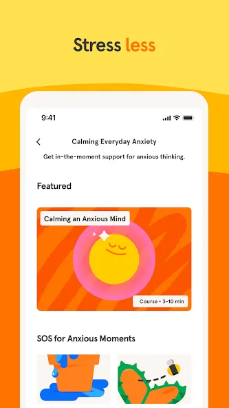{: width="180" .normal }
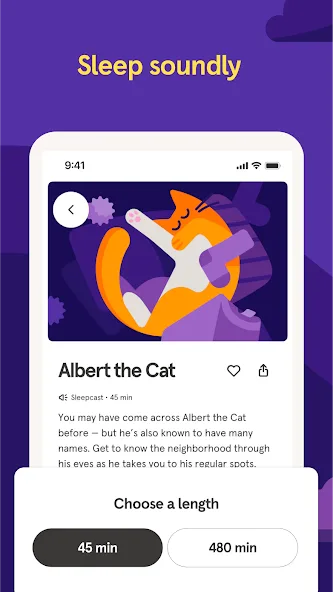{: width="180" .normal }
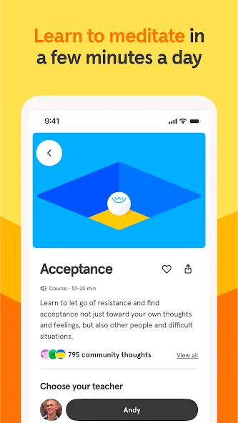{: width="180" .normal }
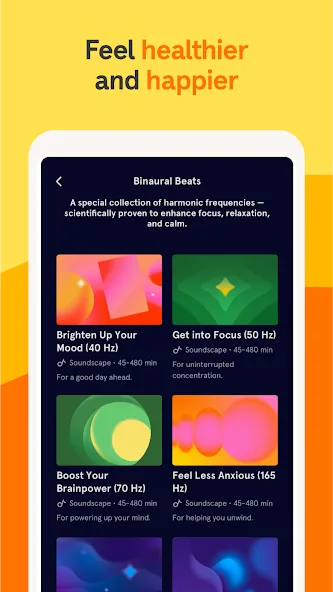{: width="180" .normal }
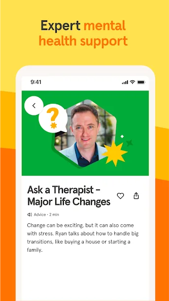{: width="180" .normal }

Headspace 将 **引导冥想** 与睡眠播客、专注音乐、呼吸练习结合——提供一条结构化的路径，帮你更安睡、更减压。如果你需要的不是"背景有声音"，而是有人带着你一步步放松，它会比纯白噪音应用更对症。

**优势**
- **庞大的引导冥想库**，涵盖睡眠、压力、专注与焦虑。
- **睡眠播客与放松**内容，适合睡前。
- **呼吸与专注练习**，风格友好、有动画感。
- 跨平台能力强（安卓 + iOS），对初学者友好。
- 基础课程免费；订阅后可获大量内容。

**不足**
- **订阅偏贵**（约 70 美元/年），与 Calm 相当。
- 不太侧重纯环境音混音。
- 最佳内容在付费墙后。

**最适合：** 想要引导式结构、而非单纯背景音的用户；如果只是想省钱听雨声，它并不是最划算的替代。

**下载 Headspace**
- [Google Play](https://play.google.com/store/apps/details?id=com.getsomeheadspace.android)
- [App Store](https://apps.apple.com/us/app/headspace-sleep-meditation/id493145008)

---

### 3. Insight Timer —— 最佳免费冥想库

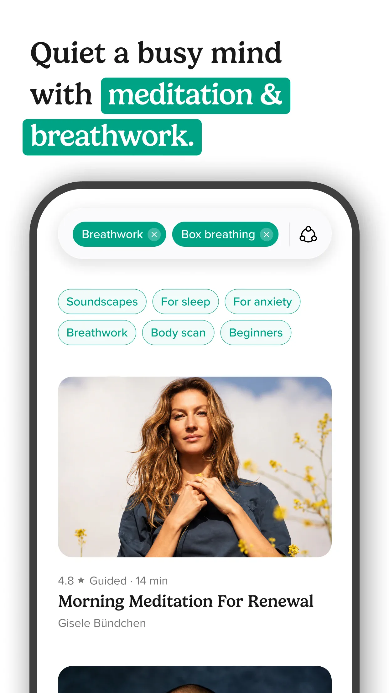{: width="180" .normal }
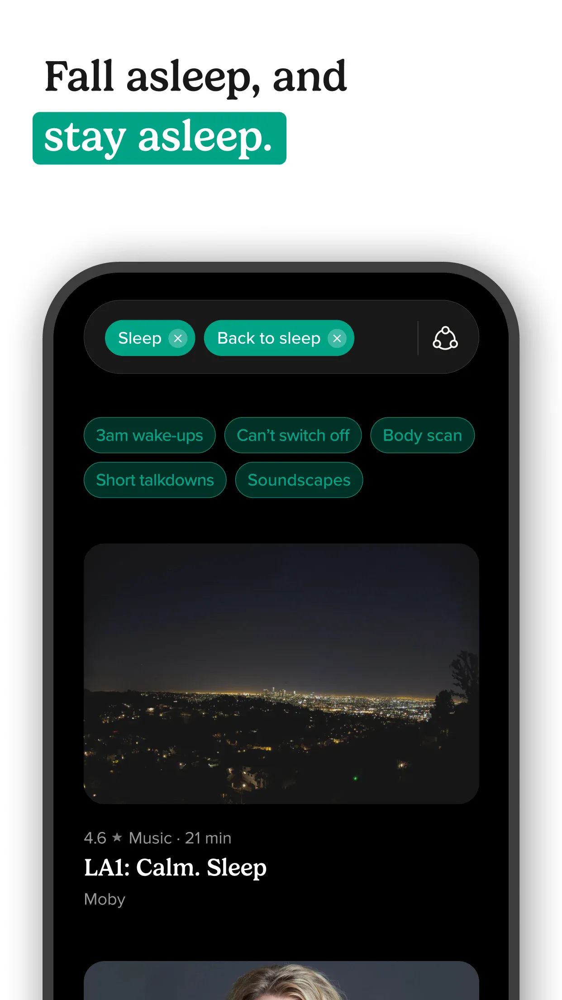{: width="180" .normal }
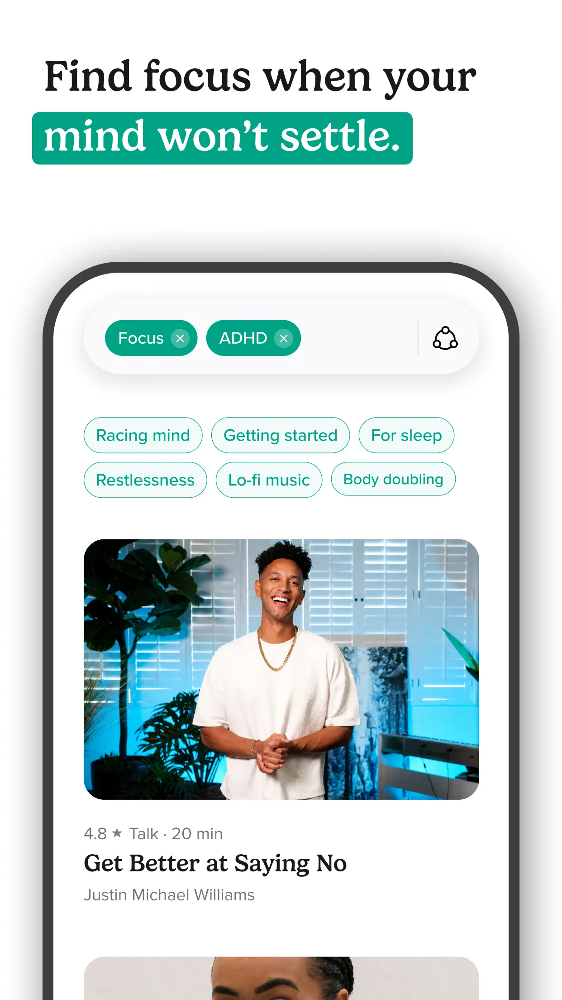{: width="180" .normal }
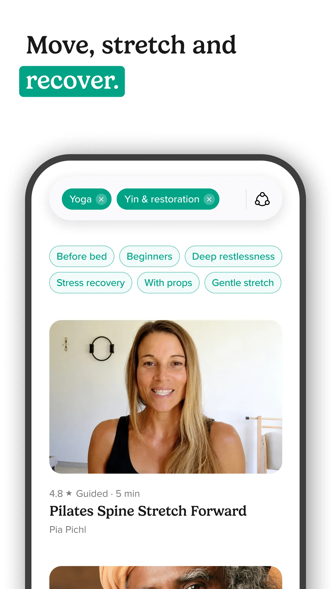{: width="180" .normal }
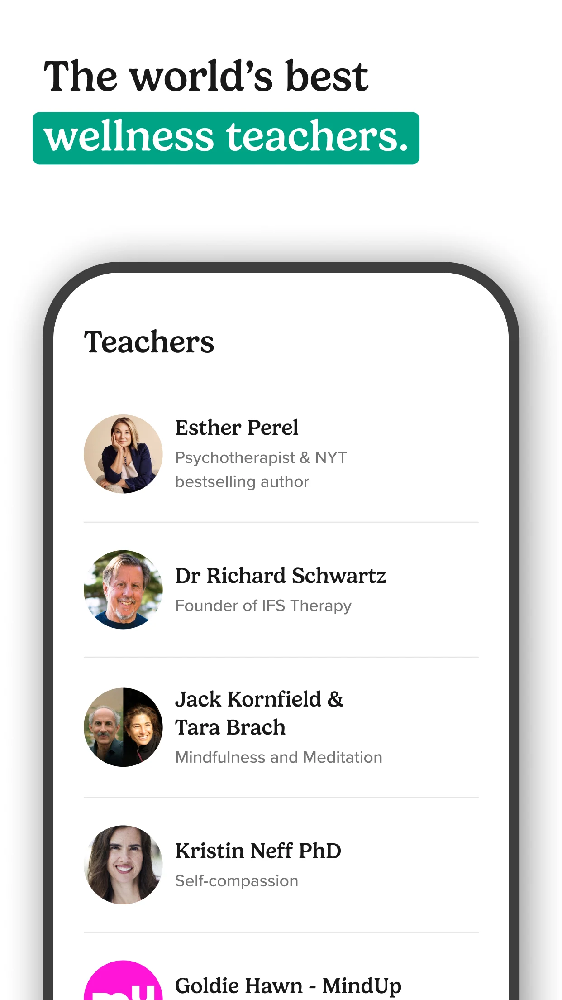{: width="180" .normal }

Insight Timer 提供 **庞大的免费冥想库**（数以万计引导课程），外加睡眠音乐、讲座与可自定义计时器。它适合那种"想试很多种、又不想先掏钱"的人：免费内容就足够撑起日常练习，自定义计时器还方便你按自己的节奏坐一会儿。

**优势**
- **免费库极其庞大**——免费内容远超 Calm 或 Headspace。
- **睡眠音乐与故事**、环境音景，以及导师带领的讲座。
- **可自定义冥想计时器**，带间隔钟声。
- 活跃的全球化社区与课程。
- 核心免费；高级课程可选会员。

**不足**
- 未经筛选时，库规模会让人 **眼花缭乱**。
- 部分高级课程需会员。
- 「睡眠故事」精致度不如 Calm。

**最适合：** 想要最大免费库与计时器的冥想者；愿意自己花点时间挑内容，就能省下订阅费。

**下载 Insight Timer**
- [Google Play](https://play.google.com/store/apps/details?id=com.spotlightsix.zentimerlite2)
- [App Store](https://apps.apple.com/us/app/insight-timer-meditate-sleep/id337472899)

---

### 4. BetterSleep —— 最佳声音混音

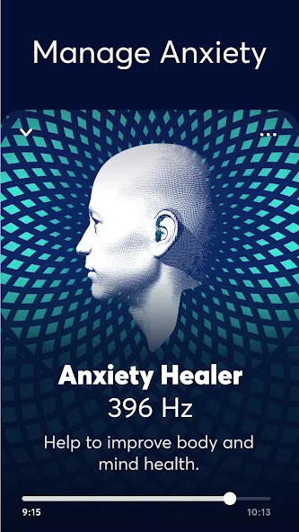{: width="180" .normal }
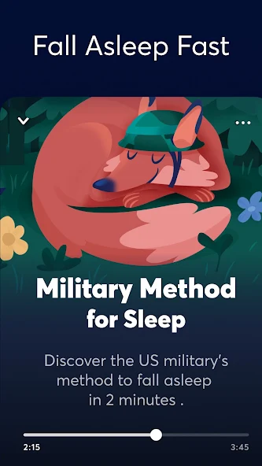{: width="180" .normal }
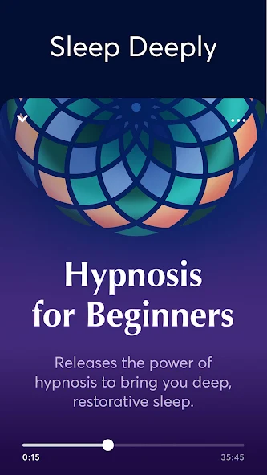{: width="180" .normal }
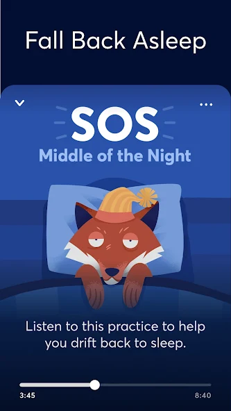{: width="180" .normal }
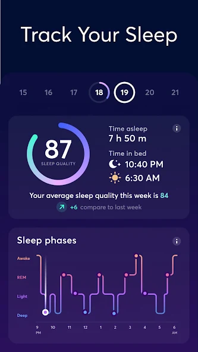{: width="180" .normal }

BetterSleep（前身 Relax Melodies）的核心是 **混出你自己的声景**——将雨声、风声、钢琴等数十层声音组合，外加睡眠故事与睡前练习。它适合对"哪种声音陪我入睡"有明确偏好、愿意动手调配的人，比如雨声压低、风声垫底再加一点钢琴。

**优势**
- **深度声音混音**——从庞大的声音目录中构建自定义组合。
- **睡眠故事、冥想与 Sleep Moves** 睡前练习。
- 智能闹钟与睡眠追踪。
- 精致、舒缓的界面。
- 免费档可用，完整目录需订阅。

**不足**
- 大多数声音与故事 **需要订阅**。
- 混音功能对轻度用户来说可能过度。
- 部分用户觉得免费档受限。

**最适合：** 喜欢亲手调配睡眠声景的用户；如果你只想一键播放，这里的深度反而成了负担。

**下载 BetterSleep**
- [Google Play](https://play.google.com/store/apps/details?id=ipnossoft.rma.free)
- [App Store](https://apps.apple.com/us/app/bettersleep-relax-and-sleep/id314498713)

---

### 5. White Noise（TMSOFT）—— 最佳声音库

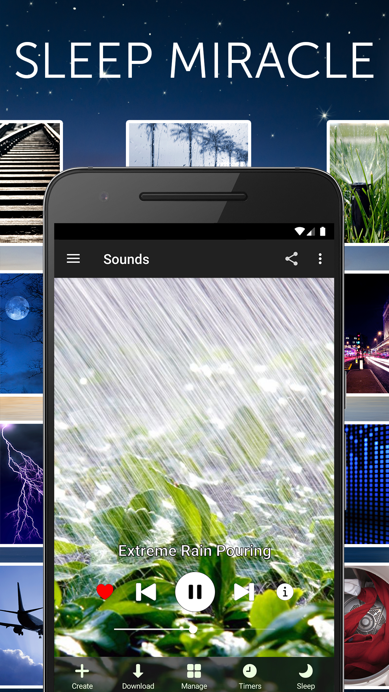{: width="180" .normal }
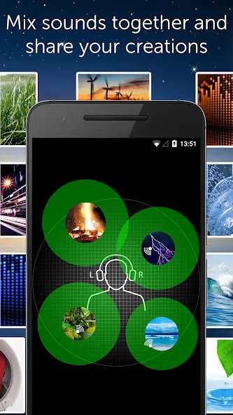{: width="180" .normal }
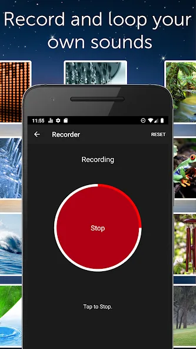{: width="180" .normal }
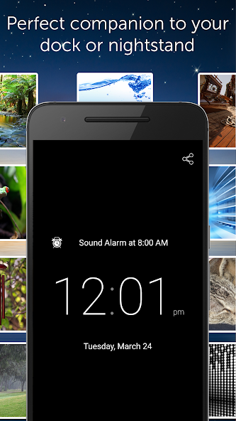{: width="180" .normal }
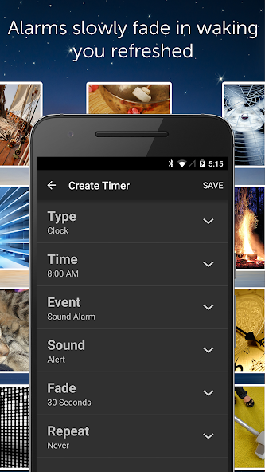{: width="180" .normal }

TMSOFT 出品的 White Noise 拥有 **庞大的环境音库**（循环音与混音），一次性买断、无订阅，并支持录制与混音。它适合"就想多听几种声音、又不想年年续费"的人，下载后还能离线播放，出差或飞行途中同样可用。

**优势**
- **非常庞大的声音库**，含循环音与环境混音。
- 可 **混音与录制** 自己的声景，也能导入自定义音源。
- **一次性购买**（约 1.99 美元）——无订阅。
- 闹钟与定时器支持音量渐变。
- 下载后可离线使用。

**不足**
- 界面更朴素，偏工具而非生活风。
- 无引导冥想或故事。
- 发现机制不如 BetterSleep 精心策划。

**最适合：** 想要大库又不想订阅的「声音纯粹派」；介意界面精致度的人需要适应它的工具风格。

**下载 White Noise（TMSOFT）**
- [Google Play](https://play.google.com/store/apps/details?id=com.tmsoft.whitenoise.full)
- [App Store](https://apps.apple.com/us/app/white-noise/id289894882)

---

### 6. Noisli —— 最佳工作专注混音

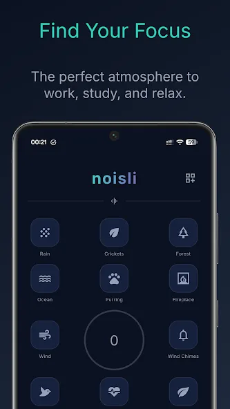{: width="180" .normal }
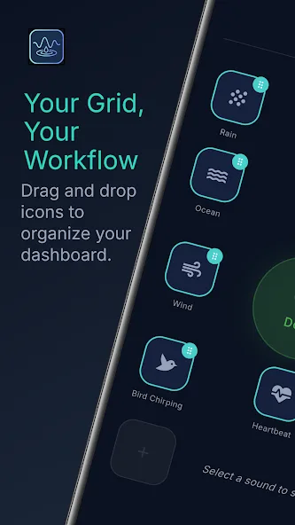{: width="180" .normal }
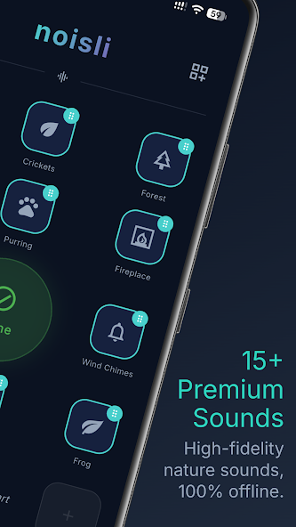{: width="180" .normal }
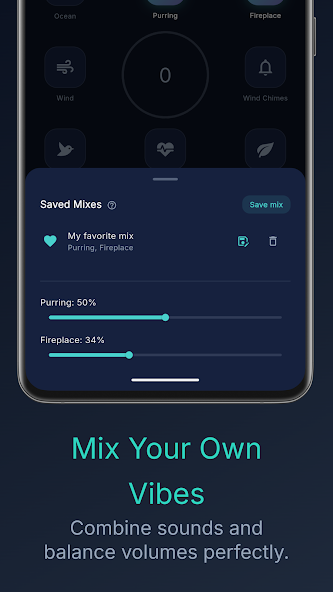{: width="180" .normal }
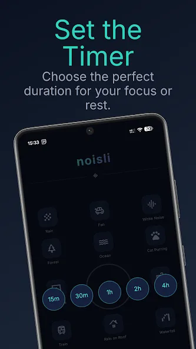{: width="180" .normal }

Noisli 是一款面向工作、学习与睡眠的 **专注与放松声音混音器**，支持网页、安卓与 iOS 同步，并内置计时器与效率功能。如果你在办公室和家里都想用同一套声景，跨设备同步会很有价值；它更偏"工作模式"而非睡前仪式。

**优势**
- **精心调配的混音**，专为专注与效率优化。
- **网页 + 移动端同步**，你的混音随处跟随。
- **计时器与效率模式**，适合工作冲刺。
- 干净、极简的界面。
- 免费档可用，完整访问需订阅。

**不足**
- **订阅约 60 美元/年** 才能解锁完整库。
- 环境音种类比 White Noise 少。
- 睡眠故事内容少于 Calm/BetterSleep。

**最适合：** 为专注而混音的远程工作者与学生；若你主要在睡前用，睡眠故事稀缺会是短板。

**下载 Noisli**
- [Google Play](https://play.google.com/store/apps/details?id=dev.crscaballero.noisli)
- [App Store](https://apps.apple.com/us/app/noisli/id862773459)

---

## 核心能力对比

能力表把上面六款的文字结论压成一张速查图。建议先看三列——"免费档""睡眠定时器""无需账号"——因为它们决定了你能不能零成本、零门槛地把它用起来，其余的库大小与混音深度再按喜好取舍。

| 能力 | Meow FM | Headspace | Insight Timer | BetterSleep | White Noise（TMSOFT） | Noisli |
|---|---|---|---|---|---|---|
| **平台** | 安卓、iOS | 安卓、iOS | 安卓、iOS | 安卓、iOS | 安卓、iOS | 安卓、iOS、网页 |
| **免费档** | 充裕 | 有限 | 庞大 | 有限 | 一次性买断（便宜） | 有限 |
| **声音库** | 精选 | 小（冥想） | 中等 | 大（可混音） | 极大 | 精选 |
| **声音混音 / 组合** | 无（精选） | 无 | 仅计时器 | 有（深度） | 有 | 有（专注） |
| **睡眠定时器** | 有 | 有 | 有 | 有 | 有 | 有 |
| **引导冥想** | 无 | 强 | 强（免费） | 部分 | 无 | 无 |
| **睡眠故事** | 无 | 有 | 部分 | 有 | 无 | 无 |
| **专注 / 工作模式** | 有（时钟） | 有 | 有 | 部分 | 部分 | 强 |
| **离线 / 下载** | 有 | 有 | 有 | 有 | 有 | 有 |
| **无需账号** | 有 | 无（需账号） | 可选 | 需账号 | 可选 | 需账号（同步） |
| **定价模式** | 免费 + 解锁 | 订阅（约 70 美元/年） | 免费 + 会员 | 免费 + 订阅 | 一次性约 1.99 美元 | 订阅（约 60 美元/年） |
| **广告** | 无 | 无 | 无 | 无 | 无 | 无 |

一句话归纳：六款都带睡眠定时器且都能离线，差别集中在"要不要账号、要不要订阅、要不要引导内容"。Meow FM 在免账号与离线这两项上最彻底，Insight Timer 免费内容最多，White Noise 是一次买断的大库，Headspace/BetterSleep/Noisli 则各有一条付费深度路线。

---

## 每款 Calm 替代品适合谁

表格比的是功能；这里按「你原来在为什么付钱」把同样的六款重新分组。这样分的好处是，你能直接对照自己的真实用途，而不是被"功能最多"迷惑。

- **为引导内容付钱**——Headspace、Insight Timer 保留冥想与睡眠故事；如果这部分才是你常用的，换成纯声音播放器会像少了半个产品。
- **为声音种类付钱**——Noisli 与 myNoise 主打可叠层的音色与特定频段；Meow FM 用本机音源承接叠层，White Noise（TMSOFT）则是一次性买断的海量曲库。
- **为睡前流程付钱**——BetterSleep 把混音、睡眠故事与记录放在一起；Meow FM 选的是更短的闭环：按播放、设定时，醒来时手机早已自己停下。
- **为专注付钱**——Brain.fm 那一类卖的是「为某种状态设计的声音」；而这里的判断标准更朴素：熄屏后台不断、没网也能播。
- **不想再付钱**——**白噪音不订阅** 的清单，至少该保留定时关闭与离线音源；Meow FM 把这两项都留在免费核心里。

从 **潮汐替代**、**小睡眠替代**、**MUJI to Relax 替代**、**Noisli 替代**、**Brain.fm 替代**，到「**白噪音替代**」这类搜法，迁移前先问两句：没信号还能不能播？不订阅的话计时器还在不在？这两个答案基本就决定了它能不能顶替你现在的睡前习惯。

## 如何选购

按用途直接挑选，最省时间：

- 想要 **简洁、可爱、免注册的白噪音** → **Meow FM**：播一段雨声、定个时，睡前不用做任何设置。
- 想要 **引导冥想 + 睡眠** → **Headspace**：有人带着练，适合想建立固定习惯的人。
- 想要 **最大的免费冥想库** → **Insight Timer**：免费内容量最可观，愿意自己挑就够用。
- 想要 **自己调配睡眠声景** → **BetterSleep**：把雨、风、钢琴叠到刚刚好。
- 想要 **海量库、一次性买断** → **White Noise（TMSOFT）**：怕年年续费的人最省心。
- 想要 **为工作准备的专注混音** → **Noisli**：跨设备同步，办公室与家里同一套声景。

## 如何摆脱 Calm

1. **列出你真正用到的功能**——环境音、睡眠故事，还是冥想？选匹配的替代品，别为用不到的内容继续付费。
2. **下载一款声音应用**（纯声音选 Meow FM 或 White Noise；混音选 BetterSleep）。
3. **建立睡前播放列表**并设置睡眠定时器，让声音在你入睡后自动停止。
4. **先试免费档**——Insight Timer 与 Meow FM 不花钱也能用很多，足够验证习惯能否被接管。
5. **确认新应用已覆盖你的夜间习惯后**，再取消 Calm 订阅；先取消再找替代，往往又要重新付费。

## 常见问题（FAQ）

**Meow FM 算好的免费 Calm 替代品吗？**
{:.faq-q}

算。如果你主要想要睡眠与专注的环境声，Meow FM 核心免费、无需账号、完全离线，且带自动停止的睡眠计时器——没有约 69.99 美元/年的订阅。它的取舍是库较小、没有引导课程，换来的是上手即用。

**Meow FM 能离线用吗？**
{:.faq-q}

能。所有声音无网也能播，所以飞机、帐篷或任何 Wi-Fi 掉线的地方你都能入睡或专注。这一点对通勤地铁、差旅酒店尤其实用。

**哪款 Calm 替代品最擅长混音？**
{:.faq-q}

BetterSleep 与 Noisli 混音最深，适合愿意一层层调配的人；White Noise（TMSOFT）以一次性买断换海量库；Meow FM 是纯环境噪音里最简单、免注册的选法。

**能轻松摆脱 Calm 吗？**
{:.faq-q}

能。选与你用途匹配者（声音 vs 故事 vs 冥想），建好带计时器的睡前播放列表，等新应用覆盖你的夜间习惯后再取消 Calm 订阅。按这个顺序来，通常一两周就能确认新工具是否够用。

[Meow FM App 页](/zh/apps/meow-fm/)——安卓与 iOS 可用。

## 相关术语

- [什么是白噪音（White Noise）？](/zh/glossary/what-is-white-noise/)
