CCleaner 名气很大，但在现代安卓上它的作用有限，不少用户想要 **更轻量的清理或真正的监控**。这些 **[CCleaner 的替代品](/zh/glossary/what-is-a-system-monitor/)** 两者兼顾——而且我们会如实说明清理工具能做什么、不能做什么。

下面我们从价格、平台以及真正关键的功能出发，对比六款应用，帮你选对工具，而不是只看品牌名。多数人卡在一个具体问题上：订阅价格、删除清单不透明，或干脆看不到实时读数；下面会按「解决哪个问题」来讲每一款。

## 为什么要跳出 CCleaner

- **在现代安卓上效果有限**——系统已自行管理缓存与后台任务，「清理」往往释放不了多少空间。
- 该应用曾 **从部分应用商店下架**，已不再是当年那款必备工具。
- 移动版 **广告与订阅提示** 频繁。
- **隐私顾虑**——部分清理工具索取宽泛的权限。
- 你可能更想要 **真正的监控**（看清是什么在消耗 CPU/电量），而非单纯清理。

> 现实提醒：在现代安卓上，腾出空间最有效的方式是删除不用的文件和大型媒体，而不是「清理内存」。选工具应着眼于*安全的存储管理*，并用监控工具找出真正在消耗资源的元凶。

## 最佳 CCleaner 替代品一览

| 应用 | 价格（2026） | 平台 | 最适合 |
|---|---|---|---|
| **System Monitor** | 免费核心 + 解锁 | 安卓 | 监控 + 加速 + 轻量清理 |
| **Files by Google** | 免费 | 安卓 | 安全、官方的存储清理 |
| **SD Maid** | 免费 + 专业版 | 安卓 | 深度、谨慎的清理 |
| **CCleaner** | 免费 + 订阅 | 安卓 | 熟悉品牌、快速清理 |
| **Avast Cleanup** | 免费 + 订阅 | 安卓 | 清理 + 照片清理 |
| **Norton Clean** | 免费 | 安卓 | 简单的垃圾/缓存清理 |

---

### 1. System Monitor —— 监控与清理兼顾最佳

{: width="180" .normal }
{: width="180" .normal }
{: width="180" .normal }
{: width="180" .normal }
{: width="180" .normal }

System Monitor 是一款 **安卓全能工具**，集 CPU 监控、存储清理、内存加速与电池医生于一体——洞察 *与* 清理一次搞定。

**优势**
- **实时的 CPU、内存与电池监控**，带过热保护。
- **存储清理**针对垃圾与缓存，并含内存分析，支持一键加速。
- **电池医生**提供健康度、电压与温度曲线。
- **悬浮窗与小组件**，随时可见。
- 多主题，核心功能免费。

**不足**
- 仅支持安卓。
- 清理力度比专业清理工具轻（它的强项在监控）。
- 部分功能需 Pro 解锁。

**最适合：** 想 *看清* 问题再动手、而不只是扫一遍缓存的用户。

**下载 System Monitor**
- [Google Play](https://play.google.com/store/apps/details?id=com.glgjing.marvel)

---

### 2. Files by Google —— 最安全的清理工具

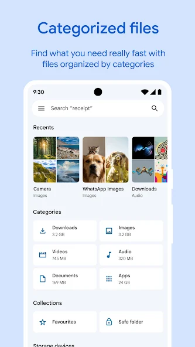{: width="180" .normal }
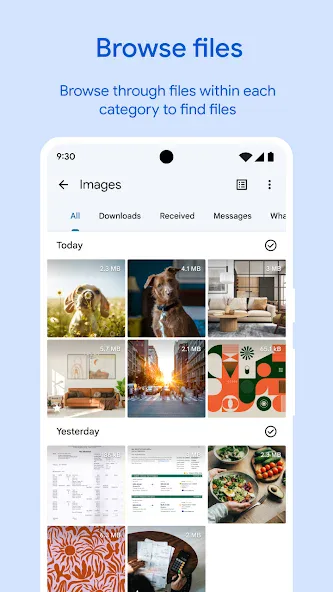{: width="180" .normal }
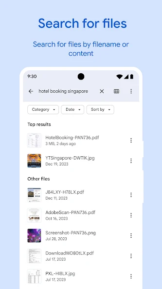{: width="180" .normal }
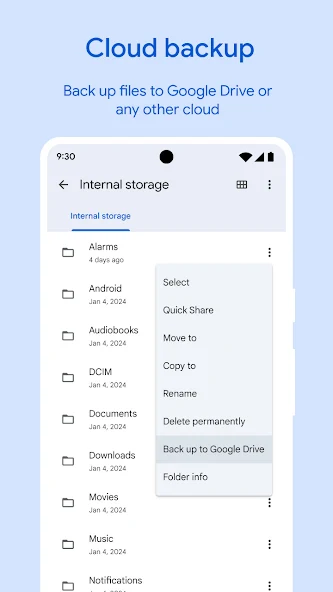{: width="180" .normal }
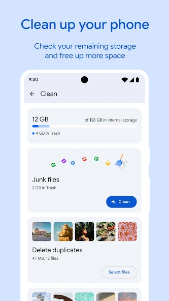{: width="180" .normal }

Files by Google 是谷歌的 **官方存储管理器**——它会清理未使用的文件、查找重复项，并以隐私友好、不激进后台任务的设计帮你释放空间。

**优势**
- **官方且安全**——谷歌出品，权限克制，无可疑行为。
- **智能存储清理**：未用文件、重复项、大型媒体与应用缓存。
- **文件浏览与离线互传**。
- **无广告、无订阅**——完全免费。
- 清晰简洁的界面，人人可用。

**不足**
- **无内存加速或系统监控**——仅管存储。
- 不像 SD Maid 那样深挖「残骸」文件。
- 仅支持安卓。

**最适合：** 想要可靠、不花哨的方式找回存储空间的用户。

**下载 Files by Google**
- [Google Play](https://play.google.com/store/apps/details?id=com.google.android.apps.nbu.files)

---

### 3. SD Maid —— 最佳深度清理

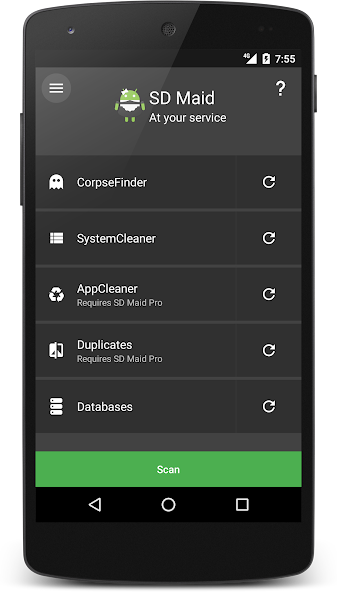{: width="180" .normal }
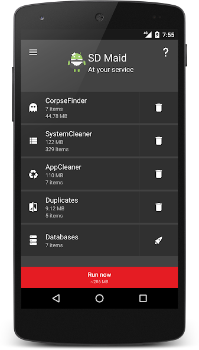{: width="180" .normal }
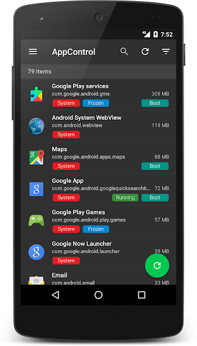{: width="180" .normal }
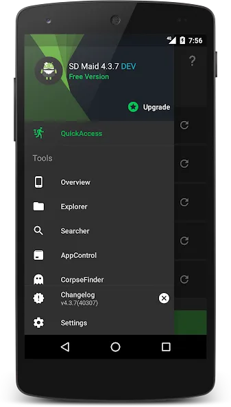{: width="180" .normal }
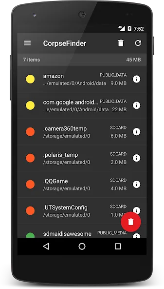{: width="180" .normal }

SD Maid 是一款 **谨慎而深度的安卓清理工具**：它能找到卸载后遗留的「残骸」文件、重复项、待优化的数据库，并提供应用管控。

**优势**
- **残骸查找器**清除其他清理工具遗漏的残留。
- 全存储 **重复与文件搜索**。
- **应用管控/冻结**与数据库优化器。
- **计划任务**实现自动维护。
- 在进阶用户中口碑扎实；免费档也很实用。

**不足**
- 仅支持安卓。
- 最佳功能（残骸查找、应用管控、计划任务）需 SD Maid Pro。
- 界面信息密集，对普通用户不够友好。

**最适合：** 想要彻底、可控清理的进阶用户。

**下载 SD Maid**
- [Google Play](https://play.google.com/store/apps/details?id=eu.thedarken.sdm)

---

### 4. CCleaner —— 最熟悉的快速清理

{: width="180" .normal }
{: width="180" .normal }
{: width="180" .normal }
{: width="180" .normal }
{: width="180" .normal }

CCleaner 移动版是 **那款知名 PC 工具的手机版本**——快速清除缓存、浏览历史与未用文件，并提供基础的照片与电池辅助功能。

**优势**
- 若在桌面端用过 CCleaner，**品牌与操作流程都熟悉**。
- **快速缓存/历史清理**，以及简洁的存储概览。
- 专业版提供 **电池与应用休眠** 辅助。
- 一键扫描，简单省心。
- 有免费档可用。

**不足**
- 对现代安卓的缓存管理 **实际影响有限**。
- 免费版有广告与订阅提示。
- **已从 iOS 下架**——现在仅安卓。

**最适合：** 只认 CCleaner 这块牌子、想要一次快速扫描的用户。

**下载 CCleaner**
- [Google Play](https://play.google.com/store/apps/details?id=com.piriform.ccleaner)

---

### 5. Avast Cleanup —— 最佳照片清理

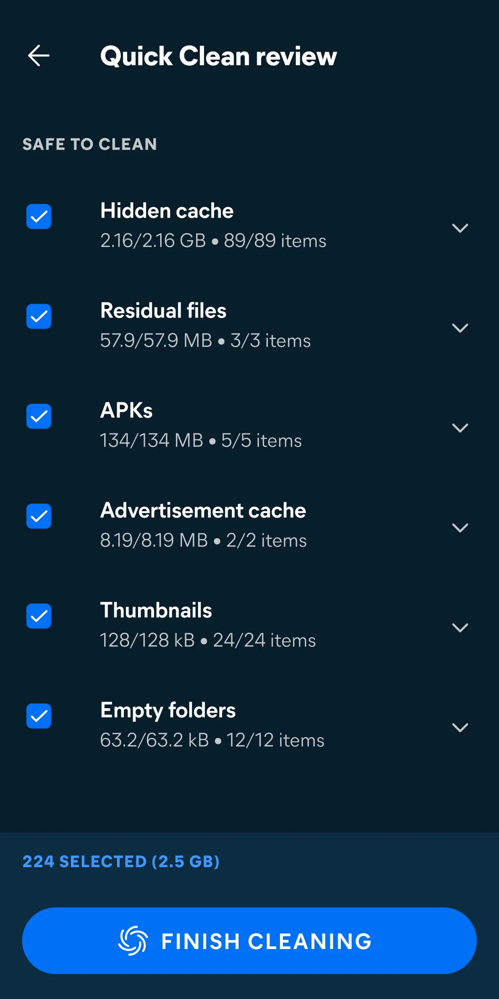{: width="180" .normal }
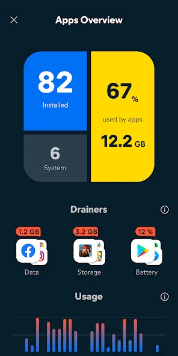{: width="180" .normal }
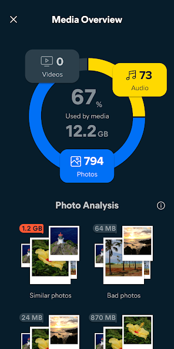{: width="180" .normal }
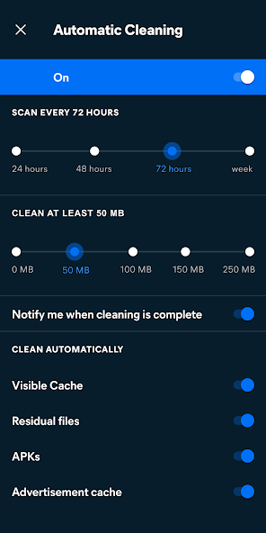{: width="180" .normal }

Avast Cleanup 侧重于 **从照片与文件中腾出空间**——它能揪出低画质、相似与重复的照片，并清理垃圾与应用缓存。

**优势**
- **照片清理**会标记模糊、重复与相似的照片供删除。
- **垃圾与缓存清除**，存储概览清晰。
- **应用休眠**以减少后台负担。
- 背靠知名安全品牌。
- 免费含高级订阅。

**不足**
- 仅支持安卓。
- 最佳照片功能需订阅。
- 无实时系统监控。

**最适合：** 存储空间被照片占据的用户。

**下载 Avast Cleanup**
- [Google Play](https://play.google.com/store/apps/details?id=com.avast.android.cleaner)

---

### 6. Norton Clean —— 最佳简洁垃圾清理

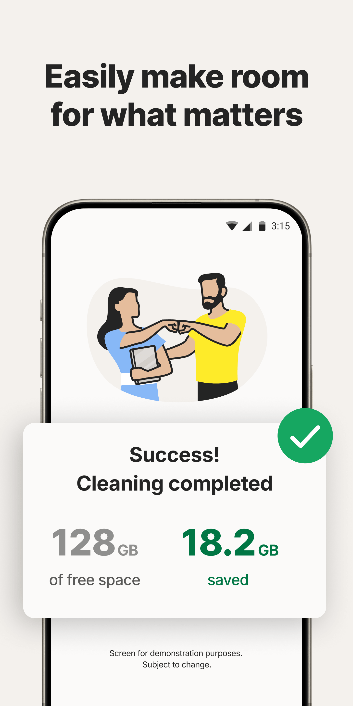{: width="180" .normal }
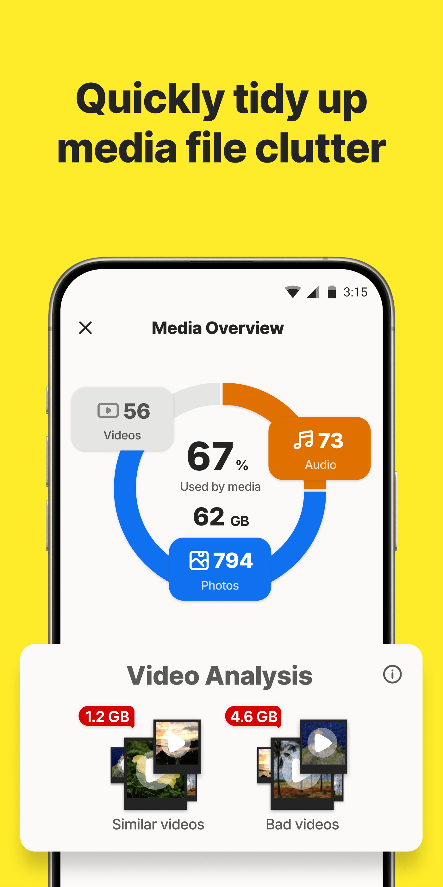{: width="180" .normal }
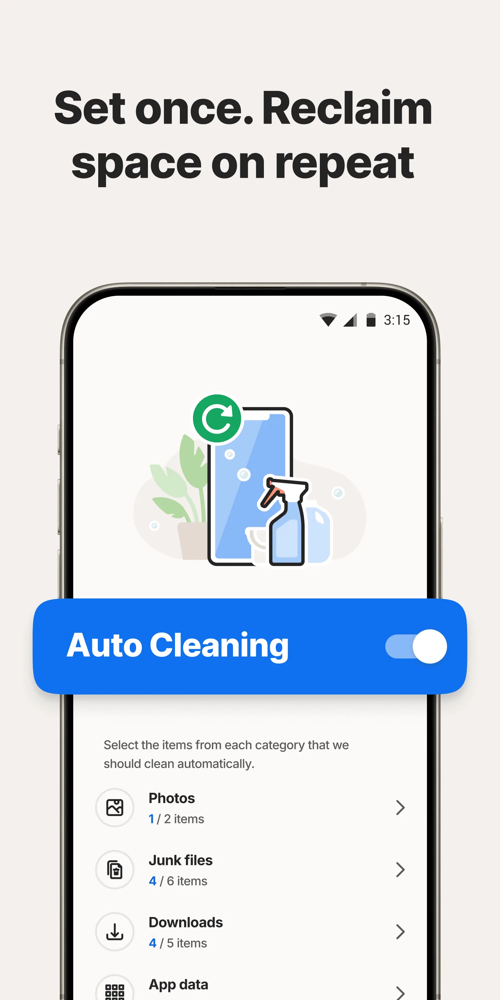{: width="180" .normal }
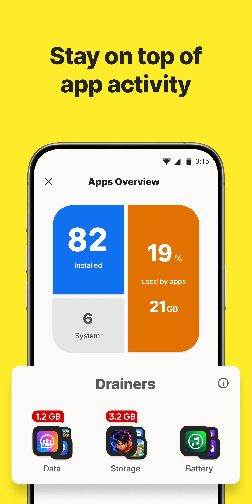{: width="180" .normal }

Norton Clean 是一款 **直截了当的垃圾与缓存清理工具**，轻点一下即可清除临时文件、残留数据与卸载残留。

**优势**
- **简洁的垃圾/缓存清除**——谁都能用。
- 卸载后 **残留文件清理**。
- 背靠 Norton 安全品牌。
- 免费使用。
- 轻量、不打扰。

**不足**
- 仅支持安卓。
- 除基础清理外功能不多。
- 无监控、无内存加速、无照片工具。

**最适合：** 想要极简、可信的一键清理工具的用户。

**下载 Norton Clean**
- [Google Play](https://play.google.com/store/apps/details?id=com.symantec.cleaner)

---

## 核心能力对比

| 能力 | System Monitor | Files by Google | SD Maid | CCleaner | Avast Cleanup | Norton Clean |
|---|---|---|---|---|---|---|
| **平台** | 安卓 | 安卓 | 安卓 | 安卓 | 安卓 | 安卓 |
| **垃圾 / 缓存清理** | 有（轻量） | 有（安全） | 有（深度） | 有 | 有 | 有 |
| **存储分析** | 有 | 有 | 有（进阶） | 基础 | 有 | 基础 |
| **重复 / 残骸查找** | 无 | 重复项 | 有（残骸） | 无 | 照片 | 无 |
| **内存加速** | 有 | 无 | 部分 | 无 | 应用休眠 | 无 |
| **省电** | 有（医生） | 无 | 无 | 基础 | 基础 | 无 |
| **实时监控** | 有（CPU/内存/电量） | 无 | 无 | 无 | 无 | 无 |
| **安全 / 官方** | 有 | 有（谷歌） | 有（进阶用户） | 注意 | 有（品牌） | 有（品牌） |
| **广告 / 订阅** | 免费核心 | 无广告 | 免费 + 专业版 | 广告 + 订阅 | 免费 + 订阅 | 免费 |
| **需要 Root** | 无 | 无 | 无（专业版扩展可选） | 无 | 无 | 无 |
| **最擅长** | 监控 + 加速 | 安全存储 | 深度清理 | 熟悉品牌 | 照片清理 | 简洁清理 |

---

## 每款 CCleaner 替代品适合谁

表格比的是功能；这里按「你原本想达成什么」把同样的六款重新分组。

- **想弄懂手机为什么变卡**——**CCleaner 替代** 里，报告 CPU、RAM、电池与温度的 System Monitor 回答的是「发生了什么」，删除缓存回答的是「腾出多少空间」；存储看起来没问题时，清理解释不了掉帧。
- **想要安全、官方的清理**——Files by Google 与 Norton Clean 让你先看大文件与重复项，再决定删什么。
- **想要按规则做深度清理**——**清浊替代**、**安卓清理君替代**、**SD Maid 替代** 适合希望逐项确认残留的人；**360清理大师替代**、**猎豹清理大师替代** 则是更偏一键式的老派做法。
- **想要一体化套装**——**腾讯手机管家替代**、**手机管家替代**、**百度手机卫士替代** 把监控、清理与安全放在一起，代价是比只读面板重得多。
- **只想腾空间**——从 **360清理大师替代**、**鲁大师替代 / 鲁大师清理** 到 **存储清理哪个好**，先看免费档到底能删什么、删除前有没有清单。

不管用哪个词搜索，迁移前先问两句：删除前能不能看到清单？这款应用除了腾空间，能不能解释卡顿？

## 如何选购

- 想要 **监控 + 加速 + 轻量清理** → **System Monitor**
- 想要 **安全、官方、不花哨的存储清理** → **Files by Google**
- 想要 **深度、谨慎的清理** → **SD Maid**
- 认准 **CCleaner 牌子与快速扫描** → **CCleaner**
- 存储被 **照片** 占据 → **Avast Cleanup**
- 想要 **极简可信的清理工具** → **Norton Clean**

## 如何摆脱 CCleaner

1. **想清目标**——是要更多空间，还是手机更流畅？这是两种不同的修法。
2. **装一个存储工具**（Files by Google 或 SD Maid），一次性清理重复项与未用文件。
3. **加一个监控工具**（System Monitor），找出真正在消耗 CPU/电量的元凶，而不是盲目「加速」。
4. **卸载 CCleaner**——等新工具满足需求后。现代安卓不需要频繁清理。
5. **保持简单**：定期删除大媒体与旧应用，其余交给系统。

## 常见问题（FAQ）

**System Monitor 是最好的 CCleaner 替代品吗？**
若你想要监控兼清理，是的。System Monitor 是这里唯一带实时 CPU/内存/电量监控、过热报警与一键加速的应用——其余都是清理或存储工具，没有实时洞察。

**哪款 CCleaner 替代品清理存储最安全？**
Files by Google 最安全——官方、无广告、无激进后台任务。SD Maid 是进阶用户最深的清理器。

**哪款 CCleaner 替代品真能释放 RAM？**
System Monitor 是这里唯一带一键内存加速的；其余管理存储与缓存，但不做实时监控或释放内存。

**System Monitor 免费吗？**
免费。核心监控、组件、浮窗与过热报警都免费；可选解锁加深主题与历史。

[System Monitor App 页](/zh/apps/system-monitor/)——安卓平台可用。

## 相关术语

- [什么是 CPU 温度监控？](/zh/glossary/what-is-a-cpu-temperature-monitor/)
- [什么是系统监控（System Monitor）？](/zh/glossary/what-is-a-system-monitor/)
- [什么是内存清理（RAM Booster）？](/zh/glossary/what-is-a-ram-booster/)
