CPU-Z 查个快速参数表很方便，但在安卓上它 **不显示[实时温度](/zh/glossary/what-is-a-cpu-temperature-monitor/)、没有悬浮窗，也不提供小组件或过热警报**。如果你想要实时监控，市面上已有成熟选择。

下面我们对比六款 **CPU-Z 的替代品**——从实时温度监控到深度参数报告——从价格、平台以及真正关键的功能出发。多数人卡在一个具体问题上：看不到实时温度、没有悬浮窗，或没有小组件；下面会按「解决哪个问题」来讲每一款。

## 为什么要跳出 CPU-Z

{: width="180" .normal }
{: width="180" .normal }
{: width="180" .normal }
{: width="180" .normal }
{: width="180" .normal }

- 在大多数安卓设备上 **没有实时 CPU 温度**——它报的是参数，不是热量。
- **没有悬浮窗或小组件**，无法一眼监控。
- 相比专用工具，**传感器与电池健康信息单薄**。
- 移动版 **含广告**，且不如 PC 经典版深入。
- 你可能想要 **过热警报或一键加速**，它都没有。

## 最佳 CPU-Z 替代品一览

| 应用 | 价格（2026） | 平台 | 最适合 |
|---|---|---|---|
| **CPU Monitor** | 免费核心 + 解锁 | 安卓 | 实时温度、频率、悬浮窗 |
| **DevCheck** | 免费 + 专业版 | 安卓、iOS | 详细的硬件与传感器信息 |
| **AIDA64** | 免费 | 安卓、iOS | 深度参数报告 |
| **Device Info HW** | 免费 + 专业版 | 安卓 | 逐部件硬件信息 |
| **Droid Hardware Info** | 免费 | 安卓 | 快速设备参数 |
| **System Monitor** | 免费核心 + 解锁 | 安卓 | 监控 + 清理 + 加速 |

---

### 1. CPU Monitor —— 实时温度最佳

{: width="180" .normal }
{: width="180" .normal }
{: width="180" .normal }
{: width="180" .normal }
{: width="180" .normal }

CPU Monitor 显示 **实时 CPU 温度与频率**、内存、电池与多核占用，并带悬浮窗、小组件、一键加速与过热警报。

**优势**
- **实时 CPU 温度与频率**，含历史分析。
- **多核 CPU 监控**与逐核占用。
- **悬浮窗**（状态栏 + 桌面）与内存/CPU/电池小组件。
- **过热警报**提醒你关闭重负载应用、给手机降温。
- **一键加速**快捷释放内存。
- 多主题、轻量、核心免费。

**不足**
- 仅支持安卓，无 iOS 版。
- 高级历史/主题功能需解锁。
- 温度准确度取决于设备传感器是否可用。

**最适合：** 想在游戏或充电时真正盯住温度与频率的用户。

**下载 CPU Monitor**
- [Google Play](https://play.google.com/store/apps/details?id=com.glgjing.stark)

---

### 2. DevCheck —— 详细传感器最佳

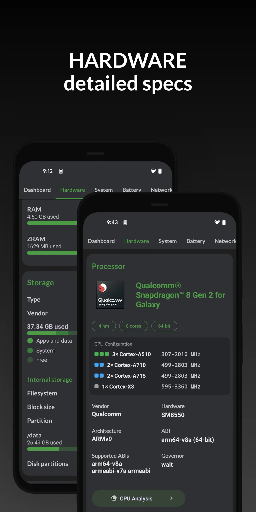{: width="180" .normal }
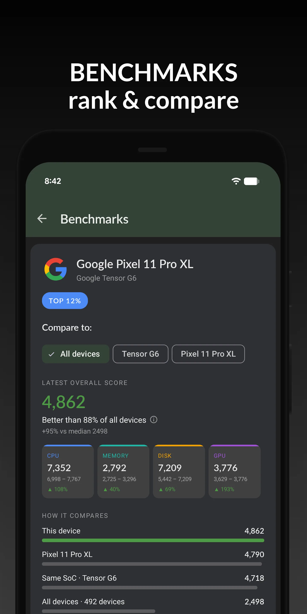{: width="180" .normal }
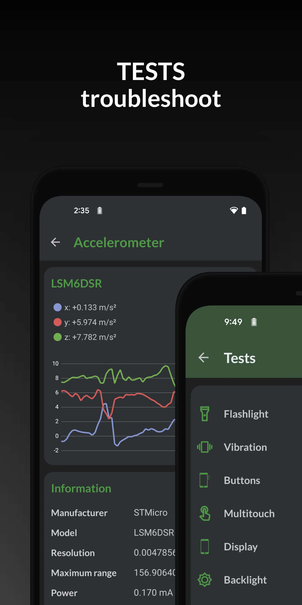{: width="180" .normal }
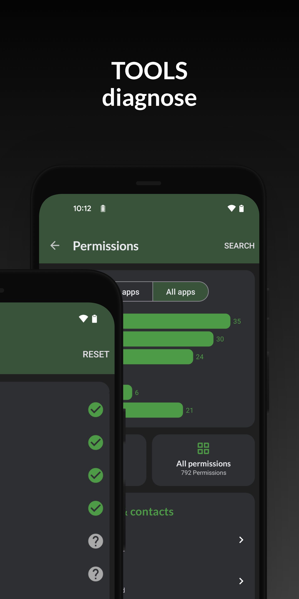{: width="180" .normal }
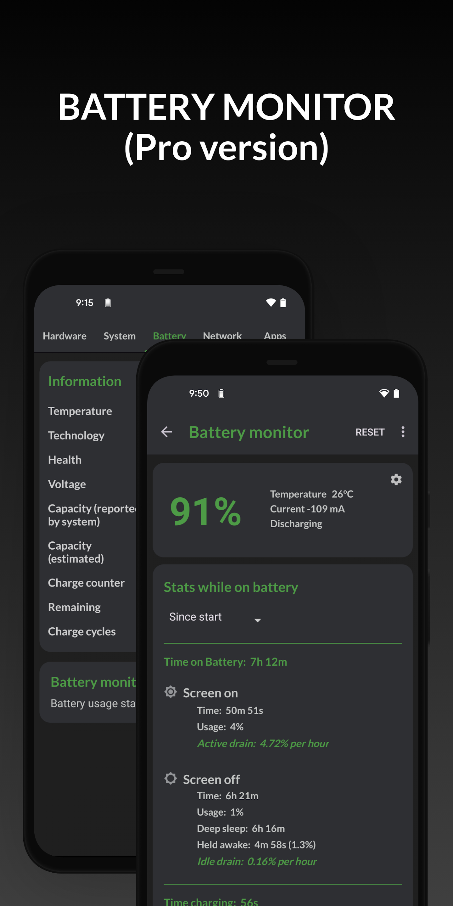{: width="180" .normal }

DevCheck 是一款 **全面的硬件与传感器报告工具**，仪表盘干净利落：CPU、GPU、电池、网络、传感器等一应俱全，并带系统监控与小组件。

**优势**
- **深度硬件读出**——SoC、GPU、内存、存储、摄像头、传感器。
- **实时仪表盘**展示 CPU、电池与温度信息。
- **小组件与系统监控**用于持续追踪。
- 干净、近乎无广告的界面。
- 免费，额外仪表盘需 Pro 升级。

**不足**
- 无悬浮窗叠加层。
- 过热警报与一键加速不是它的重点。
- 最深入的层级在 DevCheck Pro 之后。

**最适合：** 想要完整硬件清单与传感器列表的折腾党。

**下载 DevCheck**
- [Google Play](https://play.google.com/store/apps/details?id=flar2.devcheck)
- [App Store](https://apps.apple.com/us/app/devcheck/id1475762785)

---

### 3. AIDA64 —— 深度参数报告最佳

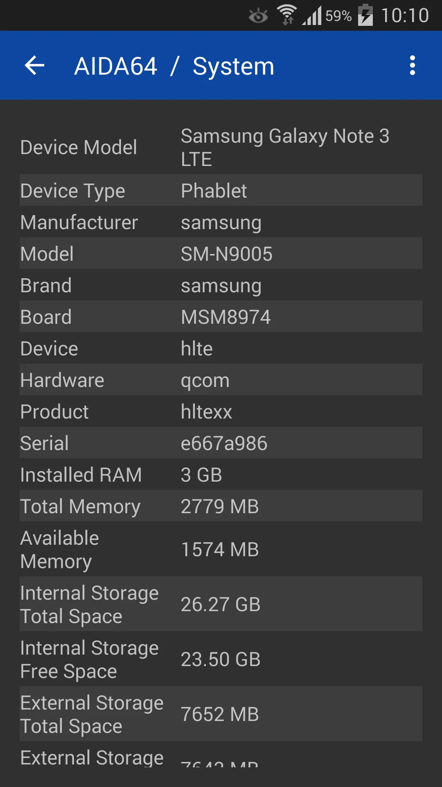{: width="180" .normal }
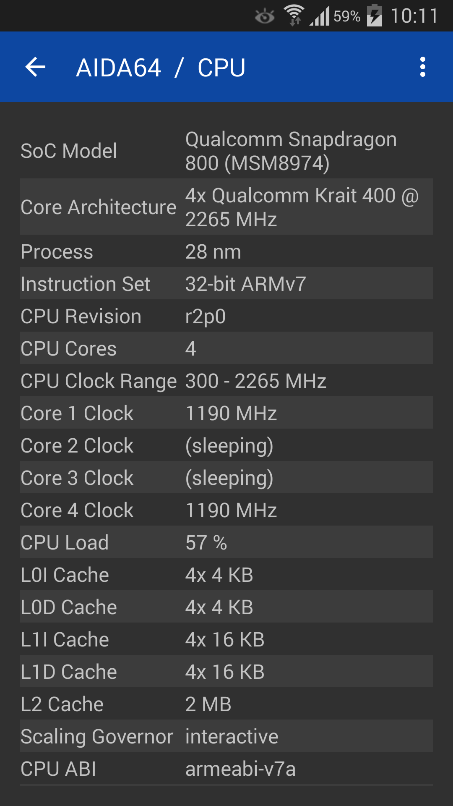{: width="180" .normal }
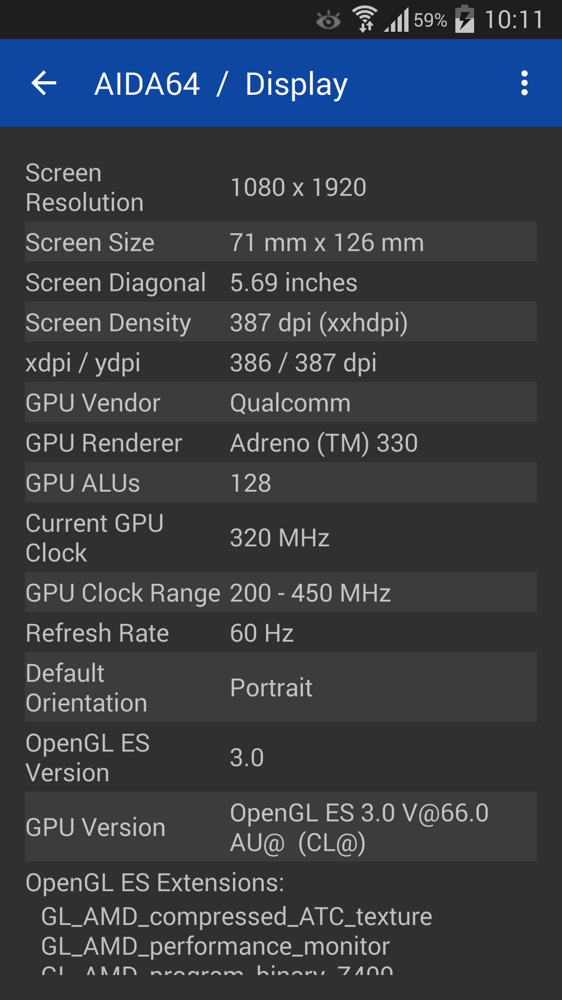{: width="180" .normal }
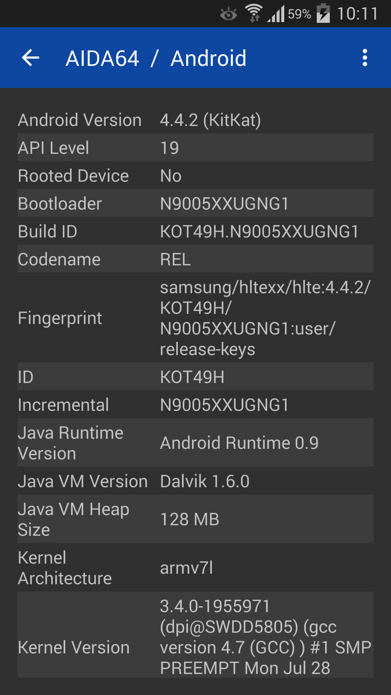{: width="180" .normal }
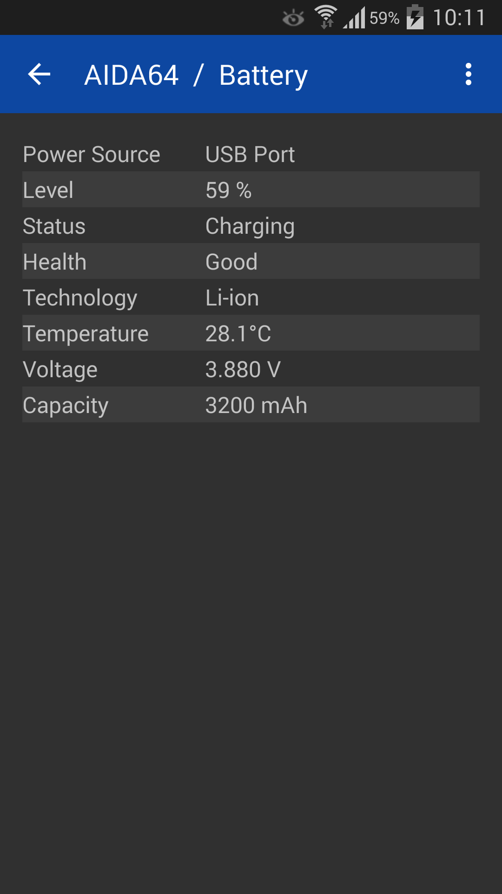{: width="180" .normal }

AIDA64 将知名的 PC 诊断品牌带到了安卓与 iOS，提供详尽的 **设备参数报告** 与实时传感器读数。

**优势**
- **可信、详尽的参数报告**，覆盖 CPU、屏幕、电池、网络等。
- **实时传感器页面**展示温度、电池与负载。
- **安卓与 iOS 双平台**可用。
- 免费版无广告。
- 桌面版 AIDA64 用户会感到熟悉。

**不足**
- 无悬浮窗或小组件。
- 不主打过热警报或加速。
- 实时监控不如专用监控工具。

**最适合：** 想在手机或平板上拿到权威、深入参数表的用户。

**下载 AIDA64**
- [Google Play](https://play.google.com/store/apps/details?id=com.finalwire.aida64)
- [App Store](https://apps.apple.com/us/app/aida64/id979579523)

---

### 4. Device Info HW —— 逐部件信息最佳

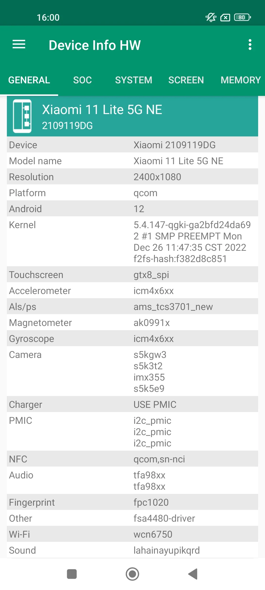{: width="180" .normal style="height:360px;object-fit:cover" }
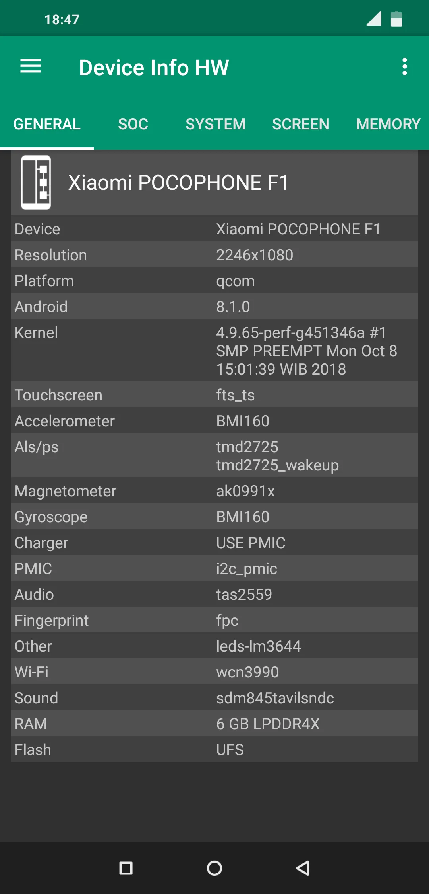{: width="180" .normal style="height:360px;object-fit:cover" }
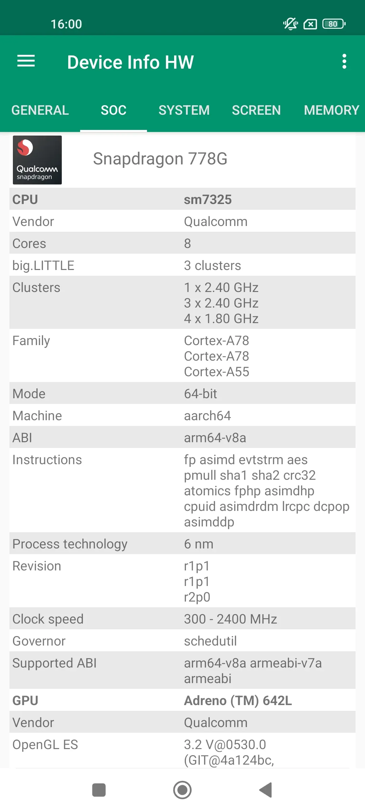{: width="180" .normal style="height:360px;object-fit:cover" }
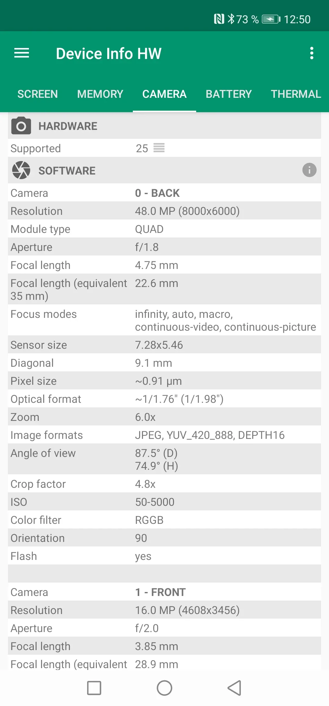{: width="180" .normal style="height:360px;object-fit:cover" }
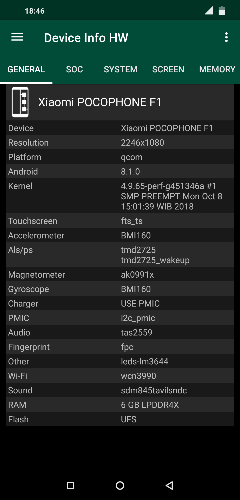{: width="180" .normal style="height:360px;object-fit:cover" }

Device Info HW 是一款 **硬件信息应用**，把每个部件——CPU、GPU、电池、摄像头、传感器、存储——拆开，以清晰的部件级视图呈现。

**优势**
- **部件级细节**（如确切的摄像头传感器、GPU 型号）。
- **电池信息**含健康度与充电细节。
- **传感器列表**带实时数值。
- 报告干净、便于导出。
- 免费含 Pro 升级。

**不足**
- 仅支持安卓。
- 无实时悬浮窗或过热警报。
- 设计上并非性能/温度监控器。

**最适合：** 想确切知道自己设备里有什么的用户。

**下载 Device Info HW**
- [Google Play](https://play.google.com/store/apps/details?id=ru.andr7e.deviceinfohw)

---

### 5. Droid Hardware Info —— 快速参数最佳

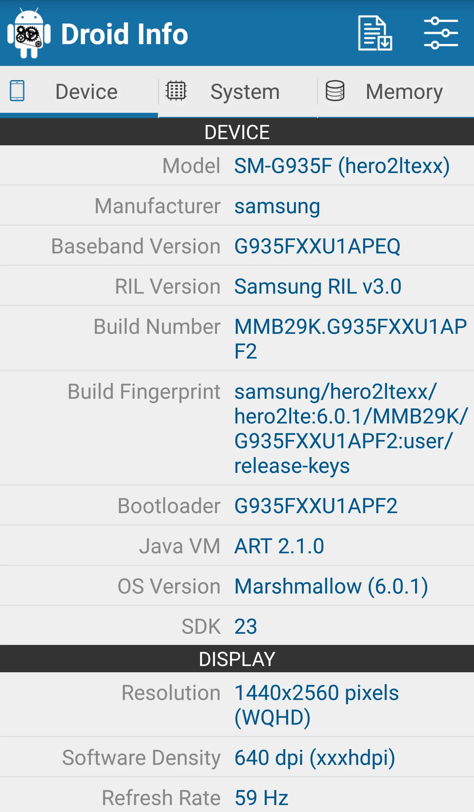{: width="180" .normal }
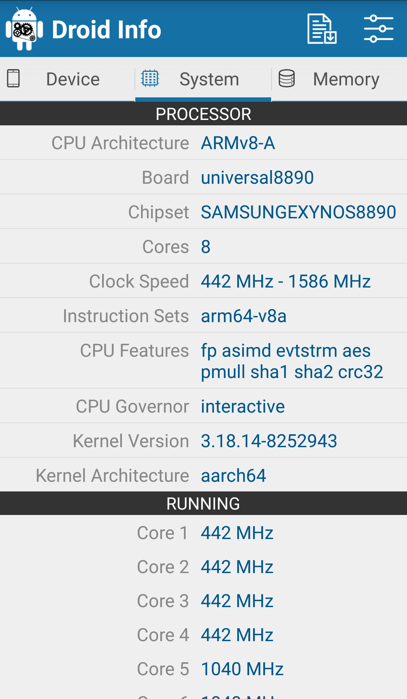{: width="180" .normal }
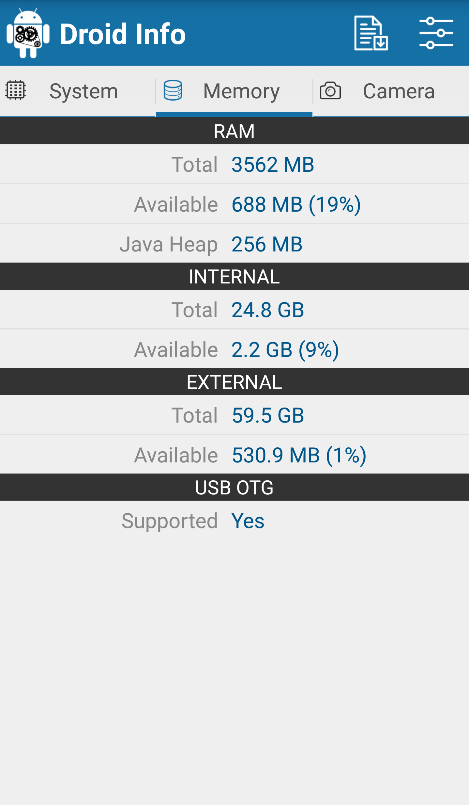{: width="180" .normal }
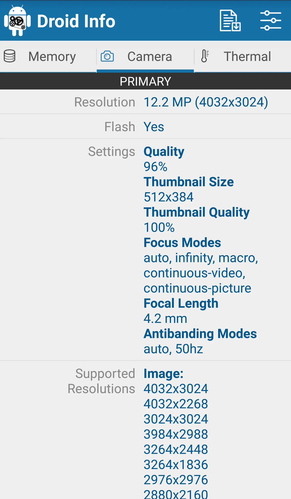{: width="180" .normal }

Droid Hardware Info 是一款 **轻量参数查看器**，以简单列表展示系统、CPU、GPU、内存、摄像头与传感器细节。

**优势**
- **快速、简单的参数列表**——无需配置。
- 覆盖 CPU、GPU、内存、存储、摄像头与传感器。
- 极小体积、免费。
- 适合快速查询与分享参数。
- 无账号、无广告干扰。

**不足**
- 仅安卓，无 iOS 版。
- 无实时监控、小组件或悬浮窗。
- 深度不如 DevCheck 或 AIDA64。

**最适合：** 只想要快速、干净设备参数读数的人。

**下载 Droid Hardware Info**
- [Google Play](https://play.google.com/store/apps/details?id=com.inkwired.droidinfo)

---

### 6. System Monitor —— 监控 + 清理一体化最佳

System Monitor 是一款 **安卓全能工具**：CPU 监控、存储清理、内存加速与电池医生，让手机保持快速、清凉与优化。

**优势**
- **CPU 温度与频率**，含历史与多核监控。
- **存储清理**针对垃圾/缓存，内存分析支持一键加速。
- **电池监控**含健康度、电压与温度曲线。
- **过热警报与保护**，外加悬浮窗与小组件。
- 多主题、核心免费。

**不足**
- 仅支持安卓。
- 清理力度比专业清理工具轻（重点在监控）。
- 部分功能需 Pro 升级。

**最适合：** 想要监控 + 轻量清理合二为一的用户。

**下载 System Monitor**
- [Google Play](https://play.google.com/store/apps/details?id=com.glgjing.marvel)

---

## 核心能力对比

| 能力 | CPU Monitor | DevCheck | AIDA64 | Device Info HW | Droid Hardware Info | System Monitor |
|---|---|---|---|---|---|---|
| **平台** | 安卓 | 安卓、iOS | 安卓、iOS | 安卓 | 安卓 | 安卓 |
| **实时 CPU 温度** | 有 | 部分 | 传感器 | 无 | 无 | 有 |
| **CPU 频率 / 多核** | 有 | 有 | 有 | 无 | 无 | 有 |
| **内存监控** | 有 | 有 | 有 | 部分 | 部分 | 有（加速） |
| **电池健康 / 温度** | 有 | 有 | 有 | 有 | 无 | 有 |
| **传感器列表** | 部分 | 有 | 有 | 有 | 有 | 部分 |
| **悬浮窗** | 有 | 无 | 无 | 无 | 无 | 有 |
| **小组件** | 有 | 有 | 无 | 无 | 无 | 有 |
| **过热警报** | 有 | 无 | 无 | 无 | 无 | 有 |
| **一键加速 / 清理** | 有（加速） | 无 | 无 | 无 | 无 | 有（加速 + 清理） |
| **深度参数报告** | 部分 | 强 | 强 | 强 | 基础 | 部分 |
| **免费档 / 广告** | 免费核心 | 免费 + 专业版 | 免费（无广告） | 免费 + 专业版 | 免费 | 免费核心 |
| **需要 Root** | 无 | 无 | 无 | 无 | 无 | 无 |

---

## 每款 CPU-Z 替代品适合谁

表格比的是功能；这里按「你原本想从一款硬件应用里得到什么」把同样的六款重新分组。

- **要实时面板，而不是规格表**——搜 **cpu-z 中文替代** 或 **安卓cpu温度监控哪个好** 的人，多半想要的是实时温度、逐核频率、悬浮窗与过热告警；CPU Monitor 正是这一类。
- **要最深的硬件报告**——**AIDA64 替代**、**DevCheck 替代** 在 SoC、GPU、屏幕与传感器清单上更强；Device Info HW 按部件拆，Droid Hardware Info 胜在快速免费。
- **要一整套系统工具箱**——**3C Toolbox 替代** 把监控、电池统计与调校放进一个安装包，代价是更重。
- **要干净的只读曲线**——**Simple System Monitor 替代** 只给 CPU、RAM 与网络曲线，不附加性能宣称。
- **关心的是电池而不是 CPU 发热**——**AccuBattery 替代** 更适合与温度监控搭配，用来看充电循环与健康度。

还有几类搜法指向的其实不是这六款：从 **安兔兔替代**、**安兔兔温度监控**、**鲁大师替代**、**鲁大师降温** 过来的人，要的是持续温度读数，而不是一次性跑分；**CPU监控大师替代**、**强力监测替代**、**手机降温替代** 更该先看「是否只读、会不会承诺一键降温」；**cpu-z 中文哪个好**、**Device Info HW 替代**、**AIDA64 中文替代** 问的则是一次看懂硬件规格，而非实时曲线。

从 **CPU-Z 中文版替代**、**硬件信息查看器替代**，到 **cpu温度监控排行榜** 这类搜法，换应用前先确认两件事：是不是免 root 读取真实热传感器？免费档里还留不留下你真正在用的悬浮窗或组件？

## 如何选购

- 想要 **实时温度 + 悬浮窗 + 过热警报** → **CPU Monitor**
- 想要 **最详尽的硬件与传感器报告** → **DevCheck** 或 **AIDA64**
- 想要 **部件级参数（摄像头/GPU）** → **Device Info HW**
- 想要 **快速免费的参数读数** → **Droid Hardware Info**
- 想要 **监控 + 清理 + 加速三合一** → **System Monitor**

## 如何摆脱 CPU-Z

1. **想清你到底查什么**——是一次性看参数，还是游戏时看实时温度。
2. **装一个监控工具**（CPU Monitor 或 System Monitor），并为悬浮窗授予叠加层权限。
3. **在主屏加个小组件**，一眼看 CPU/内存/电池。
4. 若你常玩游戏或长时间充电，**开启过热警报**，在降频前收到提醒。
5. 手机变卡时，**用一键加速或清理**（CPU Monitor 加速、System Monitor 清理）释放内存。

## 常见问题（FAQ）

**CPU Monitor 是最好的 CPU-Z 替代品吗？**
论实时监控，是的。如果你想要实时 CPU/电池温度、悬浮窗、小组件与过热报警——也就是 CPU-Z 不做的事——CPU Monitor 是最贴近的替代。

**哪款 CPU-Z 替代品能随时间显示实时温度？**
CPU Monitor 与 System Monitor 都把温度画成曲线；DevCheck 与 AIDA64 显示实时传感器值，但没有连续历史。

**哪款 CPU-Z 替代品参数报告最深？**
DevCheck 与 AIDA64 是最强的参数报告器；Device Info HW 额外提供部件级细节，如确切的摄像头/GPU 型号。

**CPU Monitor 免费吗？**
免费。核心监控——实时温度、悬浮窗、小组件与过热报警——都免费；可选解锁加深主题与历史。

[CPU Monitor App 页](/zh/apps/cpu-monitor/)——安卓平台可用。

## 相关术语

- [什么是 CPU 温度监控？](/zh/glossary/what-is-a-cpu-temperature-monitor/)
- [什么是系统监控（System Monitor）？](/zh/glossary/what-is-a-system-monitor/)
