Intuit 已于 **2024 年 3 月关停 Mint**，把功能并入 Credit Karma。如果你在找 **Mint 的替代品**，你并不孤单——数百万老用户都想要一款能清楚追踪开销、不诱导办信用卡、也不强迫使用不信任的云账号的 **记账应用**。

本指南按**相同维度**对比七款应用。每款都因**高市场份额**或**独特优势**入选。下面每款都列出真实优势、客观不足，以及在用户真正关心的核心能力上的表现——多账户、同步、报销、预算、统计、资产/净值、多币种。下载链接在各小节末尾。

## Mint 关停后用户失去了什么

- 关联银行卡后的 **交易自动导入**。
- 净值、账单与订阅的 **统一仪表盘**。
- **免费、简单的分类预算**。

代价是 Mint 靠推荐赚钱，最终把用户导向 Credit Karma 的信贷业务。下面的替代品保留了优点，并让你自己决定要多少自动化与云存储。

---

## YNAB（You Need A Budget）—— 方法论标杆

{: width="180" .normal }
{: width="180" .normal }
{: width="180" .normal }
{: width="180" .normal }
{: width="180" .normal }

YNAB 是最知名的 **零基预算（zero-based budgeting）** 应用：每笔钱在花出去之前都被「分配好用途」，建立在四条简单规则之上。它拥有最大的专职预算社区与最丰富的教学资源（工作坊、指南、论坛）。

**优势**
- **最强的预算方法**——零基分配在改变消费习惯上胜过简单分类记录。
- **通过 Plaid 实现银行同步**——交易在网页、iOS 与安卓间自动导入。
- **出色的报表与净值追踪**，外加目标规划。
- 成熟、维护良好、跨平台。

**不足**
- **无免费档**——仅 34 天试用，之后 $14.99/月或 $109/年。
- **学习曲线陡**——你需要主动做预算；它是一套系统，而非被动记录器。
- **无专门报销流程**，且 **多币种支持弱**（以美元为中心）。
- 报表不错，但做临时分析不如电子表格灵活。

**最适合：** 想用成熟方法改变消费行为、并愿意投入设置时间的人。

**下载 YNAB**
- [Google Play](https://play.google.com/store/apps/details?id=com.youneedabudget.evergreen.app)
- [App Store](https://apps.apple.com/app/ynab/id1010865877)

---

## Meow Money Manager（喵窝记账）—— 猫咪主题、界面讨喜的记账工具

{: width="180" .normal }
{: width="180" .normal }
{: width="180" .normal }
{: width="180" .normal }
{: width="180" .normal }

Meow Money Manager（喵窝记账）是一款 **安卓与 iOS** 双平台的猫咪主题[记账软件](/zh/glossary/what-is-an-expense-tracker/)与[预算管理](/zh/glossary/what-is-budget-management/)应用。它最鲜明的特质是 **界面**：可爱的卡通风格设计，配上 **400+ 丰富的分类图标**，让每日记账变得轻松，而不是像在办公。除了外观，它也覆盖了实用的记账基本功，并支持中文、英文、印尼语、泰语、葡萄牙语等多语言界面。

**优势**（来自产品说明）
- **精美卡通界面 + 400+ 自定义图标**——最突出的特质；记账有视觉成就感。
- **多账本**——分别记账（个人、旅行、工作），可单独或合并查看。
- **预算与分类预算**——日/月/年周期，总预算与分类预算一并追踪。
- **即时图表统计**——日、月、年支出报表。
- **报销管理**——把一笔支出标记为可报销（如出差），随时追踪状态。
- **资产管理**——记录现金、基金、股票、卡片、负债与净资产。
- **周期记录**——日/周/月/年自动重复。
- **50+ 币种符号**、**深色模式**与 **指纹锁**。
- **CSV 导出**（全部或按日期范围）到 Excel，外加 **Google Drive、iCloud 或 WebDav 备份**。
- **无需账号**——数据只存在你设备上。

**不足**（客观）
- **无银行自动同步**——需手动（或周期）录入。这利于隐私，但少了 Mint 那种「设好就忘」的体验。
- **云同步走 Google Drive、iCloud 或 WebDav**，而非专用跨平台账号，因此在安卓手机与 iPhone 间切换不如账号型应用顺畅。
- **高级功能**（多账本、CSV 导出）需一次性购买；免费核心已覆盖日常记账。
- 生态较小，无内置投资或净值聚合。

**典型场景**：出差时用「报销管理」把打车、餐饮标记可报销，回公司一键导出 CSV 对账；日常用 400+ 图标快速分类，多账本分开记个人与旅行开销。由于**无需账号、数据只存本地**，它适合重视隐私、不愿把账单交给 Mint 这类云账号的人——这也是它区别于多数需登录云的记账app的关键。

**最适合：** 想要清晰记账又不愿用云账号、看重友好界面、且不介意轻量手动录入的人。

**下载 Meow Money Manager（[应用详情页](/zh/apps/meow-money-manager/)）**
- [Google Play](https://play.google.com/store/apps/details?id=com.glgjing.money.manager.bookkeeping.meow)
- [App Store](https://apps.apple.com/app/id1528852284)

---

## Monarch Money —— 最像 Mint 的继任者

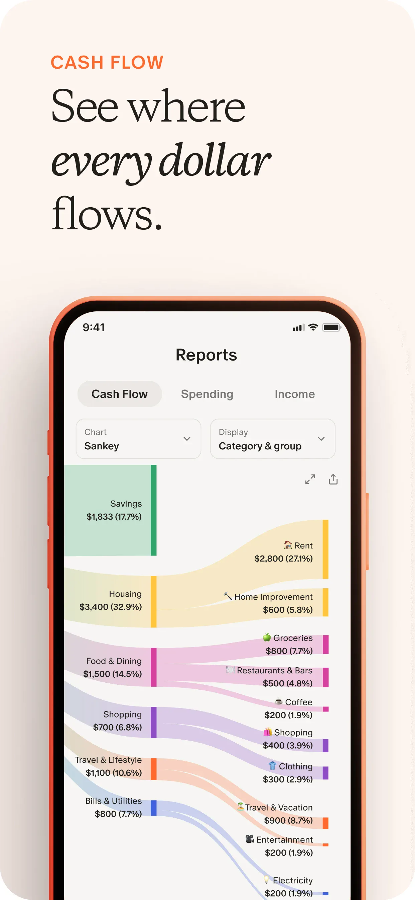{: width="180" .normal }
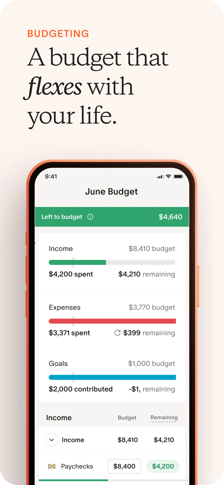{: width="180" .normal }
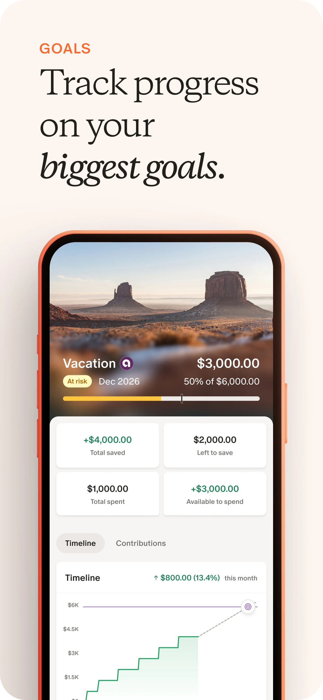{: width="180" .normal }
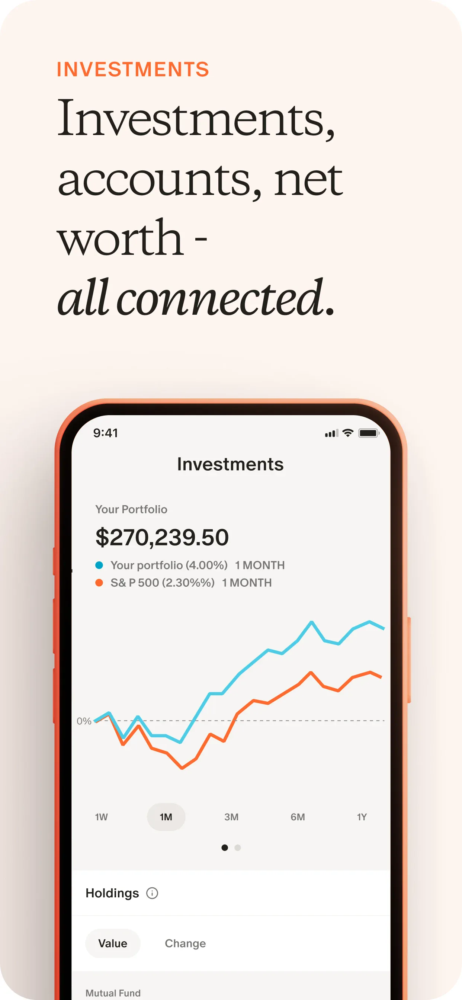{: width="180" .normal }

Monarch 最常被称为 **Mint 的直接替代品**。它把银行、卡片、贷款、投资，甚至加密货币与房产聚合到一个仪表盘，并支持协作共享，让伴侣能编辑同一份预算。

**优势**
- **最接近 Mint 的仪表盘**——净值、现金流与订阅一览无余。
- **广泛的自动同步**，含投资与房产（按估值）。
- **可协作**——与伴侣共享编辑，双方实时更新。
- 网页 + 移动端体验干净，目标/预算工具好用。

**不足**
- **无免费档**（仅试用），约 **$99.99/年**（或 $14.99/月）。
- **相对年轻**（2021 年成立）——社区比 YNAB 小，第三方指南也少。
- 与 Mint 一样，依赖 **聚合可靠性**；连接一断，就得手动清理。
- **多币种支持有限**，且面向美国市场。

**最适合：** 想要同样一体化仪表盘、且不介意付费订阅的前 Mint 用户。

**下载 Monarch Money**
- [Google Play](https://play.google.com/store/apps/details?id=com.monarchmoney.mobile)
- [App Store](https://apps.apple.com/us/app/monarch-budget-track-money/id1459319842)

---

## Rocket Money —— 管理订阅最佳

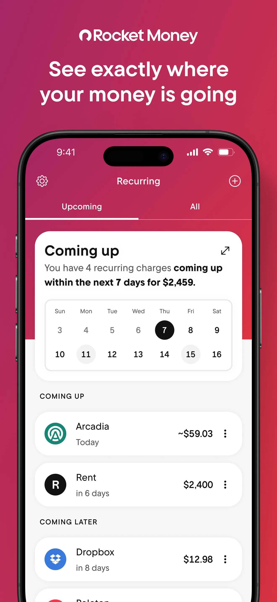{: width="180" .normal }
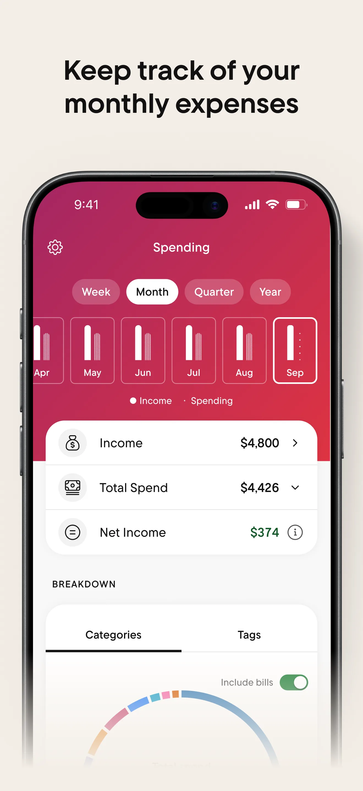{: width="180" .normal }
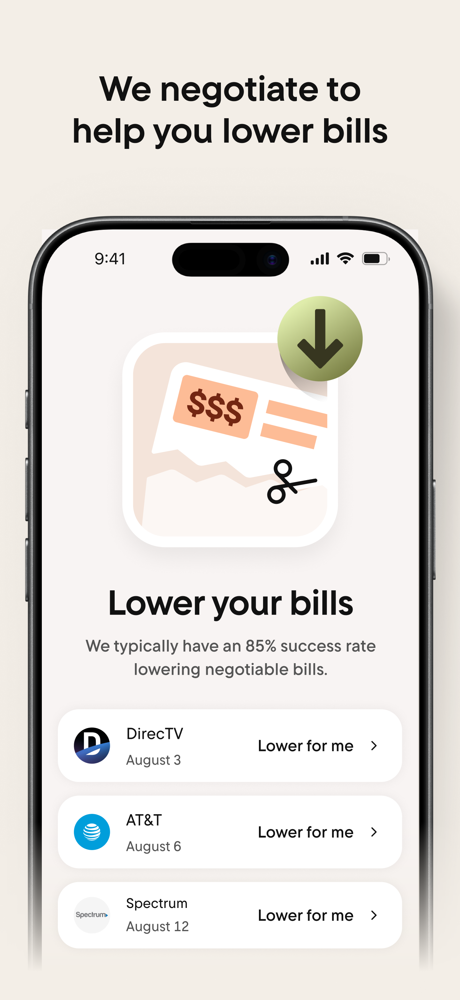{: width="180" .normal }
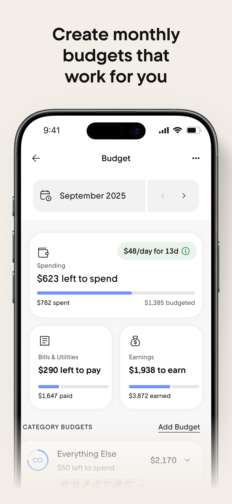{: width="180" .normal }
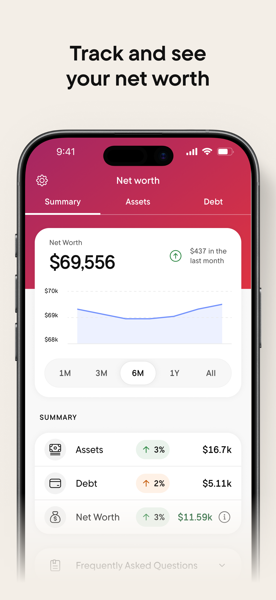{: width="180" .normal }

Rocket Money（前身 Truebill）围绕 **找出并取消不需要的订阅**、通过议价降低账单，以及提供简洁的开销概览构建。如果你的痛点是反复扣费，它是最强选择。

**优势**
- **一流的订阅管理**——检测、追踪并协助取消订阅；还能帮你议价降费。
- 有 **免费档**；叠加自动账户追踪与预算。
- 信用分监控与透支保护提醒（高级版）。
- 下载量很大，因此支持与稳定性扎实。

**不足**
- **预算功能基础**——没有零基或信封法；它只追踪、不规划。
- 自动分类尚可，但不如 YNAB 或 Monarch 可定制。
- 高级版价格 **浮动**（常约 $6–12/月，按年计费；单看退订之外的功能会觉得偏贵）。
- 无报销流程，净值/投资功能弱。

**最适合：** 真正痛点是订阅与账单失控、而非亲力亲为做预算的人。

**下载 Rocket Money**
- [Google Play](https://play.google.com/store/apps/details?id=com.truebill)
- [App Store](https://apps.apple.com/us/app/rocket-money-bills-budgets/id1130616675)

---

## Empower（前身 Personal Capital）—— 免费净值与投资视图最佳

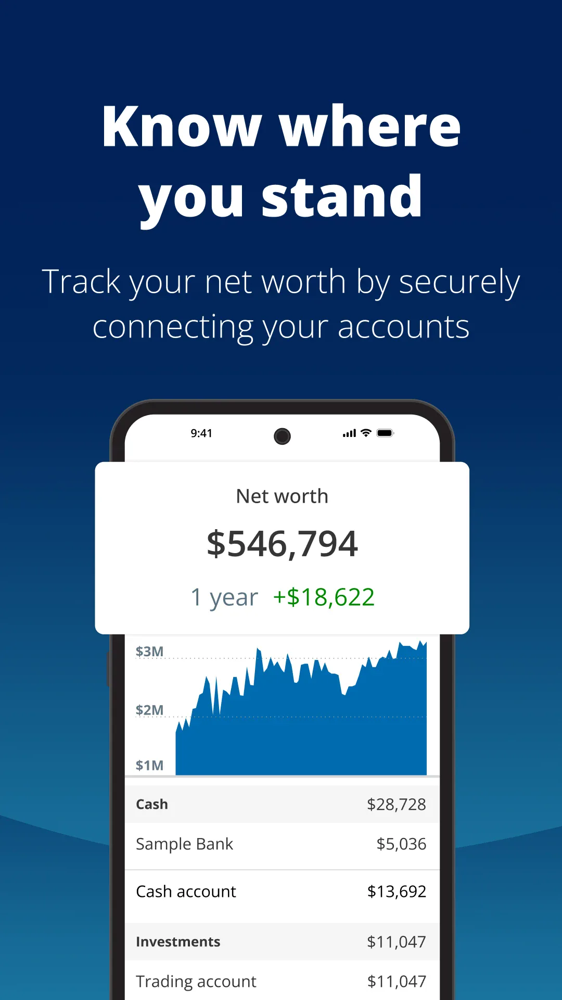{: width="180" .normal }
{: width="180" .normal }
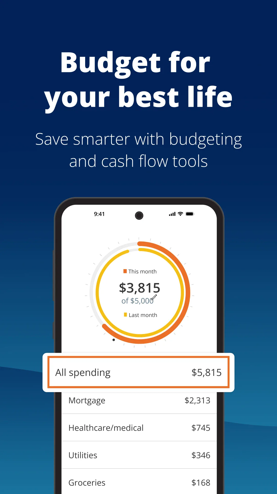{: width="180" .normal }
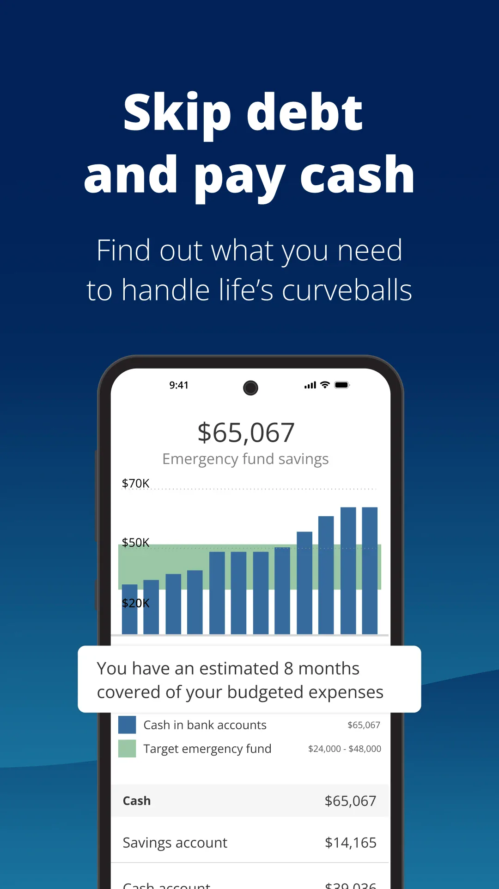{: width="180" .normal }
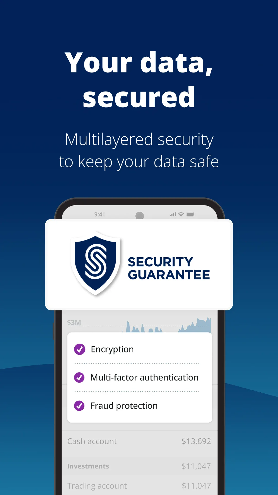{: width="180" .normal }

Empower **免费**，专注于 **净值与投资追踪**。它聚合银行、退休金、券商、加密货币，甚至房贷/房产数据，提供组合分析、退休规划与费用审计。

**优势**
- 核心仪表盘 **完全免费**。
- **一流的净值与投资分析**——资产配置、退休预测、费用审计。
- 账户覆盖极广，含投资与房产。
- 历史悠久（以 Personal Capital 之名运营逾十年）。

**不足**
- **并非真正的预算应用**——现金流/预算工具比 YNAB 或 Monarch 基础。
- **以美国为中心**；美国以外用处有限，多币种弱。
- 对高余额用户有强烈的 **投资顾问推销**。
- 无信封法或报销功能。

**最适合：** 主要想看净值与投资、不需要细到每日的预算的人。

**下载 Empower**
- [Google Play](https://play.google.com/store/apps/details?id=com.participantmobileapp)
- [App Store](https://apps.apple.com/us/app/empower/id1001257338)

---

## PocketGuard ——「可安全花费」最佳

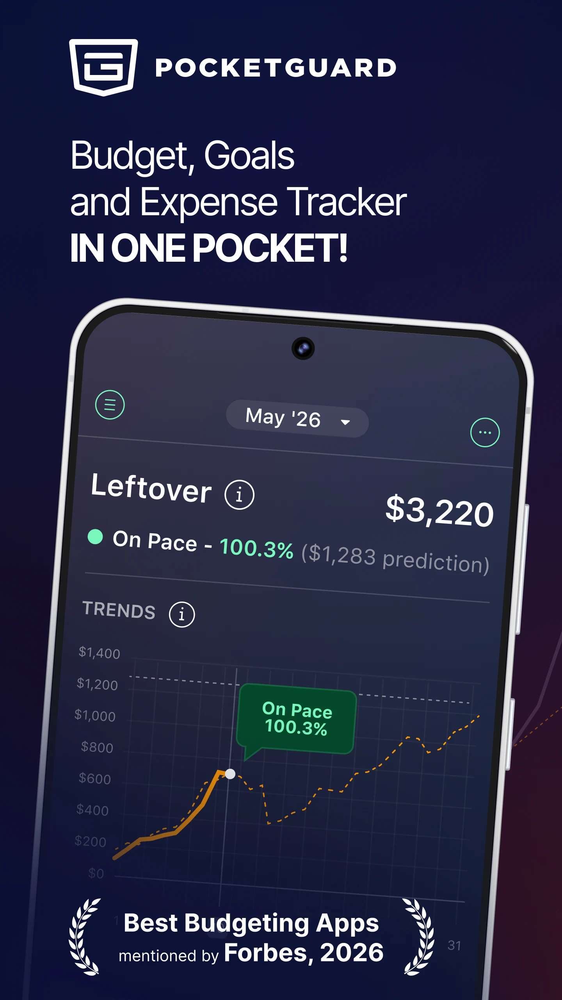{: width="180" .normal }
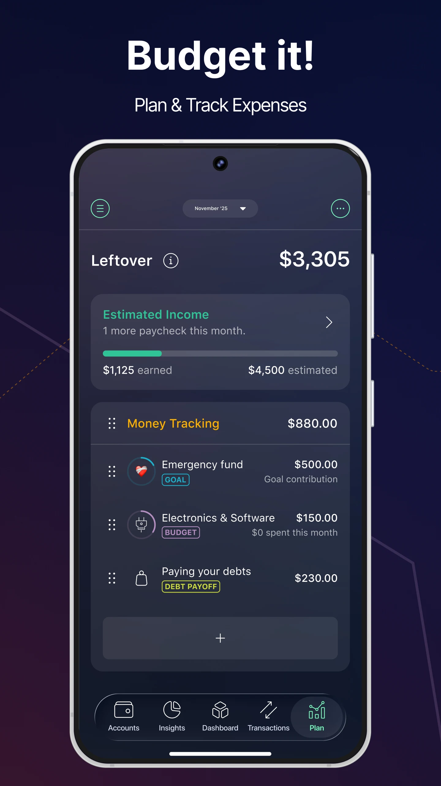{: width="180" .normal }
{: width="180" .normal }
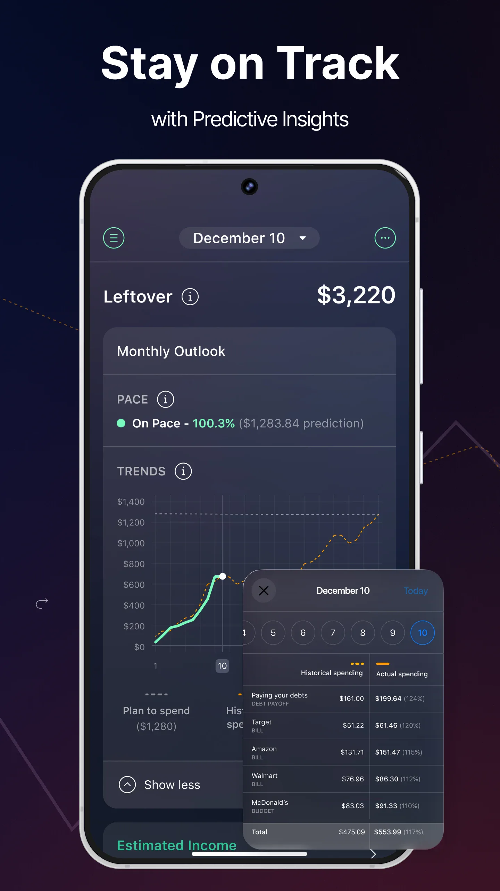{: width="180" .normal }
{: width="180" .normal }

PocketGuard 把事情简化：它显示 **「口袋里还剩多少」**——在覆盖账单、储蓄与目标之后，你还能放心花多少钱。这是避免超支、又不必学一套方法的最轻量方式。

**优势**
- **「口袋里还剩多少」这个可安全花费数字**直观又立竿见影。
- 自动分类交易、追踪订阅，并提供降费功能。
- **免费档** 加 PocketGuard Plus（约 $12.99/月或 $74.99/年）解锁更多细节。

**不足**
- **预算深度有限**——没有零基或信封法；可定制性弱。
- **移动优先**，网页体验有限。
- 无报销、无投资/净值追踪、多币种弱。
- 部分实用报表需 Plus。

**最适合：** 想要快速得到「我买得起吗？」答案、又不想管理完整预算的人。

**下载 PocketGuard**
- [Google Play](https://play.google.com/store/apps/details?id=com.pocketguard.android.app)
- [App Store](https://apps.apple.com/us/app/pocketguard-budget-app/id949414211)

---

## Goodbudget —— 免订阅的信封预算最佳

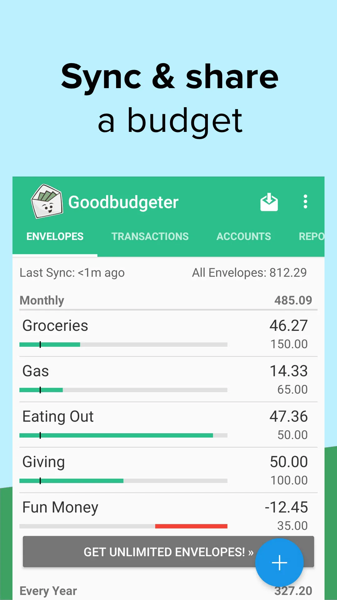{: width="180" .normal }
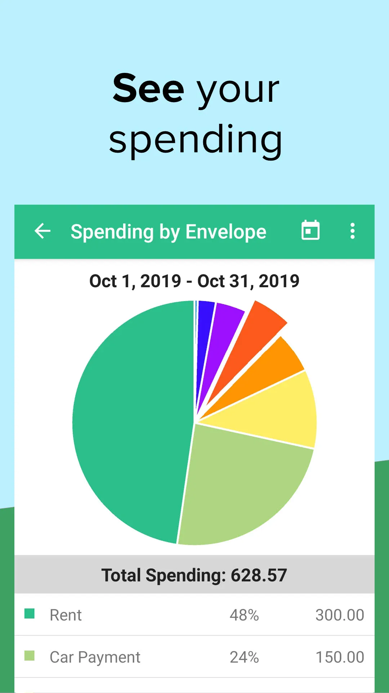{: width="180" .normal }
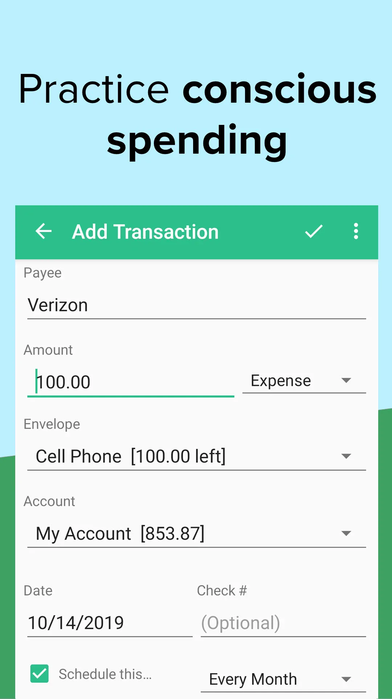{: width="180" .normal }
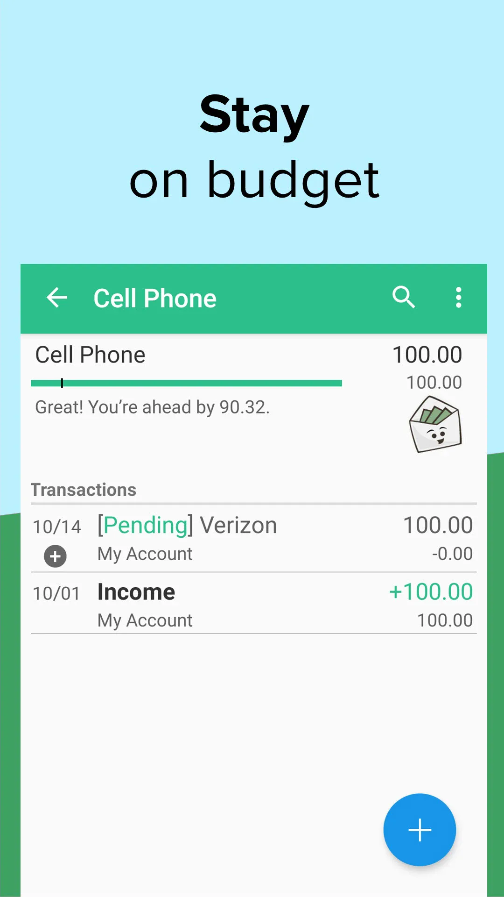{: width="180" .normal }
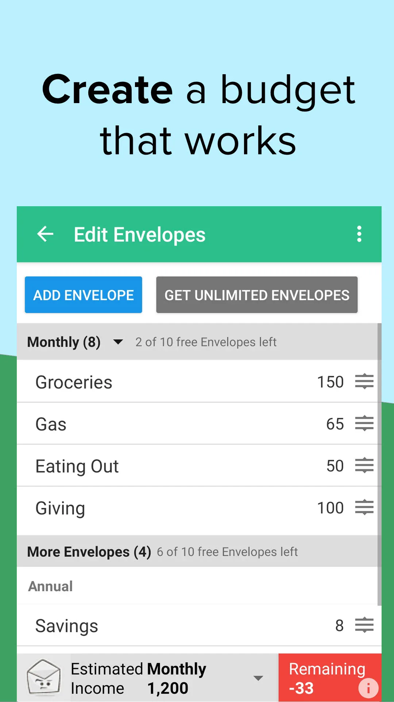{: width="180" .normal }

Goodbudget 把经典的 **信封系统** 数字化：把钱分到虚拟信封里，再从信封花。它刻意保持手动，在共享预算的伴侣与家庭中表现出色。

**优势**
- **把信封法做对了**，带跨设备云同步，让全家保持一致。
- **免费档**（20 个信封、2 台设备、1 年历史）；Premium（约 $8/月或 $70/年）解锁无限信封、更多设备、7 年历史与银行同步。
- 平台灵活：iOS、安卓与网页。

**不足**
- **大多手动录入**——免费档无自动银行导入，即便付费银行同步也不如 YNAB/Monarch。
- **自动分类极少**；分类得自己来。
- 无投资/净值追踪、无报销、多币种弱。
- 图表与报表比自动化仪表盘朴素。

**最适合：** 喜欢信封预算、偏好掌控感胜过自动化的共享家庭预算用户。

**下载 Goodbudget**
- [Google Play](https://play.google.com/store/apps/details?id=com.dayspringtech.envelopes)
- [App Store](https://apps.apple.com/app/goodbudget/id471112395)

---

## 核心能力对比

下表尽可能客观地列出每款应用支持的能力。「部分」表示功能存在但有限制（例如手动备份而非银行同步）。

| 能力 | YNAB | Meow Money | Monarch | Rocket Money | Empower | PocketGuard | Goodbudget |
|---|---|---|---|---|---|---|---|
| **多账户 / 账本** | 有 | 有（多账本） | 有（广） | 有 | 有（广） | 有 | 有（信封） |
| **银行自动同步** | 有（Plaid） | 部分（iCloud/WebDav 备份，无银行流） | 有 | 有 | 有 | 有 | 部分（手动；付费同步） |
| **报销追踪** | 无 | **有** | 无 | 无 | 无 | 无 | 无 |
| **预算深度** | **零基（强）** | 分类 + 周期预算 | 自定义预算 | 基础 | 基础现金流 | 「可安全花费」 | **信封（强）** |
| **统计 / 报表** | 强报表 | 日/月/年图表 | 强图表 | 基础 | 强（投资） | 基础 | 朴素 |
| **资产 / 净值** | 有 | 有（资产/负债） | **强** | 弱 | **最强** | 弱 | 无 |
| **多币种** | 弱（美元中心） | **有（50+ 符号）** | 弱 | 弱 | 弱（美国中心） | 弱 | 弱 |
| **订阅管理** | 无 | 无 | 部分 | **最强** | 无 | 有（追踪） | 无 |
| **免费档** | 无（仅试用） | 核心免费、高级付费 | 无（仅试用） | 有 | **有（完整）** | 有 | 有（有限） |
| **平台** | 网页+iOS+安卓 | 安卓+iOS | 网页+iOS+安卓 | iOS+安卓 | iOS+安卓 | iOS+安卓 | iOS+安卓+网页 |

---

## 如何选购

- 想要 **成熟的零基方法**且愿意学 → **YNAB**
- 想要 **免费、私密、无账号、多币种、带报销** → **[Meow Money Manager（喵窝记账）](/zh/apps/meow-money-manager/)**
- 想要 **最接近 Mint 的仪表盘**且含投资 → **Monarch Money**
- 想 **干掉订阅、降低账单** → **Rocket Money**
- 想要 **免费的净值/投资概览** → **Empower**
- 想要快速 **「我买得起吗？」** 答案 → **PocketGuard**
- 想要 **信封法与家庭共享预算** → **Goodbudget**

## 如何摆脱 Mint

1. 如果还能导出，**现在就导出数据**：交易（CSV）、账户与已存预算。
2. 在隐私与自动化之间权衡，从上文表格 **选替代品**。
3. **重建你的分类**——多数应用允许重命名默认项以匹配 Mint。
4. **设好预算与周期项**（房租、工资、订阅），让后续追踪顺畅。
5. **关联银行或保持手动**——若隐私重要，手动应用能让你数据留在设备上。

## 常见问题（FAQ）

**Mint 关停后，我的数据还能导出吗？**
能。Mint 在关闭前仍允许导出交易（CSV）、账户与已存预算。建议立刻导出，再导入任意上文替代品继续追踪。

**哪款 Mint 替代品免费又保护隐私？**
如果你看重「数据不离开设备、无需注册账号」，**Meow Money Manager（喵窝记账）** 是少数同时满足「核心免费 + 本地存储 + 无云账号」的记账app；备份走 iCloud / WebDav，而非强制云账号。

**喵窝记账（Meow Money Manager）支持多币种吗？**
支持，内置 **50+ 币种符号**，适合有跨境或外币开销的用户；同时提供中、英、印尼、泰、葡等多语言界面。

**不想学预算方法，只想简单记账，选哪个？**
想要「我还能花多少」的即时答案选 **PocketGuard**；想要可爱界面、轻松坚持每日记账的选 **Meow Money Manager（喵窝记账）**。

## 相关术语

- [什么是记账应用（Expense Tracker）？](/zh/glossary/what-is-an-expense-tracker/)
- [什么是预算管理？](/zh/glossary/what-is-budget-management/)
- [什么是报销管理？](/zh/glossary/what-is-reimbursement-management/)
