Retroflip 是一款免费、好看的复古 **[翻页时钟](/zh/glossary/what-is-a-flip-clock/)**，但基本只停留在钟面本身。它 **没有用于专注或睡眠的白噪音、没有悬浮时钟叠加层、没有小组件，也没有 iPhone 版**。如果你想要一款还能放环境音、能浮在其他应用之上、或能跑在 iOS 上的翻页时钟，这个品类已经迅速成熟——不少应用还把番茄钟、天气和小组件一起收了进来。

下面我们对比六款强力的 **Retroflip 替代品**——从可爱、功能丰富的全屏时钟，到适合番茄工作法的趣味翻页时钟——从价格、平台以及真正日常有用的功能出发。多数人卡在一个具体问题上：广告、没有小组件，或没有 iOS 版；下面会按「解决哪个问题」来讲每一款，方便你对号入座。

## 为什么要跳出 Retroflip

六款 Retroflip 替代品之所以值得看，是因为 Retroflip 基本只停留在钟面本身：没有白噪音助眠或专注、没有悬浮时钟叠加层、没有主屏小组件，也没有 iPhone/iPad 版。换应用前先想清楚你缺的是"声音"（白噪音）、"位置"（悬浮窗或小组件），还是"平台"（iOS 支持）——这三类需求对应的最佳替代品并不相同，下面表格正是按它们来排的。若把它当长期床头钟或专注工具，几项缺失会逐渐显现：

- **无环境音**——没有白噪音，无法帮你专注或入睡。
- **无悬浮时钟**——时间只在 App 内，不浮在其他应用之上。
- **无主屏小组件**——无法从启动器一眼看时间。
- **仅安卓**——iPhone 与 iPad 用户被排除。
- **主题有限**——自定义比专门的翻页时钟应用少。

换应用前先想清楚：你缺的是"声音"（白噪音助眠/专注）、"位置"（悬浮窗或小组件），还是"平台"（iOS 支持）？这三类需求对应的最佳替代品并不相同，下面表格正是按它们来排的。

## 最佳 Retroflip 替代品一览

六款 Retroflip 替代品先列成一表：只有 Only Clock 同时覆盖安卓与 iOS，并集齐主题、白噪音、悬浮时钟与小组件；其余五款要么仅安卓、要么纯 iOS，FliTik 主打番茄钟与倒计时，Flip Clock: World Clock 带天气，三款 iOS 应用则偏极简全屏与桌面小组件。平台差异最值得先看，它往往直接决定你能选哪几款。

| 应用 | 价格（2026） | 平台 | 最适合 |
|---|---|---|---|
| **Only Clock** | 免费核心 + 解锁 | 安卓、iOS | 主题、白噪音、悬浮时钟、小组件 |
| **FliTik** | 免费 + 内购 | iOS（及桌面/安卓） | 番茄钟、倒计时与氛围翻页时钟 |
| **Flip Clock: World Clock** | 免费 + 内购 | 安卓 | 带天气、小组件与世界时钟的翻页钟面 |
| **Fullscreen Clock** | 免费 + 内购 | iOS | 极简全屏翻页与专注 |
| **Flip Clock: Digital Desk Widget** | 免费 + 内购 | iOS | 桌面小组件 + 屏保翻页钟 |
| **Flip Clock — Digital Clock** | 免费 + 内购 | iOS | 轻量主题翻页时钟 |

---

### 1. Only Clock —— 功能丰富的翻页时钟

{: width="180" .normal }
{: width="180" .normal }
{: width="180" .normal }
{: width="180" .normal }
{: width="180" .normal }

Only Clock 是一款 **全屏翻页时钟**，覆盖安卓与 iOS，拥有漂亮的翻页动画、多样主题、专注用白噪音、悬浮时钟与小组件。它是最接近「全面升级 Retroflip」的选择，几乎补上了上面每一项短板——你不必为了听雨声再装一个白噪音应用，也不必为了看时间退出当前游戏。

**优势**
- **全屏翻页动画**，配多种可自由切换的精美主题。
- **内置白噪音**——雨声、森林、壁炉等，帮你专注或入睡。
- **悬浮时钟**叠加层，让你在其他应用之上也能看时间。
- 主屏 **时钟小组件**，并支持 12/24 小时与日期显示。
- **安卓与 iOS 双平台**，在备用手机或 iPad 上当桌面钟也很棒。
- 无需账号——打开即用。

**不足**
- 最丰富的主题与声音需小额一次性或订阅解锁。
- iOS 上的小组件样式比安卓更受限。
- 无世界时钟/多时区视图。

**最适合：** 想要一款既能发声、又能悬浮于应用之上、还通吃安卓与 iPhone 的翻页时钟的人；作为长期床头钟尤其合适。

**下载 Only Clock**
- [Google Play](https://play.google.com/store/apps/details?id=com.glgjing.only.flip.clock)
- [App Store](https://apps.apple.com/us/app/only-clock-flip-clock/id1566706513)

---

### 2. FliTik —— 番茄钟与倒计时最佳

{: width="180" .normal }
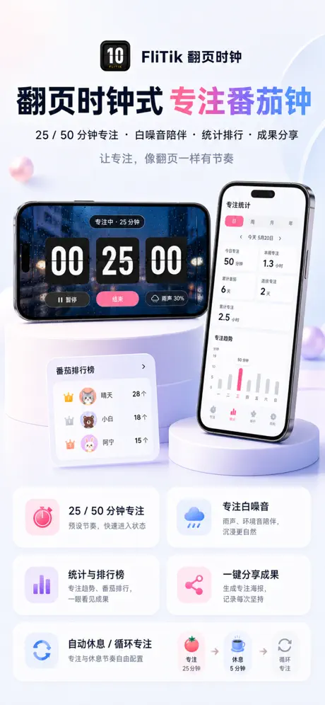{: width="180" .normal }
{: width="180" .normal }
{: width="180" .normal }

FliTik 是一款跨平台 **翻页时钟**，主打仪式感：惊艳的翻页动画、番茄钟、正/倒计时模式，以及环境音，让每一秒都显得有意。它常作为学习与工作专注的伴侣——把"看时间"和"管时间"合并到同一块屏幕上。

**优势**
- **番茄钟**加正/倒计时模式，适合学习与工作冲刺。
- **漂亮、有氛围的翻页显示**，作桌面或床头钟都好看。
- **环境音**与时钟混合，助专注与放松。
- **跨平台**（iOS、桌面与安卓），配置随处跟随。
- 清晰的大数字，隔着房间也读得清。

**不足**
- 部分主题与计时功能需内购。
- 原始自定义（颜色/位置）比纯时钟小组件应用少。
- 安卓需侧载/商店镜像获取，没有单一旗舰上架。

**最适合：** 想要翻页时钟又能跑番茄钟与倒计时的学生与专注工作者；介意安卓获取方式的人要先确认来源。

**下载 FliTik**
- [App Store](https://apps.apple.com/us/app/flitik-flip-clock-pomodoro/id6448849784)

---

### 3. Flip Clock: World Clock —— 带天气的安卓翻页时钟最佳

{: width="180" .normal }
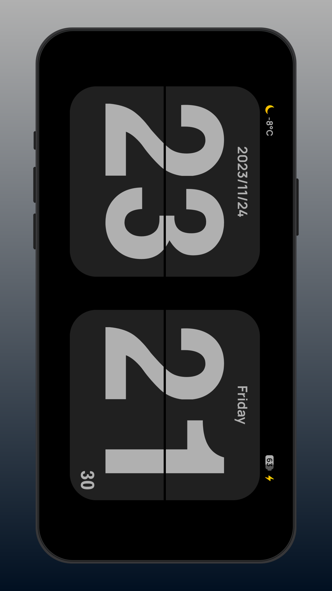{: width="180" .normal }
{: width="180" .normal }
{: width="180" .normal }
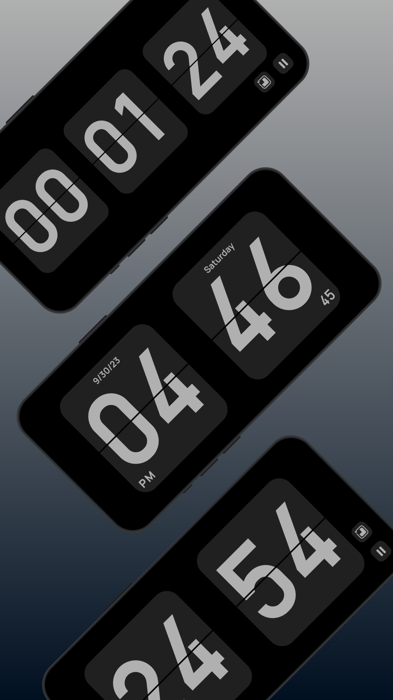{: width="180" .normal }

Flip Clock: World Clock 是一款免费的安卓 **翻页时钟**，在经典钟面上叠加了天气、主屏小组件、番茄钟与悬浮时钟。它适合"一块屏看完时间、天气与日程"的人，放在玄关或书桌都很实用。

**优势**
- **带天气的翻页时钟**，对当前位置显示天气，作桌面钟很方便。
- **主屏小组件**，时间直接显示在启动器上。
- **番茄钟与悬浮时钟**，适合专注时段。
- 免费起步，可选应用内升级。
- 轻量、易配置。

**不足**
- 免费档含广告，可能打断那份安静的观感。
- 天气与部分小组件需内购。
- 无 iOS 版。

**最适合：** 想要带天气与小组件、又不想先付费的安卓用户；对广告敏感的人可考虑去掉广告的付费项。

**下载 Flip Clock: World Clock**
- [Google Play](https://play.google.com/store/apps/details?id=com.wssc.simpleclock)

---

### 4. Fullscreen Clock —— 极简全屏专注最佳

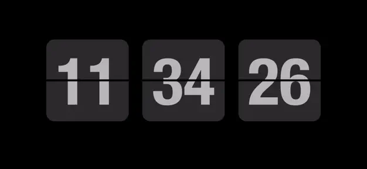{: width="360" .normal }
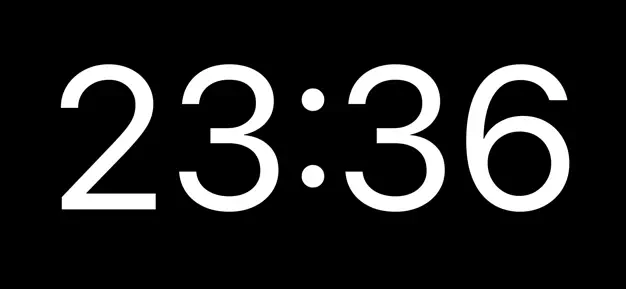{: width="360" .normal }

Fullscreen Clock: Flip & Focus 把你的 iPhone 或 iPad 变成干净、常亮的 **翻页时钟**，提供十三款钟面、夜间调暗、横屏支持与内置番茄钟。它适合喜欢极简、不想在钟面上堆功能的人，平板横放就是一块大屏钟。

**优势**
- **十三款钟面**，含翻页与专注风格。
- **屏幕常亮**并支持夜间调暗，适合床头。
- **内置番茄钟**，适合专注工作。
- 支持横竖屏；界面极简干净。
- 无需账号。

**不足**
- 仅 iOS——无安卓版。
- 多数钟面包与功能需内购。
- 自身不带环境音。

**最适合：** 想要漂亮、极简全屏时钟且带番茄钟的 iPhone/iPad 用户；如果需要白噪音，得另配应用。

**下载 Fullscreen Clock**
- [App Store](https://apps.apple.com/us/app/fullscreen-clock-flip-focus/id1403700342)

---

### 5. Flip Clock: Digital Desk Widget —— 桌面小组件 + 屏保最佳

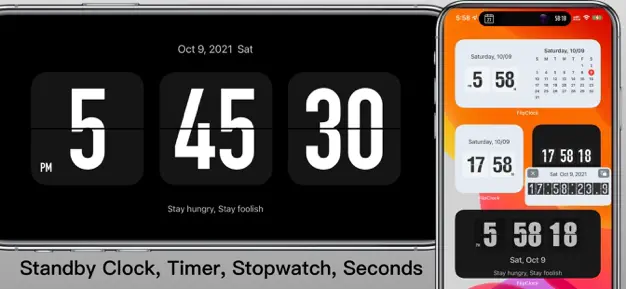{: width="360" .normal }
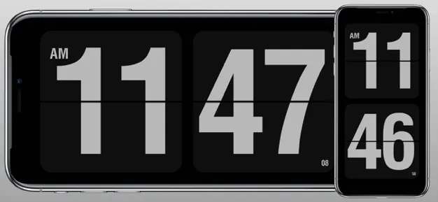{: width="360" .normal }

Flip Clock: Digital Desk Widget 是一款 iOS 应用，主打 **桌面风格翻页时钟**、可交互的待机小组件，以及适合桌面与床头的类屏保模式。它适合把旧 iPhone 立在桌上当钟：充电时进入屏保，抬眼就是翻页时间。

**优势**
- **待机与可交互小组件**，显示实时翻页时钟。
- **屏保模式**，适合充电/桌面场景。
- 显示秒、日期与日历，支持 12/24 小时制。
- 黑白与主题化样式。
- 干净、贴近 Apple 的设计。

**不足**
- 仅 iOS。
- 最佳功能需付费版。
- 无白噪音或悬浮叠加层。

**最适合：** 想把翻页时钟钉成小组件或屏保的 iPhone 用户；把它当床头钟时记得关闭自动锁屏。

**下载 Flip Clock: Digital Desk Widget**
- [App Store](https://apps.apple.com/us/app/flip-clock-digital-desk-widget/id1181028777)

---

### 6. Flip Clock — Digital Clock —— 轻量主题时钟最佳

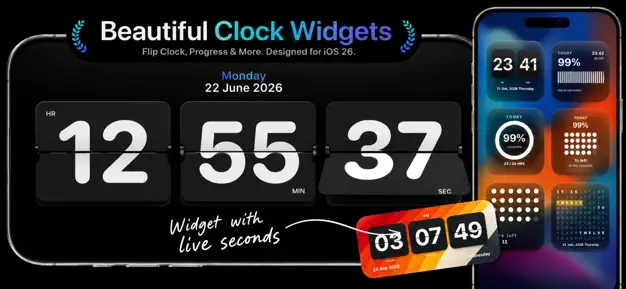{: width="180" .normal }
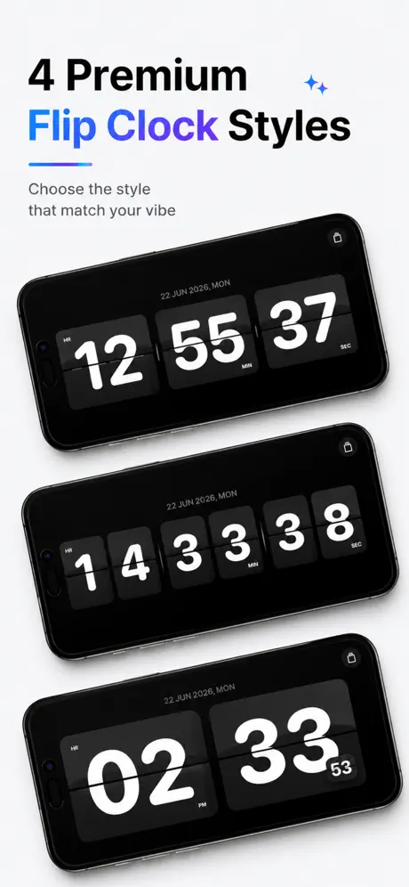{: width="180" .normal }
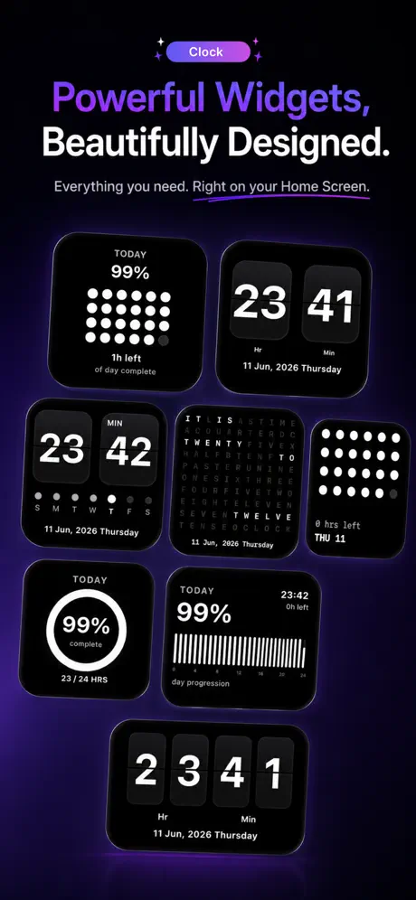{: width="180" .normal }
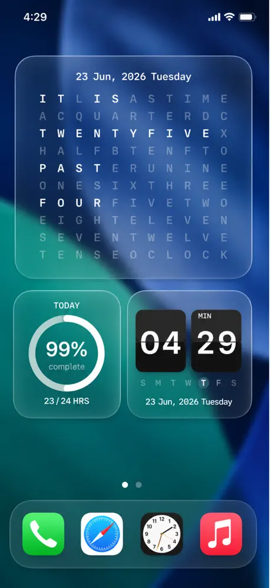{: width="180" .normal }
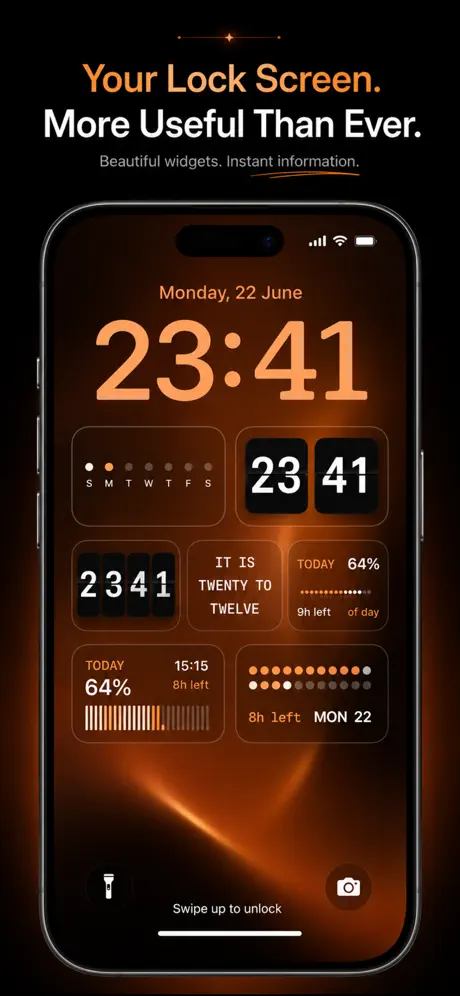{: width="180" .normal }

Flip Clock — Digital Clock 是一款简单优雅的 iOS **翻页时钟**，带主题、待机小组件、秒/日期显示与 12/24 小时支持——是 Retroflip 的轻量无冗余替代。它适合 Retroflip 的 iOS 用户：只想要那块翻页面，不想为用不到的功能付费。

**优势**
- **优雅的翻页动画**，配黑白色之外的多样主题。
- 支持 **待机与可交互小组件**。
- 显示秒、日期与日历。
- 轻量、启动快。
- 可免费试玩，可选升级。

**不足**
- 仅 iOS。
- 无声音、悬浮时钟或番茄钟。
- 主题是最主要的付费项。

**最适合：** 想要干净、带主题、不要多余功能的 iPhone 用户；把它当纯粹的第二块钟最省心。

**下载 Flip Clock — Digital Clock**
- [App Store](https://apps.apple.com/us/app/flip-clock-digital-clock/id1479450824)

---

## 核心能力对比

六款 Retroflip 替代品的能力表把文字结论压成一张速查图：先看"白噪音""悬浮时钟""小组件"三行——它们正是 Retroflip 所缺、也是多数人换应用的真实动机，其中只有 Only Clock 三项齐全且双平台通吃；"广告"一行则关系到它能不能整夜安静亮着，六款中仅 Flip Clock: World Clock 的免费档含广告。

| 能力 | Only Clock | FliTik | Flip Clock: World Clock | Fullscreen Clock | Flip Clock: Digital Desk Widget | Flip Clock — Digital Clock |
|---|---|---|---|---|---|---|
| **平台** | 安卓、iOS | iOS（+桌面/安卓） | 安卓 | iOS | iOS | iOS |
| **全屏翻页动画** | 有 | 有 | 有 | 有（翻页+更多） | 有 | 有 |
| **主题 / 自定义** | 多样 | 有氛围 | 基础 | 13 款钟面 | 主题化 | 主题化 |
| **白噪音 / 专注音** | 有 | 有 | 无 | 无 | 无 | 无 |
| **悬浮时钟叠加层** | 有 | 无 | 有 | 无 | 无 | 无 |
| **小组件** | 有 | 无 | 有 | 无 | 待机+可交互 | 待机+可交互 |
| **天气** | 无 | 无 | 有 | 无 | 无 | 无 |
| **番茄钟 / 计时** | 无 | 有 | 有 | 有 | 无 | 无 |
| **倒计时 / 正计时** | 无 | 有 | 无 | 无 | 无 | 无 |
| **12/24 小时 + 日期** | 有 | 有 | 有 | 有 | 有 | 有 |
| **免费档** | 充裕 | 免费+内购 | 免费+内购 | 免费+内购 | 免费+内购 | 免费+内购 |
| **广告** | 无 | 无 | 有（免费） | 无 | 无 | 无 |

一句话归纳：只有 Only Clock 同时具备白噪音、悬浮时钟和小组件，且双平台通吃；FliTik 与 Fullscreen Clock 强在番茄钟；Flip Clock: World Clock 胜在天气与安卓免费；两款 Digital Desk/Digital Clock 则是 iOS 上的轻量选择。

---

## 每款 Retroflip 替代品适合谁

六款 Retroflip 替代品适合谁，可按「除了显示时间，你还想让这块钟做什么」来分：要声音（白噪音）选 Only Clock 或 FliTik；要位置（悬浮窗或小组件）选 Only Clock、Flip Clock: World Clock 或两款 iOS 小组件应用；要平台（iOS）则看 FliTik、Fullscreen Clock 与两款 Digital 时钟。先想清楚你要的是声音、位置还是平台，再看分组更省时间。

- **钟面之外还要声音**——**翻页时钟替代**、**翻页桌面时钟替代** 这类搜法，多半想要一块安静常亮的钟面；Only Clock 在此之上加了白噪音、专注计时与悬浮模式。
- **桌面或浏览器里的翻页钟**——**Fliqlo 替代** 对应电脑端；FliTik 与 Flip Clock: Digital Desk Widget 则是手机上的桌面组件式外观。
- **小组件与世界时钟**——Flip Clock: World Clock 在钟面上加天气与时区；**翻页时钟24H 替代** 更看重 24 小时制与日期。
- **替掉系统闹钟**——**谷歌时钟替代** 问的是闹钟与计时器，与装饰性全屏钟面不是一回事。
- **整夜不被广告打扰**——从 **大字时钟替代**、**极简时钟替代** 到 **翻页时钟哪个好**，先按「有无广告、能不能变暗」筛一遍，因为这块屏会亮上好几个小时。

不管用哪个词搜索，迁移前先问两句：能不能调暗又不烧 OLED？免费档里还留不留下你真正在用的那个组件？这两点过关，翻页钟才能真正长期亮在床头或桌上。

## 如何选购

六款 Retroflip 替代品按最在意的需求挑：要主题、白噪音、悬浮时钟与双平台小组件选 Only Clock，要番茄钟与倒计时选 FliTik，要带天气与小组件的免费安卓翻页钟选 Flip Clock: World Clock，要极简 iOS 全屏时钟选 Fullscreen Clock，要 iPhone 桌面小组件/屏保选 Flip Clock: Digital Desk Widget，要轻量主题化 iOS 时钟则选 Flip Clock — Digital Clock。

- 想要 **主题 + 白噪音 + 悬浮时钟 + 双平台小组件** → **Only Clock**：六款里唯一全都有。
- 想要 **番茄钟、倒计时与氛围翻页时钟** → **FliTik**：学习与工作冲刺的好搭档。
- 想要 **带天气与小组件的免费安卓翻页时钟** → **Flip Clock: World Clock**：一眼看时间与天气。
- 想要 **极简 iOS 全屏时钟 + 番茄钟** → **Fullscreen Clock**：十三款钟面，横屏更舒服。
- 想要 **iPhone 上的桌面小组件 / 屏保翻页时钟** → **Flip Clock: Digital Desk Widget**：充电时当屏保。
- 想要 **轻量主题化 iOS 时钟** → **Flip Clock — Digital Clock**：只要一块干净的翻页面。

## 如何摆脱 Retroflip

从六款 Retroflip 替代品完成迁移，可按"选替代品—授权—调显示—加小组件—开声音/番茄钟"五步走：先按平台及是否需要声音、小组件或悬浮时钟从表中选一款，再授予叠加层权限并关闭电池优化，否则常亮与悬浮都不生效。把 12/24 小时与日期调成原来的习惯，迁移后就不用重新适应。按这五步接棒，翻页钟才能真正长期亮在床头或桌上。

1. 根据平台，以及你是否需要声音、小组件或悬浮时钟，从上文表格 **选替代品**——别为用不到的功能多花钱。
2. **安装并授予所需权限**（悬浮时钟需「显示在其他应用上层」，常亮需关闭电池优化），否则常亮与悬浮都不生效。
3. **设置 12/24 小时与日期显示**，匹配你在 Retroflip 里的习惯，迁移后不用重新适应。
4. **加个小组件**（Only Clock、Flip Clock: World Clock 或 iOS 小组件应用）到主屏或锁屏，一眼看时间。
5. **若需要专注或助眠**，开启白噪音（Only Clock、FliTik）或番茄钟（FliTik、Fullscreen Clock、Flip Clock: World Clock），让时钟不止报时。

## 常见问题（FAQ）

**Only Clock 适合作为 Retroflip 替代品吗？**
{:.faq-q}

对多数人来说是的。Only Clock 是最接近「全面升级 Retroflip」的选择——在保留翻页钟外观的同时，加上了白噪音、悬浮时钟、小组件与 iOS 支持。如果你只想要一块极简钟面、不在乎声音，iOS 上的两款轻量时钟反而更轻。

**哪款 Retroflip 替代品带白噪音？**
{:.faq-q}

Only Clock 与 FliTik 都含环境音，可用来助眠或专注；其余四款 iOS 选项都是无声钟，需要声音就得另配应用。

**哪款 Retroflip 替代品安卓与 iOS 都能用？**
{:.faq-q}

Only Clock 双平台都跑；FliTik 覆盖 iOS、桌面与安卓，但安卓获取方式较绕；Flip Clock: World Clock 仅安卓，其余仅 iOS。

**Only Clock 免费吗？**
{:.faq-q}

免费。核心钟、主题与白噪音免费可用；一次性或订阅解锁打开最丰富的主题与声音。先用免费核心试一周，再决定要不要解锁。

[One Clock App 页](/zh/apps/only-clock/)——安卓与 iOS 平台可用。

## 相关术语

- [什么是翻页时钟（Flip Clock）？](/zh/glossary/what-is-a-flip-clock/)
- [什么是床头钟（Nightstand Clock）？](/zh/glossary/what-is-a-nightstand-clock/)
