WidgetSmith 是最知名的 **iOS 小组件应用**，但它仅限 iPhone，而且即使在 iOS 上，也有用户想要不一样的风格、实时设备数据（电量、内存），或者更大的现成组件库。本指南跨平台对比了 **六款** 主流 **[小组件应用](/zh/glossary/what-is-a-home-screen-widget/)**，每一款或因某一项突出优势、或因市场覆盖广而被选中。下面每款应用都会给出真实优点、真实缺点，以及它在人们真正在意的主屏核心能力上的表现——现成预设、自定义编辑器、实时系统数据、天气、健康、照片、交互性与锁屏支持。下载链接在每节末尾。多数人卡在一个具体问题上：只有 iPhone 能用、要订阅，或现成组件太少；下面会按「解决哪个问题」来讲每一款。

## 为什么要跳出 WidgetSmith

六款 WidgetSmith 替代品之所以入选，是因为 WidgetSmith 仅限 iPhone、高级档需付费，且以照片、日期、天气为主，缺少电量、内存等实时设备数据。换掉它的理由通常不是它不好，而是设备或需求变了：你需要安卓支持、品牌化设计风格、更大的现成组件库，或更直接的实时读数。先明确你缺的是"平台""信息""风格"还是"省事"，再看下面六款，才不会被"功能更多"带偏。常见的几类落差是：

- **没有安卓版本**——仅限 iPhone，所以安卓用户必须另选工具。
- **实时设备遥测有限**——WidgetSmith 以照片、日期、天气和日历为主；它不像若干安卓组件那样直接显示电量百分比、内存或存储等原始设备状态。
- **特定审美**——你也许想要 One UI、Material You 或 Nothing 那种模仿其他品牌设计语言的外观，或者一套可爱 / 有质感的主题包。
- **现成 vs 自己造**——WidgetSmith 是个构建器；有些人只想要一个可以挑选的大组件库。
- **价格敏感**——WidgetSmith 的高级档解锁部分样式；替代品从免费预设库到一次性 Pro 密钥再到订阅都有。

先明确你缺的是"平台"（安卓支持）、"信息"（电量、内存等实时数据）、"风格"（品牌化设计语言），还是"省事"（大现成库），再看下面六款，才不会被"功能更多"带偏。

---

## 最佳 WidgetSmith 替代应用一览

六款 WidgetSmith 替代品先列成一表：One Widget 是安卓上跨四套设计语言的 500+ 现成组件包，KWGT 是安卓从零打造组件的编辑器，Widgy 与 Color Widgets 是 iOS 的自定义与预设代表，Widgetable、WidgetClub 则跨 iOS 与安卓。平台一列最值得先看，它往往直接决定了你能在几款里挑。

| 应用 | 价格（2026） | 平台 | 适合人群 |
|---|---|---|---|
| **One Widget** | 免费 One UI 套件 + 风格解锁 | Android | 跨 4 套设计语言的 500+ 现成组件 |
| **KWGT** | 免费 + 一次性 Pro 密钥（约 $4.99） | Android | 从零打造组件 |
| **Widgy** | 免费 + 应用内购（约 $4.99） | iOS（iPhone/iPad/Watch） | 深度自定义 iOS 组件、无需编码 |
| **Color Widgets** | 免费 + Pro（约 $2.50/月，按年计费） | iOS（iPhone/iPad/Mac） | 快速、有质感的预设 + 主题 |
| **Widgetable** | 免费 + 订阅 | iOS（也有安卓） | 面向情侣 / 闺蜜的社交与宠物组件 |
| **WidgetClub** | 免费 + 订阅 | iOS + Android | 可爱、以主题驱动的质感组件 |

---

## 1. One Widget —— 最适合现成、多风格的安卓组件

One Widget 是六款 WidgetSmith 替代品里最贴近"预设哲学"的安卓组件包，围绕 Galaxy One UI、Material You、iOS Glass 与 Nothing UI 四套设计语言，内置 500+ 现成组件，覆盖时钟、电量、内存、存储与 Wi-Fi / 蓝牙等开关。它最适合挑一个风格、拖几个组件就完事的安卓用户——无需碰公式编辑器，免费档给 One UI 套件，另外三套风格需一次性解锁；代价是仅限安卓，且只能在预设模板内自定义，无法像 KWGT 那样自由编排布局。

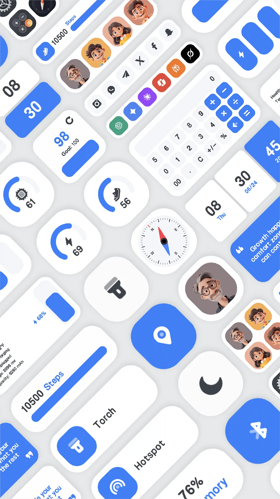{: width="180" .normal }
{: width="180" .normal }
{: width="180" .normal }
{: width="180" .normal }
{: width="180" .normal }

One Widget 是一套围绕 **四套完整设计语言**——**Galaxy One UI、Material You、iOS Glass 与 Nothing UI**——打造的安卓组件包，因此一个应用就能让三星、Pixel、iPhone 风或 Nothing 手机看起来风格统一。它内置 **500+ 现成组件**（时钟、日期、电量、内存、存储、应用快捷方式、Wi‑Fi / 蓝牙 / 手电筒等开关、日历、计步、音乐与天气），且开发者 **在持续新增组件**，让组件库保持新鲜。它适合"挑一个风格、拖几个组件就完事"的人，不用碰公式编辑器。

**优点**
- **一个应用内含四套截然不同的风格系统**——很少见；多数组件应用只坚守单一外观。
- **丰富、即拖即用的组件**，包含实时设备遥测（电量 %、内存、存储），这是 iOS 组件一般无法一眼显示的信息。
- **实用开关与快捷方式**（Wi‑Fi、蓝牙、手电筒、启动应用）带来真实用途，而不只是装饰。
- **无需设计技巧**——选个风格、放上组件，完成。
- **频繁更新**，不断加入新组件与组件类型。

**缺点**
- **仅限安卓**——没有 iOS 版本。
- **基于预设，而非自由形式编辑器**——你只能在给定的模板范围内自定义；无法像 KWGT 那样自由编排布局或编写公式。
- **部分风格 / 组件需解锁**，免费用户获得 One UI 套件。
- 不太适合想要真正独一无二、而非精致预设组件的用户。

**适合人群：** 想要跨越多种手机审美、大且好看组件库，又不想学设计工具的安卓用户；用惯 iOS 组件的人会在这里第一次看到电量与内存读数。

**下载 One Widget**
- [Google Play](https://play.google.com/store/apps/details?id=com.glgjing.galaxy.nothing.glass.material.widget)

---

## 2. KWGT Kustom Widget Maker —— 最适合从零打造组件

KWGT 是六款 WidgetSmith 替代品里安卓端从零打造组件能力最强的编辑器：用文字、形状、图片、进度条和一套公式语言拼装组件，可拉取电量、网络、天气、日历乃至 Health Connect 的步数、睡眠与卡路里数据。它靠一次性 Pro 密钥解锁全部功能、无订阅，并有庞大的社区预设可供起步微调；代价是公式语言学习曲线陡、做好一个组件很花时间，且仅限安卓，开箱界面偏实用主义，不适合只想快速摆几个组件的人。

{: width="180" .normal }
{: width="180" .normal }
{: width="180" .normal }
{: width="180" .normal }
{: width="180" .normal }

KWGT（出自 Kustom）是安卓上 **功能丰富的组件编辑器**之一。你不是选预设，而是用文字、形状、图片、进度条和一套公式语言来拼装组件，这套语言能拉取电量、网络、天气、日历乃至 **Health Connect** 数据（步数、睡眠、卡路里）。庞大的社区分享预设与主题包，所以你可以从别人的设计起步再加以微调——这也是它相对"从零开始"最实用的捷径。

**优点**
- **像素级、公式驱动的掌控**——几乎能做出任何你想象得到的组件。
- **庞大的共享生态**，含预设、主题包与教程。
- 支持 **Material You 动态配色** 与深度的实时数据绑定。
- **一次性 Pro 密钥**（无订阅）解锁全部功能。
- **Health Connect 接入** 步数 / 睡眠 / 卡路里。

**缺点**
- **学习曲线陡峭**——公式语言很强，但对 casual 用户不友好。
- **仅限安卓**，无 iOS 版本。
- 做好一个组件 **很花时间**；界面偏实用主义，开箱并不花哨。
- 相比原生应用自身的控件，点按交互较为有限。

**适合人群：** 想要完全掌控、并愿意学习编辑器的安卓发烧友；只想快速摆几个组件的人会觉得它太重。

**下载 KWGT Kustom Widget Maker**
- [Google Play](https://play.google.com/store/apps/details?id=org.kustom.widget)

---

## 3. Widgy —— 最适合深度自定义的 iOS 组件

Widgy 是六款 WidgetSmith 替代品里 iOS 端自定义能力较深的一款，采用可视化、基于图层的构建器，无需编码即可搭配天气、Apple Health、日历与提醒等数据源，面向 iPhone、iPad、Apple Watch、锁屏与 StandBy。它紧跟每一代 iOS 设计语言、更新积极，部分组件位需约 $4.99 应用内购；代价是精通图层与数据绑定仍有学习曲线，且受 iOS 组件刷新限制、数据可能延迟几分钟。适合嫌 WidgetSmith 不够自由、又不想写代码的苹果用户。

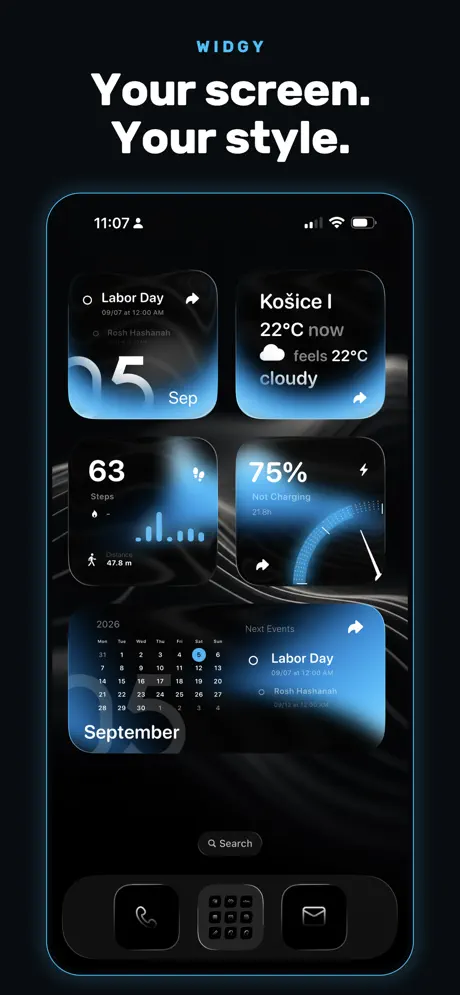{: width="180" .normal }
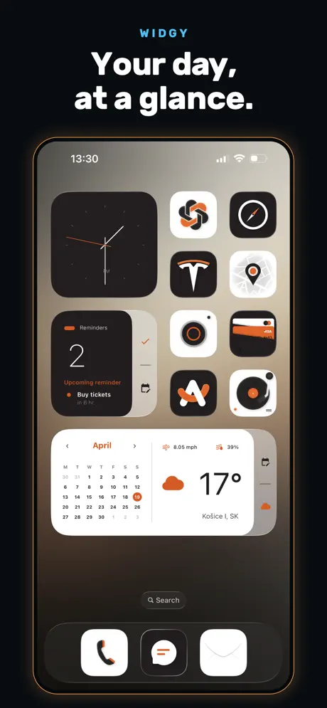{: width="180" .normal }
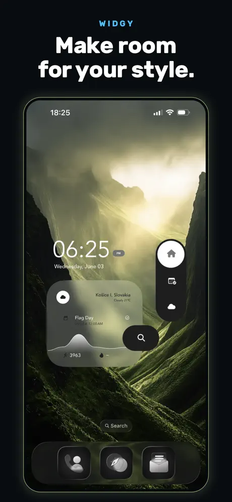{: width="180" .normal }
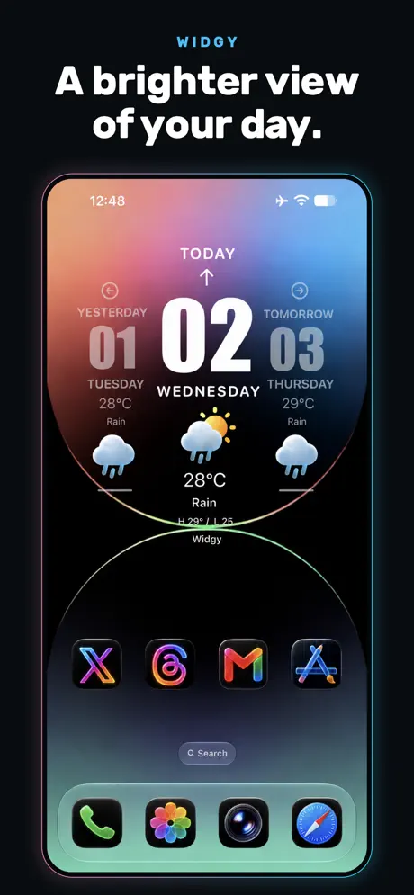{: width="180" .normal }
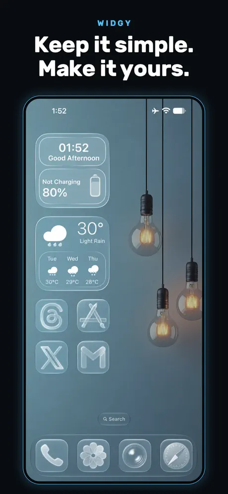{: width="180" .normal }

Widgy 是 iOS 上最贴近 KWGT 的存在：一个 **可视化、基于图层的构建器**（无需编码），配模板和广泛的数据源——天气、Apple Health、日历、提醒等。它面向 iPhone、iPad、Apple Watch、锁屏与 StandBy，并紧跟每一代新 iOS 设计语言（如 Liquid Glass）。如果你是 iPhone 用户又嫌 WidgetSmith 不够自由，它是最直接的升级。

**优点**
- **iOS 上自定义能力较深的组件构建器**，含图层、数据源与可导出的设计。
- **无需编码**——可视化编辑比 KWGT 的公式门槛更低。
- **深度数据**，含 Apple Health，并支持锁屏、StandBy 与表盘。
- **随每次新 iOS 发布积极更新**。

**缺点**
- **仅限 iOS**。
- 要精通图层与数据绑定仍有 **学习曲线**。
- **部分组件位 / 功能需应用内购**（约 $4.99）。
- 受 **iOS 组件刷新限制**——数据可能延迟几分钟。

**适合人群：** 想要专属组件、但偏好可视化编辑器而非代码的 iPhone / iPad 用户；把组件钉在锁屏上的用户尤其合适。

**下载 Widgy**
- [App Store](https://apps.apple.com/us/app/widgy-widgets-home-lock-watch/id1524540481)

---

## 4. Color Widgets —— 最适合快速、有质感的 iOS 预设

Color Widgets 是六款 WidgetSmith 替代品里最快做出好看组件的一款，依托数千款预设组件加简易自定义器，打包主题、图标包与壁纸，覆盖照片、时间日期、电量、天气、音乐与活动组件，并接入 Apple Health 记录步数。它主打"五分钟内让主屏变好看"，支持 Mac 且定位隐私优先；代价是更偏质感而非深数据、不如 Widgy 自由，最佳功能锁在约 $2.50/月的 Pro 订阅之后，且采用订阅而非一次性解锁。

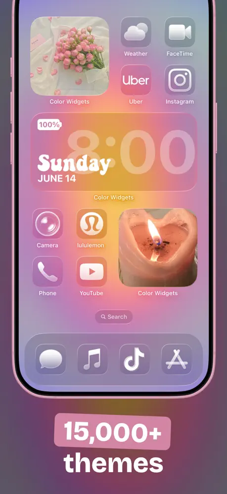{: width="180" .normal }
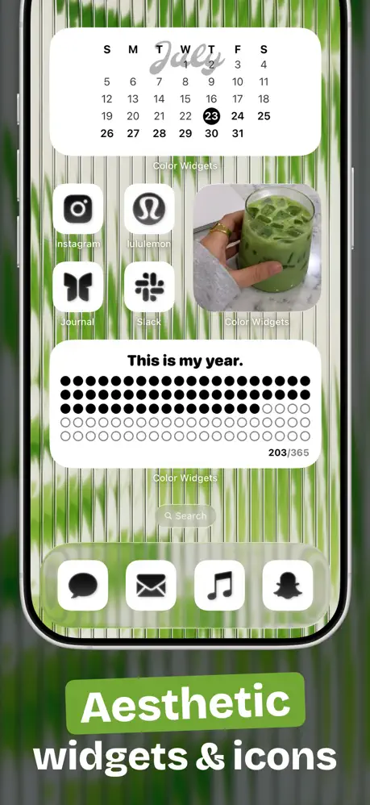{: width="180" .normal }
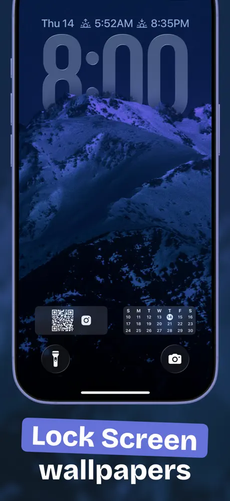{: width="180" .normal }
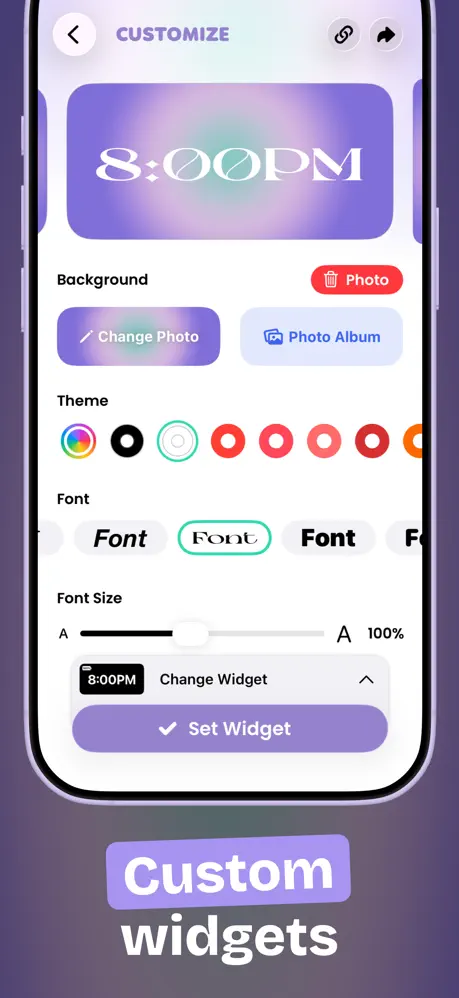{: width="180" .normal }
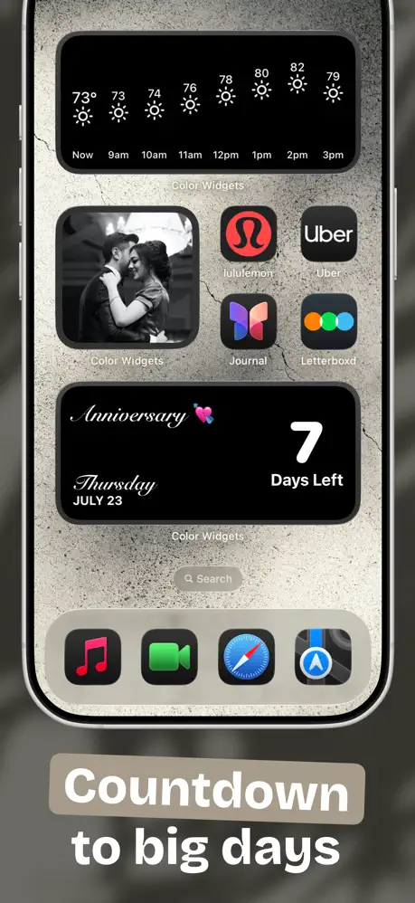{: width="180" .normal }

Color Widgets 依托 **数千款预设组件加一个简易自定义器**，并打包主题、图标包与壁纸，让你轻点几下就能给整个主屏与锁屏换肤。它覆盖照片、时间 / 日期、电量、倒计时、天气、音乐（Apple / Spotify）、日历、名言与活动组件，并接入 Apple Health 记录步数。它适合"五分钟内让主屏变好看"的需求。

**优点**
- **最快做出好看组件**——选个预设或微调颜色 / 字体，无需设计背景。
- **一体化换肤**（组件 + 图标 + 壁纸）呈现统一观感。
- **健康接入** 与广泛的组件类型。
- **隐私优先** 的定位，且支持 Mac。

**缺点**
- 更偏 **质感而非深数据**；不如 Widgy 自由。
- 最佳功能锁在 **Pro 订阅**（约 $2.50/月，按年计费）之后。
- 可能显得 **模板化**；原创性取决于共享库。
- 采用订阅模式而非一次性解锁。

**适合人群：** 想快速拥有漂亮组件与配套主题的 iPhone 用户；追求独一无二的深度自定义者应转向 Widgy。

**下载 Color Widgets**
- [App Store](https://apps.apple.com/us/app/color-widgets/id1531594277)

---

## 5. Widgetable —— 最适合社交与宠物组件

Widgetable 是六款 WidgetSmith 替代品里唯一围绕关系打造组件的一款：领养与好友共同养育的虚拟宠物、分享睡眠组件、发送心情更新，并在锁屏或主屏显示你与密友之间的实时距离。它跨 iOS 与安卓运行，更受情侣与闺蜜欢迎，评分极高且频繁更新；代价是核心功能锁在订阅之后，分享睡眠、心情与位置距离带来隐私考量，对想要普通时钟或电量内存读数的人几乎没有用处。

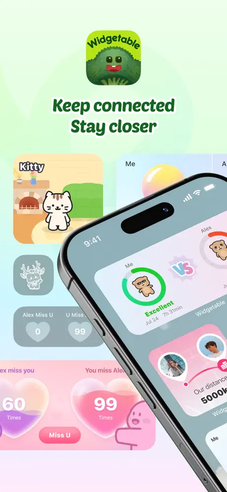{: width="180" .normal }
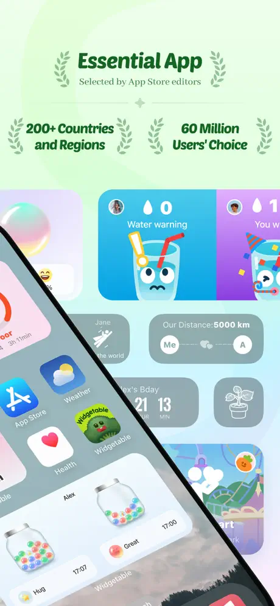{: width="180" .normal }
{: width="180" .normal }
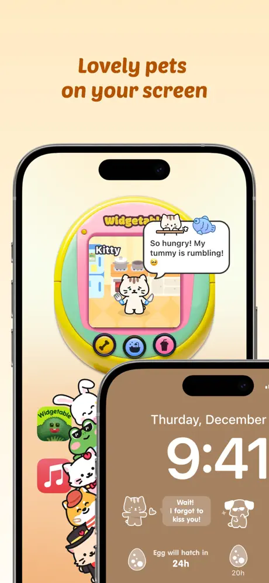{: width="180" .normal }
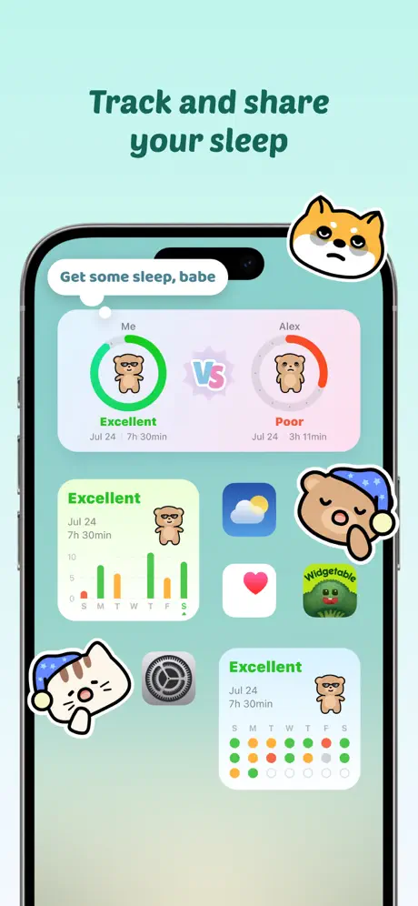{: width="180" .normal }

Widgetable 走了一条不同的路：**围绕关系打造的组件**。你领养和好友共同养育的虚拟宠物，分享睡眠组件，发送心情更新，并在锁屏或主屏上显示你和闺蜜之间的实时距离。它更受情侣与密友欢迎，而非作为通用生产力工具——想要一块普通时钟组件的人用不上它。

**优点**
- **独特的社交 / 关系组件**（宠物、睡眠、心情、距离、好友状态）在通用组件应用里找不到。
- **可爱、有趣且频繁更新** 的内容；评分极高。
- 跨 **iOS 与安卓** 运行，可与任一平台上的好友共享组件。

**缺点**
- **小众**——不是通用组件工具箱；若你不要社交功能就几乎没用。
- **核心功能锁在订阅** 之后。
- 分享个人状态（睡眠、心情、位置距离）带来 **隐私考量**，介意的人要慎用。
- 对电量、内存或日历这类生产力 / 数据组件用处不大。

**适合人群：** 想要锁屏更"有社交感"的情侣、闺蜜与宠物爱好者；追求实用信息的人应跳过这一款。

**下载 Widgetable**
- [App Store](https://apps.apple.com/us/app/widgetable-besties-couples/id1641107226)

---

## 6. WidgetClub —— 最适合可爱、以主题驱动的组件

WidgetClub 是六款 WidgetSmith 替代品里主题库最大的一款，拥有数万款主题，涵盖天气、照片、日历、时钟、倒计时、电量与提醒组件，并同时运行在 iOS 与安卓上，适合把两边主屏打扮得一致。它靠简单制作器拖入照片和颜色，几乎零门槛就能做出可爱统一的质感组件；代价是重质感轻深度，不是 Widgy、KWGT 那样的从零编辑器，完整库需订阅，安卓支持也不如 iOS 成熟。

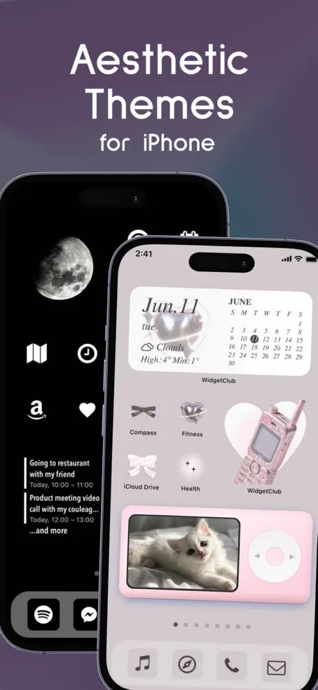{: width="180" .normal }
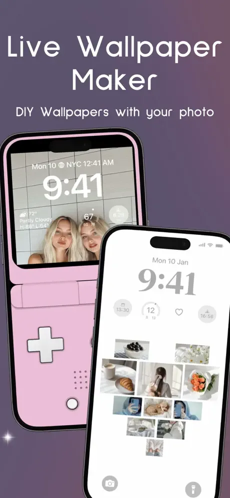{: width="180" .normal }
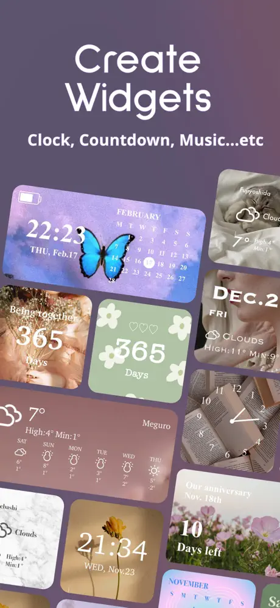{: width="180" .normal }
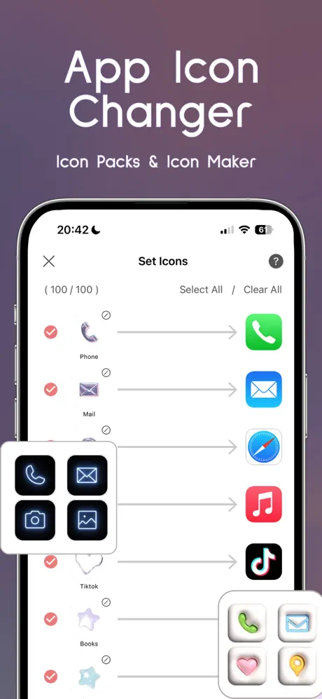{: width="180" .normal }
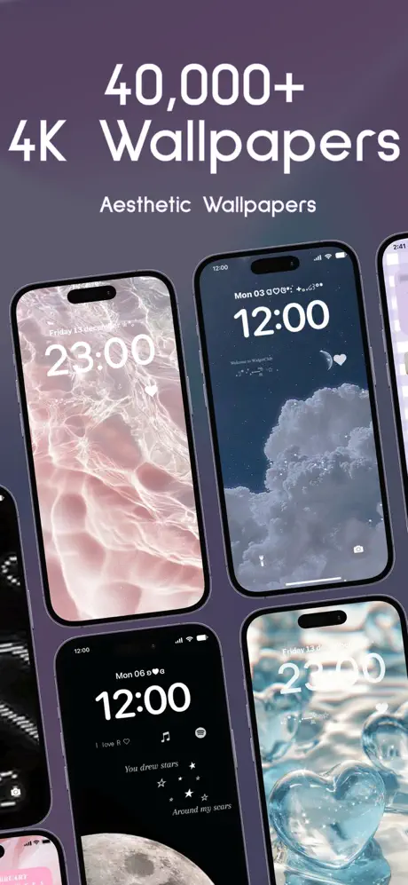{: width="180" .normal }

WidgetClub 是一款有质感的组件、壁纸与图标应用，拥有海量目录（数万款主题），涵盖天气、照片、日历、时钟、倒计时、电量与提醒组件。一个简单的制作器让你可以拖入照片和颜色；它同时运行在 **iOS 与安卓** 上，适合想把两边主屏都打扮得一致的人。

**优点**
- **非常容易** 做出可爱、统一的质感组件。
- **庞大的主题库** 与跨平台（iOS + Android）覆盖。
- 适合 **照片与提醒组件**，几乎零门槛。

**缺点**
- **重质感轻深度**；不是 Widgy / KWGT 那样从零开始的编辑器。
- 完整库需要 **订阅**。
- **安卓支持不如 iOS 成熟**。
- 电量 / 提醒组件相比专门工具较基础。

**适合人群：** 重视漂亮、有主题的主屏、胜过深度自定义的用户；想要实时电量或内存读数的人更适合 One Widget。

**下载 WidgetClub**
- [App Store](https://apps.apple.com/us/app/widgetclub-widget-theme-icon/id1580284904)

---

## 核心能力对比

六款 WidgetSmith 替代品的能力表按现成预设、从零编辑器、风格系统、实时系统数据、健康接入、交互与锁屏支持逐项列出：One Widget 以四套内置风格与 500+ 现成组件主打省事，KWGT（安卓）与 Widgy（iOS）走从零编辑的自由度路线，Color Widgets 与 WidgetClub 偏快速预设与主题，Widgetable 则是唯一的社交宠物向。"部分"表示该能力存在但有限制（例如仅预设，或锁在付费墙后）。建议先看"现成预设""从零编辑器""实时系统数据"三行，它们分别对应"省事""自由""能看多少设备信息"三条路线。

| 能力 | One Widget | KWGT | Widgy | Color Widgets | Widgetable | WidgetClub |
|---|---|---|---|---|---|---|
| **平台** | Android | Android | iOS | iOS | iOS（+安卓） | iOS + Android |
| **现成预设** | **强（500+）** | 部分（社区） | 支持（模板） | **强** | 支持（社交） | **强（主题）** |
| **从零编辑器** | 否（基于预设） | **是（强）** | **是（可视化）** | 部分（自定义器） | 否 | 部分（简易制作器） |
| **风格系统（One UI / Material You / Glass / Nothing）** | **内置 4 套** | 全（你定义） | 全（你定义） | 质感主题 | 仅可爱 | 可爱 / 主题 |
| **实时系统数据（电量 / 内存 / 存储）** | **支持（电量 / 内存 / 存储）** | 支持（公式） | 支持（电量等） | 支持（电量） | 有限（社交） | 支持（电量） |
| **天气** | 支持 | 支持 | 支持 | 支持 | 否 | 支持 |
| **健康 / 活动** | 部分 | **支持（Health Connect）** | **支持（Apple Health）** | 支持（步数） | 睡眠（社交） | 部分 |
| **照片组件** | 支持 | 支持 | 支持 | **支持（强）** | 有限 | 支持 |
| **日历 / 日期** | 支持 | 支持 | 支持 | 支持 | 有限 | 支持 |
| **交互（开关 / 快捷方式）** | **支持（开关、快捷方式）** | 有限（点按动作） | 有限（点按打开） | 点按打开 | 点按打开 | 点按打开 |
| **锁屏支持** | Android 12+ | Android 锁屏组件 | iOS 锁屏 + StandBy | iOS 锁屏 | iOS 锁屏 | iOS 锁屏 |
| **免费档** | 免费 One UI 套件（+解锁） | 免费 + Pro 密钥 | 免费 + 应用内购 | 免费 + Pro 订阅 | 免费 + 订阅 | 免费 + 订阅 |
| **更新节奏** | **持续新增组件** | 积极维护 | 积极（新 iOS） | 积极 | 积极 | 积极 |

一句话归纳：要"现成 + 实时数据 + 品牌风格"选 One Widget；要完全自由选 KWGT（安卓）或 Widgy（iOS）；要快速变好看选 Color Widgets 或 WidgetClub；要社交与宠物组件才看 Widgetable。安卓用户能看电量、内存、存储，这一点是 iOS 组件普遍做不到的。

---

## 每款 WidgetSmith 替代品适合谁

六款 WidgetSmith 替代品适合谁，可按「你原本想在桌面摆什么」分组：想要安卓现成预设选 One Widget，想亲手从零画组件选 KWGT（安卓）或 Widgy（iOS），想快速变好看选 Color Widgets 与 WidgetClub，想要社交与宠物组件才看 Widgetable。先承认自己更在意"省事"还是"自由"，再看分组更省时间。

- **安卓上的现成预设**——搜 **KWGT 中文替代** 或 **小组件盒子替代** 的人，多半不想进编辑器：One Widget 把 One UI、Nothing、Glass 与 Material You 四套风格的 500+ 成品直接摆上主屏。
- **亲手画一个组件**——KWGT 仍是图层与公式的基准，Widgy 是 iOS 上的对应物；两者都换来更多配置时间。
- **先看时钟、日历与资讯**——专门的时钟组件在字号与信息密度上更合适，主题包反而显得多余。
- **要大预设库、不想写脚本**——Color Widgets、WidgetClub 走的是目录式路线；**万能小组件替代**、**元气小组件替代** 通常也指向这一类。
- **可爱或社交向组件**——Widgetable、WidgetClub 覆盖宠物、情侣与主题，代价是库里大部分内容需要订阅。

从 **灵动坞替代**、**魔力小组件替代**、**iScreen 替代** 到 **米写替代**，换应用前先确认两件不随潮流变的事：免费档能不能真的摆放并调整尺寸？启动器更新后，组件还会不会照常显示实时数据？这两点过关，主屏才不会在更新后"变回原样"。

## 如何挑选

六款 WidgetSmith 替代品按你更看重"省事"还是"自由"来选：要安卓四套审美下的海量现成库选 One Widget，要在安卓从零设计选 KWGT，要无需编码的深度自定义 iOS 组件选 Widgy，要快速拥有漂亮预设与主题选 Color Widgets，要与朋友伴侣的社交宠物组件选 Widgetable，要跨越 iOS 与安卓的可爱主题组件则选 WidgetClub。

- 想要 **安卓 + 四套手机审美下的海量现成库** → **One Widget**：挑风格、拖组件，一步到位。
- 想在 **安卓上从零设计组件** → **KWGT**：图层与公式任你发挥，代价是学习时间。
- 想要 **无需编码的深度自定义 iOS 组件** → **Widgy**：可视化编辑器，支持锁屏与手表。
- 想 **快速拥有漂亮 iOS 组件与配套主题** → **Color Widgets**：预设加图标壁纸，一键换肤。
- 想要 **与朋友或伴侣的社交 / 宠物组件** → **Widgetable**：关系型组件，注意隐私边界。
- 想要 **跨越 iOS 与安卓的可爱、主题驱动组件** → **WidgetClub**：双平台主题库。

## 常见问题（FAQ）

**One Widget 算好的安卓 WidgetSmith 替代品吗？**
{:.faq-q}

算。如果你想要跨 One UI、Material You、Glass、Nothing 四种外观、且无需设计工具的庞大现成安卓组件库，One Widget 是最贴近 WidgetSmith「预设哲学」的安卓原生答案。它还能显示电量、内存和存储，这是 iOS 组件通常做不到的。

**One Widget 能在 iOS 上用吗？**
{:.faq-q}

不能。One Widget 仅安卓。iOS 上可选本指南里的 Widgy 或 Color Widgets，它们是 WidgetSmith 风格的选法；前者偏自由编辑，后者偏快速预设。

**哪款 WidgetSmith 替代品最擅长自定义搭建？**
{:.faq-q}

KWGT——安卓上可从零搭建的编辑器，靠图层与公式实现多样布局。One Widget 仍基于预设，所以想要完全掌控就选 KWGT；iOS 上对应的则是 Widgy。

**One Widget 免费吗？**
{:.faq-q}

One UI 风格套件免费；另外三种风格通过一次性购买解锁（无订阅）。免费档已经能摆出一套完整的三星风格主屏，确认需要其他风格再解锁更划算。

[One Widget App 页](/zh/apps/one-widget/)——安卓平台可用。

## 相关术语

- [什么是主屏幕小组件（Home Screen Widget）？](/zh/glossary/what-is-a-home-screen-widget/)
- [什么是 Material You？](/zh/glossary/what-is-material-you/)
- [什么是 Nothing UI？](/zh/glossary/what-is-nothing-ui/)
- [什么是 Galaxy One UI？](/zh/glossary/what-is-galaxy-one-ui/)
- [什么是 iOS Glass？](/zh/glossary/what-is-ios-glass/)
