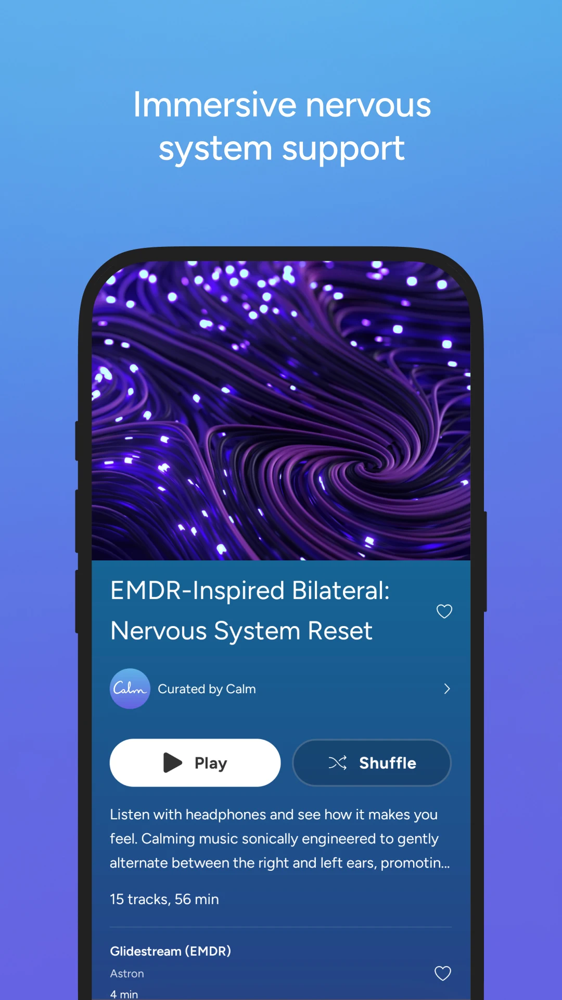

开放式办公室、吵闹的咖啡馆、正在打电话的室友——专注的天敌通常是 **突然的人声**，而不是整体音量。一段稳定的 **[白噪音](/zh/glossary/what-is-white-noise/)应用** 能把那些突兀的声音抹平成一团持续的静谧，让大脑停止监视房间。**Meow FM** 是一款安卓与 iOS 的 **免费白噪音播放器**，拥有兼顾睡眠与专注的声景。下面是它在深度工作上的对比，以及什么真的能帮你保持状态。下面比的是 **专注白噪音** 而非冥想内容，所以基线是一款 **免费白噪音 app**。

很多人以为要"绝对安静"才能专注，其实完全相反的两种情况都让人分心：太安静时，每一次关门声都格外刺耳；太嘈杂时，人声又会抢占注意力。白噪音的作用不是把世界调成静音，而是把忽高忽低的声音拉成一条平稳的底，让大脑没什么可"盯"的。

## 为什么噪音能帮你专注

- **它盖住人声**——一条平直的噪音底，能藏起旁边对话的词语，否则它们会劫持你的注意力。
- **它锚定节奏**——同一段循环像一首歌那样发出"工作模式"的信号。
- **它削减环境扰动**——施工、通知、脚步声融成一张床，而不是一次次刺痛你的觉察。

这三点里，"盖住人声"最关键，因为人脑天生会去解析语言——哪怕听不清内容，隔壁的对话也会让你不自觉地跟。稳定的雨声、风扇声没有语义，不会触发这种解析，于是你可以把注意力留给手头的活。长期使用下来，同一段循环还会变成一种条件信号：戴上耳机、点开那段声音，就像给自己按下"开始工作"的开关。

## 一款专注声音应用需要什么

- **稳定的噪音**——白、粉、棕噪音循环，听不出接缝。
- **长久无缝播放**——循环不应每三分钟重置。
- **计时器**——让声音配合一个番茄钟时段。
- **离线播放**——在飞机或没网的咖啡馆也能用。
- **免费核心**——专注不该是一笔订阅费。
- **无打扰**——过程中没有广告或弹窗。

把这几条连起来看，专注声音应用的门槛其实很具体：能连续放、能自己停、不联网也能用、中途不弹广告。听起来简单，但实际用过就知道，很多应用是"循环几分钟就重置"或"锁屏就暂停"——恰好在最需要它的时候掉链子。这也是为什么判断一款应用，最好先拿一段完整的工作时段去试，而不是只看首页有几张好看的封面。

## 一段专注时间真正需要什么

上面的清单讲功能，而一次工作时段讲的是时间。**专注白噪音** 能不能撑过真实的两小时，取决于三个细节：

- **循环听不出接缝**——三分钟的音频每次重播都把注意力拉回去一次。白、粉、棕噪音要能连续播放，若觉得平直的嘶声太冷，还能在下面叠一层雨声。
- **计时器只设一次**——把声音配成一个番茄钟时段，应用就该自己停下，不必为了关掉它而打断专注。
- **熄屏后继续播**——手机一锁就暂停的 **专注音乐** 歌单，还不如不放；噪音必须在熄屏后台持续。

Meow FM 用本机音源解决这三点，所以在列车上、没信号的图书馆里，离线播放一样能用；一份 **免费白噪音 app** 的清单，也不该为了保留计时器就逼你订阅。这里有个实用搭配：把计时器设成一个 25 分钟的番茄钟时段，声音到点自停，你正好起身活动一下；如果两段工作之间不想有静默，也可以只靠循环不设计时，用铃声或自己的节奏来判断收尾。

## 参赛选手一览

| 应用 | 价格（2026） | 离线 | 计时器 | 声音风格 | 适合人群 |
|---|---|---|---|---|---|
| **Meow FM** | 免费核心 + 可选 VIP | ✅ | ✅ | 自然循环（雨、海、壁炉） | 免费、简单的专注 |
| **Calm** | 约 $69.99/年（14 天试用） | ⚠️ 部分 | ❌ | 冥想 + 专注音乐 | 冥想式专注 |
| **Noisli** | 免费 + 订阅 | ✅ | ✅ | 白/粉噪音 + 环境 | 自己调配 |
| **Brain.fm** | 订阅 | ✅ | ✅ | 功能性音乐（AI 作曲） | 有科学包装的专注 |
| **myNoise** | 免费 + 内购 | ✅ | ✅ | 生成式、可调 | 声音钻研者 |

这张表里，"计时器"一栏格外值得看：Calm 以冥想为先，没有"循环雨声多久然后停"这种简单选项，专注时反而要多一步手动管理。如果你的目标只是"配着声音把这段时间做完"，Meow FM、Noisli、myNoise 这类带计时器的更贴合；如果你想要的是冥想、呼吸与每日 10 分钟的短时段，再把 Calm 纳入考虑。价格栏也说明一个事实：专注这件事不必从订阅开始，先用免费核心验证有效再付费更稳妥。

## 深入看 Meow FM

{: width="180" .normal }
{: width="180" .normal }
{: width="180" .normal }
{: width="180" .normal }
{: width="180" .normal }

Meow FM 是一款安卓与 iOS 的 **猫主题白噪音与专注播放器**。核心免费：雨、海、壁炉等自然循环，外加一个停止播放的计时器，避免它整天响着。它的定位很清楚——不是陪你冥想的老师，而是一台打开就响、到点就停的声音机器。

**在专注上的优势**
- **免费核心声景**——雨、海、壁炉循环，收听无付费墙。
- **自动停止计时器**——响 25 分钟一个时段，自己就结束。
- **真正的离线播放**——下载的声音无信号也能用。
- **简单可爱的界面**——打开、点一下、开干；无账号、无需设置。
- **分层混音**——叠合场景，调出贴合你空间的声床。

**在专注上的不足**
- **不是功能性音乐**——它是氛围音，不是 Brain.fm 那种为注意力设计的专注音轨。
- **曲库较小**——场景比 Noisli 或 myNoise 少。
- **无分析**——它只放声音，不统计你的时段。

"无账号、无需设置"在专注场景里是优点而不是缺憾：你不会在点开应用时被引导注册、挑选目标，注意力从一开始就没被打断。分层混音值得花一分钟试——雨声打底、壁炉声垫在一层，往往比单一循环更耐听。至于没有分析统计，反过来也意味着它不会用图表和连续天数给你压力，只想找个清净声音的人反而更轻松。

**适合人群：** 想要一款 **免费白噪音应用** 来专注、带真实计时器、无订阅的人。

- [Google Play — Meow FM](https://play.google.com/store/apps/details?id=com.glgjing.whitenoise.relax.night.sleep.meow)
- [App Store — Meow FM](https://apps.apple.com/app/id1606715188)

## 深入看 Calm

{: width="180" .normal }
{: width="180" .normal }
{: width="180" .normal }
{: width="180" .normal }

Calm 是 Google Play 上最知名的 **冥想与睡眠应用**（5000 万+ 下载、4.3 星）。除睡眠外，它也提供专注音乐、呼吸，以及每天 10 分钟、面向专注的时段。它的强项是"内容"——有老师引导、有课程结构，而不只是循环播放一段声音。

**在专注上的优势**
- **专注歌单**——为工作与学习精选的轻音乐。
- **每日 Calm**——一个短时段，重置注意力。
- **品牌信任**——该品类最被认识的名字。

**在专注上的不足**
- **付费订阅**——14 天试用后约 $69.99/年；免费内容有限。
- **不是纯噪音**——它以冥想为先，所以没有"循环棕噪音 50 分钟"这种简单选项。
- **可靠性参差**——有用户反映每天首次打开会崩溃。

对"想通过冥想进入状态"的人，每日 10 分钟和专注歌单是实打实的价值；但如果你只想要一条稳定的棕噪音当背景，这套以内容为中心的设计反倒绕了远路——既要挑课程，又受订阅限制。也有用户反映每天首次打开会崩溃，对需要"点开就用"的专注场景来说，这点值得先试用几天再判断。

**适合人群：** 通过冥想与轻音乐来专注、且愿意付费订阅的人。

- [Google Play — Calm](https://play.google.com/store/apps/details?id=com.calm.android)

## 其他应用如何

- **Noisli** 把白/粉噪音与环境声（咖啡馆、风）混在一起，免费含订阅可解锁更多——喜欢自己调配的人选它。
- **Brain.fm** 卖的是围绕专注与放松包装的 AI 作曲功能性音乐；对部分人有效，但是付费订阅。
- **myNoise** 生成可调到房间的噪音；免费含内购解锁更多，是声音发烧友最深的工具。

三者的共同点是"可玩性"更高：Noisli 适合把咖啡馆声和粉噪音调成自己的配方，myNoise 能把噪音塑形到贴合房间，Brain.fm 则押注在"为注意力设计"的音轨上。代价分别是订阅、学习成本和付费墙。如果你想十分钟之内就进入专注，而不是先研究声音参数，这些深度工具反而不如 Meow FM 直接。

## 你该选哪个？

- 想要 **免费 + 真实计时器 + 离线** → **Meow FM**。
- 想要 **轻音乐与冥想** 并接受订阅 → **Calm**。
- 想要 **自定义混音** → **Noisli**。
- 想要 **为专注而设计的音轨** → **Brain.fm**。

把它们按"你要的是声音还是内容"分开，选择就清晰了：要一条不打扰的背景噪音、到点自停、离线可用，Meow FM 最省事；要有人带着你进入状态，才考虑 Calm 或 Brain.fm。Noisli 和 myNoise 适合愿意花时间调音的人。无论选哪款，先别急着付费——用免费核心跑完几个完整工作时段，比看任何榜单都准。

[获取 Meow FM](/zh/apps/meow-fm/)——安卓与 iOS 平台可用。

## 典型场景

- **开放式办公室**——雨声或海浪循环配 25 分钟计时器，把嘈杂楼层变成持续静谧；时段结束声音自己停。
- **咖啡馆专注**——用壁炉或棕噪音盖掉杯碟声与旁人通话；离线播放让它在信号不稳的店里也持续。
- **飞行中的深度工作**——下载的场景没信号也能播，于是长途航班成了无噪工作间。
- **无订阅、无账号**——打开应用、点一个场景、开干；你与专注之间没有任何阻挡。

这些场景都绕不开一条：声音要能连续、要在熄屏后继续、最好到点自停。开放式办公室里，戴耳机配一段雨声比调高音量更友善，也更容易被同事接受；咖啡馆和航班则考验离线能力，提前把场景下载好，就不怕 Wi-Fi 掉线打断思路。

## 常见问题（FAQ）

**用 Meow FM 专注免费吗？**
{:.faq-q}

免费。核心专注声景——雨、海、壁炉等——收听无付费墙；一次性 VIP 解锁的是额外场景，而非计时器或离线播放。先用免费核心跑几个工作时段，再决定要不要补充场景。

**Meow FM 能离线用吗？**
{:.faq-q}

能。下载的场景无网也能播，所以飞机、地铁或没网的咖啡馆你都能专注。出发前先把要用的场景下载好即可。

**Meow FM 有番茄钟计时器吗？**
{:.faq-q}

有。设 15/30/60 分钟或自定义时长，音频自动停止，正好套一个 25 分钟番茄钟时段，不必手动去关。

**专注上 Meow FM 和 Brain.fm 怎么选？**
{:.faq-q}

想要免费、离线、无账号、带真实计时器的环境噪音 → Meow FM；想要为注意力设计的 AI 作曲功能性音乐 → Brain.fm（付费订阅）。先确认你能接受订阅，再试后者。

## 相关术语

- [什么是白噪音（White Noise）？](/zh/glossary/what-is-white-noise/)
