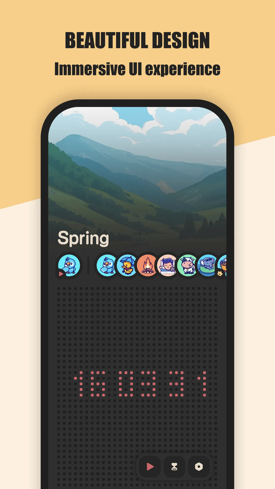
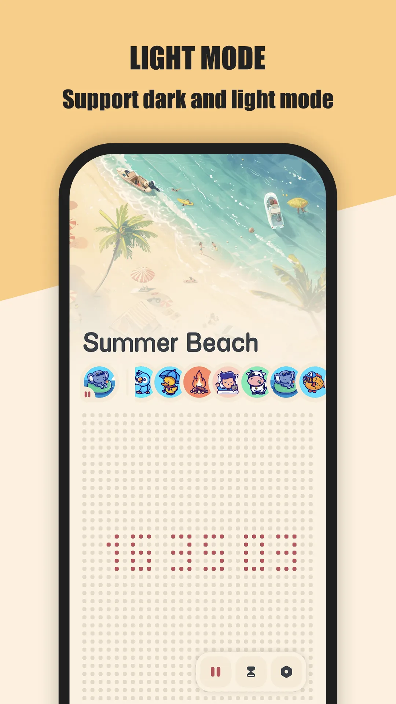
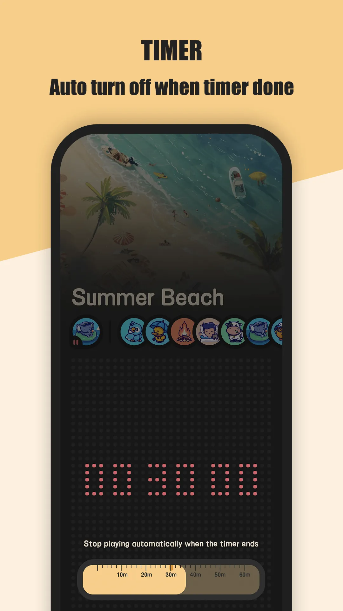
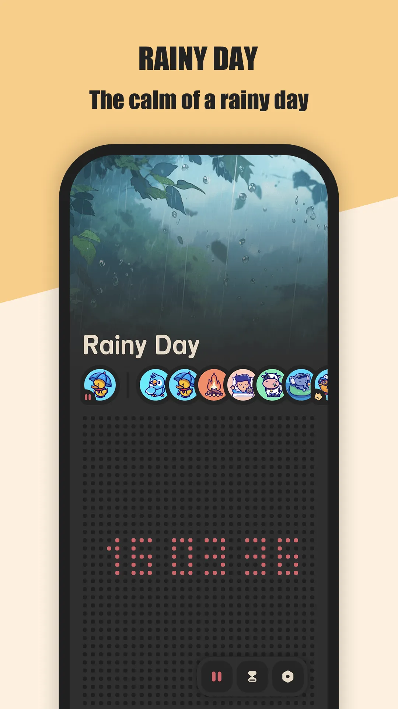
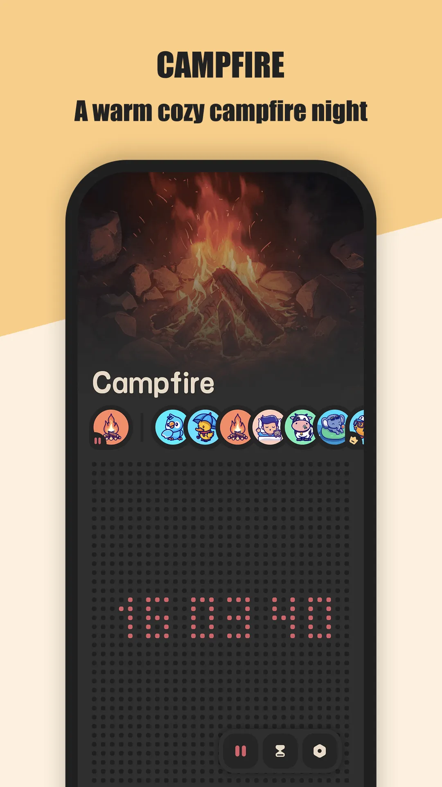
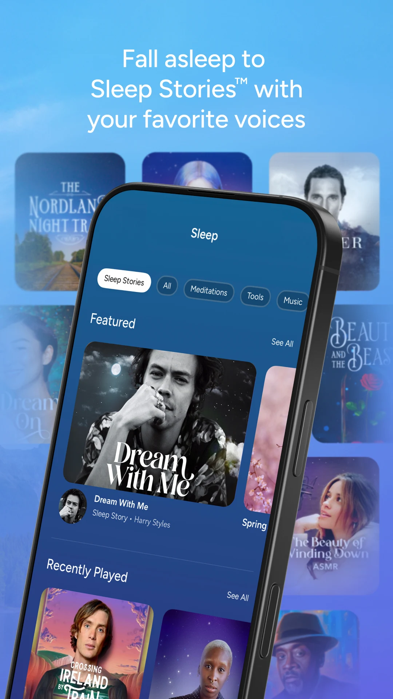
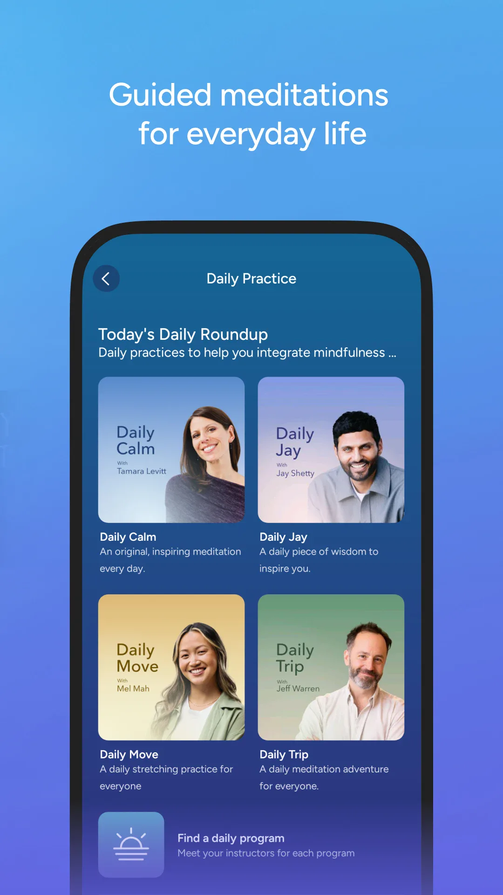
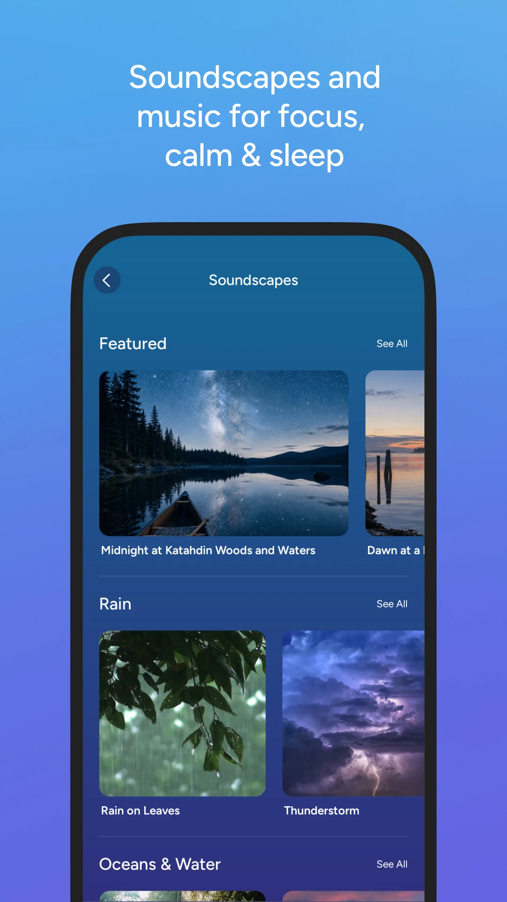
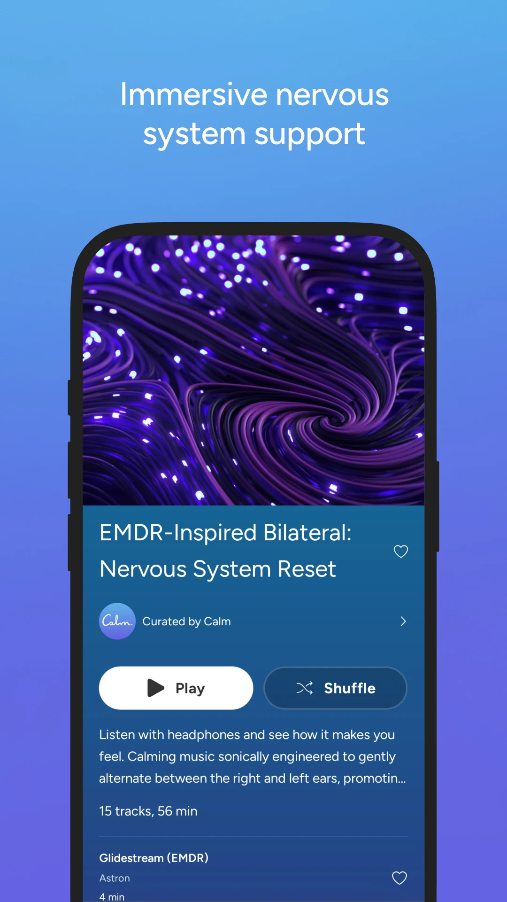

一款 **睡眠声音应用** 能在手机上占有一席之地，靠的是安静地做好一件事：帮你的大脑停止留意这个世界。窗外的车流、伴侣的鼾声、酒店房间的嗡鸣——稳定的环境音能盖住那些突兀的尖峰，让你慢慢漂走。**Meow FM** 是一款 **免费[白噪音](/zh/glossary/what-is-white-noise/)睡眠应用**，拥有自然声景和一个会自动停止的计时器。下面是它与其他睡前选项的对比，以及哪些声音真的有效。下面更看重「播放、淡出、睡着」这个睡前闭环，而不是冥想内容库。

## 为什么声音能帮你入睡

- **稳定的噪音盖住突兀噪音**——持续的雨声循环能藏起摔门声或驶过的车声。
- **它建立睡前仪式**——每晚同一段声音向大脑发出"睡觉时间"的信号。
- **计时器省电**——自动停止的播放意味着它不会响到天亮。

## 一款睡眠声音应用需要什么

- **自然声景**——雨、海、风、壁炉——听不出接缝的循环。
- **睡眠计时器**——30/60/90 分钟后自动停止。
- **离线播放**——帐篷里或飞机上没有 Wi-Fi，也不该掐断声音。
- **分层混音**——雨 + 风叠出专属声床。
- **免费核心**——为入睡付费不该发生。
- **无广告打扰**——半夜一条通知就破坏了意义。

## 睡前声音要过哪几关

一款 **睡眠声音 app** 是在凌晨两点被评判的，不是在功能表里。四件事决定它会不会留在手机上：

- **自己会停**——**白噪音定时关闭** 让声音在你睡着后淡出，而不是耗电到天亮；一款 **白噪音不订阅** 的应用，不该把这个计时器锁进付费墙。
- **没网也能播**——酒店、飞机，或任何睡前 Wi-Fi 掉线的地方，靠的都是本机音源，离线也能持续播放。
- **混音不用折腾**——雨声叠一层低沉风扇，或暴风雨下垫一层棕噪音，设好就不再动；睡前反复拖滑块恰好是反效果。
- **核心循环长期免费**——一份 **免费白噪音 app** 的清单，应该允许你每晚按播放、设定时，而不是先看试用倒计时。

Meow FM 把音源放在设备里，并带自动停止的计时器——这是它同时出现在助眠与专注两份清单里的简短理由。

## 参赛选手一览

| 应用 | 价格（2026） | 离线 | 睡眠计时器 | 声音类型 | 适合人群 |
|---|---|---|---|---|---|
| **Meow FM** | 免费核心 + 可选 VIP | ✅ | ✅ 自动停止 | 自然循环（雨、海、壁炉） | 免费、简单、带计时器 |
| **Calm** | 约 $69.99/年（14 天试用） | ⚠️ 部分 | ❌（冥想） | 冥想 + 睡眠故事 | 故事 + 冥想 |
| **Rain Rain** | 免费（雨） | ✅ | ✅ | 仅雨曲库 | 纯雨爱好者 |
| **White Noise (TMSOFT)** | 约 $2.99 一次性 | ✅ | ✅ | 大录制曲库 | 大声音目录 |
| **myNoise** | 免费 + 内购 | ✅ | ✅ | 生成式、可定制 | 声音钻研者 |

## 深入看 Meow FM

{: width="180" .normal }
{: width="180" .normal }
{: width="180" .normal }
{: width="180" .normal }
{: width="180" .normal }

Meow FM 是一款安卓与 iOS 的 **猫主题白噪音与睡眠声音应用**。核心免费：雨、海、壁炉等自然循环，外加一个会关闭播放的睡眠计时器，避免它响一整夜。

**在睡眠上的优势**
- **免费核心声景**——雨、海、壁炉循环，收听无付费墙。
- **自动停止计时器**——设 30/60/90 分钟，自己就结束，省电。
- **真正的离线播放**——下载的声音无信号也能用。
- **简单可爱的界面**——打开、点一下、入睡；无账号、无需设置。
- **分层混音**——叠两三个场景，调出贴合你房间的声床。

**在睡眠上的不足**
- **曲库较小**——场景比 myNoise 或 White Noise (TMSOFT) 少。
- **无引导冥想或睡眠故事**——它是纯氛围音，不是睡前叙事。
- **无睡眠追踪**——它只放声音，不记录你的夜晚。

**适合人群：** 想要一款 **免费睡眠声音应用**、带真实计时器、无订阅的人。

- [Google Play — Meow FM](https://play.google.com/store/apps/details?id=com.glgjing.whitenoise.relax.night.sleep.meow)
- [App Store — Meow FM](https://apps.apple.com/app/id1606715188)

## 深入看 Calm

{: width="180" .normal }
{: width="180" .normal }
{: width="180" .normal }
{: width="180" .normal }

Calm 是 Google Play 上最知名的 **冥想与睡眠应用**（5000 万+ 下载、4.3 星），以引导冥想、**睡眠故事**（旁白式睡前故事）、呼吸练习和每天 10 分钟时段为核心。

**在睡眠上的优势**
- **睡眠故事**——专为哄你入睡而设计的成人睡前故事。
- **大内容库**——冥想、声景、Calm Kids。
- **品牌信任**——该品类最被认识的名字。

**在睡眠上的不足**
- **付费订阅**——14 天试用后约 $69.99/年；免费内容有限。
- **不是白噪音计时器**——它以冥想为先，所以没有"循环雨声 60 分钟然后停"这种简单选项。
- **可靠性参差**——有用户反映每天首次打开会崩溃，与"轻松入睡"的目标相冲突。

**适合人群：** 想要故事与冥想、且愿意付费订阅的人。

- [Google Play — Calm](https://play.google.com/store/apps/details?id=com.calm.android)

## 其他应用如何

- **Rain Rain** 把一件事做到极致：免费、离线的雨声加计时器。如果你只要雨，它是好选择。
- **White Noise (TMSOFT)** 以一次性低价换大录制曲库与扎实混音——老噪声音频用户的最爱。
- **myNoise** 生成可调（棕、粉、塑形到房间）的噪音；免费含内购解锁更多，是声音发烧友最深的工具。

## 你该选哪个？

- 想要 **免费 + 真实睡眠计时器 + 离线** → **Meow FM**。
- 想要 **睡眠故事与冥想** 并接受订阅 → **Calm**。
- 只想要 **雨声** → **Rain Rain**。
- 想要 **海量、可调曲库** → **White Noise (TMSOFT)** 或 **myNoise**。

[获取 Meow FM](/zh/apps/meow-fm/)——安卓与 iOS 平台可用。

## 典型场景

- **嘈杂公寓或酒店**——雨声或暴风循环配 60 分钟计时器，盖住鼾声或薄墙，随后自动关掉，不会在凌晨三点吵醒你。
- **露营或没网的房间**——每段场景完全离线，帐篷或不稳的酒店网络都打断不了放松。
- **建立睡前仪式**——每晚同一段壁炉循环，比刷手机更快向大脑发出"睡觉时间"的信号。
- **无订阅、无账号**——按下播放就用；一切都不依赖你无法掌控的服务器。

## 常见问题（FAQ）

**用 Meow FM 入睡免费吗？**
免费。核心睡眠声景——雨、海、壁炉等——收听无付费墙；一次性 VIP 解锁的是额外场景，而非计时器或离线播放。

**Meow FM 能离线用吗？**
能。下载的场景无网也能播，所以飞机、帐篷或任何 Wi-Fi 掉线的地方你都能入睡。

**Meow FM 有睡眠计时器吗？**
有。设 30/60/90 分钟或自定义时长，音频自动停止，省电且绝不会响到天亮。

**助眠上 Meow FM 和 Calm 怎么选？**
想要免费、离线、无账号、带自动停止计时器的环境声 → Meow FM；想要睡眠故事与引导冥想、并接受约 $69.99/年订阅 → Calm。

## 相关术语

- [什么是白噪音（White Noise）？](/zh/glossary/what-is-white-noise/)
