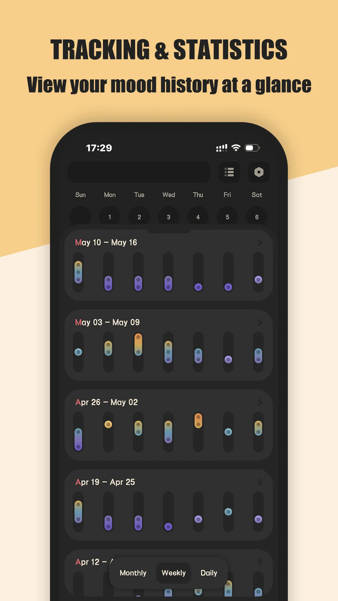
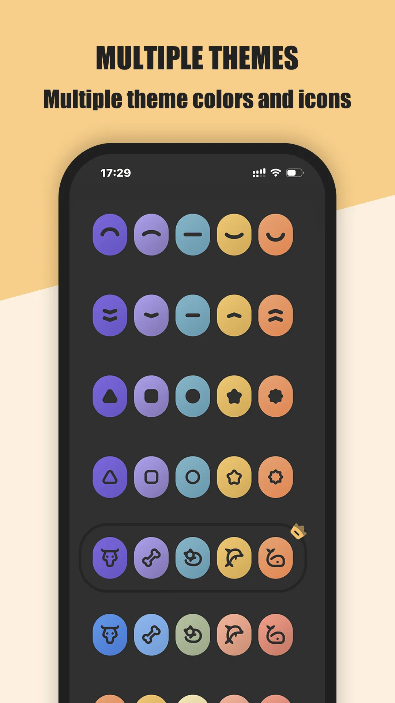

一款 **[心情日记](/zh/glossary/what-is-a-mood-tracker/)** 帮你察觉自己感受中的规律——不是靠写长文，而是十秒钟记下一个感觉，让趋势替你说话。**Meow Mood** 是一款安卓与 iOS 的 **私密心情追踪器**，让记录变得轻松：点一个情绪、加点背景，然后看图表。下面我们从心情追踪、隐私、价格与平台，对比人们实际会装的应用——**Meow Mood、Day One、Journey、Daylio、Grid Diary**。同一批应用也常被搜作 **免费心情日记** 或 **心情追踪应用**，所以下面既比一键打卡，也比长文记录。

心情记录最大的敌人是"今天没什么好写的"——一想到要组织语言、写一段完整的日记，多数人就放弃了。真正能坚持的方式是把门槛降到最低：点一个情绪图标、加几个标签，十秒结束。这样那些原本想跳过的日子也留了下来，几个月后才有足够的数据看出规律。

## 一款心情日记该做什么

一款心情日记在 2026 年该做到六件事：一键选情绪的快速记录、记睡眠人物天气的背景标签、显示低落何时扎堆的日历与图表趋势、离线优先数据归你的隐私、供自省或分享专业人士的 PDF 或文本导出，以及养成习惯的每日轻推。其中"快速记录"和"背景标签"是一对——光记情绪只知"今天不好"，加上睡眠、天气、和谁在一起才可能发现"原来每次熬夜后都低落"这类关联；趋势视图则要把数据攒够几周，日历色块才会告诉你低落在哪几天扎堆。具体标准如下：

- **快速记录**——一键选一个情绪，而不是对着空白页。
- **背景标签**——记睡眠、人物或天气，无需写一段。
- **趋势**——日历与图表显示低落何时扎堆。
- **隐私**——离线优先，数据归你。
- **导出**——PDF 或文本，供自省或分享给专业人士。
- **轻推**——每日提醒，养成习惯。

这六条里，"快速记录"和"背景标签"是一对：光记情绪只能知道"今天不好"，加上睡眠、天气、和谁在一起这些标签，才可能发现"原来每次熬夜后都低落"这类关联。趋势视图的价值也在这里——单看某一天没意义，攒够几周，日历上的色块才会告诉你低落在哪几天扎堆。至于隐私，心情是最私人的内容，离线优先、数据归自己几乎是底线。

## 我们怎么挑 2026 年最佳心情日记应用

给 **心情日记应用** 排名，功能多寡不如「第 30 天你还在不在记」重要。表格里每款都过了四道检查：记录要多久（一键选情绪、活动标签可选，而非面对空白页）、免费档能撑多久（应能持续记录并回看趋势，而非试用倒计时或把日历锁进付费墙）、数据能不能带走（能导出、默认本机存储）、图表能不能回答问题（日历热力图与心情活动分布，而不只是连续天数）。按这四条，Meow Mood 是情绪记录安卓上偏快速私密记录的最强选择，Day One 则适合想写长文配照片、不介意订阅的人。判断时先问自己：你要的是长期心情曲线，还是带照片的人生日记？

1. **记录要多久**——一键选情绪，活动标签可选。若每次都要面对空白页，那是日记，不是能长期坚持的 **免费心情日记**。
2. **免费档能撑多久**——**心情日记免费** 档应能持续记录并回看趋势，而不是试用倒计时，或把日历锁在付费墙后。
3. **数据能不能带走**——能导出、默认本机存储；一旦应用改价，纯云端账号就是实打实的成本。
4. **图表能不能回答问题**——日历热力图与心情/活动分布，而不只是一个连续天数。

按这四条，Meow Mood 是 **情绪记录安卓** 上偏快速、私密记录的最强选择；Day One 则适合想写长文、配照片，且不介意订阅的人。判断时不妨先问自己：你想要的是"一个能长期看的心情曲线"，还是"一本带照片的人生日记"？前者要的就是快与私密，后者才需要 Day One 那种富媒体能力。想清楚了，榜单排名其实没那么重要。

## 参赛选手一览

五款心情日记应用摆在一起对比——Meow Mood、Day One、Journey、Daylio 与 Grid Diary——先按"心情风格"和"隐私"两栏筛：想要点一下就记、数据不上传，Meow Mood 和 Daylio 最接近；愿意写长文配照片，Day One、Journey 更合适，但要以订阅和云同步为前提；Grid Diary 走问答提示的中间路线。价格栏提示一个现实：免费档多数应用都有，但有的会把日历、历史这类关键功能锁起来，选之前一定确认免费档能不能回看趋势。

| 应用 | 价格（2026） | 平台 | 心情风格 | 隐私 | 适合人群 |
|---|---|---|---|---|---|
| **Meow Mood** | 免费核心 + 可选 VIP | Android + iOS | 点图标 | ✅ 本地、不上传 | 轻量、私密 |
| **Day One** | 订阅（Silver/Gold）；免费受限 | Android+iOS+Mac+Web | 手动录入 | ⚠️ 云同步 | 全功能日记 |
| **Journey** | 订阅 | Android+iOS+Web | 手动录入 | ⚠️ 云（Drive） | 旅行日记 |
| **Daylio** | 免费 + 订阅 | Android + iOS | 基于图标 | ✅ 本地优先 | 微心情记录 |
| **Grid Diary** | 免费 + 订阅 | Android + iOS | 问答提示 | ✅ 本地 | 结构化提示 |

先按"心情风格"和"隐私"两栏筛：想要点一下就记、数据不上传，Meow Mood 和 Daylio 最接近；愿意写长文、配照片，Day One、Journey 更合适，但要以订阅和云同步为前提；Grid Diary 走中间路线，用问答提示帮你动笔。价格栏也提示一个现实：免费档在多数应用里都存在，但有的会把日历、历史这类关键功能锁起来，选之前一定要确认免费档能不能回看趋势。

## 深入看 Meow Mood

Meow Mood 是一款安卓与 iOS 的猫主题心情与日记应用，核心免费，记录只需一键——选一个情绪、加可选标签或短注即可完成，把"写下今天"压缩成几乎不需思考的动作。它完全离线、默认不上传（只有你开启才备份到自己的 Google Drive），配指纹或密码锁、日历图表趋势视图与免费的 PDF 导出；代价是富媒体较轻、CSV 导出归 VIP。适合想要免费心情日记、快捷可爱又私密的人——"坏日子里一个情绪图标胜过空白文本框"正是它最贴心的设计。

{: width="180" .normal }
{: width="180" .normal }
{: width="180" .normal }
{: width="180" .normal }
{: width="180" .normal }

Meow Mood 是一款安卓与 iOS 的 **猫主题心情与日记应用**。记录只需一键：选一个情绪，添加可选标签或短注，完成。它把"写下今天"这件有点沉重的事，压缩成一个几乎不需要思考的动作。

**在心情追踪上的优势**
- **一键记录**——坏日子里，一个情绪图标胜过空白文本框。
- **完全离线**——没信号也能用，条目存在设备上。
- **默认不上传**——数据留本地；只有你开启才备份到自己的 Google Drive。
- **趋势视图**——日历与图表揭示低落扎堆的时点。
- **锁**——指纹或密码让条目只属于你。
- **PDF 导出**——自省或分享给专业人士。
- **每日提醒**——让习惯成形的那一下轻推。

**在心情追踪上的不足**
- **富媒体较轻**——照片/音频的花样比 Day One 少。
- **进阶导出（CSV）为 VIP**——免费用户得 PDF。

"坏日子里一个情绪图标胜过空白文本框"是它最贴心的设计——心情最差的时候，恰好最没有力气写东西，一键记录让那条数据不至于缺失。默认不上传、可加锁，让它在共享的家庭手机上也能放心用。PDF 导出免费、CSV 归 VIP，对只想自省或偶尔给专业人士看的人来说够用；需要把数据导进表格做进一步分析的人，才需要考虑升级。

**适合人群：** 想要一款 **免费心情日记**、快捷、可爱又私密的人。

- [Google Play — Meow Mood Diary](https://play.google.com/store/apps/details?id=com.glgjing.meow.mood.diary)
- [App Store — Meow Mood Diary](https://apps.apple.com/app/id6767560237)

## 深入看 Day One

Day One 是较早的数字日记应用，曾被《纽约时报》与 Wired 提及，跨 Android、iOS、Mac 与网页同步，定位是"完整的人生记录"而非单纯心情打卡。它的强项是把文字、照片、视频、音频、位置与天气写进同一则富条目，模板与提示帮你开口，加密同步让条目跨越每个设备；代价是订阅（Silver/Gold）、云同步为本、免费档在设备与照片上受限，且一条富条目比一键心情的摩擦高得多。适合想要全功能日记、并接受订阅加云同步的人。

{: width="180" .normal }
{: width="180" .normal }
{: width="180" .normal }
{: width="180" .normal }
{: width="180" .normal }

Day One 是较早的数字日记应用——曾被 *The New York Times* 与 *Wired* 提及。它跨 Android、iOS、Mac 与网页同步。它的定位是"完整的人生记录"，而非单纯的心情打卡。

**在心情追踪上的优势**
- **富条目**——文字、照片、视频、音频、位置与天气在一则笔记里。
- **模板与提示**——卡住时给个结构化的开头。
- **加密同步**——条目随你跨越每个设备。
- **成熟生态**——十余年更新，最精致的日记应用。

**在心情追踪上的不足**
- **免费档受限**——设备与照片有上限；完整使用需 Silver 或 Gold。
- **云同步为本**——条目存在 Day One 的服务器；隐私取决于信任厂商。
- **起步更重**——一条富条目比一键心情更多的摩擦。

它能把文字、照片、位置、天气写进同一则条目，模板与提示还能帮你开口，适合想把旅行、生活片段和心情一起留存的人。但要接受订阅、云同步，以及更高的记录摩擦——对只想点一下就走的人来说，这份丰富反而是负担。免费档在设备和照片上有限制，决定长期使用前最好先确认够不够用。

**适合人群：** 想要全功能日记、并接受订阅加云同步的人。

- [Google Play — Day One](https://play.google.com/store/apps/details?id=com.dayoneapp.dayone)
- [App Store — Day One](https://apps.apple.com/app/id1044867788)

## 其他应用如何

Journey、Daylio 与 Grid Diary 是三款各有侧重的补充选项：Daylio 和 Meow Mood 走同一条路——图标加短注、本地优先，是与 Meow Mood 最像的纯心情追踪亲戚；Journey 偏旅行日记、用 Drive 同步，更适合把旅途照片见闻串起来；Grid Diary 用每日问答提供结构，适合"有提示才写得出来"的人。若只是想在会议间隙记个心情，前两者更直接；想借提示反思，Grid Diary 值得一试。

- **Journey** 是偏旅行的日记，用 Drive 备份同步；适合旅途，对快速心情记录关注较弱。
- **Daylio** 以图标加短注记录心情，免费含订阅解锁历史——与 Meow Mood 最像的纯心情追踪亲戚。
- **Grid Diary** 用每日问答结构化条目；若提示能帮你动笔则很好。

Daylio 和 Meow Mood 走的是同一条路——图标加短注、本地优先，差别在细节与界面；Journey 用 Drive 同步，更适合把旅途照片和见闻串起来；Grid Diary 靠每日问答提供结构，适合"有提示才写得出来"的人。若你只是想在会议间隙记个心情，前两者更直接；若你想借提示反思，Grid Diary 值得一试。

## 你该选哪个？

按"你要曲线还是日记"来分：要一条长期、私密、随手就能记的心情曲线，Meow Mood 或 Daylio 最省心；要用照片和文字记录整个人生，Day One 值得订阅；需要提示帮你开口，就看 Grid Diary。别被功能表带着走——先想清楚你愿意为每次记录花几秒，答案通常就出来了。

- 想要 **快速、私密、一键心情记录** → **Meow Mood**。
- 想要 **丰富、同步的人生日记** 并接受订阅 → **Day One**。
- 想要 **纯图标微记录** → **Daylio**。
- 想要 **提示式结构** → **Grid Diary**。

按"你要曲线还是日记"来分：要一条长期、私密、随手就能记的心情曲线，Meow Mood 或 Daylio 最省心；要用照片和文字记录整个人生，Day One 值得订阅；需要提示帮你开口，就看 Grid Diary。别被功能表带着走——先想清楚你愿意为每次记录花几秒，答案通常就出来了。

[获取 Meow Mood](/zh/apps/meow-mood-diary/)——安卓与 iOS 平台可用。

## 典型场景

心情记录的四种典型场景都靠"低摩擦 + 私密"才成立：低落日快速记——点一个情绪图标加标签，那些本想跳过的日子也留下数据；默认私密——条目锁在指纹后、留在本机，除非主动选 Google Drive 否则不上传；看见规律——日历与图表暴露「周日低落」或「喝完咖啡飙升」，把模糊感受变成可行动的东西；随处离线——飞机或地铁死角也能捕捉当下。攒够几周后，心情记录真正的价值往往在这些规律浮现的那一刻才显现。

- **低落日快速记**——某个难熬的晚上，点一个情绪图标加几个标签即可；不必写段落，于是那些本想跳过的日子也留了下来。
- **默认私密**——条目锁在指纹之后、留在本机；在共享的家庭手机上，除非你主动选 Google Drive，否则想法不会同步到厂商云。
- **看见规律**——日历与图表暴露「周日低落」或「喝完咖啡飙升」，把模糊的感受变成可行动的东西。
- **随处离线**——飞机或地铁死角也能记；捕捉当下无需 Wi-Fi。

这些场景都靠"低摩擦 + 私密"才成立：正因为记录只要十秒，最不想写的心情低落日才留下了数据；正因为默认不上传，你才敢在家人共用的手机上如实写。攒够几周后，日历和图表会把"周日低落""喝完咖啡飙升"这类模式摆出来——心情记录真正的价值，往往在这一刻才显现。

## 常见问题（FAQ）

**Meow Mood 免费吗？**
{:.faq-q}

核心——快速心情记录、历史、图表与离线使用——都免费起步；少数额外能力（如 CSV 导出）在可选的一次性 VIP 之后。日常记录基本无需付费。

**Meow Mood 能离线用吗？**
{:.faq-q}

能。没网、无账号也能记录、查看、编辑；数据留在本机，飞机或地铁死角都不影响。

**我的日记私密吗？**
{:.faq-q}

私密——条目永不上传到我们的服务器；你只备份到自己 Google Drive，指纹或密码锁让日记只属于你。

**Meow Mood 和 Day One 怎么选？**
{:.faq-q}

想要免费、私密、无账号、设备端的心情日记 → Meow Mood；想要丰富照片记录加同步、并愿付订阅 → Day One。关键看你要的是心情曲线，还是带照片的人生日记。

## 相关术语

- [什么是心情追踪（Mood Tracker）？](/zh/glossary/what-is-a-mood-tracker/)
