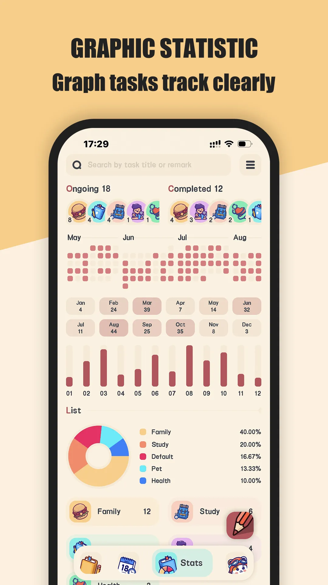
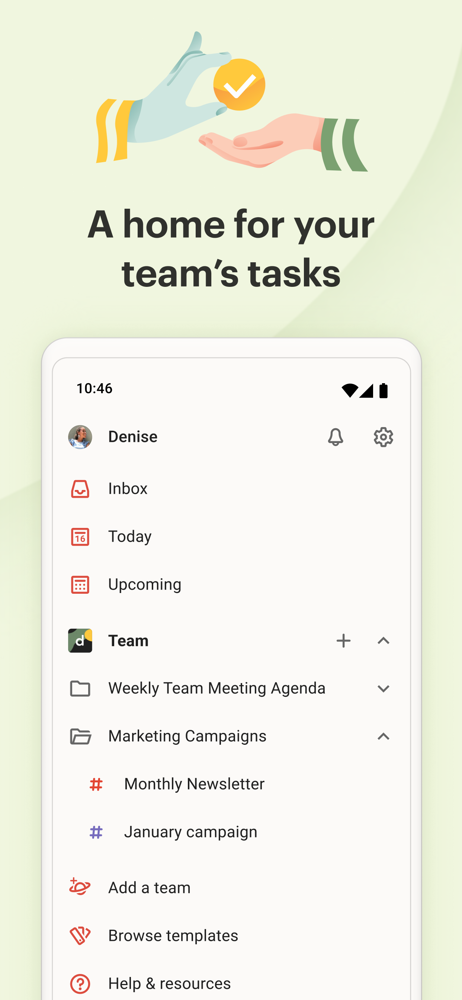

在听课、作业与兼职之间，学生需要一款又快又免费的 **[任务管理器](/zh/glossary/what-is-a-to-do-list/)**。教学大纲的截止日散落在一打课程里，小组项目横跨数周，忘了一次阅读就能拉低成绩。**Meow Todo** 是一款面向学生的 **[免费待办清单应用](/zh/glossary/what-is-a-to-do-list/)**，带子任务、日历视图与能撑过忙碌学期的提醒。下面是它与其他学生友好选项的对比。

学生的任务和职场不同：截止日成批涌来，一份作业往往横跨几周，而预算通常是零。工具要做的不是把所有事情管得井井有条，而是保证"该交的没忘、大的作业拆得开、一学期看得完"。这三点做不到，功能再强也帮不上忙。

## 学生真正需要什么

- **免费核心**——追踪作业不该付费。
- **子任务**——把一篇论文拆成查资料、起草、修改、提交。
- **截止提醒**——在到期之前推通知，而不是之后。
- **日历视图**——一个屏幕看尽每门课的截止日。
- **无需账号**——开学第一周少一个密码。
- **导出**——CSV 交计划给组员或打印。

这几条里有很强的学生印记。"子任务"对应一篇论文的完整周期——查资料、起草、修改、提交，拆开后才不会在截止前一晚崩溃；"截止提醒"要在到期前推你一把，而不是事后通知；"日历视图"则要把第 3 周和第 10 周摆在一起看，别让某个遥远的截止日藏起来。免费、无账号则从成本上让学生敢用、愿意一直用。

## 参赛选手一览

| 应用 | 价格（2026） | 账号 | 子任务 | 日历 | 最适合学生 |
|---|---|---|---|---|---|
| **Meow Todo** | 免费核心 + 可选 VIP | **无需**（本地 + 锁） | ✅（多量需 VIP） | ✅ | 免费、私密 |
| **Todoist** | 免费 + Pro 约 $48/年 | 需（云） | ✅ | ✅ | 方法 + 协作 |
| **Microsoft To Do** | 免费 | 需（Microsoft） | ✅ | ✅ | MS 生态 |
| **TickTick** | 免费 + 订阅 | 需（云） | ✅ | ✅ | 一体机 |

四款都有子任务和日历，差别集中在价格、账号和"额外能力"。Meow Todo 核心免费、无需账号、数据本地；Todoist 强在方法和协作，但要 Pro（约 $48/年）才解锁完整能力；Microsoft To Do 对用 Office 365 的学生近乎免费；TickTick 把任务、日历、番茄钟、习惯打包成一体机。按"预算、要不要账号、学校用什么生态"三问筛，通常很快就能定。

## 深入看 Meow Todo

{: width="180" .normal }
{: width="180" .normal }
{: width="180" .normal }
{: width="180" .normal }
{: width="180" .normal }

Meow Todo 是一款安卓与 iOS 的 **猫主题待办清单**。核心——清单、任务、提醒与日历视图——免费；VIP 解锁无限清单、标签、子任务、CSV 导出与应用锁。它想覆盖的是"从第一节课到期末"的整个学期，而不只是记几件琐事。

**对学生的优势**
- **免费核心**——清单、任务、截止日与日历视图零成本。
- **无需账号**——数据锁在指纹之后，留在设备。
- **子任务**——把作业拆成里程碑，滴水不漏。
- **提醒**——每日与到期任务通知，让整个学期可见。
- **你掌控的备份**——只有你开启才走 Google Drive 或 WebDav。
- **CSV 导出**——把计划交给组员或留一份可打印的副本。

**对学生的不足**
- **强力功能需 VIP**——无限清单、标签与 CSV 导出在升级之后。
- **无自动云同步**——跨设备靠你自己的 Drive/WebDav，而非实时账号。

免费核心已经覆盖最常用的清单、任务、截止日和日历，学生日常基本不用花钱。子任务把大作业拆成里程碑，提醒在到期前推一下，日历让整学期可见——这组合正好对应学生的三大痛点。要留意的是多量子任务、无限清单和 CSV 导出在 VIP 之后，以及跨设备靠手动备份；如果小组作业需要共享计划，导出 CSV 交给组员就是可行的绕过方式。

**适合人群：** 预算紧、注重隐私、想要一款 **免费任务管理器**、且无需注册的学生。

- [Google Play — Meow Todo List](https://play.google.com/store/apps/details?id=com.glgjing.money.task.todo.list.meow)
- [App Store — Meow Todo List](https://apps.apple.com/app/id6742345495)

## 深入看 Todoist

{: width="180" .normal }
{: width="180" .normal }
{: width="180" .normal }
{: width="180" .normal }
{: width="180" .normal }

Todoist 是安装量最大的任务管理器，拥有 3000 万用户信任，带自然语言输入（"明天下午 5 点交论文"）与强协作。它的优势是把任务组织和多人协作做到很成熟。

**对学生的优势**
- **自然语言**——输入任务，它解析日期与优先级。
- **项目与子任务**——按课程组织，带嵌套步骤。
- **跨平台 + 共享**——把项目清单分享给组员。
- **Karma/连击**——温和的连续记录，奖励坚持。

**对学生的不足**
- **免费档受限**——项目、评论、标签有限；Pro（约 $48/年）解锁其余。
- **需云账号**——你的任务存在 Todoist 的服务器。
- **成本累加**——学生预算里每年一笔付费。

自然语言输入让"明天下午 5 点交论文"一句话变成带时间的任务，按课程建项目、按步骤拆子任务也很顺手；共享清单对小组作业尤其方便。Karma 连击给的温和反馈能奖励坚持。但免费档在项目、评论、标签上有限制，完整使用要 Pro（约 $48/年），加上任务在它的服务器上——对预算为零、又看重隐私的学生，这两条要权衡清楚。

**适合人群：** 想要方法、协作、并愿为 Pro 付费的学生。

- [Google Play — Todoist](https://play.google.com/store/apps/details?id=com.todoist)
- [App Store — Todoist](https://apps.apple.com/app/id572688855)

## 其他应用如何

- **Microsoft To Do** 在微软世界里完全免费，带共享清单与 Outlook 整合——若学校用 Microsoft 365 则理想。
- **TickTick** 把任务、日历、番茄钟与习惯追踪打包；免费含订阅解锁完整套件。

Microsoft To Do 对用 Microsoft 365 的学校几乎是零成本的选择，清单能与 Outlook 打通；TickTick 则把任务、日历、番茄钟和习惯追踪装进一个应用，适合想"一站式"管理学习节奏的人，但完整套件要订阅。两者的共同点是要账号、走云；若你追求免费又无账号，它们的吸引力会打折。

## 什么样的学生待办清单才好用

**学生待办清单** 和工作用的任务管理器不是一回事：截止日成批涌来，一份作业横跨几周，预算通常是零。比起长长的功能表，三点更要紧：

- **待办清单子任务免费** 就可用——考试周把「查资料、起草、修改、提交」拆开，不该被付费墙挡住。
- **能摊开整学期的待办清单日历视图**，让第 3 周与第 10 周一起看得见，而不是只能一天天地翻。
- **可爱待办app** 让你真的愿意打开——如果应用本身像作业，清单到学期中就不更新了。

这也是为什么 **学生免费待办** 里最好用的往往不是功能最强的那款，而是周日晚上你还会打开的那款。应用的调性、打开的速度、提醒是否可靠，这些"软"因素在长达一个学期的尺度上，比任何高级功能都重要。选的时候，不妨想象自己在周日晚上整理下周任务——你愿意打开的那款，就是对的。

## 学生该选哪个？

- 想要 **免费 + 私密 + 无账号** → **Meow Todo**。
- 想要 **自然语言 + 协作** 并接受 Pro → **Todoist**。
- 活在 **Microsoft 365** → **Microsoft To Do**。
- 想要 **任务、日历、专注合一的应用** → **TickTick**。

把优先级排清楚就不难：预算为零、重隐私、不想注册，看 Meow Todo；需要协作和自然语言、愿意付 Pro，看 Todoist；学校用微软生态，直接用 Microsoft To Do；想把任务和番茄钟合一，选 TickTick。别在选应用上耗掉太多时间——先用起来，过一个考试周，你就知道它合不合手。

[获取 Meow Todo](/zh/apps/meow-todo-list/)——安卓与 iOS 平台可用。

## 典型场景

- **教学大纲周**——学期初把每门课的截止日贴进同一份清单，设好每日提醒，用日历视图把整学期摊开，第 3 周到第 10 周之间的事也不会藏起来。
- **小组项目**——把交付物拆成子任务（查资料、起草、修改、提交），导出 CSV 把计划交给组员。
- **考试冲刺**——用标签与 400+ 可爱分类图标把「听课」「作业」「兼职」分开，一瞥只看到此刻要交的。
- **无账号的安心**——开学第一天打开即记、无需注册；计划锁在指纹之后、留在设备上，不怕忘密码。

这些场景几乎覆盖了学生一整个学期的节奏：开学铺开全局、小组作业拆步骤、考试周抓重点、全程无需记账号密码。400+ 可爱分类图标让「听课」「作业」「兼职」一眼分清，指纹锁则让计划在共享设备上也安心。真正让清单用满一学期的，正是这些贴合学生日常的小设计。

## 常见问题（FAQ）

**Meow Todo 对学生免费吗？**
{:.faq-q}

免费。清单、任务、截止日与日历视图都免费；无限清单、标签、子任务、CSV 导出与应用锁在可选的一次性 VIP 之后。学生日常使用基本无需付费。

**需要账号吗？**
{:.faq-q}

不需要。开学第一天打开即记，无需注册；任务本地留存于指纹锁之后。

**能跟踪小组项目吗？**
{:.faq-q}

能。子任务把交付物拆成步骤，CSV 导出让你把计划交给组员或留一份可打印副本，不必共享账号。

**学生选 Meow Todo 还是 Todoist？**
{:.faq-q}

想要免费、私密、无账号、带子任务与提醒 → Meow Todo；想要自然语言输入、协作并愿为 Pro 付费 → Todoist。主要看预算和是否需要小组协作。

## 相关术语

- [什么是待办清单（To-Do List）？](/zh/glossary/what-is-a-to-do-list/)
- [什么是子任务？](/zh/glossary/what-is-a-subtask/)
