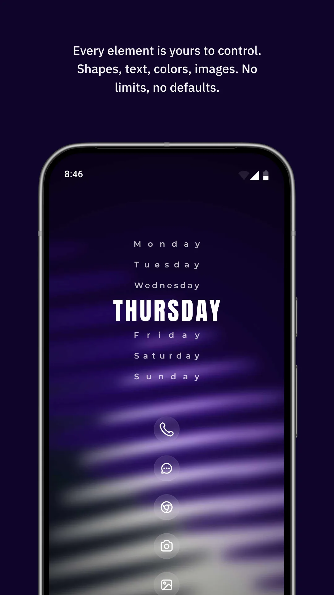

自 Android 12 起，**Material You** 让系统从壁纸提取调色板，并铺满整个 UI——图标、设置、通知乃至于主屏组件都会跟着换色。一款 **[Material You](/zh/glossary/what-is-material-you/) 小组件** 应当感觉原生：圆角与系统网格一致、配色从壁纸衍生、浅深色随主题切换。**One Widget** 内置可爱、贴合主题的小组件，风格跟随系统外观，主打"摆上去就合适"。下面我们把它与 **KWGT** 放到 Material You 风格上对比：前者是开箱即用的主题包，后者是能手工写出任意效果的编辑器。除了配色，也会看 **安卓时钟小组件 app** 与 **安卓日历小组件 app** 的实际使用场景——只跟着颜色走、却没能在一瞥间回答"几点、哪天"的组件，往往装完没几天就被删掉。

## Material You 小组件需要什么

Material You 的价值在于系统替你把配色做好了，所以判断一个组件是否"原生"，不是看它有多花哨，而是看它是否真正融入了系统。下面四条可以当作快速检查表：缺一条，放在主屏上就容易有"贴上去的异物感"。

- **动态配色**——从壁纸提炼的色调，换壁纸时组件跟着换色，而不是停留在固定的蓝或灰。
- **浅/深色跟随**——随系统主题切换；白天浅色底配深色字，夜里自动反转，不必手动维护两套配置。
- **圆角、感知形状**——贴合系统网格与图标的圆角半径，让组件和旁边的图标看起来像同一套设计。
- **快速放置**——无需编辑器，长按主屏就能添加并直接使用；需要打开编辑器调半天的组件，多数人最终不会留在主屏上。

这四条里最容易被忽略的是"快速放置"。如果你为了一个时钟组件还要研究配色公式，等于把系统已经做完的事又做了一遍。日常场景里，通勤路上扫一眼时间、开会前看一眼日程，组件的价值在于"抬眼就懂"，而不是"可定制程度"。

## 配色之外：一个主题组件到底显示什么

动态配色只是第一步，能留下来的组件，是抬眼就能回答问题的那一个。把下面四种情况对照自己的主屏，就能判断哪些组件值得留、哪些只是好看的摆设：

- **时钟与日历**——**安卓时钟小组件 app** 和 **安卓日历小组件 app** 通常是人们最先摆上的两款；浅色/深色主题下都要清晰，并跟随系统设定的一周起始日。如果你常年出差，日历组件还要能显示不同时区，否则"周一"到底从哪天算起会很混乱。
- **通透质感**——**安卓透明小组件 app** 与 **安卓玻璃风格小组件** 需要能压低背景透明度，否则明亮壁纸上文字会糊掉；One Widget 允许逐组件设置背景色与圆角，遇到浅色壁纸时把背景调深一点即可恢复可读性。
- **Nothing 与 Galaxy 皮肤**——前者是点阵单色，后者沿用原生圆角；两者在 One Widget 里都是风格预设，不必为了换一种观感各装一个应用。
- **系统开关**——时钟旁边放一个 Wi-Fi 或手电筒开关，往往比第四个装饰面板更有用；尤其是手电筒，深夜找东西时比解锁再翻设置快得多。

取舍上有个经验：主屏空间是有限的，先放"信息与操作"，再考虑"装饰"。KWGT 也能做出以上全部效果，但每一项都是一个工程——你得自己写 Kode 读取系统颜色、调透明度、接数据源；在这里，它们只是改改尺寸就能摆上去的预设。如果你只是想让主屏在一分钟内变整齐，预设显然更划算；只有当你想要某个预设做不出的效果时，才值得投入编辑器的学习成本。

## 参赛选手一览

把上面的标准套到具体产品，差别一目了然。三者都宣称支持 Material You，但"支持"的含义并不相同：One Widget 与系统组件是真正跟着壁纸走，KWGT 则需要你自己把颜色逻辑写出来。

| 应用 | 价格（2026） | 动态配色 | 设置 | 感知主题 | 适合人群 |
|---|---|---|---|---|---|
| **One Widget** | 免费核心 + VIP | ✅ 主题匹配 | 点按即放 | ✅ | 原生观感、快 |
| **KWGT** | 免费 + Pro 密钥 | ⚠️ 手动 Kode | 设计 | ⚠️ 手动 | 完全掌控 |
| **系统组件** | 免费 | ✅ | 点按即放 | ✅ | 基础、有限 |

表格里"设置"一列的差异最值得注意：点按即放意味着几分钟就能布置好一屏，而"设计"意味着你得先想清楚布局、再逐项调公式。价格上也别只看标签——KWGT 免费下载但高级功能要 Pro 密钥，One Widget 核心免费、VIP 解锁额外组件，系统组件则完全免费但样式有限。如果你不确定自己是否需要那么强的掌控力，可以先用免费档摆一版主屏，再决定要不要深入。

## 深入看 One Widget

{: width="180" .normal }
{: width="180" .normal }
{: width="180" .normal }
{: width="180" .normal }
{: width="180" .normal }

One Widget 是一款安卓的 **猫主题组件包**，风格跟随系统主题，包括 Material You 配色与圆角塑形。它的定位很明确：不让你设计组件，而是提供一批已经调好观感的成品，你只负责挑尺寸和位置。下面的截图依次展示了主界面、玻璃与主题预设、信息源与布局、交互快捷操作以及权限设置，可以看到每个组件都能单独调整背景与圆角。

**在 Material You 上的优势**
- **主题匹配调色板**——组件拾取壁纸衍生的颜色；早上换成暖色壁纸，整屏组件会一起变暖，不需要逐个改设置。
- **圆角、感知形状**——圆角跟随系统网格，和原生图标摆在一起不会显得突兀。
- **现成**——摆一个时钟或天气组件，它已经合适；对不想折腾的用户，这是最大的省时点。
- **可爱猫风格**——友好又不破坏 material 观感，适合想要一点个性但不想破坏系统整体风格的人。
- **轻且本地**——无账号、无云，组件在本机运行，设备信息和壁纸偏好不会被上传。

**在 Material You 上的不足**
- **不如 KWGT 细**——你采用主题，而非创作它；如果想要的配色逻辑预设里没有，就做不出来。
- **更多需 VIP**——额外组件与更深风格在升级之后；免费档够日常使用，但收藏型用户可能会想解锁。

**适合人群：** 想要一款 **Material You 小组件**、几秒就显原生的人。典型的一天是：换壁纸后整屏跟着换装，通勤路上抬眼看时间，睡前组件自动切成深色——全程不用打开任何编辑器。

- [Google Play — One Widget](https://play.google.com/store/apps/details?id=com.glgjing.galaxy.nothing.glass.material.widget)

## 深入看 KWGT

{: width="180" .normal }
{: width="180" .normal }
{: width="180" .normal }
{: width="180" .normal }
{: width="180" .normal }

KWGT（Kustom Widget Maker，包名 `org.kustom.widget`）能精确复刻 Material You——前提是你写 Kode 去读取系统颜色并塑形。它更像一套"组件开发环境"：自由度极高，但每个效果都要自己搭。截图展示的主界面、外观与主题、信息源、交互和权限设置，基本对应了从建项目到上主屏的完整流程。

**在 Material You 上的优势**
- **像素级掌控**——通过公式实现动态配色、自定义形状、动画；你可以让组件在某种壁纸上取主色、在另一种壁纸上取强调色，这种逻辑预设做不到。
- **一次性 Pro 密钥**——无订阅，买断之后不用每月续费。

**在 Material You 上的不足**
- **手动活**——动态配色逻辑得自己搭，从零到能用需要一段学习时间。
- **曲线陡**——不是"摆上就匹配"的体验；第一次打开时面对公式编辑器，很容易不知道从哪下手。
- **依赖启动器**——需要兼容的启动器，部分定制系统对第三方组件的支持不完整，放置前最好先确认。

**适合人群：** 想要精确掌控的安卓主题党。如果你享受"把主屏调成自己想要的样子"这个过程，KWGT 的上限远高于预设型组件；如果只是想让时间看得清、配色看得顺，学习成本就未必划算。

- [Google Play — KWGT](https://play.google.com/store/apps/details?id=org.kustom.widget)

## 你该选哪个？

- 想要 **直接匹配的 Material You** → **One Widget**：装上、选个主题、长按主屏摆上去，配色与圆角已经跟壁纸一致，整个过程不需要碰编辑器。
- 想要 **手写动态配色** → **KWGT**：愿意花时间学 Kode，希望组件在每台设备上都按自己的公式取色、塑形，甚至带动画。

一个折中思路是先用 One Widget 把主屏搭起来，确认自己真正需要哪些信息——时间、日期、天气还是快捷开关，再决定有没有必要为"像素级掌控"投入时间。对多数人来说，换一张壁纸、整屏组件跟着换色这件事本身，就已经是 Material You 最实用的部分。

[获取 One Widget](/zh/apps/one-widget/)——安卓平台可用。

## 典型场景

- **几秒得原生观感**——摆一个时钟或天气组件，它已自动拾取你的壁纸配色与圆角；无需编辑器，适合刚换新机、想把主屏快速整理好的人。
- **换壁纸即换主题**——因为调色板由壁纸衍生，新壁纸会让所有组件一次换装；周末换一张风景照，主屏随季节变脸。
- **浅/深色跟随系统**——组件随系统主题切换，主屏昼夜都协调；晚上开启深色模式后，组件不会用一块刺眼的白底破坏暗环境。
- **可爱又不破坏 material**——猫主题风格仍尊重形状与配色语言，想要一点个性又不想让主屏变得花哨的用户可以放心用。
- **轻且本地**——在本机运行、无账号；不上传任何东西，对隐私敏感或不想多注册一个账号的人尤其合适。

选组件时不妨先只看一眼：它是否在两秒内告诉你有用的信息，并且和旁边的图标像一个整体。如果答案是肯定的，它大概率就是能留下来的那一个。

## 常见问题（FAQ）

**One Widget 的 Material You 主题免费吗？**
{:.faq-q}

核心 Material You 匹配组件免费摆放，日常所需的时钟、天气等都能直接用；更深风格与额外组件类型通过可选的一次性 VIP 解锁。建议先用免费档摆一版主屏，确认自己确实需要更多样式再考虑升级。

**One Widget 跟随系统浅/深色主题吗？**
{:.faq-q}

跟随。组件感知主题，随系统浅/深色模式与壁纸衍生配色切换，早上和晚上呈现不同的底色与文字对比，不需要你在应用里手动切换两次。

**Material You 上 One Widget 还是 KWGT？**
{:.faq-q}

想要壁纸匹配组件、即放即得、不碰编辑器 → One Widget；想手写动态配色、像素级掌控 → KWGT（Pro 密钥）。判断标准很简单：你是想"用"一个已经做好的主题，还是想"做"一个只属于自己的主题。

[One Widget App 页](/zh/apps/one-widget/)——安卓平台可用。

## 相关术语

- [什么是主屏幕小组件（Home Screen Widget）？](/zh/glossary/what-is-a-home-screen-widget/)
- [什么是 Material You？](/zh/glossary/what-is-material-you/)
- [什么是 Nothing UI？](/zh/glossary/what-is-nothing-ui/)
- [什么是 Galaxy One UI？](/zh/glossary/what-is-galaxy-one-ui/)
- [什么是 iOS Glass？](/zh/glossary/what-is-ios-glass/)
