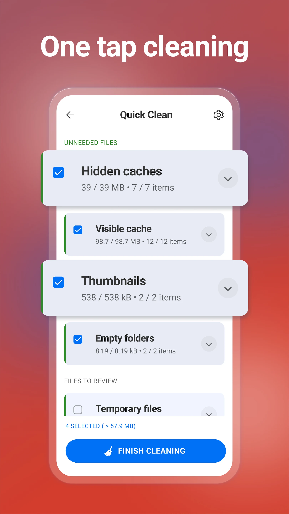

当游戏掉帧或应用重载，头号嫌疑通常是 **RAM**——但在你看得见之前，「内存不足」很模糊。一款 **[内存信息工具](/zh/glossary/what-is-a-ram-booster/)** 精确显示什么在占用内存、还剩多少空闲，于是你理解问题，而非盲目去点「加速」按钮。**System Monitor** 是一款 **付费的安卓设备信息应用**，可检测详细的内存、CPU、存储与电池数据。下面我们把它与确实会清缓存的 **CCleaner** 对比，帮你读懂手机的内存。想比较 **内存加速一键清理安卓** 与只读监控的人，可以看下面这段分界——一个会动手改文件，一个只把事实摆在你面前。

## 内存信息工具需要什么

一个真正能帮你理解内存的工具，重点不在"按钮大不大"，而在"数字准不准、看得够不够细"。下面五条是衡量标准：

- **内存总量与用量**——总量、已用、空闲，以及每应用的明细；只有一个百分比圆环，看不出问题在哪。
- **进程列表**——看清什么在占着内存；找出那个在后台悄悄占着 RAM 的应用。
- **实时监控**——随着你打开应用，看着内存变化；打开前的基线和打开后的增量，比某一刻的快照更有意义。
- **存储上下文**——看清是什么在填满设备；存储快满也会拖慢手机，但那不是内存数字能解释的。
- **轻量**——工具本身不该吃掉 RAM；监控应用自己占着内存，就失去了观察的意义。

这五条里最容易被忽略的是"轻量"与"存储上下文"。很多人盯着内存条看半天，真正的瓶颈却在存储；一个足够轻的工具，才能让你放心地开着它做测试。

## 内存读数能告诉你什么、不能告诉你什么

「内存不足」是症状，不是诊断。在相信 **内存加速一键清理安卓** 之前，有四件事值得先知道：

- **空闲内存少不等于浪费**——安卓会故意把最近用过的应用留在内存里，好让它们秒开；已用比例高很正常，该看的是应用会不会在会话中途重载。切回微信、地图时若总要先白屏一下，才说明内存真的吃紧。
- **逐应用与进程明细**——一份 **最好用的内存加速** 对比，应该能指出到底是哪个进程占着内存，而不只给一个百分比圆环；知道是谁，才能决定要不要处理它。
- **存储是另一种瓶颈**——**存储清理垃圾文件安卓** 处理的是磁盘上的缓存与残留；存储快满时的卡顿，内存数字里看不出来，需要看存储明细才能发现。
- **电池曲线与发热**——**电池监控温度曲线** 能帮你把温控降频与内存问题分开；游戏掉帧有时是发热降频，而不是内存不够，这也是 System Monitor 把这些读数和内存视图放在一起的原因。

取舍上，先判断症状属于哪一类再动手：会话中途重载看内存，卡顿伴随发热看温度，存储告急看磁盘。CCleaner 改动文件，System Monitor 报告数字，并可用 **悬浮窗系统监控安卓** 浮窗在测试时一直显示——比如玩游戏时把读数留在屏幕角落。两者都不会靠结束进程让手机变快——这是这类工具的诚实边界。

## 选手一览

| 应用 | 价格（2026） | 内存信息 | 进程列表 | 动作（释放/清理） | 最适合 |
|---|---|---|---|---|---|
| **System Monitor** | 付费（一次性） | ✅ 详细 | ✅ | ❌ 仅信息 | 理解内存 |
| **CCleaner** | 免费 + Pro 订阅 | ⚠️ 基础 | ⚠️ 有限 | ✅ | 缓存/存储清理 |
| **DevCheck** | 免费 + IAP | ✅ 详细 | ✅ | ❌ | 规格查看 |

"动作"一列仍然是关键：System Monitor 与 DevCheck 只读不写，CCleaner 才会真的清缓存。价格上，System Monitor 一次性买断、无订阅；CCleaner 免费起步、Pro 要订阅；DevCheck 免费加内购。如果你的目标是"搞懂内存为什么不够"，前两者里选；如果目标是"把存储腾出来"，才轮到 CCleaner。

## System Monitor 详解

{: width="180" .normal }
{: width="180" .normal }
{: width="180" .normal }
{: width="180" .normal }
{: width="180" .normal }

System Monitor 是一款 **付费的安卓设备信息工具**。一次性的下载价格，它就检测详细的硬件，包括内存：总量/已用/空闲 RAM 与每应用内存占用，并在你切换任务时实时更新。它只报告——不释放、也不加速内存。内存明细、悬浮窗、进程与电池、网络传感器、内存与存储这几组界面，让你可以把内存读数和其他指标放在一起对照。

**理解内存方面的优点**
- **详细的内存信息**——总量、已用、空闲，以及每应用 RAM，而不只是一条进度条；定位问题时信息量完全不同。
- **进程列表**——看清哪些应用占着内存，自己决定关闭哪些；决定是否结束一个进程的人是你，不是应用。
- **实时监控**——在打开应用前后观察内存变化；适合验证"某款游戏是否真的吃内存"这类具体疑问。
- **轻量且本地**——无账号、无云端、低开销；读数不会上传，工具本身也不添乱。
- **付费无加价**——一次性价格即得全部功能，后续不会再有 VIP 墙。

**理解内存方面的缺点**
- **不释放内存**——它显示数据；不会替你杀任务或回收 RAM（安卓已自行管理）。想要"一键加速"的人要调整预期。
- **只读**——是洞察，不是动作；你手动关闭应用，它只负责告诉你该关谁。
- **预先付费**——无免费档；买之前先想清楚自己是否真的需要这种深度数据。

**最适合：** 想详细理解自己内存使用、而非只点一下加速按钮的用户。典型场景是游戏前开浮窗记录基线、游戏后对比增量，或排查某款应用是否在后台占用过多内存。

- [Google Play — System Monitor](https://play.google.com/store/apps/details?id=com.glgjing.marvel)

## CCleaner 详解

{: width="180" .normal }
{: width="180" .normal }
{: width="180" .normal }
{: width="180" .normal }
{: width="180" .normal }

CCleaner（包名 `com.piriform.ccleaner`，Gen Digital 出品）聚焦清理——缓存、临时文件与重复项。它的工具设计围绕"动手清"展开，而不是围绕"看清楚"，这与 System Monitor 的定位正好互补。

**内存/存储方面的优点**
- **存储清理**——清除确实占空间的缓存与垃圾；存储告急时最直接有效。
- **重复项查找**——从重复中回收空间；相册里的大量相似照片常能腾出可观容量。
- **一键工具**——快速的清理动作；不想理解原理、只想腾空间的用户最省心。

**内存/存储方面的缺点**
- **内存效果有限**——安卓自动回收内存，加速只是昙花一现；数字好看几秒后又回到原样。
- **进程视图有限**——它更会清理，而非解释；想弄清"谁在占内存"还得靠监控工具。
- **订阅**——Pro 需付费方案，长期使用成本要算进去。
- **隐私历史**——过去在数据实践上受过审视，对隐私敏感的人会有所顾虑。

**最适合：** 主要想回收存储、而不只是看内存数据的用户。如果你确认卡顿来自存储快满，它会比只读监控更对症。

- [Google Play — CCleaner](https://play.google.com/store/apps/details?id=com.piriform.ccleaner)

## 其他对手对比

- **DevCheck** 是监控同侪，规格深入、带进程列表，但没有清理动作。如果只想要更硬的硬件规格读出、且不介意内购，可以把它和 System Monitor 一起看；但要清楚它同样不会帮你腾出存储。

## 你该选哪个？

- 想要 **详细、只读的内存与硬件信息** → **System Monitor**：买断制、数据细，适合排查和验证具体疑问。
- 想要 **存储/缓存清理** → **CCleaner**：接受订阅、目标是腾空间的用户。

[获取 System Monitor](/zh/apps/system-monitor/) —— 安卓可用。

## 典型场景

- **抓掉帧原因**——在开游戏前后打开内存视图，看清是哪个应用吃掉了内存，而不是盲目点加速；先有数据再决定动手。
- **揪内存大户**——进程列表显示哪个应用占着最多 RAM，于是你自己关掉它，而不是让工具一刀切地清后台。
- **实时观察**——切换任务时，看总量/已用/空闲 RAM 实时变化；验证"秒开"是否真的靠内存留驻。
- **搭配存储**——看清是什么在填满设备，而不只是一条内存条；存储与内存一起看，才不会找错方向。
- **隐私优先**——所有读取都在本地，无账号、无云端上传；设备使用痕迹留在设备上。

## 常见问题（FAQ）

**System Monitor 免费吗？**
{:.faq-q}

不。它是一次性付费下载——无订阅、无升级墙。买下后全部功能可用，但也意味着没有免费档先试，购买前先确认自己需要这种深度数据。

**内存方面 System Monitor 还是 CCleaner？**
{:.faq-q}

想要详细、只读的内存与硬件信息 → System Monitor；想要一键缓存/存储清理 → CCleaner。注意：安卓已自动回收内存，"加速"通常只是昙花一现，别把数字变化当成性能提升。

**System Monitor 会释放内存或杀任务吗？**
{:.faq-q}

不会。它只报告内存事实（总量/已用/空闲与每应用占用），从不释放 RAM 或杀任务——你手动关应用。这种克制反而是它的价值：不会为了好看的数字打断你的后台。

**System Monitor 显示进程列表吗？**
{:.faq-q}

显示。它列出运行中的应用及其内存占用，让你看清是谁占着 RAM；这是判断"该关谁"最直接的依据。

## 相关术语

- [什么是 CPU 温度监控？](/zh/glossary/what-is-a-cpu-temperature-monitor/)
- [什么是系统监控（System Monitor）？](/zh/glossary/what-is-a-system-monitor/)
- [什么是内存清理（RAM Booster）？](/zh/glossary/what-is-a-ram-booster/)
