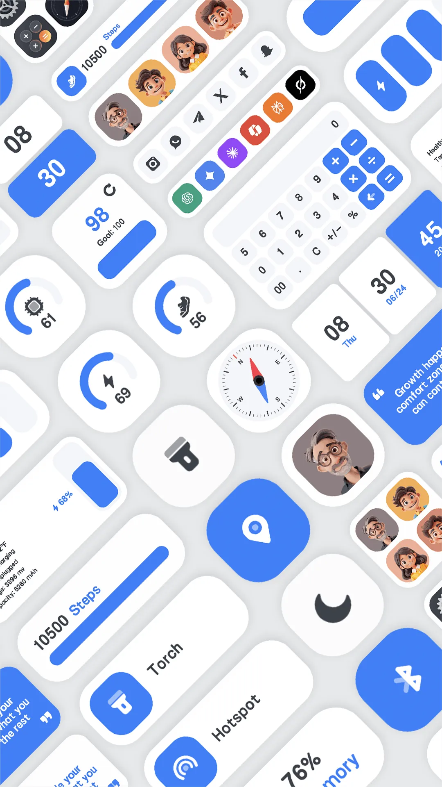
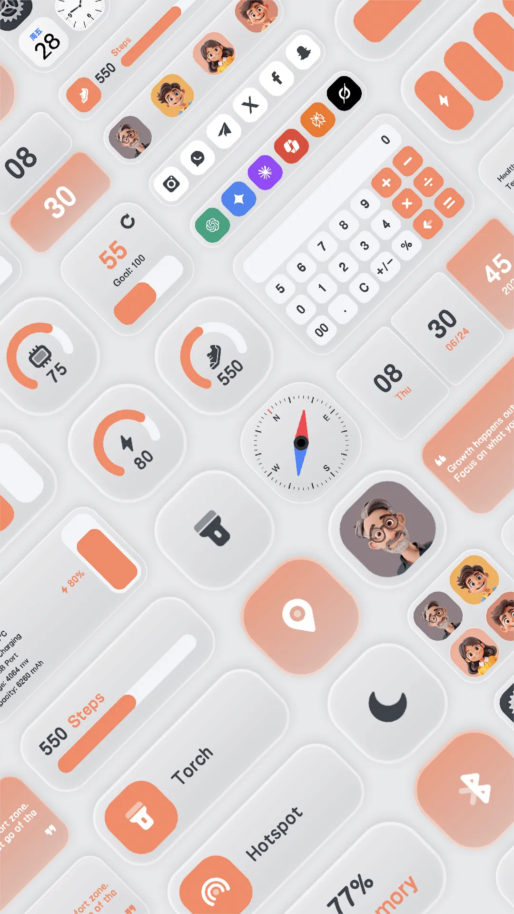
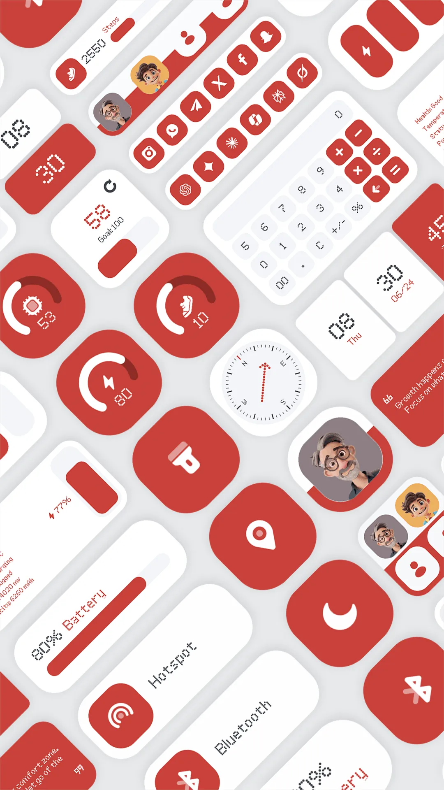
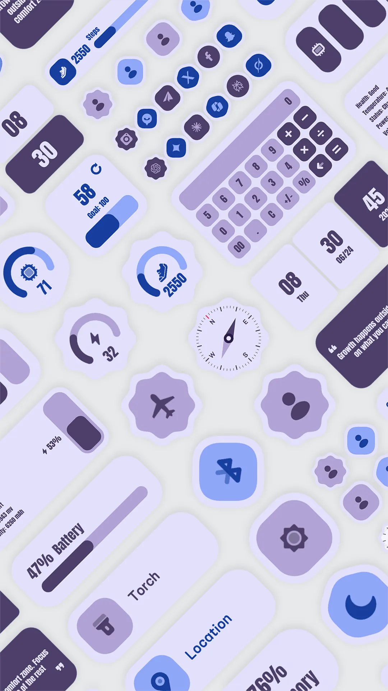
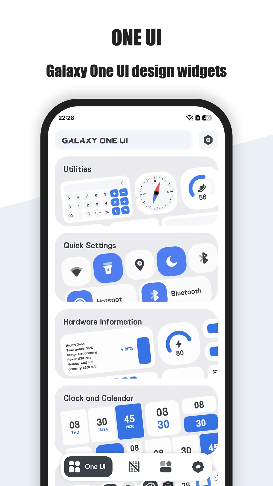

安卓的主屏是它的超能力，而[主屏小组件](/zh/glossary/what-is-a-home-screen-widget/)就是让你把它变成自己模样的方式。这份 2026 指南讲清了挑选小组件应用要看什么，以及 One Widget 如何与 KWGT、WidgetSmith 对比。无论叫它 **安卓小组件**、**桌面小组件** 还是 **小组件 app**，要挑的都是同一批应用；搜 **安卓桌面小组件哪个好** 的人，问的也是这件事。

## 大家怎么称呼它

同一个品类有好几种叫法，每种指向的其实是不太一样的工作：

- **安卓小组件** / **桌面小组件** / **自定义小组件**——泛指放在启动器上的一切；搜 **安卓小组件 app 推荐** 或 **安卓桌面组件** 的人，多半想要现成组件库，而不是一张空白画布。
- **安卓小组件制作**——指自己画组件的搭建器（KWGT 是这类基准），与预设库正好相反，代价是配置时间。
- **小组件 app**——常见诉求是「一款应用覆盖时钟、日历、电量与开关」，而不是装五个单一用途的工具。

风格词同样是搜索词：**Material You 小组件** 跟随壁纸调色板，**透明小组件** 与 **玻璃风格小组件** 追求通透感，**灵动岛小组件** 复刻动态岛的胶囊，**三星 One UI 小组件** 对齐 Galaxy 原生样式，**Nothing 风格小组件** 则是点阵极简。One Widget 把这几类都做成预设，所以它同时出现在「制作」与「现成」两份对比里。

## 为什么主屏小组件应用在安卓上重要

在安卓上，小组件是一等公民：One Widget 把时钟、开关与应用快捷方式直接放到主屏，并提供深度主题，匹配 Galaxy、Pixel 与 Nothing。iOS 的小组件更受限、更沙盒化，所以这里跨平台对比偏向安卓。

## 挑选主屏小组件应用要看什么

- **风格多样**——Glass iOS、Material You、Galaxy One UI 与 Nothing 等，让组件贴合你的启动器。
- **深度自定义**——大小、颜色、圆角半径，以及组件真正显示的内容。
- **快捷开关与快捷方式**——Wi-Fi、蓝牙、手电筒与应用快捷方式，从主屏一步触达。
- **实时信息**——时钟、日历、电量、RAM 组件就地更新。
- **机型覆盖**——在 Galaxy、Pixel、Nothing 及其他安卓皮肤上都可用。
- **一个应用、多种组件**——避免装好几个单一用途的组件应用。

## 选手一览

| 应用 | 价格（2026） | 平台 | 适合人群 / 备注 |
|---|---|---|---|
| **One Widget** | 付费应用（一次性） | 仅 Android | 500+ 组件、4 种风格、快捷开关、应用快捷方式 |
| **KWGT** | 免费 + Pro 密钥约 $4.99 | 仅 Android | 完全自定义组件编辑器，但每个组件都得自己造（DIY） |
| **WidgetSmith** | 免费 + 订阅 | 仅 iOS | iOS 主题组件；无安卓版本 |

## 深入看 One Widget

{: width="180" .normal }
{: width="180" .normal }
{: width="180" .normal }
{: width="180" .normal }
{: width="180" .normal }

One Widget 内置 500+ 可自定义的安卓主屏组件，涵盖 Glass iOS、Material You、Galaxy One UI 与 Nothing 风格，外加应用快捷方式与快捷开关。

- **500+ 高级组件**——一个应用内四种流行风格，无需编辑器。
- **完全自定义**——尺寸从 1x1 到 2x6，图标背景色与圆角半径匹配你的主题。
- **快捷开关**——Wi-Fi、蓝牙、手电筒、旋转、勿扰等直接来自组件。
- **应用快捷方式与联系人**——主屏上一步启动。
- **实时信息组件**——时钟、日历、电量与 RAM 实时更新。
- **全安卓设备**——支持 Galaxy、Pixel 与 Nothing。

**适合人群：** 想要时尚、一体机式组件工具箱的安卓用户。

深入了解：
- [最佳安卓组件应用](/zh/posts/best-one-widget-android/)
- [最佳 Material You 组件](/zh/posts/best-one-widget-material-you/)
- [One Widget 应用页](/zh/apps/one-widget/)
- [One Widget 官方使用指南](/zh/posts/tutorial-one-widget/)

## One Widget 与竞品对比

- **对比 KWGT**——若你喜欢从零造组件，KWGT 最灵活，但那份灵活就是工作量——多数人想要现成的、快的。One Widget 内置跨四种风格的 500+ 现成组件。完整对比见 [One Widget 对比 KWGT](/zh/posts/vs-one-widget-and-kwgt/)。
- **对比 WidgetSmith**——WidgetSmith 是 iOS 自定义组件的答案，没有安卓版，所以不在本受众的选项里；One Widget 是安卓原生的选择。
- **更多选项**——完整名单见 [2026 年最佳 WidgetSmith 替代应用（安卓）](/zh/posts/alternatives-to-widgetsmith/)。

## 你该选哪个？

按场景快速选：

- 想要现成、好看组件、要快 → One Widget。
- 享受 DIY、想要完全掌控 → KWGT（Pro 密钥）。
- 在 iPhone 上想要主题组件 → WidgetSmith。
- 想要一屏内的快捷开关 + 应用快捷方式 → One Widget。

## 典型场景

- **干净、有主题的主屏**——选 Glass iOS、Material You、One UI 或 Nothing 风格，直接放下 500+ 现成组件（时钟、日历、电量），无需碰编辑器。
- **一键快捷开关**——Wi-Fi、蓝牙、手电筒直接从主屏触达，不再翻设置。
- **应用与联系人快捷方式**——一个组件里启动 Chrome、地图或常用联系人，不用翻文件夹。
- **一个应用，多种组件**——Galaxy、Pixel、Nothing 全覆盖；不必装好几个单一用途组件应用。
- **不用 DIY，没有订阅**——开箱即得成品组件；免费档含 One UI 主题组件，其余风格一次性解锁。

## 常见问题（FAQ）

**One Widget 免费吗？**
{:.faq-q}

One Widget 是付费应用。免费版含 One UI 主题组件，可改大小与配色；Glass iOS、Material You、Nothing 风格通过一次性购买解锁。

**One Widget 提供哪些组件风格？**
{:.faq-q}

四种 2026 流行风格——Glass iOS、Material You（随壁纸变色）、Galaxy One UI 与 Nothing 极简——覆盖 500+ 组件。

**哪些设备支持 One Widget？**
{:.faq-q}

所有安卓设备，包括三星 Galaxy、Google Pixel 与 Nothing 手机。

**One Widget 还是 KWGT，怎么选？**
{:.faq-q}

想要 500+ 现成、有主题的组件、要快、不碰编辑器 → One Widget；想要从零造每个组件、完全掌控 → KWGT（Pro 密钥）。

## 结论

对想要时尚、一体机式组件工具箱、又不想写 DIY 脚本的安卓用户，One Widget 是最完整的选项——而且它是一次性付费应用。

- [Google Play — One Widget](https://play.google.com/store/apps/details?id=com.glgjing.galaxy.nothing.glass.material.widget)

或阅读 [最佳安卓组件应用](/zh/posts/best-one-widget-android/) 看完整拆解。

## 相关术语

- [什么是主屏幕小组件（Home Screen Widget）？](/zh/glossary/what-is-a-home-screen-widget/)
- [什么是 Material You？](/zh/glossary/what-is-material-you/)
- [什么是 Nothing UI？](/zh/glossary/what-is-nothing-ui/)
- [什么是 Galaxy One UI？](/zh/glossary/what-is-galaxy-one-ui/)
- [什么是 iOS Glass？](/zh/glossary/what-is-ios-glass/)
