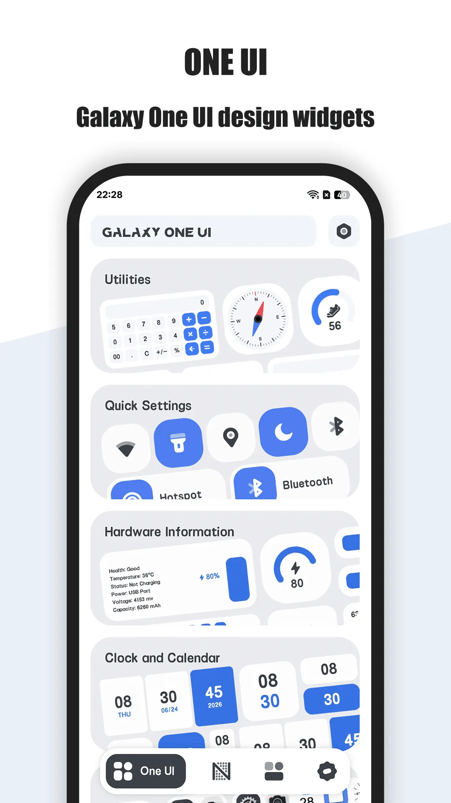

安卓的主屏是它的超能力，而[主屏小组件](/zh/glossary/what-is-a-home-screen-widget/)就是让你把它变成自己模样的方式。这份 2026 指南讲清了挑选小组件应用要看什么，以及 One Widget 如何与 KWGT、WidgetSmith 对比。无论叫它 **安卓小组件**、**桌面小组件** 还是 **小组件 app**，要挑的都是同一批应用；搜 **安卓桌面小组件哪个好** 的人，问的也是这件事——如何在有限的屏幕空间里，既放得下信息，又保持自己喜欢的风格。

## 大家怎么称呼它

同一个品类有好几种叫法，每种指向的其实是不太一样的工作。先把词分清，才不会在搜索时被结果带偏：

- **安卓小组件** / **桌面小组件** / **自定义小组件**——泛指放在启动器上的一切；搜 **安卓小组件 app 推荐** 或 **安卓桌面组件** 的人，多半想要现成组件库，而不是一张空白画布。
- **安卓小组件制作**——指自己画组件的搭建器（KWGT 是这类基准），与预设库正好相反，代价是配置时间。适合享受"从零搭出来"过程的人。
- **小组件 app**——常见诉求是「一款应用覆盖时钟、日历、电量与开关」，而不是装五个单一用途的工具；少装几个应用，主屏和后台都更清爽。

风格词同样是搜索词：**Material You 小组件** 跟随壁纸调色板，**透明小组件** 与 **玻璃风格小组件** 追求通透感，**灵动岛小组件** 复刻动态岛的胶囊，**三星 One UI 小组件** 对齐 Galaxy 原生样式，**Nothing 风格小组件** 则是点阵极简。One Widget 把这几类都做成预设，所以它同时出现在「制作」与「现成」两份对比里。对多数人来说，先想清楚自己要的是哪种风格，再去挑应用，比逐个试装更高效。

## 为什么主屏小组件应用在安卓上重要

在安卓上，小组件是一等公民：One Widget 把时钟、开关与应用快捷方式直接放到主屏，并提供深度主题，匹配 Galaxy、Pixel 与 Nothing。这意味着你不必点开任何应用，抬眼就能看到时间、日程或电量——主屏从"图标的网格"变成了真正的仪表盘。iOS 的小组件更受限、更沙盒化，所以这里跨平台对比偏向安卓。实际用起来，通勤前扫一眼日历、睡前点一下勿扰开关，这类高频小动作都靠组件完成；组件的体验好不好，直接决定了主屏好不好用。

## 挑选主屏小组件应用要看什么

面对应用商店里几十个"小组件"应用，可以用下面六条快速筛选：

- **风格多样**——Glass iOS、Material You、Galaxy One UI 与 Nothing 等，让组件贴合你的启动器；换手机或换系统主题时不必重新找一套。
- **深度自定义**——大小、颜色、圆角半径，以及组件真正显示的内容；能改尺寸和配色，才能把它塞进主屏的空隙里。
- **快捷开关与快捷方式**——Wi-Fi、蓝牙、手电筒与应用快捷方式，从主屏一步触达；手电筒这类开关放在主屏，比翻设置快得多。
- **实时信息**——时钟、日历、电量、RAM 组件就地更新；静态图片式组件看着好看，却不能替代真正会刷新数据的组件。
- **机型覆盖**——在 Galaxy、Pixel、Nothing 及其他安卓皮肤上都可用；不同品牌对第三方组件的支持有差异，选覆盖广的更省心。
- **一个应用，多种组件**——避免装好几个单一用途的组件应用；应用越少，权限与后台也越好管理。

这六条里，"风格多样"和"一个应用多种组件"最影响长期体验：前者决定它能不能跟上你审美的变化，后者决定主屏会不会越装越乱。

## 选手一览

| 应用 | 价格（2026） | 平台 | 适合人群 / 备注 |
|---|---|---|---|
| **One Widget** | 付费应用（一次性） | 仅 Android | 500+ 组件、4 种风格、快捷开关、应用快捷方式 |
| **KWGT** | 免费 + Pro 密钥约 $4.99 | 仅 Android | 完全自定义组件编辑器，但每个组件都得自己造（DIY） |
| **WidgetSmith** | 免费 + 订阅 | 仅 iOS | iOS 主题组件；无安卓版本 |

平台一列先帮你排除了大半选择：用 iPhone 的人只能看 WidgetSmith，用安卓的人在 One Widget 与 KWGT 之间选。真正的分界是"要现成还是要 DIY"——One Widget 给的是 500+ 成品，KWGT 给的是一支画笔。价格模式也不同：One Widget 一次性付费，KWGT 免费加 Pro 密钥，WidgetSmith 则是订阅制。

## 深入看 One Widget

{: width="180" .normal }
{: width="180" .normal }
{: width="180" .normal }
{: width="180" .normal }
{: width="180" .normal }

One Widget 内置 500+ 可自定义的安卓主屏组件，涵盖 Glass iOS、Material You、Galaxy One UI 与 Nothing 风格，外加应用快捷方式与快捷开关。从组件库、玻璃与透明主题、信息源布局、快捷开关到权限设置，这组界面展示的是一条"选风格—挑组件—调位置"的现成路径，而不是从空白画布开始。

- **500+ 高级组件**——一个应用内四种流行风格，无需编辑器；足够把主屏、锁屏都布置一遍。
- **完全自定义**——尺寸从 1x1 到 2x6，图标背景色与圆角半径匹配你的主题；小到角落的电量、大到整屏的日历都有合适尺寸。
- **快捷开关**——Wi-Fi、蓝牙、手电筒、旋转、勿扰等直接来自组件；常用的两三个放主屏，省下反复下拉通知栏的时间。
- **应用快捷方式与联系人**——主屏上一步启动；常用联系人放在主屏，老人小孩也能一键拨号。
- **实时信息组件**——时钟、日历、电量与 RAM 实时更新；真正会刷新数据的组件，才值得占主屏的位置。
- **全安卓设备**——支持 Galaxy、Pixel 与 Nothing；跨品牌换机时组件仍能沿用。

**适合人群：** 想要时尚、一体机式组件工具箱的安卓用户。尤其适合"想让主屏好看，但不愿意花几个晚上学编辑器"的人——500+ 现成组件意味着挑一挑就能上手。

深入了解：
- [最佳安卓组件应用](/zh/posts/best-one-widget-android/)
- [最佳 Material You 组件](/zh/posts/best-one-widget-material-you/)
- [One Widget 应用页](/zh/apps/one-widget/)
- [One Widget 官方使用指南](/zh/posts/tutorial-one-widget/)

## One Widget 与竞品对比

- **对比 KWGT**——若你喜欢从零造组件，KWGT 最灵活，但那份灵活就是工作量——多数人想要现成的、快的。One Widget 内置跨四种风格的 500+ 现成组件。完整对比见 [One Widget 对比 KWGT](/zh/posts/vs-one-widget-and-kwgt/)。判断标准是：你更享受"做"的过程，还是更想要"用"的结果。
- **对比 WidgetSmith**——WidgetSmith 是 iOS 自定义组件的答案，没有安卓版，所以不在本受众的选项里；One Widget 是安卓原生的选择。手持 iPhone 的人不必纠结，直接用 WidgetSmith 即可。
- **更多选项**——完整名单见 [2026 年最佳 WidgetSmith 替代应用（安卓）](/zh/posts/alternatives-to-widgetsmith/)。如果你还想在 One Widget 与 KWGT 之外多看几家，这份名单能省去逐个搜索的时间。

## 你该选哪个？

按场景快速选：

- 想要现成、好看组件、要快 → One Widget；几分钟就能把主屏布置好。
- 享受 DIY、想要完全掌控 → KWGT（Pro 密钥）；前提是你愿意投入学习时间。
- 在 iPhone 上想要主题组件 → WidgetSmith；安卓上没有它的版本。
- 想要一屏内的快捷开关 + 应用快捷方式 → One Widget；把高频操作和高频信息放在同一屏。

如果还是拿不定主意，可以先装免费档摆一版主屏：能接受的就继续用，觉得处处受限于再考虑 KWGT 的自由度。

## 典型场景

- **干净、有主题的主屏**——选 Glass iOS、Material You、One UI 或 Nothing 风格，直接放下 500+ 现成组件（时钟、日历、电量），无需碰编辑器；换风格时整屏一起换。
- **一键快捷开关**——Wi-Fi、蓝牙、手电筒直接从主屏触达，不再翻设置；夜里找东西时手电筒尤其顺手。
- **应用与联系人快捷方式**——一个组件里启动 Chrome、地图或常用联系人，不用翻文件夹；通勤时点一下地图就走。
- **一个应用，多种组件**——Galaxy、Pixel、Nothing 全覆盖；不必装好几个单一用途组件应用，权限和后台都更干净。
- **不用 DIY，没有订阅**——开箱即得成品组件；免费档含 One UI 主题组件，其余风格一次性解锁，不必每月续费。

## 常见问题（FAQ）

**One Widget 免费吗？**
{:.faq-q}

One Widget 是付费应用。免费版含 One UI 主题组件，可改大小与配色；Glass iOS、Material You、Nothing 风格通过一次性购买解锁。建议先用免费档试试手感，再决定是否解锁其余风格。

**One Widget 提供哪些组件风格？**
{:.faq-q}

四种 2026 流行风格——Glass iOS、Material You（随壁纸变色）、Galaxy One UI 与 Nothing 极简——覆盖 500+ 组件。四种风格覆盖了当下主流的审美取向，换壁纸或换系统主题时也能保持一致。

**哪些设备支持 One Widget？**
{:.faq-q}

所有安卓设备，包括三星 Galaxy、Google Pixel 与 Nothing 手机。不同品牌对第三方组件的支持略有差异，若在主屏找不到组件，可先检查启动器是否允许第三方组件。

**One Widget 还是 KWGT，怎么选？**
{:.faq-q}

想要 500+ 现成、有主题的组件、要快、不碰编辑器 → One Widget；想要从零造每个组件、完全掌控 → KWGT（Pro 密钥）。一句话：要结果选前者，要过程选后者。

## 结论

对想要时尚、一体机式组件工具箱、又不想写 DIY 脚本的安卓用户，One Widget 是最完整的选项——而且它是一次性付费应用。500+ 组件、四种风格、快捷开关与实时信息集中在一个应用里，省去了东拼西凑的麻烦；只有当你明确需要"别人做不出的效果"时，才值得转向 KWGT。

- [Google Play — One Widget](https://play.google.com/store/apps/details?id=com.glgjing.galaxy.nothing.glass.material.widget)

或阅读 [最佳安卓组件应用](/zh/posts/best-one-widget-android/) 看完整拆解。

## 相关术语

- [主屏幕小组件：添加与自定义 Android 小组件](/zh/glossary/what-is-a-home-screen-widget/)
- [Material You：更换 Android 主题配色](/zh/glossary/what-is-material-you/)
- [Nothing UI：设计特点与玻璃风格小组件](/zh/glossary/what-is-nothing-ui/)
- [Galaxy One UI：特性、差异与小组件支持](/zh/glossary/what-is-galaxy-one-ui/)
- [iOS Glass：玻璃质感小组件与实现方法](/zh/glossary/what-is-ios-glass/)
