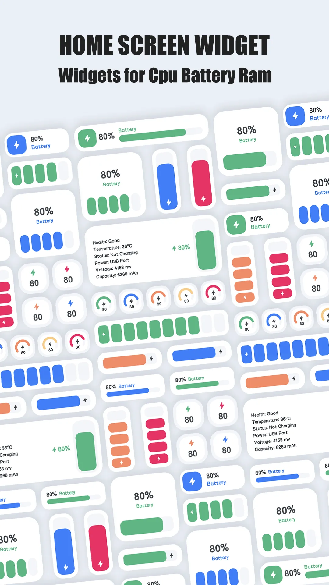

一些安卓工具想"清理"和"加速"；另一些只把手机内部正在发生的事展示给你。如果你想要诚实、只读的[设备信息](/zh/glossary/what-is-a-system-monitor/)，这份 2026 指南正合适——它讲清 System Monitor 如何与清理类对比。同一份清单也常被搜作 **安卓清理**、**内存加速** 或 **手机管家**——这些叫法指向的是会改动手机的工具，而不只是报告状态。先分清"诊断"和"动手"这两件事，才知道自己到底该装哪一类。

## 大家怎么称呼它

系统监控类工具从两个方向迎来用户，四类叫法之所以重要，是因为它们承诺的是不同的事：系统监控只读事实、报告实时 CPU 与电池等数据；手机清理删除缓存与垃圾文件；内存加速声称靠结束进程让手机变快；手机管家则是监控、清理与电池养护装在一起的一体化工具。分界线很简单：系统监控报告的是可核对的数字，清理工具改的是文件。

- **系统监控** / **安卓系统监控** / **系统监控 app**——只读事实：实时 CPU、RAM、存储、电池与温度。这正是 System Monitor 做的事。
- **手机清理** / **安卓清理** / **存储清理**——删除缓存与垃圾文件的工具；一份 **最佳手机清理安卓** 清单比的是腾出空间，而不是报告空间。
- **内存加速** / **最好用的内存加速** / **安卓清理软件**——声称靠结束进程让手机变快；在现代安卓上，这样反复关应用往往比省下的电更费电，还可能打断消息推送。
- **手机管家**——泛指监控、清理与电池养护装在一起的一体化工具；System Monitor 覆盖其中的监控与电池健康，不含清理宣称。

分界线很简单：**电池医生** 或系统监控报告的是可核对的数字，清理工具改的是文件。这份指南排的是前者，并与后者诚实对比。如果你只是想知道"手机为什么发热、掉电"，先看清数字，再决定要不要清，往往更靠谱。

## 为什么系统监控应用在安卓上重要

系统监控应用在安卓上靠浮窗与主屏小组件，让你一瞥实时 CPU、内存与电池状态，并用过热报警在造成损伤前提醒行动，关键词是"只读"——只报告、不改变任何东西。夏天户外导航、长时间游戏、边充电边看视频时温度与电量最容易出问题，有浮窗和报警就能在性能被降频拖垮或电池长期高温之前先停一步。安卓开放的系统权限让这类常驻读数与报警成为可能，这也是它比 iOS 上同类工具更实用的原因。

## 挑选系统监控应用要看什么

挑选系统监控应用，可以对照六条标准：只读检测、温度与健康、没有虚假加速、浮窗与小组件、过热保护、一次性付费。只读检测要求读数来自真实传感器与系统计数，温度与健康要连同电池电压一起看才能分开发热降频与内存不足。六条里"只读"与"温度健康"是核心——一个只报告、数据又准的工具，才配得上"监控"两个字，别为"一键变快"的承诺买单。

- **只读检测**——看 CPU、存储、内存与电池实情，而应用不改变任何东西；读数要来自真实传感器与系统计数。
- **温度与健康**——CPU 与电池温度，外加电池健康与电压；这几项一起看，才能分开发热降频与内存不足。
- **没有虚假"加速"**——是监控，不是内存加速或垃圾清理；别为"一键变快"的承诺买单。
- **浮窗与小组件**——一瞥实时数据，在任意应用之上；游戏、导航时不必切出去看温度。
- **过热保护**——发热时报警，让你降温；阈值可按自己的使用场景设置。
- **一次性付费**——无订阅，无"免费 + 唠叨"升级墙；买断之后功能全开，不被反复推销。

六条里，"只读"与"温度健康"是核心：一个只报告、数据又准的工具，才配得上"监控"两个字。

## 选手一览

选手一览对比三款 2026 年的系统监控方案：System Monitor 一次性付费下载、仅安卓，只读 CPU、存储、内存与电池信息，带温度与过热报警；CCleaner 免费加 Pro 订阅、仅安卓，做垃圾清理与内存加速，是不同工作；Device Info HW 免费、仅安卓，硬件检测详尽但实时报警较弱。"适合人群"一列最说明问题——System Monitor 与 Device Info HW 都在看清手机，CCleaner 在改动手机，按你到底想诊断还是想清理来选即可。

| 应用 | 价格（2026） | 平台 | 适合人群 / 备注 |
|---|---|---|---|
| **System Monitor** | 付费应用（一次性下载） | 仅 Android | 只读 CPU/存储/RAM/电池信息、温度、过热报警 |
| **CCleaner** | 免费 + Pro 订阅 | Android | 垃圾清理与内存加速——与监控是不同工作 |
| **Device Info HW** | 免费 | Android | 详尽硬件检测，实时报警较弱 |

> **注：** 监控不等于清理。如果你只需知道 CPU 温度与电池健康，像 System Monitor 这样的只读工具比"加速"它根本控制不了的内存的 app 更安全。

看这张表时"适合人群"一列最说明问题：System Monitor 与 Device Info HW 都在"看清手机"，CCleaner 在"改动手机"。价格模式也不同——System Monitor 一次性买断、CCleaner 订阅、Device Info HW 免费。按你到底是想诊断还是想清理来选，就不会被"加速"这类词带偏。

## 深入看 System Monitor

System Monitor 是一款付费安卓硬件信息检测工具，只读地报告实时 CPU 温度与频率、存储与内存使用、电池健康，不含清理或加速，覆盖从整机概览到单项深挖的完整视图。只读状态总览、悬浮窗设置、进程与电池、网络传感器到内存与存储报告这几组界面可一线看完。它支持 CPU 温度频率与存储内存全部只读、电池温度健康电压曲线、过热报警、任意应用之上的浮窗与组件、实时每核使用率，一次性付费无订阅。适合常玩游戏、长期充电、追踪电池损耗或给二手设备验机的安卓用户。

{: width="180" .normal }
{: width="180" .normal }
{: width="180" .normal }
{: width="180" .normal }
{: width="180" .normal }

System Monitor 是一款付费安卓硬件信息检测工具：实时 CPU 温度与频率、存储与内存使用、电池健康监控——只读，无清理或加速。从只读状态总览、悬浮窗设置、进程与电池、网络传感器到内存与存储报告，这组界面覆盖了从整机概览到单项深挖的完整视图。

- **硬件信息检测**——CPU 温度/频率、存储使用与内存使用，全部只读；买二手设备核对配置也用得上。
- **电池健康**——温度、健康、电压与电量的曲线，让你看见损耗；老手机续航变短时尤其值得一看。
- **过热报警与保护**——CPU 或电池过热时警告，让你及早行动；阈值可按场景调整。
- **浮窗与小组件**——CPU、电池与 RAM 组件实时停在任意应用之上；游戏、导航时无需切出应用。
- **多核监控**——实时每核使用率与频率；平均值会掩盖某一颗核心满载的情况。
- **付费、一次性**——下载一次；无订阅、无内存加速噱头，后续不会再被推销。

**适合人群：** 想要诚实、只读设备监控（而非清理器或加速器）的安卓用户。尤其适合常玩游戏、长期充电，或想追踪电池损耗、给二手设备验机的人。

深入了解：
- [最佳系统监控应用](/zh/posts/best-system-monitor-monitor/)
- [看清你的 RAM 在做什么](/zh/posts/best-system-monitor-ram/)
- [System Monitor 应用页](/zh/apps/system-monitor/)
- [System Monitor 官方使用指南](/zh/posts/tutorial-system-monitor/)

## System Monitor 与竞品对比

System Monitor 对比竞品，核心是监控还是清理：CCleaner 是清理与内存加速器，会改变你的手机、清缓存释放内存，而 System Monitor 正好相反，只报告硬件实情、从不碰文件或内存；Device Info HW 是扎实的免费硬件检测器，但实时过热报警与浮窗体验较弱，要免费参数表可选它，要常驻浮窗与报警则 System Monitor 更合适；更多选项可看 CCleaner 替代名单。只想知道为什么卡，只读监控更对症。

- **对比 CCleaner**——CCleaner 是清理与内存加速器——它改变你的手机（清缓存、释放内存）。System Monitor 正好相反：它只报告硬件实情，从不碰你的文件或内存。按意图选——监控 vs 清理。完整对比见 [System Monitor 对比 CCleaner](/zh/posts/vs-system-monitor-and-ccleaner/)。如果你只想知道"为什么卡"，只读监控更对症。
- **对比 Device Info HW**——Device Info HW 是扎实的免费硬件检测器，但在实时过热报警与 System Monitor 所围绕的浮窗体验上较弱。想要免费参数表可以选它，想要常驻浮窗与报警则前者更合适。
- **更多选项**——完整名单见 [2026 年最佳 CCleaner 替代应用](/zh/posts/alternatives-to-ccleaner/)。

## 你该选哪个？

选系统监控工具可按场景快速对号：想看内部正在发生什么而非改变它，就选 System Monitor，只读、数据细；想清缓存、释放内存，就选 CCleaner，接受订阅的话更对症；想要免费参数表，就选 Device Info HW，看型号与传感器清单足够；想要过热报警加小组件，还是选 System Monitor，浮窗与报警是它的强项。按你是要诊断还是要动手清理来定即可。

按场景快速选：

- 想看内部正在发生什么、而非改变它 → System Monitor；只读、数据细。
- 想清缓存、释放内存 → CCleaner（不同工作）；接受订阅的话更对症。
- 想要免费参数表 → Device Info HW；看型号、传感器清单足够。
- 想要过热报警 + 小组件 → System Monitor；浮窗与报警是它的强项。

## 典型场景

System Monitor 的典型场景有五类：在受创前抓热、盯住电池损耗、逐核一窥、不打开也一瞥、清理前先知情，都围绕"只读事实 + 浮窗报警"展开。把浮窗压在游戏或视频之上，过热报警让你在 CPU 或电池受损前暂停；电池曲线看温度、健康与电压趋势，及早发现容量滑落；逐核查看频率与负载，判断是负载还是温控。主屏组件实时显示状态，只读事实优先，再决定要不要清理，而不是被一键加速的按钮牵着走。

- **在受创前抓热**——把浮窗压在游戏或视频之上；过热报警让你在 CPU 或电池受损前暂停。
- **盯住电池损耗**——打开电池曲线看温度、健康与电压趋势，于是你知道容量何时在滑落；及早发现，安排更换或调整使用习惯。
- **逐核一窥**——查看每核频率与负载，看哪颗核心被钉住，而非只看平均值；定位到具体核心，判断是负载还是温控。
- **不打开也一瞥**——主屏 CPU/RAM/电池组件实时显示状态，无需启动应用；抬眼就知道设备此刻忙不忙。
- **清理前先知情**——只读事实优先；再决定要不要清理，而不是被"一键加速"的按钮牵着走。

## 常见问题（FAQ）

**System Monitor 免费吗？**
{:.faq-q}

不。System Monitor 是一次性付费下载——无订阅、无"免费 + 升级唠叨"。买一次即可，全部功能都可用，后续不会再有 VIP 墙。

**System Monitor 会清理或加速我的手机吗？**
{:.faq-q}

不会。System Monitor 是只读的：它报告 CPU、存储、内存与电池实情，从不清缓存、释放内存或改动文件。要清理，请看 [CCleaner 替代](/zh/posts/alternatives-to-ccleaner/) 指南。

**System Monitor 显示电池健康吗？**
{:.faq-q}

显示。它随时间画出电池温度、健康、电压与电量，让你看着损耗发展；想知道老手机续航为什么变差，这一项最有用。

**System Monitor 在 iOS 上能用吗？**
{:.faq-q}

不能。System Monitor 仅安卓；iPhone 用户需要另找支持 iOS 的设备信息工具。

## 结论

对想要诚实、只读设备监控、而非清理器或加速器的安卓用户，System Monitor 是正确选择——一次性付费下载。把"手机在做什么"变成看得见的数字，再配合浮窗与过热报警，你能更早发现问题、也更清楚有没有必要清理。

- [Google Play — System Monitor](https://play.google.com/store/apps/details?id=com.glgjing.marvel)

或阅读 [最佳系统监控应用](/zh/posts/best-system-monitor-monitor/) 看完整拆解。

## 相关术语

- [CPU 温度监控：检查手机发热与温度警报](/zh/glossary/what-is-a-cpu-temperature-monitor/)
- [系统监控：查看 Android 的 CPU、内存与存储](/zh/glossary/what-is-a-system-monitor/)
- [内存清理：工作原理与何时有用](/zh/glossary/what-is-a-ram-booster/)
