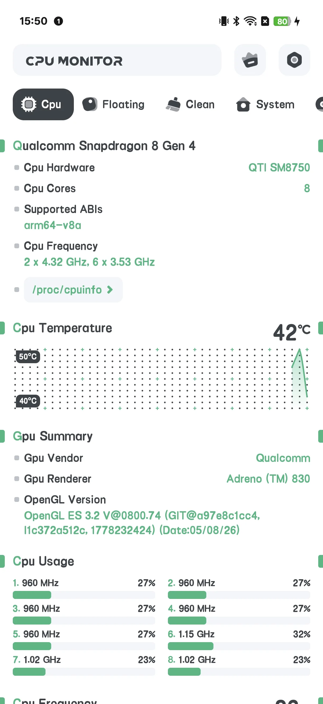
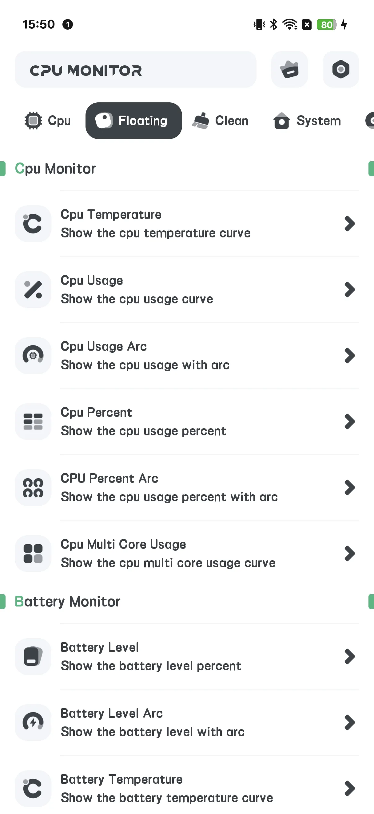
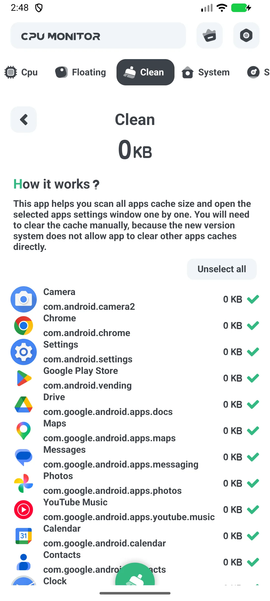
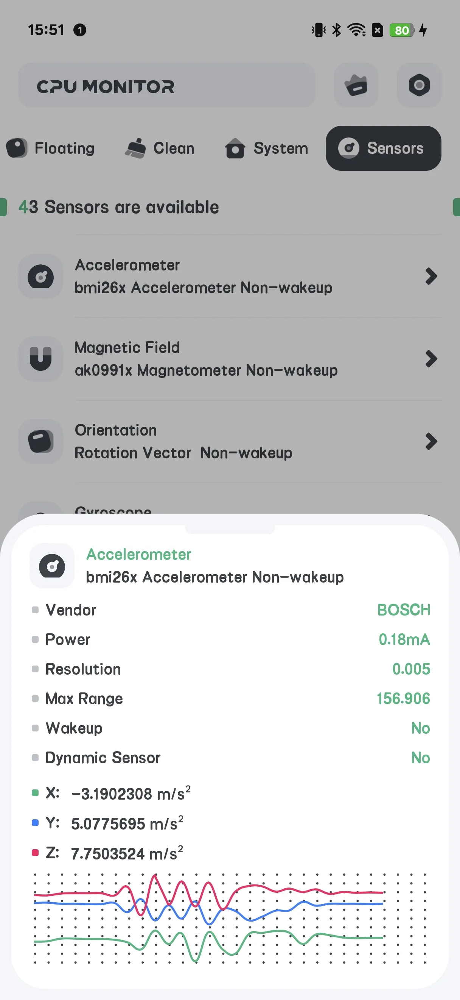
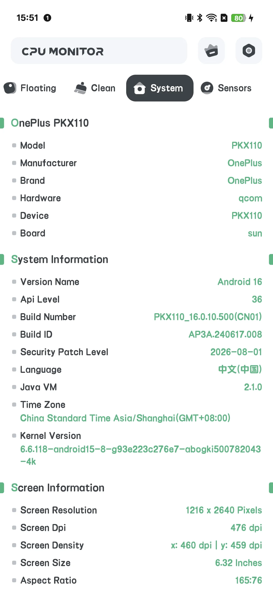

## 目录

- [应用简介](#应用简介)
- [首次使用](#首次使用)
- [实时 CPU](#实时-cpu)
- [浮窗](#浮窗)
- [主屏小组件](#主屏小组件)
- [过热报警](#过热报警)
- [历史曲线](#历史曲线)
- [升级到 Pro](#升级到-pro)
- [设置](#设置)
- [典型场景](#典型场景)
- [常见问题](#常见问题)

## 应用简介

CPU Monitor 在安卓上显示 **实时 [CPU 温度](/zh/glossary/what-is-a-cpu-temperature-monitor/) 与频率、RAM、电池与存储**，带浮窗、小组件、过热报警与历史曲线，是一款只读工具：免 root 读取热传感器与系统计数，不修改游戏数据或系统设置。这份指南从首次启动讲到 **cpu监控悬浮窗安卓**、**cpu过热报警 app** 的阈值、**cpu频率历史曲线**、**cpu内存电池小组件安卓** 的主屏布局，再到缓存清理界面——只解释数字的含义，不承诺降温。

理解"只读"这两个字很重要：它看到什么就报告什么，既不会替你关掉发热的应用，也不会给处理器降频。它的价值在于让你在问题变得严重之前得到信号——比如长时间游戏后温度一路走高，或者快充时电池烫得异常，你能据此决定暂停、摘掉手机壳还是拔掉充电器。下面按实际使用顺序，从主屏标签一路讲到浮窗、报警与历史回顾。

**📈 实时监控**
- CPU 温度与频率、每核使用率
- RAM、电池与存储状态一处看全

**🧹 清理**
- 一个 **清理** 屏幕列出应用缓存/垃圾，并可一键清除

**🌡 过热报警**
- 在热量损伤性能或电池前发出警告

**📉 历史**
- 温度 / 频率曲线，找出什么让你的设备发热

**💲 免费 + Pro**
- 免费版 **含广告**
- **Pro** 去广告并解锁"强力系统监控"工具集

## 首次使用

CPU Monitor 首次打开不用登录或授权，直接呈现当前状态，主屏有 CPU、SYSTEM、FLOATING、SENSOR 四个标签页加顶部一个升级按钮，适合先花一分钟四处点点、熟悉每页放的是什么。

{: width="180" .normal }
{: width="180" .normal }
{: width="180" .normal }
{: width="180" .normal }
{: width="180" .normal }

四个标签各管一摊：CPU 看温度与频率，SYSTEM 看 RAM、存储与电池，FLOATING 配置叠层，SENSOR 列出设备传感器。建议首次进入后先到 **CPU** 标签确认温度读数是否正常——如果传感器没有暴露真实数据，后面的报警和历史也就失去了意义。

## 实时 CPU

CPU Monitor 的实时 CPU 页在第 CPU 标签下，读取实时温度、频率与每核负载，免费版此处会显示一条横幅广告但不影响读数。每核负载比单一平均百分比更有用：当某个核心长期满载、其余空闲时，往往说明有应用卡在一个线程上；温度要结合频率一起看，高温伴随高频通常是正常负载，高温而频率被压低则可能已触发降频。若横幅挡住视线，升级 Pro 即可去掉。

1. 打开 **CPU** 标签
2. 读取实时 CPU 温度、频率与每核负载
3. 免费版此处会显示一条横幅广告

每核负载比单一的平均百分比更有用：当某个核心长期满载、其余空闲时，往往说明有应用卡在一个线程上；温度则要结合频率一起看，高温伴随高频通常是正常负载，高温而频率被压低则可能是已经触发了降频。免费版的横幅广告只在这一页出现，不影响读数本身；如果它挡住了视线，升级 Pro 即可去掉。

## 浮窗

CPU Monitor 的浮窗在 FLOATING 标签下开启，授予叠层权限后就能让实时数据浮在任意应用之上，可切换 CPU 温度、使用率、弧形、电池、FPS、RAM 与系统监控等项。叠层权限是 Android 系统级权限，只在你主动开启时申请，不用可保持关闭。建议只勾选当下真正关心的两三项，例如温度和 FPS，叠太多既占屏幕也让游戏画面杂乱；部分全面屏手机在全屏游戏时会自动隐藏悬浮窗，这是系统行为而非故障。

1. 打开 **FLOATING** 标签
2. 切换监控项（CPU 温度/使用率/弧形、电池、FPS、RAM、系统监控）
3. 按提示授予叠层权限
4. 实时数据浮在任意应用之上

叠层权限是 Android 的系统级权限，只在你主动开启浮窗时才会申请，不用时可以保持关闭。实际使用中，建议只勾选当下真正关心的两三项——例如温度和 FPS——叠太多数据既占屏幕，也会让游戏画面变得杂乱。部分全面屏手机在全屏游戏时会自动隐藏悬浮窗，这是系统行为而非故障；长时间不用也记得关掉浮窗，避免它一直占用前台。

## 主屏小组件

CPU Monitor 的主屏小组件从设置里的小组件画廊添加（仅 CPU 套件），可在主屏放一个 CPU 温度或使用率组件，适合不打开应用也想瞄一眼的场景。不同启动器对组件尺寸的支持略有差异，若在主屏找不到组件，先检查启动器是否允许第三方组件，再重启一次桌面。组件只是显示层的快捷方式，数据源和 CPU 标签里的读数一致，边充电边看视频时顺手确认电池是否烫得异常即可。

1. 打开 **设置 → 小组件画廊**（仅 CPU 套件）
2. 在主屏放一个 CPU 温度 / 使用率组件

小组件适合"不打开应用也想瞄一眼"的场景，比如边充电边看视频时，顺手确认电池是不是烫得异常。不同启动器对组件尺寸的支持略有差异，若在主屏找不到 CPU Monitor 的组件，先检查启动器是否允许第三方组件，再重启一次桌面。组件只是显示层的快捷方式，数据源和 CPU 标签里的读数一致。

## 过热报警

CPU Monitor 的过热报警在设置中开启，可分别给 CPU 和电池设阈值，在热量损伤性能或电池前发出警告。阈值不必过于激进：贴近日常最高温一点点，才能异常升温时及时提醒、又不频繁误报；CPU 与电池可以分开设，游戏时更在意 CPU、充电时盯住电池。报警只是提醒，应用不会替你采取行动，收到警告后该暂停、摘壳还是拔线仍由你决定。

1. 打开 **设置 → 过热报警**
2. 开启 CPU 和/或电池报警并设置阈值
3. 在造成损伤前你会收到警告

阈值不必设得过于激进：贴近日常最高温一点点，才能在异常升温时及时提醒，又不至于频繁误报。CPU 与电池可以分开设置——游戏时更在意 CPU 温度，充电时则盯住电池。报警只是提醒，应用不会替你采取行动，收到警告后该暂停游戏、摘壳还是拔线，仍由你决定。

## 历史曲线

CPU Monitor 的历史曲线在浮窗/历史视图中，展示随时间变化的温度与频率，用来找出哪款游戏或应用让温度飙升很方便。一次游戏结束后回看曲线，能看出温度是缓慢爬升还是某个场景突然冲高；配合频率线还能分辨是负载太大还是散热出了问题。长期记录的价值在于对比：同一款游戏在戴壳与不戴壳、空调房与闷热房间里的曲线差异，往往比单次读数更能说明问题。

## 升级到 Pro

CPU Monitor 的 Pro 升级从点升级按钮打开，强力系统监控会移除所有广告并解锁全部功能。如果只是偶尔查一次温度，免费版已经够用；但要是把它当日常监控工具、每天开浮窗看曲线，去广告和完整功能的体验会明显更顺畅。Pro 是让它从偶尔查询变成常驻仪表盘的分界。如果你只是偶尔查一次温度，免费版已经够用；但要是把它当成日常监控工具、每天都要开浮窗看曲线，去广告和完整功能的体验会明显更顺畅。

## 设置

CPU Monitor 的设置包含升级、主题、过热报警、温度单位、刷新率以及小组件画廊六项。温度单位可在摄氏度与华氏度之间切换，配合你熟悉的习惯；刷新率决定数据更新快慢，调高更跟手但多耗一点电，日常保持默认即可。主题只改变界面观感，不影响任何读数。

刷新率则决定数据更新快慢——调高更跟手，但也会多耗一点电，日常使用保持默认即可。主题只改变界面观感，不影响任何读数。

## 典型场景

CPU Monitor 的典型场景有五类：游戏时盯着热量、抓充电热点、找出元凶、快速清理、告别广告，都围绕"把温度变成看得见的数字"展开。打开 FLOATING 标签授予叠层权限，CPU 温度与电池便浮在游戏之上，让你在降频前暂停；发烫后打开历史曲线看是哪个应用让温度飙升，比凭感觉卸载靠谱。手机发卡时用清理屏幕回收缓存空间，长期当仪表盘用则升级移除广告。按你是游戏、快充还是排查场景来用即可。

- **游戏时盯着热量**——打开 FLOATING 标签、授予叠层权限，CPU 温度/电池便浮在游戏之上，让你在降频前暂停，避免一局打到关键时刻掉帧。
- **抓充电热点**——放一个主屏 CPU 组件、设好过热报警，电池发烫时你就会收到警告，方便判断是不是该换个充电器或摘掉手机壳。
- **找出元凶**——一局发烫后打开历史曲线，看是哪个应用让温度飙升；逐个排查比凭感觉卸载应用靠谱得多。
- **快速清理**——手机发卡时用清理屏幕清掉应用缓存/垃圾，把被占用的空间收回来。
- **告别广告**——点升级移除广告，并解锁完整的"强力系统监控"工具集，适合长期把它当仪表盘用的人。

## 常见问题

### CPU Monitor 和 System Monitor 是同一个吗？
{:.faq-q}
它们共享代码，但 CPU Monitor 额外有 **清理**（缓存）屏幕与 Pro 升级；System Monitor 是只读、无清理，且为一次性付费。如果你只想要纯粹的数字、不需要清理入口，System Monitor 更贴合；想顺手清缓存、先用免费版，就选 CPU Monitor。

### 为什么我看到广告？
{:.faq-q}
免费版含广告。升级到 Pro 即可移除。广告只出现在部分页面，不会篡改或遮挡核心监控数据。

## 小结

CPU Monitor 是一套实用的实时监控工具箱——实时温度、过热报警、浮窗数据、小组件与历史曲线——还附带缓存清理。它不会替你降温，却能在热量影响性能或电池之前给你一个清楚的提醒；对游戏玩家、快充用户和喜欢掌握设备状态的人来说，这是免费起步就能用上的一层保障。

## 相关术语

- [什么是 CPU 温度监控？](/zh/glossary/what-is-a-cpu-temperature-monitor/)
- [什么是系统监控（System Monitor）？](/zh/glossary/what-is-a-system-monitor/)
