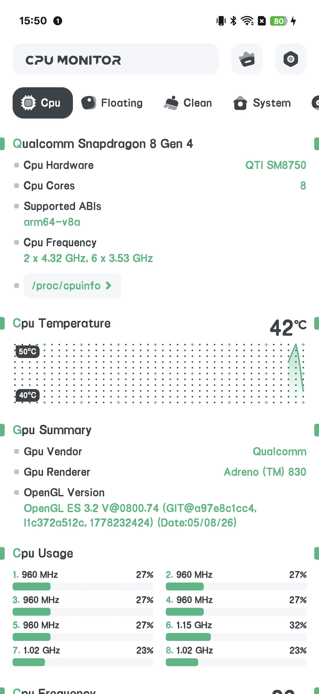
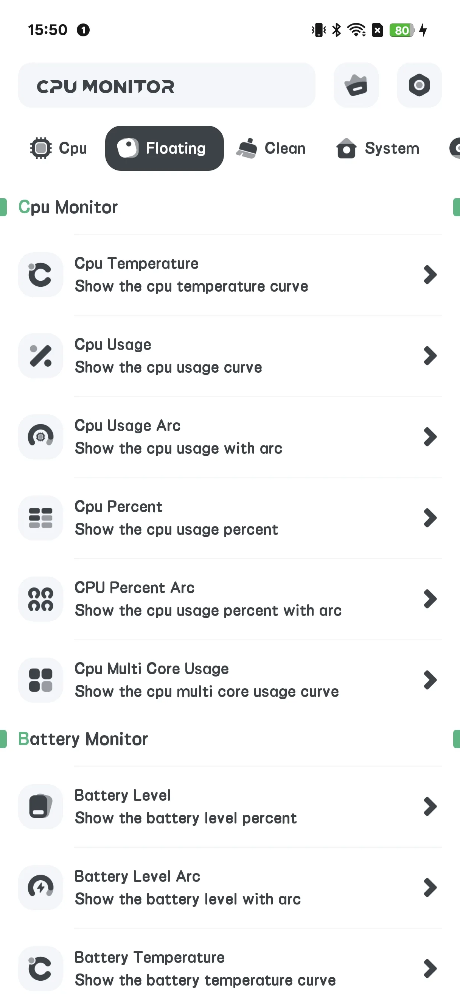
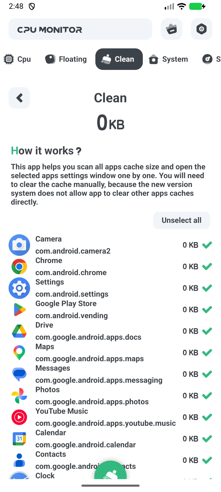
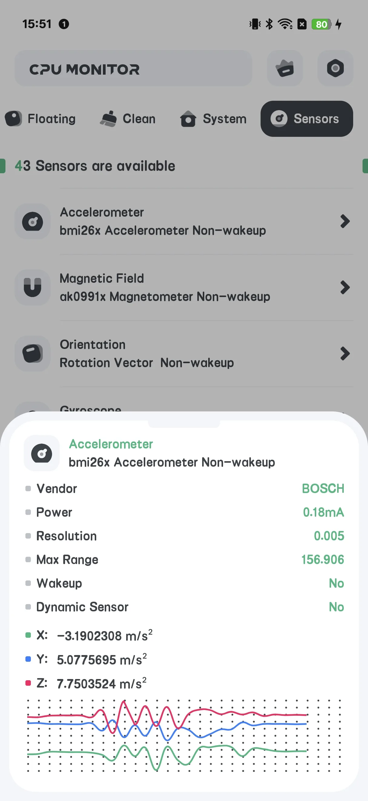
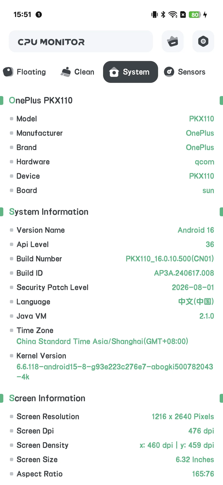

## 目录

- [应用简介](#应用简介)
- [首次使用](#首次使用)
- [实时 CPU](#实时-cpu)
- [浮窗](#浮窗)
- [主屏小组件](#主屏小组件)
- [过热报警](#过热报警)
- [历史曲线](#历史曲线)
- [升级到 Pro](#升级到-pro)
- [设置](#设置)
- [典型场景](#典型场景)
- [常见问题](#常见问题)

## 应用简介

CPU Monitor 在安卓上显示 **实时 [CPU 温度](/zh/glossary/what-is-a-cpu-temperature-monitor/) 与频率、RAM、电池与存储**，带浮窗、小组件、过热报警与历史曲线。

**📈 实时监控**
- CPU 温度与频率、每核使用率
- RAM、电池与存储状态一处看全

**🧹 清理**
- 一个 **清理** 屏幕列出应用缓存/垃圾，并可一键清除

**🌡 过热报警**
- 在热量损伤性能或电池前发出警告

**📉 历史**
- 温度 / 频率曲线，找出什么让你的设备发热

**💲 免费 + Pro**
- 免费版 **含广告**
- **Pro** 去广告并解锁"强力系统监控"工具集

## 首次使用

主屏有标签页：**CPU / SYSTEM / FLOATING / SENSOR**，顶部有一个 **升级** 按钮。

{: width="180" .normal }
{: width="180" .normal }
{: width="180" .normal }
{: width="180" .normal }
{: width="180" .normal }

## 实时 CPU

1. 打开 **CPU** 标签
2. 读取实时 CPU 温度、频率与每核负载
3. 免费版此处会显示一条横幅广告

## 浮窗

1. 打开 **FLOATING** 标签
2. 切换监控项（CPU 温度/使用率/弧形、电池、FPS、RAM、系统监控）
3. 按提示授予叠层权限
4. 实时数据浮在任意应用之上

## 主屏小组件

1. 打开 **设置 → 小组件画廊**（仅 CPU 套件）
2. 在主屏放一个 CPU 温度 / 使用率组件

## 过热报警

1. 打开 **设置 → 过热报警**
2. 开启 CPU 和/或电池报警并设置阈值
3. 在造成损伤前你会收到警告

## 历史曲线

在浮窗/历史视图中，你可以看到随时间的 **温度与频率曲线**——用来找出哪款游戏或应用让温度飙升很方便。

## 升级到 Pro

点 **升级** 打开 Pro 界面："强力系统监控"会移除所有广告并解锁全部功能。

## 设置

设置包含升级、主题、过热报警、温度单位、刷新率，以及小组件画廊。

## 典型场景

- **游戏时盯着热量**——打开 FLOATING 标签、授予叠层权限，CPU 温度/电池便浮在游戏之上，让你在降频前暂停。
- **抓充电热点**——放一个主屏 CPU 组件、设好过热报警，电池发烫时你就会收到警告。
- **找出元凶**——一局发烫后打开历史曲线，看是哪个应用让温度飙升。
- **快速清理**——手机发卡时用清理屏幕清掉应用缓存/垃圾。
- **告别广告**——点升级移除广告，并解锁完整的"强力系统监控"工具集。

## 常见问题

### CPU Monitor 和 System Monitor 是同一个吗？
它们共享代码，但 CPU Monitor 额外有 **清理**（缓存）屏幕与 Pro 升级；System Monitor 是只读、无清理。

### 为什么我看到广告？
免费版含广告。升级到 Pro 即可移除。

## 小结

CPU Monitor 是一套实用的实时监控工具箱——实时温度、过热报警、浮窗数据、小组件与历史曲线——还附带缓存清理。

## 相关术语

- [什么是 CPU 温度监控？](/zh/glossary/what-is-a-cpu-temperature-monitor/)
- [什么是系统监控（System Monitor）？](/zh/glossary/what-is-a-system-monitor/)
