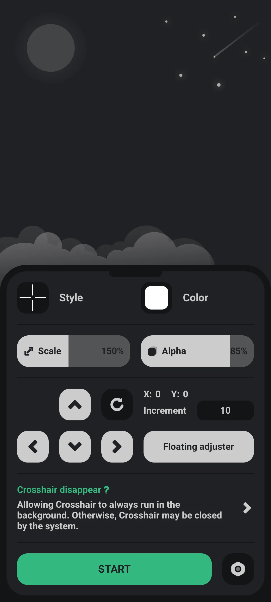
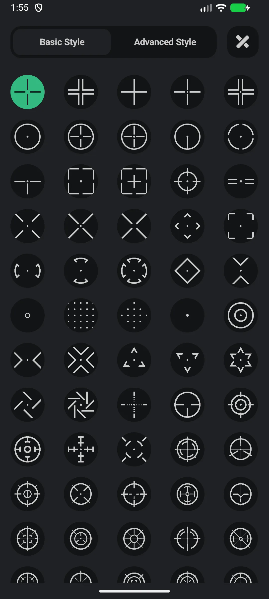
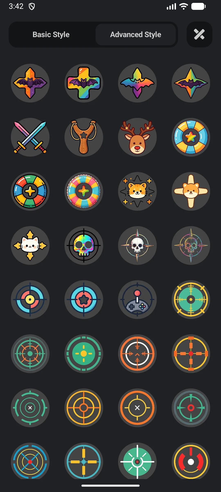
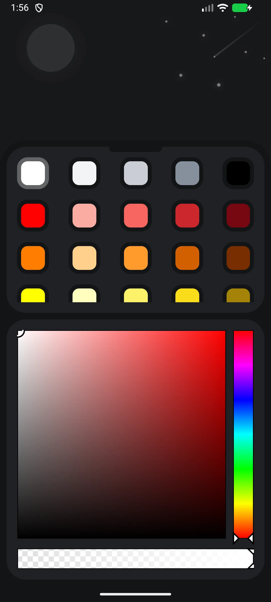
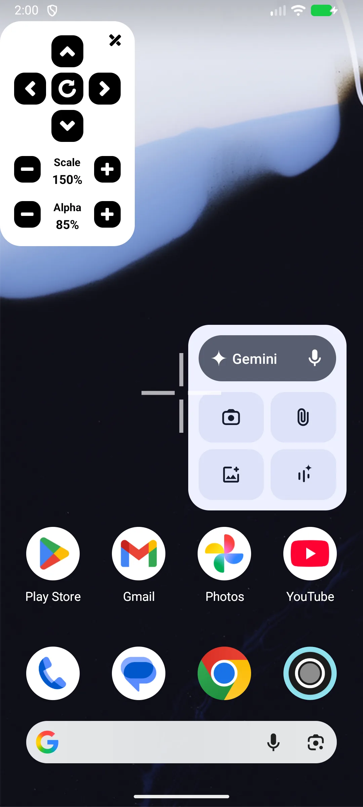

## 目录

- [应用简介](#应用简介)
- [首次使用](#首次使用)
- [授予叠层权限](#授予叠层权限)
- [选择准星样式](#选择准星样式)
- [自定义大小、颜色、位置](#自定义大小颜色位置)
- [在游戏中使用](#在游戏中使用)
- [解锁更多样式](#解锁更多样式)
- [常见问题](#常见问题)

## 应用简介

Crosshair（Crosshair Aim）为安卓上的 FPS 游戏添加 **[自定义准星叠层](/zh/glossary/what-is-a-crosshair/)**，拥有 **80+ 设计** 来改善你的瞄准——一款免费、且属于 **自定义准星安卓** 的免 root 工具。很多射击手游并不给每把武器都配清晰的准星，或者准星颜色与地图背景混在一起难以辨认；这款应用就是在屏幕最上层画一个你自己选的标记，给每一枪一个稳定的参照点。下面的指南从授予权限、挑样式，到缩放、改色、微调位置，最后讲怎样在游戏里实时调整。

**🎯 80+ 样式**
- 内置 **84 款基础**（扁平）样式
- **63 款 Pro**（进阶）样式
- 免费用户永久保留约 30 款；其余通过 24 小时奖励广告或 Pro 应用解锁

**🛠 自定义**
- **缩放** 50%–300%
- **透明度** 30%–100%
- **颜色**：60 种颜色 + 取色器
- **位置**：用方向键拖动（无粗细滑块——粗细已内嵌于每款样式）

**🔓 无需 root、无需无障碍**
- 只需 **"在其他应用上层绘制"**（叠层）权限

> 注意：**没有每游戏预设**——应用只保留一份全局准星配置。这意味着换游戏时若要换样式，需要手动改一次。

## 首次使用

打开应用进入主控制台。界面很直接：所有高频操作都集中在首屏，不需要先注册或看一段引导。

- 一个 **开始/停止** 按钮显示/隐藏准星
- 点击 **样式** 区选设计、**颜色** 选颜色，使用 **缩放/透明度** 滑块
- 设置齿轮可打开语言、评分、分享与升级

{: width="180" .normal }

建议第一次进来先别急着进游戏：把样式、颜色、大小大致调好，再开启一次准星看看它在主屏上的样子。这样等到真正开局，你只需要处理位置微调这一步，不至于手忙脚乱。

## 授予叠层权限

1. 点击准星开关 / 开始
2. 若弹出提示，授予 **"显示弹出窗口"**（在其他应用上层绘制）
3. 应用打开系统设置 → "在其他应用上层绘制"；为 Crosshair 启用
4. 返回应用

此权限（非无障碍、非 root）就是准星能停在游戏之上的原因。它属于 Android 的系统级敏感权限，只在你主动开启准星时才会申请；日常不玩游戏时可以保持关闭，减少它被常驻占用。个别国产定制系统会额外弹出"悬浮窗"或"应用悬浮窗管理"的确认，按提示允许即可；如果返回后准星仍未出现，重启一次应用通常就能解决。

## 选择准星样式

1. 点击 **样式** 区 → **样式** 界面
2. 切换 **基础**（5 列网格）/ **进阶**（4 列网格）标签
3. 点击缩略图应用它
4. 锁定的 Pro 样式会提示看奖励广告或升级

{: width="180" .normal }
{: width="180" .normal }

选样式时不妨按玩法来：狙击向的玩家常偏好一个细小的点，避免在远距离遮住目标；近距离遭遇战多的人则可能选择十字或圆环，更容易在移动中锁定中心。基础样式免费可用、覆盖多数场景，进阶样式更花哨但需要解锁。选定后回到主屏，用下一节的滑块把它调到顺眼为止。

## 自定义大小、颜色、位置

- **缩放**：拖动缩放滑块（50%–300%）
- **透明度**：拖动透明度滑块（30%–100%）
- **颜色**：打开 **颜色** → 从 60 种颜色中选或用取色器
- **位置**：用方向键微调；通过步长输入框设定步长（1–50，默认 10）；或在游戏内拖动屏幕控制面板

**没有独立的粗细滑块**——每款预渲染样式已自带粗细。

{: width="180" .normal }

几个实用经验：颜色尽量选与常见地图背景反差大的，雪地地图用深色、暗色场景用亮色，必要时用取色器精确匹配；缩放不是越大越好，过大的准星会挡住目标本身，50%–300% 的范围里通常中间档最百搭；透明度调低能让准星更"退到背景里"，减少长时间盯屏的视觉疲劳。位置微调时把步长从默认 10 调小到 1，可以做到像素级的对齐，尤其适合强迫症式的居中需求。

## 在游戏中使用

1. 启用准星（开始）
2. 启动你的 FPS 游戏
3. 准星浮在游戏之上，且 **不** 拦截触摸（所以你的点按仍落在游戏里）
4. 点击准星打开浮动控制面板：大小 +/−、透明度 +/−、方向键、重置、关闭

{: width="180" .normal }

"不拦截触摸"是关键设计：准星只是画在屏幕上，你的开火、移动、换弹操作照常传给游戏，不会被这层叠层吃掉。对局中如果发现准星偏了或太碍眼，直接点它呼出浮动面板，用大小和透明度按钮边打边调，不必退出到设置里来回切。调乱了就按重置回到默认，再关闭面板专心跳下一局。

## 解锁更多样式

- **免费**：约 30 款永久 + 看奖励广告解锁一款锁定样式 **24 小时**
- **Pro**（独立应用）：无广告，全部 147 款样式永久可用

如果你只是想验证"准星叠层对我有没有用"，免费档的约 30 款加上奖励广告的临时解锁已经足够试出感觉；确认自己会长期用、又不想每次都被广告打断，再考虑 Pro 的一次性解锁更划算。注意 Pro 是独立应用，装好后免费档里的锁定项才会全部打开。

## 常见问题

### 我需要 root 或无障碍吗？
{:.faq-q}
不需要。只需叠层（在其他应用上层绘制）权限。这也是它比许多"辅助瞄准"类工具更容易被接受的原因——它只在屏幕上作画，不碰游戏数据。

### 能按游戏保存不同准星吗？
{:.faq-q}
不能——应用只存一份全局配置。切换游戏时需手动更改；如果两款游戏风格差异很大，可以在每次开局前用浮动面板快速换一次。

### 能改粗细吗？
{:.faq-q}
不能单独改。粗细是每款样式设计的一部分；想要更细或更粗，换一个对应风格的样式即可。

## 小结

Crosshair 是给任何安卓射击游戏加一枚精准、可自定义准星最轻量的方式——无需 root、无需无障碍，80+ 样式加免费档即可起步。它做的事很单一：在屏幕上画一个你看得清、调得动的参照点；把它调到适合你的地图和武器，剩下的就交给你的枪法。

## 相关术语

- [什么是准星（Crosshair）？](/zh/glossary/what-is-a-crosshair/)
