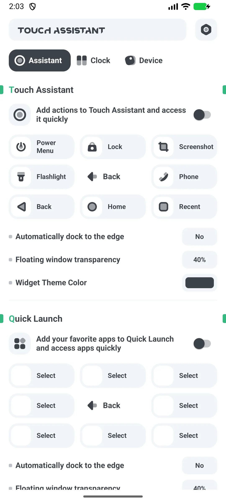
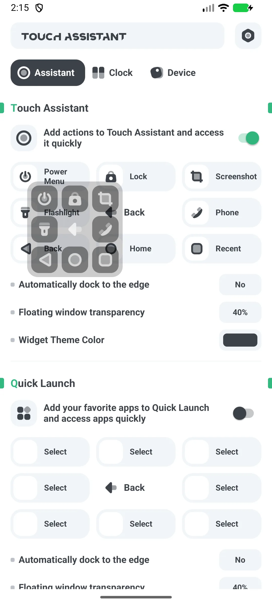
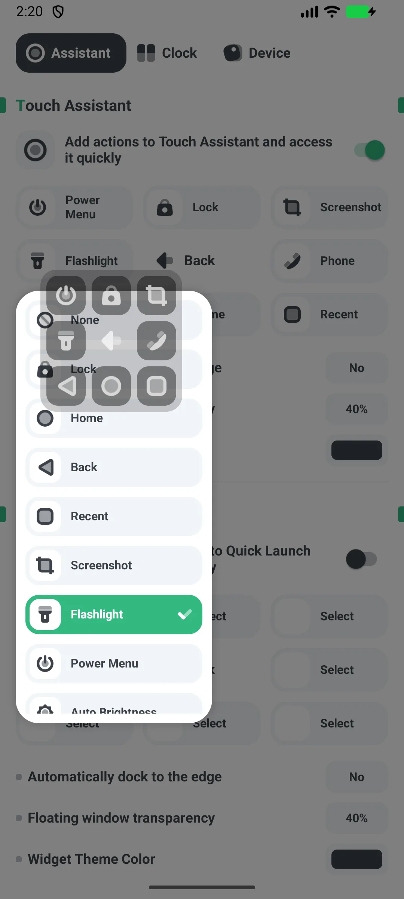

## 目录

- [应用简介](#应用简介)
- [首次使用](#首次使用)
- [授予叠层与无障碍](#授予叠层与无障碍)
- [启用并移动浮动球](#启用并移动浮动球)
- [球的动作](#球的动作)
- [应用快捷方式](#应用快捷方式)
- [系统开关小组件](#系统开关小组件)
- [大小、颜色、吸附](#大小颜色吸附)
- [单手使用](#单手使用)
- [免费 vs Pro](#免费-vs-pro)
- [典型场景](#典型场景)
- [常见问题](#常见问题)

## 应用简介

Floating Assistant 为安卓添加一颗 **[浮动球](/zh/glossary/what-is-a-floating-window/)**，用 8 个动作槽、15 种可选动作与 11 个系统开关小组件，实现应用启动、系统开关与大屏手机单手控制，是一款免 root 的单手操作悬浮球工具。球可吸附左右任一侧、每个位置都能重新指派，快捷方式覆盖应用、联系人与系统开关。这份指南从首次启动讲到授予叠层与无障碍权限、移动与缩放小球、设置 **自定义悬浮球快捷方式**，再到免费/Pro 分界——并用直白的话说明这些权限允许什么、不允许什么。

先说清楚它能做什么、不能做什么，免得你对权限产生误解：这颗球本质上是一个可以浮在任意应用之上的快捷菜单，点开是一圈动作槽，每个槽由你指定功能。它不会读取你的聊天内容或解锁你的手机，但为了实现"回主页、返回、锁屏"这类全局动作，确实需要系统赋予的无障碍服务权限。理解这一点之后，下面的设置步骤就很好判断哪些该开、哪些可以不开。

**🔵 浮动球**
- 可在任意应用之上拖动的球（无需 root）
- 通过无障碍服务替代硬件按键

**⚡ 8 个动作槽**
- 15 种可能动作：电源菜单、锁屏、截图、手电筒、电话、返回、主页、最近任务、自动亮度、自动旋转、音量 +/−/静音，等等

**📱 应用快捷方式**
- 8 个槽启动你已装的应用（提供电话/拨号动作；**没有联系人快捷方式**）

**🔧 系统开关小组件**
- 11 个主屏小组件：蓝牙、移动数据、Wi-Fi、手电筒、旋转、飞行模式、热点、勿扰、定位、振动、深色模式

**💲 免费 + Pro**
- 免费含广告；**Pro** 是独立的无广告应用

## 首次使用

Floating Assistant 首次使用从"主页入口"开关开始，这个开关是整套功能的总闸：关掉它浮动球立刻消失，打开它球才会出现在屏幕上，顶部还有升级推广与设置齿轮。

- 打开 **主页入口** 显示浮动球
- 设置齿轮可打开语言、评分、分享与升级

{: width="180" .normal }

首次打开时，应用会借这个开关引导你完成权限授予。建议耐心走完一次，之后球会常驻在屏幕边缘，随手就能用。

## 授予叠层与无障碍

Floating Assistant 的悬浮球需要叠层与无障碍两项权限：叠层让球绘于应用之上，无障碍让它执行主页、返回、最近、锁屏、截图这类全局动作，另需忽略电池优化以免球被系统回收。两项权限作用范围很具体，前者只决定能不能画在别的窗口上，后者只用于触发系统级点击。如果不打算用全局按键动作，无障碍可以不授予，但相应槽位也就无法工作。

1. 打开 **主页入口**
2. 弹出提示时授予 **"在其他应用上层绘制"**（系统设置）
3. 弹出提示时接受 **无障碍**——球的按钮动作（主页/返回/最近/锁屏/截图）需要它
4. 允许 **忽略电池优化**，以免球被杀死

叠层权限让球能绘于应用之上；无障碍让它能执行全局动作。这两项权限看起来吓人，但作用范围很具体：前者只决定"能不能画在别的窗口上面"，后者只用于触发返回、主页这类系统级点击。忽略电池优化则是为了保证球在屏幕长时间点亮时不被系统回收——少了这一步，你可能会发现用着用着球就凭空消失了。如果不打算用全局按键动作，无障碍可以不授予，但相应的槽位也就无法工作。

## 启用并移动浮动球

Floating Assistant 的球启用后会自动吸附到左或右边缘，位置按屏幕百分比保存，换分辨率相近的设备布局大体还在原处。拖动时把它放在拇指自然落点附近，单手操作时放得越低越好够，常用右手则右边缘通常比左边缘顺手。自动吸附让球不会停在碍事的屏幕正中，松手即靠边。

1. 启用 **主页入口**
2. 球出现；**拖动** 它重新定位——它会自动吸附到左/右边缘
3. 位置以屏幕百分比保存

{: width="180" .normal }

自动吸附的设计让球不会停在碍事的屏幕正中——松手后它会靠到左边缘或右边缘。拖动时留意把它放在拇指自然落点附近：单手操作时，球放得越低越好够；如果你常用右手，右边缘通常比左边缘顺手。位置按屏幕百分比保存，所以以后换了分辨率相近的设备，布局大体还在原来的地方。

## 球的动作

Floating Assistant 的球点击后展开为 8 个动作槽，默认值覆盖电源菜单、锁屏、截图、手电筒、电话、返回、主页与最近任务，再点一次球收起。15 种可选动作里，自动亮度、自动旋转、音量加减与静音这类一次点击的操作特别适合放进槽里，省得每次去拉设置面板。需注意主页、返回、锁屏、截图都依赖无障碍权限，没开的话点了槽也不会有反应。

1. 点击球将其 **展开** 为 8 个槽
2. 每个槽触发其映射动作（电源菜单、锁屏、截图、手电筒、电话、返回、主页、最近任务……）
3. 再次点击球收起

默认值：1=电源菜单，2=锁屏，3=截图，4=手电筒，6=电话，7=返回，8=主页，9=最近任务。

这些默认值已经覆盖了最常用的几项，你可以直接用，也可以按习惯重新指派。15 种可选动作里，自动亮度、自动旋转、音量加减/静音这类"一次点击"的操作特别适合放进槽里，省得每次都去拉设置面板。需要注意的是，凡涉及主页、返回、锁屏、截图的动作都依赖前面授予的无障碍权限；没开的话，点了槽也不会有反应。

## 应用快捷方式

Floating Assistant 的应用快捷方式用最多 8 个槽启动已装应用，等于给手机加了一层第二主屏：无论正在哪个应用里，点开球就能跳到常用应用，不用退回主屏翻图标。选应用时优先放一天开好几次的，冷门应用留给真正的主屏；若某应用被卸载，点击该槽会打开 Google Play 重新下载，不会出现点了没反应。

1. 用最多 8 个槽配置 **应用启动器** 球/小组件
2. 在每个槽里选一个已装应用
3. 点击启动它（若缺失则打开 Google Play）

把 8 个槽填满日常应用，等于给手机做了一层"第二主屏"：无论你正在哪个应用里，点开球就能跳到微信、地图、相机，不用退回去翻图标。选应用时优先放那些一天要开好几次的，冷门应用留给真正的主屏就好。若某个应用被卸载，点击该槽会打开 Google Play 让你重新下载，不会出现点了没反应的情况。

## 系统开关小组件

Floating Assistant 提供 11 类系统开关小组件，但要分清两类行为：手电筒和旋转直接改动系统状态、点一下就生效，Wi-Fi、蓝牙、勿扰则是打开对应系统设置界面、仍需在系统里再点一次，这是 Android 对第三方应用修改开关的限制、不是失灵。想一步控制多项，用组合小组件把常用开关收进同一条，放进主屏或球的菜单里都行。

1. 从小组件选择器添加 **开关小组件**（11 类）
2. 示例：
   - **手电筒** 实际切换闪光灯
   - **Wi-Fi / 蓝牙 / 勿扰** 打开各自的系统设置界面
   - **旋转** 写入自动旋转设置
3. 用 **组合** 小组件把多个开关归一组

{: width="180" .normal }

这里要分清两类行为：手电筒和旋转是直接改动系统状态，点一下就生效；Wi-Fi、蓝牙、勿扰则是打开对应的系统设置界面，仍需你在系统里再点一次——这是 Android 对第三方应用修改这些开关的限制，不是应用失灵。想一步到位地控制多项，就用 **组合** 小组件把常用开关收进同一条，放进主屏或球的菜单里都行。

## 大小、颜色、吸附

Floating Assistant 的外观有大小 5 档、透明度可调（默认约 40%）、黑/白/绿/蓝/黄/紫六色与边缘吸附开关四项，看着琐碎却直接影响你愿不愿意一直让它显示。大屏手机建议选大一档球、拇指更容易点中，浅色壁纸选黑球、深色壁纸选白球对比度更高；嫌挡内容就打开吸附让它靠边待着。

- **大小**：5 档 S/M/L/XL/XXL
- **透明度**：可调（默认约 40%）
- **颜色**：黑 / 白 / 绿 / 蓝 / 黄 / 紫（默认黑）
- **吸附**：开关控制边缘自动吸附

外观调整看着琐碎，却直接影响你愿不愿意一直让它显示。大屏手机建议选大一档的球，拇指更容易点中；透明度调低能让球不那么抢眼，默认约 40% 是个折中值。浅色壁纸下选黑球、深色壁纸下选白球，对比度更高；如果还是嫌它挡内容，把吸附打开让它靠边待着即可。

## 单手使用

Floating Assistant 通过无障碍服务让你用拇指完成主页、返回、最近任务、电源菜单、锁屏、截图，加上球上的手电筒、音量、旋转，不必去够实体按键——这对大屏手机尤其重要。很多人单手握持时电源键和音量键刚好落在够不着的上边缘，而返回、主页又藏在屏幕底部；把球拖到下方边缘、把最常用的四项动作排好，躺着刷视频、拎着东西回消息时也能完成全部导航，实体按键可以彻底不用碰。

## 免费 vs Pro

Floating Assistant 的免费与 Pro 主要差在广告：免费版功能不缩水、含横幅与插屏广告，Pro 是独立安装的无广告应用、不靠订阅收费。只是想试试悬浮球是否顺手，免费版完全够用；确认天天会用又受不了插屏广告频繁弹出，再换 Pro 不迟。应用里点升级只是跳到 Google Play 下载 Pro，不会在原应用里直接解锁。

- **免费** 含广告（横幅 + 插屏）
- **Pro** 是独立应用，**无广告**；应用内升级只是为它打开 Google Play

免费版的功能并不缩水，广告是主要区别——如果你只是想试试悬浮球是否顺手，免费版完全够用。Pro 是单独安装的应用，不靠订阅收费；应用里点升级只是跳到 Google Play 下载它，并不会在原应用里直接解锁。确认自己天天会用、又受不了插屏广告频繁弹出，再换 Pro 不迟。

## 典型场景

Floating Assistant 的典型场景有五类：首次设置、大屏手机单手用、不按电源键锁屏、快速跳应用、不用深挖的开关，都围绕"把够不着、藏得深的动作收进一颗球"展开。一次性授予叠层与无障碍权限后球常驻任意应用之上；把球拖到屏幕底部边缘，返回、主页、多任务与截图都落在拇指下。8 个应用槽填满日常应用可跳过找图标，11 个系统开关小组件放主屏则一步控制、不必层层点进设置。

- **首次设置**——打开主页入口，一次性授予「在其他应用上层绘制」与「无障碍」，此后球常驻任意应用之上，不用每次重新配置。
- **大屏手机单手用**——把球拖到屏幕底部边缘，返回/主页/多任务与截图都落在拇指下，躺着也能操作整台手机。
- **不按电源键锁屏**——把某个槽映射为锁屏，替下硬件键，也省去够屏幕上边缘的动作。
- **快速跳应用**——把 8 个应用槽填满日常应用，跳过回主屏找图标的步骤，跨应用切换一步到位。
- **不用深挖的开关**——把 11 个系统开关小组件（Wi-Fi、手电筒、勿扰……）放到主屏，一步控制，不必层层点进设置。

## 常见问题

### 有联系人快捷方式吗？
{:.faq-q}
没有。唯一与人相关的动作是 **电话/拨号** 快捷方式。没有联系人快捷方式；想快速联系某人，可以用拨号槽再输号码，或交给系统的电话应用。

### 能滑动球吗？
{:.faq-q}
手势 **只有** 点击展开、点击槽、拖动移动/吸附。没有左右滑动映射；如果你习惯了别的悬浮球工具的手势，这里需要换一套肌肉记忆。

### 为什么需要无障碍？
{:.faq-q}
全局按钮动作（主页/返回/最近任务/锁屏/截图）通过安卓的无障碍服务执行。这是系统给第三方应用提供的合法途径，应用用它来模拟这些点击，不会读取或上传你的屏幕内容。

## 小结

Floating Assistant 让大屏手机可以单手操作：一颗用于启动与应用动作的浮动球，外加开关小组件——免费起步，另有无广告的 Pro 应用。它不会改变你使用手机的方式，只是把那些够不着、藏得深的动作，收进一颗拇指随时能点开的球里。

## 相关术语

- [什么是辅助触控（Assistive Touch）？](/zh/glossary/what-is-assistive-touch/)
- [什么是悬浮窗（Floating Window）？](/zh/glossary/what-is-a-floating-window/)
