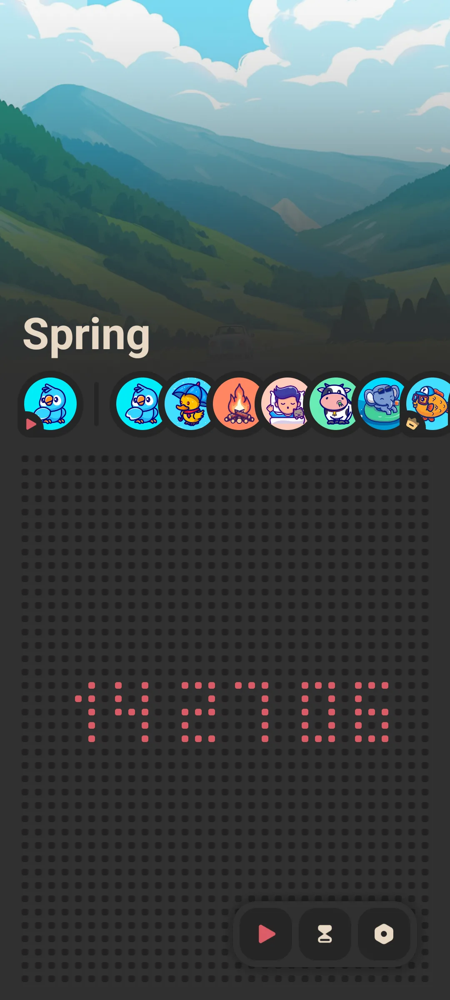
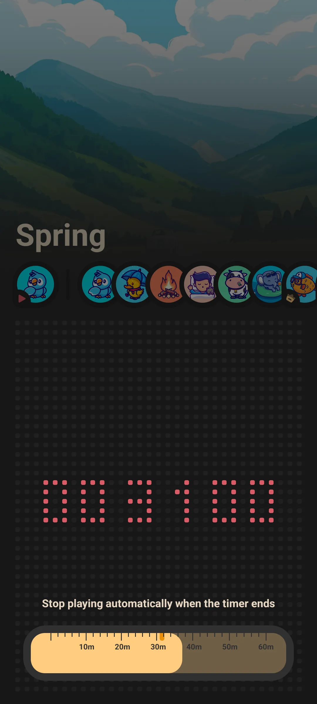
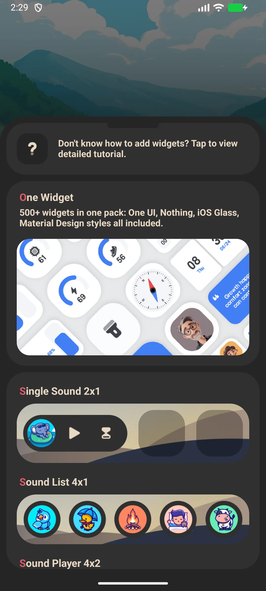

## 目录

- [应用简介](#应用简介)
- [首次使用](#首次使用)
- [播放环境声](#播放环境声)
- [睡眠计时器](#睡眠计时器)
- [后台与熄屏播放](#后台与熄屏播放)
- [主题](#主题)
- [主屏小组件](#主屏小组件)
- [免费 vs 高级声音](#免费-vs-高级声音)
- [设置](#设置)
- [典型场景](#典型场景)
- [常见问题](#常见问题)

## 应用简介

Meow FM 是一款猫主题[白噪音](/zh/glossary/what-is-white-noise/)应用，带 15+ 环境声、0–60 分钟睡眠计时器与完全离线播放，用于睡眠、放松与专注，让你更快入睡、更久专注，或让嘈杂的房间安静下来。它是一款 **离线也能播的白噪音 app**：音源放在设备里，熄屏、飞机上、没信号时照样能用，正是遮住突兀噪音最常被需要的时刻。这份指南会从第一次播放讲到 **白噪音定时关闭**、把 **雨声白噪音** 垫在棕噪音下做混音，再到主屏小组件——全程无需账号。

先明确一点：Meow FM 一次只播一段声音，所谓"混音"更多是挑一段本身就组合好的场景（例如暴风已经把雨和雷合在一起），而不是让你把多条音轨叠在一起。理解了这一点，选声音时就会直接去找最贴合当下的那一段，而不是纠结于怎么叠加。下面的步骤按真实使用顺序写：按下播放、设好计时、熄屏放着，最后再把它钉到主屏方便一键启动。

**🌧 环境声**
- 一个 **15+ 声音** 的曲库：雨、暴风、森林、壁炉、风、海边、夏夜，等等
- 浏览横向声音列表，点按播放

**⏲ 睡眠计时器**
- 0 到 60 分钟的计时滑块；结束播放自动停止，永不会响到天亮

**🔇 离线**
- 每段声音无需网络连接即可播放——航班、通勤与不稳定的酒店 Wi-Fi 上都很棒

**🎨 简洁**
- 浅色 / 深色主题
- 免费起步；一次性解锁开启高级声音场景

> 注意：Meow FM **一次只播一个声音**（没有把多个声音叠加/混合的混合器）。挑当下最合的场景。

## 首次使用

Meow FM 首次使用只需在主屏单页点按声音播放、再点停止，并用计时滑块安排自动停止，没有多级菜单也没有注册引导。主屏由一个已选声音芯片加可滚动的全部声音列表组成，所有操作都在这一页完成。

- 点按声音播放它
- 再点一次停止
- 用计时滑块安排自动停止

{: width="180" .normal }

第一次用建议先横着滑一遍列表，听听哪段声音合你的耳朵，然后再设计时——比起纠结"哪段最好"，找到你能长时间接受的那段更重要。

## 播放环境声

Meow FM 播放环境声只需在主屏滚动声音列表、点按一段即开始播放，再点同一段停止或点另一段切换，切换一步到位无需先按停止。播放在你用其他应用或锁屏后仍会持续，选好声音即可放心去做别的事。想遮噪，雨声和暴风最百搭；想放松，森林、海边和夏夜更柔和。

1. 在主屏滚动声音列表
2. 点按一个声音（如 **雨** 或 **暴风**）
3. 它立即开始播放，芯片更新
4. 再点同一个声音停止，或点另一个切换

播放会持续，即使你用其他应用或锁屏。这意味着选好声音后就可以放心去做别的事——回几条消息、翻一会儿书，声音会在背景里一直铺着。切换声音也是一步到位：点另一段，旧的立刻停、新的接上，不需要先按停止。想找"遮噪"效果，雨声和暴风通常最百搭；想放松，森林、海边和夏夜更柔和。

## 睡眠计时器

Meow FM 的睡眠计时器用 0 到 60 分钟的滑块设定，归零时播放自动停止，防止声音响到天亮。计时长度按入睡速度来定，十分钟就睡着可设短些省电，需要声音陪浅眠则设到 60 分钟。关键是别停在 0——那等于不设计时、声音会一直放到天亮；把滑块当防止整夜播放的保险，提前设好放下手机即可。

1. 拖动 **计时滑块** 从 0 到 60 分钟
2. 计时归零时播放自动停止
3. 在入睡前置好，声音就不会整夜响

{: width="180" .normal }

计时长度可以按你的入睡速度来定：有人十分钟就睡着，设短一点更省电；有人需要声音陪一整段浅眠，就设到 60 分钟。关键是别停在 0（那等于不设计时），否则声音会一直放到天亮。把滑块当作"防止整夜播放"的保险，而不是精确的入睡计时——提前设好、放下手机即可，不必盯着它数分钟。

## 后台与熄屏播放

Meow FM 用前台播放服务让声音在熄屏后继续、且不依赖服务器，音源都在本机，飞机上没信号或酒店 Wi-Fi 不稳也不会转圈加载。你按下播放、把手机扣在枕头边，屏幕暗了声音也不会断；通知里会留一条播放提示，方便随时回来看一眼或停止。对睡眠和长时间专注来说，播得稳、不用管比什么都重要。

## 主题

Meow FM 的主题在设置的浅色与深色模式间切换，默认开启深色。睡前建议保持深色：夜里屏幕整体更暗、不容易刺眼，也不会打扰已适应黑暗的眼睛；白天在桌前用浅色配白背景更清爽。主题只改变外观，不影响声音播放和计时。睡前建议保持深色：夜里屏幕整体更暗，不容易刺眼，也不会打扰已经适应黑暗的眼睛。白天在桌前用，浅色模式配白色背景看起来更清爽。主题只改变外观，不影响声音播放和计时。

## 主屏小组件

Meow FM 提供三种主屏小组件：单一声音一键播放所选声音、声音列表快速访问多个声音、声音播放器/封面一个播放器组件，从小组件选择器添加后在配置里设定声音即可。每晚用同一段声音入睡，单一声音组件最省事、放主屏角落点一下就放；习惯按场景切换则更适合声音列表。若组件列表里没有，检查启动器是否允许第三方组件后再重启桌面。

- **单一声音**——一键播放所选声音
- **声音列表**——快速访问多个声音
- **声音播放器 / 封面**——一个播放器组件

从小组件选择器添加，再在组件配置里设定声音。

{: width="180" .normal }

如果你每晚都用同一段声音入睡，"单一声音"组件最省事——放在主屏角落，躺下时点一下就开始，不用打开应用。习惯按场景切换的人更适合"声音列表"，几种常用声音都在眼前。不同启动器添加组件的方式略有差别，通常是长按主屏空白处 → 组件 → 找到 Meow FM → 拖到想要的位置；若组件列表里没有，检查启动器是否允许第三方组件后再重启一次桌面。

## 免费 vs 高级声音

Meow FM 的免费档可播放一组声音，额外高级场景通过一次性购买解锁、无订阅。建议先用免费声音试出偏好哪类音色——有人偏爱雨，有人离不开风扇般的低沉声；确认会成为长期习惯又想要更多场景时，再考虑一次性解锁，它是买断而非订阅，不用担心忘记续费就打不开常用声音。

- 一组声音 **免费** 播放
- 额外的 **高级场景** 通过 **一次性购买** 解锁（无订阅）

先用免费声音试出自己偏好哪类音色——有人偏爱雨，有人离不开风扇般的低沉声。确认这会成为长期习惯、又想要更多场景时，再考虑一次性解锁；它是买断而非订阅，不用担心哪天忘记续费就打不开常用的声音。

## 设置

Meow FM 的设置包含主题（浅/深）、Meow 家族交叉推广以及计费与恢复选项三项。换手机或重装后，若之前买过高级场景，到这里的恢复入口找回即可、不用重复购买；交叉推广只是同系列应用的入口、不影响播放，不感兴趣可无视。换手机或重装应用后，如果之前买过高级场景，到这里的"恢复"入口找回即可，不用重复购买。交叉推广只是同系列应用的入口，不影响本应用播放；不感兴趣可以无视。

## 典型场景

Meow FM 的典型场景有四类：嘈杂夜里的睡眠、桌前的专注、没信号也走、小组件一键，都围绕"离线音源 + 睡眠计时器"展开。嘈杂夜里点雨声或暴风、计时设到 60 分钟，声音盖住鼾声后自己关掉；桌前放壁炉或海边并保持熄屏，前台服务撑满整个工作时段把闲谈挡在注意力之外；声音全内置、航班与不稳 Wi-Fi 都打断不了，也不耗流量。

- **嘈杂夜里的睡眠**——点雨声或暴风，把计时器设到 60 分钟，声音盖住鼾声后自己关掉，你不用半夜醒来找手机停播放。
- **桌前的专注**——放壁炉或海边，保持熄屏；前台服务撑满整个工作时段，稳定的背景声把办公室闲谈挡在注意力之外。
- **没信号也走**——每段声音都已内置，航班或不稳的酒店 Wi-Fi 都打断不了放松，也不消耗流量。
- **小组件一键**——把单一声音组件放主屏，不打开应用就能起一段场景，睡前动作压缩到一次点击。

## 常见问题

### 能把雨 + 雷混在一起吗？
{:.faq-q}
当前应用不能——它一次只播一个声音。选最合适的一段（例如暴风已经把雨和雷合在一起），往往比你想象的更省事，也避免了多层声音互相打架。

### 需要联网吗？
{:.faq-q}
不需要。所有声音都已内置，完全离线播放，飞机、地铁或营地盖噪都不耗流量。

### 怎么让它自动停？
{:.faq-q}
用睡眠计时器（0–60 分钟）；归零即停。记得设一个大于 0 的时长，否则等同于不设。

## 小结

Meow FM 是给睡眠或专注加上平静环境声最简单的方式——免费起步、完全离线，且睡眠计时器会自己关掉。它把力气花在"声音稳、能熄屏、会自动停"这几件真正影响体验的事上，没有账号、没有订阅门槛；如果你需要一个低调可靠的遮噪工具，它很容易成为长期留在手机里的那一款。

[Meow FM App 页](/zh/apps/meow-fm/)——安卓与 iOS 可用。

## 相关术语

- [什么是白噪音（White Noise）？](/zh/glossary/what-is-white-noise/)
