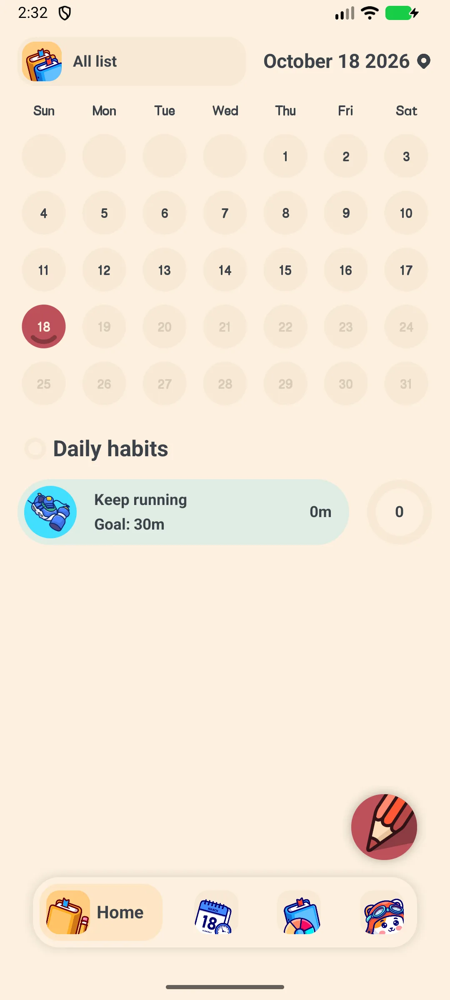
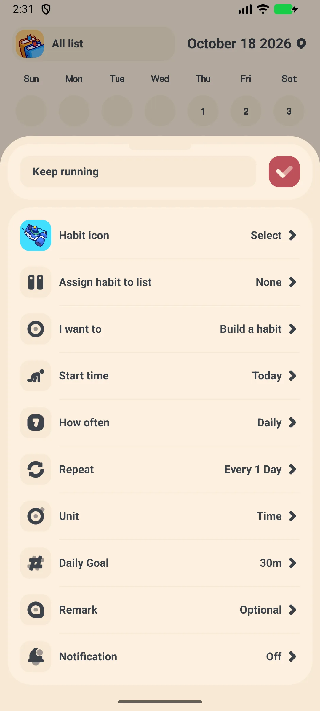
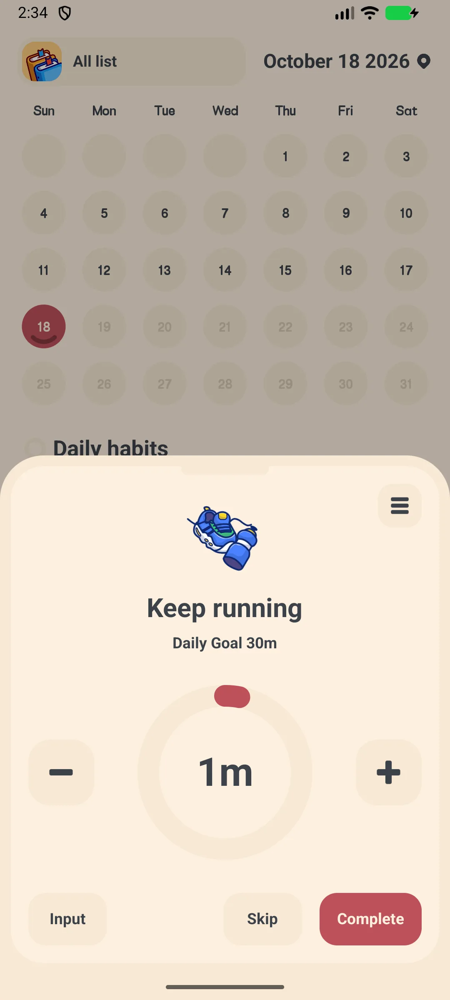
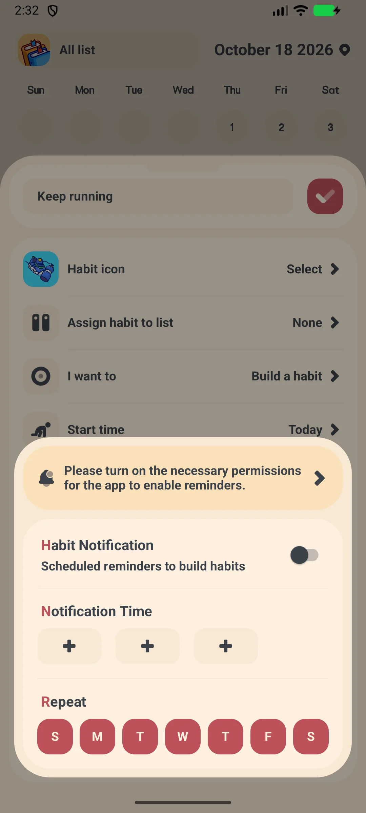
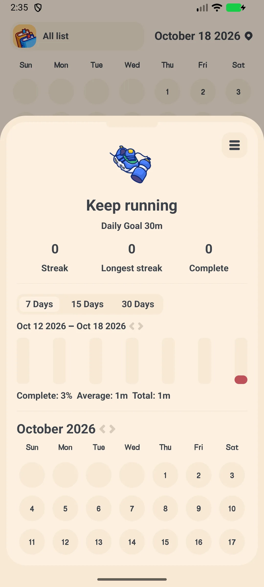

## 目录

- [应用简介](#应用简介)
- [首次使用](#首次使用)
- [添加习惯](#添加习惯)
- [每日打卡](#每日打卡)
- [提醒](#提醒)
- [连续天数与趋势](#连续天数与趋势)
- [编辑、归档或删除](#编辑归档或删除)
- [备份与导出](#备份与导出)
- [设置](#设置)
- [典型场景](#典型场景)
- [常见问题](#常见问题)

## 应用简介

Meow Habits 是一款安卓与 iOS 上的可爱**[习惯追踪](/zh/glossary/what-is-a-habit-tracker/)**与习惯养成工具，用连续天数、图表与日历热力图把好习惯坚持下来。它是一款**免账号、离线可用的习惯打卡应用**：打卡不需要注册，也不需要联网；**不订阅习惯打卡** 也能长期使用免费档，**习惯打卡小部件** 与提醒让一次打卡在主屏就能完成，而 CSV 导出与 WebDav 备份让历史数据始终属于自己。这份指南会从首次启动讲到小组件、提醒的设置，再到读懂自己的趋势。

习惯追踪的关键不是记录得多漂亮，而是让你愿意每天回来打一次卡。Meow Habits 用可爱图标降低开始的心理门槛，用连续天数给你"不想断掉"的动力，再用日历热力图把坚持这件事可视化。它是只读你人生的旁观者，不评判、不催促——漏了一天就如实留白，让你自己决定是否续上。下面的顺序按真实使用来：建习惯、每天打卡、设提醒、看趋势，最后处理数据备份。

**🐱 500+ 可爱图标**
- 一个约 **590 个图标**、横跨 **14 个分类** 的图标选择器
- 为每个习惯选图标与颜色

**🔥 连续天数与图表**
- 每习惯的连续天数与完成率
- 你进度的柱状、饼图与日历（热力图）视图

**🔁 灵活周期**
- 每天、每周、每月，或工作日（如周一/三/五）
- "每 N 天/周"自定义规则

**☁️ 私密**
- 默认离线；可选 Google Drive / WebDav 备份
- CSV 导出（VIP）

## 首次使用

应用打开在 **主页** 标签，显示今天的习惯加一个月历。底部四个标签把功能分得很清楚，第一次进来不用找设置向导——直接点加号就能开始。

- 底部标签：**主页**、**习惯**、**趋势**、**设置**
- 点 **+** 添加你的第一个习惯（免费档最多 **5 个习惯**；VIP 解锁无限）

{: width="180" .normal }

免费档的 5 个习惯上限，对刚开始尝试的人来说其实是个合理的约束：先挑最想养成的几件事，别一上来就列满二十项。用顺手了再决定要不要解锁更多。

## 添加习惯

1. 在主页标签点 **+**
2. 选 **模板** 或空白起步 → 打开 **添加习惯**
3. 输入 **名称**
4. 点 **图标** 打开图标选择器（≈590 个图标，14 个分类）
5. 选一个 **清单（列表）** 与 **类型**
6. 设定 **目标**（如计数或时长）
7. 设定 **周期**：每天 / 每周 / 每月 / 工作日，必要时加一个"每 N"间隔
8. 设定 **开始日期**
9. 点 **确认**

{: width="180" .normal }

填写时最关键的是**周期**和**目标**两项要贴合现实：想养成喝水习惯，就设每天若干杯的计数目标；想练琴，可以设每次多少分钟的时长目标。周期不必都填"每天"——健身这类习惯改成"周一/三/五"，反而更容易长期维持；"每 N 天"规则则适合浇花、换床单这类有间隔的事。模板能帮你快速起步，但别被模板框住，图标和颜色尽管挑自己喜欢的，毕竟这是你要每天看到的东西。

## 每日打卡

1. 在主页或习惯标签，点一个习惯打开 **打卡** 界面
2. 一个大进度环显示今天的目标
3. 用 **+ / −** 调整计数、**输入** 填值、**跳过** 跳过，或 **完成** 结束
4. 三点菜单提供趋势 / 通知 / 笔记 / 编辑 / 归档 / 删除

{: width="180" .normal }

大进度环的好处是"看得见进度"：喝到第三杯水时环走到一半，会给你继续下去的动力。计数型习惯用 + / − 最快，时长型就用 **输入** 直接填分钟数。真遇到不方便的日子，用 **跳过** 而不是硬留一个空白，能让统计更准确地反映你的计划；三点菜单里的 **笔记** 适合记一句当天的情况，比如"今天太忙只拉伸了五分钟"，回头看趋势时这些上下文很有价值。

## 提醒

1. 打开一个习惯并点提醒（铃铛）选项
2. 开启每日提醒
3. 选一个 **3 个时间胶囊** 之一，并选择适用星期（周日–周六）
4. 应用通知你打卡

{: width="180" .normal }

提醒时间建议跟习惯绑定的场景走：早间例行就设在起床后，喝水可以设在上午和下午各一次，睡前阅读则设在洗漱之后。适用星期让提醒只在真正需要的日子出现——工作日提醒"带工牌"，周末就不必响。提醒的作用是轻推一下，不是制造焦虑；如果某条提醒你每天都想划掉，说明时间或频率该改了，而不是硬扛。

## 连续天数与趋势

1. 打开一个习惯 → **详情** 看连续天数、历史柱状与日历热力图
2. 切到 **趋势** 标签看图表与成就

{: width="180" .normal }

连续天数是最直观的动力来源，但它也最容易让人在断掉一天后想放弃——所以更健康的看法是把它当作参考，而不是枷锁。日历热力图更适合看长期模式：哪一列颜色浅、哪一周整片留白，往往对应着你生活里的具体变化（出差、加班、生病）。柱状图看单日完成量，饼图看各习惯的占比，配合"完成率"一起读，你就能分辨是"没坚持"还是"坚持了但没达标"。

## 编辑、归档或删除

从打卡的三点菜单，你可以 **编辑**、**归档**（保留历史但隐藏）或 **删除** 一个习惯。当一个习惯已经养成、或你决定不再坚持时，优先用 **归档**——它把习惯从日常列表里收起来，却保住了过去积攒的记录和热力图。直接删除会连同历史一起抹掉，通常不是你想要的。如果只是目标或时间设得不合理，用 **编辑** 调整即可，已有记录不会受影响。

## 备份与导出

- **设置 → Google Drive / WebDav** 备份与恢复
- **设置 → 导出** 让你挑选习惯、选日期范围，并分享一份 **CSV**

数据默认只在本机，好处是私密，风险是换机或误删应用后可能找不回来。建议偶尔做一次备份：云端选 Google Drive 或你自己的 WebDav，换设备时用"恢复"导回来。想要做更细致的分析（比如算月度完成率），就用 **导出** 挑好习惯和时间范围，生成 CSV 拿到表格软件里慢慢看。

## 设置

设置包含 VIP 横幅、**深色模式**、**语言**、**一周起始**、**应用锁**（VIP）、声音、通知、**小组件**、清单、习惯、**导出**（VIP）、Google Drive、WebDav，以及 Meow 家族区块。其中"一周起始"决定周视图从周日还是周一开始，按你的习惯选；深色模式适合夜里打卡不刺眼；应用锁（VIP）能在共享设备上给记录加一道指纹或密码。小组件入口则把添加到主屏的设置集中在一起，省得你回主屏慢慢找。

## 典型场景

- **晨间例行**——设置好后把「喝水」「拉伸」钉到主屏小组件，从锁屏就能打卡，连续天数不断；醒来第一眼看到已经完成的项，也能带来一点掌控感。
- **戒掉坏习惯**——建一个「少刷手机」习惯并设每日提醒；日历热力图在连续崩掉前就让失误现形，让你有机会及时调整，而不是月底才发现整段空白。
- **回顾一个月**——打开「趋势」标签看完成率与成就，再用设置 → 导出（VIP）拉一份 CSV 做更深分析，找出哪些日子、哪些习惯最容易掉链子。
- **离线私密**——一切无需账号即可用；只在想要跨设备备份时才开启 Google Drive 或 WebDav，你的记录不会因为换手机就被迫交到一个新账号手里。

## 常见问题

### 什么会打断连续天数？
{:.faq-q}
在你设定的日子打卡，连续就继续。漏掉一个设定日会重置该习惯当前连续。也正因为如此，把周期设成贴合现实的节奏（比如每周三次而非每天都练），反而更容易保住连续记录。

### 有免费上限吗？
{:.faq-q}
有——免费档最多 **5 个习惯**。VIP 解锁无限习惯、无限清单、深色模式、应用锁与 CSV 导出。先用免费档把最核心的几件事养成，再决定要不要升级。

### 我的数据存在哪？
{:.faq-q}
默认在你的设备。用 Google Drive 或 WebDav 备份在设备间迁移；不备份时，记录不会自动出现在任何云端。

## 小结

Meow Habits 用可爱图标、连续天数与清晰趋势，把养成习惯变成平静的日常仪式——并且完全离线可用。它不逼你完美执行，只是把每天的那一次打卡变得足够简单、足够想回来；对想温和地改变日常节奏的人来说，这是个容易坚持的起点。

[Meow Habits App 页](/zh/apps/meow-habits/)——安卓与 iOS 可用。

## 相关术语

- [什么是习惯追踪应用（Habit Tracker）？](/zh/glossary/what-is-a-habit-tracker/)
