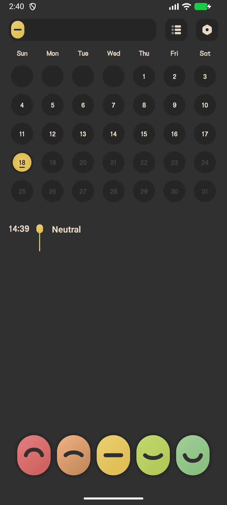
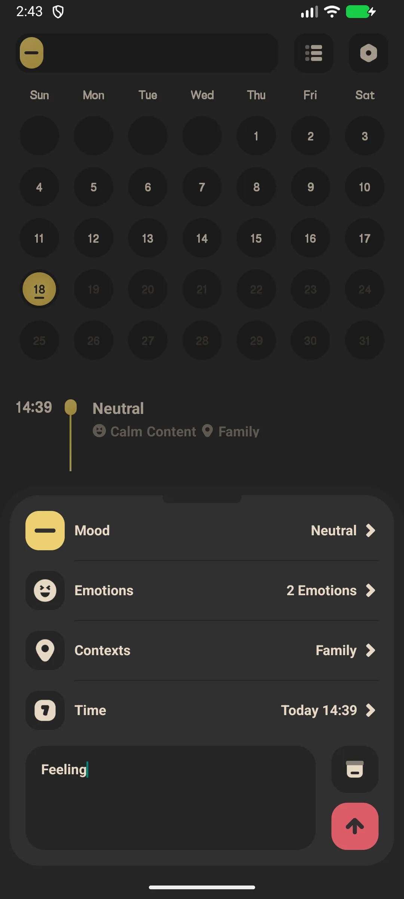
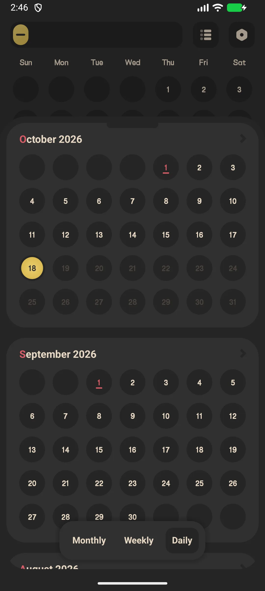
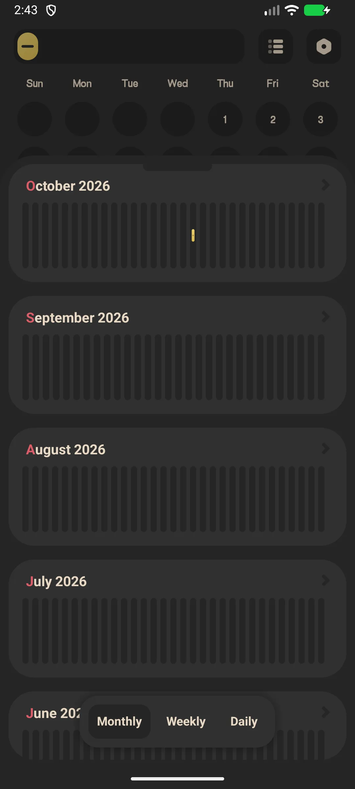

## 目录

- [应用简介](#应用简介)
- [首次使用](#首次使用)
- [记录心情（一键）](#记录心情一键)
- [完整心情条目](#完整心情条目)
- [历史日历](#历史日历)
- [统计与趋势](#统计与趋势)
- [每日提醒](#每日提醒)
- [应用锁（VIP）](#应用锁vip)
- [备份](#备份)
- [设置](#设置)
- [典型场景](#典型场景)
- [常见问题](#常见问题)

## 应用简介

Meow Mood Diary 是一款安全私密的[心情日记](/zh/glossary/what-is-a-mood-tracker/)与记录应用，带 5 个心情等级、48 个默认情绪、18 个情境标签与日历图表，一键记下心情、第二步补活动与文字。它既是离线心情日记也是每日情绪记录工具，数据默认只留本机、不上传、不需要账号。这份指南接着讲日历、图表、可选应用锁、每日提醒，以及如何从这款无需注册的日记 app 里导出自己的历史。

情绪记录最难的不是方法，而是"愿意在当下那几秒里记下来"。Meow Mood Diary 把这一步压缩到点一下胶囊：开心、平静、低落，选一个就好；哪天想多写几句，再展开补上标签和备注。所有内容默认只留在本机，不上传、不要求账号——这让它适合记录那些不太想被别人看到的真实感受。下面的顺序按真实使用写：先一键记、再写完整条目，然后看日历与趋势，最后处理隐私和备份。

**😺 一键记录**
- 主屏上五个心情等级"胶囊"
- 点胶囊即时记录，或打开它写更完整的条目

**📊 洞察**
- 用心情颜色绘制的一个月日历
- 统计：等级分布（饼图）、月度直方图、情绪频率、情境频率

**🔒 默认私密**
- 数据 **仅存本地**——不上传任何服务器
- 可选 Google Drive / WebDav 备份（云由你掌控）
- 应用锁（指纹 / 密码）是 **VIP** 功能

**🎨 丰富选项**
- **48 个默认情绪**（24 不快 + 6 中性 + 18 愉悦）分为 5 个心情等级
- **18 个情境标签**（地点 / 和谁在一起）
- 免费 vs VIP：更多图标、更多主题色、应用锁与 PDF 导出

## 首次使用

Meow Mood Diary 首次打开不用注册、不用引导，主屏显示五个心情胶囊、一个月历与今天的心情列表，直接点胶囊就能记。界面围绕快速记一笔设计：最显眼的是五个胶囊，统计和设置收在顶部菜单里不抢视线。

- 点顶部 **菜单统计** 看统计
- 点顶部 **菜单设置** 看设置

{: width="180" .normal }

第一次打开不用注册、不用引导，直接就能记。建议先点一个胶囊试一次，感受一下"展开—确认"的节奏，回头再按下面的说明补完整条目。

## 记录心情（一键）

Meow Mood Diary 的一键记录只需在主屏点一个心情胶囊、再点确认即可保存心情等级，不带备注与标签。这正是它的设计意图：在情绪最强烈的那几秒用最少动作抓住瞬间；很多时候你没心情写字，但点一个颜色还做得到，于是本想跳过的日子也留下痕迹。等有空再展开补细节也不迟。

1. 在主屏，点一个 **心情胶囊**（如"开心"）
2. 它展开——点 **确认** 即时保存，或点 **设置（齿轮）** 图标添加细节

一键记录保存的是心情等级，无备注、无标签。这正是它的设计意图：在你情绪最强烈的那几秒，用最少的动作把瞬间抓住。很多时候你没心情写字，但点一个颜色还做得到——于是那些本想跳过的日子也留下了痕迹。等有空了，再按下一节补上细节也不迟。

## 完整心情条目

Meow Mood Diary 的完整条目在胶囊齿轮里添加，可设 1–5 心情等级、从 48 个情绪和 18 个情境标签里多选、定时间、写可选备注后保存。多种情绪可以一起选，同一段经历既放松又有点累很正常；情境标签（地点、和谁在一起）帮你看清情绪与场景的关联。时间不能设成未来，是对记录而非计划的定位，备注一两句白话就够。

1. 点胶囊上的齿轮 → **添加心情**
2. 选一个 **心情等级**（1–5）
3. 选 **情绪标签**（从 48 个情绪中多选）
4. 选 **情境标签**（从 18 个情境中多选）
5. 设定 **时间**（不能是未来）
6. 写可选 **备注**
7. 点 **保存**

{: width="180" .normal }

多条情绪标签可以一起选：同一段经历里既"放松"又"有点累"很正常，不必硬归成一类。情境标签（地点、和谁在一起）则帮你在日后看清情绪和场景的关联——比如"每次加班后都偏低落"。时间不能设成未来，是对"记录"而非"计划"的定位；写备注时不用追求文采，一两句白话就够，关键是当时的真实感受。

## 历史日历

Meow Mood Diary 的历史日历用心情颜色绘出一个月，每天的彩色弧反映当天平均心情等级，点一天可看当天条目。日历把一个月铺成一片颜色，模式会自己浮现：某几天连续偏暗、某个周末格外亮，一眼就能注意到。没有记录的日子留白，不要为填满格子而硬记，空白本身也是一种信息。

- 逐月滑动主屏日历
- 每一天是一段彩色弧，颜色反映当天 **平均心情等级**（未来日期显示灰色）
- 点一天看当天的条目

{: width="180" .normal }

日历把一个月的心情铺成一片颜色，好处是模式会自己浮现出来：某几天连续偏暗、某个周末格外亮，一眼就能注意到。一天记了多条时，颜色取的是平均值，点进去还能看当天每一条的细节。没有记录的日子留白，不要为了"填满格子"而硬记——空白本身也是一种信息，说明那天你没顾上或不想记。

## 统计与趋势

Meow Mood Diary 的统计与趋势可按月、周、日切换，看等级分布饼图、月度直方图、情绪频率与情境频率。饼图回答总体偏哪种心情，直方图回答这个月比上月好还是差，频率则指出哪些情绪最常出现、哪些场景容易触发它们。把情境频率与日历对照着看，往往能发现此前没意识到的规律；统计是观察自己的工具，不是评判标准。

1. 点统计图标（右上）
2. 切换 **月 / 周 / 日** 标签
3. 查看：
   - **等级分布** 饼图
   - **月度直方图**
   - **情绪频率** 与 **情境频率**

{: width="180" .normal }

饼图回答"我最近总体偏哪种心情"，直方图回答"这个月比上月好还是差"，情绪频率和情境频率则更进一步：哪些情绪最常出现、哪些场景最容易触发它们。把"情境频率"和日历对照着看，往往能发现一些此前没意识到的规律——比如某个地点几乎总与低落同时出现。统计是帮你观察自己的工具，不是评判标准，别因为图表不好看就给自己压力。

## 每日提醒

Meow Mood Diary 的每日提醒在设置里开启并设定时间，到点会收到温和的"你感觉如何"通知。最佳时间是你能否稳定停下的一刻，睡前洗漱后、午休刚坐下或下班路上都合适；设得太早容易被忙碌冲掉，太晚又打扰入睡。它只是轻推一下，某天不想记划掉即可，别让提醒变成新负担。

1. 设置 → **提醒**
2. 开启每日提醒并设定时间
3. 你会收到温和的"你感觉如何？" / "该记录心情啦！"通知

提醒的最佳时间是你能稳定停下来的一刻——睡前洗漱后、午休刚坐下，或下班回家的路上。设得太早容易被忙碌冲掉，太晚又会打扰入睡。它只是轻轻推你一下，通知文案也是"你感觉如何"这种问法而非催促；如果某天你确实不想记，划掉即可，别让提醒变成新的负担。

## 应用锁（VIP）

Meow Mood Diary 的应用锁是 VIP 功能，开启后别人即使解锁手机，也要再过一道指纹或密码才能翻到你的条目。心情日记往往比其他记录更私密，手机会被家人同事随手拿起时这道锁很有必要。数据本身仍只在本机，应用锁只是多一层进门检查。

1. 设置 → **应用锁**
2. 若非 VIP，会提示升级
3. VIP 用户可开启指纹或密码锁

心情日记往往比其他记录更私密，如果手机会被家人或同事随手拿起，应用锁就很有必要。它是 VIP 功能：开启后，别人即使能解锁手机，也要再过一道指纹或密码才能翻到你的条目。数据本身仍只在本机，应用锁只是多一层进门检查。

## 备份

Meow Mood Diary 的备份可设置到 Google Drive 或 WebDav，含登录、备份、恢复与自动选项，除非你备份否则条目只留在设备端。不备份时隐私最强，但误删应用或换手机后记录不会自己跟过来；想既保留隐私又防丢失，就只用你自己的 Google Drive 或 WebDav，云由你掌控、数据在你自己的账号里。

## 设置

Meow Mood Diary 的设置包含语言、一周起始、应用锁（VIP）、小组件、心情图标（VIP）、主题色（VIP）、情绪与情境标签、导出（VIP）、提醒以及 Google Drive / WebDav 十项。一周起始决定周视图从周日还是周一开始；主题色能换一套配色让日历更合审美；情绪与情境标签则在默认项之外补充更贴合自己生活的描述。其中"一周起始"决定周视图从周日还是周一开始，按你的习惯选；主题色（VIP）能换一套配色，让日历看起来更合你的审美；情绪与情境标签则在默认项之外，允许你补充更贴合自己生活的描述。

## 典型场景

Meow Mood Diary 的典型场景有四类：低落日快速记、默认私密、看见规律、随处离线，都围绕"一键记录 + 本机私密"展开。难熬的晚上点一个情绪图标加几个标签即可，本想跳过的日子也留下痕迹；条目锁在指纹之后留在本机，除非主动选 Drive 否则不上云。日历与图表把周日低落、喝完咖啡飙升这类模糊感受变成可行动的信号，飞机地铁死角也能捕捉当下。

- **低落日快速记**——某个难熬的晚上，点一个情绪图标加几个标签即可；不必写段落，于是那些本想跳过的日子也留了下来，日后回看才不会只剩空白。
- **默认私密**——条目锁在（VIP）指纹之后、留在本机；在共享的家庭手机上，除非你主动选 Google Drive，否则想法不会同步到厂商云。
- **看见规律**——日历与图表暴露「周日低落」或「喝完咖啡飙升」，把模糊的感受变成可行动的东西：你知道该避开什么、多做什么。
- **随处离线**——飞机或地铁死角也能记；捕捉当下无需 Wi-Fi，情绪过去了再补写往往就失真了。

## 常见问题

### 我的日记会被上传到服务器吗？
{:.faq-q}
不会。所有条目都存在你设备的本地数据库里。只有你能把它们备份到自己 Google Drive 或 WebDav，应用本身不会替你上传。

### 日历颜色怎么定的？
{:.faq-q}
每天的色是当天条目心情等级的平均值，映射到当前主题的 5 色板。无条目的日子留白。

### 能导出日记吗？
{:.faq-q}
能——PDF 导出是 VIP 功能。想留一份可打印的存档，或把一段时间的记录整理出来，用设置里的导出即可。

## 小结

Meow Mood Diary 让每日心情追踪轻松又私密，用清晰的日历与趋势图表帮你看清随着时间推移的情绪。它不要求你每天写长篇，只求你愿意在当下点一下；正是这种低门槛，让一份心情日记有机会真正坚持下来。

[Meow Mood Diary App 页](/zh/apps/meow-mood-diary/)——安卓与 iOS 可用。

## 相关术语

- [什么是心情追踪（Mood Tracker）？](/zh/glossary/what-is-a-mood-tracker/)
