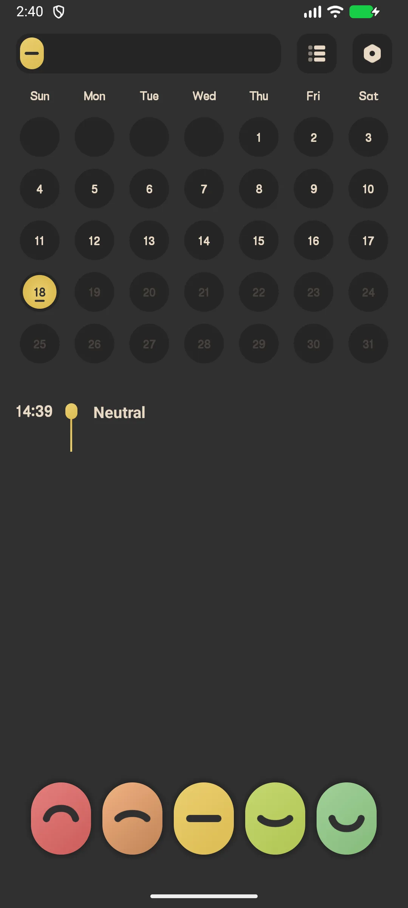
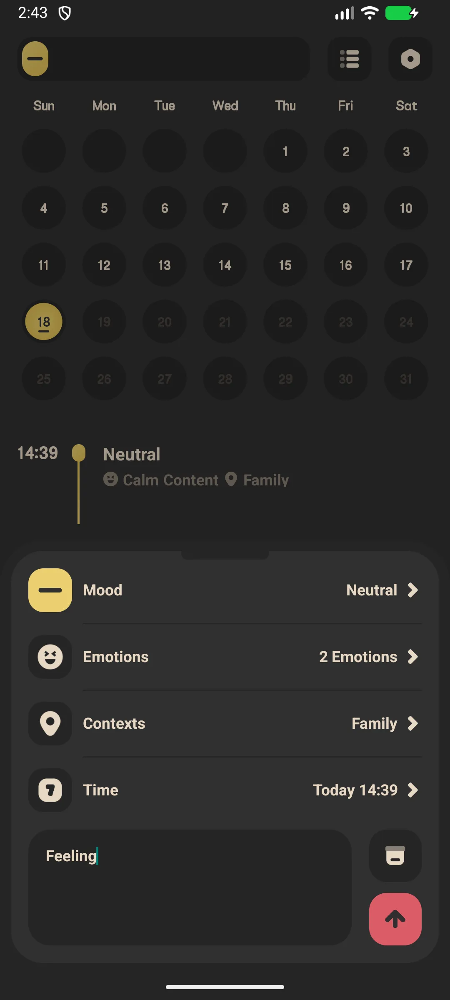
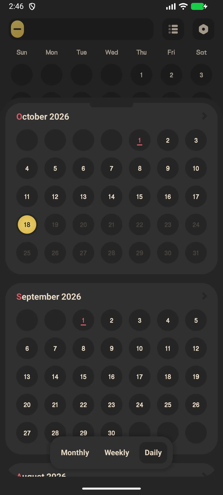
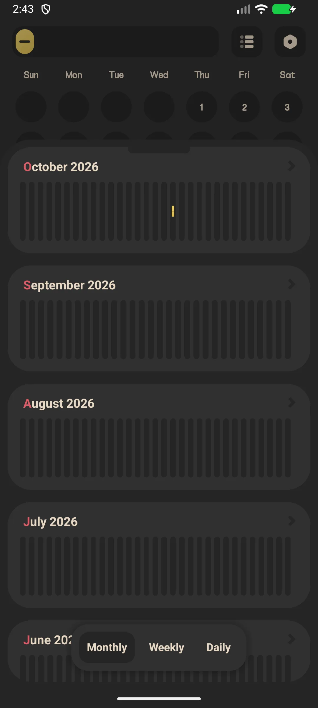

## 目录

- [应用简介](#应用简介)
- [首次使用](#首次使用)
- [记录心情（一键）](#记录心情一键)
- [完整心情条目](#完整心情条目)
- [历史日历](#历史日历)
- [统计与趋势](#统计与趋势)
- [每日提醒](#每日提醒)
- [应用锁（VIP）](#应用锁vip)
- [备份](#备份)
- [设置](#设置)
- [典型场景](#典型场景)
- [常见问题](#常见问题)

## 应用简介

Meow Mood Diary 是一款安全、私密的[心情日记](/zh/glossary/what-is-a-mood-tracker/)与记录应用，带平静的猫主题界面。它既是一款 **离线心情日记**，也是一款 **每日情绪记录** 工具：一键记下心情，第二步补上活动与文字；这份指南接着讲日历、图表、可选应用锁、每日提醒，以及如何从一款无需注册的 **日记 app** 里导出自己的历史。

**😺 一键记录**
- 主屏上五个心情等级"胶囊"
- 点胶囊即时记录，或打开它写更完整的条目

**📊 洞察**
- 用心情颜色绘制的一个月日历
- 统计：等级分布（饼图）、月度直方图、情绪频率、情境频率

**🔒 默认私密**
- 数据 **仅存本地**——不上传任何服务器
- 可选 Google Drive / WebDav 备份（云由你掌控）
- 应用锁（指纹 / 密码）是 **VIP** 功能

**🎨 丰富选项**
- **48 个默认情绪**（24 不快 + 6 中性 + 18 愉悦）分为 5 个心情等级
- **18 个情境标签**（地点 / 和谁在一起）
- 免费 vs VIP：更多图标、更多主题色、应用锁与 PDF 导出

## 首次使用

主屏显示五个心情胶囊、一个月历，以及今天的心情列表。

- 点顶部 **菜单统计** 看统计
- 点顶部 **菜单设置** 看设置

{: width="180" .normal }

## 记录心情（一键）

1. 在主屏，点一个 **心情胶囊**（如"开心"）
2. 它展开——点 **确认** 即时保存，或点 **设置（齿轮）** 图标添加细节

一键记录保存的是心情等级，无备注、无标签。

## 完整心情条目

1. 点胶囊上的齿轮 → **添加心情**
2. 选一个 **心情等级**（1–5）
3. 选 **情绪标签**（从 48 个情绪中多选）
4. 选 **情境标签**（从 18 个情境中多选）
5. 设定 **时间**（不能是未来）
6. 写可选 **备注**
7. 点 **保存**

{: width="180" .normal }

## 历史日历

- 逐月滑动主屏日历
- 每一天是一段彩色弧，颜色反映当天 **平均心情等级**（未来日期显示灰色）
- 点一天看当天的条目

{: width="180" .normal }

## 统计与趋势

1. 点统计图标（右上）
2. 切换 **月 / 周 / 日** 标签
3. 查看：
   - **等级分布** 饼图
   - **月度直方图**
   - **情绪频率** 与 **情境频率**

{: width="180" .normal }

## 每日提醒

1. 设置 → **提醒**
2. 开启每日提醒并设定时间
3. 你会收到温和的"你感觉如何？" / "该记录心情啦！"通知

## 应用锁（VIP）

1. 设置 → **应用锁**
2. 若非 VIP，会提示升级
3. VIP 用户可开启指纹或密码锁

## 备份

设置 → **Google Drive**（登录、备份 / 恢复 / 自动）与 **WebDav**。除非你备份，否则条目留在设备端。

## 设置

设置包含语言、一周起始、应用锁（VIP）、小组件、心情图标（VIP）、主题色（VIP）、情绪/情境标签、导出（VIP）、提醒，以及 Google Drive / WebDav。

## 典型场景

- **低落日快速记**——某个难熬的晚上，点一个情绪图标加几个标签即可；不必写段落，于是那些本想跳过的日子也留了下来。
- **默认私密**——条目锁在（VIP）指纹之后、留在本机；在共享的家庭手机上，除非你主动选 Google Drive，否则想法不会同步到厂商云。
- **看见规律**——日历与图表暴露「周日低落」或「喝完咖啡飙升」，把模糊的感受变成可行动的东西。
- **随处离线**——飞机或地铁死角也能记；捕捉当下无需 Wi-Fi。

## 常见问题

### 我的日记会被上传到服务器吗？
{:.faq-q}
不会。所有条目都存在你设备的本地数据库里。只有你能把它们备份到自己 Google Drive 或 WebDav。

### 日历颜色怎么定的？
{:.faq-q}
每天的色是当天条目心情等级的平均值，映射到当前主题的 5 色板。无条目的日子留白。

### 能导出日记吗？
{:.faq-q}
能——PDF 导出是 VIP 功能。

## 小结

Meow Mood Diary 让每日心情追踪轻松又私密，用清晰的日历与趋势图表帮你看清随着时间推移的情绪。

[Meow Mood Diary App 页](/zh/apps/meow-mood-diary/)——安卓与 iOS 可用。

## 相关术语

- [什么是心情追踪（Mood Tracker）？](/zh/glossary/what-is-a-mood-tracker/)
