## 目录

- [应用简介](#应用简介)
- [首次使用](#首次使用)
- [添加任务](#添加任务)
- [子任务](#子任务)
- [提醒](#提醒)
- [日历视图](#日历视图)
- [统计](#统计)
- [清单与标签](#清单与标签)
- [备份与同步](#备份与同步)
- [CSV 导出（VIP）](#csv-导出vip)
- [设置](#设置)
- [常见问题](#常见问题)

## 应用简介

Meow Todo List 是一款安卓与 iOS 的可爱卡通风格任务管理器与**[待办清单](/zh/glossary/what-is-a-to-do-list/)**。它帮你快速捕捉任务，并按天、周、月或清单回顾。它也是一款 **离线待办** 应用：任务留在本机、无需账号，免费核心覆盖清单、提醒与 **待办清单日历视图**。本指南按屏幕逐步走一遍，从首次启动到 **待办清单谷歌同步** 与 CSV 导出。

任务管理器的价值在于"把脑子里的东西倒出来，然后按需要找回去"。Meow Todo List 把这一步做得很快：右下角的加号随处可点，记完按天、周、月看都行。它默认离线、不要求注册，数据先留在你的设备上；想跨设备时才接上 Google Drive 或 WebDav。下面的顺序按真实使用来：先认识四个标签，再学添加任务、拆子任务、设提醒，最后看日历、统计与备份。

**📝 快速捕捉**

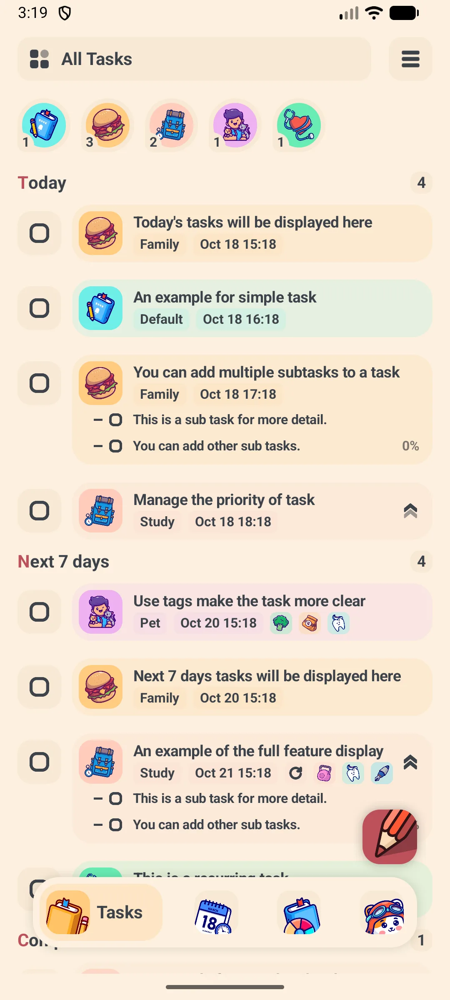{: width="180" .normal }
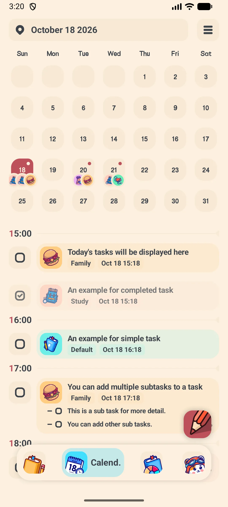{: width="180" .normal }
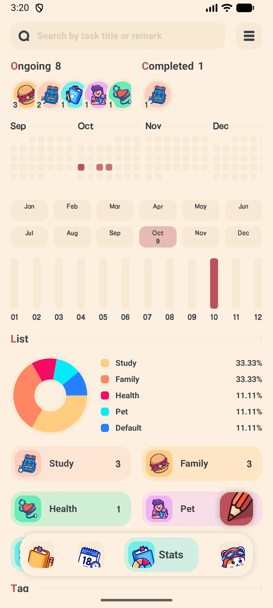{: width="180" .normal }
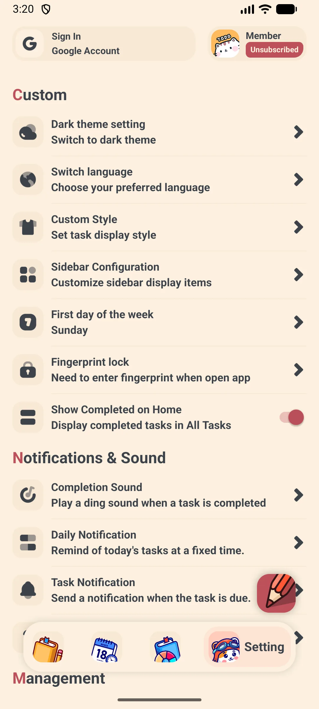{: width="180" .normal }

- 四个底部标签：**任务**、**日历**、**统计**、**设置**
- 一个浮动 **+** 按钮随处添加任务
- 侧边抽屉筛选：全部 / 今天 / 明天 / 7 天 / 已完成，外加你的清单（Books）与标签

**🗓 规划**
- 每个任务可设日期 **与时间**
- 重复任务：每天、每周、每月、每年，或自定义"每 N 天/周"规则
- 日历视图可切换日 / 周 / 月

**📊 洞察**
- 贡献热力图与按清单/标签分组的饼图
- 周 / 月 / 年概览

**☁️ 安全与私密**
- 本地存储（Room 数据库）；可选 Google Drive / WebDAV 备份
- VIP 解锁深色模式、应用锁、CSV 导出与更高上限

## 首次使用

首次打开 Meow Todo List 进入 **任务** 标签。这里就是你日常的"工作台"：默认显示今天及到期的任务，侧边抽屉则让你一键切到其他视图。

- **+** 按钮（右下）创建任务
- 左侧 **抽屉** 在今天 / 明天 / 7 天 / 已完成与你的自定义清单 & 标签间切换
- 底部栏在任务 / 日历 / 统计 / 设置间移动

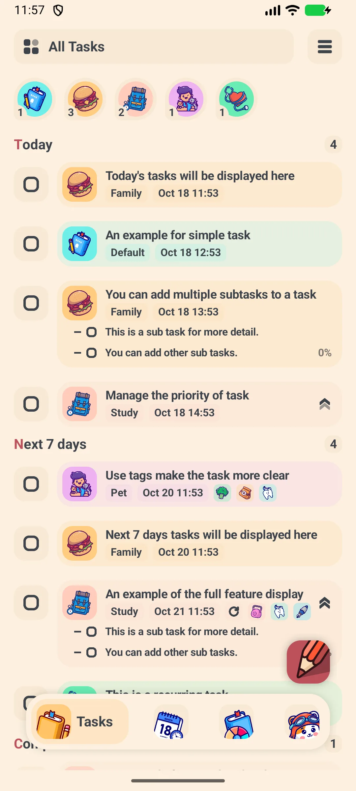{: width="180" .normal }

先花一分钟点开抽屉看看几个筛选：赶时间时用"今天"，想提前安排就用"7 天"，勾掉的事情去"已完成"找。熟悉这套导航后，添加和查找任务都会变得很自然。

## 添加任务

1. 点 **+** 按钮
2. 输入任务 **标题**
3. 点 **日期** 行打开日历弹窗；开启 **小时** 设具体时间，或清空设全天任务
4. 选一个 **清单**（如工作、生活、学习）
5. 选一个或多个 **标签** 用于筛选
6. 如喜欢可设 **优先级**
7. 点 **确认** 保存

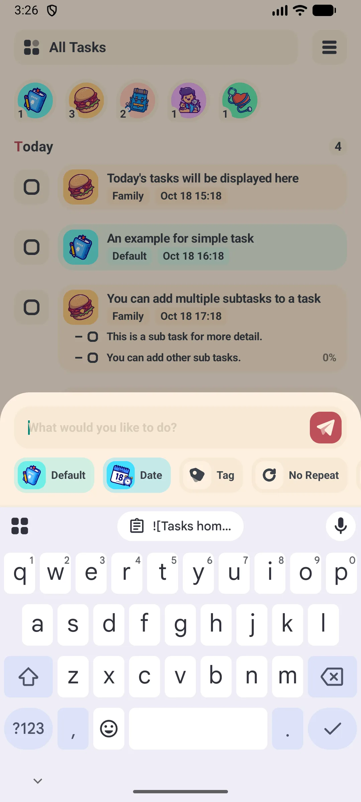{: width="180" .normal }
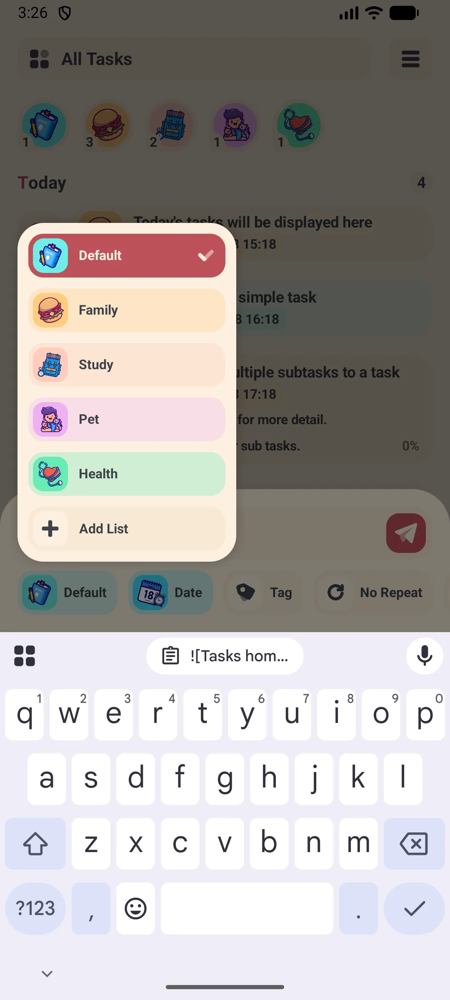{: width="180" .normal }
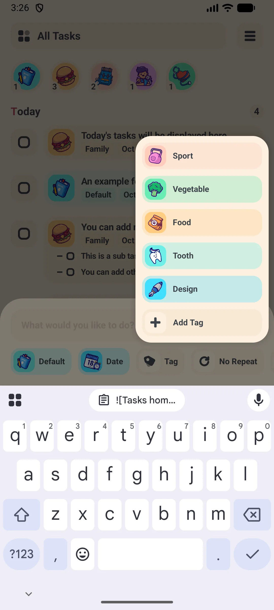{: width="180" .normal }
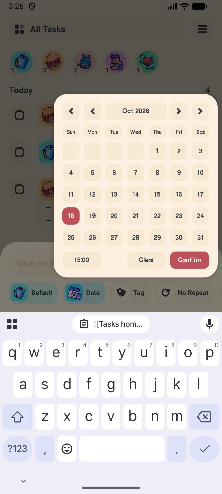{: width="180" .normal }
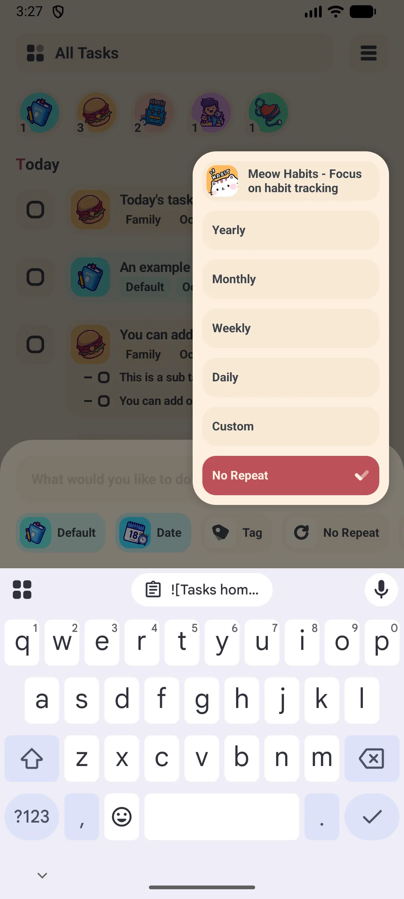{: width="180" .normal }

不必每次都把所有字段填满：赶时间时只写标题也能存下来，回头再补日期和清单。日期与时间决定任务出现在"今天"还是"明天"，也决定提醒何时响；全天任务不设具体小时，适合"交报告"这类只需当天完成的事。清单用来分类，标签用来跨清单筛选——比如给不同项目的任务都打上"本周重点"，就能在抽屉里一次看全。重复规则则适合还款、例会等周期事项，设好一次就不用每月重建。

## 子任务

打开一个任务，再用详情页底部的 **添加子任务** 字段。

- 输入子任务即加入列表
- 免费账号每任务最多 **15 个** 子任务；VIP 取消上限
- 完成时勾选

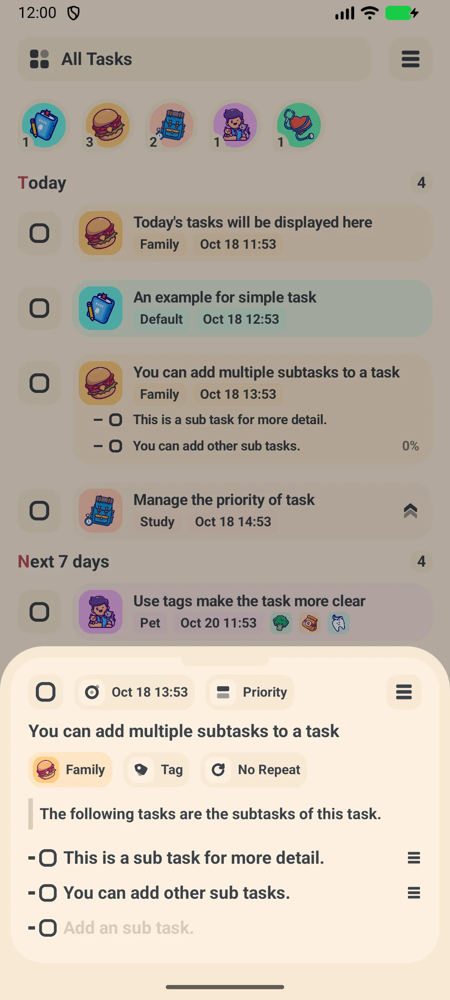{: width="180" .normal }
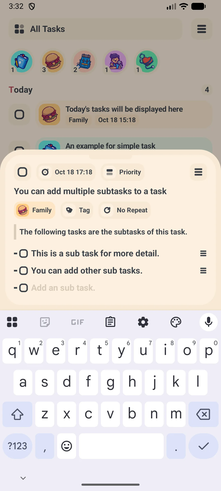{: width="180" .normal }

子任务最适合对付"大项目"这类看着就让人发怵的任务：把"准备演讲"拆成查资料、写提纲、做幻灯片、彩排，每勾掉一项都有推进感。免费档每条任务最多 15 个子任务，足够多数场景；只有极复杂的任务才会碰到上限，那时再考虑 VIP。勾选子任务不会自动完成父任务，这样你能保留整体完成的主动权。

## 提醒

提醒由 **WorkManager** 调度，所以即便不开应用也会触发。

1. 编辑任务时，设一个日期/时间（提醒用该时间）
2. 确保应用已允许通知
3. 编辑任务时应用会自动重新调度提醒

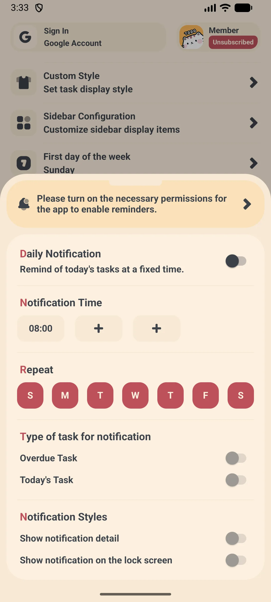{: width="180" .normal }
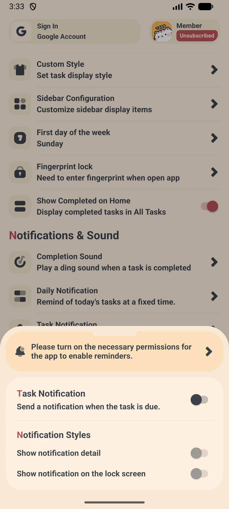{: width="180" .normal }
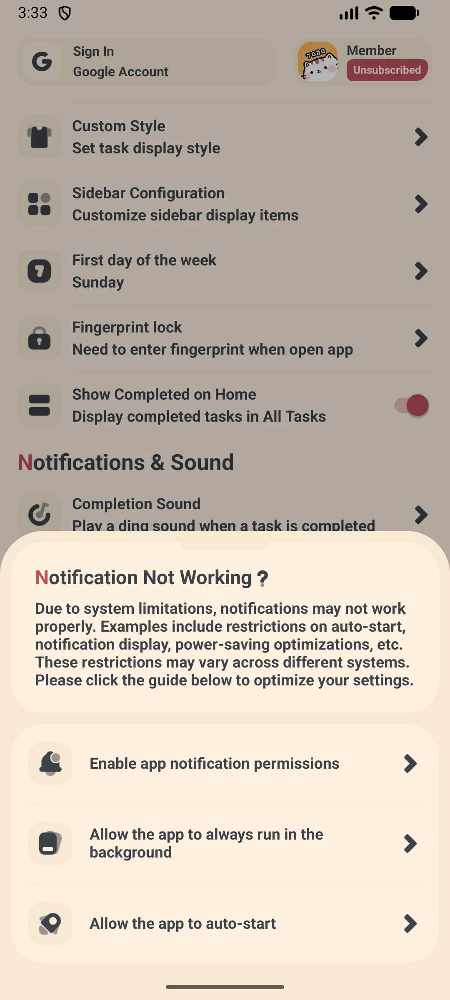{: width="180" .normal }

提醒和任务的日期/时间绑定，所以想让它响，先给任务设一个未来的时间点。用 WorkManager 调度的好处是可靠性：即使你没打开应用、甚至重启过手机，到点仍会通知。改了任务时间后不用手动重设提醒，应用会自动重新安排。通知只是提醒你去看一眼，别把它们当成必须立刻执行的命令——真正重要的是任务本身没被忘掉。

## 日历视图

1. 切到 **日历** 标签
2. 用右上 **日 / 周 / 月** 切换
3. 有任务的天显示一个小圆点
4. 点一天看当天任务

{: width="180" .normal }
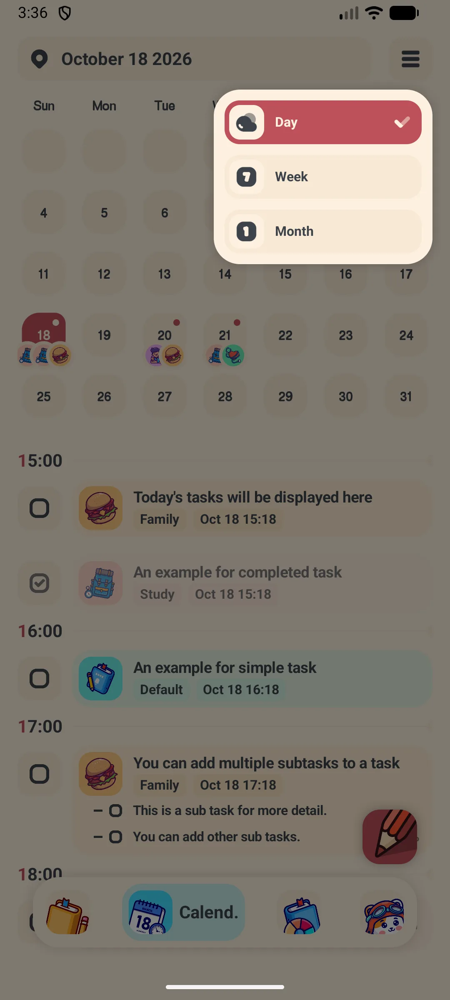{: width="180" .normal }
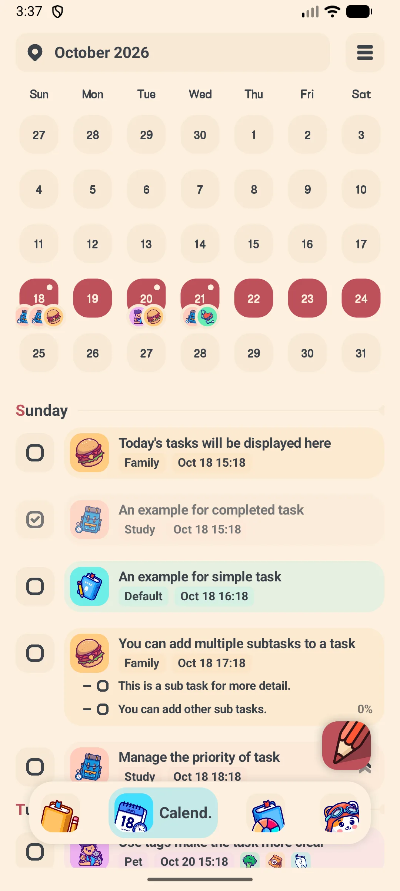{: width="180" .normal }
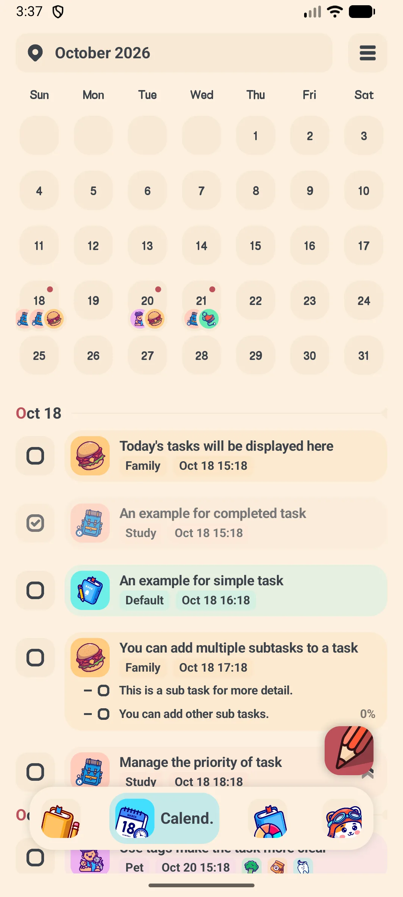{: width="180" .normal }

日历视图适合看"任务在时间里怎么分布"：月视图上有点的日子一眼扫过，就知道哪几天特别满；周视图适合安排下一周，日视图则聚焦今天。带圆点的天点开，就能看到那天全部任务。考试季或项目周期里，这个功能比清单视图更能帮你避开时间冲突。

## 统计

1. 打开 **统计** 标签
2. 查看贡献热力图与饼图
3. 切换范围（周 / 月 / 年）看按清单与标签的趋势

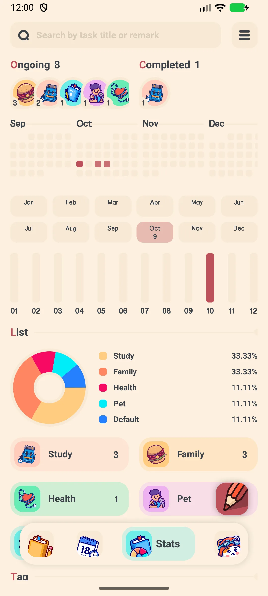{: width="180" .normal }
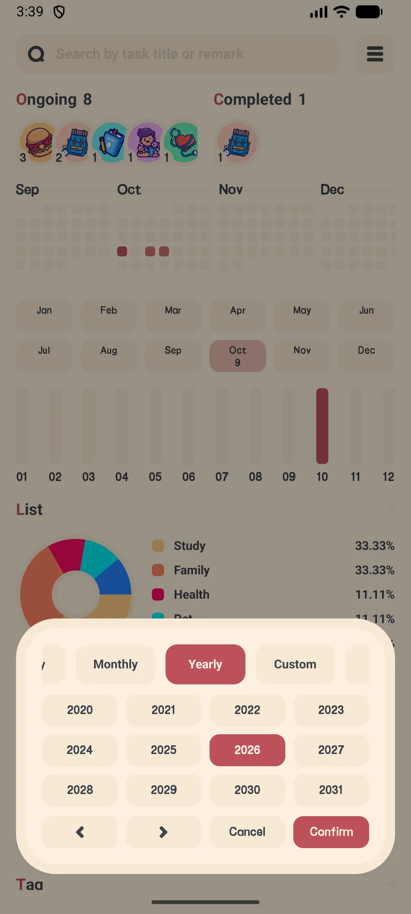{: width="180" .normal }

贡献热力图反映你持续使用清单的节奏——哪几天很活跃、哪一段空白，往往对应着工作和生活的忙闲。饼图按清单或标签分组，告诉你精力主要花在哪些类别上。切换周 / 月 / 年范围，能看出长期趋势；如果发现"学习"类任务总是占比很小，也许该重新排一下优先级了。

## 清单与标签

- **清单（列表）** 分组任务——如工作、旅行。免费账号最多创建 **10 个清单**
- **标签** 让你跨清单筛选——免费账号最多创建 **10 个标签**
- 从抽屉或设置 → 管理界面创建

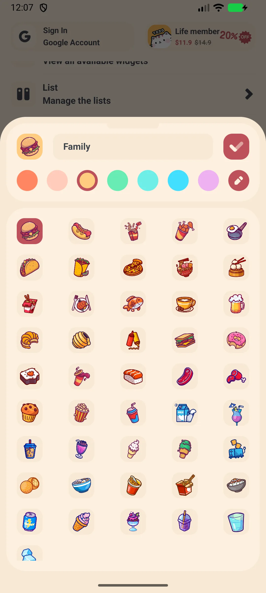{: width="180" .normal }

清单和标签的分工要想清楚：清单是"归属"，一个任务通常只属于一个清单；标签是"属性"，一个任务可以贴好几个。比如"订机票"归在"旅行"清单里，同时贴上"待付款""紧急"两个标签。免费档各有 10 个上限，按大类来建就够——先把工作、生活、学习这几个必要的建好，别一上来就细分到十几个。

## 备份与同步

1. 打开 **设置 → 管理 → Google Drive**（或 **WebDAV**）
2. 登录 / 填写你的服务器、账号与密码
3. 点 **备份** 上传，**恢复** 下载
4. 开启 **自动备份** 定期备份

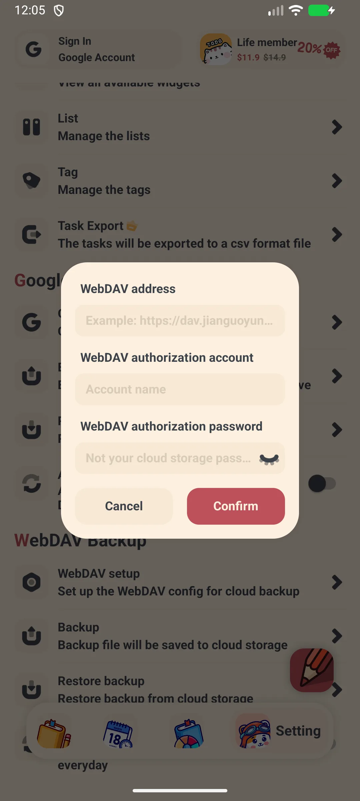{: width="180" .normal }

任务默认存在本机的 Room 数据库里，安全但怕丢——误删应用或换手机都可能让清单归零。所以哪怕你不常用云，也建议做一次备份：Google Drive 方便，WebDav 则适合想自托管的人。开启自动备份后，换设备时用"恢复"导回来即可，不必一条条重记。

## CSV 导出（VIP）

1. 打开 **设置 → 管理 → 导出**
2. 按清单 / 标签 / 优先级 / 日期范围筛选
3. 点 **导出**，再分享 `.csv` 文件（在 Excel 或 Sheets 打开）

CSV 导出是 **VIP** 功能。

导出的用途是把清单带出应用：想做更复杂的统计、和别人共享计划，或留一份自己掌控的长期存档，都能用上。导出前先用清单、标签、日期范围筛一遍，比每次导全量再在表格里删方便得多。它是 VIP 功能，普通用户不必为了它升级——备份已经能覆盖大多数数据安全需求。

## 设置

设置包含：

- **深色模式**（VIP）
- **应用锁**——指纹或密码（VIP）
- **一周起始日** 与 **语言**
- **已完成任务** 显示（默认显示最近 10 条，可"显示全部"）
- **Google Drive / WebDAV** 与 **小组件**

已完成任务默认只显示最近 10 条，好处是列表不被历史淹没；想回顾全部时点"显示全部"即可。一周起始日决定周视图从哪天开始，按你的习惯定。深色模式和应用锁属于 VIP，前者适合夜里使用不刺眼，后者在共享设备上多一层保护。小组件入口则把主屏添加的任务集中起来，省得你回主屏慢慢找。

## 典型场景

- **考试季**——用日历视图与每日提醒让每门课截止日都可见，周与周之间不漏事；子任务把复习拆成章节，临考前不再手忙脚乱。
- **小组项目**——为每个项目建一个清单（Book），用标签区分成员，把工作拆成子任务并导出 CSV 分享计划，谁负责什么一目了然。
- **离线捕捉**——通勤没信号也能随手加任务；数据留在设备上，仅回到线上才同步到 Google Drive 或 WebDav，既不丢也不外泄。
- **隐私优先**——本地 Room 存储加可选指纹应用锁，清单留在手机，不进又一个云账号；只有你主动备份时，数据才会离开设备。

## 常见问题

### 如何编辑或删除任务？
{:.faq-q}
打开任务，改字段，点确认保存。用三点菜单（或长按）删除。改完日期后，提醒会自动跟着重新调度，不用另设。

### 重复任务怎么运作？
{:.faq-q}
完成一个重复任务时，应用自动创建下一次（天 +1、周 +7、月 +1、年 +1，或你的自定义间隔），并停止原任务。于是你只需完成眼前这一次，下一期已排好。

### 免费版有上限吗？
{:.faq-q}
总任务数无硬上限，但免费档清单限 10、标签限 10、子任务限 15。免费版也显示广告。对大多数人来说这些额度够用，先用免费档跑顺流程再决定是否升级。

## 小结

Meow Todo List 是一款友好、可爱的任务管理器，覆盖快速捕捉、重复任务、日历视图与统计——并配 Drive/WebDav 备份守护你的清单。它不强迫你先学一套方法论，打开就能记；对想把一个零散待办整理成可执行清单的人来说，这是个低门槛的起点。

## 相关术语

- [什么是待办清单（To-Do List）？](/zh/glossary/what-is-a-to-do-list/)
- [什么是子任务？](/zh/glossary/what-is-a-subtask/)
