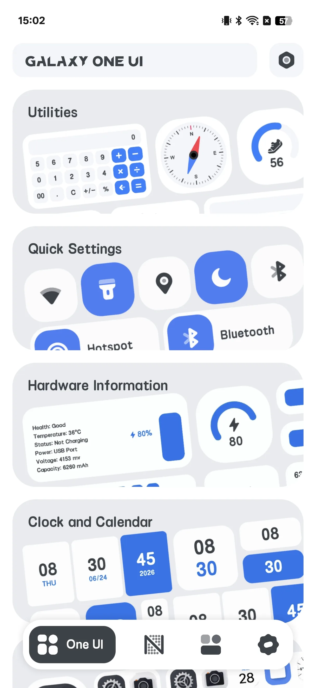
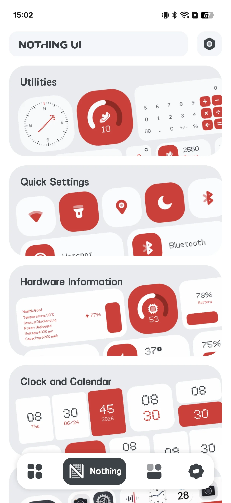
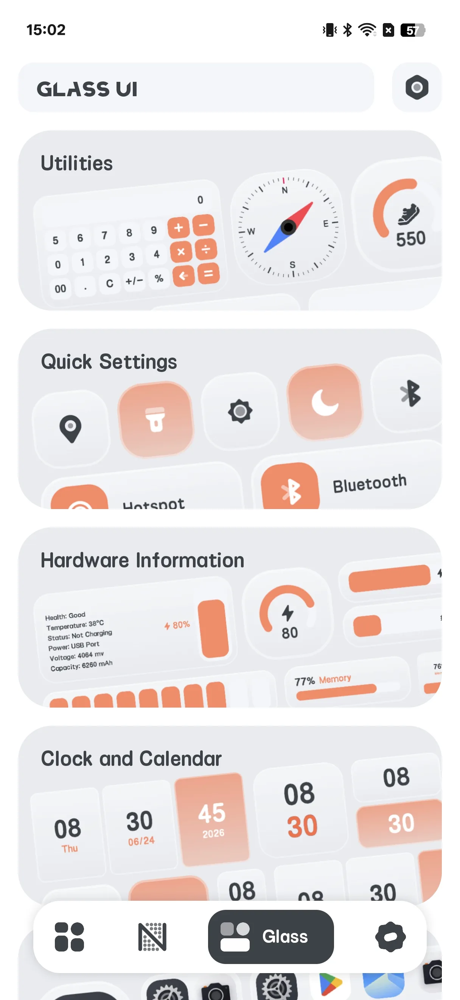
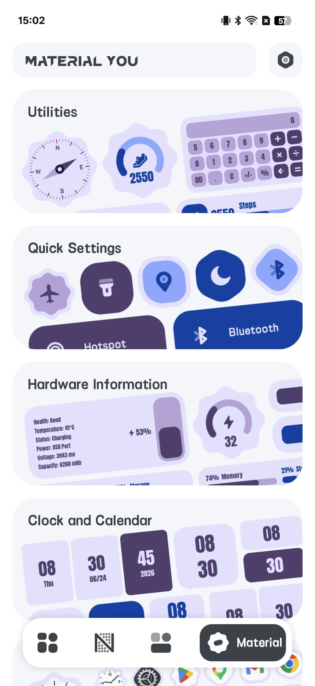
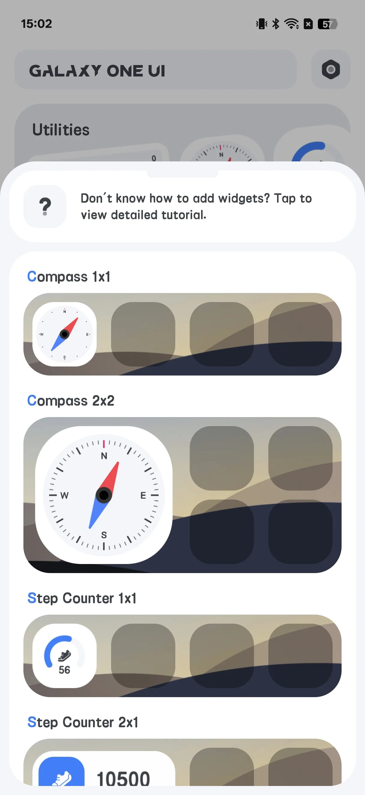
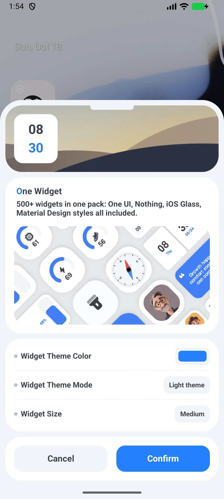

## 目录

- [应用简介](#应用简介)
- [首次使用](#首次使用)
- [浏览四种风格](#浏览四种风格)
- [添加组件](#添加组件)
- [配置组件](#配置组件)
- [快捷开关](#快捷开关)
- [应用快捷方式](#应用快捷方式)
- [实时信息组件](#实时信息组件)
- [设置](#设置)
- [典型场景](#典型场景)
- [常见问题](#常见问题)

## 应用简介

One Widget 内置 **500+ 可自定义安卓[主屏组件](/zh/glossary/what-is-a-home-screen-widget/)**，横跨四种流行风格，外加应用快捷方式与快捷开关。它是一款 **无需账号的小组件 app**：浏览四种风格库、摆上一个预设，再改尺寸、背景色与圆角即可。这份指南会走完从首次启动、四种风格，到添加与配置组件、快捷开关，再到时钟、日历与电量实时信息的完整流程。

很多人想美化主屏，却不想碰 KWGT 那种需要自己画布局的编辑器。One Widget 的定位正是"挑现成预设、改几个参数就好看"：500+ 组件按风格分好类，你只管选、摆、调。它不要求注册，也不需要联网才能用，装好即可开始布置。下面的顺序按真实操作来：先认四种风格，再学放置和配置，最后看快捷开关、应用入口和会自己更新的实时组件。

**🎨 四种风格**
- **One UI**（默认；免费"精简"版应用包含的唯一样式）
- **Nothing**
- **Glass**
- **Material You**

> 这里的"Material You"是一个使用固定蓝/紫昼夜色板的 *风格名*——并非安卓 12 基于壁纸的动态配色。

**⚡ 快捷开关**
- 11 个开关：蓝牙、移动数据、Wi-Fi、手电筒、旋转、飞行模式、热点、勿扰、定位、振动、深色模式

**📱 应用快捷方式与联系人**
- 你应用与电话/拨号的一步启动器

**📊 实时信息**
- 时钟、日历、电池与 RAM 组件就地更新

**💲 两个应用，而非一个**
- 一个 **免费"精简"应用**（仅 One UI 风格）与一个 **付费"完整"应用**（全部四种风格）。没有应用内购买——从 Google Play 安装完整应用即解锁一切。

## 首次使用

打开 One Widget 进入 4 标签画廊：**One UI / Nothing / Glass / Material You**。每个标签是一套完整的组件库，按用途分成若干类别，找起来很有条理。

- 每个风格页列出分类：工具、入口、硬件、时钟、启动器、组合、便签、联系人
- 点分类看组件预览

{: width="180" .normal }
{: width="180" .normal }
{: width="180" .normal }
{: width="180" .normal }

第一次进来别急着往主屏放：先把四个标签都点开看看，不同风格的视觉语言差别很大——One UI 圆润、Nothing 是点阵、Glass 通透、Material You 偏彩色块。找到与你壁纸最搭的那套，再挑具体组件，效果会比随手乱放好很多。

## 浏览四种风格

切换顶部标签预览每种风格。**One UI** 是默认，且在免费精简应用中可用；Nothing / Glass / Material You 需要付费完整应用。这四种是风格而非功能差异——同一类组件（如时钟或开关）在不同风格下外观不同，但用法一致。

挑风格时可以看两点：一是和壁纸、图标的搭配度，二是你喜欢的视觉密度。Nothing 的点阵很有辨识度，适合极简桌面；Glass 的半透明效果在深色壁纸上更出彩；One UI 最百搭，也是免费档唯一的选择。想先看效果再决定要不要买完整版，可以用免费档的 One UI 熟悉整个添加流程。

## 添加组件

1. 长按主屏 → **组件**
2. 在列表中找到 **One Widget** 并选一个变体
3. 系统打开 One Widget **配置** 界面
4. 设定选项并点 **确认** 放置

{: width="180" .normal }

这里有个容易困惑的点：预设是在 One Widget 应用里预览的，但真正放置要通过系统的组件选择器（长按主屏 → 组件）。所以在应用里看到喜欢的样式后，记下它属于哪个风格与类别，再去系统组件列表里找对应的变体。不同桌面启动器的组件入口叫法略有差别，若找不到 One Widget，先确认启动器允许第三方组件，再重启一次桌面。

## 配置组件

多数组件共享通用选项：

- **主题色**（弹出调色板）
- **深色 / 浅色** 模式
- **形状**——圆形或圆角矩形
- **大小**——网格选项如 1x1、2x1、4x1、5x1、6x1、2x2、4x2、5x2、6x2（最大 **6x2**）

图标背景色与圆角半径由形状派生（圆形 = 边长/2，圆角 = 边长/3）。

{: width="180" .normal }

配置时先定大小，再定颜色：主屏空间有限，1x1 适合角落里的电量或开关，4x2 才能放下带信息的时钟或组合组件。形状决定整体气质——圆形更柔和、圆角矩形更规整。由于背景色和圆角是从形状自动算出来的，你通常不用单独调它们；想要统一观感，把同一屏的组件都设成同一形状和主题色即可。

## 快捷开关

1. 从开关组件选择开关类型（Wi-Fi、蓝牙、手电筒、旋转、勿扰……）
2. 放置单个开关，或用 **组合 4x1** 组件把最多 5 个开关放进一条（默认：蓝牙 / Wi-Fi / 移动数据 / 手电筒 / 旋转）
3. 点开关执行：
   - **手电筒** 实际切换闪光灯（`CameraManager`）
   - **Wi-Fi / 蓝牙 / 勿扰** 打开相应系统设置界面
   - **旋转** 写入系统自动旋转设置

快捷开关省的是"翻设置"的时间。要分清两类行为：手电筒和旋转点一下就真正改动系统状态；Wi-Fi、蓝牙、勿扰则会打开对应设置界面，仍需你在系统里再点一次——这是 Android 限制第三方应用直接改动这些开关的结果，不是失灵。想一次控制多项，就用 **组合 4x1**，把最常用的五个开关收进一条，放在拇指够得到的地方。

## 应用快捷方式

1. 配置一个 **应用快捷方式** 组件
2. 在每个槽从启动器列表选一个已装应用
3. 点组件启动该应用（若未安装则打开 Google Play）

把每天要开好几次的应用放进快捷方式组件，能省掉回主屏翻图标的步骤：浏览器、地图、相机、音乐都是常见选择。配置时从已装应用里逐个选槽位即可，选满比留空更实用。若某个应用被卸载，点击该槽会跳到 Google Play，不会出现点了没反应。应用快捷方式和前面的开关组件可以搭配——一条开关、一条应用，主屏的操作效率会明显提升。

## 实时信息组件

- **时钟** 组件按系统组件更新周期（每 30 分钟）与尺寸变化时重绘
- **电池 / RAM** 组件约每 **60 秒** 轮询设备状态；电池也会从电量变化广播即时更新
- 日历 / 便签组件为静态或在 30 分钟周期刷新

了解刷新节奏，才不会误会组件"不准"：时钟遵循的是系统组件的更新周期，通常每 30 分钟一次，不是每一分钟都跳；电池和 RAM 大约每 60 秒轮询一次，插拔充电器时还会因电量广播立刻更新。日历和便签这类内容不常变的组件，多为静态或随 30 分钟周期刷新。把它们当作"大致实时"的信息看板就好，需要精确到秒或精确电量时，再点进对应的应用确认。

## 设置

设置包含深色模式、语言、温度单位、评分、分享、反馈、隐私与版本。深色模式决定应用界面的基调，和你给组件选的深/浅色是两个概念；温度单位只在显示天气类组件时有用。评分、分享、反馈属于常规入口，不影响组件功能；隐私与版本则让你了解应用如何处理数据、当前是什么版本。大多数设置一次配好就不用再动。

## 典型场景

- **5 分钟焕新主屏**——打开四标签画廊，点一个风格，挑个时钟或天气组件，摆上去；无需编辑器、无需 Kode，就能让主屏耳目一新。
- **配壁纸**——设主题色与深/浅色，选圆形或圆角，组件融入你的启动器，而不是像贴上去的方块。
- **一键快捷开关**——把 Wi-Fi、蓝牙、手电筒放进 4x1 一条，不再翻设置，通勤和办公时尤其顺手。
- **应用与联系人快捷方式**——从单个组件启动 Chrome、地图或常用联系人，把高频操作收在一处。
- **全安卓设备**——Galaxy、Pixel、Nothing 都支持；免费精简版含 One UI 风格，完整版解锁四种，换机后装回来即可沿用熟悉的外观。

## 常见问题

### 为什么免费应用里用不了 Nothing / Glass / Material You？
{:.faq-q}
免费应用是只包含 One UI 风格的"精简"构建。安装付费完整应用解锁另外三种风格；没有应用内购买，也不需要订阅。

### "Material You" 是真的动态主题吗？
{:.faq-q}
它是一种使用固定蓝/紫昼夜色板的风格。并非基于壁纸的动态配色，别和安卓 12 的真·Material You 混为一谈。

### 开关需要 root 吗？
{:.faq-q}
不需要。它们使用标准系统 API 与设置；手电筒用相机闪光灯 API。因此在不 root 的普通手机上也能正常使用。

## 小结

One Widget 是给你的安卓主屏最快拥有时尚、一体机式组件工具箱的方式——四种外观数百个组件，外加快捷开关与应用快捷方式。它避开了复杂编辑器的门槛，把"挑一个好看的预设、改几个参数、摆上去"这件事做到足够简单；如果你想在不折腾的前提下把主屏收拾得顺眼又顺手，它很值得一试。

## 相关术语

- [什么是主屏幕小组件（Home Screen Widget）？](/zh/glossary/what-is-a-home-screen-widget/)
- [什么是 Material You？](/zh/glossary/what-is-material-you/)
- [什么是 Nothing UI？](/zh/glossary/what-is-nothing-ui/)
- [什么是 Galaxy One UI？](/zh/glossary/what-is-galaxy-one-ui/)
- [什么是 iOS Glass？](/zh/glossary/what-is-ios-glass/)
