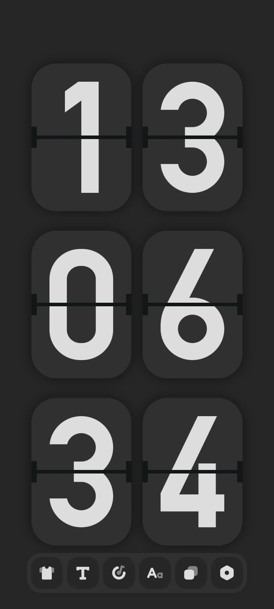
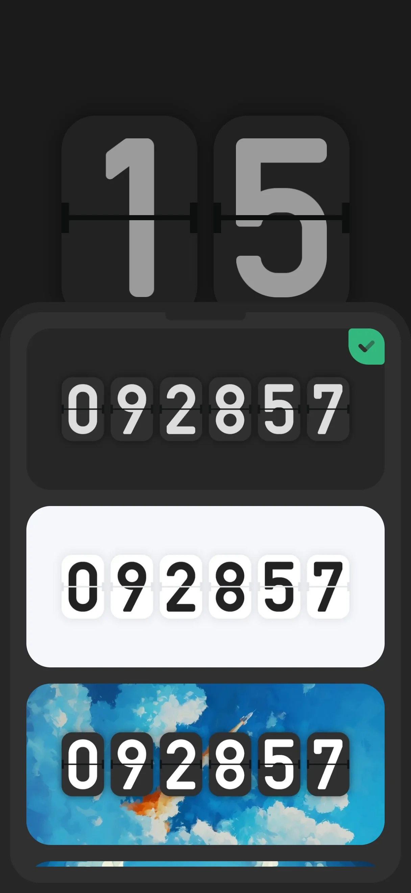
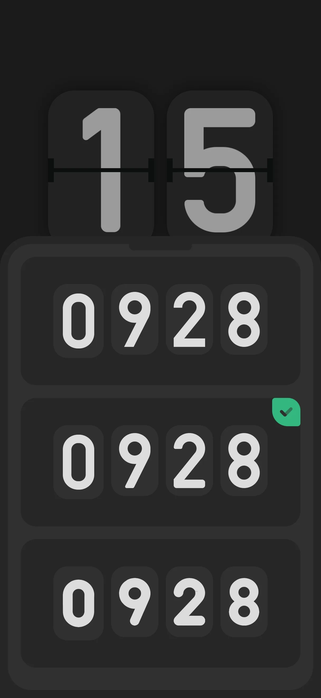
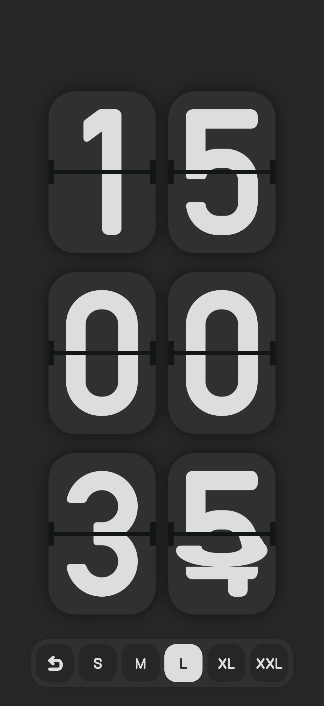
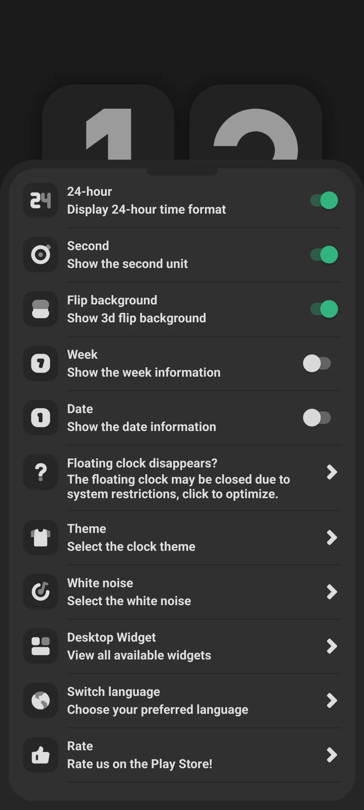
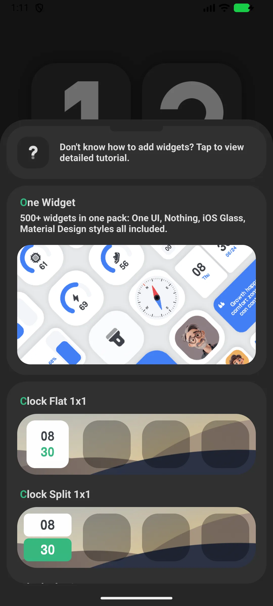
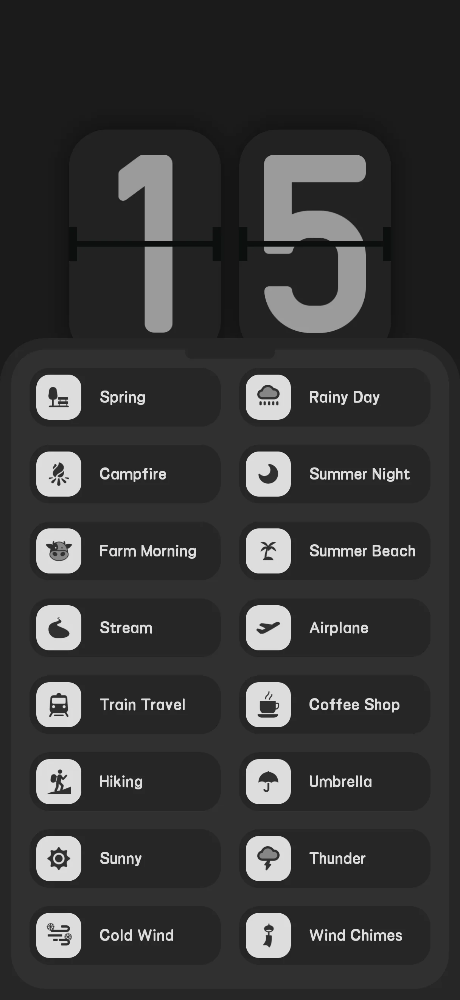
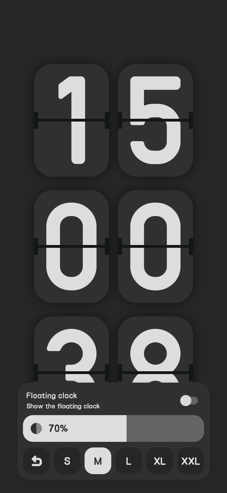

## 目录

- [应用简介](#应用简介)
- [首次使用](#首次使用)
- [翻页钟显示](#翻页钟显示)
- [12/24 小时、秒、日期](#1224-小时秒日期)
- [时钟组件](#时钟组件)
- [白噪音](#白噪音)
- [浮动时钟](#浮动时钟)
- [用闲置手机当钟](#用闲置手机当钟)
- [免费 vs Pro](#免费-vs-pro)
- [典型场景](#典型场景)
- [常见问题](#常见问题)

## 应用简介

Only Clock 是一款安卓与 iOS 漂亮的 **全屏[翻页钟](/zh/glossary/what-is-a-flip-clock/)**——把任何手机或平板变成桌面或床头钟。它也是一款带 **翻页时钟专注计时**、**翻页时钟白噪音** 与 **翻页时钟小组件** 的工具，一次安装就能覆盖桌面、床头与主屏。这份指南从首次启动讲到 12/24 小时显示、主题与字号，再到组件、声音与悬浮模式，最后说明怎样把 **旧手机当时钟** 用而不必整夜全亮。

**🕐 翻页动画**
- 数字变化时的流畅翻页过渡（每个数字约 600 毫秒）
- 多种主题（如黑、白、天空）

**🪟 组件**
- 18 个主题时钟组件，外加时钟网格组件（1x1、2x1、2x2、4x1、4x2、扁平/分体）

**🔊 白噪音**
- 内置环境声（与独立白噪音应用同源引擎），助你专注或睡眠

**📅 灵活显示**
- 切换 12/24 小时、秒、星期与日期

> 注意：Only Clock 本身 **没有番茄 / 专注计时器**——那在另一个姊妹应用里。它的白噪音只是帮你集中。

## 首次使用

打开应用进入 **全屏翻页钟**。

- 工具栏（顶部）可快速访问设置、主题、声音与大小
- 显示时钟时屏幕保持常亮

{: width="180" .normal }

## 翻页钟显示

时钟显示翻页风格时间。点工具栏改 **主题**（Clock Theme）、**字体**（Clock Font）与 **大小**（Clock Size）。

{: width="180" .normal }
{: width="180" .normal }
{: width="180" .normal }

## 12/24 小时、秒、日期

1. 打开 **设置**
2. 切换：
   - **24 小时**（默认开）
   - **秒**（默认开）
   - **星期**（默认关）
   - **日期**（默认关）
   - **翻页背景** 遮罩（默认开）

{: width="180" .normal }

## 时钟组件

1. 打开 **设置 → 组件**
2. 浏览 **画廊** 的 26 种风格
3. 点一种 → 应用显示"长按主屏添加"指引
4. 长按主屏/锁屏 → 组件 → 选 Only Clock → 放置
5. 4x2 翻页组件有自己的配置（秒 / 遮罩 / 星期 / 日期）

{: width="180" .normal }

## 白噪音

1. 打开 **设置 → 白噪音**
2. 从两列网格选一段声音（部分为高级）
3. 点按播放 / 停止

时钟与独立白噪音应用共享同一个声音引擎。

{: width="180" .normal }

## 浮动时钟

1. 在主屏工具栏开启浮动时钟开关
2. 如询问则授予叠层权限
3. 时钟叠层显示在其它应用之上

{: width="180" .normal }

## 用闲置手机当钟

因为屏幕保持常亮（`FLAG_KEEP_SCREEN_ON`）且可放置组件，旧手机或平板非常适合当专用桌面/床头钟。允许忽略电池优化以免被杀死。

## 免费 vs Pro

- **免费** 含广告，并把部分主题/字体/声音锁在奖励广告或购买之后
- **Pro** 去广告并解锁全部

## 典型场景

- **闲置手机当床头钟**——打开 Only Clock，把手机插在床边，暗色翻页脸整夜显示时间，屏幕保持常亮。
- **桌前专注锚点**——学习时段用全屏钟配白噪音；浮窗模式让时间停在笔记或视频之上。
- **主屏一瞥即达**——加一个带秒、星期、日期的 4x2 翻页组件，时间抬眼便见。
- **搭配房间**——切换黑/白/天空主题与字体/大小，让钟契合你的布置。

## 常见问题

### Only Clock 里有专注 / 番茄计时器吗？
没有。专注计时器是独立应用。Only Clock 提供翻页钟、组件与白噪音。

### 它保持屏幕常亮吗？
是——显示时钟时使用保持屏幕常亮标志；作床头钟用时，也请忽略电池优化。

## 小结

Only Clock 把任何设备变成华丽的翻页钟显示，带组件与舒缓白噪音——免费起步，Pro 升级去广告、解锁全部主题。

## 相关术语

- [什么是翻页时钟（Flip Clock）？](/zh/glossary/what-is-a-flip-clock/)
- [什么是床头钟（Nightstand Clock）？](/zh/glossary/what-is-a-nightstand-clock/)
