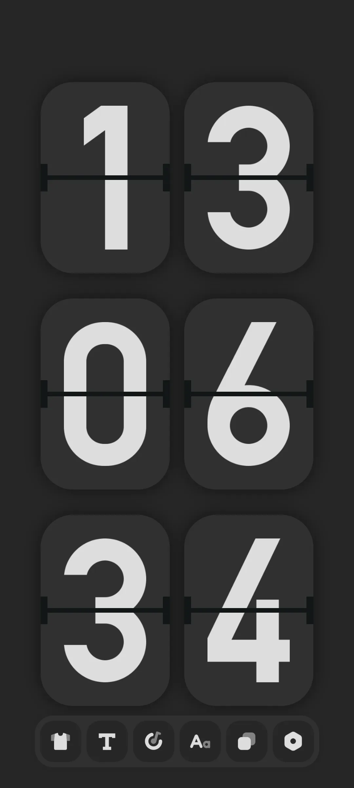
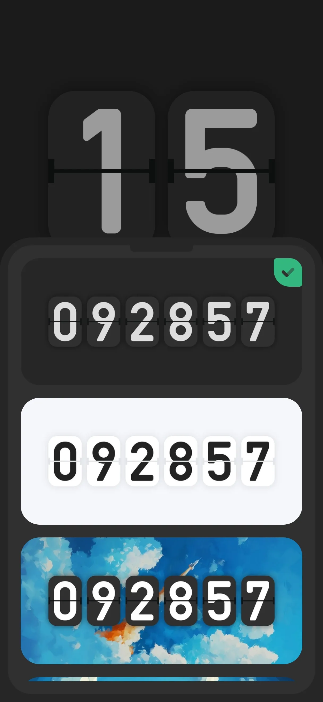
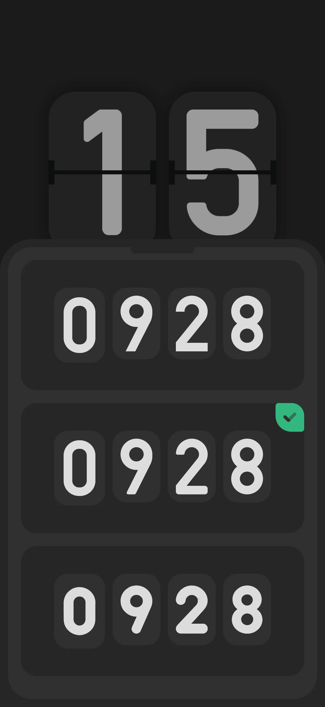
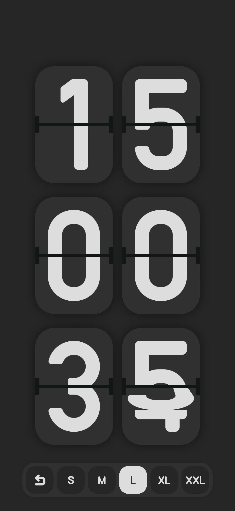
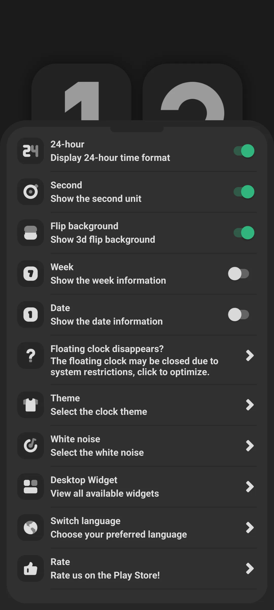
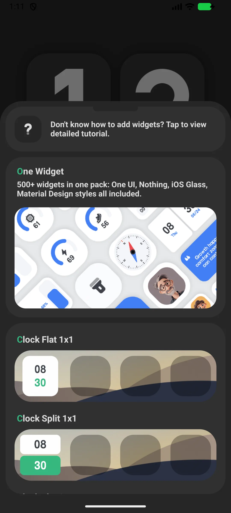
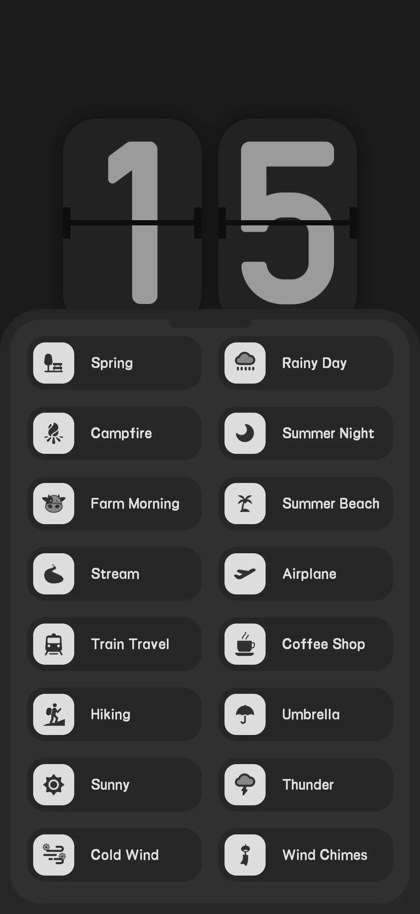
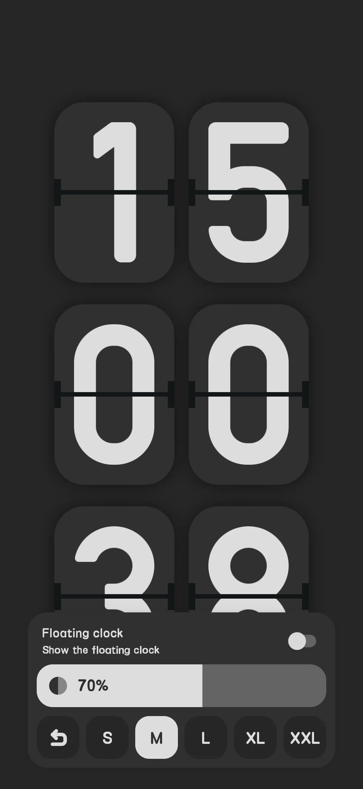

## 目录

- [应用简介](#应用简介)
- [首次使用](#首次使用)
- [翻页钟显示](#翻页钟显示)
- [12/24 小时、秒、日期](#1224-小时秒日期)
- [时钟组件](#时钟组件)
- [白噪音](#白噪音)
- [浮动时钟](#浮动时钟)
- [用闲置手机当钟](#用闲置手机当钟)
- [免费 vs Pro](#免费-vs-pro)
- [典型场景](#典型场景)
- [常见问题](#常见问题)

## 应用简介

Only Clock 是一款安卓与 iOS 上的**全屏[翻页钟](/zh/glossary/what-is-a-flip-clock/)**，目标是把你手边任何一台手机或平板变成一块清晰易读的桌面钟或床头钟。它同时把 **翻页时钟小组件**、**白噪音** 与 **悬浮时钟** 收进同一个 App，所以你不必为了"看时间 + 助眠声音 + 桌面组件"分别装三个应用。这份指南按真实使用顺序写：从首次打开、调好 12/24 小时与主题字号，到把时钟放进主屏、配一段白噪音，最后说明怎样把闲置手机长期当钟而不必整夜手动点亮。

它不是功能堆砌型工具——只围绕"把时间显示做好"这一件事：没有广告打断全屏观看，翻页动画是视觉核心，其余能力都服务于"看得清、放得下、睡得着"。

**🕐 翻页动画**
- 数字变化时是逐位翻页过渡（每个数字约 600 毫秒），比普通数字钟更有"机械翻页牌"的质感，远看也容易辨认
- 多种主题（黑、白、天空）适配深色床头或浅色桌面；翻页时有轻微背景遮罩减少残影

**🪟 组件**
- 18 个主题时钟组件，外加时钟网格组件（1x1、2x1、2x2、4x1、4x2，以及扁平/分体样式）
- 主屏组件适合"抬眼一瞥"，全屏时钟适合"专注时盯着"，两者共用一套时间源

**🔊 白噪音**
- 内置环境声与独立白噪音应用共享同一套声音引擎，无需另外安装
- 常见用法是睡前开雨声/风扇声，或工作时段用它盖住开放式办公室的杂音

**📅 灵活显示**
- 12/24 小时、秒、星期、日期可各自开关；默认 24 小时 + 秒，星期与日期关闭以保持画面干净

> 注意：Only Clock 本身 **没有番茄 / 专注计时器**，那在另一个姊妹应用里。它的白噪音只是帮你集中注意力，不会替你计时或提醒休息。如果你要的是"25 分钟番茄钟 + 时钟"，需要配合其他应用。

## 首次使用

第一次打开会直接进入 **全屏翻页钟**，没有注册、登录或引导弹窗——装上即可用，这也是它适合当床头钟的原因之一（深夜醒来不需要任何额外操作）。

- 顶部工具栏集中了设置、主题、声音与字号四个入口，常用调整都在这一步完成
- 显示时钟时屏幕会保持常亮（系统层面持有 `FLAG_KEEP_SCREEN_ON`），所以不用担心几分钟后自动熄灭

{: width="180" .normal }

如果你打算长期插电使用，建议首次进入后先做两件事：到系统设置里把"忽略电池优化"授权给 Only Clock，再按下面的步骤调好显示项。否则系统可能在后台杀掉常亮进程，出现"早上醒来屏幕黑了"的情况。

## 翻页钟显示

时钟显示采用翻页风格：每一位数字变化时像翻页牌一样滚动，而不是直接跳字。点顶部工具栏可分别改 **主题**（Clock Theme）、**字体**（Clock Font）与 **大小**（Clock Size）——通常先定主题（决定底色与数字配色），再选字体（决定数字的笔画风格），最后调大小（决定远距离可读性）。

{: width="180" .normal }
{: width="180" .normal }
{: width="180" .normal }

取舍建议：床头使用优先选**深色主题 + 大字号**，夜里看时间不刺眼；桌面或客厅用浅色主题更自然。字号不是越大越好——放到平板或电视上，过大的数字会让"分"被裁到屏幕外，建议以"秒和分同时在画面内"为准。带秒显示时刷新更频繁，若设备在充电宝上，关掉秒可以略微省电。

## 12/24 小时、秒、日期

国内用户习惯 24 小时制，默认即为 24 小时；如果你更习惯"上午/下午"的表达，可切到 12 小时。进入 **设置** 后按需切换：

1. 打开 **设置**
2. 切换：
   - **24 小时**（默认开）
   - **秒**（默认开）
   - **星期**（默认关）
   - **日期**（默认关）
   - **翻页背景** 遮罩（默认开）

{: width="180" .normal }

这几个开关本质是"信息密度"与"画面干净"的平衡：床头钟只留小时和分钟最清爽；桌面组件则建议把星期和日期也打开，既能看时间又不会错过工作日。日期格式遵循系统区域设置，中文环境下会显示"11月24日"这类本地写法，无需在 App 内单独配置。

## 时钟组件

组件是把时钟"嵌进主屏"的方式，适合不想每次都点开 App 的场景。添加步骤如下：

1. 打开 **设置 → 组件**
2. 浏览 **画廊** 的 26 种风格（主题组件与网格组件都在这里）
3. 点一种 → 应用显示"长按主屏添加"指引
4. 长按主屏/锁屏 → 组件 → 选 Only Clock → 放置，并拖动到你想要的位置
5. 4x2 翻页组件有自己的配置（秒 / 遮罩 / 星期 / 日期），长按组件可重新进入设置

{: width="180" .normal }

选择尺寸时有个经验：1x1 只够放小时和分钟，适合角落；4x2 能同时容纳秒、星期和日期，是一眼获取完整信息最划算的尺寸。不同桌面启动器对组件的支持略有差异，若在主屏找不到 Only Clock 组件，可先检查启动器是否允许第三方组件，再重启一次桌面。部分国产定制系统（如小米、华为）的锁屏组件需要在系统自带的组件管理里单独开启。

## 白噪音

白噪音用于"用声音填满环境、减少干扰"，时钟与独立白噪音应用共享同一个声音引擎，音质和逻辑一致。

1. 打开 **设置 → 白噪音**
2. 从两列网格选一段声音（部分为高级内容，免费版可通过观看奖励广告或升级 Pro 解锁）
3. 点按播放 / 停止；需要定时可结合系统睡眠定时

{: width="180" .normal }

使用场景上，雨声、风扇声适合遮住临街噪音或同事交谈，帮你进入专注状态；睡前则建议选音量平稳、没有突兀起伏的声音，并把音量调到"刚好盖住背景噪声"即可，不必开大。注意声音播放会占用后台，离开时记得停止，或在系统里给 Only Clock 设置合理的后台权限，避免被清理后声音中断。

## 浮动时钟

浮动时钟会让一个小时钟窗浮在其他应用之上，适合你看视频、读文档时仍想看到时间。

1. 在主屏工具栏开启浮动时钟开关
2. 如询问则授予"显示在其他应用上层"的叠层权限
3. 时钟叠层出现在其它应用之上，可拖动位置

{: width="180" .normal }

这个权限是 Android 的系统级敏感权限，只在你主动开启悬浮功能时才会申请；日常不使用可以保持关闭。需要注意：部分全面屏手机在看全屏视频或游戏时会自动隐藏悬浮窗，这是系统行为而非故障；另外悬浮窗会一直占用前台，长时间不用建议关掉以省电。

## 用闲置手机当钟

因为屏幕保持常亮（`FLAG_KEEP_SCREEN_ON`）且可放置组件，旧手机或平板非常适合当专用桌面/床头钟。做法是把设备插上电源、打开 Only Clock 并调到合适的主题字号，然后放在床头或桌面固定位置。

长期运行的关键是**别让系统把 App 杀掉**：到系统设置里给 Only Clock 忽略电池优化、允许后台运行，并关闭自动休眠或把它加入白名单。这样即使屏幕常亮数小时，翻页钟也能稳定显示。近年来闲置的安卓手机往往性能足够，专门当钟比让它吃灰更实用；平板的更大屏幕则适合放客厅，远距离也能看清。

## 免费 vs Pro

- **免费** 含广告，并把部分主题/字体/声音锁在奖励广告或购买之后；基础翻页钟、组件与大部分显示设置可直接使用
- **Pro** 去广告并解锁全部主题、字体与声音，适合把它当长期床头钟、不希望被打断的用户

如果你只是想试试翻页钟的效果，免费版完全够用；如果打算每天早晚都看、或放在卧室长期运行，Pro 的去广告与全主题能明显减少打扰。

## 典型场景

- **闲置手机当床头钟**——打开 Only Clock，把手机插在床边，暗色翻页脸整夜显示时间，屏幕保持常亮；配合忽略电池优化，早上醒来时间仍在。
- **桌前专注锚点**——学习时段用全屏钟配一段雨声白噪音；需要看资料时切到悬浮模式，让时间停在笔记或视频之上。
- **主屏一瞥即达**——加一个带秒、星期、日期的 4x2 翻页组件，时间抬眼便见，不必点开任何应用。
- **搭配房间布置**——切换黑/白/天空主题与字体、字号，让钟融入你的桌面或床头风格；浅色主题配白天，深色主题配夜晚。

## 常见问题

### Only Clock 里有专注 / 番茄计时器吗？
{:.faq-q}
没有。专注计时器是独立应用。Only Clock 提供翻页钟、组件与白噪音，可以用白噪音辅助专注，但不会替你计时或提醒休息。

### 它保持屏幕常亮吗？
{:.faq-q}
是——显示时钟时使用保持屏幕常亮标志；作床头钟用时，也请忽略电池优化，否则系统可能在后台结束进程导致黑屏。看时间、调主题、放本地白噪音都可离线完成，也没有账号体系；只有下载额外内容或解锁高级项时才需要网络。

## 小结

Only Clock 把任何手机或平板变成一块清晰的翻页钟，带主屏组件与舒缓白噪音——免费起步，Pro 升级去广告、解锁全部主题。如果你想要一块"抬眼就能看、夜里不刺眼、还能放点声音助眠"的时钟，它是同类型里上手成本最低的选择之一。

## 相关术语

- [什么是翻页时钟（Flip Clock）？](/zh/glossary/what-is-a-flip-clock/)
- [什么是床头钟（Nightstand Clock）？](/zh/glossary/what-is-a-nightstand-clock/)
