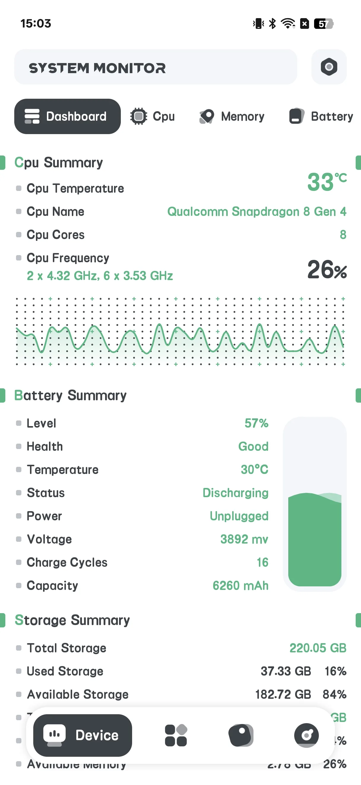
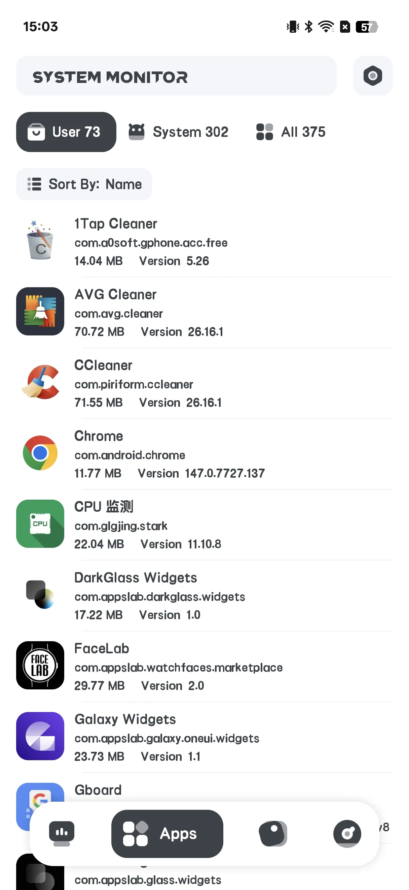
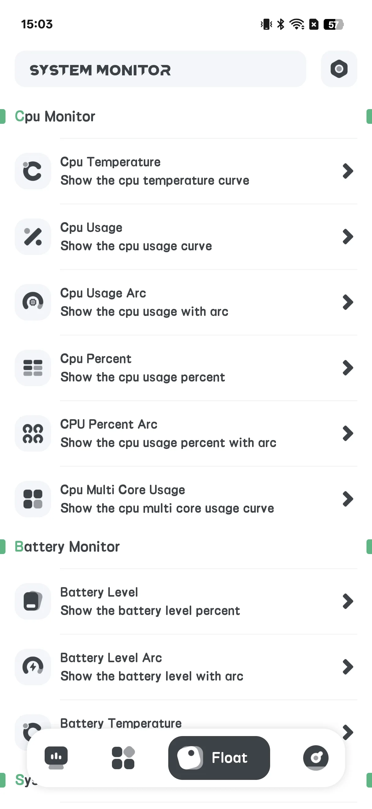
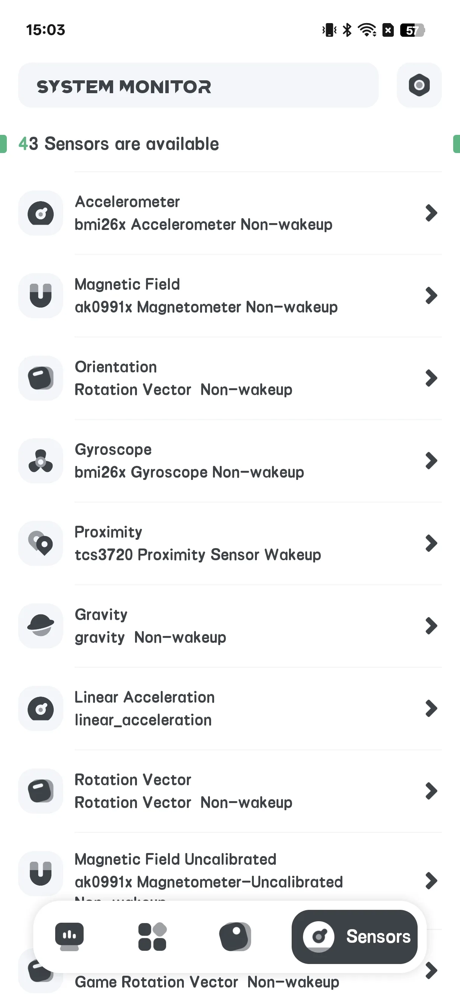
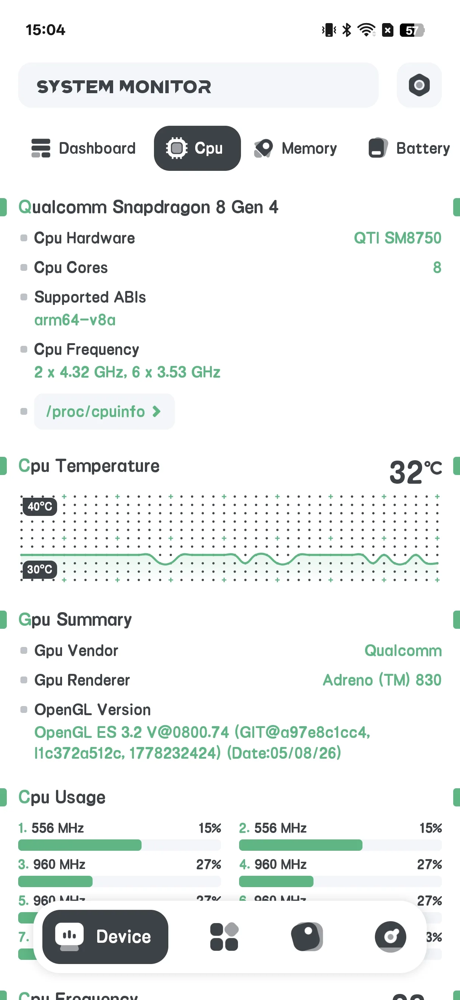
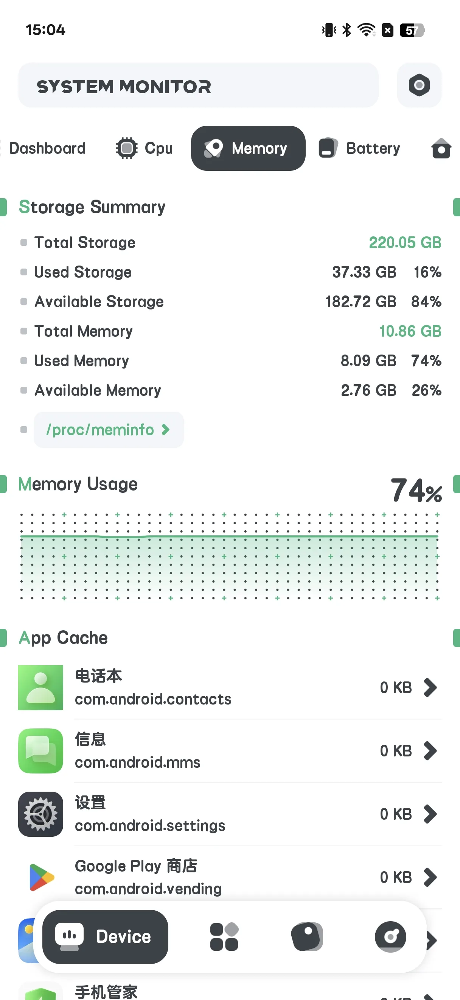
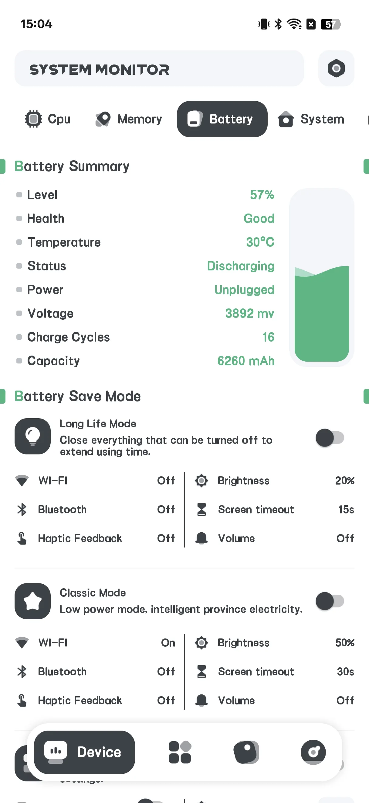
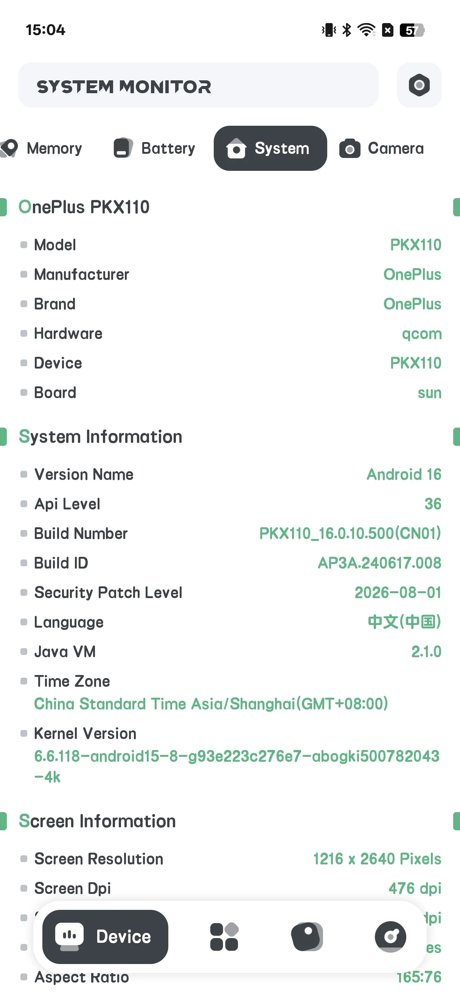
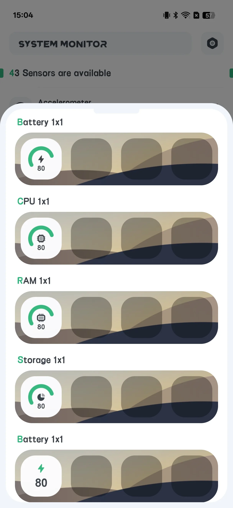

## 目录

- [应用简介](#应用简介)
- [首次使用](#首次使用)
- [查看硬件信息](#查看硬件信息)
- [电池健康](#电池健康)
- [过热报警](#过热报警)
- [浮窗](#浮窗)
- [主屏小组件](#主屏小组件)
- [设置](#设置)
- [典型场景](#典型场景)
- [常见问题](#常见问题)

## 应用简介

System Monitor 是一款 **付费、一次性** 的安卓工具，用于 **[只读硬件信息检测](/zh/glossary/what-is-a-system-monitor/)**。它报告你手机内部正在发生什么——它 **不** 清理垃圾或加速 RAM。因为它只读取系统计数，从 **安卓系统监控清理加速** 搜过来的人，通常要的是可信的数字与一直看得见的方式。这份指南从首次启动讲到硬件信息、电池健康、过热报警、**系统监控悬浮窗** 浮层与 **悬浮窗系统监控安卓** 布局，再到主屏小组件——全程只读、无需账号，也不宣称清理垃圾。

**🔍 它读取什么（只读）**
- **CPU** 温度与频率、每核使用率
- **存储** 使用
- **内存（RAM）** 使用
- **电池** 健康：温度、健康状态、电压与电量
- **相机** 能力

**🌡 过热保护**
- CPU 或电池过热时发出警告的报警

**🪟 浮窗与小组件**
- 显示实时数据的浮动叠层
- 主屏小组件：CPU / 电池 / RAM / ROM / 组合

> 重要：System Monitor **没有应用锁 / 指纹锁**，也 **不做清理或加速**。你可能看到的"指纹：支持？"一行只是设备能力读数，而非锁功能。

## 首次使用

主屏有四个标签：**硬件**、**应用**、**浮窗**、**传感器**。

- **硬件** 是主信息屏
- **浮窗** 配置叠层
- **传感器** 列出设备传感器

{: width="180" .normal }
{: width="180" .normal }
{: width="180" .normal }
{: width="180" .normal }

## 查看硬件信息

1. 打开 **硬件** 标签
2. 切换子标签：**仪表盘 / CPU / RAM / 电池 / 系统 / 相机**
3. 读取实时值：
   - **CPU**：温度、频率、每核负载
   - **RAM**：已用 / 总内存
   - **电池**：电池温度、健康、电压、电量
   - **系统**：存储与设备信息

{: width="180" .normal }
{: width="180" .normal }
{: width="180" .normal }
{: width="180" .normal }

## 电池健康

在 **电池** 子标签，你可以看到电池 **温度、健康状态、电压与电量** 的曲线——便于长期关注损耗。

{: width="180" .normal }

## 过热报警

1. 打开 **设置 → 过热报警**（或 **温度提醒**）
2. 开启 **CPU** 和/或 **电池** 报警
3. 设定 **阈值** 温度
4. 数值超出时应用警告你，让你给手机降温

## 浮窗

1. 打开 **浮窗** 标签
2. 切换你想显示的监控项（CPU 温度/使用率/曲线、电池、RAM、系统监控、FPS）
3. 按提示授予 **"在其他应用上层绘制"** 权限
4. 浮动数据出现在任意应用之上

{: width="180" .normal }

## 主屏小组件

1. 打开 **设置 → 组件画廊**
2. 选一个组件：CPU / 电池 / RAM / ROM / 组合
3. 从组件选择器放置

{: width="180" .normal }

## 设置

设置包含主题、过热报警、温度单位、刷新率、组件画廊，以及浮窗自动恢复。

## 典型场景

- **游戏时读 CPU 温度**——打开硬件标签（CPU 子标签），盯住温度与每核负载，在降频掉帧前抓到苗头。
- **护住电池**——在电池子标签查看温度、健康、电压与电量的曲线，数月追踪损耗发展。
- **不打开也一瞥**——开启浮窗叠层，或在主屏放一个组合组件，抬眼即得实时 CPU/电池/RAM。
- **设一道热闸**——开启过热报警并设阈值，在手机热到受损前收到警告。
- **记住它是什么**——记住它只读：不清理垃圾、不释放 RAM，重负载应用得你自己关。

## 常见问题

### 它清理内存或存储吗？
{:.faq-q}
不。System Monitor 严格只读——它报告事实，从不删除文件或"加速"RAM。

### 它有应用锁吗？
{:.faq-q}
没有。此应用无指纹或密码锁。

### 数据从哪来？
{:.faq-q}
来自标准安卓 API（如 BatteryManager 与系统文件）。什么都不改变。

## 小结

当你只想 *看* 手机内部——CPU 温度、电池健康与实时数据——而不想要清理器或加速器时，System Monitor 是诚实的选择。一次性付费下载。

## 相关术语

- [什么是 CPU 温度监控？](/zh/glossary/what-is-a-cpu-temperature-monitor/)
- [什么是系统监控（System Monitor）？](/zh/glossary/what-is-a-system-monitor/)
- [什么是内存清理（RAM Booster）？](/zh/glossary/what-is-a-ram-booster/)
