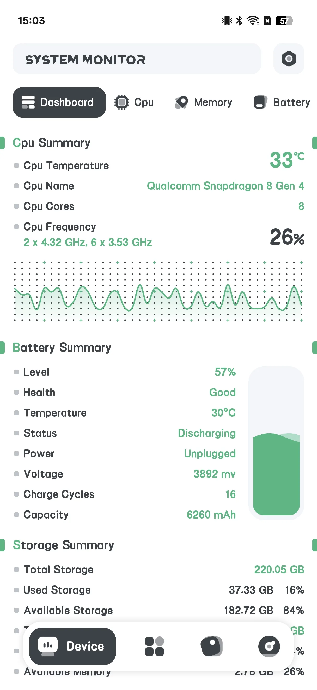
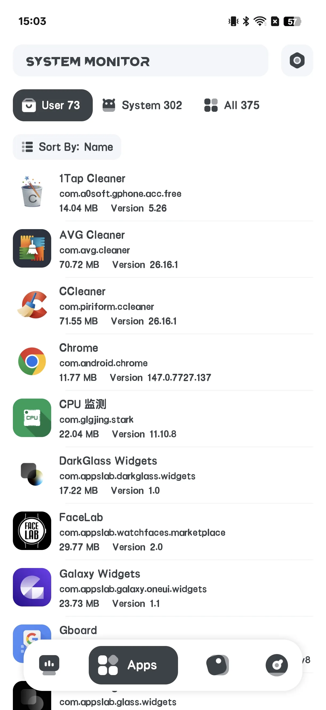
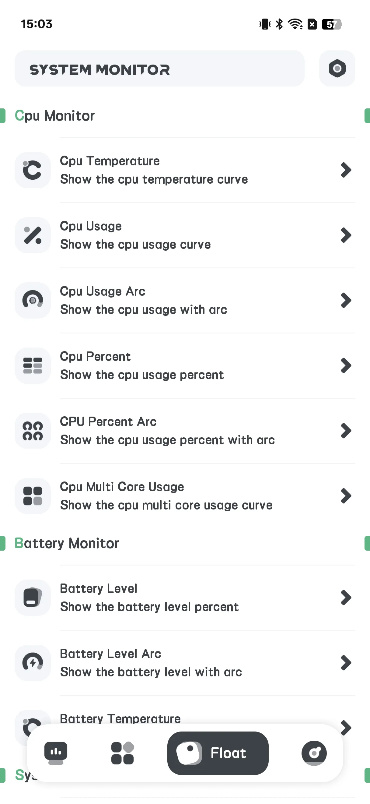
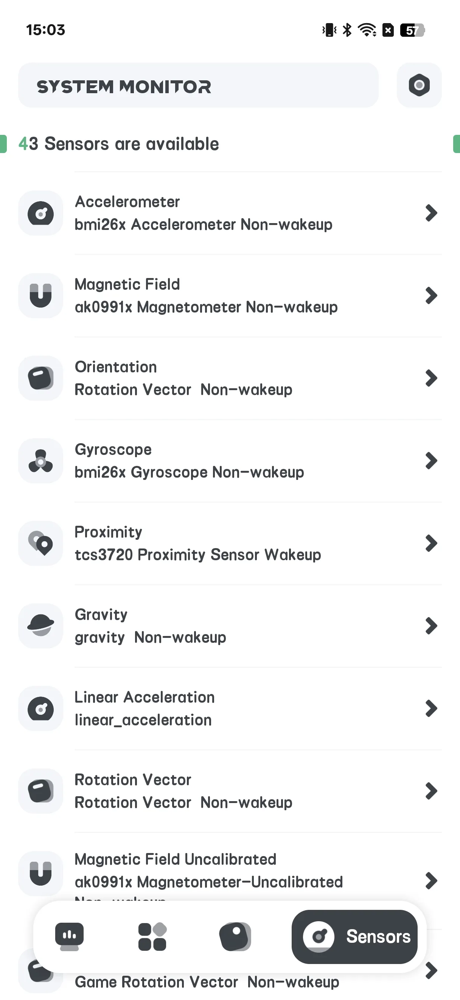
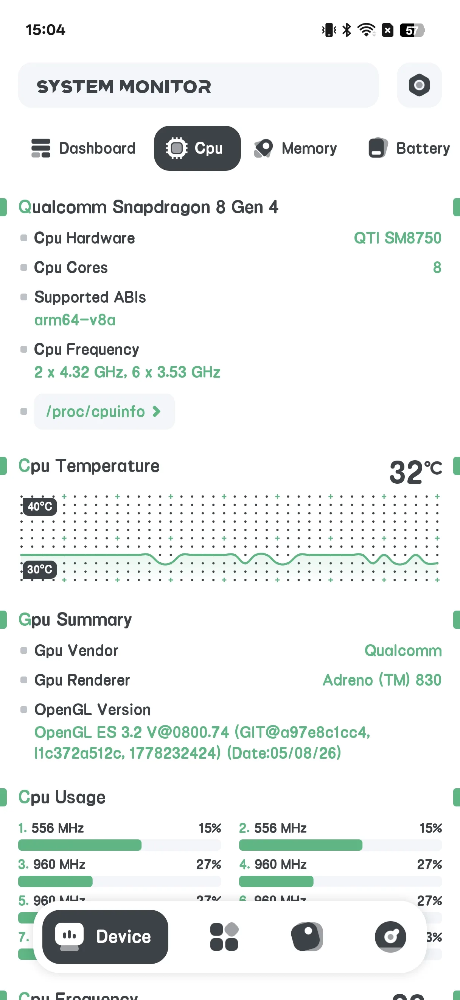
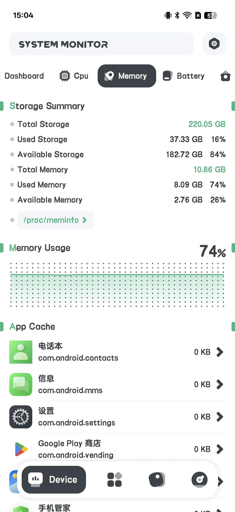
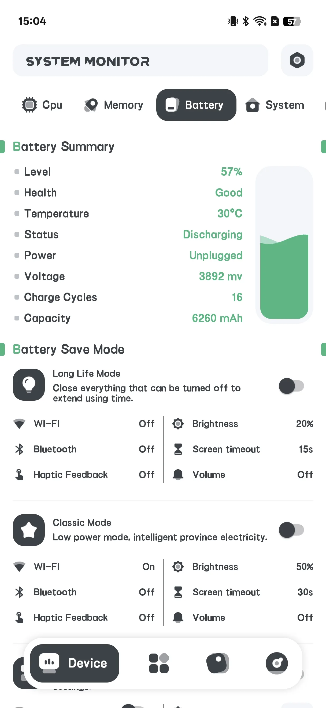
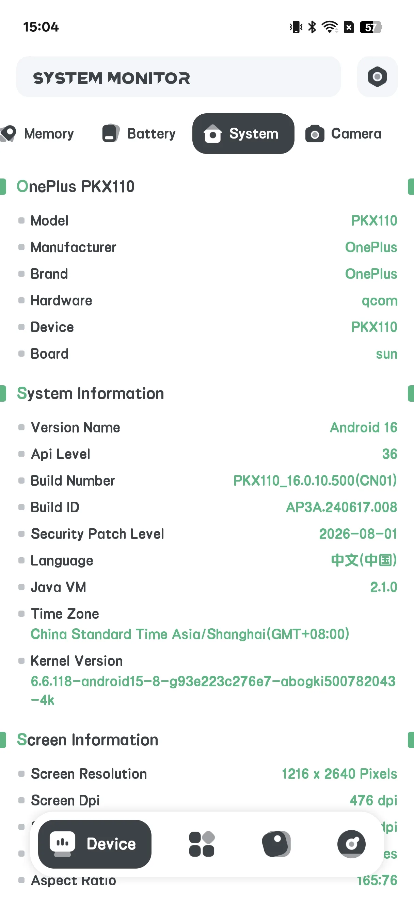
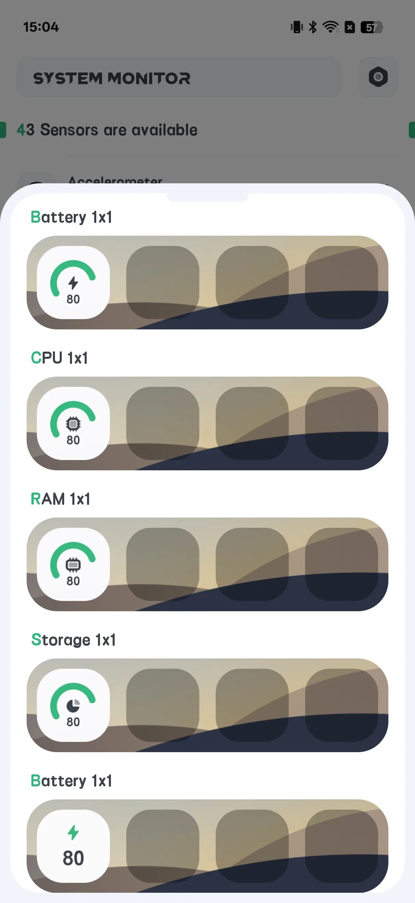

## 目录

- [应用简介](#应用简介)
- [首次使用](#首次使用)
- [查看硬件信息](#查看硬件信息)
- [电池健康](#电池健康)
- [过热报警](#过热报警)
- [浮窗](#浮窗)
- [主屏小组件](#主屏小组件)
- [设置](#设置)
- [典型场景](#典型场景)
- [常见问题](#常见问题)

## 应用简介

System Monitor 是一款 **一次性付费、无需账号** 的安卓**[只读硬件信息检测](/zh/glossary/what-is-a-system-monitor/)**工具，只读 CPU 温度与频率、每核负载、RAM、电池健康、存储与相机数据，全程不清理垃圾、不释放 RAM、不替处理器降频，把手机内部状态持续摆在屏幕上。它报告你手机内部正在发生什么，但只读取系统计数、不干预后台进程。从 **安卓系统监控清理加速** 搜过来的人，通常要的是可信的数字与一直看得见的方式。这份指南从首次启动讲到硬件信息、电池健康、过热报警、**系统监控悬浮窗** 浮层与 **悬浮窗系统监控安卓** 布局，再到主屏小组件——全程只读、无需账号，也不宣称清理垃圾。

先说清楚"只读"意味着什么：这个应用只观察、不干预。它不会关掉后台应用、不会释放内存、也不会替你给处理器降频——它把数据摆出来，让你自己判断该做什么。这正是它与那些"清理加速"工具的分别：如果你想要一个能随时看到真实状态、又不会乱改系统的仪表盘，它很合适；如果你指望一键把手机变快，那它从设计上就不打算做这件事。

**🔍 它读取什么（只读）**
- **CPU** 温度与频率、每核使用率
- **存储** 使用
- **内存（RAM）** 使用
- **电池** 健康：温度、健康状态、电压与电量
- **相机** 能力

**🌡 过热保护**
- CPU 或电池过热时发出警告的报警

**🪟 浮窗与小组件**
- 显示实时数据的浮动叠层
- 主屏小组件：CPU / 电池 / RAM / ROM / 组合

> 重要：System Monitor **没有应用锁 / 指纹锁**，也 **不做清理或加速**。你可能看到的"指纹：支持？"一行只是设备能力读数，而非锁功能。

## 首次使用

System Monitor 首次启动直接进入由**硬件**、**应用**、**浮窗**、**传感器**四个标签组成的主界面，无需账号、登录或设置向导，打开即可读取实时数据。硬件页是主信息屏，集中呈现 CPU 温度、频率、每核负载、RAM 与存储读数；应用页按进程列出内存占用；浮窗页负责把监控项叠到其它应用之上；传感器页则列出设备里有哪些传感器。第一次打开可以先四处点点熟悉布局。

- **硬件** 是主信息屏
- **浮窗** 配置叠层
- **传感器** 列出设备传感器

{: width="180" .normal }
{: width="180" .normal }
{: width="180" .normal }
{: width="180" .normal }

四页各有侧重：硬件看核心指标，应用列出每个进程的内存占用，浮窗负责把数据叠到其他应用之上，传感器则列出设备里有哪些传感器。建议先到"硬件"页确认温度、RAM 等读数是否正常——如果设备没有暴露真实传感器，后续的报警和曲线也就失去了依据。

## 查看硬件信息

System Monitor 的硬件信息页把实时读数拆成**仪表盘 / CPU / RAM / 电池 / 系统 / 相机**六个子标签，打开 **硬件** 标签后逐个切换即可读取：CPU 页给出温度、频率与每核负载，RAM 页给出已用与总内存，电池页给出温度、健康、电压与电量，系统页给出存储与设备信息。六个子标签各管一类数据，避免一屏塞满；不同手机暴露的传感器程度不同，某项读数缺失多半是设备本身没提供，而不是应用出错。按下面的步骤切换查看即可。

1. 打开 **硬件** 标签
2. 切换子标签：**仪表盘 / CPU / RAM / 电池 / 系统 / 相机**
3. 读取实时值：
   - **CPU**：温度、频率、每核负载
   - **RAM**：已用 / 总内存
   - **电池**：电池温度、健康、电压、电量
   - **系统**：存储与设备信息

{: width="180" .normal }
{: width="180" .normal }
{: width="180" .normal }
{: width="180" .normal }

六个子标签把不同类型的数据分开，避免一屏塞满。看 CPU 时把温度和每核负载一起读：高温伴随高频通常是正常负载，高温而频率被压低则可能已经触发了降频。RAM 页告诉你已用与总量，"应用"标签则进一步细分到每个进程。不同手机暴露的传感器程度不同，若某项读数缺失，多半是设备本身没提供，而不是应用出错。

## 电池健康

System Monitor 的电池子标签把 **温度、健康状态、电压与电量** 四项读数画成曲线，便于跨几周甚至几个月长期关注电池损耗；单次电压或电量读数意义有限，连成曲线才能发现同样使用强度下温度是否越来越高、健康状态是否逐步下滑。快充或边充边玩时，这一页的温度尤其值得留意，配合过热报警使用效果更好。

{: width="180" .normal }

## 过热报警

System Monitor 的过热报警可为 **CPU** 与 **电池** 分别设定温度阈值，超出时应用会发出警告，让你及时给手机降温；它只做提醒，不会替你关游戏或拔充电器。阈值贴近日常最高温一点点最实用，既能在真正异常时提醒，又不至于频繁误报；游戏时更在意 CPU 温度，充电时则盯住电池，收到警告后该暂停、摘壳还是移到阴凉处仍由你决定。按下面四步即可开启。

1. 打开 **设置 → 过热报警**（或 **温度提醒**）
2. 开启 **CPU** 和/或 **电池** 报警
3. 设定 **阈值** 温度
4. 数值超出时应用警告你，让你给手机降温

阈值不必设得太极限：贴近日常最高温一点点，才能在真正异常时提醒你，又不至于频繁误报。CPU 与电池可以分开——游戏时更在意 CPU 温度，充电时则盯住电池。要记得报警只是提醒，应用不会替你关游戏或拔充电器；收到警告后该暂停、摘壳还是移到阴凉处，仍由你决定。

## 浮窗

System Monitor 的浮窗标签可把 **CPU 温度/使用率/曲线、电池、RAM、系统监控、FPS** 等监控项停在其他应用之上，按提示授予"在其他应用上层绘制"权限后，实时数据就以浮动叠层出现。实际用时建议只勾选当下关心的一两项，叠太多既挡画面又耗电；部分全面屏手机在全屏游戏时会自动隐藏悬浮窗，那是系统行为而非故障。长时间不用记得关掉浮窗，避免它一直占着前台。按下面步骤开启即可。

1. 打开 **浮窗** 标签
2. 切换你想显示的监控项（CPU 温度/使用率/曲线、电池、RAM、系统监控、FPS）
3. 按提示授予 **"在其他应用上层绘制"** 权限
4. 浮动数据出现在任意应用之上

{: width="180" .normal }

叠层权限是 Android 的系统级权限，只在你主动开启浮窗时才会申请。实际用时建议只勾选当下关心的一两项——比如温度和 FPS——叠太多既挡画面又耗电。部分全面屏手机在全屏游戏时会自动隐藏悬浮窗，这是系统行为而非故障。长时间不用记得关掉浮窗，避免它一直占着前台。

## 主屏小组件

System Monitor 的组件画廊提供 **CPU / 电池 / RAM / ROM / 组合** 这几类主屏小组件，从组件选择器放置后即可不打开应用就瞄一眼实时数据；想一屏看全，就选"组合"组件，把 CPU、电池、RAM 收在一起。边充电边看视频时确认电池烫不烫、打游戏前扫一眼温度，都是它适合的场景；不同启动器添加组件的方式略有差别，找不到时先检查启动器是否允许第三方组件，再重启一次桌面。按下面步骤添加即可。

1. 打开 **设置 → 组件画廊**
2. 选一个组件：CPU / 电池 / RAM / ROM / 组合
3. 从组件选择器放置

{: width="180" .normal }

小组件适合"不打开应用也想瞄一眼"的场景：边充电边看视频时确认电池烫不烫，或打游戏前扫一眼温度。想一屏看全，就选"组合"组件，把 CPU、电池、RAM 收在一起。不同启动器添加组件的方式略有差别，若在主屏找不到，先检查启动器是否允许第三方组件，再重启一次桌面。

## 设置

System Monitor 的设置集中了主题、过热报警、温度单位、刷新率、组件画廊与浮窗自动恢复这几类选项：温度单位可在摄氏度与华氏度间切换，刷新率决定数据更新快慢，调高更跟手但略耗电，日常保持默认即可。浮窗自动恢复是个实用项——手机重启后，开启它能让悬浮窗自动重新出现，不必每次手动开一遍。主题只改变界面观感，不影响任何读数。

## 典型场景

System Monitor 的典型场景都建立在只读监控之上：游戏时读 CPU 温度，以便在降频掉帧前抓到苗头；护住电池时看温度、健康、电压与电量的数月曲线；不打开应用时用浮窗或组合组件一瞥实时数据；再设一道过热报警的热闸，在手机热到受损前收到警告。它不清理垃圾、不释放 RAM，想让手机变快仍要从管理应用本身入手。下面列出五种典型用法。

- **游戏时读 CPU 温度**——打开硬件标签（CPU 子标签），盯住温度与每核负载，在降频掉帧前抓到苗头，及时暂停。
- **护住电池**——在电池子标签查看温度、健康、电压与电量的曲线，数月追踪损耗发展，判断是否需要改变充电习惯。
- **不打开也一瞥**——开启浮窗叠层，或在主屏放一个组合组件，抬眼即得实时 CPU/电池/RAM。
- **设一道热闸**——开启过热报警并设阈值，在手机热到受损前收到警告，给自己留出处理时间。
- **记住它是什么**——记住它只读：不清理垃圾、不释放 RAM，重负载应用得你自己关；想让手机变快，得从管理应用本身入手。

## 常见问题

### 它清理内存或存储吗？
{:.faq-q}
不。System Monitor 严格只读——它报告事实，从不删除文件或"加速"RAM。想要清理，需要另用系统自带的存储管理或专门工具。

### 它有应用锁吗？
{:.faq-q}
没有。此应用无指纹或密码锁。你可能看到的"指纹：支持？"只是设备能力读数，不是锁功能。

### 数据从哪来？
{:.faq-q}
来自标准安卓 API（如 BatteryManager 与系统文件）。什么都不改变，所以读数反映的是系统真实报告的状态；不同设备暴露的信息多少会有差异。

## 小结

当你只想 *看* 手机内部——CPU 温度、电池健康与实时数据——而不想要清理器或加速器时，System Monitor 是诚实的选择。一次性付费下载、无需账号，它把力气花在"读数可信、随时可见、过热提醒"上；对想掌握设备状态又不希望被乱改系统的人来说，这是个让人安心的工具。

## 相关术语

- [什么是 CPU 温度监控？](/zh/glossary/what-is-a-cpu-temperature-monitor/)
- [什么是系统监控（System Monitor）？](/zh/glossary/what-is-a-system-monitor/)
- [什么是内存清理（RAM Booster）？](/zh/glossary/what-is-a-ram-booster/)
