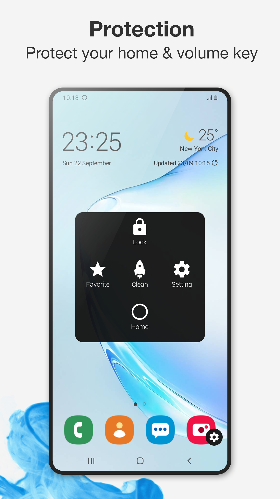
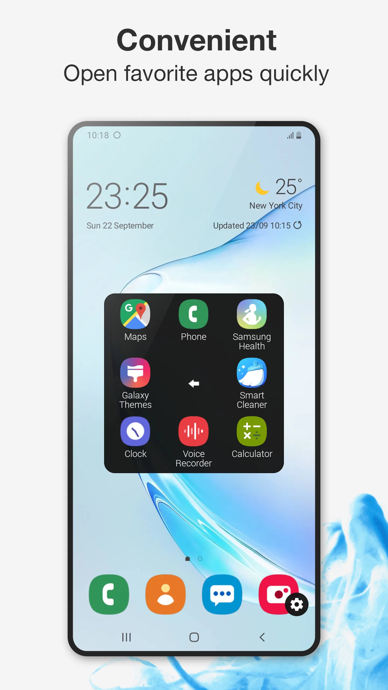

两者都把控件放到你的屏幕之上，但解决的是不同问题。**Floating Assistant** 是一个 3 合 1 叠层——辅助触控、浮动时钟与实时系统监控。**Assistive Touch**（Easy Touch）是经典的浮动导航球。这份 **Floating Assistant vs Assistive Touch** 对比帮你在 2026 年挑选一款 **[叠层小组件](/zh/glossary/what-is-a-floating-window/)** 应用。如果你在找的是不止一颗导航球的 **辅助触控替代**，下面「叠层能力」几行就足够判断。

选型的起点其实是一个很具体的问题：你只是想让失灵的实体按键有个替代，还是希望屏幕上常驻一块「控制面板」？前者的典型场景是单手握着大屏手机、拇指够不到顶部的返回键，或电源键按下去已经没反馈；后者的场景更长——边充电边看视频时想知道温度、打长局游戏时想盯住电量和内存、又不想来回切出应用看时间。两款应用都免费起步，差别不在"能不能用"，而在叠层里到底装了多少东西。

## 一览

| | Floating Assistant | Assistive Touch (Easy Touch) |
|---|---|---|
| **核心** | 3 合 1：触控 + 浮动时钟 + 监控 | 浮动导航球 |
| **平台** | Android | Android |
| **辅助触控按钮** | **有** | **有** |
| **浮动时钟** | **有** | 通常无 |
| **浮动监控（CPU/RAM/电池）** | **有，实时** | 无 |
| **一键加速** | **有** | 各异 |
| **截图 / 手电筒** | **有** | 有 |
| **自定义** | 球 + 模块、主题 | 大小、颜色、手势 |
| **隐私** | 无障碍仅用于控件；无个人数据 | 广告支撑 |
| **价格** | 免费核心 + 可选解锁 | 免费（广告支撑） |
| **最适合** | 全能控制 + 监控 | 简单导航球 |

---

## Floating Assistant 详解

{: width="180" .normal }
{: width="180" .normal }
{: width="180" .normal }
{: width="180" .normal }
{: width="180" .normal }

Floating Assistant 把三个工具打包进一个叠层：用于导航的辅助触控球、可停在任意应用之上的浮动时钟，以及显示 CPU 温度、使用率、RAM 与电池并带一键加速的浮动系统监控。这决定了它的用法不是"设好一次就忘掉"，而是可以按场景取舍——通勤路上只留导航球减少遮挡，回到座位打游戏时再把时钟和监控模块打开，让信息跟着任务走。

从上面的截图顺序也能看出配置逻辑：先定悬浮球吸在哪条边缘、菜单里放哪些按钮，再按需要叠加时钟与监控模块，最后处理无障碍与叠层权限。权限只用于让球和读数"浮"在其他应用之上，不涉及读取你的聊天或浏览内容；日常不用时可以整体关掉，不必一直常驻。

### 优点
- **一个叠层三个工具**——按钮、时钟、监控无需分别装应用。对大屏手机尤其省事：返回、主页、多任务、锁屏、截图都在拇指下，不必为了看时间再装一个悬浮时钟、为了看温度再装一个监控器。
- **浮动时钟**——让时间在任何应用或游戏之上可见。读长文档、看网课或全屏导航时，抬眼就能确认时间，不用退出当前界面。
- **实时监控**——实时 CPU 温度、使用率、RAM 与电池，游戏或充电时理想。长时间玩游戏如果发现机身发烫，可以据此决定降画质或休息一会儿，而不是靠手感猜测。
- **一键加速**——手机卡顿时快速释放 RAM。适合在频繁切换应用后临时救急；它解决的是当下的卡顿，不是长期后台管理。
- **截图、手电筒与快速启动应用** 从球上直接来。手电筒这类高频小动作无需下拉状态栏或返回桌面，夜里找东西时尤其顺手。
- **隐私姿态**——无障碍仅用于所列控件，不收集个人 or 敏感数据。这与靠广告变现、需要更广权限的悬浮球形成对比，愿意用一点设置时间换安心的人会更看重这一点。
- **保护大屏手机的实体按键**。把返回与电源动作交给屏幕上的球，能减少物理按键的按压次数，对按键已经老化的老手机很实用。

### 缺点
- **仅安卓**——无 iOS 版。如果你是 iPhone 用户，这一项就直接排除了，需要另找系统自带方案。
- **叠层占用一些屏幕空间** 若你把时钟 + 监控都开着。小屏手机上三个模块同时显示会很挤，建议按需开关，只留当前真正要看的那一个。
- **额外主题/模块** 锁在可选解锁之后。基础叠层免费，但想要更深的自定义需要付费；预算敏感的话先确认免费部分是否满足需求。
- 功能更多意味着设置比裸球略繁。第一次配置要处理菜单排序、模块开关与权限授权，比"打开就能用"的简单球多花几分钟。

### 最适合
想要从单一浮动层获得按钮 *与* 时钟 *与* 实时系统状态的重度用户与玩家。典型画像包括：实体按键不太灵的老手机用户、经常一玩就是一小时的手游玩家、以及希望把导航、计时与设备状态集中在拇指附近、不愿在桌面上摆一排小工具的人。若你只想要一颗轻量的导航球，下面这款更省事。

**下载 Floating Assistant**
- [Google Play](https://play.google.com/store/apps/details?id=com.glgjing.floating.apps.assistive.touch.pro)

---

## Assistive Touch (Easy Touch) 详解

{: width="180" .normal }
{: width="180" .normal }
{: width="180" .normal }
{: width="180" .normal }
{: width="180" .normal }

Assistive Touch 是熟悉的、iOS 风格的安卓浮动球：虚拟主页、返回、最近与音量按钮，外加锁屏、截图、手电筒与可自定义手势——替换磨损硬件键最简单的方式。它的卖点不在信息量，而在"够用、好上手"：把最常用的几个动作收进一颗球，配置项主要是大小、颜色和手势，几分钟就能调好。

从截图里的菜单与权限页可以看到，它把 Wi-Fi、蓝牙、手电筒、亮度和声音模式做成了快捷开关，双击、长按等手势也能触发动作。对于只想解决"单手按不到返回键"或"电源键快坏了"这类具体问题的人，这种轻量定位反而更合适——你不会为用不到的监控和时钟买单，也不会被多余模块遮挡屏幕。

### 优点
- **熟悉的浮动球**，带虚拟主页/返回/最近/音量控制。从 iPhone 转安卓的用户几乎不用学习，拇指一按就是熟悉的交互。
- **快速开关**——Wi-Fi、蓝牙、手电筒、亮度与声音模式。开会前调静音、睡前关 Wi-Fi，不必进入设置逐层查找。
- **可自定义手势**（双击、长按）触发动作。把高频操作绑到手势上，能少展开一层菜单，熟练后比点按更快。
- **主题** 个性化球的外观。可以让它融入壁纸，或反过来用醒目颜色方便一眼找到。
- **免费使用**，易于开启与隐藏。想用时打开、拍照或看视频时收起，没有成本负担。
- 适合 **保护实体按键** 或单手够到。躺床上看手机时，虚拟键比伸手去按物理键更自然。

### 缺点
- **广告支撑**，可能打断使用。免费换来的代价是广告，对打扰敏感的人需要考虑这一点。
- **无浮动时钟**——仅导航。想知道时间还得退出当前应用或另装一个悬浮钟，这是它与三合一工具最直观的差别。
- **无实时监控**——无 CPU/RAM/电池读数，无过热感知。玩到手机发烫时，它帮不上判断，只能靠手感。
- **核心体验无一键加速或 RAM 管理**。卡顿了只能自己清理后台，没有顺手的快捷按钮。
- **隐私顾虑**——广告驱动应用通常请求比纯监控工具更广的权限。如果你在意权限范围，需要在安装前看清它申请了什么。

### 最适合
只想要一个 iOS 风导航球来替换或补充硬件键的用户。如果你每天的需求就是"按返回、回主页、调音量、拍个截图"，而不关心温度、内存和时间常驻，这颗轻量的球恰好把成本压到最低。

**下载 Assistive Touch (Easy Touch)**
- [Google Play](https://play.google.com/store/apps/details?id=com.easytouch.assistivetouch)

---

## 关键维度对比

### 叠层范围
Floating Assistant 是工具箱：导航、时钟与监控一体。Assistive Touch 是单一用途的导航球。若你只想要按钮，球更轻；若你想从叠层多拿点，Floating Assistant 做的更多。取舍的关键是"你会不会真的用到那两块额外模块"——如果时钟和监控只是看起来不错、实际从不打开，那么它们带来的遮挡与设置开销就是净负担；反过来，如果你本来就想在游戏里盯温度、在文档上保留时间，三合一把三个需求合成了一次授权和一个入口。建议先按最朴素的需求选，确认自己会长期用叠层，再决定要不要为扩展能力多花配置时间。

### 游戏中的监控
这是最清晰的差距。Floating Assistant 的实时 CPU/RAM/电池监控与一键加速在长时段有用；Assistive Touch 完全不提供系统可见性。实际场景是：连续打几局手游后机身发热、帧率波动，有读数你就能把"是不是该休息"从猜测变成判断；没有读数，只能等卡顿明显了才反应。需要注意的是，监控读数反映的是当下状态，一键加速也只是临时释放内存，别把它当成持续的性能优化。若你玩的是轻负载游戏、从没遇到发热问题，这项优势对你就几乎为零。

### 时钟与一瞥
Floating Assistant 把时钟停在其它应用之上——作床头或桌面伴侣很方便。Assistive Touch 专注控件、省略时钟。这里的取舍在于屏幕空间与专注度：把时钟开着意味着永远占一块画面，看全屏视频或阅读时可能分心；但在开放式办公室或需要卡点完成任务时，抬眼可见的时间又能省下反复切换应用的动作。一个折中做法是只在需要时打开时钟模块，其余时间收起，让它服务于具体任务而不是常态占用。

### 隐私与广告
Floating Assistant 自我定位为不收集个人数据、核心无广告。Assistive Touch 免费但广告支撑，若你注重隐私值得权衡。判断时不要只看宣传语，还要回到权限本身：两者都需要无障碍或叠层权限才能实现悬浮交互，区别在于这些权限被用来做什么、以及应用靠什么变现。广告支撑意味着更复杂的权限请求和打断风险；无广告、无个人数据收集则把边界划得更清楚。你在意的若只是"少点打扰"，这一点往往比功能清单更能决定长期体验。

## 你该选哪个

- **选 Floating Assistant** 如果你想要一个叠层包办导航、浮动时钟与实时系统监控（对游戏与老手机很棒）。尤其适合实体按键老化、又常长时间玩游戏、还希望设备上状态一目了然的用户——一次授权就能覆盖三个需求。
- **选 Assistive Touch (Easy Touch)** 如果你只想要一个简单的、免费的浮动导航球替换硬件键。需求越单一，它越显得清爽：没有多余模块抢空间，也不用为用不到的功能做设置。
- **作为全能日常工具**，Floating Assistant 覆盖更广，不必迫使你装多个应用。如果你已经因为"看时间""看温度""按返回"装了三款工具，合并成一层反而是更省心的方案。

## 其它值得考虑的浮动按钮应用

两款对比装不下所有找 **辅助触控替代** 或 **assistive touch 中文替代** 的原因，该换什么取决于你想让这颗球做什么：

- **小米悬浮球替代**、**苹果辅助触控替代**、**小白点替代** 指向的是系统自带或 iOS 式的小白点；迁到安卓后，常见诉求是「能不能自己换菜单、能不能吸附到边缘」。评估时把这两问放在功能之前，因为它们决定了日常顺不顺手。
- **按钮大师替代** 更偏把物理音量键、电源键重新指派，而不是屏幕上的一颗球。如果你的痛点是实体键本身，而不是"少一个屏幕入口"，这类工具更对症。
- **悬浮助手SoftCircle 替代**、**白开水悬浮助手替代**、**fooview悬浮球替代**、**龙珠悬浮窗替代** 这类搜法，多半来自国内轻量悬浮工具的用户；判断顺序仍是：免不免 root、菜单能否重排、后台是否够轻。轻是这类工具的核心价值，别让功能清单把它变重。
- 从 **辅助触控替代** 到 **单手操作悬浮球**，真正不变的两问是：每个位置能不能重映射？叠层与无障碍权限有没有说清楚？前者决定它能不能贴合你的肌肉记忆，后者决定你愿不愿意长期授予权限。

完整名单见 [2026 年最佳 Assistive Touch 替代应用](/zh/posts/alternatives-to-assistive-touch/)。

## 典型场景

- **不用硬件键也能导航**——Floating Assistant 的辅助触控球把返回/主页/多任务/锁屏/截图送到拇指下，替下磨损的按键。挤地铁时单手握机、或躺着看书时不想起身按电源键，都能直接完成操作。
- **让时间常驻可见**——它的浮动时钟停在任何应用或游戏之上，作床头或桌面伴侣很方便。夜里醒来不想点亮整块屏幕，只需瞥一眼悬浮的小钟即可确认时间。
- **游戏时盯着热量**——实时 CPU/RAM/电池监控与一键加速在长时段有用；Assistive Touch 什么都看不到。长时间副本或导航途中，根据读数决定降亮度或休息，比凭感觉更稳妥。
- **一个叠层，而非三个应用**——触控、时钟与监控收进单一浮动层，不必同时摆弄多款工具。少装应用也意味着少几次权限授权和更少后台进程。
- **隐私优先**——无障碍仅用于所列控件、不收集个人数据，不像靠广告支撑的球。适合对权限范围敏感、又不愿因广告中断操作的用户。

## 常见问题（FAQ）

**Floating Assistant 还是 Assistive Touch，怎么选？**
{:.faq-q}

想要一个叠层同时做辅助触控 + 浮动时钟 + 实时系统监控 → Floating Assistant；只想要简单免费的导航球 → Assistive Touch (Easy Touch)。一句话概括：前者是工具箱，后者是单一用途的球，按你实际会用到的模块数量决定。

**Floating Assistant 带浮动时钟吗？**
{:.faq-q}

带。不像 Assistive Touch，它把时钟停在其它应用之上——作床头或桌面一瞥很实用。若你担心遮挡，可以按需开关，不必常驻。

**Floating Assistant 监控 CPU/RAM/电池吗？**
{:.faq-q}

监控，实时。它显示 CPU 温度/使用率、RAM 与电池，并提供一键加速；Assistive Touch 没有系统监控。这些读数适合在长时间游戏或充电时做参考，一键加速用于临时缓解卡顿。

**Floating Assistant 免费吗？**
{:.faq-q}

免费。核心叠层免费；可选解锁加深主题与模块。建议先用免费部分跑通日常需求，确认确实需要更多自定义再考虑解锁。

## 相关术语

- [什么是辅助触控（Assistive Touch）？](/zh/glossary/what-is-assistive-touch/)
- [什么是悬浮窗（Floating Window）？](/zh/glossary/what-is-a-floating-window/)
