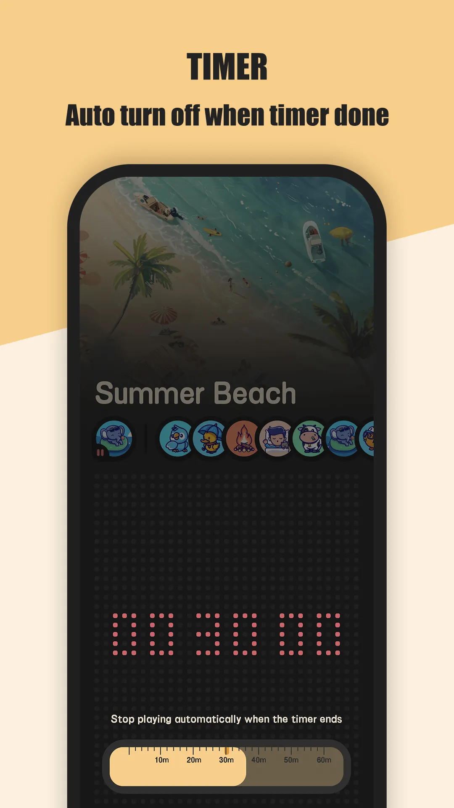

两者都助你睡眠，但是不同的工具。**Meow FM** 是一款简单可爱的白噪音播放器——雨、海、壁炉等，带睡眠计时器。**Calm** 是一个完整的健康订阅服务，含引导冥想、睡眠故事与音乐。这份 **Meow FM vs Calm** 对比带真实价格，帮你在 2026 年挑对 **助眠声音应用**。如果你其实是在找 **潮汐替代** 或 **白噪音替代**、不想续订，下面「价格」一行基本就能决定。

先把问题拆开：你想解决的是"环境太吵、需要一层稳定的声音盖住它"，还是"脑子停不下来、需要有人带着你把注意力收回来"？前者是声音播放器的活——打开、选场景、设定时，倒头就睡；后者才需要引导冥想、睡眠故事这类内容。两款应用都能陪你入睡，但只有把需求对准，才不会为一个用不到的功能库长期付费。

## 一览

Meow FM 与 Calm 都能助眠，但一个是白噪音播放器、一个是健康订阅服务：Meow FM 免费核心加可选一次性解锁、无需账号、能离线播放，Calm 则是约 $69.99/年的订阅，含引导冥想、睡眠故事与音乐。两者都覆盖 Android 与 iOS，Calm 还多一个网页版；下表的价格与声音库一行基本就能决定该留哪一个。

| | Meow FM | Calm |
|---|---|---|
| **核心** | 白噪音与环境声 | 冥想、睡眠故事、音乐 |
| **平台** | Android、iOS | Android、iOS、web |
| **价格** | 免费核心 + 可选解锁 | 约 $69.99/年订阅 |
| **声音库** | 精选环境（雨、海、壁炉…） | 大（环境 + 音乐 + 故事） |
| **声音混音** | 精选场景 | 高级档内混音 |
| **睡眠计时器** | **有（自动停止）** | 有 |
| **引导冥想** | 无 | **有（大库）** |
| **睡眠故事** | 无 | **有（名人旁白）** |
| **专注 / 工作模式** | 有（时钟） | 有 |
| **需账号** | **否** | 是（订阅） |
| **风格** | 可爱猫主题 | 平静、高端 |
| **最适合** | 入睡/专注的简单声景 | 引导课程 + 故事 |

---

## Meow FM 详解

Meow FM 是一款 **[白噪音](/zh/glossary/what-is-white-noise/)应用**，用于睡眠、放松与专注：挑一个雨、暴风、森林、海边或壁炉场景，加上自动停止的睡眠计时器，按下播放即可，睡前不必在几百个选项里纠结。它免费核心、无需账号、可离线使用，配可爱猫主题界面与桌面时钟；曲库比 Calm 小，也没有引导冥想或睡眠故事，适合只要一层稳定遮噪音、又不想被订阅绑定的人。

{: width="180" .normal }
{: width="180" .normal }
{: width="180" .normal }
{: width="180" .normal }
{: width="180" .normal }

Meow FM 是一款 **[白噪音](/zh/glossary/what-is-white-noise/)应用**，用于睡眠、放松与专注。挑一个场景——雨、暴风、森林、海边、壁炉——加上睡眠计时器，然后播放。界面温暖且猫主题，并带一个桌面时钟，可兼作床头伴侣。它的全部操作就围绕"选声音、定时、播放"三件事，没有课程表、没有连续签到，也不会要求你先注册账号。

从截图里的频道列表、均衡器与计时器页可以看出使用顺序：先在电台列表里挑一段环境声，用收藏把常用的几个存起来，再设定时关闭的分钟数。深色与浅色模式加上每个声音的封面，让它更像一个让人放松的床头小物件，而不是充满数据面板的效率工具。若你打算在飞机、帐篷或 Wi-Fi 不稳的地方使用，离线可播这一点会比"曲库更大"更实际。

### 优点
- **精选环境声** 用于睡眠、放松与专注——雨、暴风、风、森林、海边、壁炉等。场景不多但都围绕遮噪挑选，睡前不必在几百个选项里纠结，随手选一个就能开始。
- **带自动停止的睡眠计时器**，让你入睡后声音即止。设一个大致的入睡时长（比如 60 分钟），声音会在你睡着后自己关掉，既省电又不会半夜被持续播放打扰。
- **桌面时钟** 让你工作或学习时保持高效。把它放在桌面上，既能当声景的背景，也能抬眼看时间，省去切换到时钟应用的动作。
- **无需账号**——打开就播放；不上传任何东西。对不想留下使用记录、只想"按一下就有声音"的人，这个设定几乎是零摩擦。
- **可爱、平静的 Meow 风设计**，让人安心而非临床。柔和的猫主题界面在夜里不刺眼，比一些冷冰冰的健康仪表盘更适合睡前使用。
- **免费核心** + 一次性声音解锁（无订阅压力）。基本场景免费就能用；想要更多声音是一次性买断，不必担心每个月被自动扣费。
- **深色与浅色模式**，每个声音有漂亮封面。夜间切深色减少亮光刺激，白天切浅色更清爽，视觉体验随环境切换。

### 缺点
- **曲库比 Calm 这类订阅服务小**。如果你喜欢每天换不同声音、追求丰富内容，精选场景久了可能会觉得重复。
- **无引导冥想或睡眠故事**——纯环境声。它不会有人声带你放松，也没有情节把注意力从杂念上引开，需要"被引导"的人会失望。
- **高级声音** 需购买（无订阅，但非全免费）。虽然不是月费，但完整声音库仍要一次性付费，别以为所有内容都免费。
- **无网页播放器**——仅手机/平板。习惯在电脑上听声音工作的人，需要另找方案。
- 若你想要每日健康习惯，结构化程序较少。没有课程、进度和提醒，把它当"每日仪式"的话得靠自己维持。

### 最适合
想要漂亮、简单的环境声来入睡或专注的人——无课程、无账号、无月费。典型用户包括：被室友鼾声或临街噪音困扰、只想盖住声音入睡的人；在开放式办公室需要一层稳定背景音来专注的人；以及经常坐飞机、住帐篷、网络不稳，必须离线可用的人。如果你还想要引导和故事，往下看 Calm。

**下载 Meow FM**
- [Google Play](https://play.google.com/store/apps/details?id=com.glgjing.whitenoise.relax.night.sleep.meow)
- [App Store](https://apps.apple.com/us/app/meow-fm-white-noise/id1606715188)

---

## Calm 详解

Calm 是最知名的心理健康应用之一，提供引导冥想、名人旁白的睡眠故事、呼吸练习，以及大音乐与声音库，订阅约 $69.99/年。它是云端内容平台：需账号，跨 Android、iOS 与网页同步进度，课程与统计帮你把睡前引导变成可追踪的习惯；但若你只想用雨声盖住噪音，这套结构会显得臃肿，最佳内容也留在付费墙后。

{: width="180" .normal }
{: width="180" .normal }
{: width="180" .normal }
{: width="180" .normal }

Calm 是最知名的心理健康应用之一：引导冥想、名人旁白的睡眠故事、呼吸练习，以及大音乐与声音库。它是一个健康平台，而不只是噪音播放器。如果你的目标是建立"每天睡前听一段引导"的习惯，它提供的课程、进度与跨平台同步会把这件事变得可追踪，而不是每天临时决定听什么。

截图中的课程主页、呼吸练习、睡眠故事与进度统计，正好对应它的使用闭环：选一个目标（睡眠、压力、专注），跟着课程走，再看进度。代价是节奏被平台安排好了——你得登录、选目标，多数优质内容也在付费墙后。若你只是想让雨声盖住噪音，这套结构反而会显得多余。

### 优点
- **庞大的引导冥想库** 用于睡眠、压力、专注与焦虑。不同时长和主题的课程，让"今天该听哪一段"有明确答案，适合不愿自己规划的人。
- **名人旁白的睡眠故事**——许多人钟爱的招牌功能。有情节和声音陪伴，比单纯的环境声更容易把思绪从白天的琐事上带走。
- **带精致高端感的呼吸与紧张练习**。呼吸练习配上打磨过的界面与音效，让放松这件事有仪式感，而不是干巴巴的计时。
- **冥想之外的音乐与声景**。除了课程，也有可单独播放的音乐和声音，覆盖一部分"只要背景音"的需求。
- **跨平台**——Android、iOS 与 web，进度同步。手机听完一段，网页上接着继续，通勤与在家之间不用重新找位置。
- **结构化课程** 若你想要每日习惯，而非仅背景噪音。课程会安排节奏和进度，帮你把"偶尔放松"变成可持续的练习。

### 缺点
- **昂贵的订阅**（约 $69.99/年）才得完整库。长期成本明显高于一次性买断的白噪音应用，且是按年持续支付。
- **需账号**——它是云服务，而非本地播放。登录后还要联网获取内容，网络不佳时体验会受影响。
- **若你只想用雨声入睡则过于臃肿**。为听一段雨声而注册、选目标、付年费，对轻量需求来说是明显的过度配置。
- **纯环境混音较弱**——强项在内容，而非声音设计。若你追求可自由叠加、精细调节的噪音，它的能力不如专注声音的产品。
- **最佳内容在付费墙后**，故免费用户范围有限。免费版能体验到的内容有限，评估时要把"完整体验"的成本算进去。

### 最适合
想要引导冥想、睡眠故事与结构化健康习惯、且接受付费订阅的用户。如果你把睡前一段引导当成长期习惯、愿意为内容质量和进度追踪付费，Calm 的完整度是白噪音播放器给不了的；反之，若你的问题只是"环境太吵"，不必为此背上订阅。

**下载 Calm**
- [Google Play](https://play.google.com/store/apps/details?id=com.calm.android)
- [App Store](https://apps.apple.com/us/app/calm-sleep-meditation/id571800810)

---

## 关键维度对比

Meow FM 与 Calm 的差异集中在内容模型、价格与承诺、简单 vs 深度、平台四个维度：前者是免费起步、无需账号、可离线的声音播放器，后者是约 $69.99/年、需登录、跨三端的健康内容平台。若你要的是 *引导*，Calm 广得多；若你要的是 *噪音*，Meow FM 足够。下面逐条展开差异。

### 内容模型
Meow FM 是个声音播放器：挑场景、设计时器、入睡。Calm 是个内容平台：冥想、故事、音乐与课程。若你要 *引导*，Calm 广得多；若你要 *噪音*，Meow FM 足够。判断的分界在于你入睡时大脑的状态：如果是一安静下来就思绪乱跑、需要有人把注意力带走，内容的价值大于声音本身；如果你本身容易入睡、只是被外界声音干扰，那么一段稳定的环境声就是最省事的解法。把这两类需求分清，比比较曲库大小更能得到满意的结果。

### 价格与承诺
Meow FM 免费起步、一次性声音解锁、无订阅。Calm 是约 $69.99/年的持续承诺。对纯环境助眠，Meow FM 更便宜、摩擦更低。这里的差别不只是金额，还有"承诺方式"：一次性买断意味着付完就长期归你用，年费则要求你每年重新评估是否值得续。若你不确定自己会不会坚持用，先用免费核心试一段时间，再决定是否付费，是更稳妥的顺序。

### 简单 vs 深度
Meow FM 直接打开就是声音——无账号、无引导。Calm 要你选目标并登录。对某些是功能，对另一些是摩擦。深夜躺下时，少一步操作就少一分清醒：Meow FM 适合"按下就睡"的直达需求；Calm 的选目标和登录换来了个性化与进度追踪，适合愿意投入几分钟换取结构化体验的人。你更看重哪一刻的体验，决定了哪款更适合你。

### 平台
两者均覆盖 Android 与 iOS。Calm 多了 web；Meow FM 留在移动端。两者强项都不在桌面收听。如果你主要在手机或平板上使用，这点差异无关紧要；若你习惯在电脑前工作时也放着声音，Calm 的网页版能覆盖，而 Meow FM 需要你另想电脑端的方案。反过来，离线播放不依赖网络这一点，又是移动端白噪音更实用的地方。

## 你该选哪个

在 Meow FM 与 Calm 之间选择，取决于你要的是免费离线的环境声，还是付费的引导内容：只想要平静的雨声入睡或专注、无账号不订阅，就选 Meow FM；想要睡眠故事、引导冥想与结构化课程、接受约 $69.99/年订阅，就选 Calm。许多人两者兼得——每晚用 Meow FM 听纯噪音，偶尔用 Calm 冥想；若预算要紧，Meow FM 单独就能胜任。按下面三条对号入座。

- **选 Meow FM** 如果你只想要平静的环境声来入睡或专注，偏好无账号、无订阅，且喜欢可爱简单的界面。被噪音干扰、需要离线可用、又不想被月费绑定的人，基本可以闭眼选它。
- **选 Calm** 如果你想要引导冥想、睡眠故事与结构化健康课程，并愿用付费订阅。把睡前引导当长期习惯、愿意为内容与进度追踪付费，是它最能发挥价值的场景。
- **两者兼得**：许多人每晚用 Meow FM 听纯噪音，保留 Calm 偶尔冥想——但若预算要紧，Meow FM 单独就能胜任助眠声音这件事。先用免费核心验证自己的真实需求，再决定要不要增加订阅。

## 其它值得考虑的声音应用

Meow FM 与 Calm 之外，找 **白噪音替代** 的人按原来在为什么付钱分流：搜 **潮汐替代** 的多半舍不得引导冥想与睡前仪式，换成纯声音播放器反而会觉得降级；**小睡眠替代**、**MUJI to Relax 替代** 指向随手就有的环境声，Meow FM 用本机音源加混音覆盖且不需要账号；**Noisli 替代** 与 **Brain.fm 替代** 分别对应自由叠层与设计好的状态声音。判断顺序仍是熄屏后台播放、离线音源、定时关闭、能否长期免费这四项。

- 搜 **潮汐替代** 或 **潮汐哪个好** 的人，多半舍不得的是引导冥想与睡前仪式；如果这部分才是你常用的，换成纯声音播放器反而会觉得降级。先分清你用的是声音还是内容，再决定要不要迁移。
- **小睡眠替代**、**MUJI to Relax 替代** 指向的是「随手一按就有环境声」的轻量体验；Meow FM 用本机音源加混音覆盖这一点，不需要账号。对这类需求，轻量和离线比曲库数量更重要。
- **Noisli 替代** 与 **Brain.fm 替代** 分别对应可自由叠层的噪音、以及为特定状态设计的声音；前者 Meow FM 能接住，后者是另一套产品思路。你要的是"自己调"还是"别人设计好"，决定了该往哪边找。
- 想找 **白噪音替代** 而不想被订阅绑住，判断顺序仍是：熄屏后台播放、离线音源、定时关闭、能否长期免费。把这四项按你的使用频率排序，比看宣传语更能筛出合适的一款。

完整名单见 [2026 年最佳 Calm 替代应用](/zh/posts/alternatives-to-calm/)。

## 典型场景

Meow FM 与 Calm 的典型场景按需求分工：嘈杂夜里入睡用 Meow FM 的雨或暴风配 60 分钟计时器，盖住鼾声并自动关掉；办公室专注用它的壁炉或海边在桌面钟后离线运行；追求无账号无月费用它打开就有声；若还要睡眠故事与课程，Calm 更广，许多人只把 Meow FM 留作每晚的噪音。按下面四类场景各取所需即可。

- **嘈杂夜里的入睡**——Meow FM 的雨或暴风配 60 分钟计时器，盖住鼾声并自动关掉；Calm 只为跑睡眠故事就要订阅。若被打扰是主要问题，一段稳定的遮噪音加自动停止就够了。
- **用声音挡掉办公室噪音来专注**——Meow FM 的壁炉或海边在桌面钟后离线运行；Calm 的专注音乐要年费计划。开放式办公室里，本地可播的声音不必依赖公司 Wi-Fi。
- **无账号、无月费**——Meow FM 打开就是声音；Calm 要先登录、付费，多数内容才解锁。对只想"按一下就睡"的人，少一次登录就少一次清醒。
- **也想有引导冥想**——若你还要睡眠故事与课程，Calm 更广；许多人只把 Meow FM 留作每晚的噪音。两套需求可以分开满足，不必让一款应用承担全部。

## 常见问题（FAQ）

**Meow FM 还是 Calm，怎么选？**
{:.faq-q}

想要免费、离线、无账号、带自动停止计时器的环境声 → Meow FM；想要引导冥想、睡眠故事与结构化课程 → Calm（接受约 $69.99/年订阅）。核心判断是你需要"被遮住噪音"还是"被引导注意力"。

**Meow FM 免费吗？**
{:.faq-q}

免费。核心环境场景免费；额外场景一次性购买解锁，无订阅。即便不付费，睡前遮噪这件核心事也能完成。

**Meow FM 能离线用吗？**
{:.faq-q}

能。所有声音无网也能播，所以飞机、帐篷或任何 Wi-Fi 掉线的地方你都能入睡或专注。这正是本地声景相对云服务的实用优势。

**Meow FM 真的私密吗？**
{:.faq-q}

真私密——无需账号，也不上传任何东西；你只管按下播放。没有账号体系，也就没有使用记录需要担心。

## 相关术语

- [什么是白噪音（White Noise）？](/zh/glossary/what-is-white-noise/)
