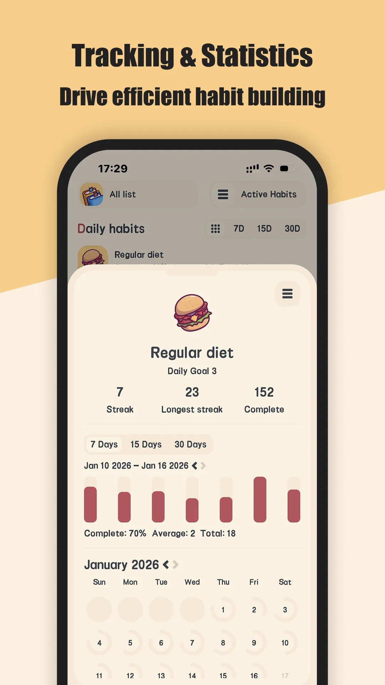
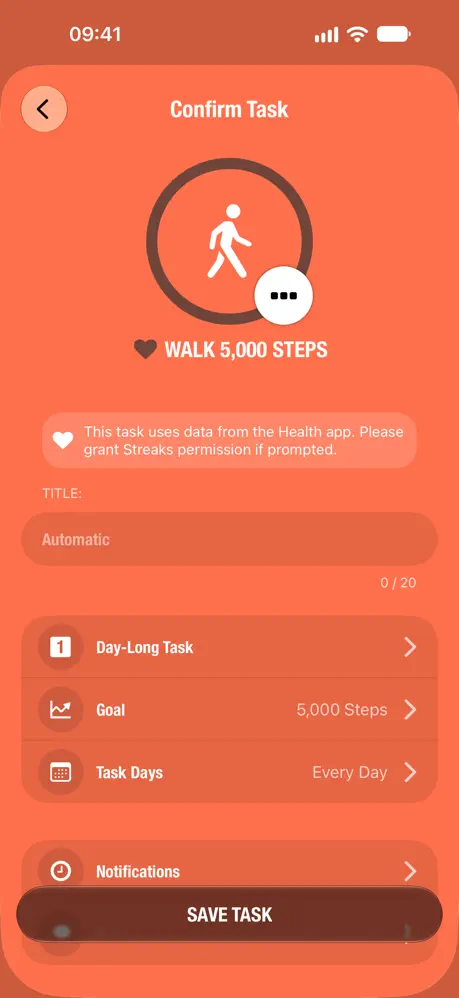

两者都是习惯追踪器，但面向不同用户。**Meow Habits** 是一款免费核心、跨平台、带 500+ 可爱卡通图标、且同时支持养成 *与* 戒除模式的追踪器。**Streaks** 是一款精致、iOS 专属、用于完成正向任务的极简应用。这份 **Meow Habits vs Streaks** 对比带 2026 价格与真实功能差异，帮你选择。很多人在搜 **小日常替代** 或 **Streaks 替代** 时也会翻到这里；若必须能装在安卓上，光「平台」这一行就足以给出答案。

选型的第一个分岔不是功能，而是你要追踪什么类型的行为：想多喝水、每天读书这类"多做"的目标，两款都能胜任；但如果是少刷手机、戒深夜零食、戒烟这类"少做"的目标，就需要专门的戒除模式，而这一点正是两者分野最大的地方。第二个分岔是你和家人的设备——只要链条里有一台安卓机，选择范围就立刻收窄。把这两件事想清楚，再看图标和界面，顺序才不会乱。

## 一览

Meow Habits 与 Streaks 都是习惯追踪器，但平台与定位不同：前者免费核心、跨平台、带 500+ 可爱卡通图标，养成与戒除模式都有；后者约 $4.99 一次性、仅 iOS、最多 12 个任务，主打极简连胜。两者都不基于订阅，真正的分野在平台与是否要追踪戒除——只要链条里有一台安卓机，选择范围就立刻收窄。下表按关键维度摆开。

| | Meow Habits | Streaks |
|---|---|---|
| **平台** | **Android 与 iOS** | 仅 iOS |
| **价格** | 免费核心 + 可选 VIP | 约 $4.99 一次性 |
| **养成与戒除** | **两者都有** | 主要养成 |
| **图标 / 风格** | **500+ 可爱卡通图标** | 极简、系统图标 |
| **图表** | 柱状、饼图、日历、趋势 | 聚焦简洁 |
| **隐私** | **离线 + 指纹锁** | iCloud |
| **导出** | **CSV** | 有限 |
| **模板** | 模板库 + 分组清单 | 手工挑任务 |
| **同步** | Google Drive / WebDav（你的账号） | iCloud |
| **提醒** | 有 | 有 |
| **最适合** | 跨平台、养成+戒除、可爱 UI | 极简 iOS 专属追踪 |

---

## Meow Habits 详解

Meow Habits 是一款 **[习惯追踪器](/zh/glossary/what-is-a-habit-tracker/)**，围绕友好、猫主题的界面与 500+ 可爱卡通图标构建，同时支持养成好习惯与戒掉坏习惯两种模式。它免费核心、覆盖 Android 与 iOS，离线可用、指纹锁，数据默认不上传，备份由你选 Google Drive 或 WebDav。对很多人来说，习惯追踪失败不是不会记，而是界面让人不想打开——愿意天天看的画面反而是坚持的关键。

{: width="180" .normal }
{: width="180" .normal }
{: width="180" .normal }
{: width="180" .normal }
{: width="180" .normal }

Meow Habits 是一款 **[习惯追踪器](/zh/glossary/what-is-a-habit-tracker/)**，围绕友好、猫主题的界面与海量卡通图标构建。它最突出的特质是 **设计**：可爱的视觉与 500+ 丰富卡通图标让每日打卡轻快，而非像苦差。它还同时支持养成好习惯与戒掉坏习惯。对很多人来说，习惯追踪失败不是因为不会记，而是因为界面让人不想打开；用一个愿意天天看的画面承载打卡，反而是能否坚持的关键。

从今日列表、打卡备注到统计图表这几张截图，可以看出它的节奏：早上看一眼今天要做的事，随手点一下完成，偶尔写句备注；周末再看柱状、日历热力图，判断哪几天掉了链子。模板库和分组清单让起步更快——不用从空白页开始设计"早起""喝水""读书"各自该怎么记。若家里同时有安卓和 iPhone，你选的是同一套体验，备份账号也由自己决定。

### 优点
- **500+ 可爱卡通图标**——最清晰的区别；记录有玩心，而非临床。给"背单词"选一本书、给"跑步"选一只鞋，视觉暗示让打卡这件事不那么像任务清单。
- **养成与戒除模式**——在一个应用里既追踪学吉他 *又* 戒深夜零食。两种方向共用一套统计，省得为"少做"的目标另装一款应用。
- **跨平台**——Android 与 iOS 同一体验，同步由你掌控的 Google Drive / WebDav。家里有人用安卓、有人用 iPhone，也能记录同一份家庭习惯表。
- **丰富图表**——进度柱状、饼图与日历热力图、趋势视图。想看"这个月哪几天没做到"，日历热力图一眼就能定位，比逐日翻记录效率高得多。
- **隐私优先**——离线可用、指纹锁，默认不上传任何东西到厂商服务器。通勤地铁里没信号也能打卡，数据先留在手机，是否备份由你决定。
- **免费核心**（连续、图表、提醒）+ 可选 VIP 解锁 CSV 导出等额外项。先用免费档把习惯跑起来，确认自己会长期用，再考虑为导出等能力付费。
- **模板与分组清单**，快速起步。不想自己搭结构时，从模板库挑一个改改就能用，把精力留给执行而不是配置。

### 缺点
- **不如 Streaks 的"苹果原生"精致**——若你活在 iOS 生态，Streaks 更紧凑。HealthKit、Watch 表盘这类深度整合，是跨平台应用难以完全对等的。
- **VIP 解锁部分额外项**（如 CSV 导出、更深统计）。基础记录免费，但要把数据迁出去做备份或二次分析，就需要一次性 VIP。
- **无网页应用**——聚焦移动端。想在电脑上查看或补记，得回到手机操作。
- **功能更广** 可能比 Streaks 的激光聚焦更显繁。图标、图表、模板一多，初次配置的选择也更多；偏好极简的人可能觉得界面信息量偏大。
- 社区小于老牌的 Streaks。想找现成的打卡模板或经验分享时，可参考的资料相对少一些。

### 最适合
想要可爱、跨平台、且 *同时* 处理养成与戒除、并重视隐私与图标多样的人。典型场景是：一个家庭里既有安卓也有 iPhone，想共同维护早睡、运动这类习惯；或者你本人既有"每天读书"的养成目标，又有"少刷短视频"的戒除目标，希望在一个地方看全。若你只用 iPhone、且只要极简的连胜体验，Streaks 更对味。

**下载 Meow Habits**
- [Google Play](https://play.google.com/store/apps/details?id=com.glgjing.meow.habit.goal)
- [App Store](https://apps.apple.com/us/app/meow-habits/id6758230559)

---

## Streaks 详解

Streaks 是定义了这一品类的极简 iOS 习惯应用：最多挑 12 个任务，每天标记完成，看连胜增长，约 $4.99 一次性买断、无订阅。它关乎专注与苹果生态的精致——任务有上限、图标克制、统计只保留够用的部分，并深度整合 HealthKit、Siri、小组件、Apple Watch 与快捷指令，靠 iCloud 在 iPhone、iPad、Mac 间同步。代价是被限定在苹果设备内，且主要面向正向任务。

{: width="180" .normal }
{: width="180" .normal }
{: width="180" .normal }
{: width="180" .normal }
{: width="180" .normal }

Streaks 是定义了这一品类的极简 iOS 习惯应用。你最多挑 12 个任务，每天标记完成，看连胜增长。它关乎专注与苹果生态的精致。设计上它刻意做减法：任务数量有上限、图标克制、统计也只保留够用的部分，让"打开就打卡、打完就走"成为常态。

截图里的今日任务、连胜天数与统计页，就是它全部的日常——没有可自定义的图标库，也没有复杂的分组。换来的是和苹果生态的贴合：HealthKit 数据可以参与任务判定，Siri、小组件、Apple Watch 与快捷指令都能接入，iPhone、iPad、Mac 之间靠 iCloud 无缝同步。代价是你被限定在苹果设备内，且它主要面向"完成正向任务"。

### 优点
- **极美极简**——干净、获奖的 iOS 界面，不挡道。每天打卡时不会被一堆选项分散注意力，界面本身就鼓励"做完就退出"。
- **深度苹果整合**——HealthKit、Siri、小组件、Apple Watch 与快捷指令。运动类目标可以直接读取健康数据，戴表时抬腕就能完成打卡，不必掏手机。
- **最多 12 个任务**，带智能提醒与灵活日程。上限看似限制，其实帮你聚焦在真正重要的少数习惯上，避免列了一长串却一个都坚持不了。
- **iCloud 同步** 跨 iPhone、iPad 与 Mac，对苹果用户无缝。早上在手表上打卡、办公室在 Mac 上补记，进度始终一致。
- **一次性购买**——无订阅。付一次就长期拥有，不必担心年费或续订提醒。
- **激励性的连胜机制** 让你持续回来。连续天数形成一条不想断掉的链，这种心理动力对很多人比复杂统计更有效。

### 缺点
- **仅 iOS**——完全没有安卓应用。家里或工作里只要有人用安卓，这套体验就断在设备边界上。
- **主要是养成模式**——为完成正向任务设计，并非明确戒除习惯。想记录"今天没吃夜宵"这类目标，它建模得并不自然。
- **图标/自定义有限**——系统图标与克制的风格（对一些人好，对另一些平淡）。喜欢用视觉区分习惯的人会觉得选择太少。
- **标准体验中无历史 CSV 导出**。想把数据拿出来另做分析或长期归档，会发现出口有限。
- **上限 12 个任务**——对专注够，对重度用户偏紧。同时追踪十几个目标的人需要取舍。
- **仅 iCloud 同步** 把你绑在苹果生态。没有 Google Drive 或 WebDav 之类的自选方案，数据通道由平台决定。

### 最适合
只用 iPhone、想要极美简单聚焦追踪器、且不需要戒除习惯或用安卓的用户。如果你是深度苹果用户、追求"少即是多"的打卡体验，12 个任务上限反而成了帮你聚焦的护栏；但如果目标里有戒除项，或家里有安卓设备，这一项就不够用了。

**下载 Streaks**
- [App Store](https://apps.apple.com/us/app/streaks/id963034692)

---

## 关键维度对比

Meow Habits 与 Streaks 的差异集中在平台、养成 vs 戒除、隐私与同步、自定义与图表、价格五个维度：前者跑 Android 与 iOS、免费核心、养成戒除双模式、500+ 图标；后者仅 iOS、约 $4.99 一次性、最多 12 个任务、走 iCloud。两者都不订阅。平台往往最先决定答案——家里或工作流里只要有人用安卓，Meow Habits 就是唯一选择。下面逐条展开。

### 平台
对许多人这是决定性。Meow Habits 跑在 Android 与 iOS；Streaks 仅 iOS。若你家或工作流中任何人在安卓，Meow Habits 是两者中唯一选择。这一项应该最先判断，因为它不会因你的偏好而改变：再喜欢极简界面，也没法把只支持 iOS 的应用装到安卓机上。反过来，如果你全部设备都是苹果，平台就不再是筛选条件，可以放心往下比体验。

### 养成 vs 戒除
Streaks 围绕 *做* 正向任务构建。Meow Habits 明确也支持 *戒除* 习惯——戒烟、少刷屏、早睡——Streaks 建模得没那么自然。差别在每天打卡时的一念之间：正向习惯是"做了就打勾"，戒除习惯是"没做也算完成"，后者需要应用理解"今天成功忍住了"这种反向逻辑。如果你的目标清单里同时有这两类，选支持双模式的那一款能省掉一套额外的记录方式。

### 隐私与同步
Meow Habits 离线优先、指纹锁，同步到 *你的* Google Drive/WebDav。Streaks 用 iCloud。两者都合理；Meow Habits 给你更直接的控制与纯本地使用。取舍在于：iCloud 对苹果用户几乎无感，设置成本最低；自选网盘则需要你多配一步，但数据放在自己的账号里，换生态时也更灵活。若你不希望习惯数据进入任何云，前者的离线模式是更彻底的选择。

### 自定义与图表
Meow Habits 在图标多样（500+）与图表类型（柱状、饼图、日历、趋势）外加 CSV 导出上胜出。Streaks 在克制与苹果原生小组件/快捷指令上胜出。这里没有绝对的优劣：想要一眼看懂"哪天断了"，丰富的图表更直观；想要桌面小组件抬眼即见、用快捷指令自动打卡，苹果原生的整合更顺手。按你最常看的那个视图来选，比数功能项更有意义。

### 价格
Meow Habits 核心免费；Streaks 约 $4.99 一次性。两者都不基于订阅。这点对预算敏感的人很友好——没有每月或每年的续费压力。要注意的是，Meow Habits 的 CSV 导出等能力在 VIP 之后，若你把导出列为必需，实际成本要算上这笔一次性解锁；而 Streaks 的一次性购买把全部体验打包在内，但上限仍是 12 个任务。

## 你该选哪个

在 Meow Habits 与 Streaks 之间选择，取决于平台与追踪目标：用安卓或双平台、想追踪戒除习惯、爱可爱图标，或偏好离线私密与 CSV 导出，就选 Meow Habits；只用 iPhone、想要最精致的极简追踪器、活在 HealthKit 与 Apple Watch 的苹果生态里，就选 Streaks。前者免费核心、后者约 $4.99 一次性，都不订阅；先用免费档验证自己会不会坚持，再决定要不要付费。按下面三条判断。

- **选 Meow Habits** 如果你用安卓或双平台、想追踪戒除习惯、爱可爱图标，或偏好离线/私密追踪与 CSV 导出。这些条件里只要命中两条以上，基本就不用再纠结。
- **选 Streaks** 如果你只用 iPhone、想要最精致的极简追踪器，且活在苹果生态（HealthKit、Watch、快捷指令）。苹果设备越全，它的整合优势越明显。
- **对多数跨平台或注重隐私的用户，Meow Habits 覆盖更多情形**；对纯 iOS 极简爱好者，Streaks 仍是更干净的选择。你可以先用免费档验证自己会不会坚持打卡，再决定要不要为导出或深度统计付费。

## 其它值得考虑的习惯打卡应用

Meow Habits 与 Streaks 之外，换习惯打卡应用常见还有三类原因：想要免费、开源、无需账号的纯统计时，Loop 是安卓基准，Meow Habits 在免账号之外多了 iOS、图标与 CSV 导出；驱动你的是游戏化奖励与伙伴监督时，Habitica 那一类更合适；需要按时间段排布、跨设备同步或教练式课程时，Habitify 与 Fabulous 分别更对口。从国内应用迁来的人常搜 **小日常替代** 等，判断顺序是有没有安卓版、免费档能记几个习惯、数据能否导出、界面是否愿意天天看。

- 想要免费、开源、无需账号的纯统计时，Loop 是安卓上的基准；Meow Habits 在同样免账号的前提下多了图标、iOS 与 CSV 导出。如果你的唯一诉求是"把打卡记准"，Loop 这种不花哨的工具反而够用。
- 如果驱动你打卡的是游戏化奖励与伙伴监督，而不是一条极简连胜，Habitica 那一类更合适；本文对比的两款都不主打这一路。动力来源不同，工具形态也不同，别拿连胜机制去硬套需要组队监督的习惯。
- 真正需要按时间段排布并跨设备同步，或跟着教练式课程走时，Habitify 与 Fabulous 分别更对口；Meow Habits 的选择是把数据留在本机，而不是放进账号。要日程编排和引导课程的人，用错工具会觉得"功能都在但用不起来"。

从国内应用迁来的人常在搜 **小日常替代**、**小习惯替代**、**种子习惯替代**、**自律树替代** 或 **习惯足迹替代**。这类「**打卡小日常类似**」的需求，判断顺序仍是：有没有安卓版 → 免费档能记几个习惯 → 数据能否导出 → 界面是否愿意天天看；Meow Habits 对应的是跨平台、免费 5 个习惯、CSV 导出与 500+ 图标。按这个顺序逐项排除，比逐个下载试用更省时间。

完整六款对比见 [2026 年最佳 Streaks 替代应用](/zh/posts/alternatives-to-streaks/)。

## 典型场景

Meow Habits 与 Streaks 的典型场景按设备与目标分工：家里有安卓时只有 Meow Habits 能跑；养成与戒除要一起追踪时，Meow Habits 的双模式胜过只做正向任务的 Streaks；重视隐私就用它的离线、指纹锁与自选备份；500+ 卡通图标则让每日打卡有玩心、愿意持续出现。按下面四类场景各取所需即可。

- **家里有安卓**——若同住或共事的人用安卓，Meow Habits 是两者中唯一能跑在那里的，共享的日常才能真正共享。家庭打卡表最怕设备不一致，平台这一项先过关，其他功能才谈得上。
- **养成与戒除一起**——在同一应用里追踪「学吉他」和「戒深夜零食」；Streaks 为完成正向任务而建，不擅长戒除。两种逻辑放在一处，周末看报表时才能看到完整的自己。
- **你掌控的隐私**——离线、指纹锁下记录，只在你选择时同步到自己的 Google Drive 或 WebDav，默认不进厂商云。对不想让生活习惯数据进入第三方服务器的人，这一点比图表好看更重要。
- **可爱的一致**——500+ 卡通图标让每日打卡有玩心，于是你持续出现。选择一个你愿意每天点开的界面，往往比多一个统计维度更能提升坚持率。

## 常见问题（FAQ）

**Meow Habits 和 Streaks 怎么选？**
{:.faq-q}

想要安卓或双平台、养成+戒除模式、可爱图标与离线/私密追踪 → Meow Habits；想要最精致、纯 iOS 极简、活在苹果生态里的追踪器 → Streaks。先按平台和是否要戒除来筛，通常这一步就有答案。

**Meow Habits 免费吗？**
{:.faq-q}

核心免费——连续、图表、提醒与模板都免费；CSV 导出与少数进阶能力在可选的一次性 VIP 之后。先免费用一段时间，确认自己真的会坚持，再决定要不要解锁。

**Meow Habits 能离线用吗？**
{:.faq-q}

能。没网、无账号也能打卡；数据留在本机，并在你选择时备份到 Google Drive 或 WebDav。地铁、飞机或信号差的房间里都不影响记录。

**Streaks 能戒掉坏习惯吗？**
{:.faq-q}

不太行——Streaks 为完成正向任务设计；Meow Habits 明确支持养成与戒除双模式。若你的目标清单里有"少做"类项目，选双模式的那一款更省事。

## 相关术语

- [什么是习惯追踪应用（Habit Tracker）？](/zh/glossary/what-is-a-habit-tracker/)
