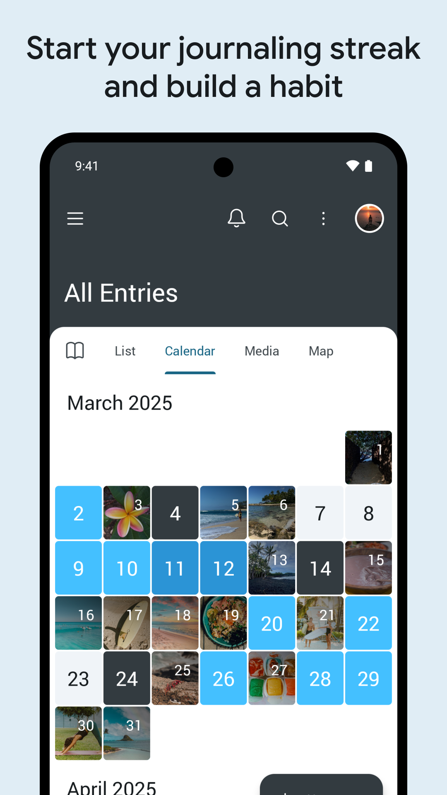

两者都是日记，但满足的需求不同。**Meow Mood** 是一款私密、以情绪为核心的打卡日记，配宁静的猫咪主题界面。**Day One** 则是一款富功能生活日记，带照片、音频与云端同步。这份 **Meow Mood vs Day One** 对比，结合真实定价与隐私差异，帮你在 2026 年挑对 **日记 app**。如果你其实是在找 **Daylio 替代**，或想知道 **Daylio 哪个好**，下面「快速打卡 vs 完整写作」这条分界线同样适用。

先把"日记"这个词拆成两件事：一种是把今天的感受压成一个图标和几个标签，二十秒搞定，目的是积累足够多的记录后看出情绪规律；另一种是写一段完整的文字，附上照片、地点和天气，目的是把某个瞬间保存下来。前者怕的不是功能少，而是操作繁琐让人放弃；后者怕的才是功能不够、承载不了回忆。你属于哪一类，决定了下面哪款值得细看。

## 一览

Meow Mood 与 Day One 都是日记应用，但一个记情绪、一个存回忆：前者私密、以情绪为核心、核心免费加可选 VIP、永不上传，后者是约 $35/年的订阅、带照片音频视频与端到端加密云同步。两者都覆盖 Android 与 iOS，Day One 还多 Mac 与网页。真正的分界是"快速打卡 vs 完整写作"——下表的隐私、媒体与价格几行基本就能定夺。

| | Meow Mood | Day One |
|---|---|---|
| **重心** | 情绪与心情追踪 | 富功能生活日记 |
| **平台** | Android、iOS | Android、iOS、Mac、网页 |
| **价格** | 核心免费 + 可选 VIP | ~$35/年（Silver） |
| **隐私** | **离线，永不上传** | 云端同步（端到端加密） |
| **媒体** | 文字与标签 | **照片、音频、视频** |
| **情绪追踪** | **强（心情图标、情境）** | 基础 |
| **提醒** | **每日心情提醒** | 可选 |
| **导出** | **PDF** | 多种格式 |
| **主题** | 可爱猫咪主题、配色 | 干净、中性 |
| **最适合** | 情绪规律、心理健康 | 多媒体回忆留存 |

---

## Meow Mood 详解

Meow Mood 是一款 **安全、私密的打卡心情日记**，配宁静的猫咪主题界面：睡前点一个心情图标，加情境标签，必要时写两句，二十秒即可完成。它核心免费、可选 VIP，记录永不上传、完全离线，只备份到你自己的 Google Drive，并带每日提醒、指纹/密码锁与 PDF 导出。对情绪记录来说，"愿意每天打开"比"能存多少种内容"更关键——这款应用把主要力气花在降低这一步的阻力上。

{: width="180" .normal }
{: width="180" .normal }
{: width="180" .normal }
{: width="180" .normal }
{: width="180" .normal }

Meow Mood 是一款 **安全、私密的打卡心情日记**，配宁静的猫咪主题界面。它最突出的特质是 **设计**：可爱的卡通猫咪视觉与丰富的心情图标，让每日打卡轻松愉快，而非临床式的沉重。除了好看，它永不把记录上传到服务器，只备份到你自己的 Google Drive。对情绪记录来说，"愿意每天打开"比"能存多少种内容"更关键——这款应用把主要力气花在了降低这一步的阻力上。

从日记编辑、心情选择、趋势图表到历史日历这几张截图，可以看出它的使用闭环：睡前点一个心情图标，加上情境标签（工作、睡眠、社交等），必要时写两句；过段时间再看日历和趋势，找出"周一周二总是不佳"这类规律。记录只留在设备里，是否导出 PDF、是否备份到自己的 Google Drive，都由你决定。

### 优点
- **可爱的卡通猫咪界面**，配多样心情图标与自定义配色——最清晰的差异化。柔和的视觉让睡前的记录变成一件轻松的小事，而不是面对一份心理评估表。
- **完全隐私**：记录永不上传到我们的服务器；备份只去你自己的 Google Drive。没有账号，也就没有平台侧的使用画像，写心情时更放得开。
- **一键快速心情记录**——无需写长文就能记下此刻感受。通勤地铁上、睡前躺下时，几秒就能完成，不会因为"今天太累没力气写"而断掉。
- **情绪与情境标签**，帮你理解 *为什么* 会有那种感觉。单看心情图标只是"不好"，加上标签才能逐渐分辨是加班、睡眠不足还是人际摩擦带来的。
- **完全离线**——没 Wi-Fi 也能记心情、看历史、改记录。飞机上、帐篷里、信号不好的地下室都不影响使用。
- **提醒、指纹/密码锁**，以及情绪趋势的日历 + 图表视图。每日提醒帮你建立习惯，锁屏保护则让这篇日记适合放在手边。
- **详尽的日记条目** 与可定制的每日提醒；支持 PDF 导出。想多写几句时它有空间，需要迁移或归档时也有出口。

### 缺点
- **无富媒体**——它是心情 + 文字，不是照片/音频剪贴簿。想给日记配上旅行照片或一段语音，它做不到。
- **无跨设备云端账号同步**——备份是你的 Google Drive，所以跨设备比 Day One 更手动。手机上记的内容不会自动出现在平板上。
- 生态规模较小，第三方集成较少。想接入其他服务或找现成模板时，可选范围有限。
- 不太适合长篇、结构化的散文式日记。它鼓励的是短打卡，不是写几千字的随笔。
- 部分高级统计锁在 VIP 之后。基础的日历和趋势够用，更细的分析需要解锁。

### 最适合
想要一款私密、友好、看着舒心、可完全离线使用的心情日记的人。典型用户是：想坚持记录情绪、但讨厌长篇写作的人；对隐私敏感、不愿把心事放在别人服务器上的人；以及希望用图表和标签看懂自己状态规律的人。若你需要的是照片、音频和跨设备无缝同步，Day One 更合适。

**下载 Meow Mood**
- [Google Play](https://play.google.com/store/apps/details?id=com.glgjing.meow.mood.diary)
- [App Store](https://apps.apple.com/us/app/meow-mood-diary/id6767560237)

---

## Day One 详解

Day One 是最知名的数字日记：一个干净的书写空间，带照片、音频、视频，以及跨手机、平板、Mac 与网页的端到端加密云同步，订阅约 $35/年。它专为捕捉生活而来——旅行照片、孩子的一句话、某天的天气和地点，都能塞进同一篇条目，多年后翻出是完整的回忆而非一个心情图标。提示、模板、强大搜索与多种导出格式让它成熟完整，但天生不是为"二十秒记个心情"设计的。

{: width="180" .normal }
{: width="180" .normal }
{: width="180" .normal }
{: width="180" .normal }
{: width="180" .normal }

Day One 是最知名的数字日记：一个干净的书写空间，带照片、音频、视频，以及跨手机、平板、Mac 与网页的端到端加密云端同步。它专为捕捉生活，而非只是心情。旅行时拍的照片、孩子说的一句话、某天的天气和地点，都能塞进同一篇条目里，多年以后翻出来是一段完整的回忆，而不只是一个"开心/难过"的图标。

截图中的书写界面、媒体附件、趋势图与历史回顾，展示了它的完整度：提示与模板帮你打开话头，强大搜索让你几年后还能找到某句话，多种导出格式则保证数据可迁移。代价是云端优先的模式和约 $35/年的订阅——记录存在 Day One 的服务器上（虽然端到端加密），而且它天生就不是为了"二十秒记个心情"设计的。

### 优点
- **富媒体**——条目可附照片、音频和视频，外加地点与天气。一次旅行、一场演出，能用多感官把当时的氛围保留下来。
- **云端同步（端到端加密）** 覆盖 Android、iOS、Mac 与网页——跨设备无缝。手机上随手记一句，到 Mac 上接着写长文，进度自动一致。
- **精致的书写体验**，带提示、模板与强大搜索。不知道写什么时有提示引导，想找旧内容时搜索能快速定位。
- **多种导出格式**（PDF 等）便于迁移。将来想换工具或打印成册，不必担心数据被锁死。
- **成熟的生态** 与长久口碑。作为老牌日记应用，它的稳定性和配套资源都经过时间检验。
- 适合 **长篇、多媒体回忆留存**。想把人生片段写成有图有声的篇章，它的承载能力远胜打卡式应用。

### 缺点
- **付费订阅**（约 $35/年）才能用上大多数人需要的功能。免费档能体验的范围有限，长期使用要把订阅算进成本。
- **云端优先模式**——记录存在 Day One 的服务器上（已加密，但非仅本地）。虽然端到端加密保护了内容，数据毕竟不在自己设备上。
- **弱于快速心情记录**——设计上就没有心情图标或情绪规律图表。想每天点一下就走的人，会觉得它太重。
- 相比离线优先的应用，**本地隐私较弱**。完全不上传这件事，它做不到。
- 出身偏 iPhone；Android/网页体验落后于 iOS。若你主力是安卓设备，体验可能不如宣传中顺畅。

### 最适合
想要一款精美、多媒体、随处同步、并保留带照片的文字生活记录的用户。如果你把日记当成"人生档案"，愿意为写作体验和跨设备同步付费，Day One 是成熟且完整的选择；如果只想在睡前点和、记录情绪，它的能力会大幅闲置。

**下载 Day One**
- [Google Play](https://play.google.com/store/apps/details?id=com.dayoneapp.dayone)
- [App Store](https://apps.apple.com/us/app/day-one-journal/id1044867788)

---

## 关键维度对比

Meow Mood 与 Day One 的差异集中在隐私模型、心情 vs 回忆、媒体与丰富度、平台与同步、价格五个维度：前者离线优先、核心免费、记录永不上传、一键心情打卡，后者约 $35/年、端到端加密云同步、覆盖 Android/iOS/Mac/网页四个平台、支持富媒体。判断时要分清"加密得很好"与"根本没上传"是两回事，也要分清你要"看懂情绪"还是"保存回忆"。下面逐条展开。

### 隐私模型
Meow Mood 离线优先：除非你备份到自己的 Google Drive，否则记录永不离开设备。Day One 同步到其加密云端。两者都保护数据，但 Meow Mood 是「什么都不出我手机」这一理念的更强选择。判断时要分清"加密得很好"和"根本没上传"是两回事：前者依赖平台的服务与密钥管理，后者把控制权完全留给你。若你写的是不愿让任何服务接触的内容，这一点往往比功能清单更重要。

### 心情 vs 回忆
Meow Mood 为 *情绪* 而生：心情图标、情境标签、趋势与提醒，浮现出规律。Day One 为 *回忆* 而生：带媒体与时间线的富条目。想读懂自己的感受，选 Meow Mood；想记录生活，选 Day One。这两件事并非互斥，很多人两套都用——但要只留一个，就问自己：一年后你更想翻出"那阵子为什么总低落"的趋势图，还是"那天在海边的照片和文字"。

### 媒体与丰富度
Day One 在媒体上明显胜出——照片、音频、视频、地点。Meow Mood 刻意精简（心情 + 文字）。这种精简也是它的速度：一次打卡只需几秒。丰富度与速度常成反比：能附照片的日记，写起来自然更慢；二十秒能完成的打卡，注定存不下照片。按你最常使用的时段选——睡前的疲惫时刻适合前者中的轻量者，周末的从容时刻才适合后者。

### 平台与同步
Day One 覆盖 Android、iOS、Mac 与网页，同步无缝。Meow Mood 覆盖 Android 与 iOS，备份由你自主掌控。重度 Mac/网页用户会感受到 Day One 的广度。如果你主要在手机上记、偶尔在平板翻看，Meow Mood 的自主备份已经够用；如果你的写作发生在电脑前、阅读发生在多个设备间，跨平台同步的价值才会凸显。

### 价格
Meow Mood 核心免费；Day One 是约 $35/年的订阅。纯心情追踪，Meow Mood 是更低成本的路径。这里同样要把"钱"和"习惯"一起算：Day One 的订阅是否值得，取决于你会不会真的用上它的写作与媒体能力；Meow Mood 的免费核心已经覆盖了每日打卡的全部刚需，先用它验证自己能否坚持，再决定是否升级也不迟。

## 你该选哪个

在 Meow Mood 与 Day One 之间选择，取决于你要看懂情绪还是保存回忆：想要私密、免费、离线、以情绪为核心的每日打卡，就选 Meow Mood；想要随处同步、带照片文字的全功能多媒体日记、接受约 $35/年订阅，就选 Day One。前者核心免费、记录永不上传，后者覆盖 Android/iOS/Mac/网页四个平台。许多用户两者互补——用 Meow Mood 打卡、用 Day One 写长文；若只想要一个，让这条分界替你决定。按下面三条判断。

- **选 Meow Mood** 若你的目标是私密追踪情绪、看清规律，偏好离线优先的隐私，并想要可爱、快速的每日打卡。不想写长文、不想被订阅绑定的人，基本可以直接选它。
- **选 Day One** 若你想要一本随处同步、保留带照片文字记录的全功能多媒体日记。把日记当长期档案、愿意为跨设备和写作体验付费，是它最能发挥价值的场景。
- **两者互补**：许多用户用 Meow Mood 做每日心情打卡，用 Day One 写更长的日记——但如果只想要一个，让「心情 vs 回忆」这个问题替你决定。先低成本试出自己的真实习惯，再投入订阅也不迟。

## 其它值得考虑的心情日记应用

Meow Mood 与 Day One 之外，换应用的原因取决于你在离开哪一款：搜 **Daylio 替代** 的多半只想要一键记心情、加标签、看日历，Meow Mood 正好覆盖且数据留本机；想要 **卡片日记替代** 那种每天一页仪式感的，Meow Mood 用五个心情胶囊把打卡压到一次点击；从 **MOODA 替代** 等搜法过来的通常不想被订阅和云账号绑住，判断顺序是有没有安卓版、免费档能记多久、历史能否导出。若你要引导式提问与漂亮长文，Day One 更接近。

- 搜 **Daylio 替代** 或 **Daylio 哪个好** 的人，多数只想要一键记心情、加活动标签、再看日历，不想写段落；Meow Mood 正好覆盖这个闭环，而且数据留在本机。先确认这一点，再考虑要不要为媒体能力多付钱。
- 想要 **卡片日记替代** 这类卡片式排版的人，看重的是「每天一页、填空就好」的仪式感；Meow Mood 用五个心情胶囊把这一步压到一次点击。若你在意的是排版形式而非记录速度，可以再往下比较。
- 从 **MOODA 替代**、**moo日记替代**、**情绪指压替代**、**心岛日记替代** 这些搜法过来的，通常是不想被订阅和云账号绑住：判断顺序仍是有没有安卓版、免费档能记多久、历史能不能导出。把这四项按你的优先级排好，比逐个下载试错更省时间。
- 若你要的是引导式提问与漂亮的长文写作体验，Day One 比 Meow Mood 更接近。动力来自"被提问"还是"自己坦诚写下"，会直接影响哪款更适合你。

完整名单见 [2026 年最佳 Day One 替代应用](/zh/posts/alternatives-to-day-one/)。

## 典型场景

Meow Mood 与 Day One 的典型场景按记录方式分工：每日心情打卡交给 Meow Mood 的一键记录，适合 20 秒的晚间习惯；严格隐私选它——无账号、条目留在本机；富回忆留存交给 Day One 的照片、音频与跨设备同步；许多用户两者都用——Meow Mood 记心情、Day One 写长文。按下面四类场景各取所需，别为用不到的能力长期付费。

- **每日心情打卡**——Meow Mood 一键记录适合 20 秒的晚间习惯；Day One 想要更完整的条目，更适合周末回顾。把高频的打卡交给前者，低频的长文交给后者，是很多人的实际分工。
- **严格隐私**——Meow Mood 无账号、条目留在本机；Day One 的加密云很出色，但仍是服务器存储。若记录内容高度私密，"不上传"比"上传时加密"更让人安心。
- **富回忆留存**——Day One 凭照片、音频与跨设备同步出彩；Meow Mood 刻意保持精简。旅行、聚会这类值得珍藏的时刻，媒体与文字结合才能留下完整氛围。
- **两者都用**——许多人用 Meow Mood 记心情、用 Day One 写长文；若只想要一个，让「心情 vs 回忆」替你决定。别为用不到的能力长期付费，这是两款定位分明的应用带来的最大便利。

## 常见问题（FAQ）

**Meow Mood 还是 Day One，怎么选？**
{:.faq-q}

想要私密、免费、离线、以情绪为核心的每日打卡 → Meow Mood；想要随处同步的多媒体生活日记 → Day One。核心判断是你要"看懂情绪"还是"保存回忆"。

**Meow Mood 免费吗？**
{:.faq-q}

核心免费；Day One 需用约 $35/年的订阅才能解锁大多数人要的功能。先用免费核心把记录习惯建立起来，再决定要不要为更完整的写作体验付费。

**Meow Mood 能离线用吗？**
{:.faq-q}

能。没网、无账号也能记录、查看、编辑；数据留在本机。飞机、地铁或信号差的房间里都不影响打卡。

**Meow Mood 真的私密吗？**
{:.faq-q}

真私密——记录永不上传我们的服务器；备份只去你自己的 Google Drive。没有账号体系，也就不需要担心平台侧的使用画像。

## 相关术语

- [什么是心情追踪（Mood Tracker）？](/zh/glossary/what-is-a-mood-tracker/)
