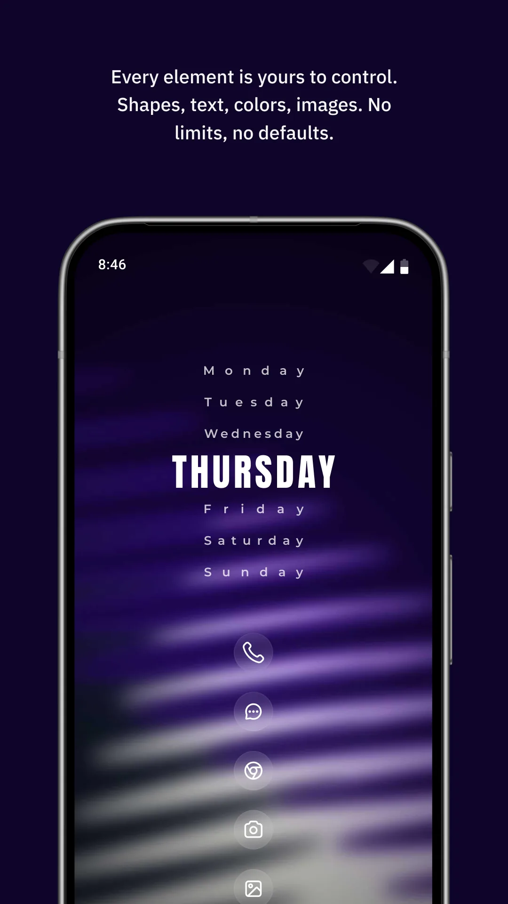
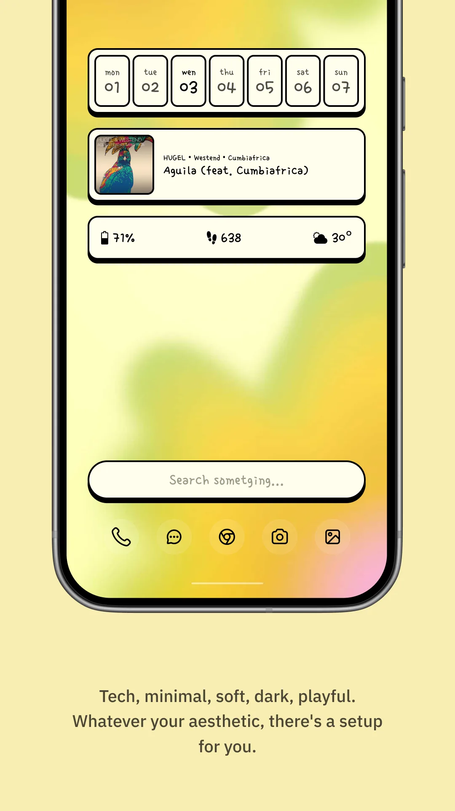
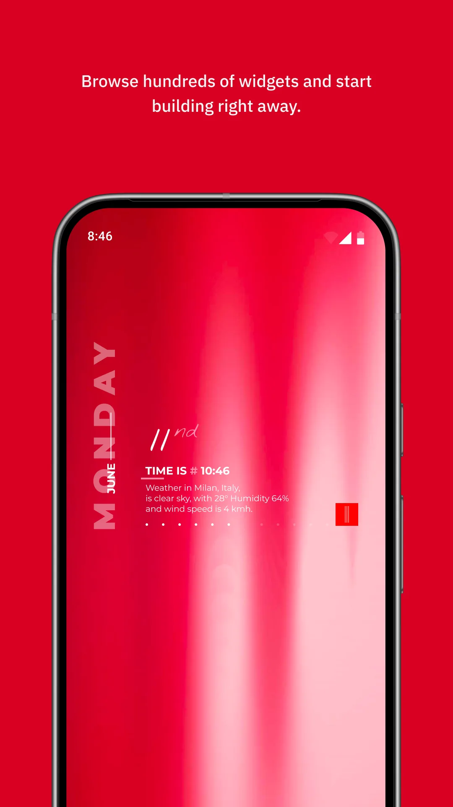
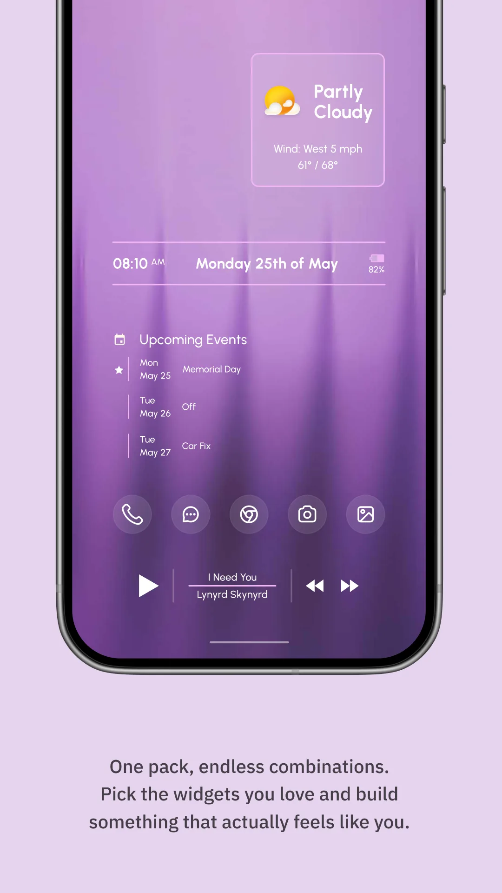
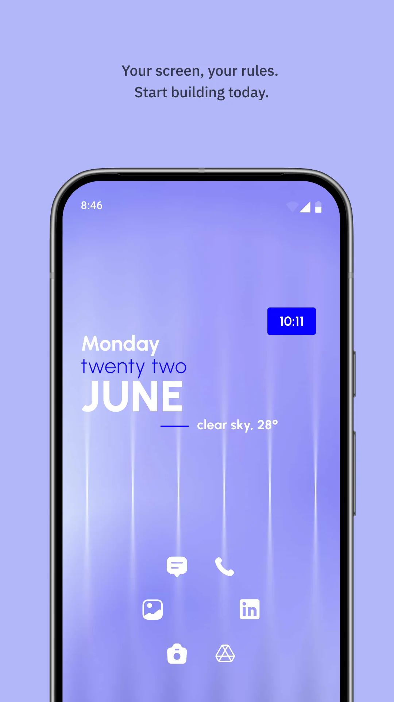

两者都自定义你的主屏，但方式不同。**One Widget** 自带 500+ 成品、紧跟潮流的组件，你只需改尺寸、放上去即可。**KWGT**（Kustom Widget Maker）则是一个从零开始的编辑器，你能搭建任何想象得到的组件。这份 **One Widget vs KWGT** 对比，帮你在 2026 年挑对 **[安卓组件应用](/zh/glossary/what-is-a-home-screen-widget/)**。如果你在找的是不用进编辑器的 **KWGT 中文替代**，下面「设置成本」那一行基本就决定了。

## 一览

| | One Widget | KWGT（Kustom） |
|---|---|---|
| **思路** | 500+ 现成组件 | 从零搭建的编辑器 |
| **风格** | One UI、Nothing、Glass、Material You | 任意（你设计） |
| **学习曲线** | **低** | **高** |
| **实时数据绑定** | 预设组件 | **完整（天气、音乐、公式）** |
| **自定义** | 尺寸、颜色、圆角 | 完全（每个元素） |
| **导出 / 分享** | 有限 | **完整（配 Pro）** |
| **快捷开关 / 捷径** | **有（Wi-Fi、蓝牙、手电、应用）** | 可行（需配置） |
| **价格** | 免费 One UI + 一次性解锁 | 免费 + Pro 密钥（约 $4.99） |
| **平台** | Android | Android |
| **最适合** | 快速、统一的主题化 | 独特的自定义设计 |

---

## One Widget 详解

{: width="180" .normal }
{: width="180" .normal }
{: width="180" .normal }
{: width="180" .normal }
{: width="180" .normal }

One Widget 是一款 **一体化安卓主屏工具箱**，打包了横跨四种潮流风格的 500+ 精品组件：Glass iOS、Material You、Galaxy One UI，以及 Nothing 极简风。你挑一个成品组件、改改尺寸，就完成了。

### 优点
- **500+ 现成组件**——无需编辑器、无需设计技能；点一下放上去。
- **四种流行风格**——Glass、Material You、Galaxy One UI、Nothing——覆盖大多数审美口味。
- **8 大功能分类**：应用捷径、系统快捷开关（Wi-Fi、蓝牙、手电…）、设备硬件信息（电池、RAM、存储）、时钟/日历、便签/语录、联系人、聚合应用启动器（Google/AI/社交），以及迷你工具（指南针、计步器、计算器）。
- **尺寸完全自定义**（1x1 到 2x6）、图标背景色与圆角，以匹配你的主题。
- **快捷开关与应用捷径** 作为主屏组件——真正好用，不只是装饰。
- **低学习曲线**——适合不想学设计工具、想快速拥有精致桌面的人。
- 免费提供 **One UI 套件**；其他风格一次性购买解锁。

### 缺点
- **仅安卓**——无 iOS 版。
- **受预设约束**——你在成品设计内自定义，而非空白画布。
- **实时数据深度有限**——组件是精选的；你无法绑定任意公式或小众数据源。
- 与真正的搭建器相比，**导出/分享有限**。
- 其他风格家族需购买（One UI 免费）。

### 最适合
想要快速、统一又好看的主屏，且不想学设计工具的用户。

**下载 One Widget**
- [Google Play](https://play.google.com/store/apps/details?id=com.glgjing.galaxy.nothing.glass.material.widget)

---

## KWGT 详解

{: width="180" .normal }
{: width="180" .normal }
{: width="180" .normal }
{: width="180" .normal }
{: width="180" .normal }

KWGT（Kustom Widget Maker）是安卓上最强大的组件搭建器。你放置文字、形状、图片与数据点，再把它们绑定到实时来源——天气、音乐、电池，或你自己的公式——创造出完全原创的组件。

### 优点
- **无限自定义**——每个元素（位置、尺寸、字体、颜色、图层）都由你定义。
- **完整实时数据绑定**——天气、音乐、系统状态，以及通过 Kustom 表达式语言的自定义公式。
- **定制布局**——重现任何外观（或自创），精确到像素。
- **庞大的社区**，提供共享预设与教程。
- **Pro 密钥（约 $4.99）** 去除水印，解锁完整导出/分享。
- 核心可 **免费使用** 进行搭建与测试。

### 缺点
- **高学习曲线**——放置与绑定元素需要真功夫；不适合随意用户。
- **时间投入**——一个出色的组件可能要花数小时，而 One Widget 只要数秒。
- **仅安卓**，无 iOS。
- 购买 Pro 密钥前，**含水印、导出受限**。
- 若你「只想要一个好看的时钟组件」，它会让人招架不住。

### 最适合
想要独一无二主屏、并乐于亲手搭建的设计师与折腾党。

**下载 KWGT**
- [Google Play](https://play.google.com/store/apps/details?id=org.kustom.widget)

---

## 关键维度对比

### 速度 vs 掌控
One Widget 在「变美所需时间」上胜出：挑预设、改尺寸、完成。KWGT 在掌控上胜出：一块空白画布，由你决定每个像素与数据源。重视时间，选 One Widget；重视独特，选 KWGT。

### 实时数据
两者都能显示实时信息，但深度不同。One Widget 的组件是精选的（时钟、电池、RAM、开关）。KWGT 让你把 *任意* 数据——天气公式、正在播放的音乐元数据、自定义计算——绑定进自定义布局。对小众数据，KWGT 无可匹敌。

### 美学
One Widget 保证统一、时髦的观感（Glass/One UI/Nothing/Material You），因为预设出自专业设计。KWGT 的产出完全取决于你的功力——惊艳或业余。

### 价格
One Widget 的 One UI 免费，其他家族一次性解锁。KWGT 免费可用，约 $4.99 的 Pro 密钥去水印、解锁导出。两者都合理；都不是重订阅。

## 你该选哪个

- **选 One Widget** 若你想几分钟内拥有一个统一、精致的主屏，且偏好精选风格而非设计工具。
- **选 KWGT** 若你想要完全的创作掌控、实时数据公式，且不介意学习（并花时间）去搭建独特组件。
- **许多安卓用户两者都留**：One Widget 应付快速、日常的组件，KWGT 则在想要真正自定义时出场。

## 其它值得考虑的小组件工具

两款对比装不下所有找 **KWGT 中文替代** 的原因，该换什么取决于你原本想搭什么：

- 搜 **小组件盒子替代** 或 **小组件盒子哪个好** 的人，多半想要现成预设与中文界面，而不是从零画图层；One Widget 走的是「选一个、改尺寸、摆上去」这条短路。
- **万能小组件替代**、**魔力小组件替代**、**元气小组件替代** 指向的是同一类诉求：模板多、样式全、上手快。
- **灵动坞替代** 与 **iScreen 替代** / **米写替代** 更偏灵动岛式胶囊或桌面美化套装；One Widget 用 Glass 与 Nothing 两套预设覆盖这些外观，且不必切到另一套主题体系。
- 若你要的只是稳定的时钟与日历，专门的时钟组件比通用组件包更轻；若还想摆上 Wi-Fi、手电筒开关，通用包才划算。

完整名单见 [2026 年最佳 WidgetSmith 替代应用](/zh/posts/alternatives-to-widgetsmith/)。

## 典型场景

- **今晚就要精致主屏**——One Widget 的 500+ 现成组件，挑一下、改尺寸、完成；KWGT 得先来一场搭建。
- **你爱从零造**——KWGT 的编辑器与 Kode 让你把天气、音乐、自定义公式绑定进独一无二的组件。
- **你只想要快捷开关**——One Widget 把 Wi-Fi/蓝牙/手电与应用捷径做成组件；无需写脚本。
- **你要小众实时数据**——KWGT 完整的实时数据绑定，对"正在播放"、天气公式、定制统计无可匹敌。
- **两者都留**——许多安卓用户用 One Widget 应付日常组件，KWGT 留给真正想要自定义的时刻。

## 常见问题（FAQ）

**One Widget 还是 KWGT，怎么选？**
想要几分钟就统一、精致的桌面、不碰编辑器 → One Widget；想要完全创作掌控、带实时数据公式、且不介意学习曲线 → KWGT。

**One Widget 免费吗？**
One UI 风格套件免费；另外三种风格通过一次性购买解锁（无订阅）。

**One Widget 能在 iOS 上用吗？**
不能。One Widget 仅安卓；KWGT 也仅安卓。iOS 上可看 WidgetSmith。

**KWGT 免订阅吗？**
KWGT 免费可用、可测试；约 $4.99 的一次性 Pro 密钥去水印、解锁完整导出。无订阅。

## 相关术语

- [什么是主屏幕小组件（Home Screen Widget）？](/zh/glossary/what-is-a-home-screen-widget/)
- [什么是 Material You？](/zh/glossary/what-is-material-you/)
- [什么是 Nothing UI？](/zh/glossary/what-is-nothing-ui/)
- [什么是 Galaxy One UI？](/zh/glossary/what-is-galaxy-one-ui/)
- [什么是 iOS Glass？](/zh/glossary/what-is-ios-glass/)
