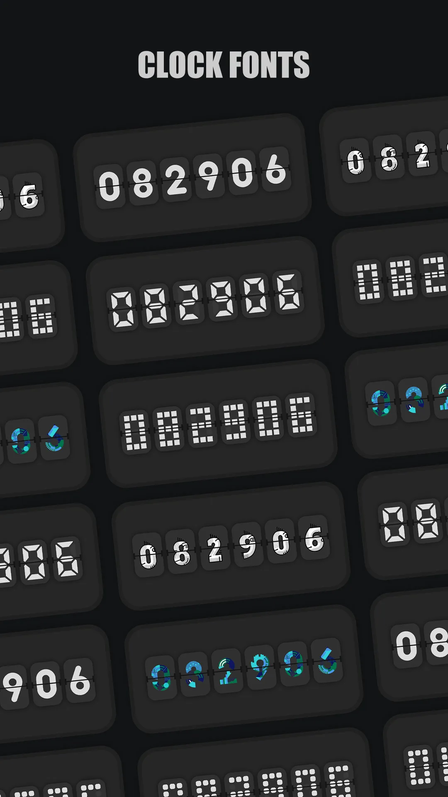

两者都呈现经典的翻页外观，但附赠的额外功能不同。**Only Clock** 是一款带白噪音与悬浮模式的主题化全屏翻页时钟。**Flip Clock** 则是一款人气免费的翻页时钟应用——简单、全屏、带广告。这份 **Only Clock vs Flip Clock** 对比，帮你在 2026 年挑一款 **[翻页时钟](/zh/glossary/what-is-a-flip-clock/)应用**。如果你其实是在问 **安卓翻页时钟哪个好**，或想找 **翻页时钟替代**，下面的功能与广告两行就是答案。

选型的核心问题很朴素：你想要的只是一块会翻页的钟，还是一个"钟 + 声音 + 桌面组件"的床头伴侣？只想看时间的人，多一个功能就是多一层干扰；而把旧手机长期插在床边的人，往往同时需要夜里的声音和抬眼可见的时间。两款都免费起步，差别集中在主题、声音、悬浮与广告这四件事上——先看你在意哪几件，再决定是否付费解锁。

## 一览

| | Only Clock | Flip Clock |
|---|---|---|
| **视图** | 全屏翻页时钟 | 全屏复古翻页时钟 |
| **主题** | **多样（猫咪、天空、太空、熊猫等）** | 复古风格 |
| **白噪音** | **有** | 无 |
| **悬浮时钟** | **有** | 无（聚焦应用内） |
| **亮度 / AOD** | 基于主题调暗 | 亮度 + 常亮 |
| **日期 / 12-24 时** | 有 | 有 |
| **平台** | **Android 与 iOS** | 以安卓为主 |
| **价格** | 核心免费 + 解锁 | 免费（广告/IAP） |
| **最适合** | 主题时钟 + 声音 + 叠层 | 简单的复古外观、免费 |

---

## Only Clock 详解

{: width="180" .normal }
{: width="180" .normal }
{: width="180" .normal }
{: width="180" .normal }
{: width="180" .normal }

Only Clock 是一款 **全屏翻页时钟**，配有漂亮的翻页动画与一整套主题——从可爱猫咪到太空与熊猫场景。除了外观，它额外加入了助专注与睡眠的白噪音，以及一个悬浮时钟叠层。它更适合"长期摆着用"的场景：旧手机插上电放在床头，夜里看时间、放一段雨声，白天还能把时钟收进主屏组件。

从设置、主界面、主题、闹钟计时器到夜间模式这几张截图，可以看出它围绕"看时间"把周边需求都补齐了：主题决定底色与数字配色，白噪音负责声音环境，悬浮层让时间浮在视频或笔记之上。需注意最丰富的主题与声音在解锁之后——先用免费核心确认自己会长期用，再决定是否付费，是更稳妥的顺序。

### 优点
- **多种精美主题**（猫咪、天空、太空、熊猫等），可自由切换。让钟融进房间风格——儿童房配猫咪、书房配天空，比单一复古脸更有存在感。
- **内置白噪音**——雨声、森林、壁炉等，帮你专注或入睡。睡前开着雨声配床头钟，不必再单独装一个白噪音应用。
- **悬浮时钟叠层**，让你在其他应用之上也能看见时间。看长视频、读文档时，时间始终停在画面一角，不用切出去确认。
- **主屏时钟组件**，外加 12/24 小时与日期显示。抬眼一瞥就知道时间，也能顺带看到日期。
- **可在 Android 与 iOS 上运行**，在闲置手机或 iPad 上作桌面/床头钟都很棒。家里同时有安卓和苹果设备，也能统一用一款。
- **无需账号**——打开，时钟即刻工作。深夜醒来不需要登录或点掉弹窗，这正是床头钟该有的低门槛。

### 缺点
- **最丰富的主题与声音** 锁在一次性的小额解锁或订阅之后。基础体验免费，但完整主题库要付费。
- **组件样式** 在 iOS 上比安卓更受限。苹果用户若能接受这点差异，其余体验基本一致。
- **无世界时钟 / 多时区视图。** 经常和海外同事约时间的人，需要另找工具换算。
- 若你只想要一个光秃秃的复古钟，它会显得功能过剩——主题、声音、叠层这些用不到，反而增加了设置项。

### 最适合
想要一款既播放声音、又能悬浮于应用之上、且安卓 iPhone 都能用的翻页时钟的人。典型用户是：把旧手机当床头钟长期插电使用的人、睡前需要声音陪伴的人、以及家里设备跨平台、希望一款应用通用的用户。若你只想要免费的经典翻页脸，下面这款更直接。

**下载 Only Clock**
- [Google Play](https://play.google.com/store/apps/details?id=com.glgjing.only.flip.clock)
- [App Store](https://apps.apple.com/us/app/only-clock-flip-clock/id1566706513)

---

## Flip Clock 详解

{: width="180" .normal }
{: width="180" .normal }
{: width="180" .normal }
{: width="180" .normal }
{: width="180" .normal }

Flip Clock 是一款人气 **免费翻页时钟应用**：干净的翻页全屏动画、亮度与常亮控制，外加日期——正是经典的床头外观，通常以带广告或小额内购的形式免费提供。它把力气全花在"把翻页钟做好"这一件事上，没有声音、没有叠层，也没有复杂的主题系统。

截图里的主界面、夜间模式、闹钟计时器、小组件与设置页，展示了它"够用就好"的定位：打开就是钟，调个亮度和常亮就能当床头钟。免费档会带广告，可能偶尔打断那份安静感；介意的话可以看小额购买去广告的选项。若你从没用过翻页钟、只想试试这种复古质感，它的零成本试用门槛最低。

### 优点
- **经典复古翻页外观**——令人满足的机械卡片翻动美学，仅此而已。远看像一块老式翻页牌，视觉干净、不花哨。
- **简单轻量**——直接打开即见时钟，无需设置。给长辈或孩子用，几乎不需要教。
- **亮度与常亮控制**，适合床头或桌面使用。夜间调暗不刺眼，白天调亮看得清。
- **免费使用**，可选小额购买去广告。零成本就能体验到完整的翻页钟效果。
- 内含 **日期与 12/24 小时** 显示。基础信息齐全，不必再去系统里翻日历。

### 缺点
- **无白噪音**——纯时钟，无睡眠或专注用的环境音。想要声音陪伴，还得另外装应用。
- **无悬浮叠层**——时间只在应用内，不在其他应用之上。看视频、读文档时想看时间，只能切回来。
- **以安卓为主**——iPhone 用户得在 App Store 上自行寻找同类。跨平台场景里它不占优。
- 免费档 **带广告**，可能破坏那份宁静的观感。床头场景里突然弹出广告，体验会被打断。
- **主题有限**，且这类应用大多无组件。想把钟摆进主屏一瞥即见，它多半做不到。

### 最适合
想要一款简单、免费复古翻页时钟，不需要声音、组件或悬浮时钟的用户。若你的需求就是"一块好看的钟"，不打算为额外能力付费，Flip Clock 把多余的东西都省掉了。

**下载 Flip Clock**
- <a href="https://play.google.com/store/apps/details?id=com.wssc.simpleclock" target="_blank" rel="noopener noreferrer">Google Play — Flip Clock</a>

---

## 关键维度对比

### 主题与个性
Only Clock 提供一套广泛、精致的主题库（含可爱猫咪场景），让时钟贴合你的心情或房间。Flip Clock 守在经典赛道，变化有限。取舍在于：主题是"每天都会看到的东西"，选一套顺眼的确实能提升使用愉悦感；但如果你本来就偏爱复古机械感，Flip Clock 那份克制反而更耐看，不必为用不到的主题库付费。

### 声音与专注
这是最清晰的差距。Only Clock 内含助眠与专注的白噪音；Flip Clock 是无声时钟。若你希望时钟 *同时* 帮你放松，Only Clock 是两者中唯一能做到的。实际场景是：睡前开一段雨声配暗色钟面，或工作时用森林声盖住开放式办公室的交谈——这些需求一个"钟 + 声音"的组合就能一次满足，省得在两个应用之间来回切。

### 悬浮时钟与组件
Only Clock 加了悬浮叠层与主屏组件。Flip Clock 把时间只留在应用内。就「一瞥即知」而言，Only Clock 覆盖更广。但也要权衡遮挡：悬浮窗会占一块画面，看全屏视频时可能分心；若你只在专门看时间时才打开时钟，应用内的显示已经足够，不必为常驻叠层付出屏幕空间。

### 平台
Only Clock 运行于 Android 与 iOS；Flip Clock 以安卓为主。iPhone 用户从 Only Clock 获得更完整体验。这一项对苹果用户几乎是决定性的——家里只有 iPhone 的话，根本不用再往下比。安卓用户则两边都能装，可以按功能和广告情况自由选择。

### 价格
两者都免费起步。Only Clock 最好的主题/声音需解锁；Flip Clock 免费带广告。两者都不是重订阅。判断时算一笔总账：如果你想用完整主题与声音，Only Clock 的一次性或订阅解锁是必要成本；如果你只在乎免费看时间，Flip Clock 零成本，代价是广告——介意广告的话，其小额去广告购买也比订阅轻。

## 你该选哪个

- **选 Only Clock** 如果你想要主题化视觉、白噪音、悬浮时钟或组件，并支持 iPhone。把旧手机或 iPad 变成长驻床头、带声音的翻页钟，是它最擅长的场景。
- **选 Flip Clock** 若你只想要一款免费、简单的复古翻页时钟，不需要声音或附加项。想零成本先试试翻页质感，它是最短的路径。
- **作为一体化床头伴侣**，Only Clock 做的更多；作为光秃秃、怀旧的一只钟，Flip Clock 正合适。先用免费档各自试几天，看看你会不会真的用到声音和叠层，再决定要不要解锁。

## 其它值得考虑的翻页钟应用

两款对比装不下所有人找 **翻页时钟替代** 的原因，该换什么取决于这块钟要做什么：

- 搜 **翻页桌面时钟替代** 的人，多半想要一块干净、少设置的桌面钟面；**大字时钟替代** 与 **极简时钟替代** 指向的也是可读性优先的那一类。判断顺序是先看字够不够大、远看清不清。
- **Fliqlo 替代** 通常是想在电脑或浏览器里复刻经典翻页钟，而不是装一个安卓应用。设备不同，解决方案完全不同。
- **谷歌时钟替代** 问的是「能不能替掉系统自带的闹钟与计时器」，与装饰性钟面是两件事。要功能替换就找闹钟工具，要视觉摆设才看翻页应用。
- **翻页时钟24H 替代** 更看重 24 小时制与日期显示；Only Clock 在设置里直接提供 12/24 小时切换，这类需求能直接满足。
- 从 **翻页时钟替代** 或 **翻页时钟哪个好** 搜过来，判断顺序仍是：有没有广告、整夜亮着会不会太亮、要不要白噪音或专注计时。按这三项排优先级，比看主题数量更实用。

完整名单见 [2026 年最佳 Retroflip 替代应用](/zh/posts/alternatives-to-retroflip/)。

## 典型场景

- **有主题的床头或桌面钟**——Only Clock 的猫咪/天空/太空/熊猫主题让钟成为房间一部分；Flip Clock 守住经典复古脸。希望设备融进家居风格，前者的选择更多。
- **带声音入睡或学习**——只有 Only Clock 加了白噪音，所以若你想让钟也安抚你，它才是选法。雨声、森林声配暗色钟面，夜里看时间不刺眼。
- **时间浮于其他应用之上**——Only Clock 的悬浮叠层让时间显在视频或笔记之上；Flip Clock 留在应用内。读长文档时不想切出去看时间，这点差异很明显。
- **iPhone 或闲置设备使用**——Only Clock 跑在安卓与 iOS 上，还能把旧手机或 iPad 变成钟；Flip Clock 以安卓为主。跨平台家庭或手里有闲置设备的人，前者的适配更省心。

## 常见问题（FAQ）

**Only Clock 还是 Flip Clock，怎么选？**
{:.faq-q}

想要主题化视觉、白噪音、悬浮时钟或组件，并支持 iPhone → Only Clock；只想要免费、简单复古翻页钟、别无附加 → Flip Clock。先确认你是否需要声音和叠层，这两项决定了大部分差异。

**Only Clock 免费吗？**
{:.faq-q}

免费。核心钟、主题与白噪音免费可用；一次性或订阅解锁打开最丰富的主题与声音。先用免费核心试出自己的真实需求，再决定要不要解锁。

**Only Clock 在 iOS 上能用吗？**
{:.faq-q}

能。Only Clock 同时跑在安卓与 iOS（iPad 也是绝佳的钟显示）。若你手里有闲置 iPad，插上电就是一块大屏翻页钟。

## 相关术语

- [什么是翻页时钟（Flip Clock）？](/zh/glossary/what-is-a-flip-clock/)
- [什么是床头钟（Nightstand Clock）？](/zh/glossary/what-is-a-nightstand-clock/)
